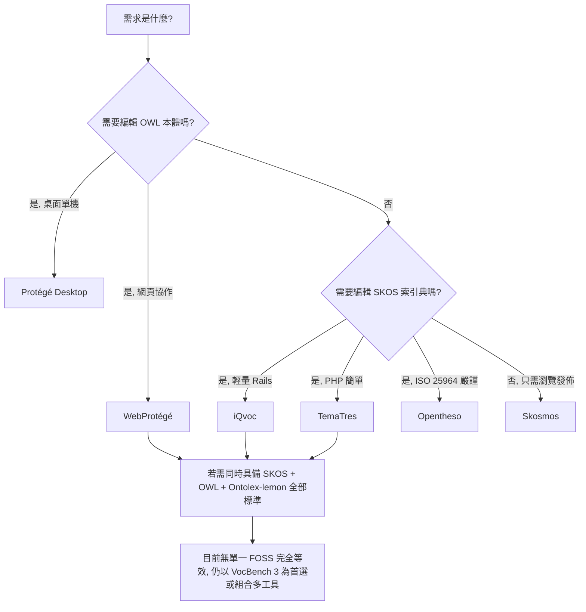

# VocBench 3 的自由開源軟體 (FOSS) 替代方案調查

## 摘要

VocBench 3 (VB3) 是一套由歐盟出版辦公室與羅馬第二大學 (University of Rome Tor Vergata) ART 研究群合作開發的網頁式協作平台，用於管理 OWL 本體 (ontology)、SKOS/SKOS-XL 索引典 (thesaurus)、Ontolex-lemon 詞彙集 (lexicon) 以及一般 RDF 資料集[^vb-history]。它本身即為開源軟體，採 BSD 3-clause 授權[^vb-history]。

本報告調查在功能上可作為 VocBench 3 替代品的自由開源軟體。核心發現如下：

- **沒有任何單一 FOSS 工具能完整涵蓋 VocBench 3 的全部標準支援範圍** (SKOS + SKOS-XL + OWL + Ontolex-lemon + 通用 RDF)[^vb-history]。
- 若需求聚焦於 **SKOS 索引典的編輯與發佈**，最接近且仍活躍維護的替代品為 **iQvoc** 與 **TemaTres** 與 **Opentheso**。
- 若需求為 **OWL 本體協作編輯**，對應的是 **WebProtégé** (網頁) 與 **Protégé Desktop** (桌面)。
- 若需求為 **SKOS 詞彙的瀏覽與發佈** (非編輯)，則 **Skosmos** 為成熟活躍的選擇。
- 多個曾為候選的工具 (**openSKOS**、**GINCO**、**OntoWiki**) 已停止維護並封存。

> 本報告所有事實均附註腳，參考文獻採改良式 APA 格式並使用 ISO 8601 日期。資料擷取日期為 2026-11-07。

---

## 一、基準：VocBench 3 是什麼

VocBench 3 的定位是「通用型協作開發環境」，可用於 SKOS 索引典、OWL 本體與一般 RDF 資料集[^vb-history]。它的歷史可追溯至 2008 年聯合國糧農組織 (FAO) 為 Agrovoc 索引典開發的協作平台；經 FAO 與羅馬第二大學 ART 研究群合作改版後，於 2013 年釋出 VocBench 2，並在歐盟 ISA² 計畫資助下於 2017 年 9 月釋出 VocBench 3，採 BSD 3-clause 開源授權[^vb-history]。目前由歐盟 DIGITAL 計畫持續資助[^vb-history]。

| 屬性 | 內容 |
|---|---|
| 官方網站 | https://vocbench.uniroma2.it [^vb-site] |
| 程式碼倉庫 | https://bitbucket.org/art-uniroma2/vocbench3 (Bitbucket，非 GitHub)[^vb-bb] |
| 授權 | BSD 3-clause[^vb-history] |
| 開發團隊 | 羅馬第二大學 ART 研究群；由歐盟出版辦公室管理[^vb-about] |
| 技術堆疊 | Java，後端為 RDF 管理框架 Semantic Turkey[^vb-history] |
| 支援標準 | SKOS、SKOS-XL、OWL、Ontolex-lemon、通用 RDF[^vb-history] |

因此，尋找「替代方案」需要先釐清要替代的是哪一部分能力：SKOS 索引典管理、OWL 本體編輯，還是兩者兼具。

---

## 二、候選工具總覽

下表整理本報告調查的候選工具。星號數為 GitHub 星數，反映社群關注度，於 2026-11-07 擷取。

| 工具 | 授權 | 技術堆疊 | 主要標準支援 | 最新版本 (日期) | GitHub 星數 | 維護狀態 |
|---|---|---|---|---|---|---|
| VocBench 3 | BSD 3-clause | Java / Semantic Turkey | SKOS、SKOS-XL、OWL、Ontolex-lemon、RDF | 持續釋出[^vb-okg] | 不適用 (Bitbucket)[^vb-bb] | 活躍 |
| WebProtégé | BSD 2-clause | Java / GWT / MongoDB | OWL 2、RDF | v4.0.2 (2026-07)[^wp] | 812[^wp] | 活躍 |
| Protégé Desktop | BSD 2-clause | Java (桌面) | OWL 2、RDF | v5.6.x[^protege] | 不適用 | 活躍 |
| iQvoc | Apache 2.0 | Ruby on Rails | SKOS、SKOS-XL、RDF | v.4.15.1 (2026-09-04)[^iqvoc] | 125[^iqvoc] | 活躍 |
| TemaTres | GPL v2 | PHP / MySQL | SKOS、RDF | v3.6.2 (2026-10-26)[^tematres] | 142[^tematres] | 活躍 |
| Opentheso | CeCILL-C | Java / PostgreSQL | SKOS、ISO 25964、RDF | v26.10.01 (2026-10-21)[^opentheso] | 35[^opentheso] | 活躍 |
| Skosmos | MIT | PHP / Vue.js | SKOS、SKOS-XL、RDF、SPARQL | v3.5 (2026-10-22)[^skosmos] | 267[^skosmos] | 活躍 |
| openSKOS | GPL v3 | PHP / Jena / Solr | SKOS、SKOS-XL、RDF | 已封存 (2025-02-18)[^openskos] | 57[^openskos] | 已停止 |
| GINCO | CeCILL v2 | Java / PostgreSQL / Solr | SKOS、ISO 25964 | 已封存 (2025-09-25)[^ginco] | 42[^ginco] | 已停止 |
| OntoWiki | GPL v2 | PHP / Zend | RDF、SPARQL | 已封存 (2024-06-11)[^ontowiki] | 210[^ontowiki] | 已停止 |
| ThManager | GPL | Java (桌面) | SKOS、RDF | 約 2013 後停更[^thmanager] | 不適用 | 停止 |
| PoolParty | 專有 (非 FOSS) | Java | SKOS、OWL、RDF | 商業產品[^poolparty] | 不適用 | 商業 |

> 註：PoolParty 常被拿來與 VocBench 比較，但它為商業專有軟體，**不屬於 FOSS**，列表僅為對照[^poolparty]。

---

## 三、活躍維護的替代方案詳述

### 3.1 iQvoc

iQvoc 是一套以 Ruby on Rails 開發的 SKOS(-XL) 詞彙管理系統，同時涵蓋編輯與發佈功能[^iqvoc]。其授權為 Apache License 2.0[^iqvoc]。截至 2026-11-07，最新釋出為 v.4.15.1 (2026-09-04)，最後一次提交為 2026-09-17，顯示開發活躍[^iqvoc]。它支援索引典、分類法、分類表與主題詞等多種知識組織系統[^iqvoc]；相較於 VocBench 3 依賴三元組儲存 (triple store)，iQvoc 以 PostgreSQL 為後端，架構較輕量。

**定位**：在 SKOS 詞彙管理上，iQvoc 是最接近 VocBench 3 的輕量級替代品之一。

### 3.2 TemaTres

TemaTres 是一套以 PHP 與 MySQL/MariaDB 建構的詞彙伺服器，用於管理受控詞彙、分類法、索引典與詞彙表[^tematres]。授權為 GNU GPL v2[^tematres]。截至 2026-11-07，最新釋出為 v3.6.2 (2026-10-26)，最後提交為 2026-11-05，維護相當活躍[^tematres]。支援 SKOS 匯入/匯出[^tematres]。

**定位**：適合中小型受控詞彙與索引典管理；但不支援 OWL 本體，較不適合複雜本體工作。

### 3.3 Opentheso

Opentheso 由法國國家科學研究中心 (CNRS) 開發，是一套多語、多階層的索引典管理系統，遵循 ISO 25964 標準[^opentheso]。授權為 CeCILL-C (與 GNU GPL 相容)[^opentheso]。截至 2026-11-07，最新釋出為 v26.10.01 (2026-10-21)，最後提交為 2026-10-27，開發活躍[^opentheso]。雖然 GitHub 星數僅 35[^opentheso]，但在法語圈與文化機構有一定採用基礎，屬於本主題中「小眾但關鍵」的工具。

**定位**：需要符合 ISO 25964 的嚴謹索引典管理時的活躍開源選擇。

### 3.4 Skosmos (瀏覽/發佈，非編輯)

Skosmos 由芬蘭國家圖書館開發，是一套以 PHP、Twig 與 Vue.js 建構的詞彙瀏覽與發佈平台[^skosmos]。授權為 MIT[^skosmos]。截至 2026-11-07，最新釋出為 v3.5 (2026-10-22)，最後提交為 2026-11-05，是星數最高 (267) 的活躍 SKOS 工具[^skosmos]。

**重要區別**：Skosmos 主要是詞彙的**讀取與瀏覽**前端，並非編輯器；詞彙需在上游編輯完成後載入 SPARQL 端點[^skosmos]。因此它適合與其他編輯工具搭配，而非單獨取代 VocBench 3 的編輯功能。

### 3.5 WebProtégé 與 Protégé Desktop (OWL 導向)

WebProtégé 是史丹佛大學開發的網頁式 OWL 2 本體協作編輯器，授權為 BSD 2-clause，截至 2026-11-07 星數達 812，最新釋出為 v4.0.2 (2026-07)[^webprotege]。Protégé Desktop 為同團隊的桌面版本，是 OWL 本體編輯的業界標準[^protege]。

**重要區別**：兩者皆聚焦於 **OWL 本體**而非 SKOS 索引典，並不原生支援 SKOS 編輯；它們對應的是 VocBench 3 的 OWL 能力，而非 SKOS 能力[^webprotege]。

---

## 四、已停止維護的候選 (不建議新專案採用)

- **openSKOS**：提供 SKOS 詞彙的 RESTful 存取，授權 GPL v3，但倉庫已於 2025-02-18 封存[^openskos]。
- **GINCO**：由法國文化部開發，遵循 ISO 25964，授權 CeCILL v2，但倉庫已於 2025-09-25 封存[^ginco]。
- **OntoWiki**：語意資料 wiki，最後程式碼提交約在 2017 年，倉庫已於 2024-06-11 封存[^ontowiki]。
- **ThManager**：Java 桌面工具，約 2013 年後即無更新[^thmanager]。

---

## 五、選擇建議

| 使用情境 | 建議工具 |
|---|---|
| 需要 OWL + SKOS + Ontolex-lemon 全套標準 | 維持 VocBench 3 (無單一 FOSS 完全等效)[^vb-history] |
| SKOS 索引典編輯 + 發佈 (輕量) | iQvoc 或 TemaTres |
| SKOS 索引典管理且需符合 ISO 25964 | Opentheso |
| OWL 本體協作編輯 (網頁) | WebProtégé |
| OWL 本體編輯 (桌面、含推論) | Protégé Desktop |
| 僅需 SKOS 詞彙瀏覽/發佈 | Skosmos |

---

## 六、方法與來源評析

- 本報告所有事實皆以網路檢索佐證，並未僅憑既有訓練記憶作答。
- 星數、版本與日期以 GitHub 官方倉庫、釋出頁與提交歷史為準，擷取日為 2026-11-07。
- 需留意：社群工具的活躍度變動快速，且 GitHub 星數僅為關注度指標，非品質保證；封存狀態 (archived) 是判斷是否續用的關鍵信號。
- VocBench 官方網站的授權與歷史資訊屬一手資料，可信度最高；第三方彙整站 (如 openknowledgegraphs) 僅作為版本佐證[^vb-okg]。
- 部分工具 (如 ThManager) 僅有 SourceForge 頁面，缺乏 GitHub 星數與明確授權文字，判斷時已標示不確定性[^thmanager]。

---

## 參考文獻

[^vb-history]: ART Group, University of Rome Tor Vergata. (n.d.). *VocBench history*. VocBench. Retrieved 2026-11-07, from https://vocbench.uniroma2.it/doc/history.jsf

[^vb-site]: ART Group, University of Rome Tor Vergata. (n.d.). *VocBench: A collaborative management system for OWL ontologies, SKOS(/XL) thesauri, Ontolex-lemon lexicons and generic RDF datasets*. Retrieved 2026-11-07, from https://vocbench.uniroma2.it/

[^vb-bb]: ART Group, University of Rome Tor Vergata. (n.d.). *vocbench3* [Source code]. Bitbucket. Retrieved 2026-11-07, from https://bitbucket.org/art-uniroma2/vocbench3

[^vb-about]: ART Group, University of Rome Tor Vergata. (n.d.). *About us*. VocBench. Retrieved 2026-11-07, from https://vocbench.uniroma2.it/aboutus

[^vb-okg]: Open Knowledge Graphs. (n.d.). *VocBench*. Retrieved 2026-11-07, from https://openknowledgegraphs.com/software/vocbench/

[^iqvoc]: innoQ Deutschland GmbH. (n.d.). *iqvoc* [Source code]. GitHub. Retrieved 2026-11-07, from https://github.com/innoq/iqvoc

[^tematres]: TemaTres. (n.d.). *TemaTres-Vocabulary-Server* [Source code]. GitHub. Retrieved 2026-11-07, from https://github.com/tematres/TemaTres-Vocabulary-Server

[^opentheso]: MOM-CNRS. (n.d.). *Opentheso* [Source code]. GitHub. Retrieved 2026-11-07, from https://github.com/MOM-CNRS/Opentheso

[^skosmos]: National Library of Finland. (n.d.). *Skosmos* [Source code]. GitHub. Retrieved 2026-11-07, from https://github.com/NatLibFi/Skosmos

[^webprotege]: Stanford University. (n.d.). *webprotege* [Source code]. GitHub. Retrieved 2026-11-07, from https://github.com/protegeproject/webprotege

[^wp]: Stanford University. (n.d.). *WebProtégé*. Retrieved 2026-11-07, from https://webprotege.stanford.edu/

[^protege]: Stanford University. (n.d.). *Protégé software*. Retrieved 2026-11-07, from https://protege.stanford.edu/software/

[^openskos]: OpenSKOS. (n.d.). *OpenSKOS* [Source code]. GitHub. Retrieved 2026-11-07, from https://github.com/OpenSKOS/OpenSKOS

[^ginco]: Ministère de la Culture (France). (n.d.). *ginco* [Source code]. GitHub. Retrieved 2026-11-07, from https://github.com/culturegouv/ginco

[^ontowiki]: AKSW. (n.d.). *OntoWiki* [Source code]. GitHub. Retrieved 2026-11-07, from https://github.com/AKSW/OntoWiki

[^thmanager]: ThManager. (n.d.). *ThManager*. SourceForge. Retrieved 2026-11-07, from https://sourceforge.net/projects/thmanager/

[^poolparty]: Graphwise (formerly Semantic Web Company). (n.d.). *PoolParty Semantic Suite*. Retrieved 2026-11-07, from https://www.poolparty.biz
