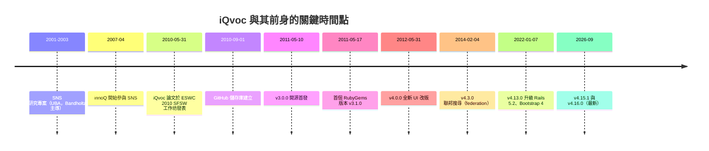
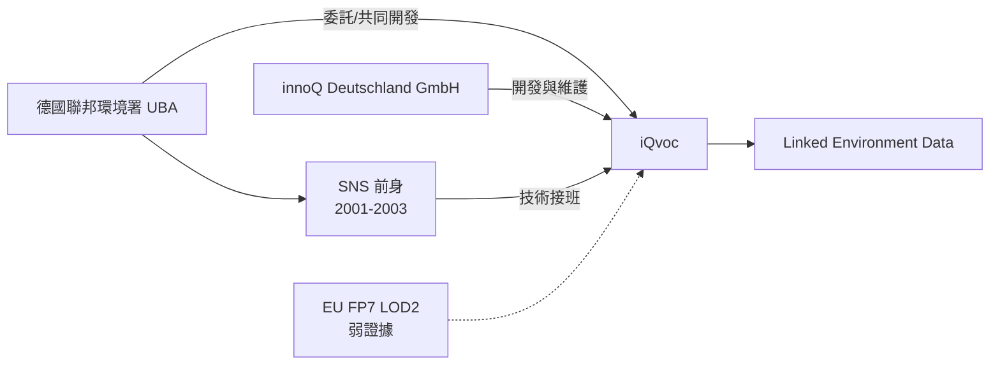
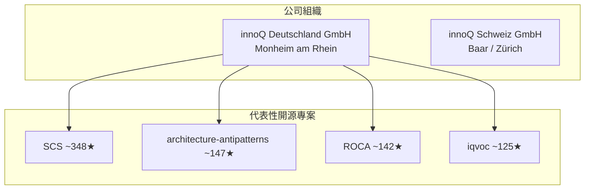
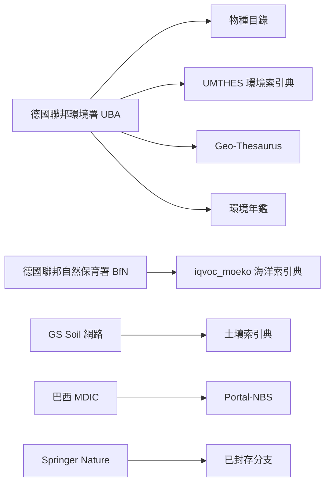

# iQvoc 專案背景調查：歷史、公司、資金、團隊與社群

> 本報告調查對象為 GitHub 專案 [`innoq/iqvoc`](https://github.com/innoq/iqvoc)[^gh]。iQvoc 是一套以 Ruby on Rails 撰寫、採用 Apache 2.0 授權的 SKOS(-XL) 詞彙管理系統（Vocabulary Management System），用於管理與發佈知識組織系統（Knowledge Organization Systems, KOS），例如索引典（thesauri）、分類法（taxonomies）、分類架構與標題表[^gh][^iqvocnet]。由於 iQvoc 由德國 IT 顧問公司 innoQ Deutschland GmbH 建立並維護，本報告同時調查該公司的背景。
>
> 所有事實均以腳註標註來源，報告本身為獨立文件，不假設任何前置對話或背景知識。檢索日期為 2026-11-07。

---

## 目錄

1. [摘要](#1-摘要)
2. [iQvoc 專案是什麼](#2-iqvoc-專案是什麼)
3. [歷史與時間軸](#3-歷史與時間軸)
4. [資金來源：為何而生](#4-資金來源為何而生)
5. [母體公司：innoQ Deutschland GmbH](#5-母體公司innoq-deutschland-gmbh)
6. [團隊與維護者](#6-團隊與維護者)
7. [社群規模與人氣](#7-社群規模與人氣)
8. [實際部署案例](#8-實際部署案例)
9. [生態系：延伸模組與衍生分支](#9-生態系延伸模組與衍生分支)
10. [競爭對手](#10-競爭對手)
11. [來源批判性反思](#11-來源批判性反思)
12. [參考文獻](#12-參考文獻)

---

## 1. 摘要

| 面向 | 結論 |
|------|------|
| 專案定位 | SKOS(-XL) 詞彙/索引典管理與發佈工具，Ruby on Rails，Apache 2.0 |
| 建立者 | innoQ Deutschland GmbH（德國 IT 顧問公司） |
| 共同開發方 | 德國聯邦環境署（Umweltbundesamt, UBA） |
| 開源首發 | 2011-05-10（v3.0.0）；首個 RubyGems 版本 2011-05-17 |
| 前身 | SNS（Semantic Network Service），2001–2003 年 UBA 研究專案 |
| 資金型態 | 政府委託案（UBA）為主，非傳統研究補助；另見 EU FP7 LOD2 專案關聯 |
| 人氣 | GitHub 約 125 stars、44 forks、22 watchers |
| 維護狀態 | 持續維護中（2026-09 發佈 v4.16.0） |
| 公司規模 | 160+ 員工、6 個據點、獨立經營、無創投 |
| 創投 | 無——獨立、股東自營 |

---

## 2. iQvoc 專案是什麼

iQvoc 由 innoQ Deutschland GmbH 開發，並與德國聯邦環境署（Umweltbundesamt, UBA）共同開發[^talk2010]。其功能涵蓋詞彙管理的完整生命週期[^gh][^homewiki]：

- 從 SKOS 表示法匯入既有詞彙
- 瀏覽器中的多語言顯示與導覽
- 給註冊使用者的編輯功能與編輯工作流（editorial workflow）
- 以 Linked Data 方式在語意網上發佈詞彙（含內容協商 content negotiation，同一 URI 依 MIME 型別回傳 HTML、RDF/XML 或 Turtle）

技術上，iQvoc 以 Ruby on Rails 開源框架實作，可搭配幾乎任何 Web 伺服器與資料庫管理系統；若偏好 Java 環境，亦有 Java byte code 版本可用[^iqvocnet]。授權為 Apache License 2.0[^license]。

> 授權檔中的著作權標示為「Copyright 2011-2016 innoQ Deutschland GmbH」[^license]，而 README 則寫「Copyright 2022 innoQ Deutschland GmbH」[^gh]。兩者年份不一致，屬文件維護落差，非授權條款差異。

---

## 3. 歷史與時間軸

iQvoc 並非憑空誕生，而是德國聯邦環境署既有語意服務的技術接班者。其前身 **SNS（Semantic Network Service）** 源自 2001–2003 年 UBA 的研究專案，該專案由 **Thomas Bandholtz**（現為 innoQ principal）主導，改良了早期以索引典為基礎的網站索引方法；innoQ 自 2007 年 4 月起參與該專案[^snswiki]。

### 3.1 開源首發與版本演進

- GitHub 儲存庫建立於 **2010-09-01**[^apirepo]。
- CHANGELOG 記載最早的內部版本可溯及 **2.3.0**（「iQvoc is now Rails 3 compatible」），此前為私有開發[^changelog]。
- **v3.0.0（2011-05-10）** 為首個公開發布版本，變更說明寫道：「iQvoc has undergone major refactorings and architecture changes. It is now Open Source and publicly available.」[^changelog]
- **v3.1.0（2011-05-16/17）** 為首個 RubyGems 套件版本[^changelog]。
- 最新發布為 **v4.15.1** 與 **v4.16.0**，後者加入 SKOS 匯出為 ZIP 壓縮檔、Faraday v2 升級與大型索引典匯出效能改善[^releases]。

### 3.2 重要版本里程碑

| 版本 | 日期 | 重點 |
|------|------|------|
| v3.0.0 | 2011-05-10 | 開源首發 |
| v3.3.0 | 2012-01-10 | Rails 3.1、asset pipeline、engine 模式 |
| v4.0.0 | 2012-05-31 | 全新設計的 UI |
| v4.1.0 | 2013-04-17 | Rails 4、概念階層 API、SKOS notations |
| v4.3.0 | 2014-02-04 | 聯邦搜尋（federated search）、非同步 importer、REST API 文件 |
| v4.4.0 | 2014-07-17 | 非同步 SKOS 匯出、集合版本控制、Bootstrap 3 |
| v4.13.0 | 2022-01-07 | Rails 5.2、Bootstrap 4、faucet-pipeline |
| v4.15.0 | 2026-01-14 | 升級 Rails 8.1、捨棄 EOL Ruby |
| v4.16.0 | 2026-09 | ZIP 匯出、效能改善 |

（資料來源：[^changelog]、[^releases]）

### 3.3 學術曝光

iQvoc 曾於 **2010-05-31** 在希臘克里特島 Heraklion 舉行、與 **第 7 屆 Extended Semantic Web Conference（ESWC 2010）** 共同舉辦的「**第 6 屆語意網腳本化與開發工作坊（SFSW2010）**」上發表論文《iQvoc – Open Source SKOS(XL) Maintenance and Publishing Tool》，作者為 Thomas Bandholtz、Till Schulte-Coerne、Robert Glaser、Joachim Fock 與 Tim Keller[^talk2010][^sfsw2010]。該年工作坊與「Scripting Challenge」合併，iQvoc 為六篇入選論文之一；當年的挑戰賽優勝者為 sparqlPuSH[^sfsw2010]。

---

## 4. 資金來源：為何而生

iQvoc 的主要驅動力來自 **德國聯邦環境署（UBA）的委託與共同開發**，而非一般競爭型研究補助。多個來源交叉印證：

- innoQ 官方活動頁明載：「iQvoc wird von innoQ Deutschland GmbH gemeinsam mit dem Umweltbundesamt (UBA) entwickelt」（iQvoc 由 innoQ 與 UBA 共同開發）[^talk2010]。
- iQvoc Wiki 的「Linked Environment Data」頁面指出，自 2010 年起，UBA 的多個專案共同建立以 Linked Data 為基礎的公共資料網路，起點為 **環境樣本銀行（Environmental Specimen Bank）** 與 **SNS**，屬與 **Ecoinformatics Initiative**（歐洲環境署）的國際合作[^ledwiki]。
- iQvoc 被定位為 UBA **Linked Environment Data** 計畫的開源框架；SNS 的舊技術（Topic Maps／Java／SOAP 服務）將逐步移植到 iQvoc 之上，並由 REST API 取代 SOAP[^snswiki][^ledwiki]。

### 4.1 可能的其他資金關聯

- innoQ GitHub 組織下存在名為 **`iqvoc_lod2`** 的客製化儲存庫[^lod2]，名稱指向歐盟 FP7 的 **LOD2（Linked Open Data 2）** 專案。惟此關聯來自儲存庫命名推斷，未在可存取文件中找到直接的補助條款說明，宜視為**弱證據**。
- **未發現** iQvoc 直接獲得德國 BMBF 或特定競爭型研究補助的證據。
- 專案網站以「需要客製化實例？請與我們聯繫」的角度呈現，顯示 innoQ 以委託客製、支援與代管作為商業模式[^iqvocnet]。

---

## 5. 母體公司：innoQ Deutschland GmbH

### 5.1 基本資料

| 項目 | 內容 |
|------|------|
| 公司名 | innoQ Deutschland GmbH |
| 登記 | Amtsgericht Düsseldorf HRB 44126[^northdata] |
| 首次登記日 | 2002-11-07[^northdata] |
| 登記地址 | Krischerstr. 100, 40789 Monheim am Rhein, Germany[^northdata][^innoqhome] |
| 共同創辦人 | Roman Roth、Stefan Tilkov[^northdata][^innoqmgmt] |
| 瑞士子公司 | innoQ Schweiz GmbH（Baar／Zürich）[^innoqhome] |
| 規模 | 160+ 員工、6 個據點（公司自述）[^innoqculture]；第三方檔案列 147 人、範圍 51–200[^northdata] |
| 經營型態 | 獨立、股東自營、無創投[^northdata][^innoqculture] |
| 服務 | 架構策略、軟體架構與開發、Data & AI、IT 安全、數位產品開發、平台與基礎設施、知識移轉與培訓[^innoqhome] |

### 5.2 成立年份的歧異

關於成立年份，各來源並不一致，值得讀者留意：

- 德國商業登記（Handelsregister）首次登錄為 **2002-11-07**[^northdata]。
- 公司自述語境指向「千禧年前後」創立（其招聘頁面描述創辦時期的動機與願景）[^innoqculture]；公司對共同創辦人 Stefan Tilkov 的追思頁面亦以「將近 24 年」描述其投入時間，回推約為 1999–2000 年[^innoqmgmt]。
- 第三方公司檔案（如 LinkedIn）列出 **1998 年**創立；此數字來自第三方彙整，未見於公司官方頁面，宜審慎看待。

此落差反映「實際開始營運」與「法人正式登記」之間的差異，讀者不宜逕採單一數字。

### 5.3 據點

innoQ 官方網站列出的德國據點包括 Monheim am Rhein（總部）、Berlin、Hamburg、Köln、Offenbach 與 München；瑞士則有 Baar 與 Zürich[^innoqhome]。

### 5.4 管理層與知名人物

- **Phillip Ghadir** — CEO（德國，2022 年起）[^innoqmgmt][^northdata]
- **Martina Freers** — CEO（德國，2026 年起）[^innoqmgmt][^northdata]
- **Roman Roth** — 共同創辦人、CEO（瑞士）[^innoqmgmt][^northdata]
- **Oliver Wolf** — 前執行長（德國，2022–2026）[^northdata]
- **Roger Heggli** — COO（瑞士）[^innoqmgmt]
- **Stefan Tilkov** — 共同創辦人、前執行長，著有多本軟體架構書籍（如《REST und HTTP》），於 2023 年辭世，公司網站設有追思頁面[^innoqmgmt][^northdata]

### 5.5 開源與社群活動

innoQ 的 GitHub 組織擁有 292 個公開儲存庫[^innoqgh]，代表性專案包括：

- **SCS（Self-Contained Systems）** — 自足式系統架構風格的權威定義站，約 348 stars[^innoqgh]
- **ROCA（Resource-Oriented Client Architecture）** — 約 142 stars[^innoqgh]
- **architecture-antipatterns** — 架構反模式網站，約 147 stars[^innoqgh]
- **iqvoc** — 約 125 stars，為該組織 pinned 的代表專案之一[^innoqgh]

公司並經營 **INNOQ Technology Day** 線上研討會、INNOQ Podcast 與 Security Podcast，並定期於部落格發表技術文章，iQvoc 在其中的角色是「知識管理／語意網」能力的展示，兼具開源社群形象與顧問業務導流的功能[^innoqhome][^innoqgh]。

---

## 6. 團隊與維護者

iQvoc README 明列四位維護者，均隸屬 innoQ Deutschland GmbH[^gh]：

| 姓名 | GitHub 帳號 | 說明 |
|------|-------------|------|
| Robert Glaser | `mrreynolds` | 貢獻次數最高（約 2,154 commits）[^contributors] |
| Marc Jansing | `mjansing` | 近年主要發佈者（約 1,059 commits）[^contributors] |
| Till Schulte-Coerne | `tillsc` | 共同維護者（約 563 commits）[^contributors] |
| Frederik Dohr | `FND` | 共同維護者[^gh] |

原始架構與論文作者另包括 **Thomas Bandholtz**（SNS 專案主導者、innoQ principal）與 **Joachim Fock**、**Tim Keller**（UBA 方作者）[^talk2010][^snswiki]。

貢獻者統計（依 contributions 排序）中，`youngbrioche`（Robert Glaser）居首，顯示專案核心長期由少數 innoQ 成員主導[^contributors]。

---

## 7. 社群規模與人氣

| 指標 | 數值 |
|------|------|
| Stars | 125[^apirepo] |
| Forks | 44[^apirepo] |
| Watchers | 22[^apirepo] |
| Commits | 4,955[^gh] |
| Open issues | 56[^apirepo] |
| 授權 | Apache 2.0[^license] |
| 語言 | Ruby[^apirepo] |

iQvoc 的社群屬於「小而專精」型：並非開放社群驅動的大型專案，而是由一家顧問公司專業維護的企業級開源專案。專案的開發討論主要發生在 GitHub issue tracker[^apirepo]；README 提及郵件列表 `iqvoc@lists.innoq.com` 作為功能提案管道[^gh]，社群活動度有限。

---

## 8. 實際部署案例

iQvoc 的採用者明顯集中於**德國公部門環境資訊領域**，並向外延伸至學術與其他政府機構。

### 8.1 已確認的部署

- **德國聯邦環境署（UBA）** — 主要使用者，應用包括：物種目錄（Species Catalog，以 Darwin Core 擴充 SKOS）、環境索引典 UMTHES（SKOS-XL）、Geo-Thesaurus（以 Geonames Ontology 擴充）、環境年鑑（Environmental Chronicle，以 Event Ontology 擴充），以及汰換舊有 SNS[^homewiki][^ledwiki][^snswiki]。
- **德國聯邦自然保育署（BfN）** — 海洋生態索引典 `iqvoc_moeko`（Meeresökologischer Thesaurus des BfN）[^moeko]。
- **GS Soil Best Practice Network** — 土壤索引典（Soil Thesaurus），屬歐洲層級專案[^homewiki]。
- **Springer Nature** — 曾維護具 Cloud Foundry 部署支援的 iQvoc 分支（該儲存庫已於 2026 年封存）[^springer]。
- **巴西政府（MDIC）** — `mdicgovbr/Portal-NBS`，巴西服務術語平台（Plataforma de busca e visualização da Nomenclatura Brasileira de Serviços）[^portalnbs]。
- **波蘭 Poznań 超級運算與網路中心（PCSS）** — 曾提出多筆生產環境相關 issue，顯示其使用或評估 iQvoc[^gh]。
- **PortalU 與 Umwelt-BW** — 透過 SNS（由 iQvoc 提供編輯介面）間接使用[^snswiki]。

### 8.2 未獲證實的推測對象

以下機構曾列為可能使用者，但**未找到證據**：德國聯邦統計局（Destatis）、德國國家圖書館（DNB）、GESIS、GDI-DE／GeoPortal.DE[^homewiki]。

---

## 9. 生態系：延伸模組與衍生分支

### 9.1 官方延伸模組

innoQ 為 iQvoc 提供多個擴充引擎，皆為 Apache 2.0 授權[^gh]：

| 專案 | 功能 |
|------|------|
| `iqvoc_skosxl` | SKOS-XL 延伸（標籤擴充）[^gh] |
| `iqvoc_compound_forms` | 複合標籤（compound labels）[^gh] |
| `iqvoc_inflectionals` | 詞形變化（inflectionals）[^gh] |
| `iqvoc_similar_terms` | 相似詞引擎[^gh] |

### 9.2 衍生分支（Forks）

- **Cedar**（`uhlibraries-digital/cedar`）— 美國休士頓大學圖書館的詞彙管理器，為 iQvoc 衍生分支，加入 ARK 識別碼[^cedar]。
- **iqvoc_lod2** — LOD2（EU FP7）專案客製版本[^lod2]。
- **iqvoc_moeko** — BfN 海洋生態索引典[^moeko]。
- **springernature/iqvoc** — Springer Nature 的 Cloud Foundry 部署分支[^springer]。
- **mdicgovbr/Portal-NBS** — 巴西政府分支[^portalnbs]。

---

## 10. 競爭對手

iQvoc 所處的 SKOS 詞彙管理市場中，較知名的替代方案包括：

| 產品 | 型態 | 說明 |
|------|------|------|
| VocBench | 開源（Apache 2.0） | 多語言索引典編輯器，支援 SKOS-XL、OWL，Java 撰寫 |
| PoolParty | 商業 | Semantic Web Company（維也納）的企業級索引典管理 |
| Skosmos | 開源（MIT） | 芬蘭國家圖書館的 SKOS 瀏覽器，PHP，偏重瀏覽而非編輯 |
| TopBraid | 商業 | TopQuadrant 的資料治理與詞彙管理 |
| TemaTres | 開源 | PHP 撰寫的詞彙伺服器 |

iQvoc 的差異化在於：以 Ruby on Rails 撰寫（該領域罕見）、Apache 2.0 免費開源、強調**編輯工作流**與 **Linked Data 發佈**，並在**德國公部門環境**與**歐洲環境資訊**領域具有實績[^iqvocnet][^homewiki]。

---

## 11. 來源批判性反思

- **來源偏向**：關於 iQvoc 歷史與公司背景的多數事實來自 innoQ 自身的官網、GitHub 儲存庫與 Wiki，屬**第一方來源**，可能帶有行銷傾向（例如對功能與案例的正面描述）。本報告因此盡量以 GitHub API 的中性計量（stars、forks、commits 日期）與德國商業登記資料加以平衡。
- **成立年份存疑**：商業登記（2002-11-07）與第三方檔案（1998）之間的落差，反映「公司實際開始營運」與「法人正式登記」的差異，讀者不宜逕採單一數字。
- **資金證據強弱不一**：UBA 共同開發有 innoQ 官方、Wiki 與學術論文三方交叉印證，屬**強證據**；LOD2 專案關聯來自儲存庫命名推斷，屬**弱證據**，本報告已明確標示。
- **時效性**：GitHub 星數、forks 等計量會隨時間變動，本報告數值為 2026-11-07 檢索時的快照。
- **未證實即未證實**：對 Destatis、DNB、GESIS 等機構，本報告明確標示「未找到證據」，而非臆測其使用。
- **無法取得之資訊**：innoQ 的年度營收與精確員工數受付費牆限制（North Data Premium），本報告不臆測具體數字。

---

## 12. 參考文獻

[^gh]: innoQ Deutschland GmbH. (n.d.). *iQvoc - A SKOS(-XL) Vocabulary Management System for the Semantic Web*. GitHub. Retrieved 2026-11-07, from https://github.com/innoq/iqvoc

[^iqvocnet]: iQvoc. (n.d.). *iQvoc – A Vocabulary Management System for the Semantic Web*. Retrieved 2026-11-07, from https://iqvoc.net/

[^apirepo]: GitHub. (n.d.). *innoq/iqvoc repository metadata* [Data set]. Retrieved 2026-11-07, from https://api.github.com/repos/innoq/iqvoc

[^contributors]: GitHub. (n.d.). *Contributors to innoq/iqvoc* [Data set]. Retrieved 2026-11-07, from https://api.github.com/repos/innoq/iqvoc/contributors

[^changelog]: innoQ Deutschland GmbH. (n.d.). *iQvoc CHANGELOG*. GitHub. Retrieved 2026-11-07, from https://github.com/innoq/iqvoc/blob/main/CHANGELOG.md

[^license]: innoQ Deutschland GmbH. (n.d.). *iQvoc LICENSE*. GitHub. Retrieved 2026-11-07, from https://github.com/innoq/iqvoc/blob/main/LICENSE

[^releases]: innoQ Deutschland GmbH. (n.d.). *Releases · innoq/iqvoc*. GitHub. Retrieved 2026-11-07, from https://github.com/innoq/iqvoc/releases

[^snswiki]: innoQ Deutschland GmbH. (2011, May 3). *SNS*. iQvoc Wiki. Retrieved 2026-11-07, from https://github.com/innoq/iqvoc/wiki/SNS

[^ledwiki]: innoQ Deutschland GmbH. (2011, May 25). *Linked Environment Data*. iQvoc Wiki. Retrieved 2026-11-07, from https://github.com/innoq/iqvoc/wiki/Linked-Environment-Data

[^homewiki]: innoQ Deutschland GmbH. (2015, November 10). *Home*. iQvoc Wiki. Retrieved 2026-11-07, from https://github.com/innoq/iqvoc/wiki/Home

[^talk2010]: innoQ Deutschland GmbH. (2010, May 31). *iQvoc – Open Source SKOS(XL) Maintenance and Publishing Tool*. Retrieved 2026-11-07, from https://www.innoq.com/en/talks/2010/05/iqvoc-open-source-skos-xl-maintenance-and-publishing-tool/

[^sfsw2010]: Grimnes, G. A., Auer, S., & Williams, G. T. (2010). *6th Workshop on Scripting and Development for the Semantic Web (SFSW2010)*. Archived workshop homepage. Retrieved 2026-11-07, from https://web.archive.org/web/20100622032945/http://www.semanticscripting.org/SFSW2010/

[^innoqhome]: innoQ Deutschland GmbH. (n.d.). *INNOQ*. Retrieved 2026-11-07, from https://www.innoq.com/en/

[^innoqmgmt]: innoQ Deutschland GmbH. (n.d.). *Management*. Retrieved 2026-11-07, from https://www.innoq.com/en/management/

[^innoqculture]: innoQ Deutschland GmbH. (n.d.). *Our culture*. Retrieved 2026-11-07, from https://www.innoq.com/en/culture/

[^northdata]: North Data. (n.d.). *innoQ Deutschland GmbH, Monheim a. Rhein, Amtsgericht Düsseldorf HRB 44126*. Retrieved 2026-11-07, from https://www.northdata.de/InnoQ+Deutschland+GmbH,+Monheim+am+Rhein/Amtsgericht+D%C3%BCsseldorf+HRB+44126

[^innoqgh]: GitHub. (n.d.). *INNOQ*. Retrieved 2026-11-07, from https://github.com/innoq

[^moeko]: innoQ Deutschland GmbH. (n.d.). *innoq/iqvoc_moeko*. GitHub. Retrieved 2026-11-07, from https://github.com/innoq/iqvoc_moeko

[^lod2]: innoQ Deutschland GmbH. (n.d.). *innoq/iqvoc_lod2*. GitHub. Retrieved 2026-11-07, from https://github.com/innoq/iqvoc_lod2

[^springer]: Springer Nature. (n.d.). *springernature/iqvoc*. GitHub. Retrieved 2026-11-07, from https://github.com/springernature/iqvoc

[^cedar]: University of Houston Libraries. (n.d.). *uhlibraries-digital/cedar*. GitHub. Retrieved 2026-11-07, from https://github.com/uhlibraries-digital/cedar

[^portalnbs]: Ministério do Desenvolvimento, Indústria, Comércio e Serviços (Brazil). (n.d.). *mdicgovbr/Portal-NBS*. GitHub. Retrieved 2026-11-07, from https://github.com/mdicgovbr/Portal-NBS
