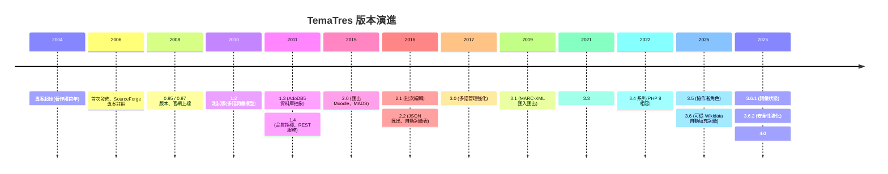
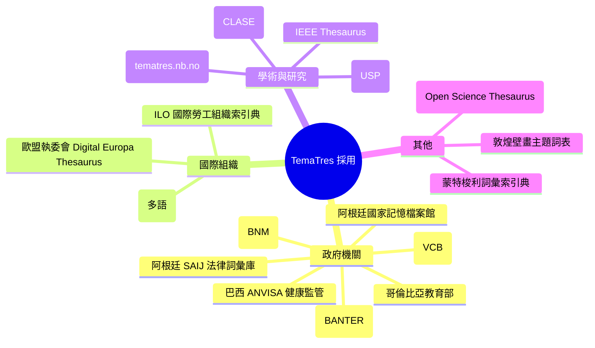

# TemaTres Vocabulary Server 專案背景調查

## 摘要

TemaTres Vocabulary Server 是一套以 PHP 撰寫、採用 GNU GPL v2 授權的開放原始碼「詞彙伺服器」(vocabulary server)，用來管理與發佈受控詞彙、索引典(thesauri)、分類法(taxonomies)、詞彙表(glossaries)等各種「知識正式表徵」(formal representations of knowledge)[^repo]。本報告調查此專案的歷史、作者與團隊、組織背景、資金與創投、社群、技術、採用情形與學術引用等面向。

一句話總結：**TemaTres 是一個由阿根廷資訊專業者 Diego Ferreyra 自 2004 年起以個人身分獨立開發維護的開放原始碼專案，沒有公司、沒有創投、沒有基金會，靠社群與機構採用而持續活躍逾二十年**[^readme][^ghrepo]。

---

## 1. 專案是什麼

TemaTres 的官方描述為：「用於管理知識正式表徵(如受控詞彙、分類法、索引典與詞彙表)的網頁應用程式」[^ghrepo]。其核心能力包括[^sf]：

- 建立詞彙間的等價、階層與關聯關係(BT/NT、USE/UF、RT)
- 支援多階層(polyhierarchy)與多語(multilingual)詞彙
- 支援範圍註(scope note)、歷史註、編目註與書目註
- 詞目工作流：候選(candidate)、接受(accepted)、拒絕(rejected)
- 使用者與編輯者權限管理、品質檢核(重複詞、自由詞、非法關係)
- 完整匯出多種格式：XML(Zthes、TopicMaps、MADS、Dublin Core、VDEX、BS 8723、SiteMap)、RDF(SKOS-Core)、MARC-XML、JSON、PDF、TXT 等
- 提供 RESTful 詞彙 Web 服務與可選的 SPARQL 端點
- 可與 WordPress、Omeka、DSpace、PKP OJS 等系統整合

技術堆疊為 **PHP**(7.4 以上)、**MySQL 或 MariaDB**、以及一個支援 mod_rewrite 的 HTTP 伺服器[^readme]。

| 項目 | 內容 |
|---|---|
| 專案性質 | 開放原始碼網頁應用(詞彙伺服器) |
| 授權 | GNU General Public License v2 (GPLv2) |
| 程式語言 | PHP |
| 資料庫 | MySQL / MariaDB(透過 AdoDB5 抽象層) |
| 官方網站 | https://vocabularyserver.com |
| 原始碼 | https://github.com/tematres/TemaTres-Vocabulary-Server |
| 最早著作權年 | 2004 |

---

## 2. 歷史與起源

### 2.1 起源時間

TemaTres 原始碼的著作權聲明為「Copyright (C) 2004-2021 Diego Ferreyra」，變更紀錄檔則寫「Copyright (C) 2004-2022」，可據此推斷專案約於 **2004 年**起步[^readme][^changelog]。西班牙語維基百科將「首次發佈(lanzamiento inicial)」記為 **2006 年**[^eswiki]。

### 2.2 起源地點與動機

根據聯合國糧農組織(FAO)的 AIMS 知識庫於 2016 年的介紹，TemaTres「最初是在阿根廷布宜諾斯艾利斯大學(Universidad de Buenos Aires)的圖書館開發的」，並以 GNU GPL 2.0 授權釋出[^fao]。其開發動機是為了解決當時缺乏免費、以網頁為基礎的索引典與受控詞彙管理工具的問題。

### 2.3 早期散佈管道

專案最早透過 **SourceForge** 發佈，該專案頁面註冊於 **2006 年 7 月 20 日**[^sf]；官方網站 vocabularyserver.com 的最早網頁典藏可追溯至 **2008 年 9 月 23 日**，當時已可見 TemaTres 0.95／0.97 版本與 AGROVOC、USGS Thesaurus 等詞彙案例[^wayback2008]。GitHub 上的正式倉庫則建立於 **2010 年 8 月 11 日**[^ghrepo]。

### 2.4 版本演進

以下為可考的主要版本里程碑(日期以 GitHub Release 或官方部落格公告為準)：

其中值得注意的節點：

- **1.4**(2011 年 7 月)：加入品質指標、使用者自訂註記、IMS VDEX 匯出、以及 RESTful 詞彙服務[^blog14]。
- **2.2**(2016 年 10 月)：加入 JSON 匯出、可批次建立自動詞彙表(auto-gloss)、PDF 匯出[^blog22]。
- **3.0**(2017 年 12 月)：強化多語詞彙管理[^blog30]。
- **3.6**(2025 年 8 月)：新增以 **Wikidata** 為來源自動填充詞彙的功能[^rel36]。
- **3.6.2**(2026 年 10 月 26 日)：安全性修正、函式庫更新(感謝 Björn Hagström 回報)[^rel362]。
- 最新提交於 **2026 年 11 月 5 日**，將版本推進至 4.0[^commits]。

---

## 3. 作者、團隊與創辦人

### 3.1 主要作者

TemaTres 幾乎由單一作者 **Diego Ferreyra** 開發與維護。其 GitHub 帳號為 `@tematres`(顯示名稱 "diego ferreyra")，聯絡信箱為 `tematres@r020.com.ar`，個人網站為 `r020.com.ar`(一個以西班牙語整理圖書資訊學資源的網站)[^ghuser][^r020]。

Diego Ferreyra 自 2010 年即在 GitHub 上活動，是最主要的提交者；截至 2026 年，他在本倉庫有 489 次貢獻[^ghcontrib]。

### 3.2 貢獻者與社群志工

除主要作者外，專案有一群間歇出現的社群貢獻者，較活躍者包括[^ghcontrib][^rel362]：

- **Björn Hagström**(`bjornhagstrom`)：近年在安全性、Docker 支援、Bootstrap 5 遷移等方面有大量貢獻
- **a-roussos**：安裝程序與錯誤修正
- **horus68**：在地化與介面
- **eugebib**、**gautiermichelin**、**RicPiz**、**bfavaretto**、**clifflandis** 等

此外，**翻譯**由社群透過 **Crowdin** 平台協作完成[^readme]。

### 3.3 專業背景(需謹慎看待)

Diego Ferreyra 的專業身分為詞彙控制與資訊系統領域的技術與語言專業者。公開資料顯示他曾以 Infojus／SAIJ(阿根廷司法與人權部的法律資訊系統)名義，為多個法律詞彙庫提供「技術與語言協助」[^infojus]。網路上的學經歷描述(例如 UBA 教授、CAICYT-CONICET 研究人員等)多見於第三方彙整網站，未能在本調查中以官方一手來源充分佐證，**故本報告不對其任職機構做出確定陳述**。

值得注意的是，近年出現一位同名但活動於秘魯／美國網路開發領域的 Diego Ferreyra[^amy]；其與 TemaTres 作者是否為同一人無法由現有來源確證，讀者應避免混淆。

---

## 4. 組織背景：沒有公司

本調查的關鍵結論之一：**TemaTres 背後沒有公司、沒有企業法人、沒有基金會，也沒有機構法人作為其擁有者**。

- README 僅載明著作權屬於個人(Diego Ferreyra)，並未提及任何組織[^readme]。
- 官方網站與 GitHub 組織帳號皆為個人性質，未見任何公司品牌[^ghuser]。
- 專案與布宜諾斯艾利斯大學的關係屬於「最初開發地點」的歷史淵源，而非機構託管[^fao]。

### 4.1 第三方商業服務(非專案本身)

雖然專案本身非商業，但存在**第三方**提供 TemaTres 的付費導入、客製與諮詢服務，例如 OpenSky Information 在其網站上提供 TemaTres 的實作、圖形客製與索引典配置服務[^opensky]。這些業者與 TemaTres 核心開發**並無官方隸屬關係**，屬於生態系服務商。

---

## 5. 資金、創投與商業模式

**未發現任何創投、外部投資、政府補助或機構資金來源的證據。**

- 專案以 GPLv2 完全免費釋出，沒有付費版本、企業版或營利方案[^readme]。
- GitHub 倉庫與官網皆無捐贈、贊助、Patreon、Open Collective 等募資連結[^ghrepo]。
- 沒有可辨識的商業實體或股權結構。

換言之，TemaTres 是一個**無資金、以志工與創辦人個人投入為基礎的長期開放原始碼專案**。

---

## 6. 社群與治理

### 6.1 主要社群管道

- **Google Groups 討論群組**：`tematres@googlegroups.com`，為專案主要的使用者與開發討論空間[^sasha]。
- **Crowdin 翻譯平台**：社群協作的介面翻譯[^readme]。
- **GitHub Issues**：截至 2026 年 11 月有 29 個開啟中的議題[^ghrepo]。
- **官方部落格**：早期版本公告與案例分享的主要發布管道[^blog14]。

### 6.2 專案生態系(「TemaTres family」)

專案 Wiki 列出相關工具家族，包括：PortalThes(以 Web 服務發佈詞彙的入口)、T3Suggest(Omeka 自動建議外掛)、WP-TemaTres(WordPress 外掛)、VisualVocabulary(視覺化詞彙)等[^sasha]。

### 6.3 社群規模(GitHub 指標，2026 年 11 月)

| 指標 | 數值 |
|---|---|
| Stars | 142 |
| Forks | 63 |
| Watchers | 22 |
| Open issues | 29 |
| 主要貢獻者 | 1(Diego Ferreyra)＋約 12 位間歇貢獻者 |
| 授權 | 無標準授權檔(以 README 聲明 GPLv2) |

以星數(約 142)而言，TemaTres 屬於**利基型、學術／圖資領域**的專案；但考量其採用廣度(見下節)，其影響力遠高於星數所示[^ghrepo]。

---

## 7. 學術與專業引用

TemaTres 有一篇核心學術論文：

- **Gonzales-Aguilar, A., Ramírez-Posada, M., & Ferreyra, D. (2012)** 在西班牙期刊《El Profesional de la Información》(第 21 卷第 3 期，頁 319–325)發表〈TemaTres: software para gestionar tesauros〉，介紹其安裝、功能與介面[^paper]。

該專案亦被多個專業目錄收錄：

- **W3C Semantic Web Wiki** 的 TemaTres 條目(2011 年)[^sasha]
- **法國政府跨部會自由軟體清單(SILL)** 推薦為自由軟體工具[^sill]
- **TAPoR** 與 **SSH Open Marketplace** 工具目錄[^sshopen]
- **FAO AIMS** 知識庫的專題報導(2014 年、2016 年)[^fao]

---

## 8. 採用情形

官方網站列出 **703 個已知使用案例(Known cases)**[^cases]，涵蓋政府、學術、圖書館、博物館與國際組織。以下為部分代表性案例：

其中 ILO 索引典、Digital Europa Thesaurus、IEEE Thesaurus 等皆為具規模的專業詞彙，顯示 TemaTres 在高標準詞彙管理場景中具實用性[^cases]。

---

## 9. 授權與使用條件

TemaTres 以 **GNU General Public License, Version 2 (GPLv2, 1991 年 6 月)** 釋出，著作權歸 Diego Ferreyra(2004 年起)[^readme]。這代表任何人都可自由使用、修改與再散布，但衍生作品須以相同授權釋出。需注意的是，GitHub 倉庫本身未附標準授權檔，授權資訊主要來自 README 的聲明[^ghrepo]。

---

## 10. 來源批判與可信度評估

- **一手來源**(README、changelog、GitHub API、官方部落格、Wikidata)：可信度高，本報告多數事實據此。
- **FAO AIMS**(2016 年)：屬國際組織發布的介紹，可信度高，其「起源於布宜諾斯艾利斯大學圖書館」之說為少數描述起源動機的來源[^fao]。
- **西班牙語維基百科**與 **Wikidata**：可交叉驗證版本與授權，但部分欄位(如首次發佈年)係社群編寫，宜以著作權年份(2004)與版本紀錄佐證[^eswiki]。
- **社群彙整網站**(如部分部落格、目錄)：僅供交叉參考，未作為關鍵事實的唯一來源。
- **侷限**：官方網站 vocabularyserver.com 部分頁面受 Cloudflare 驗證或時逾，採用的確切案例數(703)與作者詳細學經歷未取得完全一手佐證；本報告已在相關段落標明不確定性。

---

## 11. FAQ 式重點整理

| 問題 | 回答 |
|---|---|
| 起源時間 | 約 2004 年(著作權首年)，2006 年首次發佈 |
| 創辦人 | Diego Ferreyra(阿根廷) |
| 是否有公司？ | 沒有，為個人獨立專案 |
| 是否有創投／資金？ | 未發現任何創投、補助或資金來源 |
| 團隊規模 | 1 位核心作者＋約 12 位間歇貢獻者＋翻譯社群 |
| 授權 | GNU GPL v2 |
| 技術 | PHP + MySQL/MariaDB |
| 社群 | Google Groups、Crowdin、GitHub |
| 學術論文 | El Profesional de la Información (2012) |
| 採用規模 | 官方稱 703 個已知案例 |
| GitHub 星數 | 142(2026 年 11 月) |
| 最新版本 | 3.6.2(2026 年 10 月)，主線推進至 4.0 |

---

## 參考文獻

[^ghrepo]: tematres. (n.d.). TemaTres-Vocabulary-Server [Open source repository]. Retrieved 2026-11-07, from https://github.com/tematres/TemaTres-Vocabulary-Server

[^repo]: GitHub. (n.d.). Repository metadata for tematres/TemaTres-Vocabulary-Server. Retrieved 2026-11-07, from https://api.github.com/repos/tematres/TemaTres-Vocabulary-Server

[^readme]: Ferreyra, D. (n.d.). TemaTres readme. Retrieved 2026-11-07, from https://github.com/tematres/TemaTres-Vocabulary-Server/blob/master/readme.md

[^changelog]: Ferreyra, D. (n.d.). TemaTres changelog. Retrieved 2026-11-07, from https://github.com/tematres/TemaTres-Vocabulary-Server/blob/master/changelog.md

[^ghuser]: tematres. (n.d.). diego ferreyra [GitHub profile]. Retrieved 2026-11-07, from https://github.com/tematres

[^ghcontrib]: GitHub. (n.d.). Contributors to tematres/TemaTres-Vocabulary-Server. Retrieved 2026-11-07, from https://api.github.com/repos/tematres/TemaTres-Vocabulary-Server/contributors

[^commits]: GitHub. (n.d.). Commit history of tematres/TemaTres-Vocabulary-Server. Retrieved 2026-11-07, from https://api.github.com/repos/tematres/TemaTres-Vocabulary-Server/commits

[^eswiki]: Wikipedia. (2026-06-09). TemaTres. In Wikipedia, la enciclopedia libre. Retrieved 2026-11-07, from https://es.wikipedia.org/wiki/TemaTres

[^fao]: AIMS, Food and Agriculture Organization of the United Nations. (2016-11-16). TemaTres 2.2: Open source web tool to manage formal representations of knowledge. Retrieved 2026-11-07, from https://aims.fao.org/news/tematres-22-open-source-web-tool-manage-formal-representations-knowledge

[^sf]: SourceForge. (n.d.). TemaTres: controlled vocabulary server. Retrieved 2026-11-07, from https://sourceforge.net/projects/tematres/

[^wayback2008]: Internet Archive. (2008-09-23). TemaTres Vocabulary Server [Wayback Machine capture]. Retrieved 2026-11-07, from https://web.archive.org/web/20080923190117/http://www.vocabularyserver.com/

[^blog14]: Ferreyra, D. (2011-07-28). TemaTres 1.4 released! [Blog post]. Retrieved 2026-11-07, from https://web.archive.org/web/20210412030139/https://www.vocabularyserver.com/blog/page/2/

[^blog22]: Ferreyra, D. (2016-10-17). TemaTres 2.2 release is out!, open source web tool to manage controlled vocabularies [Blog post]. Retrieved 2026-11-07, from https://web.archive.org/web/20210412030958/https://www.vocabularyserver.com/blog/

[^blog30]: Ferreyra, D. (2017-12-02). TemaTres 3.0 release is out! new facilities to manage multilingual vocabularies [Blog post]. Retrieved 2026-11-07, from https://web.archive.org/web/20210412030958/https://www.vocabularyserver.com/blog/

[^rel36]: GitHub. (2025-08-04). Release 3.6. Retrieved 2026-11-07, from https://api.github.com/repos/tematres/TemaTres-Vocabulary-Server/releases

[^rel362]: GitHub. (2026-10-26). Release 3.6.2. Retrieved 2026-11-07, from https://api.github.com/repos/tematres/TemaTres-Vocabulary-Server/releases

[^paper]: Gonzales-Aguilar, A., Ramírez-Posada, M., & Ferreyra, D. (2012). TemaTres: software para gestionar tesauros. El Profesional de la Información, 21(3), 319-325. Retrieved 2026-11-07, from https://doi.org/10.3145/epi.2012.may.14

[^sill]: Gouvernement français. (n.d.). Le socle interministériel de logiciels libres (SILL). Retrieved 2026-11-07, from https://code.gouv.fr/sill/detail?name=TemaTres

[^sshopen]: SSH Open Marketplace. (n.d.). TemaTres Controlled Vocabulary Server. Retrieved 2026-11-07, from https://marketplace.sshopencloud.eu/tool-or-service/VNoucV

[^cases]: TemaTres Vocabulary Server. (n.d.). Known cases of TemaTres. Retrieved 2026-11-07, from https://www.vocabularyserver.com/vocabularies/

[^opensky]: OpenSky Information. (n.d.). TemaTres. Retrieved 2026-11-07, from https://openskyinformation.com/en/tematres-en/

[^r020]: R020 Bibliotecología y ciencias de la información. (n.d.). TemaTres: aplicación para gestión de vocabularios controlados. Retrieved 2026-11-07, from https://r020.com.ar/web/items/show/3270

[^infojus]: Sistema Argentino de Información Jurídica (SAIJ). (n.d.). Banco de Vocabularios Jurídicos. Retrieved 2026-11-07, from http://vocabularios.saij.gob.ar/

[^sasha]: Wikimedia Foundation. (n.d.). Wikidata item Q6140868 (TemaTres). Retrieved 2026-11-07, from https://www.wikidata.org/wiki/Q6140868

[^amy]: tematre. (n.d.). Discussion and documentation references for TemaTres. Retrieved 2026-11-07, from https://groups.google.com/g/tematres
