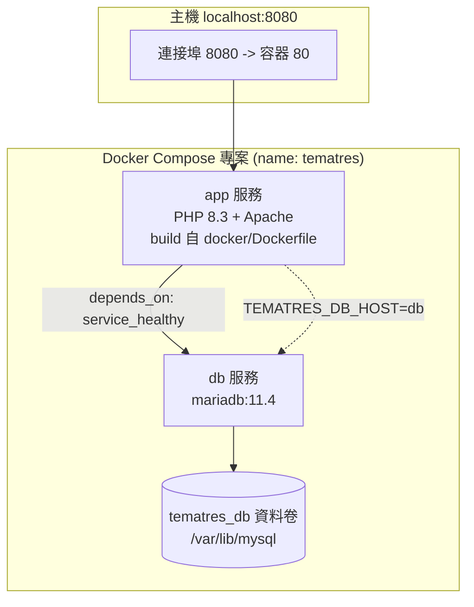
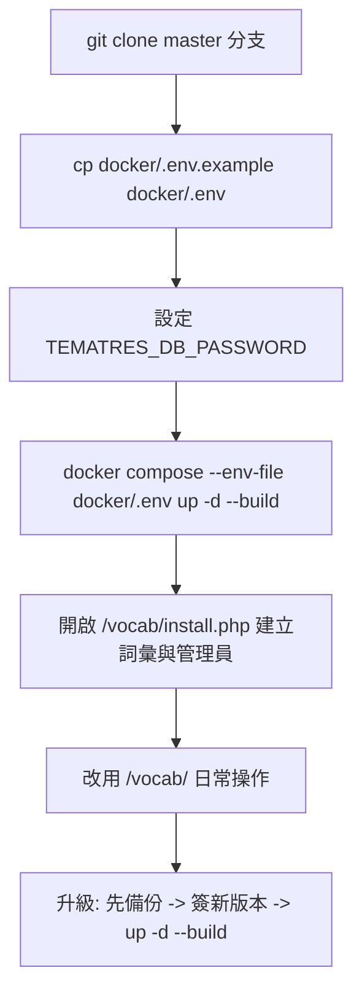

# 如何在 Docker 中執行 TemaTres Vocabulary Server

## 摘要

TemaTres 是一套以 PHP 撰寫的網頁應用程式，用來管理受控詞彙、分類法、主題詞表（thesaurus）與詞彙表（glossary）等知識的正式表述[^repo]。自 2026 年 11 月起，官方原始碼倉庫正式納入了 Docker 支援，做法是在倉庫內新增一個 `docker/` 目錄，內含 `Dockerfile`、`docker-compose.yml`（搭配 MariaDB）以及一個從環境變數讀取資料庫設定的 `db.tematres.php`[^pr117][^commit]。本文說明兩種可用的執行途徑：（A）使用官方新增的 `docker/` 組合；（B）自行以 `php:8.x-apache` 映像手動組裝（給需要高度自訂的場合）。文中同時整理安裝後的初始化步驟、備份還原、常見錯誤與注意事項。

> 重要前提：Docker 支援**尚未出現在任何正式發行標籤（tag）**中。截至本文撰寫時，最新發行版為 `v3.6.2`（2026-10-26 發佈），其檔案樹並不包含 `docker/` 目錄[^release][^tagtree]。因此若要用官方 Docker 支援，必須取得 `master` 分支（或 2026-11-02 之後的提交），而非從 Releases 頁面下載 `v3.6.2`。

---

## 1. 背景：TemaTres 是什麼

TemaTres 是一套用於管理正式知識表述（formal representations of knowledge）的網頁應用程式，涵蓋受控詞彙、分類法、主題詞表與詞彙表[^repo]。技術上它是一個 PHP 應用，官方列出的系統需求如下[^readme]：

- HTTP 伺服器（需啟用 `mod_rewrite`）
- MySQL 5.0 以上，或 MariaDB
- PHP 7.4 以上
- PHP 擴充模組：cURL、php-xml

專案首頁為 `https://vocabularyserver.com`，採用 GNU GPL v2 授權[^repo][^readme]。GitHub 上 `tematres/TemaTres-Vocabulary-Server` 倉庫約有 **142 顆星**、63 個 fork[^api]，屬於成熟但社群規模中等的專案；社群長年（自 2018 年 issue #32 起）即表達希望官方支援 Docker[^issue32]，最終由貢獻者 Björn Hagström 於 2026 年透過 PR #117 實作並被合併[^pr117][^commit]。

---

## 2. 途徑 A：使用官方 `docker/` 組合（建議）

### 2.1 取得原始碼

由於 Docker 支援只在 `master` 分支，需以 git 複製倉庫，而非下載 release 壓縮檔：

```sh
git clone https://github.com/tematres/TemaTres-Vocabulary-Server.git
cd TemaTres-Vocabulary-Server
```

倉庫中的 `docker/` 目錄結構如下[^dockerapi]：

```
docker/
├── .dockerignore
├── .env.example
├── .gitignore
├── Dockerfile
├── db.tematres.php
├── docker-compose.yml
└── README.md
```

### 2.2 設定環境變數

依官方 `docker/README.md` 的指示[^dockerreadme]，先複製範例檔並設定資料庫密碼：

```sh
cp docker/.env.example docker/.env
# 編輯 docker/.env，將 TEMATRES_DB_PASSWORD 改為自訂密碼（僅限字母與數字）
```

`.env.example` 的內容與可用變數如下[^envexample]：

| 變數 | 預設值 | 說明 |
|---|---|---|
| `TEMATRES_DB_PASSWORD` | `change-me` | 資料庫密碼；僅在資料庫建立時使用，日後修改需同步改資料庫 |
| `TEMATRES_PORT` | `8080` | 主機對外連接埠（`http://localhost:8080/vocab/`） |
| `TEMATRES_BIND` | `127.0.0.1` | 綁定位址；設為 `0.0.0.0` 才會對外網開放 |
| `PHP_VERSION` | `8.3` | 映像內使用的 PHP 版本標籤 |

### 2.3 啟動

```sh
docker compose -f docker/docker-compose.yml --env-file docker/.env up -d --build
```

### 2.4 初始化安裝

啟動後，開啟<http://localhost:8080/vocab/install.php>，建立詞彙與管理員帳號（此處填的 e-mail 與密碼即成為日後登入憑證），之後改用<http://localhost:8080/vocab/>[^dockerreadme]。

### 2.5 官方組合的架構

`docker-compose.yml` 定義了兩個服務[^compose]：



- **`db`**：使用 `mariadb:11.4` 映像，透過環境變數建立 `tematres` 資料庫與使用者，並設定 healthcheck（`healthcheck.sh --connect --innodb_initialized`）確保應用只在資料庫就緒後啟動[^compose]。
- **`app`**：由倉庫根目錄 (`context: ..`) 依 `docker/Dockerfile` 建置，內含倉庫簽出（checked out）版本的程式碼，因此升級時不需手動改檔案[^dockerfile][^dockerreadme]。
- **網路**：預設只發佈在 localhost（`${TEMATRES_BIND:-127.0.0.1}`）[^compose]。

### 2.6 `Dockerfile` 內容解析

官方 `docker/Dockerfile` 的關鍵步驟[^dockerfile]：

```dockerfile
ARG PHP_VERSION=8.3
FROM php:${PHP_VERSION}-apache

RUN docker-php-ext-install mysqli \
 && a2enmod rewrite \
 && cp "$PHP_INI_DIR/php.ini-production" "$PHP_INI_DIR/php.ini"

COPY . /var/www/html/
COPY docker/db.tematres.php /var/www/html/vocab/db.tematres.php

EXPOSE 80
HEALTHCHECK --interval=30s --timeout=5s --start-period=20s --retries=5 \
    CMD php -r 'exit(@file_get_contents("http://127.0.0.1/vocab/index.php")===false ? 1 : 0);'
```

重點說明：

- 以 `php:8.3-apache` 為基底（可用 `PHP_VERSION` 換版本，例如 `8.4`）[^dockerfile][^dockerreadme]。
- 安裝 `mysqli` 擴充模組（cURL、XML、mbstring 已是映像內建），並啟用 `rewrite` 模組以支援乾淨網址（`.htaccess`）[^dockerfile]。
- 採用 `php.ini-production`，因此 PHP 錯誤會寫入日誌而非顯示給訪客；以 `docker compose logs app` 檢視[^dockerfile][^dockerreadme]。
- 以 `docker/db.tematres.php` 取代倉庫中的 `vocab/db.tematres.php`，使映像不含任何密碼[^dockerfile]。

### 2.7 資料庫設定來源（環境變數）

容器版的 `docker/db.tematres.php` 完全從環境變數讀取設定，不含任何寫死的密碼[^dbphp]：

```php
$DBCFG["DBdriver"]  = "mysqli";
$DBCFG["Server"]    = getenv('TEMATRES_DB_HOST') ?: 'db';
$DBCFG["DBName"]    = getenv('TEMATRES_DB_NAME') ?: 'tematres';
$DBCFG["DBLogin"]   = getenv('TEMATRES_DB_USER') ?: 'tematres';
$DBCFG["DBPass"]    = (string) getenv('TEMATRES_DB_PASSWORD');
$DBCFG["DBprefix"]  = getenv('TEMATRES_DB_PREFIX') ?: 'lc_';
// ...
define('CFG_HASH_PASS', '1');
```

可用的環境變數為 `TEMATRES_DB_HOST`、`TEMATRES_DB_NAME`、`TEMATRES_DB_USER`、`TEMATRES_DB_PASSWORD`、`TEMATRES_DB_PREFIX`[^dbphp]。

---

## 3. 日常操作：啟動、停止、備份、還原

官方 `docker/README.md` 提供的操作指令整理如下[^dockerreadme]：

```sh
# 停止（保留資料庫）
docker compose -f docker/docker-compose.yml down

# 再次啟動（資料庫保留）
docker compose -f docker/docker-compose.yml up -d

# 停用並刪除資料卷（會刪除資料庫！）
docker compose -f docker/docker-compose.yml down -v

# 備份資料庫（輸出到倉庫外部，因為倉庫內容會被複製進映像）
docker compose -f docker/docker-compose.yml exec -T db \
  sh -c 'mariadb-dump -utematres -p"$MARIADB_PASSWORD" --single-transaction tematres' > ~/tematres.sql

# 還原
docker compose -f docker/docker-compose.yml exec -T db \
  sh -c 'mariadb -utematres -p"$MARIADB_PASSWORD" tematres' < ~/tematres.sql
```

幾個官方文件特別提醒的要點[^dockerreadme]：

- **升級版本**：由於映像內建的是簽出當下的程式碼，升級流程為：先備份資料庫 → 簽出新版本 → 重跑 `up -d --build`。資料庫資料卷 `tematres_tematres_db` 會保留，之後再依根目錄 `readme.md` 的「Update from a previous version」第 3 步做資料庫升級。
- **同時跑第二份**：在指令加上 `-p <name>` 指定不同專案名稱，並設定另一個 `TEMATRES_PORT`。
- **安全性**：連接埠預設只綁 localhost；安裝程式在詞彙建立完成前是「開放」狀態，因此在對外開放（`TEMATRES_BIND=0.0.0.0`）前務必先完成安裝。
- **反向代理與 TLS**：TemaTres 會從 `X-Forwarded-Proto` 判斷 https（見 `getURLbase()`）；但 `install.php` 僅檢查 `HTTPS` 變數來決定樣式表與腳本網址，經此類代理時瀏覽器可能因混合內容（mixed content）而阻擋，表單本身仍可正常送出。

---

## 4. 途徑 B：手動以 Apache 映像組裝

若需要更細緻的控制，或想沿用既有的 MySQL，可自行組裝。社群多年來的常見做法是以 `php:*-apache` 映像掛載程式碼，另起一個資料庫容器。例如 GitHub issue #93 中使用者提供的 compose（注意：該範例本身遇到問題，見下節）[^issue93]：

```yaml
services:
  mysql:
    image: mysql:5.7
    environment:
      MYSQL_ROOT_PASSWORD: root
      MYSQL_DATABASE: tematres
      MYSQL_USER: tematres
      MYSQL_PASSWORD: tematres
    volumes:
      - mysql-data:/var/lib/mysql

  apache:
    image: php:7.4-apache
    depends_on:
      - mysql
    ports:
      - "80:80"
    volumes:
      - ./tematres:/var/www/html/
```

手動途徑必須自行處理官方 Dockerfile 有做、但手動容易遺漏的步驟：

1. 安裝 `mysqli` 擴充模組（`docker-php-ext-install mysqli`）[^dockerfile]。
2. 啟用 `rewrite` 模組（`a2enmod rewrite`）[^dockerfile]。
3. 編輯 `vocab/db.tematres.php`，填入正確的資料庫主機名稱、使用者、密碼[^readme]。
4. 視需要安裝 cURL 與 XML 相關擴充模組。

---

## 5. 常見問題與陷阱

| 症狀 | 可能原因 | 來源 |
|---|---|---|
| 首頁 500 錯誤 | 容器版缺少 `mysqli`、`rewrite` 未啟用，或資料庫主機名稱/hostname 設定錯誤 | [^issue93] |
| 匯入 SKOS 時 `Class 'DOMDocument' not found` | PHP 未安裝 XML 擴充模組（`php-xml`） | [^issue76] |
| 匯入時 `Call to undefined function utf8_decode()` | PHP 版本過新或缺少相關擴充 | [^issue76] |
| 選語言後安裝畫面空白 | 舊版 PHP 映像相容性問題（PHP 7.1/5.4 混合環境） | [^issue74] |
| 受 TLS 反向代理時樣式/腳本被瀏覽器阻擋 | `install.php` 只檢查 `HTTPS`，混合內容判定 | [^dockerreadme] |
| 誤用 Releases 頁面的 `v3.6.2` 找不到 `docker/` | Docker 支援尚未進入發行標籤，只在 `master` | [^release][^tagtree] |

此外，官方明言此 Docker 支援「尚未在 amd64、TLS 代理後方，或既有安裝的升級情境下測試過」[^pr117]，因此正式環境導入前應自行於目標平台驗證。

---

## 6. 結論與建議

1. **首選**：`git clone` `master` 分支，使用倉庫內建的 `docker/` 組合（步驟見 §2）；這是最新、最完整且被官方維護的方式。
2. **注意**：目前 Docker 支援尚未進入任何 `v3.x.x` 發行標籤，切勿從 Releases 下載後期待有 `docker/` 目錄[^release][^tagtree]。
3. **維運**：務必先備份資料庫再升級；備份輸出放在倉庫目錄之外（因為倉庫內容會被複製進映像）[^dockerreadme]。
4. **安全**：安裝完成前不要對外開放連接埠；正式環境建議在完成安裝後再調整 `TEMATRES_BIND`[^dockerreadme]。



---

## 參考文獻

[^repo]: TemaTres. (n.d.). *TemaTres-Vocabulary-Server*. Retrieved 2026-11-07, from https://github.com/tematres/TemaTres-Vocabulary-Server

[^readme]: Ferreyra, D. (2021). *readme.md* [TemaTres 官方說明文件]. Retrieved 2026-11-07, from https://raw.githubusercontent.com/tematres/TemaTres-Vocabulary-Server/master/readme.md

[^dockerreadme]: TemaTres. (2026). *TemaTres with Docker* [docker/README.md]. Retrieved 2026-11-07, from https://raw.githubusercontent.com/tematres/TemaTres-Vocabulary-Server/master/docker/README.md

[^dockerfile]: TemaTres. (2026). *Dockerfile* [docker/Dockerfile]. Retrieved 2026-11-07, from https://raw.githubusercontent.com/tematres/TemaTres-Vocabulary-Server/master/docker/Dockerfile

[^compose]: TemaTres. (2026). *docker-compose.yml* [docker/docker-compose.yml]. Retrieved 2026-11-07, from https://raw.githubusercontent.com/tematres/TemaTres-Vocabulary-Server/master/docker/docker-compose.yml

[^envexample]: TemaTres. (2026). *.env.example* [docker/.env.example]. Retrieved 2026-11-07, from https://raw.githubusercontent.com/tematres/TemaTres-Vocabulary-Server/master/docker/.env.example

[^dbphp]: TemaTres. (2026). *db.tematres.php* [docker/db.tematres.php]. Retrieved 2026-11-07, from https://raw.githubusercontent.com/tematres/TemaTres-Vocabulary-Server/master/docker/db.tematres.php

[^pr117]: Hagström, B. (2026, November 1). *Add Docker support* [Pull request #117]. GitHub. Retrieved 2026-11-07, from https://github.com/tematres/TemaTres-Vocabulary-Server/pull/117

[^commit]: Hagström, B. (2026, October 26). *Add Docker support (docker/)* [Commit a11bc840]. GitHub. Retrieved 2026-11-07, from https://github.com/tematres/TemaTres-Vocabulary-Server/commit/a11bc840958e3185e0a5891bf74b86c4dae9be8c

[^release]: TemaTres. (2026, October 26). *3.6.2* [Release v3.6.2]. GitHub. Retrieved 2026-11-07, from https://github.com/tematres/TemaTres-Vocabulary-Server/releases/tag/v3.6.2

[^tagtree]: TemaTres. (2026). *Git tree of v3.6.2* [Repository tree]. GitHub API. Retrieved 2026-11-07, from https://api.github.com/repos/tematres/TemaTres-Vocabulary-Server/git/trees/9be0b0a992ef73bb3c5f9f2ebde25a272836363a

[^api]: TemaTres. (2026). *TemaTres-Vocabulary-Server repository metadata* [GitHub API response]. Retrieved 2026-11-07, from https://api.github.com/repos/tematres/TemaTres-Vocabulary-Server

[^dockerapi]: TemaTres. (2026). *Contents of docker/ directory* [GitHub API response]. Retrieved 2026-11-07, from https://api.github.com/repos/tematres/TemaTres-Vocabulary-Server/contents/docker

[^issue32]: regisnew. (2018, October 17). *Docker compatibility* [Issue #32]. GitHub. Retrieved 2026-11-07, from https://github.com/tematres/TemaTres-Vocabulary-Server/issues/32

[^issue74]: chenkuncloud. (2022, June 6). *The installation content is not displayed after selecting the language* [Issue #74]. GitHub. Retrieved 2026-11-07, from https://github.com/tematres/TemaTres-Vocabulary-Server/issues/74

[^issue76]: gao-stu. (2022, July 1). *Unable to import file* [Issue #76]. GitHub. Retrieved 2026-11-07, from https://github.com/tematres/TemaTres-Vocabulary-Server/issues/76

[^issue93]: AbrilJara. (2024, May 27). *Can't run with docker* [Issue #93]. GitHub. Retrieved 2026-11-07, from https://github.com/tematres/TemaTres-Vocabulary-Server/issues/93
