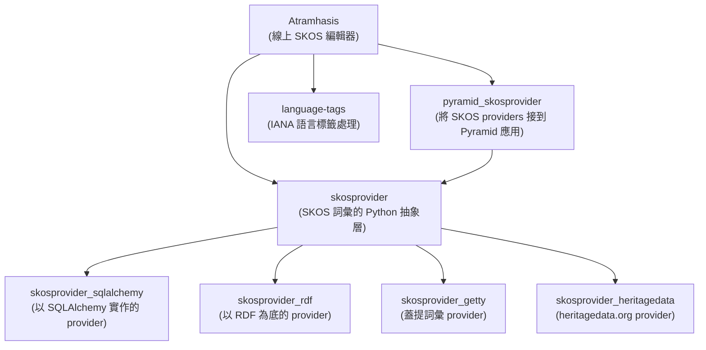
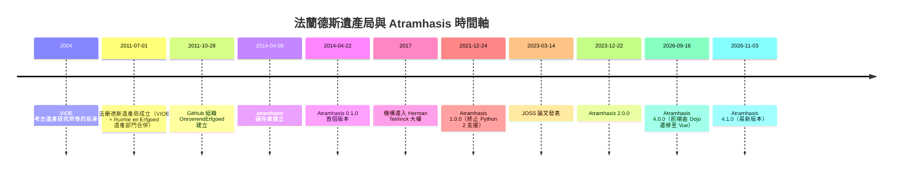
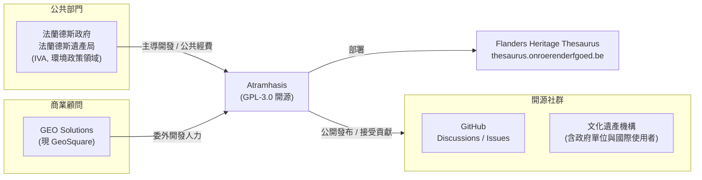

# Atramhasis 專案背景調查

## 摘要

Atramhasis 是一套以網頁為基礎的線上 SKOS（Simple Knowledge Organization System）詞彙編輯器，用於建立與維護受控詞彙表（controlled vocabularies）、權威檔（authority files）與主題詞表（thesauri）[^pypi]。本報告調查其背後的主導組織、歷史脈絡、團隊組成、經費性質與社群狀況。

本報告針對以下幾個面向逐一說明：專案本體與技術概觀、主導機構「法蘭德斯遺產局」（Flanders Heritage Agency，荷語：Agentschap Onroerend Erfgoed）的歷史與定位、開發團隊與貢獻者、資金性質（是否有創投）、以及社群與相關生態系。

**重要前提**：Atramhasis 並非商業新創產品，而是比利時法蘭德斯（Flanders）政府機構主導、以公共經費支持的公部門開源專案。專案本身沒有創投（venture capital）參與，也沒有商業募資歷史，這與一般「公司／創投」型的軟體專案有根本差異。相關的商業合作夥伴是一家比利時地理資訊顧問公司 GEO Solutions（現更名 GeoSquare）。

---

## 1. 專案本體概觀

### 1.1 基本資料

Atramhasis 的原始碼託管於 GitHub 上的 `OnroerendErfgoed/atramhasis` 儲存庫。專案自述為「An online SKOS editor」（一套線上 SKOS 編輯器）[^ghapi]。

| 項目 | 內容 |
|------|------|
| 儲存庫 | `OnroerendErfgoed/atramhasis` |
| 建立時間 | 2014-04-08 |
| 主要語言 | Python（約 2.79 MB），其次為 Vue、SCSS、Jinja、TypeScript、Shell、CSS、JavaScript、Mako |
| 授權條款 | GNU General Public License v3.0（GPL-3.0） |
| 預設分支 | `develop` |
| 星號數（Stars） | 65 |
| 分支數（Forks） | 13 |
| 追蹤者（Watchers） | 65 |
| 未結議題（Open issues） | 48 |
| 主題標籤 | `app`、`pypi-package`、`python`、`skos`、`thesaurus`、`vocabulary` |
| 官方網站 | http://atramhasis.readthedocs.io/ |

[^ghapi]: GitHub REST API. (2026). Repository: OnroerendErfgoed/atramhasis. Retrieved 2026-11-07, from https://api.github.com/repos/OnroerendErfgoed/atramhasis

需要說明的是，程式語言的組成數據（Python 佔絕大多數）反映的是歷史累積的程式碼量；專案在 2026 年的 4.0.0 版本已將前端由 Dojo 框架遷移為 Vue，因此 Vue 與 TypeScript 的比例日後會逐步上升[^pypi][^langapi]。

[^langapi]: GitHub REST API. (2026). Repository languages: OnroerendErfgoed/atramhasis. Retrieved 2026-11-07, from https://api.github.com/repos/OnroerendErfgoed/atramhasis/languages

### 1.2 功能定位

Atramhasis 讓使用者透過簡單的網頁介面建立並編輯符合 SKOS 規範的線上詞彙表。其設計盡可能貼近 SKOS 規格，因此適用於多種詞彙型態，包括簡單的選項清單（pick lists）、權威檔、平面清單，以及基本到相對複雜的主題詞表。不過官方文件明確指出，它**不適合**管理非常龐大或複雜的詞表，例如蓋提藝術與建築詞表（Getty Art and Architecture Thesaurus, AAT）[^cff]。

Atramhasis 也被設想為服務導向架構（Service Oriented Architecture, SOA）中的一個核心節點，盡可能將其功能透過 REST 服務對外提供，讀取與寫入概念架構（concept scheme）皆可透過 API 完成[^intro]。

主要功能包括[^features]：

- **公開 HTML 介面**：可搜尋詞彙、瀏覽概念架構、檢視概念的標籤、註記、來源與關聯，並提供 RDF/XML 與 N3/Turtle 等下載格式。預設提供英文、法文與荷文三種公開介面。
- **SKOS 編輯器（後台）**：以分頁方式編輯標籤、註記、關聯、來源與外部詞彙的匹配（matches），並支援「合併」（merge）外部概念。可管理詞彙來源（Providers）與語言（Languages）。
- **LDF 伺服器**：可搭配 Linked Data Fragments 伺服器，快速提供 RDF triples。

[^features]: Atramhasis documentation. (2026). Features. Retrieved 2026-11-07, from https://atramhasis.readthedocs.io/en/latest/features.html

### 1.3 技術堆疊與生態系

Atramhasis 後端以 Python 的 Pyramid 框架建構，透過一系列由同一組織維護的 `skosprovider` 函式庫家族與 SKOS 資料互動[^pypi][^intro]。這個生態系包含[^ghapi_org]：

[^ghapi_org]: GitHub REST API. (2026). Organization repositories: OnroerendErfgoed. Retrieved 2026-11-07, from https://api.github.com/orgs/OnroerendErfgoed/repos

### 1.4 實際部署案例

Atramhasis 最主要的實際部署，是法蘭德斯遺產局的「法蘭德斯遺產主題詞表」（Flanders Heritage Thesaurus），網址為 `thesaurus.onroerenderfgoed.be`。該站收錄多個與文化遺產相關的詞彙表，例如遺產類型（heritagetypes）、風格與文化（styles and cultures）、材料（materials）與年代（periods）。多數詞彙表內容為荷文，但介面同時支援荷文、英文與法文[^pypi]。

---

## 2. 主導機構：法蘭德斯遺產局

### 2.1 機構定位

Atramhasis 由**法蘭德斯遺產局**開發與維護。這是比利時法蘭德斯政府處理考古、古蹟與地景事務的機構[^intro]。其荷文正式名稱為 **agentschap Onroerend Erfgoed**（法蘭德斯遺產局／Onroerend Erfgoed 機構）[^wikipedia]。

法蘭德斯遺產局是法蘭德斯政府的一個「**內部自治機構**」（Intern Verzelfstandigd Agentschap, IVA），且**不具法人格**（zonder rechtspersoonlijkheid），隸屬於「環境」政策領域（Beleidsdomein Omgeving）。其管轄範圍為法蘭德斯地區（Vlaams Gewest），總部設於布魯塞爾的 Herman Teirlinck 大樓[^wikipedia]。

### 2.2 歷史沿革

法蘭德斯遺產局成立於 **2011 年 7 月 1 日**，是由兩個前身機構合併而成[^wikipedia]：

1. **VIOE**（Vlaams Instituut voor het Onroerend Erfgoed，法蘭德斯不動產遺產研究所）
2. 當時「空間與遺產」機構（Ruimte en Erfgoed）中「遺產」（Erfgoed）部門

其中 VIOE 成立於 2004 年，是「考古遺產研究所」（Instituut voor het Archeologisch Patrimonium）與「古蹟與地景部門」知識小組的繼承者。這次合併首次將不動產遺產的所有政策執行任務整合到單一機構之下。2017 年，該機構由 Phoenix 大樓遷移至 Herman Teirlinck 大樓[^wikipedia]。

[^wikipedia]: Wikipedia. (2026, November 2). Onroerend Erfgoed (agentschap). Retrieved 2026-11-07, from https://nl.wikipedia.org/wiki/Onroerend_Erfgoed_(agentschap)

### 2.3 核心任務

依官方說明，法蘭德斯遺產局的任務是為法蘭德斯的不動產遺產擬定並執行政策，具體包含調查、保護與支持管理等工作[^wikipedia][^overons]：

- **盤點（Inventariseren）**：製作建築、考古與地景遺產的科學性清冊，並有主題式清冊（如具遺產價值的樹木、管風琴、世界大戰遺產、歷史園林、海事與船舶遺產）。清冊收錄超過 90,000 件物件；被收錄於科學性清冊本身並無法律效果，僅為描述與紀錄。
- **保護（Beschermen）**：可授予五種保護身分——保護古蹟、保護城鎮／村落景觀、保護文化歷史地景、保護考古遺址、保護船舶遺產。保護程序分為暫時性與最終性兩階段，並附帶主動與被動保存義務及拆除禁令。
- **支持遺產管理**：對不動產遺產的所有者、設計者、開發商與地方政府提供諮詢與合作，並提供財務支持（補助、貸款、稅賦減免等）。
- **認可與補助**：對遺產市鎮（OEG）、跨市鎮遺產服務（IOED）、遺產典藏庫、考古學家與金屬探測者等授予認可並提供補助。

[^overons]: Onroerend Erfgoed. (n.d.). Over onze werking. Retrieved 2026-11-07, from https://www.onroerenderfgoed.be/over-ons

### 2.4 領導層

法蘭德斯遺產局由「署長」（administrateur-generaal）領導。依 2024 年的資料，署長為 **Peter De Wilde**[^wikipedia]。

---

## 3. 團隊與貢獻者

### 3.1 組織層級

GitHub 上的 `OnroerendErfgoed` 組織成立於 2011-10-28，自述為「Agentschap Onroerend Erfgoed（法蘭德斯遺產局）的開源軟體」，地點標示為比利時布魯塞爾，Twitter 帳號為 `vioe`。該組織共公開 73 個儲存庫，追蹤者約 10 人[^ghorg]。

[^ghorg]: GitHub REST API. (2026). Organization: OnroerendErfgoed. Retrieved 2026-11-07, from https://api.github.com/orgs/OnroerendErfgoed

### 3.2 主要貢獻者

依 GitHub 貢獻統計，atramhasis 儲存庫的主要貢獻者如下（依貢獻次數排序）[^contrib]：

| 貢獻者 | 貢獻次數 | 備註 |
|--------|---------|------|
| BartSaelen | 376 | 主導開發者 |
| goessebr（Bram Goessens） | 259 | 主要發布者（後期版本多由其發布） |
| koenedaele（Koen Van Daele） | 218 | 專案元老、JOSS 論文第一作者 |
| JonasGe（Jonas Geuens） | 93 | JOSS 論文作者之一 |
| Jonathan-Piraux | 88 | GEO Solutions 成員 |
| cedrikv（Cedrik Vanderhaegen） | 87 | JOSS 論文作者之一 |
| pyup-bot | 85 | 自動化依賴更新機器人 |
| Wim-De-Clercq | 71 | GEO Solutions 成員 |
| dependabot[bot] | 43 | 自動化依賴更新機器人 |
| wouter-adriaens | 42 | |
| vancamti | 35 | |
| AxelVerstappen | 23 | |
| yannickkuypers | 18 | |
| roefem | 15 | |
| vanbosa | 8 | |

[^contrib]: GitHub REST API. (2026). Repository contributors: OnroerendErfgoed/atramhasis. Retrieved 2026-11-07, from https://api.github.com/repos/OnroerendErfgoed/atramhasis/contributors

值得注意的是，貢獻者名單中混入了 `pyup-bot`、`dependabot[bot]`、`github-actions[bot]`、`Copilot` 等自動化帳號，這意味著人力貢獻者實際約有 20 人左右，且前四名（BartSaelen、goessebr、koenedaele、JonasGe）累積貢獻佔比相當高，顯示專案屬於**少數核心維護者驅動**的模式。

### 3.3 官方作者群與所屬單位

依專案的 `CITATION.cff` 檔案，Atramhasis 的正式作者共九人，分屬兩個單位[^cff]：

- **Agentschap Onroerend Erfgoed（法蘭德斯遺產局）**：Koen Van Daele、Jonas Geuens、Bram Goessens、Cedrik Vanderhaegen
- **GEO Solutions**：Tinne Cahy、Wim De Clercq、Jonathan Piraux、Bart Saelen、Maarten Taeymans

[^cff]: Flanders Heritage Agency. (2024). Atramhasis (CITATION.cff) [Computer software metadata]. Retrieved 2026-11-07, from https://raw.githubusercontent.com/OnroerendErfgoed/atramhasis/develop/CITATION.cff

這份名單顯示，專案是由**政府機構本身**（法蘭德斯遺產局）與**外部商業顧問公司**（GEO Solutions）共同開發的合作成果。

### 3.4 學術發表

Atramhasis 團隊曾在《Journal of Open Source Software》（JOSS）發表專案論文，投稿於 2022 年 12 月 14 日，2023 年 3 月 14 日刊出[^joss]：

> Van Daele, K., Cahy, T., De Clercq, W., Geuens, J., Goessens, B., Piraux, J., Saelen, B., Taeymans, M., & Vanderhaegen, C. (2023). Atramhasis: An online SKOS vocabulary editor. *Journal of Open Source Software*, 8(83), 5040.

[^joss]: Van Daele, K., Cahy, T., De Clercq, W., Geuens, J., Goessens, B., Piraux, J., Saelen, B., Taeymans, M., & Vanderhaegen, C. (2023). Atramhasis: An online SKOS vocabulary editor. Journal of Open Source Software, 8(83), 5040. Retrieved 2026-11-07, from https://doi.org/10.21105/joss.05040

該論文由 JOSS 編輯 Daniel S. Katz 處理，審稿人為 gaurav 與 Sven Lieber[^joss_review]。

[^joss_review]: Journal of Open Source Software. (2023). Atramhasis: An online SKOS vocabulary editor (Review). Retrieved 2026-11-07, from https://github.com/openjournals/joss-reviews/issues/5040

此外，法蘭德斯遺產局的研究人員另有一篇 2017 年的 ISPRS 期刊論文，說明該機構的主題詞表歷史、重要性、使用方式與技術演進，Atramhasis 亦在此文獻脈絡中被記載[^cff][^isprs]。

[^isprs]: Mortier, S., Van Daele, K., & Meganck, L. (2017). Calling it what it is. Thesauri in the Flanders Heritage Agency: History, Importance, Use and Technological Advances. ISPRS Annals of Photogrammetry, Remote Sensing and Spatial Information Sciences, IV-2/W2, 151-156. Retrieved 2026-11-07, from https://doi.org/10.5194/isprs-annals-IV-2-W2-151-2017

---

## 4. 資金性質：沒有創投，採公共經費模式

使用者關心的「創投」（venture capital）與「資金」面向，需明確澄清：

**Atramhasis 不是受創投支持的商業專案。** 其主導機構法蘭德斯遺產局是法蘭德斯政府的內部自治機構（IVA），本身即為公部門單位，運作經費來自政府預算而非風險投資，且該機構不具獨立營利性質[^wikipedia]。專案的開發、維護與授權（GPL-3.0 開源授權）皆屬公共服務性質，而非以商業化或上市募資為目標。

較接近「商業資源」的成分是**顧問委外**：專案的部分作者任職於 GEO Solutions（一家比利時地理資訊顧問公司），顯示法蘭德斯遺產局在其資訊系統建設上，採用了政府機構與外部顧問公司合作開發的模式[^cff][^cff]。

GEO Solutions 現已更名並整合為 **GeoSquare**，總部位於比利時 Edegem，在 Leuven、Gent、Namur 等地設有據點，宣稱擁有超過 250 名員工與 350 家以上客戶（涵蓋政府、基礎建設與運輸領域）[^geosquare]。

[^geosquare]: GeoSquare. (2026). Over ons. Retrieved 2026-11-07, from https://geosquare.be/nl-be/over-ons

就財務結構而言，此類「政府機構 + 顧問公司」的組合，資金來源通常是**政府採購與專案預算**，而非股權投資或創業募資。

---

## 5. 社群與開發協作

### 5.1 社群管道

Atramhasis 的社群互動主要透過 GitHub 進行[^pypi][^intro]：

- **議題追蹤（Issue tracker）**：用於回報錯誤與請求功能。
- **GitHub Discussions 討論區**：用於一般討論、安裝求助、功能建議等。
- **電子郵件**：`ict@onroerenderfgoed.be`，供不便公開討論的特定問題使用。
- **貢獻指南**：設有 `CONTRIBUTING.md`，歡迎程式碼改進、文件更新與介面翻譯等貢獻。

### 5.2 版本節奏

Atramhasis 自 2014 年 0.1.0 版起持續發布，至今已到 4.1.0 版（2026-11-03），版本演進具連續性[^pypi][^changes]。重要的里程碑包括：

- **0.1.0（2014-04-22）**：初版，建立專案、文件、單元測試與骨架[^pypi]。
- **1.0.0（2021-12-24）**：終止 Python 2 支援[^pypi]。
- **2.0.0（2023-12-22）**：支援非數字識別碼（UUID 或手動指派），並可透過介面建立 providers[^pypi]。
- **4.0.0（2026-09-16）**：前端由 Dojo 遷移為 Vue，並移除 Ruby Sass 工具鏈（破壞性變更）[^changes]。
- **4.1.0（2026-11-03）**：導入 mise 開發環境設定、新增瀏覽紀錄清理腳本等[^pypi]。

[^changes]: Atramhasis documentation. (2026). History. Retrieved 2026-11-07, from https://atramhasis.readthedocs.io/en/latest/changes.html

### 5.3 社群採用的間接證據

GitHub 上的 **13 個 fork** 中，多數為個人或機構的複製，其中值得注意的是 **`Informatievlaanderen/atramhasis`**——這是比利時法蘭德斯政府「資訊法蘭德斯」（Informatievlaanderen）組織的 fork，顯示此工具在法蘭德斯政府體系內被其他單位採用或評估。另有巴西的 `vcusp/atramhasis`（描述為「Vocabulário」）與 `arqtrad/atramhasis` 等組織 fork，反映其國際能見度雖不高，但已在文化遺產／詞彙管理領域被跨國採用[^forks]。

[^forks]: GitHub REST API. (2026). Repository forks: OnroerendErfgoed/atramhasis. Retrieved 2026-11-07, from https://api.github.com/repos/OnroerendErfgoed/atramhasis/forks

### 5.4 發行管道

Atramhasis 以 Python 套件形式發布於 PyPI，最新版本 4.1.0（2026-11-03），支援 Python 3.10 至 3.13，並提供 `dev` 與 `postgresql` 兩個 extra。PyPI 頁面列出 5 位維護者：cedrikv、claeyswo、geuensjo、goessebr、Koen.Van.Daele，作者欄標示為 Flanders Heritage Agency[^pypi]。

[^pypi]: Python Package Index. (2026, November 3). atramhasis 4.1.0. Retrieved 2026-11-07, from https://pypi.org/project/atramhasis/

專案另設有 Zenodo DOI（`10.5281/zenodo.5801135`）以供學術引用，並通過 GitHub Actions 的 CI 流程與 Scrutinizer CI 的品質評分[^pypi]。

### 5.5 開發環境演進

依 4.1.0 的更新說明，專案近年開始採用 [mise](https://mise.jdx.dev/) 作為本地開發環境工具，執行 `mise install` 與 `mise run server` 即可安裝工具並啟動後端與前端，於 `http://localhost:6543` 啟動開發伺服器。這顯示專案在工程流程上持續現代化[^pypi]。

---

## 6. 綜合分析與批判性反思

### 6.1 專案性質總結

### 6.2 關鍵特性

1. **非商業、非創投**：由公部門主導，無創投、無募資、無商業模式壓力，這解釋了其在 GitHub 上僅 65 顆星卻能長期穩定維護（自 2014 年至今逾十二年）的現象。
2. **機構長期承諾**：專案能持續十二年發布版本，核心原因是背後有一個政府機構的長期任務需求（管理文化遺產詞彙），而非市場驅動。
3. **小而專精的社群**：65 星、13 fork、約 20 名人力貢獻者，屬於典型的「利基型」開源專案，社群規模小但功能完整、文件齊備並有學術發表。
4. **政府與顧問協作模式**：作者群橫跨政府機構與 GEO Solutions，是歐洲公部門資訊系統常見的「政府＋顧問公司」協作型態。

### 6.3 來源可信度評估

- **官方一手來源**（GitHub API、PyPI、ReadTheDocs 文件、CITATION.cff）為主要依據，可信度高且可交叉驗證。
- **維基百科**用於機構歷史與定位，屬二手來源，但與官方網站資訊一致。
- **GitHub 星號與貢獻數據**為查詢當下（2026-11-07）的即時快照，會隨時間變動。
- 本報告**未找到任何創投、募資輪次或商業投資的證據**，因此明確判定此類資訊不存在；若有相關說法，應要求提出具體來源佐證。
- 專案的「開源社群活躍程度」難以僅憑星號量化，本報告僅呈現可驗證的客觀指標，未對其「成功程度」做價值判斷。

### 6.4 尚待確認事項

- 法蘭德斯遺產局的年度資訊系統預算與 Atramhasis 的具體經費規模，官方未公開細項，本報告無法量化。
- GEO Solutions 與法蘭德斯遺產局之間的具體合約關係（是否為政府採購、招標金額等）未取得公開文件佐證。
- 專案的實際部署數量（除官方 thesaurus 站外）缺乏系統性統計。

---

## 參考文獻

Atramhasis documentation. (2026). Features. Retrieved 2026-11-07, from https://atramhasis.readthedocs.io/en/latest/features.html

Atramhasis documentation. (2026). History. Retrieved 2026-11-07, from https://atramhasis.readthedocs.io/en/latest/changes.html

Atramhasis documentation. (2026). Introduction. Retrieved 2026-11-07, from https://atramhasis.readthedocs.io/en/latest/intro.html

Flanders Heritage Agency. (2024). Atramhasis (CITATION.cff) [Computer software metadata]. Retrieved 2026-11-07, from https://raw.githubusercontent.com/OnroerendErfgoed/atramhasis/develop/CITATION.cff

GeoSquare. (2026). Over ons. Retrieved 2026-11-07, from https://geosquare.be/nl-be/over-ons

GitHub REST API. (2026). Organization: OnroerendErfgoed. Retrieved 2026-11-07, from https://api.github.com/orgs/OnroerendErfgoed

GitHub REST API. (2026). Organization repositories: OnroerendErfgoed. Retrieved 2026-11-07, from https://api.github.com/orgs/OnroerendErfgoed/repos

GitHub REST API. (2026). Repository contributors: OnroerendErfgoed/atramhasis. Retrieved 2026-11-07, from https://api.github.com/repos/OnroerendErfgoed/atramhasis/contributors

GitHub REST API. (2026). Repository forks: OnroerendErfgoed/atramhasis. Retrieved 2026-11-07, from https://api.github.com/repos/OnroerendErfgoed/atramhasis/forks

GitHub REST API. (2026). Repository languages: OnroerendErfgoed/atramhasis. Retrieved 2026-11-07, from https://api.github.com/repos/OnroerendErfgoed/atramhasis/languages

GitHub REST API. (2026). Repository: OnroerendErfgoed/atramhasis. Retrieved 2026-11-07, from https://api.github.com/repos/OnroerendErfgoed/atramhasis

Journal of Open Source Software. (2023). Atramhasis: An online SKOS vocabulary editor (Review). Retrieved 2026-11-07, from https://github.com/openjournals/joss-reviews/issues/5040

Mortier, S., Van Daele, K., & Meganck, L. (2017). Calling it what it is. Thesauri in the Flanders Heritage Agency: History, Importance, Use and Technological Advances. ISPRS Annals of Photogrammetry, Remote Sensing and Spatial Information Sciences, IV-2/W2, 151-156. Retrieved 2026-11-07, from https://doi.org/10.5194/isprs-annals-IV-2-W2-151-2017

Onroerend Erfgoed. (n.d.). Over onze werking. Retrieved 2026-11-07, from https://www.onroerenderfgoed.be/over-ons

Python Package Index. (2026, November 3). atramhasis 4.1.0. Retrieved 2026-11-07, from https://pypi.org/project/atramhasis/

Van Daele, K., Cahy, T., De Clercq, W., Geuens, J., Goessens, B., Piraux, J., Saelen, B., Taeymans, M., & Vanderhaegen, C. (2023). Atramhasis: An online SKOS vocabulary editor. Journal of Open Source Software, 8(83), 5040. Retrieved 2026-11-07, from https://doi.org/10.21105/joss.05040

Wikipedia. (2026, November 2). Onroerend Erfgoed (agentschap). Retrieved 2026-11-07, from https://nl.wikipedia.org/wiki/Onroerend_Erfgoed_(agentschap)
