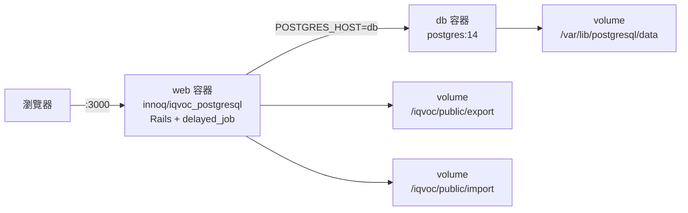

# 如何用 Docker 執行 iQvoc

## 摘要

iQvoc 是一套以 Ruby on Rails 撰寫的 SKOS(-XL) 詞彙管理系統（vocabulary management system），由 innoQ Deutschland GmbH 開發並以 Apache 2.0 授權釋出，主要用於管理同義詞庫（thesauri）、分類法（taxonomies）、主題標目等知識組織系統[^repo]。官方 repo 提供兩種 Docker 執行方式：直接以官方映像檔啟動，或從原始碼自行建置[^readme]。本報告說明這兩種路徑的完整指令、服務架構、環境變數、預設帳密，並整理社群已知的建置與執行問題。

## iQvoc 是什麼

iQvoc 支援以 SKOS 表示法匯入既有詞彙、多語系瀏覽、註冊使用者的編輯功能，以及將詞彙發佈到語意網（Semantic Web）[^readme]。專案以 Ruby 撰寫，截至 2026-10-17 在 GitHub 上有 125 顆星、44 個 fork[^apirepo]。其 repo 內建 `docker-compose.yml`、`Dockerfile` 與 `entrypoint.sh`，並在 Docker Hub 上提供預先建置的映像檔 `innoq/iqvoc_postgresql`[^compose][^dockerfile][^hub]。

## 快速開始（官方建議路徑）

官方 README 對 Docker 的說明僅有一句：clone repo 後執行 `docker-compose up`[^readme]：

```bash
git clone https://github.com/innoq/iqvoc.git
cd iqvoc
docker-compose up
```

README 提醒需確認 Docker daemon 正在執行、且已安裝 docker-compose；此設定使用 PostgreSQL 作為資料庫，預設使用者帳密則記錄於 `db/seeds.rb`[^readme]。

啟動後平台可於 `http://localhost:3000` 存取（compose 檔將容器 3000 埠對外映射）[^compose]。

> 注意：若系統上的 `docker-compose` 是舊版 Python 實作（v1），在 Python 3.12 環境可能因 `distutils` 被移除而崩潰；此時應改用 Docker 官方較新的 `docker compose`（v2 外掛）指令[^issue453]。

## 服務架構

compose 檔定義兩個服務：`db`（PostgreSQL）與 `web`（iQvoc 應用）[^compose]：



`web` 服務透過 `depends_on: db` 確保資料庫先啟動，並以環境變數 `POSTGRES_HOST=db` 連線到 compose 網路內的服務名稱[^compose]。

## docker-compose.yml 內容

官方 repo 中的 `docker-compose.yml` 如下[^compose]：

```yaml
version: '3'
services:
  db:
    image: postgres:14
    restart: always
    volumes:
      - /var/lib/postgresql/data
    environment:
      POSTGRES_DB: iqvoc_production
      POSTGRES_USER: iqvoc
      POSTGRES_PASSWORD: iqvoc
  web:
#    build: .
    image: innoq/iqvoc_postgresql
    ports:
      - "3000:3000"
    volumes:
      - /iqvoc/public/export
      - /iqvoc/public/import
    environment:
      PORT: 3000
      POSTGRES_HOST: db
      POSTGRES_DB: iqvoc_production
      POSTGRES_USER: iqvoc
      POSTGRES_PASSWORD: iqvoc
      SECRET_KEY_BASE: b9a0bec111d1ff8e3c4dedff55bcfaa3a3ae87eb7a282abb642b79bf9095650e4e38f896ddce556d272ee1fb99bdad68eae67e7fd53827d5a6c2fc5755d05440
    depends_on:
      - db
```

需注意兩點[^compose]：

- `web` 服務預設使用 Docker Hub 上的預建映像檔 `innoq/iqvoc_postgresql`；`build: .` 這一行被註解掉了，代表預設「不」從本機 Dockerfile 建置。
- `SECRET_KEY_BASE` 以明文硬編碼在檔案中，屬示範性質，正式環境應自行更換。

## Dockerfile 說明

`Dockerfile` 定義 `web` 映像檔的建置流程[^dockerfile]：

- 基底映像檔為 `ruby:2.6`，並安裝 Node.js 16 供前端資源編譯使用。
- 設定 `RAILS_ENV=production`、`RAILS_LOG_TO_STDOUT=true`、`RAILS_SERVE_STATIC_FILES=true`、`BUNDLE_PATH=/bundle`、`PORT=3000`。
- 安裝 Ruby（bundler）與 npm 依賴後，把 `config/database.yml.postgresql` 複製為 `config/database.yml`。
- 以非 root 使用者 `iqvoc` 執行，並在建置階段執行 `npm run compile` 編譯前端資源。
- 容器啟動指令（CMD）為同時啟動背景工作者與 Rails 伺服器：

```bash
bin/delayed_job start && bin/rails server -b 0.0.0.0 -p $PORT
```

前端資源使用 Faucet pipeline（`faucet-pipeline-js`、`faucet-pipeline-sass` 等）編譯，`npm run compile` 執行的是 `faucet --compact --fingerprint`[^packagejson][^faucet]。

## entrypoint.sh 啟動流程

每次容器啟動時，`entrypoint.sh` 會依序執行下列步驟[^entrypoint]：

```bash
#!/bin/bash
set -e

# Remove a potentially pre-existing server.pid for Rails.
rm -f /app/tmp/pids/server.pid

# generate assets again, to take care of the possible runtime env RAILS_RELATIVE_URL_ROOT
npm run compile
rake db:migrate
rake db:seed

# Then exec the container's main process (what's set as CMD in the Dockerfile).
exec "$@"
```

也就是：(1) 清除殘留的 Rails `server.pid`；(2) 再次編譯前端資源（以因應執行期可能設定的 `RAILS_RELATIVE_URL_ROOT`）；(3) 執行資料庫遷移 `rake db:migrate`；(4) 執行種子資料 `rake db:seed`；(5) 最後啟動 CMD 指定的主程序[^entrypoint]。

## 資料庫連線與環境變數

Docker 設定使用 PostgreSQL，資料庫設定範本讀取以下環境變數[^dbyml]：

| 環境變數 | 預設值 | 說明 |
| --- | --- | --- |
| `POSTGRES_HOST` | `localhost` | 資料庫主機（compose 中設為 `db`） |
| `POSTGRES_USER` | `postgres` | 資料庫使用者（compose 中設為 `iqvoc`） |
| `POSTGRES_PASSWORD` | `postgres` | 資料庫密碼（compose 中設為 `iqvoc`） |
| `POSTGRES_DB` | `iqvoc_development`／`iqvoc_test`／`iqvoc_production` | 依環境而定的資料庫名稱 |
| `DB_POOL` 或 `RAILS_MAX_THREADS` | `5` | 連線池大小 |

repo 另附一份 MySQL 範本 `config/database.template.yml`，但 Docker 設定並未採用 MySQL；`Gemfile` 中 `mysql2` 與 `sqlite3` 皆為註解狀態，啟用的是 `pg`（PostgreSQL 驅動）[^dbyml][^templateyml][^gemfile]。

## 預設使用者帳密

`db/seeds.rb` 在 `rake db:seed` 時建立兩個預設帳號（具冪等性，若已存在則不重複建立）[^seeds]：

| 電子郵件 | 密碼 | 角色 |
| --- | --- | --- |
| `admin@iqvoc` | `admin123` | administrator |
| `demo@iqvoc` | `cooluri123` | reader |

README 明確提醒登入後應前往使用者的管理區（Users section）更改預設密碼[^readme]。

## 建置本地映像 vs 使用官方映像

若不想使用 Docker Hub 上的預建映像檔，可改為從原始碼建置。做法是編輯 `docker-compose.yml`：取消註解 `build: .`、並註解掉 `image: innoq/iqvoc_postgresql`，然後執行[^compose]：

```bash
docker compose build
docker compose up
```

不過從 Dockerfile 自行建置存在已知問題（見下節）[^issue449]。

## 已知問題

社群在 GitHub issues 中記錄了若干與 Docker 相關的狀況：

- **舊映像檔帳密不符（Issue #432）**：使用者反映官方映像檔的 `admin@iqvoc` / `admin123` 無法登入。追查後發現映像檔內含較舊版本的 iQvoc，實際密碼為 `admin`（而非 `admin123`）。維護者於 2022-05-31 推送了新映像檔修正此問題[^issue432]。
- **使用舊版 docker-compose 失敗（Issue #453）**：在 Python 3.12 環境下執行 `docker-compose`（v1）會因 `distutils` 模組被移除而出現 `from distutils.spawn import find_executable` 匯入錯誤。此為工具鏈相容性問題，改用 `docker compose`（v2）即可[^issue453]。
- **從 Dockerfile 建置失敗（Issue #449）**：以提供的 Dockerfile 從原始碼建置並執行時，出現 `Could not find nokogiri-1.14.1, mini_portile2-2.8.1 in locally installed gems` 的原生擴充套件問題；嘗試加入 `bundle lock --add-platform x86_64-linux` 仍未解決。同一 issue 中，將基底映像檔改為 `ruby:2.7` 後又出現 `You need to add gem 'daemons' to your Gemfile`（delayed_job 所需）[^issue449]。
- **匯出權限被拒（Issue #398）**：在容器內執行 `rake iqvoc:export` 時，因容器以非 root 使用者執行，寫入 `/iqvoc/public/export/` 出現 `Errno::EACCES: Permission denied`[^issue398]。

此外，Docker Hub 上的 `innoq/iqvoc_postgresql` 映像檔最後一次推送時間為 2022-05-31，僅有一個 `latest` 標籤，且該映像檔的建置基底 `ruby:2.6` 與 Node.js 16 皆已終止支援；相較之下，`main` 分支已升級至 Rails 8.1、CI 測試涵蓋 Ruby 3.3／3.4／4.0，顯示預建映像檔與最新原始碼之間存在明顯落差[^hub][^dockerfile][^ci][^changelog]。

## 建議

1. 啟動指令優先使用 `docker compose`（v2），避免舊版 `docker-compose` 在現代 Python 環境的相容性問題[^issue453]。
2. 若需最新功能，考慮從 `main` 分支自行建置映像檔；並留意上述 nokogiri／daemons 等建置問題，必要時調整基底映像檔與 Gemfile[^issue449]。
3. 更換 compose 檔中硬編碼的 `SECRET_KEY_BASE`，並於首次登入後立即更改預設帳密[^compose][^readme]。
4. 需要執行匯出等寫檔操作時，以 root 身分進入容器（例如 `docker exec -u 0 -it <container> /bin/bash`）以避開權限問題[^issue398]。

## 參考文獻

[^repo]: innoQ Deutschland GmbH. (n.d.). *iQvoc — A SKOS(-XL) Vocabulary Management System for the Semantic Web*. GitHub. Retrieved 2026-11-07, from https://github.com/innoq/iqvoc

[^readme]: innoQ Deutschland GmbH. (n.d.). *README.md — innoq/iqvoc*. GitHub. Retrieved 2026-11-07, from https://github.com/innoq/iqvoc/blob/main/README.md

[^apirepo]: GitHub REST API. (n.d.). *Repository metadata for innoq/iqvoc*. Retrieved 2026-11-07, from https://api.github.com/repos/innoq/iqvoc

[^compose]: innoQ Deutschland GmbH. (n.d.). *docker-compose.yml — innoq/iqvoc*. GitHub. Retrieved 2026-11-07, from https://github.com/innoq/iqvoc/blob/main/docker-compose.yml

[^dockerfile]: innoQ Deutschland GmbH. (n.d.). *Dockerfile — innoq/iqvoc*. GitHub. Retrieved 2026-11-07, from https://github.com/innoq/iqvoc/blob/main/Dockerfile

[^entrypoint]: innoQ Deutschland GmbH. (n.d.). *entrypoint.sh — innoq/iqvoc*. GitHub. Retrieved 2026-11-07, from https://github.com/innoq/iqvoc/blob/main/entrypoint.sh

[^dbyml]: innoQ Deutschland GmbH. (n.d.). *config/database.yml.postgresql — innoq/iqvoc*. GitHub. Retrieved 2026-11-07, from https://github.com/innoq/iqvoc/blob/main/config/database.yml.postgresql

[^templateyml]: innoQ Deutschland GmbH. (n.d.). *config/database.template.yml — innoq/iqvoc*. GitHub. Retrieved 2026-11-07, from https://github.com/innoq/iqvoc/blob/main/config/database.template.yml

[^gemfile]: innoQ Deutschland GmbH. (n.d.). *Gemfile — innoq/iqvoc*. GitHub. Retrieved 2026-11-07, from https://github.com/innoq/iqvoc/blob/main/Gemfile

[^seeds]: innoQ Deutschland GmbH. (n.d.). *db/seeds.rb — innoq/iqvoc*. GitHub. Retrieved 2026-11-07, from https://github.com/innoq/iqvoc/blob/main/db/seeds.rb

[^packagejson]: innoQ Deutschland GmbH. (n.d.). *package.json — innoq/iqvoc*. GitHub. Retrieved 2026-11-07, from https://github.com/innoq/iqvoc/blob/main/package.json

[^faucet]: innoQ Deutschland GmbH. (n.d.). *faucet.config.js — innoq/iqvoc*. GitHub. Retrieved 2026-11-07, from https://github.com/innoq/iqvoc/blob/main/faucet.config.js

[^ci]: innoQ Deutschland GmbH. (n.d.). *.github/workflows/ci.yml — innoq/iqvoc*. GitHub. Retrieved 2026-11-07, from https://github.com/innoq/iqvoc/blob/main/.github/workflows/ci.yml

[^changelog]: innoQ Deutschland GmbH. (n.d.). *CHANGELOG.md — innoq/iqvoc*. GitHub. Retrieved 2026-11-07, from https://github.com/innoq/iqvoc/blob/main/CHANGELOG.md

[^hub]: Docker Hub. (n.d.). *innoq/iqvoc_postgresql*. Retrieved 2026-11-07, from https://hub.docker.com/r/innoq/iqvoc_postgresql

[^issue432]: innoQ Deutschland GmbH. (2022, May 31). *Demo accounts "Email and/or password wrong"* (Issue #432). GitHub. Retrieved 2026-11-07, from https://github.com/innoq/iqvoc/issues/432

[^issue453]: innoQ Deutschland GmbH. (2025, August 17). *docker-compose up failed (v4.14.5)* (Issue #453). GitHub. Retrieved 2026-11-07, from https://github.com/innoq/iqvoc/issues/453

[^issue449]: innoQ Deutschland GmbH. (2023, February 7). *Cannot run iQvoc built from Dockerfile - no nokogiri or mini_portile* (Issue #449). GitHub. Retrieved 2026-11-07, from https://github.com/innoq/iqvoc/issues/449

[^issue398]: innoQ Deutschland GmbH. (2019, October 9). *Export issue from docker* (Issue #398). GitHub. Retrieved 2026-11-07, from https://github.com/innoq/iqvoc/issues/398
