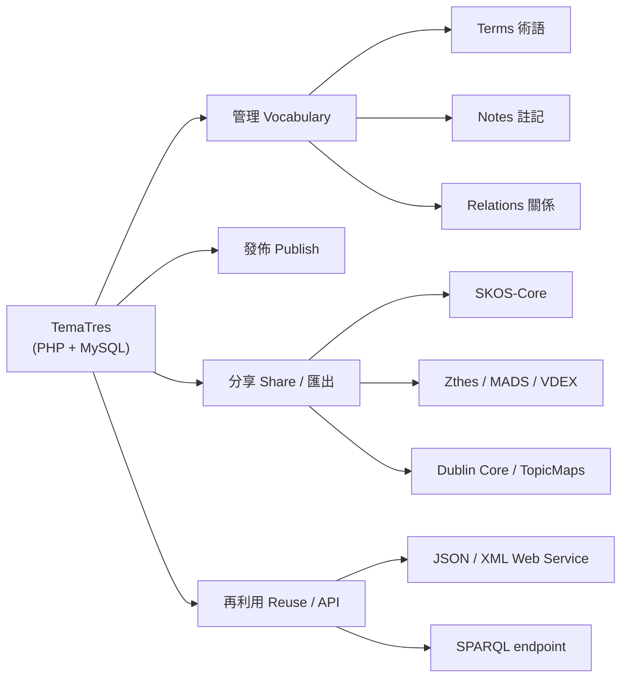
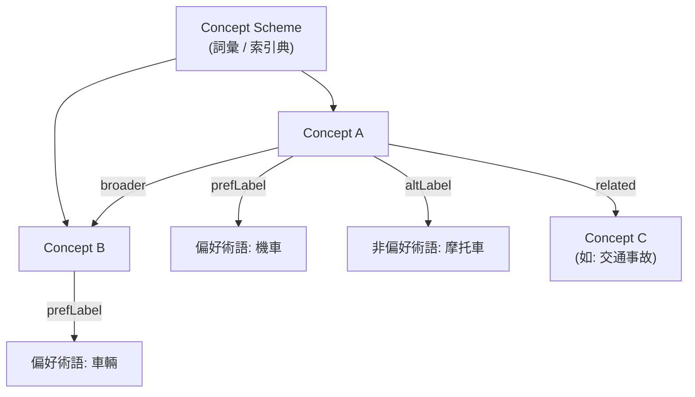
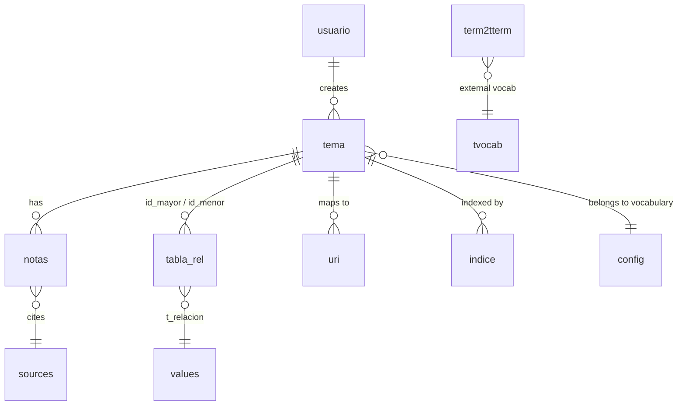
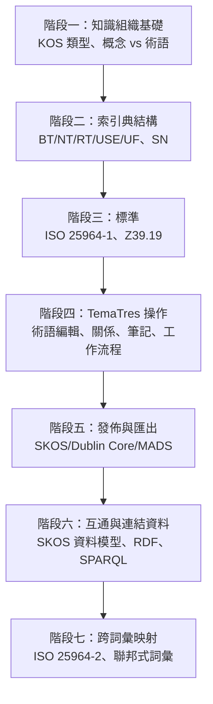

# 使用 TemaTres 詞彙伺服器所需的領域模型、概念與先備知識

## 摘要

TemaTres（TemaTres Vocabulary Server）是一套以 PHP 與 MySQL/MariaDB 撰寫的開源網頁應用，用來建立、管理、發佈與再利用「知識的正式表徵」（formal representations of knowledge），例如控制詞彙（controlled vocabularies）、分類法（taxonomies）、索引典（thesauri）與詞彙表（glossaries）[^about]。它本身是一艘「船」，但真正驅動它的是圖書資訊學（Library and Information Science, LIS）長年累積的知識組織（Knowledge Organization, KO）理論與一系列國際標準。因此，要能有效使用 TemaTres，使用者必須先具備一套特定的「領域模型」心智框架、核心概念詞彙，以及關於標準、資料模型與網路互通技術的先備知識。本報告以官方文件、原始碼設定檔與國際標準規範為依據，系統性地整理這些需求，並附上學習路徑與批判性反思。

本報告所有事實均標註來源；所有推論性的「學習順序建議」屬於作者依文獻脈絡所做的整理，並非官方文件原文。

---

## 一、TemaTres 是什麼：定位與基本事實

TemaTres 由 Diego Ferreyra 自 2004 年起開發，採用 GNU General Public License v2（GPLv2）授權釋出[^readme][^changelog]。技術需求為：具備 `mod_rewrite` 的 HTTP 伺服器、MySQL 5.0 以上（或 MariaDB）、PHP 7.4 以上，並需啟用 cURL 與 php-xml 模組；核心依賴資料庫抽象層 ADOdb5 與前端樹狀元件 tree.jquery[^readme][^changelog]。其官方說明定位為「用於管理與運用詞彙、索引典、分類法與知識正式表徵的開源詞彙伺服器」[^about]。

在 GitHub 上，此專案約有 142 顆星、63 個 fork[^ghapi]。依技能規則對 GitHub 專案的判準，142 顆星屬於「低於約 100 顆星需斟酌」門檻之上，且其領域（知識組織系統）本身即屬相對小眾但成熟的社群，故值得完整report[^skill]。此外，官方列出的實際部署案例超過 700 個，包含聯合國 UNBIS 索引典、歐盟 EUROVOC、歐洲環境總署 GEMET 等大型機構詞彙，顯示其雖非熱門專案，卻是領域內被實際採用的工具[^about]。



---

## 二、使用 TemaTres 必須具備的「領域模型」

「領域模型」在此指：使用者在腦中必須建立起來的一套概念結構，能夠對應到 TemaTres 的資料模型。TemaTres 的內部模型本質上是「術語為中心」（term-centric），但其設計明確對齊國際標準的「概念為中心」（concept-centric）模型[^skos]。

### 2.1 概念與術語的區分（Concept vs. Term）

知識組織的根本前提，是把「概念」（Concept，一個思想單位、一組意義）與「術語」（Term，用來標示該概念的字詞字串）區分開來[^skos]。同一個概念可以有多個術語（同義詞），而一個索引典的工作就是選定其中一個為「偏好術語」（preferred term），其餘為「非偏好術語」（non-preferred term）[^iso25964wiki]。在 SKOS 資料模型中，這分別對應 `skos:Concept`、`skos:prefLabel` 與 `skos:altLabel`[^skos]。這是使用者最核心的第一個心智模型。

### 2.2 三種語意關係（Three Relationship Types）

所有索引典與控制詞彙的關係，最終歸納為三類，這是 TemaTres 關係編輯器的底層邏輯[^manage][^iso25964wiki]：

| 關係類型 | 英文 | 作用 | SKOS 對應 |
|---|---|---|---|
| 等同關係 | Equivalence | 同義詞與近義詞之間，指向同一概念 | `skos:altLabel` / `skos:hiddenLabel` |
| 階層關係 | Hierarchical | 較廣（broader）與較窄（narrower）概念之間 | `skos:broader` / `skos:narrower` |
| 關聯關係 | Associative | 彼此相關但無階層先後的概念之間 | `skos:related` |

### 2.3 標準縮寫詞彙（BT / NT / RT / USE / UF …）

使用 TemaTres 的術語編輯介面時，會直接面對這些沿用數十年的縮寫。它們是「先備概念」中不可迴避的一部分[^iso25964wiki][^skos]:

- **BT**（Broader Term）：較廣義之上位詞。
- **NT**（Narrower Term）：較狹義之下位詞，為 BT 的反向。
- **RT**（Related Term）：關聯詞，非階層式。
- **USE**（Use）：由非偏好詞指向「應改用」的偏好詞。
- **UF**（Used For）：偏好詞「用來取代」的非偏好詞（USE 的反向）。
- **TT**（Top Term）：階層鏈的最高層詞（根節點）。
- **SN**（Scope Note）：範圍註（定義詞的使用範圍與界線）。
- **HN**（History Note）：歷史註（記錄術語隨版本變動的情形）。
- **BTG / BTP**：分別為「屬種型（generic）」與「全體-部分型（partitive）」的廣義詞區分[^iso25964wiki]。

TemaTres 另外延伸了這些傳統縮寫，允許使用者自訂新的關係類型，官方標語即為「let's go beyond the thesauri」（超越傳統索引典）[^manage]。

### 2.4 多語與跨詞彙映射模型（Multilingual & Cross-vocabulary Mapping）

TemaTres 支援多語索引典，並允許在不同詞彙之間建立映射，映射類型包含「等值（equivalent）」「不等值（no equivalent）」與「部分等值（partial）」[^about][^manage]。在跨詞彙情境下，使用者需理解 ISO 25964-2 所規範的映射概念：精確等值（exact）、近似等值（inexact/close）、部分等值（partial），以及廣義/狹義映射[^iso25964-2]。



---

## 三、TemaTres 的實際資料模型（概念如何落地為資料表）

要真正駕馭 TemaTres，需理解其資料庫 schema。安裝時會動態建立一組具備前綴（prefix）的資料表[^schema]。核心實體整理如下[^schema][^config]：

| 資料表 | 角色 | 對應領域概念 |
|---|---|---|
| `{prefix}tema` | 術語／概念主表，含 `tema`（術語字串）、`code`（代碼/標記）、`tema_hash`（去重雜湊）、`estado_id`（狀態）、`isMetaTerm` | 概念、偏好術語、`skos:notation` |
| `{prefix}tabla_rel` | 術語間關係表，含 `id_mayor`（廣義/來源）、`id_menor`（狹義/目標）、`t_relacion`（關係類型） | BT/NT/RT/UF |
| `{prefix}notas` | 註記表，`tipo_nota` 區分範圍註、歷史註、書目註、私密註、定義、範例 | SN/HN/`skos:scopeNote` 等 |
| `{prefix}sources` | 權威來源／書目來源，供 `notas.src_id` 引用 | 書目引註 |
| `{prefix}indice` | 快速字母索引 | 字母瀏覽 |
| `{prefix}values` | 泛用查值表，儲存關係類型、註記類型、狀態、設定、URI 類型等 | 各類列舉值 |
| `{prefix}config` | 詞彙的詮釋資料（標題、作者、語言、`tipo`、`polijerarquia`） | 詞彙層級後設資料 |
| `{prefix}uri` | 術語對外部 URI 的映射（`uri_type_id` 對應 exactMatch 等） | `skos:exactMatch` 等映射 |
| `{prefix}tvocab` / `{prefix}term2tterm` | 外部詞彙登錄與跨詞彙術語映射 | 聯邦式詞彙互通 |
| `{prefix}usuario` | 使用者與權限 | 工作流程與角色 |

關係類型的內部常數定義於設定檔 `config.tematres.php`[^config]：

```php
define("id_TR", "2");   // Related Term (RT)
define("id_TG", "3");   // Broader/Término General (BT)
define("id_UP", "4");   // Used For (UF)
define("id_EQ_PARCIAL", "5"); // 部分等值
define("id_EQ", "6");         // 完全等值
define("id_EQ_NO", "7");      // 不等值
```

這段原始碼是最有力的證據：TemaTres 的領域模型直接以索引典標準的關係類型為骨架。使用者若不理解 BT/RT/UF/EQ 的概念，幾乎無法解讀資料表、匯出檔與 API 回應。



---

## 四、必備的核心概念（Concept Checklist）

以下為使用 TemaTres 前建議先掌握的概念清單，依「是否為必要」分層。

### 4.1 必備（使用任何功能都會遇到）

- 控制詞彙（Controlled Vocabulary）與自然語言的差別。
- 索引典（Thesaurus）、分類法（Taxonomy）、分類架構（Classification Scheme）、詞彙表（Glossary）、主題標目（Subject Heading）等知識組織系統（KOS）類型之分野[^skos][^iso25964-2]。
- 概念 vs. 術語、偏好術語 vs. 非偏好術語。
- 三種關係類型（等同、階層、關聯）與其縮寫。
- 範圍註（Scope Note）的用途。
- 工作流程狀態：候選（candidate）、已接受（accepted/active）、已拒絕（rejected）[^about]。

### 4.2 進階（發佈、互通、資料交換時需要）

- SKOS 資料模型：`Concept`、`ConceptScheme`、`prefLabel`、`altLabel`、`hiddenLabel`、`broader`/`narrower`/`related`、`exactMatch` 等映射屬性、`notation`、以及 `Collection`/`OrderedCollection`[^skos]。
- RDF 三元組、URI 與「開放世界假設」的基本認識（SKOS 以 OWL Full 定義，缺資料不代表否定）[^skos]。
- 連結資料（Linked Data）與 JSON-LD。
- SPARQL 查詢語言（TemaTres 可選擇啟用 SPARQL endpoint）[^readme]。
- 多語索引典與跨語言等值處理[^about]。
- 跨詞彙映射（ISO 25964-2）[^iso25964-2]。

---

## 五、先備知識：需要認識的標準

TemaTres 的價值很大一部分來自其對標準的支援。使用者在匯入/匯出、互通整合時，必須認識下列標準。

| 標準 | 全名 | 發佈機構 | 角色 | TemaTres 支援 |
|---|---|---|---|---|
| **ISO 25964-1** | Thesauri and interoperability with other vocabularies — Part 1: Thesauri for information retrieval | ISO（2011-08） | 建構索引典之現行國際標準，含資料模型與 XML schema | 透過 BS 8723 匯出、關係模型對齊[^iso25964-1][^niso25964] |
| **ISO 25964-2** | Part 2: Interoperability with other vocabularies | ISO（2013-03） | 詞彙間映射之規範 | 跨詞彙映射、聯邦詞彙[^iso25964-2][^niso25964] |
| **ANSI/NISO Z39.19** | Guidelines for the Construction, Format, and Management of Monolingual Controlled Vocabularies | NISO（2005, R2010） | 單語控制詞彙建構指引 | 關係模型與工作流程符合[^z3919] |
| **SKOS** | Simple Knowledge Organization System | W3C（2009-08-18, Recommendation） | 以 RDF 表徵 KOS 之網頁標準 | 完整 SKOS-Core 匯入/匯出、SPARQL[^skos] |
| **BS 8723** | Structured vocabularies for information retrieval — Guide | BSI（2005–2008） | ISO 25964 之前身 | 匯出格式之一[^iso25964wiki] |
| **Zthes** | Z39.50 Profile for Thesaurus Navigation | 社群規格（非 ISO/ANSI 正式標準） | 索引典檢索協定 profile | 匯出格式之一[^share] |
| **Dublin Core (ISO 15836)** | Dublin Core metadata element set | ISO / DCMI | 通用後設資料元素集 | 匯出格式之一[^share] |
| **MADS** | Metadata Authority Description Schema | 美國國會圖書館 | 權威資料 XML schema，MADS/RDF 為 SKOS 擴充 | 匯出格式之一[^share] |
| **ISO/IEC 13250 (Topic Maps)** | Information technology — Topic Maps | ISO/IEC（2003 二版） | 主題、關聯、發生之知識表徵標準 | TopicMaps 匯出[^share] |
| **IMS VDEX** | IMS Vocabulary Definition Exchange | IMS Global（2004） | 教育領域之詞彙交換格式 | VDEX 匯出[^share] |

TemaTres 的分享頁面明確列出這些可匯出的 schema：Skos-Core、BS 8723、Dublin Core、MADS、TopicMaps、IMS VDEX、Zthes，以及 WordPress XML、TXT、SQL、JSON/JSON-LD、RSS[^share]。這意味著使用者若要真正利用 TemaTres，需能讀懂這些格式的語意，而不只是操作介面。

---

## 六、先備知識：技術與背景知識

除了圖書資訊學的領域知識，還需具備下列技術背景：

1. **網頁技術基礎**：理解 PHP/MySQL 應用的安裝（設定 `db.tematres.php`、執行安裝腳本）與 `mod_rewrite`[^readme]。這屬於「部署」層級，而非「使用」層級，但 TemaTres 為自行架設（self-hosted）軟體，故常難以迴避。
2. **後設資料（Metadata）概念**：能區分「描述資源」的後設資料與「詞彙本身的結構資料」，並理解 Dublin Core 等元素集[^share]。
3. **資料交換與 API**：TemaTres 提供 JSON、SKOS-Core、XML 等 web service，並可設定 SPARQL endpoint；整合到 DSpace、WordPress、Open Journal Systems 等系統時，需要 REST/XML 與 API 概念[^reuse][^readme]。
4. **語意網（Semantic Web）基礎**：RDF、URI、本體（ontology）與 SKOS 之間的關係。需注意的是，SKOS 並非形式化知識表徵語言，索引典的「概念」不是邏輯公理，這點常被誤解[^skos]。

---

## 七、學習路徑建議

以下學習順序為作者依文獻脈絡整理的建議，非官方規範。



若只想「單機管理一份詞彙表」，階段一至四即可上手；若要與其他系統互通或發佈為連結資料，階段五至七為必要。

---

## 八、批判性反思（Critical Source Reflection）

- **一手 vs. 二手來源**：本報告的標準定義以 ISO、NISO、W3C 官方頁面為主要依據（權威性高），TemaTres 功能描述則以官方網站與 GitHub 原始碼為依據[^schema][^config]。其中 TemaTres 版本號在不同頁面出現 3.4.2、4.0 等差異（`changelog.md` 標示 3.4.2，而 `config.tematres.php` 內標示 `TemaTres 4.0`），顯示文件與程式碼版本標示不完全一致，使用者應以實際安裝版本為準[^changelog][^config]。
- **標準的內部對應關係**：TemaTres 的關係常數（id_TR=2、id_TG=3、id_UP=4、id_EQ=6…）直接源自索引典標準，但標準本身（ISO 25964）並未規定資料庫實作；因此「TemaTres 的資料表」不等於「ISO 25964 資料模型」，兩者是對齊關係而非等同[^config][^niso25964]。
- **時效性**：ISO 25964-1 於 2011 年發佈、2022 年經系統性審查確認仍有效，但正被修訂版取代[^iso25964-1]；SKOS 自 2009 年以來未再更新，仍是穩定的 W3C Recommendation[^skos]。使用時應留意標準的修訂動態。
- **來源偏誤**：TemaTres 官方頁面具行銷性質，對其限制（如僅支援 MySQL、PHP 舊式架構、GPLv2 授權的傳染性）著墨較少；評估導入時應交叉參考社群與第三方報導。官方「誰使用 TemaTres」頁面宣稱逾 700 個案例，數量難以獨立查核，宜視為參考而非保證[^about]。

---

## 九、結論

使用 TemaTres 所需的先備知識，可濃縮為三層：

1. **領域模型層**：概念與術語的區分、三種關係類型、KOS 類型光譜，以及偏好/非偏好術語、範圍註與工作流程狀態。
2. **標準知識層**：ISO 25964（含 Part 2 的映射）、ANSI/NISO Z39.19，以及一組交換標準（SKOS、BS 8723、Zthes、Dublin Core、MADS、TopicMaps、VDEX）。
3. **技術背景層**：後設資料、RDF/語意網與 SKOS 資料模型、JSON/XML API 與 SPARQL，以及基本的 PHP/MySQL 部署概念。

換言之，TemaTres 是「工具」，而它要求使用者先具備的是「知識組織的領域素養」。不具備這些先備知識，仍可勉強操作介面輸入術語，但無法正確建構一份語意一致、可互通、可再利用的高品質控制詞彙。

---

## 參考文獻

Ferreyra, D. (2021). *About Tematres*. Vocabularyserver.com. Retrieved 2026-11-07, from https://vocabularyserver.com/web/about

Ferreyra, D. (n.d.). *Management features*. Vocabularyserver.com. Retrieved 2026-11-07, from https://web.archive.org/web/20240327025513/https://vocabularyserver.com/web/manage

Miles, A., & Bechhofer, S. (2009). *SKOS Simple Knowledge Organization System Reference* (W3C Recommendation 18 August 2009). World Wide Web Consortium. Retrieved 2026-11-07, from https://www.w3.org/TR/skos-reference/

National Information Standards Organization. (2010). *ANSI/NISO Z39.19-2005 (R2010) Guidelines for the Construction, Format, and Management of Monolingual Controlled Vocabularies*. Retrieved 2026-11-07, from https://www.niso.org/publications/ansiniso-z3919-2005-r2010

National Information Standards Organization. (n.d.). *ISO 25964 – the international standard for thesauri and interoperability with other vocabularies*. Retrieved 2026-11-07, from https://www.niso.org/schemas/iso25964/

International Organization for Standardization. (2011). *ISO 25964-1:2011 Information and documentation — Thesauri and interoperability with other vocabularies — Part 1: Thesauri for information retrieval*. Retrieved 2026-11-07, from https://www.iso.org/standard/53657.html

International Organization for Standardization. (2013). *ISO 25964-2:2013 Information and documentation — Thesauri and interoperability with other vocabularies — Part 2: Interoperability with other vocabularies*. Retrieved 2026-11-07, from https://www.iso.org/standard/53658.html

TemaTres. (n.d.). *TemaTres-Vocabulary-Server* [Source code repository]. GitHub. Retrieved 2026-11-07, from https://github.com/tematres/TemaTres-Vocabulary-Server

TemaTres. (n.d.). *readme.md*. GitHub. Retrieved 2026-11-07, from https://raw.githubusercontent.com/tematres/TemaTres-Vocabulary-Server/master/readme.md

TemaTres. (n.d.). *changelog.md*. GitHub. Retrieved 2026-11-07, from https://raw.githubusercontent.com/tematres/TemaTres-Vocabulary-Server/master/changelog.md

TemaTres. (n.d.). *config.tematres.php*. GitHub. Retrieved 2026-11-07, from https://raw.githubusercontent.com/tematres/TemaTres-Vocabulary-Server/master/common/include/config.tematres.php

TemaTres. (n.d.). *Relations between vocabularies and Terminological web services*. GitHub Wiki. Retrieved 2026-11-07, from https://github.com/tematres/TemaTres-Vocabulary-Server/wiki/Relations-between-vocabularies-and-Terminological-web-services

TemaTres. (n.d.). *Share your knowlodge*. Vocabularyserver.com. Retrieved 2026-11-07, from https://web.archive.org/web/20240718122130/https://vocabularyserver.com/web/share

TemaTres. (n.d.). *Reuse controlled vocabularies*. Vocabularyserver.com. Retrieved 2026-11-07, from https://web.archive.org/web/20241125181618/https://vocabularyserver.com/web/reuse

TemaTres. (n.d.). *vocab/install.php* (database schema definitions). GitHub. Retrieved 2026-11-07, from https://github.com/tematres/TemaTres-Vocabulary-Server

Wikipedia. (n.d.). *ISO 25964*. Retrieved 2026-11-07, from https://en.wikipedia.org/wiki/ISO_25964

[^about]: Ferreyra, D. (2021). *About Tematres*. Vocabularyserver.com. Retrieved 2026-11-07, from https://vocabularyserver.com/web/about
[^manage]: Ferreyra, D. (n.d.). *Management features*. Vocabularyserver.com. Retrieved 2026-11-07, from https://web.archive.org/web/20240327025513/https://vocabularyserver.com/web/manage
[^share]: TemaTres. (n.d.). *Share your knowlodge*. Vocabularyserver.com. Retrieved 2026-11-07, from https://web.archive.org/web/20240718122130/https://vocabularyserver.com/web/share
[^reuse]: TemaTres. (n.d.). *Reuse controlled vocabularies*. Vocabularyserver.com. Retrieved 2026-11-07, from https://web.archive.org/web/20241125181618/https://vocabularyserver.com/web/reuse
[^readme]: TemaTres. (n.d.). *readme.md*. GitHub. Retrieved 2026-11-07, from https://raw.githubusercontent.com/tematres/TemaTres-Vocabulary-Server/master/readme.md
[^changelog]: TemaTres. (n.d.). *changelog.md*. GitHub. Retrieved 2026-11-07, from https://raw.githubusercontent.com/tematres/TemaTres-Vocabulary-Server/master/changelog.md
[^config]: TemaTres. (n.d.). *config.tematres.php*. GitHub. Retrieved 2026-11-07, from https://raw.githubusercontent.com/tematres/TemaTres-Vocabulary-Server/master/common/include/config.tematres.php
[^schema]: TemaTres. (n.d.). *vocab/install.php* (database schema definitions). GitHub. Retrieved 2026-11-07, from https://github.com/tematres/TemaTres-Vocabulary-Server
[^ghapi]: TemaTres. (n.d.). *TemaTres-Vocabulary-Server* [Source code repository]. GitHub. Retrieved 2026-11-07, from https://api.github.com/repos/tematres/TemaTres-Vocabulary-Server
[^skos]: Miles, A., & Bechhofer, S. (2009). *SKOS Simple Knowledge Organization System Reference* (W3C Recommendation 18 August 2009). World Wide Web Consortium. Retrieved 2026-11-07, from https://www.w3.org/TR/skos-reference/
[^iso25964-1]: International Organization for Standardization. (2011). *ISO 25964-1:2011 Information and documentation — Thesauri and interoperability with other vocabularies — Part 1: Thesauri for information retrieval*. Retrieved 2026-11-07, from https://www.iso.org/standard/53657.html
[^iso25964-2]: International Organization for Standardization. (2013). *ISO 25964-2:2013 Information and documentation — Thesauri and interoperability with other vocabularies — Part 2: Interoperability with other vocabularies*. Retrieved 2026-11-07, from https://www.iso.org/standard/53658.html
[^niso25964]: National Information Standards Organization. (n.d.). *ISO 25964 – the international standard for thesauri and interoperability with other vocabularies*. Retrieved 2026-11-07, from https://www.niso.org/schemas/iso25964/
[^z3919]: National Information Standards Organization. (2010). *ANSI/NISO Z39.19-2005 (R2010) Guidelines for the Construction, Format, and Management of Monolingual Controlled Vocabularies*. Retrieved 2026-11-07, from https://www.niso.org/publications/ansiniso-z3919-2005-r2010
[^iso25964wiki]: Wikipedia. (n.d.). *ISO 25964*. Retrieved 2026-11-07, from https://en.wikipedia.org/wiki/ISO_25964
[^skill]: Agent Zone. (n.d.). *Agent Zone Research Skill*. Internal project documentation.
