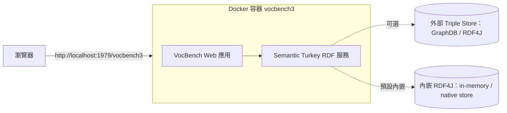
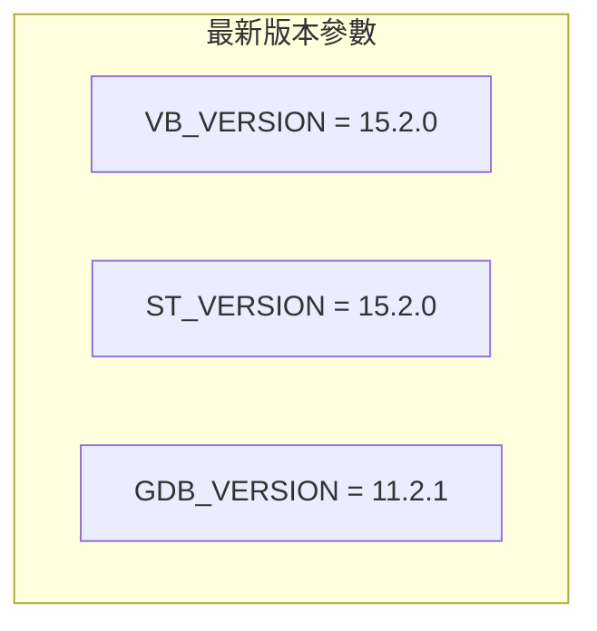
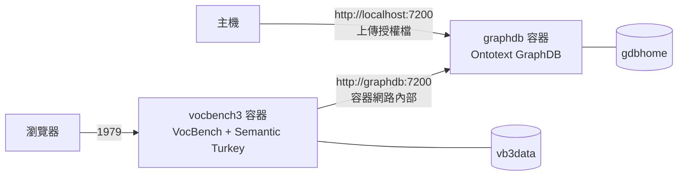

# VocBench 3 的 Docker 容器部署指南

本報告說明如何在 Docker 容器中架設 VocBench 3（以下簡稱 VB3）。內容涵蓋專案背景、Docker 映像的來源、單一容器部署、資料持久化、以及搭配 GraphDB 的 `docker-compose` 多容器部署，最後說明首次登入與常見注意事項。

## 1. 為何要在 Docker 中架設 VocBench 3

要理解 Docker 部署流程，必須先知道 VB3 的技術組成。VB3 是一套以網頁為基礎、支援多語言與協作的本體（ontology）編輯平台，用於管理 OWL 本體、SKOS（含 SKOS-XL）詞表、Ontolex-lemon 詞彙庫以及一般 RDF 資料集[^vocbench3-what]。它的商業邏輯與資料存取層由 **Semantic Turkey** 實作，後者是一套知識獲取與管理的開源平台，由羅馬第二大學（Tor Vergata University of Rome）的 ART 研究群（ART Research Group）開發[^vocbench3-what]。

由於 VB3 仰賴 Java 執行環境並包含一個內嵌的 RDF 後端，直接用發行版部署需要在主機安裝對應版本的 Java 並手動解壓縮。官方提供 Docker 映像正是為了簡化這個流程[^vb3-docker-readme]，讓整個系統（前端 Web 應用 + Semantic Turkey 後端）在單一容器內即可啟動。



## 2. 映像來源：官方 Bitbucket 專案

VB3 官方映像並非發佈在 Docker Hub 或 GitHub，而是由 ART 研究群放在 **Bitbucket** 的 `vocbench3-docker` 專案中[^vb3-docker-repo][^vb3-docker-readme]。因此「拉取現成映像」在此行不通，**必須自行以官方發行版建置映像**。

- 官方 Docker 專案位置：`https://bitbucket.org/art-uniroma2/vocbench3-docker`[^vb3-docker-repo]
- 官方發行版（full distribution）下載頁：`https://bitbucket.org/art-uniroma2/vocbench3/downloads/`[^vb3-downloads]
- 官方文件說明：Docker 發行版與 standalone 發行版一同提供，Docker 專案的 readme 檔案說明了一切安裝與執行方式[^vocbench3-doc]

映像的 tag 代表 VB3 的特定版本，`latest` 指向最新版本；報告撰寫當下，Docker README 指出最新版為 `15.2.0`[^vb3-docker-readme]。對應的官方發行版檔案為 `vocbench3-15.2.0-full.zip`（約 170 MB，發佈於 2026-10-23）[^vb3-downloads]。

> 註：官方專案位於 Bitbucket，無 GitHub 星號數可引用。社群另行發佈於 Docker Hub 的映像星號數普遍為 0，詳見第 6 節。

## 3. 前置需求

在開始之前，必須在主機準備以下項目：

- **Docker 引擎**（若使用多容器部署，另需 Docker Compose，官方文件以 `docker-compose` 指令操作）[^vb3-docker-readme]
- 官方 **VB3 full distribution ZIP 檔**（例如 `vocbench3-15.2.0-full.zip`），從官方下載頁取得[^vb3-downloads][^vb3-docker-readme]
- 若採用 GraphDB 部署，另需一個以 Semantic Turkey 所用 Java 版本（目前為 **Java 21**）建置的 `graphdb-lucene-fts-plugin` 外掛 ZIP 檔[^vb3-docker-readme]

官方 Dockerfile 以 `eclipse-temurin:17-alpine` 為基底映像，因此**容器內的執行環境為 Java 17**[^vb3-dockerfile]。此點與官方文件所述一致：使用 standalone 發行版時只需安裝 Java 17 或更新版本[^vocbench3-doc]。



## 4. 方法一：建置映像並執行單一容器

這是最精簡的部署方式，適合快速試用。

### 4.1 建置映像

1. `cd` 進入專案中與目標版本對應的子目錄（例如 `alpine/`）[^vb3-docker-readme]
2. 將完整的 VB3 發行版 ZIP 檔複製到該目錄[^vb3-docker-readme]
3. 執行建置指令[^vb3-docker-readme]：

```bash
docker build -t vocbench3:<version> .
```

其中 `<version>` 為版本號（例如 `15.2.0`）。注意指令結尾的句點 `.` 代表以當前工作目錄作為建置脈絡（build context），不可省略[^vb3-docker-readme]。

### 4.2 啟動容器

以**前景模式**啟動（會佔用終端機）[^vb3-docker-readme]：

```bash
docker run -it -p 1979:1979 --name vocbench3-instance-name vocbench3:tag
```

- `vocbench3-instance-name` 為自行指定的容器名稱（可選）[^vb3-docker-readme]
- `tag` 為欲使用的 VB3 版本標籤[^vb3-docker-readme]
- `-p` 將容器的 `1979` 埠對應至主機的同號埠；若僅允許本機存取，改用 `-p 127.0.0.1:1979:1979`[^vb3-docker-readme]

啟動後稍候片刻，VB3 應可透過 `http://localhost:1979/vocbench3` 存取[^vb3-docker-readme]。

改以**背景（detached）模式**啟動，只要移除 `-it` 並加上 `-d`[^vb3-docker-readme]：

```bash
docker run -d -p 1979:1979 --name vocbench3-instance-name vocbench3:tag
```

確認容器已啟動可執行 `docker ps`；停止容器則用 `docker stop vocbench3-instance-name`（或自動產生的容器 ID）[^vb3-docker-readme]。重新啟動既有容器[^vb3-docker-readme]：

```bash
docker start -ia vocbench3-instance-name   # 前景
docker start vocbench3-instance-name        # 背景
```

刪除容器（需先停止）[^vb3-docker-readme]：

```bash
docker rm vocbench3-instance-name
```

> **安全設計**：容器以映像內建立的專用非 root 使用者身分執行（UID/GID 為 `101979`），該使用者通常與主機上的任何使用者不同[^vb3-docker-readme][^vb3-dockerfile]。

## 5. 資料持久化

容器的可寫層（writable layer）在容器被刪除後內容會遺失，且不易從主機存取，也不易與其他容器共享[^vb3-docker-readme]。因此重要資料必須存放於掛載到容器的 **volume**。官方建議使用由 Docker 管理的 **named volume**，因其簡化了權限管理（對於像 VB3 這樣的非 root 容器尤其重要）[^vb3-docker-readme]。

### 5.1 使用 named volume（官方建議）

```bash
docker volume create vb3-stdata
docker run -it -v vb3-stdata:/opt/vocbench3/data -p 1979:1979 \
  --name vocbench3-instance-name vocbench3:tag
```

其中 `vb3-stdata` 儲存 VB3 後端 Semantic Turkey 的資料[^vb3-docker-readme]。volume 會跨容器執行持續存在，且必須在沒有容器使用時明確刪除[^vb3-docker-readme]：

```bash
docker volume rm vb3-stdata
```

備份與還原 volume 的常見做法[^vb3-docker-readme]：

```bash
# 備份
docker run --rm -v vb3-stdata:/data -v ${PWD}:/backup alpine \
  sh -c "cd /data && tar cvf /backup/volume_export.tar ."

# 還原
docker run --rm -v vb3-stdata:/data -v ${PWD}:/backup alpine \
  sh -c "mkdir /tmp/extracted && tar xvf /backup/volume_export.tar -C /tmp/extracted && rsync -av --delete /tmp/extracted/ /data/"
```

### 5.2 使用 bind mount

也可改用 bind mount 對應主機目錄[^vb3-docker-readme]：

```bash
docker run -it -v ${PWD}/vb3-stdata:/opt/vocbench3/data -p 1979:1979 \
  --name vocbench3-instance-name vocbench3:tag
```

使用 bind mount 時，必須讓容器內執行的非 root 使用者（UID/GID `101979`）對該目錄具有寫入權限，因此需調整目錄擁有者[^vb3-docker-readme]：

```bash
chown -R 101979:101979 ${PWD}/vb3-stdata
```

## 6. 方法二：搭配 Ontotext GraphDB 的 docker-compose 部署

官方專案附帶一份 `docker-compose.yml`，用於建立搭配 Ontotext GraphDB 的部署環境[^vb3-docker-readme]。GraphDB 在這套架構中做為外部 triple store（RDF 三元組儲存庫）。

### 6.1 版本參數

`.env` 檔案定義了三個版本參數[^vb3-env]：

```
ST_VERSION="15.2.0"
VB_VERSION="15.2.0"
GDB_VERSION="11.2.1"
```

### 6.2 docker-compose.yml 結構

```yaml
services:
  vocbench3:
    build:
      context: alpine
      args:
        vb_version: ${VB_VERSION}
        st_version: ${ST_VERSION}
    ports:
    - "1979:1979"
    volumes:
     - vb3data:/opt/vocbench3/data
    links:
    - graphdb
  graphdb:
    build:
      context: ./helpers/graphdb-with-st-sails
      args:
        vb_version: ${VB_VERSION}
        st_version: ${ST_VERSION}
        gdb_version: ${GDB_VERSION}
    ports:
     - "127.0.0.1:7200:7200"
    volumes:
     - gdbhome:/opt/graphdb/home
volumes:
  vb3data:
  gdbhome:
```

（以上為官方 `docker-compose.yml` 內容[^vb3-compose]。）

GraphDB 服務的映像由 `helpers/graphdb-with-st-sails/Dockerfile` 建置，它以 `ontotext/graphdb:${gdb_version}` 為基底，並把從 VB3 發行版中抽出的 `<...>-sail` JAR 檔及 Lucene 全文檢索外掛複製進 GraphDB 的 `lib` 目錄[^vb3-graphdb-dockerfile]。



### 6.3 部署步驟

依照官方說明[^vb3-docker-readme]：

1. 確認 `.env` 內含正確的版本號[^vb3-docker-readme]
2. 將完整的 VB3 發行版複製到 `helpers/graphdb-with-st-sails` 目錄[^vb3-docker-readme]
3. 用與 Semantic Turkey 相同的 Java 版本（目前為 Java 21）將 `https://github.com/Ontotext-AD/graphdb-lucene-fts-plugin` 建置出的 ZIP 檔複製到 `helpers/graphdb-with-st-sails` 目錄[^vb3-docker-readme]
4. 以背景模式啟動部署[^vb3-docker-readme]：

```bash
docker-compose up -d
```

執行後會產生兩個具名 volume：VB3 的 `vocbench3-docker_vb3data` 與 GraphDB 的 `vocbench3-docker_gdbhome`[^vb3-docker-readme]。

啟動完成後，VB3 應可於 `http://localhost:1979/vocbench3` 存取[^vb3-docker-readme]。GraphDB 實例已與 VB3（實際上是其後端 Semantic Turkey）連結，可在 VB3 容器內以 `http://graphdb:7200` 存取（例如建立以遠端儲存庫為後端的專案時）[^vb3-docker-readme]；在主機上則可透過 `http://localhost:7200` 存取，並可在此網頁介面上傳 GraphDB 授權檔[^vb3-docker-readme]。

停止部署[^vb3-docker-readme]：

```bash
docker-compose stop
```

> **警告**：舊版 `docker-compose.yaml` 使用 bind mount 而非具名 volume。若要沿用其資料，需先建立 tar 壓縮檔，再依前述還原指令解壓進 volume；且在建立 tar 壓縮檔前須先變更 VB3 檔案的擁有權[^vb3-docker-readme]。

## 7. 首次登入與管理員設定

VB3 首次被存取時，會偵測到系統中尚無任何使用者，因而顯示一個註冊表單；**第一位註冊的使用者會被自動升級為管理員**（administrator）[^vb3-first-access]。為方便將 VB3 當作單純的桌面工具使用，系統提供一個預先定義的示範使用者（電子郵件 `admin@vocbench.com`），只要點擊「Fill pre-defined user」按鈕即可自動填入必填資訊[^vb3-first-access]。Semantic Turkey 的官方文件同樣指出，由此服務建立的第一位使用者會自動被授予管理員角色[^st-first-access]。

註冊完成後，系統會導向設定頁面，讓管理員設定系統的核心組態（非強制，但為使系統如期運作所需）[^vb3-first-access]。

## 8. 後端儲存選項

理解後端選項有助於決定是否採用前述的 GraphDB 部署。VB3（更精確地說是其 RDF 後端 Semantic Turkey）內嵌了一套 RDF4J 發行版，提供兩種儲存方案：**in-memory store** 與 **native store**；使用此內嵌方案建立本地儲存庫非常方便，可讓使用者在無須額外安裝的情況下快速試用平台[^vocbench3-sys]（官方文件亦提及此點，但註記該份文件已過時，未反映近年新增的功能[^vocbench3-doc]）。然而，為了能完全掌控資料，官方建議改用獨立的 triple store 並以遠端方式連接[^vocbench3-sys]。支援的外部後端包括 RDF4J Server（VB 15.2.0 對應版本為 5.3.2）與 Ontotext GraphDB（10.x 或 11.x）[^vocbench3-sys]。

## 9. 社群映像（Docker Hub）

除官方 Bitbucket 專案外，Docker Hub 上存在若干由社群維護的 VB3 映像。以下整理了搜尋結果中與「vocbench」最相關者（星號數皆極低，多為 0）[^dockerhub-search]：

| 映像 | 說明 | 星號 | 拉取次數 | 最後更新 |
|---|---|---|---|---|
| `nvasiljevic/vocbench3` | 內含 Semantic Turkey 的 VB3 容器 | 0 | 20,735 | 2020-08-13[^dh-nvasiljevic] |
| `skarampatakis/vocbench-docker` | 用以設定並執行 VocBench v3 的映像（automated build） | 0 | 1,191 | 2018-10-25[^dh-skarampatakis] |
| `matthieubosquet/vocbench` | VocBench SKOS 詞表管理工具 | 0 | 589 | —[^dockerhub-search] |
| `sebastianesp/vocbench` | （無說明） | 0 | 623 | —[^dockerhub-search] |
| `mpparsley/vocbench` | （無說明） | 1 | 143 | —[^dockerhub-search] |

`skarampatakis/vocbench-docker` 的說明提供最簡流程[^dh-skarampatakis]：

```bash
docker build -t vocbench .
docker run -p 1979:1979 -d vocbench
```

之後即可於 `localhost:1979/vocbench3` 存取[^dh-skarampatakis]。

> **選用建議**：社群映像皆已多年未更新（最新者為 2020 年），且星號數極低。官方文件明確表示 Docker 發行版「隨 standalone 發行版一同提供」，並指向官方 Bitbucket 專案的 readme[^vocbench3-doc]。因此除非有特殊需求，否則**應優先採用官方 Bitbucket 專案的建置流程**，以確保取得與最新版本相符的映像。

## 10. 常見注意事項與疑難排解

- **不要在 Docker Hub 找官方映像**：官方映像位於 Bitbucket，需自行建置，無法 `docker pull`[^vb3-docker-repo][^vb3-docker-readme]。
- **建置指令的句點**：`docker build` 結尾的 `.` 為建置脈絡，缺少會導致建置失敗[^vb3-docker-readme]。
- **非 root 使用者權限**：容器以 UID/GID `101979` 執行；使用 bind mount 時務必先 `chown`，否則 VB3 無法寫入資料目錄[^vb3-docker-readme][^vb3-dockerfile]。
- **Java 版本一致性**：容器執行環境為 Java 17[^vb3-dockerfile]；GraphDB 部署的 Lucene 外掛則須以 Semantic Turkey 使用的 Java 版本（目前 Java 21）建置[^vb3-docker-readme]，兩者用途不同，勿混淆。
- **埠號**：VB3 對外為 `1979`[^vb3-docker-readme]；GraphDB 為 `7200`[^vb3-docker-readme]。
- **資料遺失風險**：未掛載 volume 的容器，其資料在容器刪除後即遺失[^vb3-docker-readme]。

## 11. 結論

在 Docker 中架設 VB3 的核心流程為：從官方 Bitbucket 下載頁取得 full distribution ZIP，放進官方 `vocbench3-docker` 專案的版本子目錄，以 `docker build` 建置映像，再以 `docker run`（需掛載 volume 以持久化資料）或 `docker-compose up -d`（搭配 GraphDB 做為外部 triple store）啟動，最後透過 `http://localhost:1979/vocbench3` 存取並註冊第一位管理員。由於官方映像不在 Docker Hub，必須自行建置；社群映像雖存在但普遍老舊且星號極低，建議優先採用官方流程。

## 參考文獻

[^vocbench3-what]: ART Group. (n.d.). *VocBench 3* [Docker image description]. Retrieved 2026-11-07, from https://bitbucket.org/art-uniroma2/vocbench3-docker/raw/HEAD/README.md

[^vb3-docker-readme]: ART Group. (n.d.). *VocBench 3 Docker — README*. Retrieved 2026-11-07, from https://bitbucket.org/art-uniroma2/vocbench3-docker/raw/HEAD/README.md

[^vb3-docker-repo]: ART Group. (n.d.). *vocbench3-docker repository*. Retrieved 2026-11-07, from https://bitbucket.org/art-uniroma2/vocbench3-docker

[^vb3-dockerfile]: ART Group. (n.d.). *alpine/Dockerfile*. Retrieved 2026-11-07, from https://bitbucket.org/art-uniroma2/vocbench3-docker/raw/HEAD/alpine/Dockerfile

[^vb3-compose]: ART Group. (n.d.). *docker-compose.yml*. Retrieved 2026-11-07, from https://bitbucket.org/art-uniroma2/vocbench3-docker/raw/HEAD/docker-compose.yml

[^vb3-env]: ART Group. (n.d.). *.env*. Retrieved 2026-11-07, from https://bitbucket.org/art-uniroma2/vocbench3-docker/raw/HEAD/.env

[^vb3-graphdb-dockerfile]: ART Group. (n.d.). *helpers/graphdb-with-st-sails/Dockerfile*. Retrieved 2026-11-07, from https://bitbucket.org/art-uniroma2/vocbench3-docker/raw/HEAD/helpers/graphdb-with-st-sails/Dockerfile

[^vb3-downloads]: ART Group. (2026). *VocBench 3 downloads*. Retrieved 2026-11-07, from https://bitbucket.org/art-uniroma2/vocbench3/downloads/

[^vocbench3-doc]: ART Group. (n.d.). *VocBench Documentation — Requirements and Installation*. Retrieved 2026-11-07, from https://vocbench.uniroma2.it/doc/

[^vb3-first-access]: ART Group. (n.d.). *First Access — Administrator registration*. Retrieved 2026-11-07, from https://vocbench.uniroma2.it/doc/user/first_access_adm.jsf

[^st-first-access]: ART Group. (n.d.). *Semantic Turkey Documentation — First Access*. Retrieved 2026-11-07, from https://semanticturkey.uniroma2.it/doc/user/first_access.jsf

[^vocbench3-sys]: ART Group. (n.d.). *System Administration Manual — Separate Triple Store*. Retrieved 2026-11-07, from https://vocbench.uniroma2.it/doc/sys/

[^dockerhub-search]: Docker Hub. (n.d.). *Repository search: "vocbench"*. Retrieved 2026-11-07, from https://hub.docker.com/search?q=vocbench

[^dh-nvasiljevic]: Docker Hub. (n.d.). *nvasiljevic/vocbench3*. Retrieved 2026-11-07, from https://hub.docker.com/r/nvasiljevic/vocbench3

[^dh-skarampatakis]: Docker Hub. (n.d.). *skarampatakis/vocbench-docker*. Retrieved 2026-11-07, from https://hub.docker.com/r/skarampatakis/vocbench-docker
