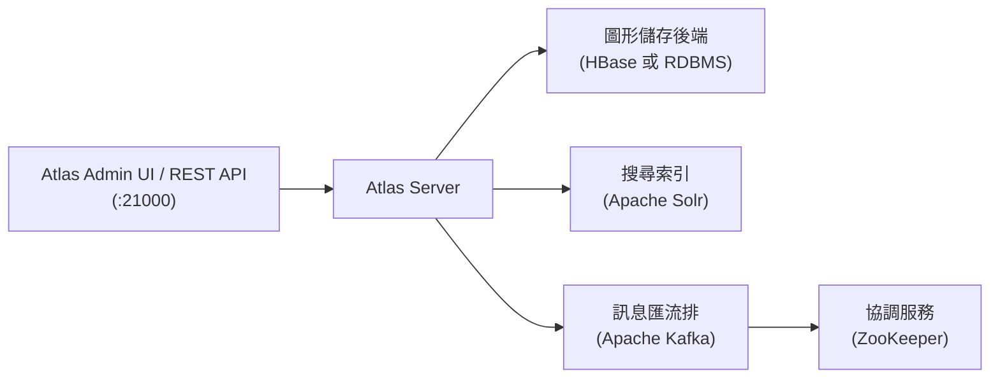

# 如何在 Docker 容器中架設 Apache Atlas

## 摘要

Apache Atlas 是 Apache 軟體基金會（Apache Software Foundation, ASF）旗下的開源後設資料（metadata）管理與資料治理（data governance）框架，原本為 Hadoop 生態系設計，用來集中管理資料資產的型別、血緣（lineage）與分類[^atlasGitHub]。它本身並非單一程式，而是由 Atlas 伺服器、圖形資料庫（graph database）、搜尋索引引擎、訊息匯流排（Kafka）與協調服務（ZooKeeper）等多個元件構成的系統[^atlasDockerReadme]。

本報告說明「如何把 Apache Atlas 放進 Docker 容器中執行」。這裡有一個關鍵前提必須先釐清：

- **Apache Atlas 官方並沒有在 Docker Hub 上發布任何可直接 `docker pull` 的官方映像檔**。截至本報告撰寫時，Docker Hub 上的 `apache/atlas` 儲存庫沒有任何已發布的標籤（tag）[^atlasDockerHub]。因此官方支援的 Docker 用法是「**從原始碼建置**」：透過官方 GitHub 儲存庫中的 `dev-support/atlas-docker/` 目錄，以 Docker Compose 組合出整套服務[^atlasDockerReadme]。
- 若只想「快速跑起來看看」，社群維護的 `sburn/apache-atlas` 映像檔是一個現成的替代方案，它使用內嵌式的 HBase 與 Solr，下載後即可直接執行[^sburnReadme]。

本報告為獨立文件，所有需要的背景知識都收錄在內。讀者只要具備 Docker 與 Docker Compose 的基本操作經驗，即可依本報告完成架設。

---

## 一、Apache Atlas 簡介

### 1.1 後設資料管理是什麼

在資料平台中，除了資料本身，還有「描述資料的資料」，也就是**後設資料（metadata）**：某張資料表有哪些欄位、欄位型別為何、這張表由哪個上游工作產生、又被哪個下游報表使用、是否含有個人敏感資訊等[^atlasGitHub]。當資料資產數量成長到數百、數千項時，人工作業無法掌握全貌，於是需要一套集中式的後設資料系統。

Apache Atlas 提供的核心能力包括[^atlasGitHub][^atlasAtlasDocs]：

| 能力 | 說明 |
|---|---|
| 資料分類（Data Classification） | 建立分類（如 PII、機密）並標記到資料資產 |
| 集中稽核（Centralized Auditing） | 記錄所有後設資料變更事件，供追蹤 |
| 搜尋與血緣（Search & Lineage） | 依型別／分類搜尋資產，並呈現資料流動關係 |
| 安全與資料治理 | 以細粒度授權控管存取，橋接治理與合規需求 |
| 模型／型別系統（Type System） | 建立定義後設資料物件結構的型別與關聯 |

### 1.2 Atlas 的系統組成

Atlas 的伺服器本身不負責儲存圖形資料與索引，而是依賴外部元件[^atlasDockerReadme]：



- **圖形儲存後端（Graph Storage Backend）**：儲存 Atlas 的型別與實體（entity）。官方 Docker 支援兩種：HBase（`hbase2`）或關聯式資料庫（RDBMS，例如 PostgreSQL）[^atlasDockerReadme][^atlasHbaseProps][^atlasPostgresProps]。
- **搜尋索引（Search Index）**：使用 Apache Solr 提供全文與屬性搜尋[^atlasHbaseProps]。
- **訊息匯流排（Notification）**：Atlas 透過 Kafka 發布與訂閱後設資料變更事件，Kafka 需要 ZooKeeper 協調[^atlasHbaseProps]。
- **Atlas REST 伺服器（可選）**：獨立接收 hook 通知的 REST 服務，預設埠為 `41000`[^atlasDockerReadme]。

---

## 二、方法一：社群現成映像檔（最快上手）

若只是想快速體驗 Atlas，社群維護的 `sburn/apache-atlas` 是最省事的方式。該映像檔由 Apache Atlas **2.3.0** 的發行原始碼建置，並修補成可在容器中執行；它內建**內嵌式 HBase + Solr**，且已預先初始化，下載映像檔後無需額外設定即可使用[^sburnReadme]。

> 該專案為社群維護，非官方發布。GitHub 上的 `sburn/docker-apache-atlas` 儲存庫約有 144 顆星、70 次 fork，授權為 Apache-2.0[^sburnRepo]；對應的 Docker Hub 映像檔累計下載次數超過 94 萬次，顯示實際採用度相當高，但最後一次更新映像檔為 2022-12-15[^sburnDockerHub]。

### 2.1 基本用法

啟動 Atlas，對外開放 Web UI 埠 `21000`[^sburnReadme]：

```bash
docker run -d \
    -p 21000:21000 \
    --name atlas \
    sburn/apache-atlas
```

首次啟動可能需要數分鐘，之後即可從 `http://localhost:21000/` 存取。預設帳密為 `admin / admin`[^sburnReadme]。

### 2.2 常用操作

```bash
# 優雅地停止 Atlas
docker exec -ti atlas /apache-atlas/bin/atlas_stop.py

# 查看啟動腳本輸出
docker logs atlas

# 持續追蹤 application.log（首次啟動與除錯很有用）
docker exec -ti atlas tail -f /apache-atlas/logs/application.log

# 執行範例（加入範例型別、實體與 traits）
docker exec -ti atlas /apache-atlas/bin/quick_start.py
```

以上指令均出自該映像檔的官方 README[^sburnReadme]。

### 2.3 資料持久化與自訂設定

預設狀態下容器內的資料不會保留在宿主機。若要**資料持久化**，把資料目錄掛載到宿主機[^sburnReadme]：

```bash
docker run --detach \
    -v ${PWD}/data:/apache-atlas/data \
    -p 21000:21000 \
    --name atlas \
    sburn/apache-atlas
```

若要用**自訂設定**，把 conf 目錄掛載出來[^sburnReadme]：

```bash
docker run --detach \
    -v ${PWD}/pre-conf:/apache-atlas/conf \
    -p 21000:21000 \
    --name atlas \
    sburn/apache-atlas
```

若需**探索日誌**，把 logs 目錄掛載到宿主機[^sburnReadme]：

```bash
docker run --detach \
    -v ${PWD}/atlas-logs:/apache-atlas/logs \
    -p 21000:21000 \
    --name atlas \
    sburn/apache-atlas
```

### 2.4 可用的環境變數

該映像檔支援以下環境變數[^sburnReadme]：

| 變數名稱 | 預設值 | 說明 |
|---|---|---|
| `JAVA_HOME` | `/usr/lib/jvm/java-8-openjdk-amd64` | 使用的 Java 實作 |
| `ATLAS_OPTS` | 無 | 額外的 Java 選項，套用於 client 與 server |
| `ATLAS_CLIENT_OPTS` | 無 | 僅套用於 client 的額外 Java 選項 |
| `ATLAS_CLIENT_HEAP` | 無 | client 的 Java 堆積大小，預設 1024MB |
| `ATLAS_SERVER_OPTS` | 無 | 套用於 Atlas 服務的額外選項 |
| `ATLAS_SERVER_HEAP` | 無 | Atlas 伺服器的 Java 堆積大小，預設 1024MB |
| `ATLAS_HOME_DIR` | 無 | Atlas 安裝根目錄 |
| `ATLAS_LOG_DIR` | 無 | 日誌儲存位置 |
| `ATLAS_PID_DIR` | 無 | PID 檔儲存位置 |
| `ATLAS_EXPANDED_WEBAPP_DIR` | 無 | WAR 檔展開的位置 |

> **注意事項**：該映像檔在 Docker rootless 模式下可能無法正確啟動[^sburnReadme]。此外它內建的是較舊的 Atlas 2.3.0，若要最新功能應改用方法二自行建置[^sburnReadme]。

---

## 三、方法二：官方 Docker Compose 從原始碼建置（官方支援）

這是 Apache Atlas 專案官方維護的 Docker 方案，位於 `apache/atlas` 儲存庫的 `dev-support/atlas-docker/` 目錄中[^atlasDockerReadme]。它會以 Docker Compose 把 Atlas 與其依賴服務（ZooKeeper、Kafka、Solr，以及 HBase 或 Postgres 後端）全部建成容器並啟動。

### 3.1 前置需求

- 近期版本的 Docker（官方文件撰寫時為 Engine 20.10.5、Compose 1.28.5）[^atlasDockerReadme]。
- Docker 至少配置 **6 GB 記憶體**[^atlasDockerReadme]。

### 3.2 步驟一：取得原始碼

```bash
git clone https://github.com/apache/atlas.git
cd atlas/dev-support/atlas-docker
```

### 3.3 步驟二：下載依賴壓縮檔

```bash
chmod +x download-archives.sh
./download-archives.sh
```

此腳本會依 `.env` 內的版本設定，下載 Hadoop、HBase、Kafka、Hive 的壓縮檔到本機 `downloads/` 快取目錄，供後續建置映像檔使用[^atlasDockerReadme][^atlasDownloadScript]。

### 3.4 步驟三：設定建置環境變數

```bash
export DOCKER_BUILDKIT=1
export COMPOSE_DOCKER_CLI_BUILD=1
```

### 3.5 步驟四：建置 atlas-base 映像檔

```bash
docker compose -f docker-compose.atlas-base.yml build
```

`Dockerfile.atlas-base` 以 Ubuntu 20.04 為基底，安裝 Java 8／11／17、Python3、pip、SSH 等，並建立 atlas、hadoop 等使用者與目錄結構[^atlasDockerfileBase]。

### 3.6 步驟五：建置 Apache Atlas

```bash
mkdir -p ${HOME}/.m2
docker compose -f docker-compose.atlas-build.yml up
```

這一步會啟動一個建置容器，掛載宿主機的 `${HOME}/.m2` 作為 Maven 快取、以及本機原始碼目錄，編譯 Atlas 並產出 `dist/apache-atlas-${ATLAS_VERSION}-server.tar.gz`[^atlasDockerReadme][^atlasBuildCompose]。**依 `${HOME}/.m2` 快取狀態，建置時間最長可能需要約一小時**[^atlasDockerReadme]。

### 3.7 步驟六：啟動 Atlas

官方提供兩種後端選擇，可任選其一。

**選項 A — 使用 PostgreSQL 作為後端儲存（較簡單，建議初學）**[^atlasDockerReadme]：

```bash
export ATLAS_BACKEND=postgres
docker compose -f docker-compose.atlas.yml -f docker-compose.atlas-postgres.yml up -d --wait
```

此 overlay 會先執行一次性的 `config/init_postgres.sh` 初始化服務，建立所需的角色（role）、資料庫與 Atlas RDBMS schema，之後才啟動 Atlas[^atlasDockerReadme][^atlasInitPostgres]。Postgres 模式下 Atlas 使用 `atlas.graph.storage.backend=rdbms` 搭配 PostgreSQL 驅動與連線設定（`jdbc:postgresql://atlas-db/atlas`）[^atlasPostgresProps]。

**選項 B — 使用 HBase 作為後端儲存**[^atlasDockerReadme]：

```bash
export ATLAS_BACKEND=hbase
docker compose -f docker-compose.atlas.yml -f docker-compose.atlas-hadoop.yml up -d --wait
```

Atlas 會安裝於 `/opt/atlas/`，日誌位於 `/var/log/atlas`[^atlasDockerReadme]。

### 3.8 步驟七（可選）：啟動 Atlas REST 通知伺服器

若需要 hook 通知的 REST 端點，在 Atlas 已啟動後執行（Kafka 與 ZooKeeper 必須已就緒）[^atlasDockerReadme]：

```bash
# 搭配 Postgres 後端
export ATLAS_BACKEND=postgres
docker compose -f docker-compose.atlas.yml -f docker-compose.atlas-postgres.yml -f docker-compose.atlas-rest.yml up -d --build --wait atlas-rest

# 搭配 HBase 後端
export ATLAS_BACKEND=hbase
docker compose -f docker-compose.atlas.yml -f docker-compose.atlas-hadoop.yml -f docker-compose.atlas-rest.yml up -d --build --wait atlas-rest
```

此 REST 伺服器的封包由 atlas-build 步驟產生，hook 通知會送到埠 **41000**（例如 `http://localhost:41000/rest/api/atlas/v2/notification/topic/{topicName}`），帳密與 Atlas 相同（`admin` / `atlasR0cks!`）[^atlasDockerReadme]。

### 3.9 步驟八：存取 Atlas Admin UI

開啟 `http://localhost:21000`，使用帳號 `admin`、密碼 `atlasR0cks!` 登入[^atlasDockerReadme]。

---

## 四、官方 Compose 堆疊的服務與埠

官方 `dev-support/atlas-docker` 方案由下列服務組成。以下埠彙整自各 compose 檔案與官方 README[^atlasDockerReadme][^atlasCompose][^atlasCommonCompose]：

| 服務／容器 | 映像檔／來源 | 用途 | 埠 |
|---|---|---|---|
| `atlas` | 自建 `atlas:latest` | Atlas 伺服器本體 | `21000` |
| `atlas-rest` | 自建 `atlas-rest` | REST 通知伺服器（可選） | `41000` |
| `atlas-solr` | 自建（`Dockerfile.atlas-solr`） | 搜尋索引 | `8983` |
| `atlas-kafka` | 自建（Kafka 3.9.1） | 訊息匯流排 | `9092` |
| `atlas-zk` | 自建（`Dockerfile.atlas-zk`） | 協調服務 | `2181` |
| `atlas-db` | 官方 `postgres:13.21` | Postgres 後端（Postgres 模式） | `5432` |
| `atlas-backend` | 依後端而定（HBase 或 Postgres） | 圖形儲存後端 | 依後端而定 |

> **重要**：無論選哪種後端，**Kafka 與 ZooKeeper 都是必需的**，因為 Atlas 使用它們處理通知與事件[^atlasDockerReadme][^atlasHbaseProps]。Postgres 模式較單純；HBase 模式需要額外的 Hadoop overlay（HDFS + YARN），複雜度較高。

### 4.1 掛載點與設定檔

官方 compose 會把下列內容從宿主機掛載進容器[^atlasCompose]：

| 宿主機路徑 | 容器內路徑 | 說明 |
|---|---|---|
| `./config/atlas/${ATLAS_BACKEND}/atlas-application.properties` | `/opt/atlas/conf/atlas-application.properties` | Atlas 主要設定（唯讀） |
| `./config/atlas/users-credentials.properties` | `/opt/atlas/conf/users-credentials.properties` | 使用者帳密（唯讀） |
| `./data` | `/home/atlas/data` | 資料持久化目錄 |

`users-credentials.properties` 以 `username=group::sha256-password` 格式描述帳密，例如 `admin=ADMIN::<sha256 雜湊>`[^atlasUsersCreds]。設定檔中的 `atlas.authentication.method.file=true` 表示採用檔案式驗證[^atlasHbaseProps]。

---

## 五、關鍵建置參數與版本

官方 `dev-support/atlas-docker/.env` 控制所有版本與建置參數[^atlasEnv]：

| 變數 | 預設值 | 說明 |
|---|---|---|
| `BUILD_HOST_SRC` | `true` | 使用本機原始碼或從 Git 複製 |
| `SKIPTESTS` | `true` | 建置時略過 Maven 測試 |
| `GIT_URL` | `https://github.com/apache/atlas.git` | 建置用的 Git 來源 |
| `BRANCH` | `master` | 要建置的分支／ref |
| `PROFILE` | `dist,external-hbase-solr` | Maven profiles |
| `ATLAS_BASE_JAVA_VERSION` | `17` | base 映像檔的 Java 版本（8／11／17） |
| `ATLAS_BUILD_JAVA_VERSION` | `17` | 建置容器的 Java 版本 |
| `ATLAS_SERVER_JAVA_VERSION` | `17` | Atlas 伺服器的 Java 版本 |
| `ATLAS_VERSION` | `3.0.0-SNAPSHOT` | 要建置的 Atlas 版本 |
| `UBUNTU_VERSION` | `20.04` | Ubuntu 基底映像檔版本 |
| `HADOOP_VERSION` | `3.4.2` | Hadoop 版本 |
| `HBASE_VERSION` | `2.6.4` | HBase 版本 |
| `KAFKA_VERSION` | `3.9.1` | Kafka 版本 |
| `HIVE_VERSION` | `4.1.0` | Hive 版本 |
| `ATLAS_BACKEND` | `hbase` | 後端型別（`hbase` 或 `postgres`） |

官方發行版可從 Apache 下載伺服器取得，截至本報告撰寫時最新為 **2.5.0**（2026-04-30 發布），歷史版本含 2.4.0、2.3.0、2.2.0、2.1.0、2.0.0、1.2.0、0.8.4[^atlasReleases]。

---

## 六、兩種方法比較與選擇建議

| 面向 | 方法一：`sburn/apache-atlas` | 方法二：官方 Docker Compose |
|---|---|---|
| 上手難度 | 低，`docker run` 一行即可 | 高，需下載依賴、建置原始碼（可長達一小時） |
| 官方支援 | 否（社群維護） | 是（Apache Atlas 專案維護） |
| Atlas 版本 | 2.3.0（內建） | 可自選（`.env` 內 `ATLAS_VERSION`） |
| 後端 | 內嵌 HBase + Solr（已初始化） | HBase 或 PostgreSQL 可選 |
| 依賴服務 | 全部內嵌於單一容器 | 各依賴獨立容器（Compose 管理） |
| 預設帳密 | `admin / admin` | `admin / atlasR0cks!` |
| 適用情境 | 快速體驗、示範、開發測試 | 貼近正式環境、需要特定版本或外部後端 |

**選擇建議**：

- 若目標是**快速驗證、教學或輕量測試**，選方法一（`sburn/apache-atlas`），一行指令即可。
- 若目標是**追最新版本、使用官方支援的設定、或需要 PostgreSQL／外部 HBase 後端**，選方法二（官方 Compose）。
- 若處於 **Docker rootless 模式**，方法一可能無法啟動，宜改用方法二[^sburnReadme]。

---

## 七、來源批判性反思

- **官方性與權威性**：方法二的資訊全部來自 Apache Atlas 官方 GitHub 儲存庫的 `dev-support/atlas-docker/` 目錄與 `.env`、compose 檔案，屬第一手權威來源[^atlasDockerReadme][^atlasEnv][^atlasCompose]。方法一的資訊來自 `sburn/docker-apache-atlas` README，屬單一維護者（Vadim Korchagin）維護的社群專案，權威性低於官方，但其約 144 顆星與 70 次 fork 顯示社群採用度尚可[^sburnRepo]。
- **時效性**：方法一的映像檔建置於 Atlas 2.3.0，該儲存庫最後推送時間為 2023-12-25，屬較舊且維護活動趨緩的專案[^sburnRepo]。方法二位於官方 `master` 分支，`apache/atlas` 儲存庫在 2026-10-30 仍有推送，代表仍持續維護[^atlasRepo]。
- **需注意的落差**：官方 README 使用 `ATLAS_VERSION=3.0.0-SNAPSHOT`（開發快照版），與實際穩定發行版 2.5.0 不同；若要求穩定性，應在 `.env` 中改用穩定發行版本或對應的 `BRANCH`[^atlasEnv][^atlasReleases]。
- **未找到官方 Docker Hub 映像檔**：經查詢，Docker Hub 上的 `apache/atlas` 並無任何已發布標籤[^atlasDockerHub]。因此「官方 Docker 映像檔」一詞容易被誤解，實際上官方僅提供「自建映像檔」的 Dockerfile 與 Compose 腳本，本報告已明確區分這點。

---

## 參考文獻

[^atlasGitHub]: Apache Software Foundation. (n.d.). *Apache Atlas - Open Metadata Management and Governance capabilities across the Hadoop platform and beyond*. Retrieved 2026-11-07, from https://github.com/apache/atlas

[^atlasRepo]: Apache Software Foundation. (2026). *apache/atlas* [GitHub repository metadata]. Retrieved 2026-11-07, from https://api.github.com/repos/apache/atlas

[^atlasDockerReadme]: Apache Software Foundation. (n.d.). *atlas-docker/README.md* [Source code]. Retrieved 2026-11-07, from https://raw.githubusercontent.com/apache/atlas/master/dev-support/atlas-docker/README.md

[^atlasEnv]: Apache Software Foundation. (n.d.). *atlas-docker/.env* [Source code]. Retrieved 2026-11-07, from https://raw.githubusercontent.com/apache/atlas/master/dev-support/atlas-docker/.env

[^atlasCompose]: Apache Software Foundation. (n.d.). *atlas-docker/docker-compose.atlas.yml* [Source code]. Retrieved 2026-11-07, from https://raw.githubusercontent.com/apache/atlas/master/dev-support/atlas-docker/docker-compose.atlas.yml

[^atlasCommonCompose]: Apache Software Foundation. (n.d.). *atlas-docker/docker-compose.atlas-common.yml* [Source code]. Retrieved 2026-11-07, from https://raw.githubusercontent.com/apache/atlas/master/dev-support/atlas-docker/docker-compose.atlas-common.yml

[^atlasBuildCompose]: Apache Software Foundation. (n.d.). *atlas-docker/docker-compose.atlas-build.yml* [Source code]. Retrieved 2026-11-07, from https://raw.githubusercontent.com/apache/atlas/master/dev-support/atlas-docker/docker-compose.atlas-build.yml

[^atlasPostgresCompose]: Apache Software Foundation. (n.d.). *atlas-docker/docker-compose.atlas-postgres.yml* [Source code]. Retrieved 2026-11-07, from https://raw.githubusercontent.com/apache/atlas/master/dev-support/atlas-docker/docker-compose.atlas-postgres.yml

[^atlasDockerfileBase]: Apache Software Foundation. (n.d.). *atlas-docker/Dockerfile.atlas-base* [Source code]. Retrieved 2026-11-07, from https://raw.githubusercontent.com/apache/atlas/master/dev-support/atlas-docker/Dockerfile.atlas-base

[^atlasDownloadScript]: Apache Software Foundation. (n.d.). *atlas-docker/download-archives.sh* [Source code]. Retrieved 2026-11-07, from https://raw.githubusercontent.com/apache/atlas/master/dev-support/atlas-docker/download-archives.sh

[^atlasInitPostgres]: Apache Software Foundation. (n.d.). *atlas-docker/config/init_postgres.sh* [Source code]. Retrieved 2026-11-07, from https://raw.githubusercontent.com/apache/atlas/master/dev-support/atlas-docker/config/init_postgres.sh

[^atlasHbaseProps]: Apache Software Foundation. (n.d.). *atlas-docker/config/atlas/hbase/atlas-application.properties* [Source code]. Retrieved 2026-11-07, from https://raw.githubusercontent.com/apache/atlas/master/dev-support/atlas-docker/config/atlas/hbase/atlas-application.properties

[^atlasPostgresProps]: Apache Software Foundation. (n.d.). *atlas-docker/config/atlas/postgres/atlas-application.properties* [Source code]. Retrieved 2026-11-07, from https://raw.githubusercontent.com/apache/atlas/master/dev-support/atlas-docker/config/atlas/postgres/atlas-application.properties

[^atlasUsersCreds]: Apache Software Foundation. (n.d.). *atlas-docker/config/atlas/users-credentials.properties* [Source code]. Retrieved 2026-11-07, from https://raw.githubusercontent.com/apache/atlas/master/dev-support/atlas-docker/config/atlas/users-credentials.properties

[^atlasReleases]: Apache Software Foundation. (2026). *Index of /atlas* [Apache archive distribution directory]. Retrieved 2026-11-07, from https://dlcdn.apache.org/atlas/ and https://archive.apache.org/dist/atlas/2.5.0/

[^atlasDockerHub]: Docker Hub. (n.d.). *apache/atlas* [Docker image repository]. Retrieved 2026-11-07, from https://hub.docker.com/r/apache/atlas

[^sburnReadme]: Korchagin, V. (n.d.). *Apache Atlas Docker image* [Source code]. Retrieved 2026-11-07, from https://raw.githubusercontent.com/sburn/docker-apache-atlas/master/README.md

[^sburnRepo]: Korchagin, V. (2026). *sburn/docker-apache-atlas* [GitHub repository metadata]. Retrieved 2026-11-07, from https://api.github.com/repos/sburn/docker-apache-atlas

[^sburnDockerHub]: Docker Hub. (2024). *sburn/apache-atlas* [Docker image repository metadata]. Retrieved 2026-11-07, from https://hub.docker.com/v2/repositories/sburn/apache-atlas/

[^atlasAtlasDocs]: Apache Software Foundation. (n.d.). *Apache Atlas – Data Governance and Metadata framework for Hadoop* [Project documentation]. Retrieved 2026-11-07, from https://atlas.apache.org/#/Installation
