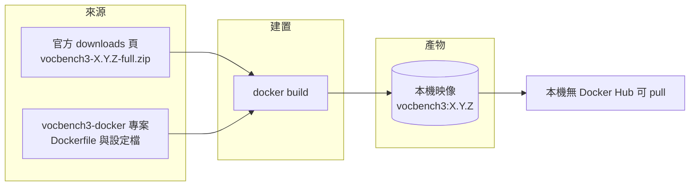
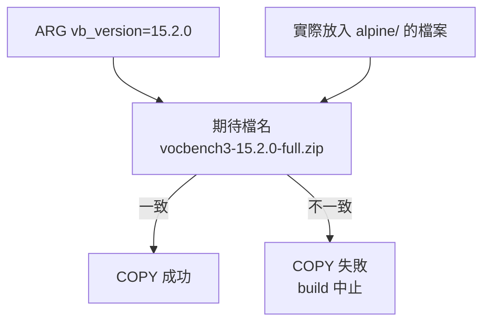
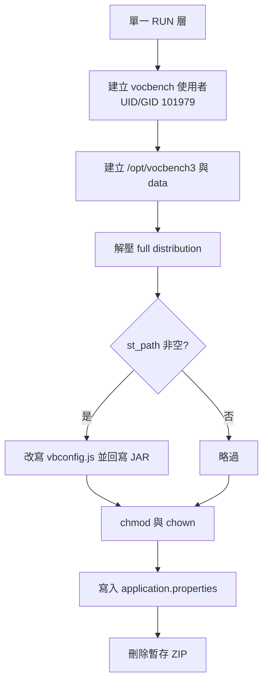
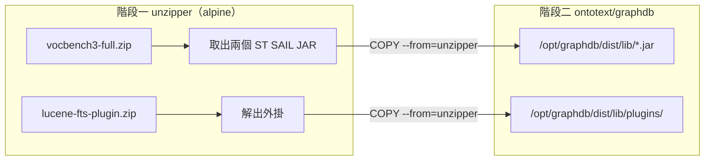

# VocBench 3：Docker 映像建置流程詳解

本報告聚焦於單一主題：**如何從原始碼建置 VocBench 3（以下簡稱 VB3）的 Docker 映像**。VB3 的官方 Docker 專案並未提供可 `docker pull` 的現成映像，而是要求使用者自行以官方發行版建置，因此「建置」是整個部署流程中最容易出錯、也最少被完整說明的一步。本報告從建置脈絡（build context）的檔案準備開始，逐行解析官方 `Dockerfile`，說明每個指令與每個建置參數的作用，再說明搭配 GraphDB 時的第二個映像（多階段建置），最後整理常見錯誤與版本演變。

## 1. 背景：為什麼需要「自行建置」

VB3 是一套以網頁為基礎、支援多語言與協作的本體（ontology）編輯平台，可管理 OWL 本體、SKOS（含 SKOS-XL）詞表、Ontolex-lemon 詞彙庫以及一般 RDF 資料集[^vb3-what]。其商業邏輯與資料存取層由 **Semantic Turkey** 實作，後者是一套知識獲取與管理的開源平台，由羅馬第二大學（Tor Vergata University of Rome）的 ART 研究群（ART Research Group）開發[^vb3-what]。

VB3 仰賴 Java 執行環境，官方提供兩種發行方式：一是 standalone 發行版（解壓縮即可執行），二是 Docker 發行版[^vb3-doc]。Docker 發行版的專案位於 Bitbucket 的 `vocbench3-docker` 儲存庫[^vb3-repo]，其 readme 開頭即以「Supported tags」說明映像標籤代表特定版本[^vb3-readme]。然而該專案本身**只包含 Dockerfile 與組態檔，不包含發行版 ZIP**，也不在 Docker Hub 上提供映像；使用者必須自行下載發行版 ZIP，放進對應目錄後執行 `docker build`[^vb3-readme]。



換言之，「映像來源」不是登錄檔（registry），而是「官方發行版 ZIP + 官方 Dockerfile」的組合；建置指令是唯一取得映像的途徑[^vb3-readme]。

## 2. 建置所需的目錄與檔案

`vocbench3-docker` 儲存庫在最新提交（commit `e52abee8`）下的頂層結構如下[^vb3-tree]：

| 路徑 | 類型 | 用途 |
|---|---|---|
| `.env` | 檔案 | 定義三個版本號變數，供 `docker-compose` 使用[^vb3-env] |
| `README.md` | 檔案 | 官方操作說明[^vb3-readme] |
| `docker-compose.yml` | 檔案 | 定義 VB3 + GraphDB 雙容器部署[^vb3-compose] |
| `alpine/` | 目錄 | 內含 VB3 映像的 `Dockerfile`[^vb3-tree] |
| `helpers/graphdb-with-st-sails/` | 目錄 | 內含 GraphDB 映像的 `Dockerfile`[^vb3-tree] |

其中 `alpine/` 目錄在 HEAD 下**只有一個檔案 `Dockerfile`**[^vb3-alpine-dir]，因此「與目標版本對應的子目錄」指的就是這個 `alpine/`。**發行版 ZIP 並非版控內容，必須由使用者自行複製進去**：官方 readme 明確要求將 VB3 的 *full* distribution 複製到該目錄，再於該目錄執行建置指令[^vb3-readme]。

### 2.1 版本對應關係

建置時有三個版本號需要留意，它們分別是 VB3 版本、Semantic Turkey 版本與 GraphDB 版本。官方 `.env` 目前內容為[^vb3-env]：

```
ST_VERSION="15.2.0"
VB_VERSION="15.2.0"
GDB_VERSION="11.2.1"
```

三者之中，**VB3 與 Semantic Turkey 的版本號在目前版本是相同的**（皆為 `15.2.0`）[^vb3-env]。官方 downloads 頁的最新檔案為 `vocbench3-15.2.0-full.zip`，大小 170,499,688 位元組（約 163 MiB），發佈於 2026-10-23[^vb3-downloads-api]。`vocbench3-docker` 專案亦已標記 `15.2.0` 標籤[^vb3-tags]，與發行版一致。

### 2.2 ZIP 檔名的嚴格要求

這是最關鍵、也最容易被忽略的一點。`Dockerfile` 中是以**變數展開後的固定檔名**來複製 ZIP[^vb3-alpine-dockerfile]：

```dockerfile
ARG vb_version=15.2.0
COPY vocbench3-${vb_version}-full.zip /tmp
```

因此建置時，被複製的檔案名稱必須**恰好**是 `vocbench3-<vb_version>-full.zip`。官方下載頁提供的檔名（例如 `vocbench3-15.2.0-full.zip`）正好符合此規則[^vb3-downloads-api]。若使用者下載後重新命名（例如縮短為 `vocbench3-full.zip`），或 `vb_version` 與實際檔名不一致，`COPY` 步驟會因找不到檔案而失敗。



## 3. 前置需求

- **Docker 引擎**：官方 Dockerfile 以 `eclipse-temurin:17-alpine` 為基底映像[^vb3-alpine-dockerfile]，該標籤在 Docker Hub 上存在且持續更新（`17-alpine` 於 2026-11-05 更新，對應 Alpine 3.24）[^temurin-tag]。因此主機端只需能執行 Docker 即可；Java 執行環境由容器提供。
- **Docker Compose**：若要走搭配 GraphDB 的雙容器路線，另需 Compose（官方文件以 `docker-compose` 指令操作）[^vb3-readme]。
- **要下載的檔案**：官方 VB3 full distribution ZIP[^vb3-downloads-api]；GraphDB 路線另需 `graphdb-lucene-fts-plugin` 外掛 ZIP[^vb3-readme]。
- **充足的磁碟空間**：單是壓縮檔即約 163 MiB，解壓後、加上基底映像與各層，佔用會明顯放大。

## 4. 方法一：建置單一 VB3 映像

這是不需要外部 triple store、最精簡的建置方式。

### 4.1 建置步驟

官方 readme 給出的步驟如下[^vb3-readme]：

1. `cd` 進入與目標版本對應的子目錄（即 `alpine/`）。
2. 將 VB3 的 *full* distribution ZIP 複製到該目錄。
3. 執行建置指令：

```bash
docker build -t vocbench3:<version> .
```

其中 `<version>` 為版本號（例如 `15.2.0`）。官方特別強調**指令結尾的句點（`.`）不可省略**，它代表以當前工作目錄的檔案作為建置脈絡（build context）[^vb3-readme]。

### 4.2 為什麼句點不能省

`docker build` 的位置參數（`PATH | URL | -`）指定的就是建置脈絡，也就是「建置過程可以存取的檔案集合」；當脈絡是本地目錄時，該目錄的內容會被送往建置器[^docker-context]。句點 `.` 代表「當前目錄」。少了它，建置指令語法不完整；指定錯誤的路徑，則 `COPY vocbench3-<version>-full.zip /tmp` 會找不到 ZIP 而失敗[^docker-context][^vb3-alpine-dockerfile]。

此外，Docker 在建置時會先讀取脈絡根目錄下的 `.dockerignore`，符合樣式的檔案會在送往建置器前被排除[^docker-dockerignore]。官方專案並未附 `.dockerignore`[^vb3-tree]，因此 `alpine/` 內的所有檔案（含那個約 163 MiB 的 ZIP）都會被完整送往建置器；這正是 `COPY` 能取得 ZIP 的原因，也意味著建置啟動時會有一次明顯的「transferring context」延遲[^docker-context]。

### 4.3 覆寫版本參數（進階）

`Dockerfile` 開頭以 `ARG` 定義了五個可覆寫的參數[^vb3-alpine-dockerfile]：

```dockerfile
ARG vb_version=15.2.0
ARG st_version=15.2.0
ARG st_path=""
ARG VB_UID=101979
ARG VB_GID=101979
```

`ARG` 定義的變數可由使用者在建置時透過 `--build-arg <名稱>=<值>` 傳入；與 `ENV` 不同，`ARG` 的值**不會被寫入最終映像、也不會存在於最終容器中**，且變數自其宣告的那一行起才生效[^docker-arg]。因此，若想建置與預設不同的版本，可如此覆寫：

```bash
docker build \
  --build-arg vb_version=15.1.2 \
  --build-arg st_version=15.1.2 \
  -t vocbench3:15.1.2 .
```

（前提是放入的 ZIP 檔名與 `vb_version` 相符。）這也是 `docker-compose.yml` 傳入版本號所用的機制：它將 `.env` 的 `${VB_VERSION}`、`${ST_VERSION}` 以 `build.args` 形式往下傳[^vb3-compose]。

`st_path` 參數預設為空字串，用途是自訂前端應用程式的存取路徑前綴（見 5.4 節）。`VB_UID` 與 `VB_GID` 預設為 `101979`，決定容器內非 root 使用者的 UID/GID（見 5.5 節）[^vb3-alpine-dockerfile]。

### 4.4 常見建置選項

| 選項 | 作用 | 對應情境 |
|---|---|---|
| `-t vocbench3:15.2.0` | 為映像命名並打上標籤 | 幾乎每次都要 |
| `--build-arg vb_version=...` | 覆寫版本參數 | 建置非預設版本[^docker-arg] |
| `--no-cache` | 不使用快取，全部重跑 | 懷疑快取導致結果不符時 |

關於快取：Docker 會逐層快取建置結果，一旦某一層變更，該層與其後的所有層都會失效並重建[^docker-cache]。而在 `ARG` 的情況，若某個 `ARG` 的值與前次建置不同，快取未命中會發生在**該變數第一次被使用的地方**，而不是它的宣告處[^docker-arg]。這解釋了為何只改 `vb_version` 時，失效的會是 `COPY` 那一層而非開頭的 `FROM`。

## 5. Dockerfile 逐行解析

以下為 `alpine/Dockerfile` 的完整內容[^vb3-alpine-dockerfile]，並逐段說明。

```dockerfile
FROM eclipse-temurin:17-alpine

ARG vb_version=15.2.0
ARG st_version=15.2.0
ARG st_path=""
ARG VB_UID=101979
ARG VB_GID=101979

COPY vocbench3-${vb_version}-full.zip /tmp
RUN set -eux ; \
    addgroup -g ${VB_GID} vocbench ; \
    adduser -D -u ${VB_UID} -G vocbench -s /sbin/nologin vocbench ; \
    mkdir /opt/vocbench3 ; \
    mkdir /opt/vocbench3/data ; \
    cd /opt/vocbench3 ; \
    unzip -q /tmp/vocbench3-${vb_version}-full.zip -d . ; \
    if [ -n "$st_path" ]; then \
    mkdir -p /tmp/zipdiff/public/vocbench3/ && \
    unzip -p "semanticturkey-${st_version}/lib/vocbench3-${vb_version}.jar" "public/vocbench3/vbconfig.js" > /tmp/zipdiff/public/vocbench3/vbconfig.js && \
    sed -i "s#^var st_path;#var st_path=\"${st_path}\"#" /tmp/zipdiff/public/vocbench3/vbconfig.js && \
    jar -uf "semanticturkey-${st_version}/lib/vocbench3-${vb_version}.jar" -C "/tmp/zipdiff" "public/vocbench3/vbconfig.js" && \
    rm -r /tmp/zipdiff ; \
    fi; \
    chmod -R u=rwX,go=rX semanticturkey-${st_version} ; \
    chmod +x semanticturkey-${st_version}/bin/* ; \
    chown -R ${VB_UID}:${VB_GID} . ; \
    echo 'semanticturkey.data.dir=../data/SemanticTurkeyData' > semanticturkey-${st_version}/application.properties ; \
    rm /tmp/vocbench3-${vb_version}-full.zip

WORKDIR /opt/vocbench3/semanticturkey-$st_version

EXPOSE 1979

USER ${VB_UID}

ENTRYPOINT ["bin/semanticturkey.sh"]
```

### 5.1 `FROM`：基底映像

`FROM` 會初始化一個新的建置階段並設定後續指令的基底映像，有效的 Dockerfile 必須以 `FROM` 開頭；`ARG` 是唯一可以放在 `FROM` 之前的指令[^docker-from]。此處使用的 `eclipse-temurin:17-alpine` 是以 Alpine Linux 為底的 OpenJDK 17 映像[^vb3-alpine-dockerfile]。選擇 Alpine 換來較小的映像體積，但相對地，容器內的工具鏈是 BusyBox 版本（例如 `adduser`、`addgroup` 的參數與 Debian 系不同）。

### 5.2 `COPY`：把發行版 ZIP 放進映像

`COPY` 會把檔案從建置脈絡複製到映像的檔案系統中[^docker-copy]。這裡把 ZIP 放到 `/tmp`，供下一步解壓。因為 `COPY` 的來源是建置脈絡，所以 ZIP **必須位於 `docker build` 的脈絡目錄內**；放在脈絡之外是取不到的[^docker-copy][^docker-context]。

### 5.3 `RUN`：一次完成解壓與設定

`RUN` 會在當前映像之上執行指令並產生新的一層，該層供 Dockerfile 後續步驟使用[^docker-run]。官方把幾乎所有安裝動作集中在單一 `RUN`，逐項如下[^vb3-alpine-dockerfile]：

| 子步驟 | 指令 | 說明 |
|---|---|---|
| 建立群組與使用者 | `addgroup` / `adduser` | 建立非 root 使用者 `vocbench`，UID/GID 由 `VB_UID`/`VB_GID` 決定（預設 `101979`），登入 shell 設為 `/sbin/nologin` |
| 建立目錄 | `mkdir /opt/vocbench3`、`.../data` | 前者為安裝根目錄，後者為資料目錄（對應掛載 volume 的目標） |
| 解壓縮 | `unzip -q .../vocbench3-<版本>-full.zip -d .` | 於 `/opt/vocbench3` 解壓；`-q` 為靜默模式；解壓後會產生 `semanticturkey-<版本>/` 子目錄 |
| 條件式路徑改寫 | `if [ -n "$st_path" ]` 區塊 | 僅當 `st_path` 非空時執行（見 5.4） |
| 權限整理 | `chmod -R u=rwX,go=rX ...` | 目錄/檔案擁有者可讀寫、其他人唯讀、目錄可進入 |
| 賦予可執行權 | `chmod +x semanticturkey-<版本>/bin/*` | 讓啟動腳本可執行 |
| 變更擁有者 | `chown -R ${VB_UID}:${VB_GID} .` | 將整個安裝目錄交給 `vocbench` 使用者 |
| 寫入資料目錄設定 | `echo 'semanticturkey.data.dir=../data/SemanticTurkeyData' > .../application.properties` | 讓 Semantic Turkey 把資料寫到 `/opt/vocbench3/data` 之下 |
| 清理 | `rm /tmp/vocbench3-<版本>-full.zip` | 從映像移除 ZIP，避免殘留約 163 MiB 的檔案 |

值得注意的是，這個 `RUN` 以 `set -eux` 開頭：`-e` 讓任一子指令失敗即中止，`-u` 讓使用未定義變數視為錯誤，`-x` 會把執行到的指令印出以便除錯[^vb3-alpine-dockerfile]。這也代表步驟之間以 `&&` 或 `;` 串接並以反斜線折行，是為了讓**整段只產生一層**，並在失敗時立即停下。



### 5.4 `st_path` 條件區塊：自訂前端路徑

當 `--build-arg st_path=/vocbench` 這類值被傳入時，這一區塊會[^vb3-alpine-dockerfile]：

1. 從 `semanticturkey-<st_version>/lib/vocbench3-<vb_version>.jar` 中取出 `public/vocbench3/vbconfig.js`。
2. 用 `sed` 把該檔中形如 `var st_path;` 的行改寫為 `var st_path="<自訂值>"`。
3. 用 `jar -uf` 把改寫後的檔案寫回同一個 JAR。
4. 刪除暫存目錄。

效果是讓前端應用程式知道自己被服務在非根路徑之下。**預設為空字串，因此一般情況此區塊會被略過**，使用者無須理會；除非有反向代理或子路徑部署需求，才需要設定。

### 5.5 `WORKDIR`、`EXPOSE`、`USER`、`ENTRYPOINT`

- **`WORKDIR /opt/vocbench3/semanticturkey-$st_version`**：設定後續 `RUN`、`CMD`、`ENTRYPOINT`、`COPY`、`ADD` 的工作目錄；若目錄不存在會自動建立[^docker-workdir]。
- **`EXPOSE 1979`**：`EXPOSE` **不會真正開放埠**，它只是「建置者對執行者」的文件宣告，說明此映像預期對外使用 1979 埠[^docker-expose]。真正要讓主機連得上，仍須在 `docker run` 時用 `-p` 發佈埠[^vb3-readme]。
- **`USER ${VB_UID}`**：`USER` 設定該階段之後（含執行時）的預設使用者與群組[^docker-user]。這裡設為 `101979`，是安全設計：容器以非 root 身分執行，而該 UID/GID 通常與主機上任何使用者都不相同[^vb3-readme]。
- **`ENTRYPOINT ["bin/semanticturkey.sh"]`**：採用 exec 形式（JSON 陣列），會直接以該執行檔啟動，使其成為容器的 PID 1 並能接收 Unix 訊號；相對地，shell 形式會透過 `/bin/sh -c` 啟動、無法傳遞訊號[^docker-entrypoint]。由於 `WORKDIR` 已設定，這裡用相對路徑 `bin/...` 即可。

## 6. 方法二：以 docker-compose 建置兩個映像

若要搭配 Ontotext GraphDB 做為外部 triple store，官方專案附帶 `docker-compose.yml`[^vb3-compose]。此檔案同時定義了**兩個需要建置的服務**：

```yaml
services:
  vocbench3:
    build:
      context: alpine
      args:
        vb_version: ${VB_VERSION}
        st_version: ${ST_VERSION}
    ports:
    - "1979:1979"
    volumes:
     - vb3data:/opt/vocbench3/data
    links:
    - graphdb
  graphdb:
    build:
      context: ./helpers/graphdb-with-st-sails
      args:
        vb_version: ${VB_VERSION}
        st_version: ${ST_VERSION}
        gdb_version: ${GDB_VERSION}
    ports:
     - "127.0.0.1:7200:7200"
    volumes:
     - gdbhome:/opt/graphdb/home
volumes:
  vb3data:
  gdbhome:
```

（以上為官方 `docker-compose.yml` 內容[^vb3-compose]。）

重點解析：

- `vocbench3` 服務的建置脈絡是 `alpine`，並以 `args` 傳入 `VB_VERSION`、`ST_VERSION`[^vb3-compose]。**因此走這條路線時，ZIP 要放在 `alpine/` 目錄，而不是 `helpers/graphdb-with-st-sails/`。**
- `graphdb` 服務的建置脈絡是 `./helpers/graphdb-with-st-sails`，並額外傳入 `GDB_VERSION`[^vb3-compose]。**此目錄需要自行放入兩個 ZIP**：VB3 full distribution 與 Lucene FTS 外掛[^vb3-readme]。
- `ports` 欄位只在**執行**時發佈埠，與建置無關；但可看出 GraphDB 只綁定 `127.0.0.1:7200`，不對外網開放[^vb3-compose]。

### 6.1 準備與啟動

官方 readme 對雙容器路線的建置前置要求為[^vb3-readme]：

1. 確認 `.env` 內含正確的版本號。
2. 將 VB3 full distribution 複製到 `helpers/graphdb-with-st-sails`。
3. 用與 Semantic Turkey 相同的 Java 版本（目前為 **Java 21**）建置 `https://github.com/Ontotext-AD/graphdb-lucene-fts-plugin` 產出的 ZIP，並複製到同目錄。
4. 於含 `docker-compose.yml` 的目錄執行：

```bash
docker-compose up -d
```

第 3 點常被誤讀：**這裡要求的 Java 是「用來建置外掛」的版本（Java 21），不是容器內的版本。** VB3 容器本身的執行環境是 Java 17（來自 `eclipse-temurin:17-alpine` 基底）[^vb3-alpine-dockerfile]。兩者用途不同，不應混淆。

## 7. GraphDB helper 映像：多階段建置

`helpers/graphdb-with-st-sails/Dockerfile` 是專案中唯一的**多階段建置**，內容如下[^vb3-graphdb-dockerfile]：

```dockerfile
ARG gdb_version

FROM alpine:3.24.2 AS unzipper

ARG st_version
ARG vb_version

WORKDIR /tmp

COPY vocbench3-${vb_version}-full.zip .
COPY lucene-fts-plugin-graphdb-plugin.zip .

RUN unzip -j "/tmp/vocbench3-${vb_version}-full.zip" \
        "semanticturkey-${st_version}/lib/st-changetracking-sail-${st_version}.jar" \
        "semanticturkey-${st_version}/lib/st-trivial-inference-sail-${st_version}.jar" \
        -d /tmp/vb_lib && \
    unzip -q "/tmp/lucene-fts-plugin-graphdb-plugin.zip" -d /tmp/fts_plugin


FROM ontotext/graphdb:${gdb_version}

WORKDIR /opt/graphdb/dist/lib

COPY --from=unzipper /tmp/vb_lib/*.jar /opt/graphdb/dist/lib/
COPY --from=unzipper /tmp/fts_plugin /opt/graphdb/dist/lib/plugins/
```

### 7.1 為何要用多階段

多階段建置在一個 Dockerfile 中使用多個 `FROM`，每個 `FROM` 開啟一個新階段；如此可選擇性地把產物從某個階段複製到另一個階段，**把不需要的東西留在前一階段**，讓最終映像保持精簡[^docker-multistage]。此處第一階段命名為 `unzipper`，其唯一任務是「解壓」，最終映像不需要 `alpine` 基底與解壓工具，因此不留它們。

### 7.2 第一階段（`unzipper`）：從 ZIP 中挑檔

- 基底是 `alpine:3.24.2`，只為取得 `unzip` 等工具[^vb3-graphdb-dockerfile]。
- `ARG gdb_version` 寫在第一個 `FROM` 之前，是合法用法（`ARG` 是唯一可置於 `FROM` 前的指令）[^docker-from]，使其值可在 `FROM ontotext/graphdb:${gdb_version}` 中使用。
- 兩個 `COPY` 把脈絡中的兩個 ZIP 放進 `/tmp`。
- `unzip -j` 的 `-j` 表示「junk paths（攤平路徑）」，只取出兩個特定的 JAR 到 `/tmp/vb_lib`：`st-changetracking-sail-<st_version>.jar` 與 `st-trivial-inference-sail-<st_version>.jar`。這兩個是 Semantic Turkey 的 RDF4J SAIL 外掛，供 GraphDB 使用[^vb3-graphdb-dockerfile]。
- 另一行把 Lucene FTS 外掛 ZIP 解到 `/tmp/fts_plugin`。

### 7.3 第二階段：組裝最終 GraphDB 映像

- 基底為 `ontotext/graphdb:${gdb_version}`[^vb3-graphdb-dockerfile]。
- `WORKDIR` 設到 `/opt/graphdb/dist/lib`[^docker-workdir]。
- **`COPY --from=unzipper ...`**：`COPY --from` 允許從其他建置階段（或映像）複製檔案，而非只能從建置脈絡複製；來源路徑是相對於所指定階段的檔案系統根目錄[^docker-copy-from]。這裡把前一階段抽出的兩個 SAIL JAR 放到 `lib/`，並把外掛內容放到 `lib/plugins/`。

### 7.4 外掛 ZIP 的產生方式

`graphdb-lucene-fts-plugin` 是一套 Maven 專案，需以 `mvn clean package` 建置並執行測試，產物位於 `target/lucene-fts-plugin-graphdb-plugin.zip`[^fts-readme]。該專案以 Apache License 2.0 授權，在 GitHub 上的星號數為 0、fork 數為 2、預設分支為 `master`[^fts-gh]。其 `pom.xml` 顯示它依賴 `graphdb-sdk` 與 `graphdb-runtime`（`provided` scope）以及 Lucene 元件[^fts-pom]。由於星號數極低，這並非「熱門專案」；但它是 GraphDB 官方組織（Ontotext-AD）維護，且是官方 VB3 Dockerfile 指定的來源，因此在 GraphDB 路線下屬於必要依賴[^vb3-readme]。



## 8. 建置完成後的驗證

建置成功後，可用下列指令確認映像已存在：

```bash
docker images
```

應可見到名為 `vocbench3`、標籤為所指定版本（例如 `15.2.0`）的映像。此後啟動與存取方式為[^vb3-readme]：

```bash
docker run -it -p 1979:1979 --name vocbench3-instance-name vocbench3:tag
```

啟動後稍候片刻，即可透過 `http://localhost:1979/vocbench3` 存取[^vb3-readme]。

若建置階段失敗，錯誤通常發生在 `COPY`（找不到 ZIP）或 `RUN`（解壓或權限問題）這兩層；由於 `SET -eux` 會把指令逐條印出，可據此定位失敗的子步驟[^vb3-alpine-dockerfile]。

## 9. 常見建置錯誤與疑難排解

| 症狀 | 可能原因 | 對策 |
|---|---|---|
| `COPY failed: ... not found` | ZIP 不在建置脈絡、或檔名不符 `vocbench3-<vb_version>-full.zip` | 確認 ZIP 位於 `alpine/`（或 compose 指定的脈絡目錄）且檔名正確[^vb3-alpine-dockerfile][^vb3-readme] |
| 解壓後找不到目錄 | 誤用了 *standalone* 而非 *full* distribution | 官方要求使用 **full** distribution[^vb3-readme] |
| 建置啟動時耗時很久 | 建置脈絡把約 163 MiB 的 ZIP 送往建置器 | 屬正常現象；脈絡傳輸是必要成本[^docker-context] |
| 改了版本卻拿到舊結果 | 建置快取命中 | 用 `--no-cache` 重跑；快取規則為「某層變更則其後皆失效」[^docker-cache] |
| 誤以為 `EXPOSE` 已開放埠 | `EXPOSE` 僅為文件宣告 | 執行時務必加 `-p`[^docker-expose][^vb3-readme] |
| 建置外掛時 Java 版本錯誤 | 誤以為要與容器內 Java 17 一致 | 外掛須以 Semantic Turkey 所用的 Java（目前 Java 21）建置[^vb3-readme] |
| 映像標籤與目錄名混淆 | 以為目錄名等於版本號 | HEAD 下建置目錄固定為 `alpine`[^vb3-tree] |

## 10. 版本演變：Dockerfile 的歷史變遷

理解建置流程時，最常見的困惑來自「網路上不同年代的教學內容不一致」。以下為 `vocbench3-docker` 關鍵演變[^vb3-tags][^vb3-graphdb-dockerfile]：

| 時期 | 建置目錄 | 基底映像 | 版本傳遞方式 | 進入點 |
|---|---|---|---|---|
| 11.4.2（2023） | `11.4.2/` | `adoptopenjdk/openjdk8:alpine` | `ENV` | `ENTRYPOINT ["bin/karaf"]` + `CMD ["server"]`[^vb3-old-dockerfile] |
| 12.1.0（2024） | 由版本號目錄過渡 | 下調至 Java 17（提交訊息：Downgraded to java 17）[^vb3-tags] | 過渡 | 過渡 |
| 15.0.0（2025） | 目錄更名為 `alpine`（提交訊息：Folder renaming）[^vb3-tags] | `eclipse-temurin:17-alpine` | `ARG` | `ENTRYPOINT ["bin/semanticturkey.sh"]`[^vb3-alpine-dockerfile] |

因此，**若看到以 `11.4.2/` 之類「版本號目錄」為建置位置的舊教學，那是舊版結構**；目前應以 `alpine/` 為準[^vb3-tree]。同理，舊版以 `ENV` 傳遞版本、以 `bin/karaf` 啟動，這兩點在現行版本皆已改變[^vb3-old-dockerfile][^vb3-alpine-dockerfile]。

## 11. 結論

VB3 的 Docker 映像建置之所以「看似一句 `docker build` 就結束」，是因為關鍵細節都藏在三個地方：

1. **建置脈絡的檔案準備**：必須把官方 *full* distribution ZIP 放進 `alpine/`（GraphDB 路線則另需放入 Lucene 外掛 ZIP），且 ZIP 檔名必須與 `ARG vb_version` 展開後完全一致[^vb3-readme][^vb3-alpine-dockerfile]。
2. **Dockerfile 的設計意圖**：`eclipse-temurin:17-alpine` 基底、`ARG` 版本參數、單一 `RUN` 內的使用者建立與解壓、`chown` 予 UID/GID `101979`、`application.properties` 指定資料目錄、以非 root 的 exec-form `ENTRYPOINT` 啟動[^vb3-alpine-dockerfile]。
3. **第二個映像的多階段建置**：GraphDB 映像以 `unzipper` 階段從 ZIP 挑出兩個 SAIL JAR 與 Lucene 外掛，再以 `COPY --from` 組進最終映像，以維持精簡[^vb3-graphdb-dockerfile][^docker-multistage]。

只要把握「ZIP 命名與位置」「`ARG` 可覆寫版本」「Java 17 為容器內、Java 21 為外掛建置用」三個要點，就能穩定重現官方建置流程。

## 參考文獻

[^vb3-what]: ART Group. (n.d.). *VocBench 3* [Docker image description]. Retrieved 2026-11-07, from https://bitbucket.org/art-uniroma2/vocbench3-docker/raw/HEAD/README.md

[^vb3-readme]: ART Group. (n.d.). *VocBench 3 Docker — README*. Retrieved 2026-11-07, from https://bitbucket.org/art-uniroma2/vocbench3-docker/raw/HEAD/README.md

[^vb3-repo]: ART Group. (n.d.). *vocbench3-docker repository*. Retrieved 2026-11-07, from https://bitbucket.org/art-uniroma2/vocbench3-docker

[^vb3-tree]: ART Group. (n.d.). *vocbench3-docker source tree (HEAD)*. Retrieved 2026-11-07, from https://api.bitbucket.org/2.0/repositories/art-uniroma2/vocbench3-docker/src/HEAD/

[^vb3-alpine-dir]: ART Group. (n.d.). *alpine directory listing (HEAD)*. Retrieved 2026-11-07, from https://api.bitbucket.org/2.0/repositories/art-uniroma2/vocbench3-docker/src/HEAD/alpine/

[^vb3-alpine-dockerfile]: ART Group. (n.d.). *alpine/Dockerfile*. Retrieved 2026-11-07, from https://bitbucket.org/art-uniroma2/vocbench3-docker/raw/HEAD/alpine/Dockerfile

[^vb3-old-dockerfile]: ART Group. (2023). *11.4.2/Dockerfile*. Retrieved 2026-11-07, from https://api.bitbucket.org/2.0/repositories/art-uniroma2/vocbench3-docker/src/11.4.2/11.4.2/Dockerfile

[^vb3-graphdb-dockerfile]: ART Group. (n.d.). *helpers/graphdb-with-st-sails/Dockerfile*. Retrieved 2026-11-07, from https://bitbucket.org/art-uniroma2/vocbench3-docker/raw/HEAD/helpers/graphdb-with-st-sails/Dockerfile

[^vb3-compose]: ART Group. (n.d.). *docker-compose.yml*. Retrieved 2026-11-07, from https://bitbucket.org/art-uniroma2/vocbench3-docker/raw/HEAD/docker-compose.yml

[^vb3-env]: ART Group. (n.d.). *.env*. Retrieved 2026-11-07, from https://bitbucket.org/art-uniroma2/vocbench3-docker/raw/HEAD/.env

[^vb3-downloads-api]: ART Group. (2026). *VocBench3 downloads (Bitbucket API)*. Retrieved 2026-11-07, from https://api.bitbucket.org/2.0/repositories/art-uniroma2/vocbench3/downloads

[^vb3-tags]: ART Group. (2026). *vocbench3-docker tags (Bitbucket API)*. Retrieved 2026-11-07, from https://api.bitbucket.org/2.0/repositories/art-uniroma2/vocbench3-docker/refs/tags

[^vb3-doc]: ART Group. (n.d.). *VocBench Documentation — Requirements and Installation*. Retrieved 2026-11-07, from https://vocbench.uniroma2.it/doc/

[^temurin-tag]: Docker Hub. (2026). *eclipse-temurin:17-alpine*. Retrieved 2026-11-07, from https://hub.docker.com/v2/repositories/library/eclipse-temurin/tags?name=17-alpine

[^fts-readme]: Ontotext-AD. (n.d.). *GraphDB Lucene FTS Plugin — README*. Retrieved 2026-11-07, from https://raw.githubusercontent.com/Ontotext-AD/graphdb-lucene-fts-plugin/master/README.md

[^fts-pom]: Ontotext-AD. (n.d.). *graphdb-lucene-fts-plugin — pom.xml*. Retrieved 2026-11-07, from https://raw.githubusercontent.com/Ontotext-AD/graphdb-lucene-fts-plugin/master/pom.xml

[^fts-gh]: Ontotext-AD. (2026). *graphdb-lucene-fts-plugin repository metadata*. Retrieved 2026-11-07, from https://api.github.com/repos/Ontotext-AD/graphdb-lucene-fts-plugin

[^docker-from]: Docker Inc. (n.d.). *Dockerfile reference — FROM*. Retrieved 2026-11-07, from https://docs.docker.com/reference/dockerfile/#from

[^docker-arg]: Docker Inc. (n.d.). *Dockerfile reference — ARG*. Retrieved 2026-11-07, from https://docs.docker.com/reference/dockerfile/#arg

[^docker-copy]: Docker Inc. (n.d.). *Dockerfile reference — COPY*. Retrieved 2026-11-07, from https://docs.docker.com/reference/dockerfile/#copy

[^docker-copy-from]: Docker Inc. (n.d.). *Dockerfile reference — COPY --from*. Retrieved 2026-11-07, from https://docs.docker.com/reference/dockerfile/#copy---from

[^docker-run]: Docker Inc. (n.d.). *Dockerfile reference — RUN*. Retrieved 2026-11-07, from https://docs.docker.com/reference/dockerfile/#run

[^docker-workdir]: Docker Inc. (n.d.). *Dockerfile reference — WORKDIR*. Retrieved 2026-11-07, from https://docs.docker.com/reference/dockerfile/#workdir

[^docker-expose]: Docker Inc. (n.d.). *Dockerfile reference — EXPOSE*. Retrieved 2026-11-07, from https://docs.docker.com/reference/dockerfile/#expose

[^docker-user]: Docker Inc. (n.d.). *Dockerfile reference — USER*. Retrieved 2026-11-07, from https://docs.docker.com/reference/dockerfile/#user

[^docker-entrypoint]: Docker Inc. (n.d.). *Dockerfile reference — ENTRYPOINT*. Retrieved 2026-11-07, from https://docs.docker.com/reference/dockerfile/#entrypoint

[^docker-context]: Docker Inc. (n.d.). *Build context*. Retrieved 2026-11-07, from https://docs.docker.com/build/concepts/context/

[^docker-dockerignore]: Docker Inc. (n.d.). *Build context — .dockerignore files*. Retrieved 2026-11-07, from https://docs.docker.com/build/concepts/context/#dockerignore-files

[^docker-cache]: Docker Inc. (n.d.). *Build cache invalidation*. Retrieved 2026-11-07, from https://docs.docker.com/build/cache/invalidation/

[^docker-multistage]: Docker Inc. (n.d.). *Multi-stage builds*. Retrieved 2026-11-07, from https://docs.docker.com/build/building/multi-stage/
