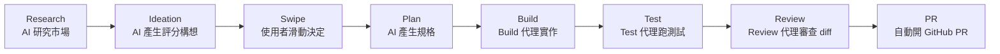

# SolidCraft 的「Tinder 式 PR review」是什麼？一場名稱混淆的調查

## 摘要

網路上一度流傳「SolidCraft 引入了一種 Tinder 式 PR review」。本報告的核心結論是：**這個說法把兩個不同的專案混為一談了。**

- 名為 **SolidCraft** 的專案，是一個以純 Rust 撰寫的開源參數化 3D CAD 應用程式，其 Pull Request 流程是傳統的 GitHub PR 加上 CodeRabbit 自動審查，**並沒有任何「Tinder 式」或滑動式的程式碼審查功能**[^solidcraft-readme][^solidcraft-api]。
- 真正具有「像 Tinder 一樣滑動」的介面，並依此自動產生 PR 的專案叫做 **Autensa**（GitHub 儲存庫名為 `mission-control`）。它是一種「自主產品引擎」，其核心賣點是「用滑動來決定（Swipe to Decide）」功能構想，通過的構想會被 AI 代理自動實作並開出 PR[^autensa-site][^mc-readme]。

換句話說，所謂「Tinder 式 PR review」的實際原形，是 Autensa 的「Swipe to Decide」——而它的滑動對象嚴格來說是**產品功能構想（ideas）**，不是**程式碼 diff 的逐行審查**。本報告逐一釐清這兩條線索。

---

## 一、先釐清：SolidCraft 究竟是什麼？

SolidCraft 是一個開源、以純 Rust 撰寫的**參數化 3D CAD（電腦輔助設計）應用程式**，由 Tangency Labs 維護。它的定位是在桌面上、瀏覽器裡，或透過 MCP（Model Context Protocol）伺服器讓 AI 代理進行 3D 建模[^solidcraft-readme]。

其 GitHub 專案的關鍵數據如下[^solidcraft-api]：

| 項目 | 內容 |
| --- | --- |
| 儲存庫 | `tangency-labs/solidcraft` |
| Star 數 | 約 14,644 |
| Fork 數 | 約 1,960 |
| 主要語言 | Rust |
| 授權 | Apache-2.0 |
| 官網 | https://solidcraft.io |
| 主題標籤 | `cad`、`parametric-cad`、`brep`、`rust`、`wasm`、`mcp`、`step` |

它的功能包括：草圖與約束求解、拉伸／旋轉／掃掠／倒角／薄殼等特徵、參數與組態、組合件、板金，以及 STEP／IGES／STL／OBJ／glTF 等檔案格式的匯入匯出[^solidcraft-readme]。

### SolidCraft 的 PR 審查其實很傳統

SolidCraft 的協作流程寫在 `CONTRIBUTING.md`，並透過 `.coderabbit.yaml` 設定 CodeRabbit 這類 AI 程式碼審查機器人，搭配一般的 GitHub PR 與 CI 檢查。專案內與 "swipe" 相關的討論全部指向**觸控板手勢**（例如在 3D 視埠中用兩指滑動來平移、旋轉、縮放），與程式碼審查無關；搜尋 "Tinder"、"swipe to approve" 等關鍵字在該專案的 issues、PRs、discussions 中皆無結果[^solidcraft-search]。

**小結：SolidCraft 沒有 Tinder 式 PR review。** 那是一個 CAD 工具，不是程式碼審查工具。

---

## 二、那「Tinder 式」的東西到底是什麼？——Autensa 的「Swipe to Decide」

真正被形容為「Tinder 風格」的，是 **Autensa**（副標題「The World's First Autonomous Product Engine」，自主產品引擎），其開源儲存庫為 `crshdn/mission-control`[^autensa-site][^mc-readme]。

Autensa 的定位是：把一個產品「指向」某個市場，然後由 AI 代理自動進行研究、產生功能構想、讓你用滑動決定、再自動實作並開出 PR。它的官方標語是：

> 「你唯一的工作就是滑動。其他全都自動化。」（Your only job is the swipe. Everything else is automated.）[^autensa-site]

其 GitHub 關鍵數據如下[^mc-api]：

| 項目 | 內容 |
| --- | --- |
| 儲存庫 | `crshdn/mission-control` |
| Star 數 | 約 2,159 |
| Fork 數 | 約 437 |
| 主要語言 | TypeScript（Next.js） |
| 授權 | MIT |
| 官網 | https://autensa.com |
| 主題標籤 | `aiagent`、`automation`、`openclaw` |

### 「Swipe to Decide」怎麼運作

構想會以卡片形式出現在一個 **Tinder 式介面**中，使用者對每張卡有四種動作[^mc-readme]：

- **Pass** — 拒絕。偏好模型會從中學習。
- **Maybe** — 存入「Maybe Pool」，一週後帶著新的市場脈絡重新浮現。
- **Yes** — 建立任務，Build 代理開始寫程式。
- **Now!** — 緊急派送，進入優先佇列並立即執行。

每一次滑動都會訓練一個「每個產品專屬的偏好模型」，讓後續產生的構想越來越貼近使用者的口味[^mc-readme]。

### 從滑動到 PR：整條自動化流水線

Autensa 把整條產品開發生命週期自動化，流程如下[^autensa-site][^mc-readme]：

也就是說：**你滑動批准的功能構想，會經過 Build → Test → Review 三個 AI 代理，最後自動產生一個 GitHub Pull Request**[^mc-readme]。此專案另外提供三種自動化層級（Supervised／Semi-Auto／Full Auto），最保守的模式是「PR 自動建立、但由你手動審查與合併」，最激進的模式則一路自動到部署[^autensa-site]。

### 一個關鍵區別

需要注意：**Autensa 滑動的對象是「功能構想（feature ideas）」，不是「程式碼 diff 的逐行變更」。** 因此嚴格來說，把它稱為「Tinder 式 PR review」是一種簡化甚至誤稱：

- Autensa 的滑動選項是 Pass／Maybe／Yes／Now!，對應的是「要不要做這個功能」的產品決策，而不是「這段程式碼要不要合併」的審查決策。
- 真正的 PR 審查（Review 步驟）在流水線中是交給 **AI 代理**自動完成，並非由人類滑動操作。
- 人類在 Autensa 中唯一要動手的地方是「對構想滑動」，PR 的產生與審查則是代理的工作。

---

## 三、附帶說明：確實存在「Tinder 式程式碼審查」的獨立小專案

若把範圍放寬到「Tinder 式程式碼審查」這個概念本身，GitHub 上確實有零星的獨立小專案，但它們都與 SolidCraft 無關[^codeswipe][^crswiper]：

| 專案 | 語言 | Star | 說明 |
| --- | --- | --- | --- |
| `anthonyhumphreys/code-review-swiper` | Swift（SwiftUI） | 約 1 | 把每個變更的檔案變成一張 Tinder 式卡片，右滑接受、左滑拒絕，最後彙整成 PR 回饋[^crswiper] |
| `pulanski/codeswipe` | TypeScript（T3 Stack） | 約 0 | 自我描述為「tinder for code review lol」的網頁應用雛形[^codeswipe] |

這些專案 Star 數極低，屬於個人實驗性質；把它們任何一個冠上「SolidCraft」之名都是不正確的。

---

## 四、結論

「SolidCraft 引入 Tinder 式 PR review」這個說法，是把兩件事混在一起：

1. **SolidCraft** ＝ 純 Rust 的開源 3D CAD 工具（約 14.6k stars），採用傳統 GitHub PR ＋ CodeRabbit 審查，**沒有** Tinder 式機制[^solidcraft-readme][^solidcraft-api]。
2. **Autensa**（`crshdn/mission-control`，約 2.2k stars）＝ 具備 Tinder 式「Swipe to Decide」介面的自主產品引擎，滑動批准的功能構想會被 AI 代理自動實作並開出 PR[^autensa-site][^mc-readme]。

若要用一句話修正這個傳聞：**「Tinder 式滑動」是 Autensa 對『功能構想』做決策的介面，而它自動產生 PR；SolidCraft 則與此無關，那只是名稱相似的兩個專案被搞混了。**

### 資料可信度反思

- 本報告所引用的 SolidCraft 與 Autensa 數據均直接取自各自 GitHub 儲存庫與官方網站，來源權威性高；Star／Fork 數為擷取當下的即時數字，會隨時間變動[^solidcraft-api][^mc-api]。
- 「SolidCraft 沒有 Tinder 功能」是**基於否定式搜尋**（搜尋 Tinder／swipe 等關鍵字無相關結果）得出的結論，屬於較弱的證明形式；但因該專案本質是 CAD 工具，且官方文件對此毫無著墨，此結論的可信度仍然很高[^solidcraft-search]。
- 部分旁證（如 X／Twitter 上「tinder but for code reviews」的貼文）在調查時已無法存取，故未列為正式引用。

---

[^solidcraft-readme]: Tangency Labs. (n.d.). SolidCraft: an open-source parametric 3D CAD application built in pure Rust. Retrieved 2026-11-07, from https://github.com/tangency-labs/solidcraft

[^solidcraft-api]: GitHub. (n.d.). tangency-labs/solidcraft [Repository metadata]. Retrieved 2026-11-07, from https://api.github.com/repos/tangency-labs/solidcraft

[^solidcraft-search]: Tangency Labs. (n.d.). Issues and pull requests [Repository search results for "tinder" and "swipe"]. Retrieved 2026-11-07, from https://github.com/tangency-labs/solidcraft/issues

[^autensa-site]: Ghray, Inc. (n.d.). Autensa — The World's First Autonomous Product Engine. Retrieved 2026-11-07, from https://autensa.com

[^mc-readme]: crshdn. (n.d.). Autensa (mission-control): The world's first Autonomous Product Engine (APE). Retrieved 2026-11-07, from https://github.com/crshdn/mission-control

[^mc-api]: GitHub. (n.d.). crshdn/mission-control [Repository metadata]. Retrieved 2026-11-07, from https://api.github.com/repos/crshdn/mission-control

[^codeswipe]: pulanski. (n.d.). codeswipe. Retrieved 2026-11-07, from https://github.com/pulanski/codeswipe

[^crswiper]: anthonyhumphreys. (n.d.). code-review-swiper. Retrieved 2026-11-07, from https://github.com/anthonyhumphreys/code-review-swiper
