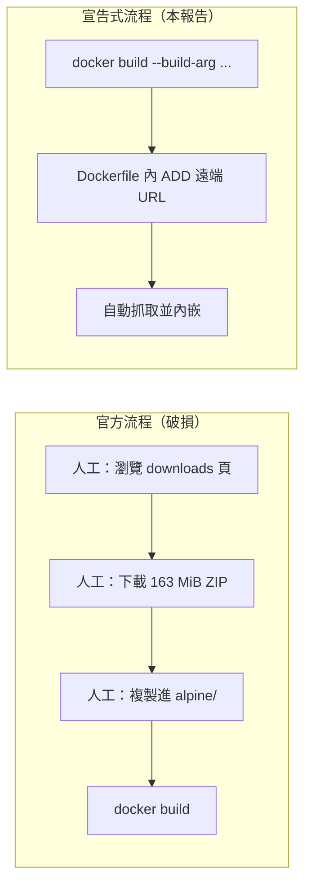

# VocBench 3：不手動下載任何檔案，用宣告式的方式建置 Docker 映像

本報告只處理一個具體痛點：**VocBench 3（以下簡稱 VB3）的官方 Docker 流程，把「下載發行版」這一步留在 Docker 之外，要求使用者手動把一個約 163 MiB 的 ZIP 放進建置脈絡。** 這對已經習慣宣告式（declarative）、微服務範式的 Docker 使用者而言是格格不入的設計。本報告先精確指出這個缺陷在官方檔案中的位置，再給出**可直接複製的三種修正方案**：在 `Dockerfile` 內用 `ADD` 抓遠端 URL、用多階段建置連外掛一起從原始碼長出來、以及在 CI 內下載。全程不需要人手動把任何檔案放進目錄。

## 1. 問題的精確位置

官方 Docker 專案 `vocbench3-docker` 的 readme 把建置描述成三個步驟[^vb3-readme]：

> - `cd` 進入與版本對應的子目錄
> - 將 VocBench 3 的 *full* distribution **複製**到該目錄
> - 執行 `docker build -t vocbench3:<version> .`

而官方 `alpine/Dockerfile` 對應的第一個動作確實就是「從脈絡取檔」[^vb3-dockerfile]：

```dockerfile
ARG vb_version=15.2.0
COPY vocbench3-${vb_version}-full.zip /tmp
```

`COPY` 的來源**只能是建置脈絡**（policy：建置階段、具名脈絡或映像）[^docker-copy]。也就是說，`docker build` 之前，那個 ZIP 必須已經躺在本機磁碟上。官方從未提供任何自動取得該檔案的機制：沒有 `ADD <url>`、沒有 `curl`、沒有下載腳本，發行版也不在任何容器登錄檔（registry）上。使用者唯一的線索是 readme 裡一句「找到 downloads 頁面」，然後自行想辦法把檔案放到正確的目錄、還得維持正確的檔名。

這個「檔案從哪來」的空缺，正是本報告要填補的地方。



## 2. 為什麼「手動下載」違反 Docker 的宣告式慣例

Docker 官方的最佳實務明確把「抓取遠端成品」視為建置本身的職責。其中 `ADD` 與 `COPY` 的取捨段落寫道[^docker-bestpractices]：

> `ADD` 最適合用在「建置過程中需要下載遠端成品」的情境。`ADD` 比用 `wget`、`tar` 手動加入檔案更好，因為它能確保更精確的建置快取。

同一段也指出 `ADD` 內建遠端資源的 checksum 驗證能力，並支援 Git URL 的分支、標籤與子目錄解析[^docker-bestpractices]。換言之，Docker 生態早已把「下載發行檔」收斂成一個原生指令；一個要求使用者先去瀏覽器按「下載」的建置流程，等於把可自動化、可重現、可稽核的步驟退化成人為操作。

再看社群實際反應：Docker Hub 上與 `vocbench` 相關的映像共有 24 個，其中多數由個人重新打包[^dockerhub-search]。這正是「官方沒有可 `pull` 的映像、又要求手動下載」所催生的補丁文化。已有維護者直接在自己的 Dockerfile 裡修掉這個缺口，例如 `cadmiumkitty/vocbench3` 的 readme 就明白寫著其目的是[^cadmiumkitty-readme]：

> 移除對「另外下載壓縮檔」的需求。

## 3. 方案一（推薦）：在 Dockerfile 內用 `ADD` 抓遠端 URL

這是最貼近 Docker 原生、改動最小、也最容易被上游接受的作法。

### 3.1 原理

Dockerfile 的 `ADD` 支援遠端 URL 來源：當 `<src>` 是 URL 時，BuildKit 會下載該 URL 的內容並放到指定目的地[^docker-add-url]。它同時支援 `--checksum=sha256:<hash>` 來驗證遠端 HTTP 資源，且雜湊演算法只支援 SHA-256[^docker-add-checksum]。

事件中，Bitbucket 的發行檔下載端點是公開的、無須認證，因此可以直接用 `ADD`（若需要認證，官方文件說明必須改用容器內的 `curl` 或 `wget`）[^docker-add-url]。

### 3.2 具體修改

把官方 `alpine/Dockerfile` 的這一行：

```dockerfile
COPY vocbench3-${vb_version}-full.zip /tmp
```

換成這一行（其餘完全不動）：

```dockerfile
ADD https://bitbucket.org/art-uniroma2/vocbench3/downloads/vocbench3-${vb_version}-full.zip /tmp/
```

一個值得注意的細節是結尾的斜線：官方文件說明，若目的地以斜線結尾，檔名會由 URL 路徑推斷；例如 `ADD http://example.com/foobar /` 會建立 `/foobar`[^docker-add-url]。因此上面這行會把檔案落在 `/tmp/vocbench3-<版本>-full.zip`，正好與後續 `RUN` 內既有的 `unzip -q /tmp/vocbench3-${vb_version}-full.zip` 路徑一致，不需改動 `RUN`。

改完後，**使用者不再需要下載或複製任何檔案**，建置指令依然是熟悉的單行：

```bash
docker build -t vocbench3:15.2.0 .
```

要換版本也只是換參數（`ARG` 可由 `--build-arg` 覆寫，且 `ARG` 不會寫入最終映像）[^docker-arg][^docker-variables]：

```bash
docker build --build-arg vb_version=15.1.2 \
             --build-arg st_version=15.1.2 \
             -t vocbench3:15.1.2 .
```

### 3.3 為何不改用 `RUN curl`：`ADD` 的快取語意更好

社群常見的另一種寫法是 `RUN curl -L ... --output ...`（見第 4 節），但 `ADD` 在快取上通常更精確。官方文件指出，遠端 `ADD` 的行為如下[^docker-add-url]：

- 遠端檔案的 `mtime` 雖會採用 HTTP `Last-Modified`，但 `mtime` **不納入快取的變更判定**；因此只要 URL 字串不變，快取鍵就穩定。版本號寫在 URL 內，天然形成「一版一快取」的正確行為。
- 下載的檔案權限為 `600`。

值得注意的是，遠端 **ZIP 不會被自動解壓**。`ADD` 的自動解壓只針對 tar 系列（`gzip`、`bzip2`、`xz`、`zstd`），且遠端 tar 預設還不下載後解壓，除非加上 `--unpack=true`[^docker-add-unpack]。因此 `RUN unzip` 這一步仍必須保留，本方案不涉及解壓邏輯的改動。

### 3.4 加上供應鏈完整性：釘選 SHA-256

官方建議在建置時下載遠端成品時一併驗證內容[^docker-bestpractices]。`ADD --checksum` 支援 HTTP 來源的 SHA-256 digest[^docker-add-checksum]。作法是先算一次雜湊：

```bash
curl -sL https://bitbucket.org/art-uniroma2/vocbench3/downloads/vocbench3-15.2.0-full.zip \
  | sha256sum
```

再把得到的值寫回去：

```dockerfile
ARG VB_SHA256
ADD --checksum=sha256:${VB_SHA256} \
    https://bitbucket.org/art-uniroma2/vocbench3/downloads/vocbench3-${vb_version}-full.zip /tmp/
```

如此一來，若上游在相同 URL 下換了內容，建置會直接失敗，而不是默默產出不同的映像。作為對照，官方發行檔 `vocbench3-15.2.0-full.zip` 的大小為 170,499,688 位元組，發佈於 2026-10-23[^vb3-downloads-api]。

## 4. 社群已經怎麼修：三個可借鏡的實作

本節的價值不在「推薦某個第三方映像」，而在於**這三個儲存庫已經把「不手動下載」的做法寫成可複製的程式碼**。

### 4.1 `redmer/vocbench3-docker`：`ADD` URL ＋ GitHub Actions

這是最接近本報告方案一的實作。其 `Dockerfile` 直接把官方 `COPY` 改成遠端 `ADD`[^redmer-dockerfile]：

```dockerfile
ARG VOCBENCH_VERSION=14.0.0
ARG SEMANTIC_TURKEY_VERSION=14.0
ADD https://bitbucket.org/art-uniroma2/vocbench3/downloads/vocbench3-${VOCBENCH_VERSION}-full.zip /tmp/
```

其餘安裝邏輯與官方一致。更關鍵的是它附帶一個 `workflow_dispatch` 的 GitHub Actions 工作流程，接受 `vb_version`、`st_version` 兩個輸入，透過 `build-args` 傳入並推送映像[^redmer-workflow]。其 readme 說明映像名稱為 `ghcr.io/redmer/vocbench3-docker:14.0.0`，並明確寫出「發行檔來源」與「Dockerfile 來源」兩個連結[^redmer-readme]。該儲存庫在 GitHub 上星號數為 0、fork 數為 0[^redmer-gh]。

### 4.2 `cadmiumkitty/vocbench3`：`RUN curl` 方案

此實作改動更小，僅在 `RUN` 內抓檔[^cadmiumkitty-dockerfile]：

```dockerfile
ENV vb_version=9.1.0
ENV st_version=9.1
RUN curl -L https://bitbucket.org/art-uniroma2/vocbench3/downloads/vocbench3-${vb_version}-full.zip --output /tmp/vocbench3-${vb_version}-full.zip
```

其 readme 明言目的是「移除另外下載壓縮檔的需求」[^cadmiumkitty-readme]。該儲存庫在 GitHub 上星號數為 4[^cadmiumkitty-gh]，並以 MIT 授權釋出。**此版本的代價**是它仍以 `ENV` 傳遞版本（`ENV` 會寫入映像並持久化，與 `ARG` 不同）[^docker-env]，且用 `curl` 而非 `ADD`，快取語意較不精確。

### 4.3 `internetofwater/vocbench3-docker`：在 CI 內下載

此儲存庫保留了 `COPY` 式 Dockerfile（放在版本子目錄 `13.1.0/`）[^iow-dockerfile]，但把「下載」搬到 CI 步驟裡[^iow-workflow]：

```yaml
- name: Download Vocbench Source
  run: curl -L https://bitbucket.org/art-uniroma2/vocbench3/downloads/vocbench3-${{ env.TARGET_VERSION }}-full.zip -o ${{ env.TARGET_VERSION }}/vocbench3-${{ env.TARGET_VERSION }}-full.zip
```

這個作法讓「人工」消失，但代價是**本機開發者仍然必須手動下載**：聲明式的保證只覆蓋 CI，不覆蓋開發者的筆電。相較之下，方案一（`ADD` URL）在本機與 CI 上行為一致，是更徹底的解。該儲存庫在 GitHub 上星號數為 4[^iow-gh]。

### 4.4 對照：Docker Hub 上的熱門社群映像

若只想要「現成可 `pull`」的選項，Docker Hub 搜尋 `vocbench` 的結果中，拉取次數最高的是 `nvasiljevic/vocbench3`，累計 20,735 次拉取、星號數 0、最後更新於 2020-08-13[^dh-nvasiljevic]。其餘如 `cadmiumkitty/vocbench3`（688 次）、`datlowedocker/vocbench3`（558 次）、`skarampatakis/vocbench-docker`（1,191 次）等，星號數皆為 0，且多數已多年未更新[^dockerhub-search][^dh-skarampatakis][^dh-datlowe]。這組數據的意義是：社群確實渴望一個可 `pull` 的映像，但現有選項都缺乏可信度與時效性，因此自行宣告式建置仍是主流解。

## 5. 方案二：連 GraphDB 外掛也從原始碼長出來（完全無人工檔案）

官方搭配 GraphDB 的 `helpers/graphdb-with-st-sails/Dockerfile` 需要**兩個**手動取得的檔案[^vb3-graphdb-dockerfile]：

```dockerfile
COPY vocbench3-${vb_version}-full.zip .
COPY lucene-fts-plugin-graphdb-plugin.zip .
```

第一個（VB3 發行版）可用與方案一相同的 `ADD` URL 手法解決。第二個（Lucene FTS 外掛）較麻煩：它是 Maven 專案，官方發行端點不存在預建的 ZIP。其 readme 說明建置方式為 `mvn clean package`，產物位於 `target/lucene-fts-plugin-graphdb-plugin.zip`[^fts-readme]。GitHub API 查詢該專案的 releases 為空陣列，表示**上游沒有提供任何現成二進位發行檔**。

因此要完全無人工作業，必須在建置階段內自行編譯。`ADD` 支援以 Git URL 為來源，且支援 `#<ref>` 指定標籤、分支或 commit，甚至 `#<ref>:<subdir>` 指定子目錄[^docker-add-git]。可利用多階段建置把「編譯外掛」獨立成一個階段，再把產物複製進 GraphDB 映像：

```dockerfile
ARG gdb_version
ARG st_version
ARG vb_version

FROM alpine:3.24.2 AS unzipper
WORKDIR /tmp
ADD https://bitbucket.org/art-uniroma2/vocbench3/downloads/vocbench3-${vb_version}-full.zip .
ADD https://github.com/Ontotext-AD/graphdb-lucene-fts-plugin.git#master .
RUN unzip -j "vocbench3-${vb_version}-full.zip" \
        "semanticturkey-${st_version}/lib/st-changetracking-sail-${st_version}.jar" \
        "semanticturkey-${st_version}/lib/st-trivial-inference-sail-${st_version}.jar" \
        -d /tmp/vb_lib

FROM maven:3-eclipse-temurin-21 AS plugin
WORKDIR /src
ADD https://github.com/Ontotext-AD/graphdb-lucene-fts-plugin.git#master .
RUN mvn -q clean package

FROM ontotext/graphdb:${gdb_version}
WORKDIR /opt/graphdb/dist/lib
COPY --from=unzipper /tmp/vb_lib/*.jar /opt/graphdb/dist/lib/
COPY --from=plugin /src/target/lucene-fts-plugin-graphdb-plugin.zip /tmp/plugin.zip
RUN unzip -q /tmp/plugin.zip -d /opt/graphdb/dist/lib/plugins/ && rm /tmp/plugin.zip
```

多階段建置的意義在於「選擇性地把產物從一個階段複製到另一個階段，把不要的東西留在前一階段」，最終映像只需 GraphDB 與外掛本身[^docker-multistage]。`COPY --from` 讓你能從其他階段（或映像）取檔，而非只能從建置脈絡[^docker-copy-from]。

**此方案的限制必須誠實說明**：

- 選擇 Maven 基底映像時，其 JDK 必須與官方要求的版本相符。官方 readme 指明外掛須以 Semantic Turkey 所用的 Java 建置，目前為 **Java 21**[^vb3-readme]；而 VB3 容器本身的執行環境是 Java 17（來自 `eclipse-temurin:17-alpine`）[^vb3-dockerfile]。兩者用途不同。
- Git URL 的 `#master` 追蹤的是分支，並非不可變；要可重現應改用 `#<完整 commit SHA>`。官方文件說明 `ADD` 支援 Git 的 commit SHA 作為 ref，Git 來源的 checksum 即為該 commit SHA[^docker-add-checksum][^docker-add-git]。
- 上游專案的預設分支為 `master`，Apache License 2.0 授權，星號數為 0[^fts-gh]。

## 6. 方案三：以 docker-compose 一次完成

官方 `docker-compose.yml` 已經使用宣告式的 `build.args` 傳遞版本號[^vb3-compose]，因此採用方案一後，compose 路線同樣不再需要人工檔案：

```yaml
services:
  vocbench3:
    build:
      context: alpine
      args:
        vb_version: ${VB_VERSION}
        st_version: ${ST_VERSION}
```

Compose 的 `build` 區段的 `args` 就是「Dockerfile `ARG` 的值」；其值可省略，此時建置時須由使用者互動提供，否則該參數不會被設定[^compose-build-args]。搭配官方 `.env`（`VB_VERSION`、`ST_VERSION`、`GDB_VERSION`）[^vb3-env]，整個流程化為：

```bash
# .env 決定版本
docker-compose up -d
```

若採方案一，前提是先把 `alpine/Dockerfile` 的 `COPY` 改成遠端 `ADD`。改完之後，`alpine/` 目錄不再需要放置任何 ZIP，因此官方文件中「把發行版複製到目錄」的指示即被完全繞過。

## 7. 快取與傳輸行為的實質差異

把 `COPY` 換成遠端 `ADD` 除了免除人工，還附帶兩個可量測的好處：

| 面向 | 官方 `COPY` 版 | 遠端 `ADD` 版 |
|---|---|---|
| 建置脈絡大小 | 含約 163 MiB ZIP，建置啟動時須傳輸[^docker-context] | 脈絡僅含 Dockerfile，幾乎為零 |
| 快取鍵 | 由被 `COPY` 檔案的內容／metadata 計算[^docker-invalidation] | 由 URL 字串決定；`mtime` 不納入判定[^docker-add-url] |
| 版本切換 | 需重新手動放入對應版本 ZIP | `--build-arg` 即完成 |

`docker build` 會把整個脈絡（扣除 `.dockerignore` 排除者）送往建置器[^docker-context][^docker-dockerignore]。官方 `vocbench3-docker` 專案並未附 `.dockerignore`[^vb3-tree]，因此官方流程每次建置都會把那個 163 MiB 的 ZIP 傳一輪；改用遠端 `ADD` 後，這筆成本直接消失。

## 8. 疑難排解

| 症狀 | 原因 | 對策 |
|---|---|---|
| `ADD` 下載失敗 | 建置環境無外網，或代理未設定 | 設定代理建置參數；代理參數會自動排除於快取與 `docker history` 之外[^docker-variables] |
| 換了版本仍取得舊內容 | URL 相同導致快取命中 | 用 `--no-cache` 或改動 `ARG`；`ARG` 值變更會造成快取未命中，且發生在變數首次被使用處[^docker-invalidation] |
| 想驗證下載內容 | 未釘選雜湊 | 加 `ADD --checksum=sha256:<hash>`[^docker-add-checksum] |
| 遠端 tar 未自動解壓 | `ADD` 對遠端 tar 預設不解壓 | 加 `--unpack=true`[^docker-add-unpack] |
| 需要認證的來源失敗 | `ADD` 不支援認證 | 改用容器內 `curl` / `wget`[^docker-add-url] |
| `ADD` 到目的地後檔名不符 | 目的地結尾缺少斜線 | 結尾加 `/` 讓檔名由 URL 推斷[^docker-add-url] |

## 9. 結論

官方 VB3 建置流程的核心缺陷，可精確定位在 `alpine/Dockerfile` 的 `COPY vocbench3-${vb_version}-full.zip /tmp` 這一行、以及 readme 中「把發行版複製到目錄」的指示[^vb3-dockerfile][^vb3-readme]：它要求使用者以人工方式把一個 163 MiB 的檔案搬進建置脈絡，而 Docker 早就為此提供了原生指令。

修正只需把該行換成：

```dockerfile
ADD https://bitbucket.org/art-uniroma2/vocbench3/downloads/vocbench3-${vb_version}-full.zip /tmp/
```

改完後：

- **本機與 CI 完全一致**，不再有「CI 能跑、筆電要先下載」的分裂。
- **一行指令建置任何版本**：`docker build --build-arg vb_version=15.1.2 -t vocbench3:15.1.2 .`
- **建置脈絡縮小約 163 MiB**，且快取語意更精確（以 URL 為鍵）。
- 可用 `--checksum=sha256:<hash>` 補上供應鏈完整性驗證。
- 搭配 GraphDB 時，先用同一手法取得 VB3 發行版，再用多階段建置從 Git 原始碼編譯 Lucene FTS 外掛，即可達成「零人工檔案」的完整宣告式部署。

社群早已自行修補這個缺口（見 `redmer/vocbench3-docker`、`cadmiumkitty/vocbench3`、`internetofwater/vocbench3-docker`），但這些都是星號數極低的個人專案。真正需要的，是讓這個修正回到官方 `Dockerfile` 本身。

## 參考文獻

[^vb3-readme]: ART Group. (n.d.). *VocBench 3 Docker — README*. Retrieved 2026-11-07, from https://bitbucket.org/art-uniroma2/vocbench3-docker/raw/HEAD/README.md

[^vb3-dockerfile]: ART Group. (n.d.). *alpine/Dockerfile*. Retrieved 2026-11-07, from https://bitbucket.org/art-uniroma2/vocbench3-docker/raw/HEAD/alpine/Dockerfile

[^vb3-graphdb-dockerfile]: ART Group. (n.d.). *helpers/graphdb-with-st-sails/Dockerfile*. Retrieved 2026-11-07, from https://bitbucket.org/art-uniroma2/vocbench3-docker/raw/HEAD/helpers/graphdb-with-st-sails/Dockerfile

[^vb3-compose]: ART Group. (n.d.). *docker-compose.yml*. Retrieved 2026-11-07, from https://bitbucket.org/art-uniroma2/vocbench3-docker/raw/HEAD/docker-compose.yml

[^vb3-env]: ART Group. (n.d.). *.env*. Retrieved 2026-11-07, from https://bitbucket.org/art-uniroma2/vocbench3-docker/raw/HEAD/.env

[^vb3-tree]: ART Group. (n.d.). *vocbench3-docker source tree (HEAD)*. Retrieved 2026-11-07, from https://api.bitbucket.org/2.0/repositories/art-uniroma2/vocbench3-docker/src/HEAD/

[^vb3-downloads-api]: ART Group. (2026). *VocBench3 downloads (Bitbucket API)*. Retrieved 2026-11-07, from https://api.bitbucket.org/2.0/repositories/art-uniroma2/vocbench3/downloads

[^redmer-dockerfile]: redmer. (2025). *vocbench3-docker — Dockerfile*. Retrieved 2026-11-07, from https://raw.githubusercontent.com/redmer/vocbench3-docker/main/Dockerfile

[^redmer-workflow]: redmer. (2025). *vocbench3-docker — build-image.yaml*. Retrieved 2026-11-07, from https://raw.githubusercontent.com/redmer/vocbench3-docker/main/.github/workflows/build-image.yaml

[^redmer-readme]: redmer. (2025). *vocbench3-docker — README*. Retrieved 2026-11-07, from https://raw.githubusercontent.com/redmer/vocbench3-docker/main/README.md

[^redmer-gh]: redmer. (2026). *vocbench3-docker repository metadata*. Retrieved 2026-11-07, from https://api.github.com/repos/redmer/vocbench3-docker

[^cadmiumkitty-dockerfile]: cadmiumkitty. (2021). *vocbench3 — Dockerfile*. Retrieved 2026-11-07, from https://raw.githubusercontent.com/cadmiumkitty/vocbench3/main/Dockerfile

[^cadmiumkitty-readme]: cadmiumkitty. (2021). *vocbench3 — README*. Retrieved 2026-11-07, from https://raw.githubusercontent.com/cadmiumkitty/vocbench3/main/README.md

[^cadmiumkitty-gh]: cadmiumkitty. (2026). *vocbench3 repository metadata*. Retrieved 2026-11-07, from https://api.github.com/repos/cadmiumkitty/vocbench3

[^iow-dockerfile]: internetofwater. (2025). *vocbench3-docker — 13.1.0/Dockerfile*. Retrieved 2026-11-07, from https://raw.githubusercontent.com/internetofwater/vocbench3-docker/master/13.1.0/Dockerfile

[^iow-workflow]: internetofwater. (2025). *vocbench3-docker — push_to_dockerhub.yaml*. Retrieved 2026-11-07, from https://raw.githubusercontent.com/internetofwater/vocbench3-docker/master/.github/workflows/push_to_dockerhub.yaml

[^iow-gh]: internetofwater. (2026). *vocbench3-docker repository metadata*. Retrieved 2026-11-07, from https://api.github.com/repos/internetofwater/vocbench3-docker

[^fts-readme]: Ontotext-AD. (n.d.). *GraphDB Lucene FTS Plugin — README*. Retrieved 2026-11-07, from https://raw.githubusercontent.com/Ontotext-AD/graphdb-lucene-fts-plugin/master/README.md

[^fts-gh]: Ontotext-AD. (2026). *graphdb-lucene-fts-plugin repository metadata*. Retrieved 2026-11-07, from https://api.github.com/repos/Ontotext-AD/graphdb-lucene-fts-plugin

[^docker-add-url]: Docker Inc. (n.d.). *Dockerfile reference — Adding files from a URL*. Retrieved 2026-11-07, from https://docs.docker.com/reference/dockerfile/#adding-files-from-a-url

[^docker-add-checksum]: Docker Inc. (n.d.). *Dockerfile reference — ADD --checksum*. Retrieved 2026-11-07, from https://docs.docker.com/reference/dockerfile/#add---checksum

[^docker-add-unpack]: Docker Inc. (n.d.). *Dockerfile reference — ADD --unpack*. Retrieved 2026-11-07, from https://docs.docker.com/reference/dockerfile/#add---unpack

[^docker-add-git]: Docker Inc. (n.d.). *Dockerfile reference — Adding files from a Git repository*. Retrieved 2026-11-07, from https://docs.docker.com/reference/dockerfile/#adding-files-from-a-git-repository

[^docker-copy]: Docker Inc. (n.d.). *Dockerfile reference — COPY*. Retrieved 2026-11-07, from https://docs.docker.com/reference/dockerfile/#copy

[^docker-copy-from]: Docker Inc. (n.d.). *Dockerfile reference — COPY --from*. Retrieved 2026-11-07, from https://docs.docker.com/reference/dockerfile/#copy---from

[^docker-arg]: Docker Inc. (n.d.). *Dockerfile reference — ARG*. Retrieved 2026-11-07, from https://docs.docker.com/reference/dockerfile/#arg

[^docker-env]: Docker Inc. (n.d.). *Dockerfile reference — ENV*. Retrieved 2026-11-07, from https://docs.docker.com/reference/dockerfile/#env

[^docker-bestpractices]: Docker Inc. (n.d.). *Building best practices — ADD or COPY*. Retrieved 2026-11-07, from https://docs.docker.com/build/building/best-practices/#add-or-copy

[^docker-variables]: Docker Inc. (n.d.). *Build variables*. Retrieved 2026-11-07, from https://docs.docker.com/build/building/variables/

[^docker-multistage]: Docker Inc. (n.d.). *Multi-stage builds*. Retrieved 2026-11-07, from https://docs.docker.com/build/building/multi-stage/

[^docker-context]: Docker Inc. (n.d.). *Build context*. Retrieved 2026-11-07, from https://docs.docker.com/build/concepts/context/

[^docker-dockerignore]: Docker Inc. (n.d.). *Build context — .dockerignore files*. Retrieved 2026-11-07, from https://docs.docker.com/build/concepts/context/#dockerignore-files

[^docker-invalidation]: Docker Inc. (n.d.). *Build cache invalidation*. Retrieved 2026-11-07, from https://docs.docker.com/build/cache/invalidation/

[^compose-build-args]: Docker Inc. (n.d.). *Compose Build Specification — args*. Retrieved 2026-11-07, from https://docs.docker.com/reference/compose-file/build/#args

[^dockerhub-search]: Docker Hub. (2026). *Repository search: "vocbench"*. Retrieved 2026-11-07, from https://hub.docker.com/v2/search/repositories/?query=vocbench&page_size=25

[^dh-nvasiljevic]: Docker Hub. (2026). *nvasiljevic/vocbench3*. Retrieved 2026-11-07, from https://hub.docker.com/v2/repositories/nvasiljevic/vocbench3/

[^dh-skarampatakis]: Docker Hub. (2026). *skarampatakis/vocbench-docker*. Retrieved 2026-11-07, from https://hub.docker.com/v2/repositories/skarampatakis/vocbench-docker/

[^dh-datlowe]: Docker Hub. (2026). *datlowedocker/vocbench3*. Retrieved 2026-11-07, from https://hub.docker.com/v2/repositories/datlowedocker/vocbench3/
