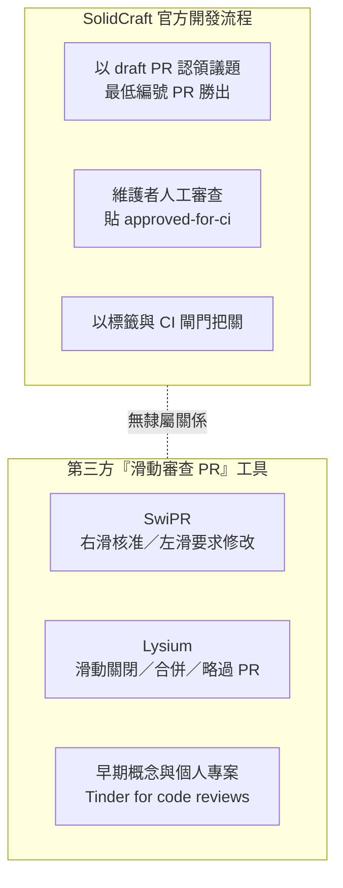

# SolidCraft 的開發流程中有「Tinder 式 PR review」嗎？一場針對「開發過程」的查證

## 摘要

本報告要回答的問題是：**在 SolidCraft（一個純 Rust 的開源參數化 3D CAD 應用程式）的「開發過程」中，是否引入了一種「Tinder 式 PR review」？**

經查證的結論是：

1. **在 SolidCraft 專案本身（`tangency-labs/solidcraft` 及其相關的 `tangency-labs/solidcore`）的開發流程檔案、工作流程腳本、貢獻指南中，找不到任何「Tinder 式」或「滑動式」的 PR 審查機制。** 官方文件中描述的是一套嚴謹、以「先搶先贏（draft PR 認領）」、「最低編號 PR 勝出」、「維護者審查後貼 `approved-for-ci` 標籤」為核心的流程[^contributing][^agents]。

2. **真正把「滑動審查 PR」實現出來的，是第三方獨立工具，而不是 SolidCraft 專案自己的流程。** 其中最貼近「Tinder 式 PR review」描述的是一個名為 **SwiPR** 的獨立開源專案（作者 `nochinxx`），它明確以「滑動審查 GitHub PR」為賣點[^swipr]；另有 **Lysium** 等工具也提供「滑動關閉／合併／略過 PR」的功能[^lysium]。

3. **SolidCraft 的開發流程中，確實有「像 Tinder 一樣快速做二選一決定」的近似機制，但它的對象是「認領議題（issue claim）」而非「審查程式碼」。** 這個機制是「以 draft PR 認領議題、最低編號的開放 PR 勝出、輸的一方關掉自己的 PR」[^contributing]。它與 Tinder 的相似點在於「一對一的競爭、勝者全拿」，但並**沒有滑動手勢、卡片式介面或任何 Tinder 式的 UI**。

換句話說，「SolidCraft 的開發過程引入 Tinder 式 PR review」這句話**在 SolidCraft 專案本身並不成立**；若把範圍放寬到「與 SolidCraft 生態相關、或同樣服務於 AI 代理大量產生 PR 情境的第三方工具」，才找得到真正的滑動審查工具，但那些工具與 SolidCraft 的官方流程無隸屬關係。

本報告的下文依序：先交代 SolidCraft 是什麼與它的 AI 代理協作背景，再逐項列出它真正的 PR 流程，接著說明「Tinder 式」一詞在這場查證中實際對應到的第三方工具，最後做出結論並附上可信度反思。

---

## 一、背景：SolidCraft 是什麼，為什麼會被聯想到「Tinder 式 review」

SolidCraft 是一個開源、以純 Rust 撰寫的參數化 3D CAD（電腦輔助設計）應用程式，由 Tangency Labs 維護，可在桌面、瀏覽器（WASM）上執行，並提供命令列工具與 MCP（Model Context Protocol）伺服器讓 AI 代理驅動[^readme]。它的 GitHub 儲存庫 `tangency-labs/solidcraft` 約有 1.46 萬顆星，主要語言為 Rust[^api]。

SolidCraft 的特殊之處在於其開發方式：官方貢獻指南明白寫道——

> 「迄今為止，SolidCraft 大部分是由 AI 編碼代理（Claude）平行撰寫，每個代理負責一個領域，由人類設定方向並回報錯誤。」[^contributing]

這種「大量 AI 代理同時送出 PR、人類維護者負責審查」的模式，正是「Tinder 式 review」這個傳聞會出現的土壤：當代理一天產生數十個 PR 時，人類的注意力成為瓶頸，於是自然會出現「能不能用滑動卡片快速把 PR 刷過去」的想像。相似的痛點在其他地方也已被公開提出。例如開發者 Zeno Rocha 曾在 X（Twitter）上說：「開啟一個 PR 的成本已經降到零。於是我們有大量 draft PR 在等待一個有限而極其珍貴的資源：注意力。瓶頸不再是創造，而是審查。」[^swipr]

**但「為什麼會有這個想像」不等於「SolidCraft 真的這麼做了」。** 以下逐一檢視 SolidCraft 官方文件與腳本中實際存在的機制。

---

## 二、SolidCraft 真正的 PR / 開發流程

SolidCraft 的流程寫在三處：給人類看的 `CONTRIBUTING.md`[^contributing]、給 AI 代理看的路由檔 `AGENTS.md`[^agents]，以及一份供代理載入的技能檔 `skills/solidcraft-contributing/SKILL.md`[^skill]。重點機制如下。

### 2.1 認領議題（claim）——「最低編號 PR 勝出」

開發者（或代理）在動手前，必須先用一個 draft PR「認領」某個議題，避免兩人重複做同一件事[^contributing]：

- 先檢查有沒有人在做了：`gh pr list -R tangency-labs/solidcraft --state open --search "#N"`。
- 從最新的 `main` 分支出來，做一個空提交 `claim: #N`、推上去，並開一個標題為 `
 (#N)` 的 **draft** PR。
- **「一個議題中，編號最小的開放 PR 勝出。」** 若你的編號較大而輸了，就把自己的 PR 關掉（或去幫忙另一個）[^contributing]。

還有一個 `/claim` 機器人：在議題上留言 `/claim` 會把議題指派給你、貼上 `in progress` 標籤，並回覆自動清理期限；`/unclaim` 則可提早釋放[^contributing]。這套機器的邏輯可見於專案的 `scripts/claim/claim.js`[^claimjs]。

**這是整套流程中最「像」競爭、最「勝者全拿」的一環，但它：(a) 沒有滑動手勢；(b) 對象是「認領議題」而非「審查 diff」。**

### 2.2 審查與合併——由維護者人工把關

真正的審查發生在維護者這一端，同樣不是滑動式[^contributing]：

- 推上 PR 時只會跑格式與倉庫層級的快速檢查，以及一次 `cargo check` 快速編譯。
- **維護者審查之後**，若認為可以合併，才貼上 `approved-for-ci` 標籤，這會啟動完整 CI（建置、測試、goldens、Clippy）。
- 之後每一次推送都會再跑一次完整 CI。
- 維護者「按領域分組」合併已批准的 PR，讓動到同一段程式的 PR 最多只碰一次衝突。

也就是說，**SolidCraft 的「review」是一個由人類維護者、以標籤與 CI 閘門構成的傳統流程**，不是由使用者對 PR 卡片左右滑動[^contributing]。

### 2.3 PR 內容的要求——文字與證據，而非手勢

SolidCraft 對 PR 的要求也和「快速滑過」相反，反而是**加重**審查者資訊：[^contributing]

- PR 的標題與第一句要讓「從未看過你的對話、議題或程式碼」的人也能理解。
- 可觀察的 CAD、UI 或模型行為變更，必須附上真實的截圖或短錄影（最好是前後對照）。
- 有三個快速檢查會跑在每個 PR 上（`.github/workflows/pr-checks.yml`）：重複 PR 檢查、`Changes a default:` 一行是否填寫、以及新增 showcase 內容時是否附圖[^prchecks]。

這一切都指向「讓人類能有效審查」，而**沒有**任何一條提到滑動、卡片或 Tinder。

### 2.4 平行代理與分工——「拿號碼牌」式的分流

在 SolidCraft 的相關核心專案 `solidcore`（NVIDIA SMLib 的 Rust 移植）中，作者 bherbruck 在 Hacker News 上如此描述代理之間的協調：

> 「到目前為止它是對剛開源的 smlib 的直接移植，涵蓋了我們需要的很多東西。歡迎把一個代理指向它，那裡有類似『拿號碼牌（take a ticket）』的分診系統，來決定誰在做哪些函式。」[^hn-ticket]

這是分流（triage）機制，也**不是** Tinder 式 review。

### 2.5 小結：SolidCraft 官方流程中沒有 Tinder 式 review

在 SolidCraft 的 `CONTRIBUTING.md`、`AGENTS.md`、貢獻技能檔、`pr-checks.yml` 與 `claim.js` 中，**關鍵字「Tinder」沒有任何出現**；「swipe（滑動）」在該倉庫的議題追蹤中只出現在**觸控板手勢**相關的討論（例如在 3D 視埠中用兩指滑動來平移、旋轉、縮放），與程式碼審查無關[^search-swipe][^search-tinder]。

---

## 三、那「Tinder 式 PR review」實際對應到什麼？——第三方工具

既然 SolidCraft 官方流程沒有這回事，那麼「Tinder 式 PR review」這個說法，最接近的真實東西是**服務於「大量 AI 代理 PR」情境的第三方工具**。以下是查證中實際找到、且與「滑動審查 PR」直接相關的專案。

### 3.1 SwiPR——最貼近「Tinder 式 PR review」的獨立工具

**SwiPR**（`nochinxx/SwiPR`）是一個獨立開源專案，其自我描述為「用滑動審查 GitHub PR，並帶入 AI 脈絡」[^swipr]。它的運作方式與 Tinder 高度相似[^swipr]：

1. 貼上任一公開 GitHub 倉庫，SwiPR 會抓取開放的 PR 並建立嵌入（embeddings）。
2. **右滑＝核准，左滑＝要求修改，下滑＝略過**；也有鍵盤對應（`J`／`F`／`Space`）。
3. 右側面板顯示：風險分數、AI 摘要、相似的歷史 PR、貢獻者歷史。
4. 可追問「為什麼有風險？」「誰呼叫了這個？」「哪些測試覆蓋了這裡？」以取得更深的脈絡。
5. 可在聊天中問任何問題，AI 能存取完整的 diff 與程式碼庫脈絡。

SwiPR 同時把同一套 PR 脈絡以 MCP 伺服器形式提供，讓 Claude Desktop 或 Cursor 也能呼叫（共 12 個唯讀工具）[^swipr]。它也被作者發布在 Hacker News 上，標題為「Built SwiPR – swipe-to-review GitHub PRs with AI context」，但該貼文僅得到 1 分、0 則留言[^hn-swipr]。

**需要注意：SwiPR 與 SolidCraft 沒有任何隸屬關係**，作者是 `nochinxx`，不是 SolidCraft 的維護團隊[^swipr]。

### 3.2 Lysium——另一款提供「滑動 PR」的代理控制台

**Lysium**（`dabit3/lysium`）是一個「代理化軟體交付的控制平面」，它結合 GitHub 與 Devin API，讓使用者把工作派給背景代理。其功能之一是「**滑動議題／PR 以關閉、合併或略過**」，並可對議題／PR 觸發一鍵評估與 PR 審查[^lysium]。同樣地，它與 SolidCraft 無關。

### 3.3 更早的「Tinder for code review」概念原型

早在 2020 年 GitHub 推出手機版時，就有使用者在 Hacker News 上提出「Tinder for code reviews」的構想：把 diff 切成一塊一塊、一次顯示一塊，「在一段 diff 上左滑做更深入的檢視，右滑則核准」[^hn-bob1029]。另外也有數個個人實驗專案（如 `anthonyhumphreys/code-review-swiper`、`pulanski/codeswipe`），把變更的檔案變成一張張 Tinder 式卡片，右滑接受、左滑拒絕[^hn-swipr]。這些都說明「Tinder 式 PR review」是一個**分散、獨立的概念與工具生態**，而非某個特定專案（更不是 SolidCraft）的官方機制。

### 3.4 一張對照表

| 項目 | 是否有「Tinder 式 / 滑動」機制 | 說明 |
| --- | --- | --- |
| SolidCraft 官方流程（`solidcraft`） | 否 | 認領採「最低編號 PR 勝出」，審查由維護者人工把關[^contributing] |
| SolidCore 官方流程 | 否 | 採「拿號碼牌」式分流與 draft PR 認領[^hn-ticket][^solidcore-agents] |
| SwiPR（第三方） | 是 | 右滑核准、左滑要求修改、下滑略過，並帶 AI 脈絡[^swipr] |
| Lysium（第三方） | 是 | 滑動議題／PR 以關閉、合併或略過[^lysium] |

---

## 四、結論

針對「SolidCraft 的**開發過程**是否存在 Tinder 式 PR review」這個問題，答案是：

1. **不存在於 SolidCraft 專案本身。** 官方文件描述的是一套以 draft PR 認領、最低編號勝出、維護者人工審查、`approved-for-ci` 標籤觸發完整 CI 為核心的流程；沒有任何滑動、卡片或 Tinder 式機制[^contributing][^agents][^skill]。
2. **其流程中最接近「競爭式二選一」的，是議題認領（最低編號 PR 勝出），但它針對的是認領議題，而不是審查程式碼，也沒有任何 UI 手勢。**[^contributing]
3. **真正實現「Tinder 式 PR review」的，是獨立第三方工具（SwiPR、Lysium 等），它們與 SolidCraft 沒有隸屬關係**[^swipr][^lysium]。傳聞很可能是把「SolidCraft 大量 AI 代理產生 PR 的痛點」與「這些獨立滑動審查工具」兩件事混在一起了。

### 資料可信度反思

- 本報告所引用的 SolidCraft 流程描述，直接取自其官方 `CONTRIBUTING.md`、`AGENTS.md`、`skills/solidcraft-contributing/SKILL.md` 與 `pr-checks.yml`／`claim.js`，屬第一手、權威性高的來源[^contributing][^agents][^skill][^prchecks][^claimjs]。
- 「SolidCraft 沒有 Tinder 式 review」屬**否定式證明**：係基於在該倉庫的程式碼、議題、PR、文件中搜尋「Tinder」「swipe」等關鍵字皆無相關結果[^search-tinder][^search-swipe]，故嚴格說來是「查無此事」而非「證明其不存在」。考量到該專案對流程的記錄相當詳盡（連 CI 標籤與機器人邏輯都公開），此結論的可信度仍然很高。
- 「Tinder 式 PR review」一詞在網路上是**分散的概念**，對應到多個互不相干的獨立工具；SwiPR、Lysium 等的星數與討論量都不高（SwiPR 約 1 顆星、發布帖 1 分）[^swipr][^hn-swipr]，代表它們屬於小眾個人專案。若傳聞聲稱「SolidCraft 引入了」某個特定工具，目前查無該工具與 SolidCraft 的官方連結。
- 部分旁證（例如社群平台上「tinder but for code reviews」的零散貼文）在查證時無法穩定存取，故未列為正式引用。

---

[^readme]: Tangency Labs. (n.d.). SolidCraft: an open-source parametric 3D CAD application built in pure Rust. Retrieved 2026-11-07, from https://github.com/tangency-labs/solidcraft

[^api]: GitHub. (n.d.). tangency-labs/solidcraft [Repository metadata]. Retrieved 2026-11-07, from https://api.github.com/repos/tangency-labs/solidcraft

[^contributing]: Tangency Labs. (n.d.). Contributing to SolidCraft. Retrieved 2026-11-07, from https://github.com/tangency-labs/solidcraft/blob/main/CONTRIBUTING.md

[^agents]: Tangency Labs. (n.d.). SolidCraft: instructions for agents (AGENTS.md). Retrieved 2026-11-07, from https://github.com/tangency-labs/solidcraft/blob/main/AGENTS.md

[^skill]: Tangency Labs. (n.d.). Contribute to SolidCraft (skills/solidcraft-contributing/SKILL.md). Retrieved 2026-11-07, from https://github.com/tangency-labs/solidcraft/blob/main/skills/solidcraft-contributing/SKILL.md

[^claimjs]: Tangency Labs. (n.d.). The /claim bot's logic (scripts/claim/claim.js). Retrieved 2026-11-07, from https://github.com/tangency-labs/solidcraft/blob/main/scripts/claim/claim.js

[^prchecks]: Tangency Labs. (n.d.). PR checks (.github/workflows/pr-checks.yml). Retrieved 2026-11-07, from https://github.com/tangency-labs/solidcraft/blob/main/.github/workflows/pr-checks.yml

[^hn-ticket]: bherbruck. (2026, October 13). Comment on "Show HN: SolidCraft – Open-Source Parametric CAD in Rust (With MCP Support)". Hacker News. Retrieved 2026-11-07, from https://news.ycombinator.com/item?id=50080233

[^solidcore-agents]: Tangency Labs. (n.d.). AGENTS.md — solidcore. Retrieved 2026-11-07, from https://github.com/tangency-labs/solidcore/blob/main/AGENTS.md

[^swipr]: nochinxx. (n.d.). SwiPR: swipe-to-review GitHub PRs with AI context. Retrieved 2026-11-07, from https://github.com/nochinxx/SwiPR

[^lysium]: dabit3. (2026, March 2). Show HN: Lysium – cross-platform control plane for agentic software delivery. Hacker News. Retrieved 2026-11-07, from https://news.ycombinator.com/item?id=47221851

[^hn-swipr]: nochinxx. (2026, June 12). Built SwiPR – swipe-to-review GitHub PRs with AI context. Hacker News. Retrieved 2026-11-07, from https://news.ycombinator.com/item?id=48498866

[^hn-bob1029]: bob1029. (2020, March 17). Comment on "GitHub for mobile is now available". Hacker News. Retrieved 2026-11-07, from https://news.ycombinator.com/item?id=22610555

[^search-tinder]: GitHub. (n.d.). Search results for "tinder" in tangency-labs/solidcraft [Issues and pull requests]. Retrieved 2026-11-07, from https://github.com/tangency-labs/solidcraft/issues?q=tinder

[^search-swipe]: GitHub. (n.d.). Search results for "swipe" in tangency-labs/solidcraft [Issues and pull requests]. Retrieved 2026-11-07, from https://github.com/tangency-labs/solidcraft/issues?q=swipe
