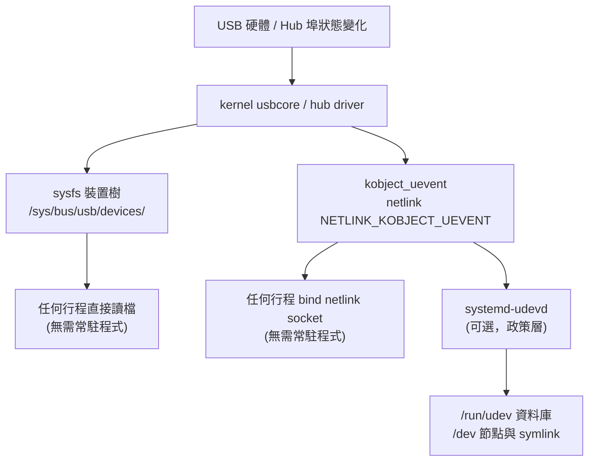

# 不依賴 systemd/udev 取得 Linux USB 實體拓撲資訊

## 摘要

在 Linux 上，USB 裝置的**實體拓撲**（哪個裝置接在哪個匯流排、哪個 Hub 的哪個埠）本質上是由 **kernel（usbcore）** 維護並透過 **sysfs** 對外曝露的。`systemd-udevd`（下稱 udev）只是 kernel uevent 的**消費者**之一，負責套用規則、建立 `/dev` 節點與符號連結；它**不是**拓撲資料的來源，也**不是**取得拓撲的必要條件[^udev7]。因此只要直接讀取 sysfs（`/sys/bus/usb/devices/`）、使用 libusb、或自行開啟 kernel 的 netlink uevent socket，就能在完全沒有 systemd/udev 的環境（例如自製 initramfs、容器、嵌入式系統、或純 busybox 系統）取得完整的 USB 實體拓撲[^sysfsrules][^netlink7]。

本報告說明 USB 拓撲在 sysfs 中的呈現方式、裝置目錄名稱的編碼規則、可直接使用的關鍵屬性、以及四種繞過 systemd/udev 的取得方法。

## 背景：為何要「不仰賴 systemd」

Linux 核心並不需要任何使用者空間常駐程式，就能**自己**完成 USB 列舉：當裝置插入時，kernel 的 hub 驅動（`hub_wq` 工作佇列）會偵測埠狀態變化、重置埠、讀取描述子、指派位址，並在 sysfs 建立對應的裝置目錄。這些動作全部發生在核心內[^usbhtml][^usbhotplug]。使用者空間的 udev 只是在**之後**才收到通知，去做命名、權限、載入模組等「政策（policy）」工作[^udev7]。

換言之：



圖中 `systemd-udevd` 只是兩條可選路徑之一；sysfs 與 netlink 兩條路徑都不經它[^udev7][^netlink7]。

## sysfs 中的 USB 拓撲結構

sysfs 是核心將內部 `kobject`（裝置物件）結構對外曝露的虛擬檔案系統，慣例掛載於 `/sys`[^sysfs5]。USB 子系統的裝置樹位於兩個地方：

- **真正的階層樹**：`/sys/devices/`（例如 `/sys/devices/pci0000:00/0000:00:14.0/usb1/1-1/1-1.2/`）[^sysfsrules]
- **依匯流排分類的平坦符號連結清單**：`/sys/bus/usb/devices/`，其中每個項目都是連到 `/sys/devices/` 的符號連結[^sysfs5]

實務上最方便的做法是走訪 `/sys/bus/usb/devices/`；但如果要存取「子裝置目錄」或做穩健的階層解析，官方建議一律走 `/sys/devices/` 這棵唯一的真實樹狀結構，因為只有那裡保證是真正的目錄階層，且裝置路徑 `devpath` 與核心事件中的 `DEVPATH` 一致[^sysfsrules]。

### 裝置目錄名稱的編碼規則

USB 裝置目錄名稱由核心在 `usb_alloc_dev()` 中以 `dev_set_name(&dev->dev, "%d-%s", bus->busnum, dev->devpath)` 產生[^usbsrc]。規則如下：

| 名稱形式 | 意義 |
|---|---|
| `usbN` | 第 N 個根節點（Root Hub），即 host controller 的虛擬根集線器。命名為 `usb%d`（`bus->busnum`）[^usbsrc] |
| `B-P` | 匯流排 B、根集線器上的埠 P（P 從 1 起算，對應硬體上的埠標號）[^usbsrc] |
| `B-P1.P2` | 先接在匯流排 B 的埠 P1，再接到該 Hub 上的埠 P2[^usbsrc] |
| `B-P1.P2.P3...` | 逐層往下，用 `.` 串接每一層 Hub 的埠號，形成「從根到裝置的路徑」[^usbsrc] |
| `B-P:C.I` | **介面（interface）**裝置：裝置 `B-P` 的第 C 個設定的第 I 號介面，格式 `"%d-%s:%d.%d"`[^messagesrc] |

核心原始碼片段（節錄自 `usb_alloc_dev()`）說明了路徑的累積方式[^usbsrc]：

```c
/* root hub: devpath = "0", name = "usb%d" */
if (unlikely(!parent)) {
    dev->devpath[0] = '0';
    dev_set_name(&dev->dev, "usb%d", bus->busnum);
} else {
    if (parent->devpath[0] == '0')          /* 接在根集線器上 */
        snprintf(dev->devpath, sizeof(dev->devpath), "%d", port1);
    else                                     /* 接在一般 Hub 上 */
        snprintf(dev->devpath, sizeof(dev->devpath), "%s.%d",
                 parent->devpath, port1);
    dev_set_name(&dev->dev, "%d-%s", bus->busnum, dev->devpath);
}
```

介面裝置的名稱則來自 `usb_set_configuration()`[^messagesrc]：

```c
dev_set_name(&intf->dev, "%d-%s:%d.%d",
             dev->bus->busnum, dev->devpath, configuration, ifnum);
```

一個具體例子：`/sys/bus/usb/devices/1-1.2:1.0` 代表「匯流排 1、根埠 1 上的 Hub、其埠 2 上的裝置，第 1 個設定、第 0 號介面」。

核心刻意保留這條「沿著 Hub 埠走出來的路徑」，作為**穩定且可預測**的識別碼。`usb_make_path()` 的文件明確指出：這個識別碼反映硬體上的實體路徑，在系統被實體重新佈線前不會改變，插拔裝置、重新開機、重新列舉都不影響它；它比 `busnum`（容易因模組載入順序或 PCI 熱插拔而變動）或裝置位址穩定得多[^usbhtml]。

> 注意：接在 **USB 2.0 根集線器（EHCI）** 上的裝置，若操作在高速模式與全速／低速模式，可能得到**不同的路徑 ID**，這與 companion controller 的設計有關[^usbhtml]。

### 可直接讀取的關鍵屬性

在每個裝置目錄（`/sys/bus/usb/devices/B-P/`）下，核心提供下列與拓撲／識別相關的檔案[^abiusb]：

| 屬性檔 | 內容 | 說明 |
|---|---|---|
| `busnum` | 十進位 | 裝置所處的 USB 匯流排編號[^abiusb] |
| `devnum` | 十進位 | 裝置在該匯流排上的位址（device address），**會隨重新列舉而變**[^abiusb] |
| `devpath` | 字串 | USB 介面裝置路徑字串[^abiusb] |
| `speed` | 數值 | 連線速率（Mbps）：1.5 / 12 / 480 / 5000 / 10000 / 20000[^abiusb] |
| `idVendor` / `idProduct` | 十六進位 | 廠商／產品 ID[^abiusb] |
| `product` / `manufacturer` / `serial` | 字串 | 描述子字串（可能不存在）[^abiusb] |
| `descriptors` | 二進位 | 快取的裝置／設定描述子（bus-endian）[^abiusb] |
| `bConfigurationValue` | 十進位 | 目前作用中的設定值[^abiusb] |
| `bNumInterfaces` / `bNumConfigurations` | 十進位 | 介面／設定數量[^abiusb] |
| `maxchild` | 十進位 | 若本裝置是 Hub，其埠數[^abiusb] |
| `removable` | 數值 | 埠是否支援熱插拔 |

此外，Hub 底下的每個實體埠另有自己的目錄與屬性，可用來查詢更細緻的埠狀態[^abiusb]：

- `/sys/bus/usb/devices/.../<hub_interface>/port<X>/`：埠裝置目錄
- `port<X>/state`：該埠上裝置的狀態（`not-attached`、`attached`、`powered`、`default`、`addressed`、`configured`、`suspended` 等），支援 `poll()`[^abiusb]
- `port<X>/connect_type`：`hotplug`、`hardwired`、`not used` 或 `unknown`[^abiusb]
- `port<X>/location`：由韌體提供的實體連接器位置（hex 整數）[^abiusb]
- `port<X>/connector`：連到 USB Type-C connector 的連結（若啟用 Type-C Connector Class）[^abiusb]

要判斷「哪些裝置是介面而非裝置」，可檢查目錄名稱是否含 `:`；裝置目錄下另有可寫的授權檔 `authorized`、以及介面層的 `authorized`[^abiusb]。

## 方法一：直接走訪 sysfs（零依賴，最推薦）

最單純、依賴最少的方法是直接讀檔。由於 sysfs 官方規範「永遠在 `/sys`」、不需要解析 `/proc/mounts`、也不需要自己去掛載[^sysfsrules]，程式可假設路徑固定。

演算法：

1. 列出 `/sys/bus/usb/devices/` 下所有項目（或走訪 `/sys/devices/` 的真實樹）。
2. 過濾掉名稱含 `:` 的介面項目，只保留裝置；根集線器名稱為 `usbN`。
3. 讀取每個裝置的 `busnum`、`devnum`、`devpath`、`speed`、`idVendor`、`idProduct` 等屬性。
4. 以裝置目錄名稱（`B-P1.P2...`）或其真實路徑（`readlink` 解析後的 `/sys/devices/...`）重建樹狀關係：父節點即為去掉最後一個 `.P`（或最後一個 `-P`）的上層目錄。
5. 若要埠層級資訊，進入各 Hub 介面目錄的 `port<X>/` 讀取 `state` 與 `connect_type`。

**穩健性要點**[^sysfsrules]：

- 一律解析符號連結到 `/sys/devices` 的真實路徑再操作，不要把 symlink 當成路徑元素。
- 不要假設父裝置在 `devpath` 中的固定位置；`devpath` 的鏈結可能被核心插入新節點。應由名稱語法（`-` 與 `.` 分隔）判斷層級，或向上找 `subsystem` 為 `usb` 的父裝置。
- 屬性檔讀取失敗時的錯誤碼（如 `-EIO`、`-ENXIO`）不應過度耦合[^sysfsrules]。

這個方法不需要 root、不需要 udev、不需要 libusb，只要有 sysfs 可見即可。

## 方法二：使用 libusb

libusb 是跨平台使用者空間 USB 函式庫；在 Linux 上它的後端會直接讀取 sysfs 與 usbfs 來建立裝置清單[^libusb]。它提供直接的拓撲查詢函式[^libusb]：

| 函式 | 回傳 |
|---|---|
| `libusb_get_device_list()` | 系統上所有 USB 裝置的清單 |
| `libusb_get_bus_number(dev)` | 裝置所處的匯流排編號 |
| `libusb_get_port_number(dev)` | 裝置所接的埠號（通常唯一對應一個實體埠）[^libusb] |
| `libusb_get_port_numbers(dev, arr, len)` | **從根到該裝置**的完整埠號序列——即拓撲路徑；深度上限 7（依 USB 3.0 規範）[^libusb] |
| `libusb_get_parent(dev)` | 父裝置（即所屬 Hub），可用來自行往上爬出樹[^libusb] |
| `libusb_get_device_address(dev)` | 裝置在匯流排上的位址[^libusb] |
| `libusb_get_device_speed(dev)` | 協商速率（`LIBUSB_SPEED_*`）[^libusb] |
| `libusb_get_session_data(dev)` | 後端識別碼；Linux 上為 `busnum << 8 | devnum`[^libusb] |

`libusb_get_port_numbers()` 回傳的陣列即對應 sysfs 目錄名稱中 `B-` 之後那串以 `.` 分隔的埠號，兩者可以互相驗證。libusb 的 `libusb_get_port_number()` 文件提醒：除非作業系統或熱插拔擴充卡有特殊行為，埠號通常與實體埠一一對應，但**不保證**永遠不變或與 Hub 製造商的編號順序一致[^libusb]。

libusb 本身的列舉**不需要 udev 常駐**；它只是讀取核心已經建立好的 sysfs/usbfs 狀態。若要在系統啟動早期使用，需注意裝置節點權限（可能需 root）[^libusb]。

## 方法三：直接監聽 kernel uevent（netlink）

若要**即時**得知拓撲變化（熱插拔），可自行開啟 kernel 的 netlink 群組 **`NETLINK_KOBJECT_UEVENT`**（自 Linux 2.6.10 起提供），**完全不需經過 udev**[^netlink7]。

做法[^netlink7]：

1. `socket(AF_NETLINK, SOCK_RAW, NETLINK_KOBJECT_UEVENT)`
2. `bind()` 到 `sockaddr_nl`，並在 `nl_groups` 設定位元遮罩以加入群組（uevent 使用第 1 個群組，即 bit 0，值 `1`）
3. 以 `recvmsg()` 持續接收核心推送的 uevent 訊息

> `NETLINK_KOBJECT_UEVENT` 屬於少數「允許非 root 使用者接收」的 netlink 群組；但**發送**訊息在任何群組都不允許非特權使用者為之[^netlink7]。

每個 uevent 的環境變數由核心的 `kobject_uevent()` 組裝，**必定**包含三個基底欄位[^kobjsrc]：

- `ACTION=`：動作，如 `add`、`remove`、`change`、`move`、`online`、`offline`
- `DEVPATH=`：裝置在 sysfs 中的路徑（對應 `/sys/devices/...`），是該裝置的唯一鍵[^kobjsrc][^sysfsrules]
- `SUBSYSTEM=`：子系統名稱（USB 為 `usb`）[^kobjsrc]

USB 子系統另外會附加自己的欄位。裝置層的 `usb_dev_uevent()` 加入 `BUSNUM` 與 `DEVNUM`[^usbsrc]；匯流排層的 `usb_uevent()` 加入 `PRODUCT` 與 `TYPE`[^drvsrc]：

```c
/* drivers/usb/core/usb.c — 裝置層 */
add_uevent_var(env, "BUSNUM=%03d", usb_dev->bus->busnum);
add_uevent_var(env, "DEVNUM=%03d", usb_dev->devnum);

/* drivers/usb/core/driver.c — 匯流排層 */
add_uevent_var(env, "PRODUCT=%x/%x/%x", idVendor, idProduct, bcdDevice);
add_uevent_var(env, "TYPE=%d/%d/%d",
               bDeviceClass, bDeviceSubClass, bDeviceProtocol);
```

介面裝置的 uevent（`usb_if_uevent()`）再加入 `INTERFACE=%d/%d/%d`（class/subclass/protocol）與 `MODALIAS`[^messagesrc]。

因此，程式可在收到 `SUBSYSTEM=usb` 且 `ACTION=add` 的事件後，用 `DEVPATH`（或 `BUSNUM`+`DEVNUM`）去 sysfs 讀取完整拓撲，形成「事件驅動 + sysfs 查詢」的組合。這正是 udev 內部所做的事，但可完全自製[^udev7]。

**注意**[^netlink7]：

- netlink **不保證可靠**，核心在 socket 緩衝區滿時會丟棄訊息，並可能在 `recvmsg()` 回傳 `ENOBUFS`；程式需自行偵測並重新同步（例如事件後做一次完整 sysfs 掃描）。
- 建議用 `libnl` 或 `libnetlink` 等函式庫包裝，而非直接操作低階介面[^netlink7]。

## 方法四：`/sys/kernel/debug/usb/devices`（文字拓撲）

核心另提供一份人類可讀的拓撲快照。傳統上路徑為 `/proc/bus/usb/devices`（usbfs），但在現代系統多改置於 debugfs，即 **`/sys/kernel/debug/usb/devices`**；新版核心以 debugfs 提供，usbfs 則為相容選項[^procusb]。此檔格式為每個裝置多行 ASCII，其中 `T:` 行即為拓撲資訊[^procusb]：

```
T:  Bus=dd Lev=dd Prnt=dd Port=dd Cnt=dd Dev#=ddd Spd=dddd MxCh=dd
```

對應欄位為：匯流排號（Bus）、在樹中的層級（Lev，根為 0）、父裝置號（Prnt）、在父裝置上的埠（Port）、該層裝置數（Cnt）、裝置號（Dev#，即 device address）、速率（Spd，Mbps）、最大子裝置數（MxCh）[^procusb]。文件說明：官方刻意以 ASCII 輸出，讓程式可用 `T:` 行的前四欄（Lev、Prnt、Port、Cnt）自行重建 USB 拓撲圖[^procusb]。

缺點是檔名與位置隨核心版本演進（`/proc/bus/usb/devices` → debugfs），且 debugfs 預設可能需要 root 掛載，較不適合當作穩定的長期介面；適合除錯與一次性快照。

## 方法比較

| 方法 | 依賴 | 即時性 | 取得拓撲能力 | 適用場景 |
|---|---|---|---|---|
| sysfs 直接讀取 | 只要 sysfs | 快照（可輪詢/poll） | 完整（含埠層級） | 最小依賴、嵌入式、容器 |
| libusb | libusb 函式庫 | 快照 + hotplug callback | 完整（埠號序列、父裝置） | 跨平台應用 |
| netlink uevent | 只要 netlink | 事件驅動 | 事件 + 需再查 sysfs | 熱插拔監控、自製 daemon |
| debugfs `devices` | debugfs 掛載（常需 root） | 快照 | 文字拓撲 | 除錯、腳本快照 |

## 與 udev/systemd 的關係（釐清）

- udev **接收** kernel uevent，然後做規則比對、建立 `/dev` 節點與 symlink、維護 `/run/udev` 資料庫；`libudev` 只是對這些資料的存取層[^udev7]。
- 也就是說，udev 提供的是「政策與命名」的抽象，而**拓撲本身來自核心 sysfs 與 uevent**[^sysfsrules][^kobjsrc]。
- 官方 sysfs 存取規則甚至建議：若可能，應透過 udev/HAL 提供的抽象；但若確實需要直接存取 sysfs，只要遵循其規則（走 `/sys/devices`、解析真實路徑、以 subsystem 找父裝置），程式即可在未來核心版本上正常運作[^sysfsrules]。

因此「不仰賴 systemd」在技術上完全可行：拓撲資料的**唯一真實來源**是 kernel，透過 sysfs 與 netlink 兩種介面即可取得。

## 實務建議

1. **優先組合**：以 sysfs 讀取為基礎（方法一），需要即時性時再疊加 netlink uevent（方法三）。這兩者都不需要任何使用者空間常駐程式。
2. **穩定性**：以「匯流排編號 + 埠路徑」而非「裝置位址」作為長期識別；`devnum` 會因重新列舉而變[^abiusb]。
3. **解析路徑**：用目錄名稱語法（`-` 分段、`.` 分層、`:` 標示介面）解析，並將符號連結解析成 `/sys/devices` 的真實路徑[^sysfsrules][^usbsrc]。
4. **USB 2.0 根集線器的路徑差異**：高速與全速／低速可能得到不同路徑 ID，需納入考量[^usbhtml]。
5. **避免 libsysfs**：核心文件明確建議不要使用 `libsysfs`，因其對 sysfs 做了不成立的假設且已不再積極維護[^sysfsrules]。

## 參考文獻

[^udev7]: systemd project. (n.d.). *udev(7) — Linux manual page*. Retrieved 2026-11-07, from https://man7.org/linux/man-pages/man7/udev.7.html

[^netlink7]: Linux man-pages project. (n.d.). *netlink(7) — Linux manual page*. Retrieved 2026-11-07, from https://man7.org/linux/man-pages/man7/netlink.7.html

[^sysfs5]: Linux man-pages project. (n.d.). *sysfs(5) — Linux manual page*. Retrieved 2026-11-07, from https://man7.org/linux/man-pages/man5/sysfs.5.html

[^sysfsrules]: The kernel development community. (n.d.). *Rules on how to access information in sysfs*. Retrieved 2026-11-07, from https://www.kernel.org/doc/html/latest/admin-guide/sysfs-rules.html

[^usbhtml]: The kernel development community. (n.d.). *The Linux-USB host side API*. Retrieved 2026-11-07, from https://www.kernel.org/doc/html/latest/driver-api/usb/usb.html

[^usbhotplug]: The kernel development community. (n.d.). *USB hotplugging*. Retrieved 2026-11-07, from https://www.kernel.org/doc/html/latest/driver-api/usb/hotplug.html

[^abiusb]: The kernel development community. (n.d.). *sysfs-bus-usb (ABI/testing)*. Retrieved 2026-11-07, from https://www.kernel.org/doc/Documentation/ABI/testing/sysfs-bus-usb

[^procusb]: The kernel development community. (2010, September 13). */proc/bus/usb filesystem output*. Retrieved 2026-11-07, from https://www.kernel.org/doc/Documentation/usb/proc_usb_info.txt

[^kobjsrc]: Kroah-Hartman, G. (2007, December 19). *Everything you never wanted to know about kobjects, ksets, and ktypes*. Retrieved 2026-11-07, from https://www.kernel.org/doc/html/latest/core-api/kobject.html

[^libusb]: libusb project. (n.d.). *libusb: Device handling and enumeration*. Retrieved 2026-11-07, from https://libusb.sourceforge.io/api-1.0/group__libusb__dev.html

[^usbsrc]: Torvalds, L. (n.d.). *drivers/usb/core/usb.c* [Source code]. Retrieved 2026-11-07, from https://github.com/torvalds/linux/blob/master/drivers/usb/core/usb.c

[^messagesrc]: Torvalds, L. (n.d.). *drivers/usb/core/message.c* [Source code]. Retrieved 2026-11-07, from https://github.com/torvalds/linux/blob/master/drivers/usb/core/message.c

[^drvsrc]: Torvalds, L. (n.d.). *drivers/usb/core/driver.c* [Source code]. Retrieved 2026-11-07, from https://github.com/torvalds/linux/blob/master/drivers/usb/core/driver.c
