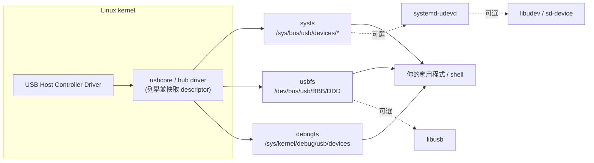
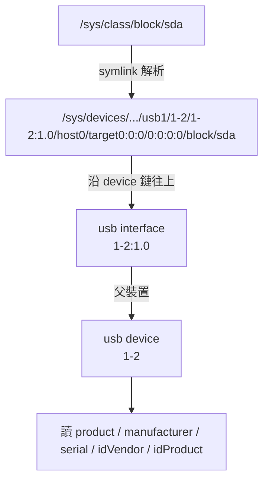
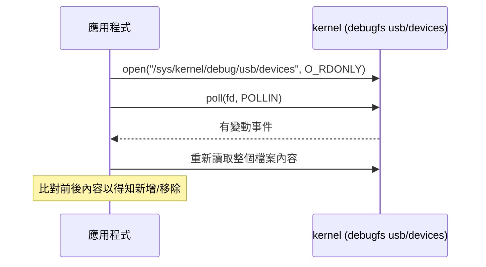

# 不仰賴 systemd 與其他 user space 應用程式，如何在 Linux 取得 USB 資訊

## 摘要

本報告回答一個具體問題：在 Linux 上，若不想仰賴 systemd（特別是 `systemd-udevd`）、libudev 或其他 user space 常駐程式，要如何取得 USB 裝置的資訊，例如 USB 隨身碟（USB Drive）的產品型號（product model）、製造商、序號等？

核心結論是：**USB 資訊的第一手來源是 Linux kernel 本身**，kernel 在裝置列舉（enumeration）階段就已經讀取並快取 USB 描述元（descriptor），並透過三個核心介面暴露給 user space：`sysfs`、`usbfs`（`/dev/bus/usb`）與 `debugfs`[^usb-hostside]。這三者都不需要 udev 或任何 daemon 參與。真正仰賴 systemd／udev 的其實是**上層工具**，例如 `lsusb` 用人名對照表、`udevadm`、`libudev`／`sd-device`[^lsusb][^udevadm][^sd-device]。

## 問題背景：誰才真正依賴 systemd

在討論方法之前，必須先釐清「依賴 systemd」的界線，因為常見工具混用了不同層次的資料來源：

| 工具／元件 | 資料來源 | 是否依賴 systemd／udev |
| --- | --- | --- |
| `sysfs`（`/sys`） | kernel 直出 | 否 |
| `usbfs`（`/dev/bus/usb`） | kernel 直出 | 否 |
| `debugfs`（`/sys/kernel/debug/usb/devices`） | kernel 直出 | 否 |
| `lsusb -D /dev/bus/usb/...` | usbfs | 否 |
| `lsusb`（一般列表） | usbfs + udev 硬體資料庫 | 是（僅人名對照部分） |
| `usb-devices` | 直接走 `sysfs` 的 shell script | 否 |
| `lsblk` | `sysfs` + udev db，無 udev 時退回直接讀裝置[^lsblk] | 視編譯與環境 |
| `udevadm` | systemd-udevd | 是 |
| `libudev` / `sd-device` | systemd-udevd 的裝置資料庫 | 是 |
| `libusb` | usbfs（獨立程式庫） | 否 |

`lsusb` 的手冊明確寫道它「uses udev's hardware database to associate a full human-readable name to the vendor ID and the product ID」[^lsusb]，也就是說它把 udev 只用於「VID:PID → 人名」這種美化用途；裝置是否存在、描述元內容仍來自 kernel。相對地，`libudev`／`sd-device` 是以 systemd-udevd 維護的裝置資料庫為核心[^sd-device]，屬於真正的 systemd 依賴。

## 整體架構

下圖說明資訊從硬體到應用程式的流動方向。三個虛線框都是 kernel 提供的介面，左側的 `systemd-udevd` 與 libudev 只是可選的上層消費者。



## 方法一：sysfs（最推薦、零常駐程式）

### 每個 USB 裝置的屬性目錄

kernel 會為每個 USB 裝置在 `/sys/bus/usb/devices/` 下建立一個目錄，名稱形如 `1-2`（busnum 1、port 2）或含介面的 `1-2:1.0`[^sysfs-stable][^sysfs-testing]。目錄內可直接讀取的屬性檔案包括：

- `idVendor`、`idProduct`：廠商與產品 ID，十六進位[^sysfs-testing]。
- `manufacturer`、`product`：廠商自訂字串，即裝置描述的製造商名稱與**產品型號**[^sysfs-testing]。
- `serial`：裝置序號字串（若裝置提供）[^sysfs-stable]。
- `bcdDevice`：裝置版本號[^sysfs-testing]。
- `bDeviceClass`、`bDeviceSubClass`、`bDeviceProtocol`：裝置類別碼，例如 `08` 代表 mass storage[^sysfs-testing]。
- `bNumConfigurations`、`bConfigurationValue`、`bNumInterfaces`[^sysfs-testing]。
- `busnum`、`devnum`、`devpath`：bus 編號、裝置位址、裝置路徑[^sysfs-stable]。
- `speed`、`version`、`bMaxPower`：連線速度、USB 版本、最大耗電[^sysfs-testing]。
- `descriptors`：**二進位**的裝置描述元與各組態描述元快取檔[^sysfs-stable]。

關鍵在於：`manufacturer`、`product`、`serial` 這些字串，是 kernel 在裝置列舉時主動以控制傳輸向裝置索取 string descriptor 後快取的結果，因此**只需讀檔即可取得，過程中完全不需要 udev 或任何 user space 應用程式**。

### 取得 USB 隨身碟型號的實務做法

USB 隨身碟在系統上通常以區塊裝置（block device）形式出現，例如 `/dev/sda`。要取得它的 USB 產品型號，需先由區塊裝置往上追溯到 USB 裝置目錄，再讀 `product` 檔：



可用的 shell 片段（僅讀取檔案，不使用 udev）：

```sh
# 1. 找出目標區塊裝置的真實 sysfs 路徑
path=$(readlink -f /sys/class/block/sda)

# 2. 沿路徑往上，找到第一個 usb 介面目錄（形如 1-2:1.0），再取其父目錄（usb 裝置）
usb_iface=$(echo "$path" | grep -oE '[0-9]+-[0-9.]+:[0-9]+\.[0-9]+' | head -n1)
usb_dev="${usb_iface%%:*}"

# 3. 讀取產品型號等資訊（目錄在 /sys/bus/usb/devices/ 下）
cat "/sys/bus/usb/devices/$usb_dev/product"
cat "/sys/bus/usb/devices/$usb_dev/manufacturer"
cat "/sys/bus/usb/devices/$usb_dev/idVendor"
cat "/sys/bus/usb/devices/$usb_dev/idProduct"
cat "/sys/bus/usb/devices/$usb_dev/serial"
```

同一顆隨身碟也可從 SCSI 層交叉驗證（注意 `vpd_pg80`／`vpd_pg83` 可能不存在）：

```sh
# 直接讀 SCSI INQUIRY 回報的廠商與型號
cat /sys/block/sda/device/vendor
cat /sys/block/sda/device/model

# 若存在，VPD 頁面可提供序號與裝置識別
[ -f /sys/block/sda/device/vpd_pg80 ] && cat /sys/block/sda/device/vpd_pg80
[ -f /sys/block/sda/device/vpd_pg83 ] && cat /sys/block/sda/device/vpd_pg83
```

另一條等效但更適合程式的路徑是走 SCSI 層：USB 隨身碟底層多使用 SCSI 指令集，kernel 以 `sd`（SCSI Disk）作為上層驅動，會把裝置經 `INQUIRY` 回報的廠商與型號字串放到 `/sys/block/sda/device/vendor` 與 `/sys/block/sda/device/model`（例如 `SanDisk` 與 `Cruzer Blade`）[^scsi-guide]。這與 USB descriptor 的 `manufacturer`／`product` 是兩套獨立來源，數值可能不同，實務上建議兩者都讀、互相交叉比對。

SCSI 層還額外提供 **VPD（Vital Product Data）頁面**，可用於取得更精確的序號與識別資訊[^scsi-guide]：

- `vpd_pg80`：Unit Serial Number（單元序號）VPD 頁面[^mpdesouza]。
- `vpd_pg83`：Device Identification（裝置識別）VPD 頁面[^mpdesouza]。

並非所有 USB 隨身碟都會在 sysfs 暴露 `vpd_pg80`／`vpd_pg83`：kernel 的 USB storage 層在 `slave_configure` 中對多數 USB 儲存裝置設定了 `skip_vpd_pages`，因為部分裝置在收到 VPD 查詢時會當機；只有被特別加入 `BLIST_TRY_VPD_PAGES` 白名單的機型（例如 `SanDisk Cruzer Blade`）才會顯示這兩個屬性[^mpdesouza]。因此設計時不能假設 `vpd_pg*` 一定存在，應先檢查檔案是否存在。

不仰賴 udev 的 `usb-devices` 是絕佳參考實作：它是一個 shell script，直接走訪 `/sys/bus/usb/devices/usb*`，逐一讀取上述屬性檔並印出 `S: Manufacturer=`、`S: Product=`、`S: SerialNumber=` 等欄位[^usb-devices]。若需要「不依賴任何外部程式」的極簡環境，把它的邏輯內嵌即可。

### sysfs 的穩定性與注意事項

kernel 文件《Rules on how to access information in sysfs》明確指出 **sysfs 不是穩定的核心內部 API**，但同時說明：使用者可期待「在沒有版本屬性變更的前提下，屬性檔的格式與內容保持一致」[^sysfs-rules]。該文件給出的實務規則包括：

- sysfs 永遠掛載於 `/sys`，不要花力氣去解析 `/proc/mounts` 尋找其他掛載點[^sysfs-rules]。
- 要找到鏈上的父裝置時，應**依 subsystem 值往上走訪**，而非假設固定的父裝置位置或使用 `../` 相對路徑[^sysfs-rules]。
- 屬性檔的讀寫失敗（如 `-EIO`、`-ENXIO`）應正常往上傳遞錯誤[^sysfs-rules]。

此外，部分屬性檔（例如需要讀寫裝置狀態者）可能需要 root 權限，讀取敘述性字串通常權限較寬鬆，但設計時仍應假設可能需要提升權限。

## 方法二：usbfs（`/dev/bus/usb`）與 USBDEVFS ioctl

若要繞過 sysfs 快取、直接向裝置發出 USB 請求（例如讀取 sysfs 未暴露的 string descriptor index），可透過 usbfs。`/dev/bus/usb/BBB/DDD`（BBB=bus 編號、DDD=裝置位址）是一個「魔法檔案」：讀取它會得到二進位內容，先是 18 bytes 的裝置描述元，接著是目前組態的描述元；多位元組欄位在裝置描述元中已被 kernel 轉為主機位元序（host endian），組態描述元則維持 bus endian[^usb-hostside]。

要進行更細緻的操作則使用 ioctl，標頭為 `<linux/usbdevice_fs.h>`：

- `USBDEVFS_CONTROL`：發出控制請求，參數為 `struct usbdevfs_ctrltransfer`，可用 `GET_DESCRIPTOR` 讀取 string descriptor（內容為 UTF-16LE，`bString` 欄位）[^usb-hostside]。
- `USBDEVFS_GETDRIVER`：取得綁定在某介面上的 kernel driver 名稱[^usb-hostside]。
- `USBDEVFS_CLAIMINTERFACE` / `USBDEVFS_RELEASEINTERFACE`：搶佔／釋放介面[^usb-hostside]。

權限方面，這些 ioctl 需要 `CAP_SYS_RAWIO` 能力以及檔案系統存取權限；預設只有 root 可寫入這些裝置檔，可用 `chmod` 或 usbfs 掛載選項 `devmode=0666` 放寬[^usb-hostside]。`CAP_SYS_RAWIO` 在 capabilities(7) 中被定義為允許 I/O port 操作、`/dev/mem` 存取與「對其他裝置執行一系列裝置特定操作」的能力[^capabilities]。`lsusb -D /dev/bus/usb/001/001` 就是走這條路徑，且手冊註明此選項需要 root[^lsusb]。

**優點**：不依賴 sysfs 版面、可取得完整描述元。
**缺點**：需要較高權限、`BBB/DDD` 不是穩定識別（裝置重新列舉會變號）[^usb-hostside]。

若不排斥第三方**程式庫**（但仍是獨立於 systemd 的選擇），`libusb` 提供跨平台的封裝：`libusb_get_device_list()` 列舉裝置、`libusb_get_device_descriptor()` 取得描述元、`libusb_get_string_descriptor_ascii()` 或 `libusb_get_device_string()` 取得字串（含 manufacturer／product／serial）[^libusb-desc][^libusb-dev]。libusb 在 Linux 上的 backend 就是 usbfs，與 systemd 無關。

## 方法三：debugfs 的 `/sys/kernel/debug/usb/devices`

kernel 亦透過 debugfs 提供一個純文字檔 `/sys/kernel/debug/usb/devices`，逐行以單一字母標籤描述所有已知 USB 裝置[^usb-hostside]：

- `T:` 拓撲（Bus、Lev、Prnt、Port、Dev#、Spd、MxCh）
- `D:` 裝置描述元（USB 版本、class、subclass、protocol、MaxPacketSize、組態數）
- `P:` 產品 ID 資訊（Vendor、ProdID、Rev）
- `S:` 字串描述元（Manufacturer、Product、SerialNumber）
- `C:` / `I:` / `E:` 組態、介面、端點

其中 `S: Product=` 即為產品型號。此檔需要掛載 debugfs，且該介面被定位為除錯與資訊用途[^usb-hostside]。它的好處是可以配合 `poll()` 偵測裝置新增／移除：



kernel 文件提醒，此設計意圖是資訊與除錯用途，若要初始化裝置或啟動 helper，較合適的是 udev／HAL 之類機制[^usb-hostside]。因此 debugfs 適合「觀測」，不宜作為唯一正式資料來源。

## 不靠 udev 做熱插拔監測

若除了查詢還要**即時得知裝置插拔**，同樣不需要 udev。可選方案：

1. **Netlink**：開啟 `NETLINK_KOBJECT_UEVENT` 的 netlink socket 接收 kernel 送出的 uevent。netlink(7) 說明 `NETLINK_KOBJECT_UEVENT` 是「kernel messages to user space」，且該群組允許非 root 接收訊息[^netlink]。
2. **poll() debugfs**：如上節所述，對 `/sys/kernel/debug/usb/devices` 做 `poll()`[^usb-hostside]。
3. **kernel hotplug helper**：早期的機制是核心參數 `/proc/sys/kernel/hotplug` 指向一個程式，kernel 在 USB 裝置加入／移除時呼叫它並傳入環境變數 `ACTION`、`PRODUCT`、`TYPE`、`INTERFACE` 等[^usb-hotplug]。此機制在現代系統多由 udev 接管，但概念上不依賴 systemd。
4. **輕量 user space 替代**：BusyBox 的 `mdev` 可作為 udev 的極簡替代，它同樣以 sysfs 為基礎，透過 `kernel.hotplug` 或在啟動時 `mdev -s` 掃描來建立裝置節點[^mdev]。嚴格說 mdev 仍是 user space 應用程式，但它是可完全自控、不牽涉 systemd 的選項。

## 方案比較與建議

| 面向 | sysfs（USB 層） | sysfs（SCSI 層） | usbfs | debugfs |
| --- | --- | --- | --- | --- |
| 常駐程式需求 | 無 | 無 | 無 | 無 |
| 取得產品型號 | 直接讀 `product` | 讀 `device/model` | 讀描述元並自行解 UTF-16LE | 讀文字檔 `S: Product=` |
| 取得序號 | `serial` | `vpd_pg80`（可能不存在） | 讀 string descriptor | `S: SerialNumber=` |
| 權限 | 多為一般讀取 | 多為一般讀取 | 常需 `CAP_SYS_RAWIO`／root | 需掛載 debugfs |
| 資料穩定性 | 中（屬性格式穩定、路徑非 API） | 中（VPD 支援依機型） | 描述元為 USB 標準 | 除錯用途，非正式 |
| 是否可做 I/O | 否 | 否 | 是 | 否 |
| 熱插拔 | 需自行輪詢或搭配 netlink | 需自行輪詢 | 需自行輪詢 | 支援 `poll()` |

實務建議：

- **只想取得型號、廠商、序號**：優先讀 `sysfs`（`/sys/bus/usb/devices/*/product` 等），或直接改寫 `usb-devices` 的邏輯[^usb-devices]。
- **要完整描述元或主動向裝置發請求**：走 usbfs，或用獨立的 `libusb`。
- **要即時監測插拔**：`NETLINK_KOBJECT_UEVENT`，或搭配 `poll()` debugfs。
- **避免**：`udevadm`、`libudev`／`sd-device`，因為它們以 systemd-udevd 為核心[^udevadm][^sd-device]；`lsusb` 的一般列表雖可列出裝置，但名稱對照依賴 udev 硬體資料庫[^lsusb]。

## 已知的限制與風險

- **sysfs 非穩定 API**：路徑與目錄配置可能隨 kernel 版本調整，程式應依 subsystem 與屬性語意走訪，而非硬編固定路徑[^sysfs-rules]。
- **`BBB/DDD` 不穩定**：usbfs 的 bus／device 編號會在重新列舉後改變，不可存進設定檔[^usb-hostside]。
- **權限**：usbfs ioctl 與部分屬性需要較高權限，設計時需考慮以 udev **規則**（若不排斥）或 `chmod`／caps 授權[^usb-hostside][^capabilities]。
- **字串編碼**：USB string descriptor 為 UTF-16LE，`bString` 需自行轉換；sysfs 已代為轉好，直接讀檔更省事[^usb-hostside]。
- **來源品質提醒**：本報告引用 kernel 官方文件與 man page 為主；另有部落格文章示範以 `/sys` 或 `lsblk` 取得 USB 序號[^funwithlinux]，該來源為個人技術部落格，權威性較低，僅作交叉參考，其結論與 kernel 文件一致。

## 結論

要在 Linux 上不仰賴 systemd 或其他 user space 應用程式取得 USB 資訊，答案是把資料來源直接對準 kernel：**sysfs** 提供最省事的產品型號／廠商／序號讀取（USB 層的 `product`、`manufacturer`、`serial`，以及 SCSI 層的 `device/model`、`vpd_pg80`／`vpd_pg83`），**usbfs** 提供最完整的描述元與主動 I/O 能力，**debugfs** 提供便於觀測與 `poll()` 的文字介面。這些資料都由 kernel 在列舉階段即完成準備，無須任何常駐程式；真正綁定 systemd 的只是 `udevadm`、`libudev`／`sd-device` 這類上層工具。對於資源受限、追求最小依賴的環境（例如嵌入式或極簡發行版），以 sysfs 為主、以 netlink 或 debugfs `poll()` 監測插拔，是最貼近核心、依賴最少的組合。

## 參考文獻

[^usb-hostside]: Linux kernel development community. (n.d.). The Linux-USB Host Side API. Retrieved 2026-11-07, from https://www.kernel.org/doc/html/latest/driver-api/usb/usb.html

[^sysfs-stable]: Linux kernel development community. (n.d.). sysfs-bus-usb (ABI stable). Retrieved 2026-11-07, from https://raw.githubusercontent.com/torvalds/linux/master/Documentation/ABI/stable/sysfs-bus-usb

[^sysfs-testing]: Linux kernel development community. (n.d.). sysfs-bus-usb (ABI testing). Retrieved 2026-11-07, from https://raw.githubusercontent.com/torvalds/linux/master/Documentation/ABI/testing/sysfs-bus-usb

[^sysfs-rules]: Linux kernel development community. (n.d.). Rules on how to access information in sysfs. Retrieved 2026-11-07, from https://www.kernel.org/doc/html/latest/admin-guide/sysfs-rules.html

[^usb-hotplug]: Linux kernel development community. (n.d.). USB hotplugging. Retrieved 2026-11-07, from https://raw.githubusercontent.com/torvalds/linux/master/Documentation/driver-api/usb/hotplug.rst

[^usb-devices]: Kroah-Hartman, G., Dunlap, R., & Pop, F. (2009, June 23). usb-devices(1). usbutils. Retrieved 2026-11-07, from https://man7.org/linux/man-pages/man1/usb-devices.1.html

[^lsusb]: Sailer, T. (2019, February 11). lsusb(8). usbutils. Retrieved 2026-11-07, from https://man7.org/linux/man-pages/man8/lsusb.8.html

[^lsblk]: Broz, M., & Zak, K. (2026, May 24). lsblk(8). util-linux. Retrieved 2026-11-07, from https://man7.org/linux/man-pages/man8/lsblk.8.html

[^udevadm]: systemd project. (n.d.). udevadm(8). Retrieved 2026-11-07, from https://man7.org/linux/man-pages/man8/udevadm.8.html

[^sd-device]: systemd project. (n.d.). sd-device(3). Retrieved 2026-11-07, from https://man7.org/linux/man-pages/man3/sd-device.3.html

[^netlink]: Linux man-pages project. (2026, February 8). netlink(7). Retrieved 2026-11-07, from https://man7.org/linux/man-pages/man7/netlink.7.html

[^capabilities]: Linux man-pages project. (2026, February 8). capabilities(7). Retrieved 2026-11-07, from https://man7.org/linux/man-pages/man7/capabilities.7.html

[^libusb-desc]: libusb project. (n.d.). libusb: USB descriptors. Retrieved 2026-11-07, from https://libusb.sourceforge.io/api-1.0/group__libusb__desc.html

[^libusb-dev]: libusb project. (n.d.). libusb: Device handling and enumeration. Retrieved 2026-11-07, from https://libusb.sourceforge.io/api-1.0/group__libusb__dev.html

[^mdev]: BusyBox project. (n.d.). MDEV Primer. Retrieved 2026-11-07, from https://raw.githubusercontent.com/mirror/busybox/master/docs/mdev.txt

[^scsi-guide]: Bottomley, J., & Landley, R. (n.d.). SCSI Interfaces Guide. Linux kernel documentation. Retrieved 2026-11-07, from https://www.kernel.org/doc/html/latest/driver-api/scsi.html

[^mpdesouza]: de Souza, M. (2019, August 16). Kernel adventures: Enabling VPD pages for USB storage devices in sysfs. Marcos' Blog. Retrieved 2026-11-07, from https://mpdesouza.com/blog/kernel-adventures-enabling-vpd-pages-for-usb-storage-devices-in-sysfs/

[^funwithlinux]: FunWithLinux. (2025, November 28). How to determine USB drive serial number in Linux using C++ (alternative methods without hwinfo or hdparm). Retrieved 2026-11-07, from https://www.funwithlinux.net/blog/usb-drive-serial-number-under-linux-c/
