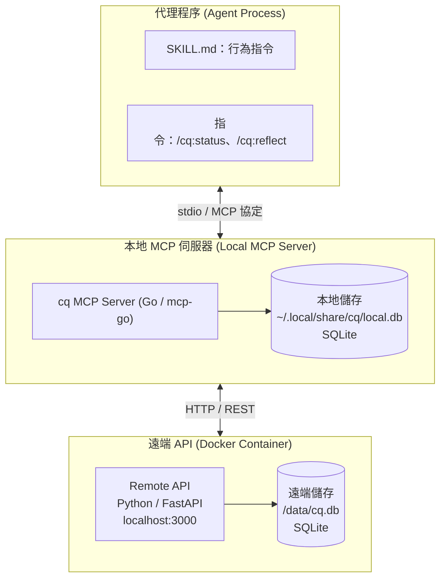
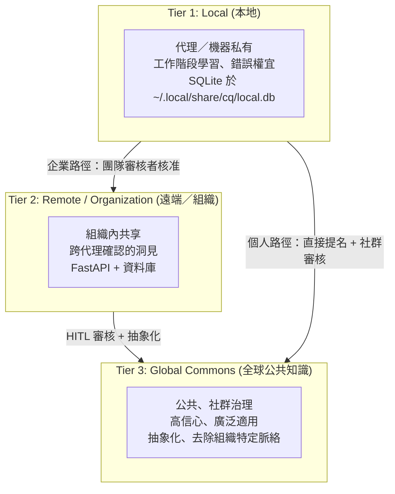
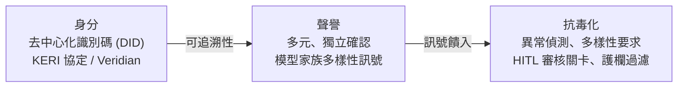
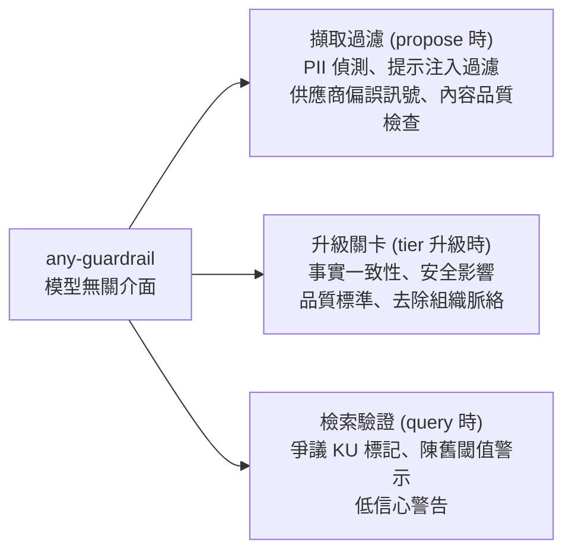
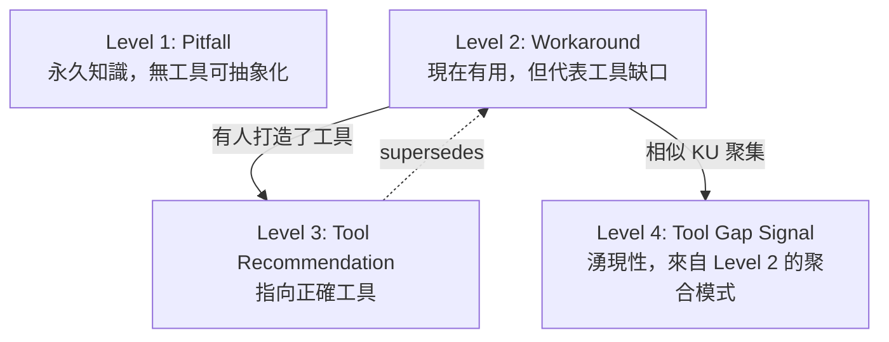
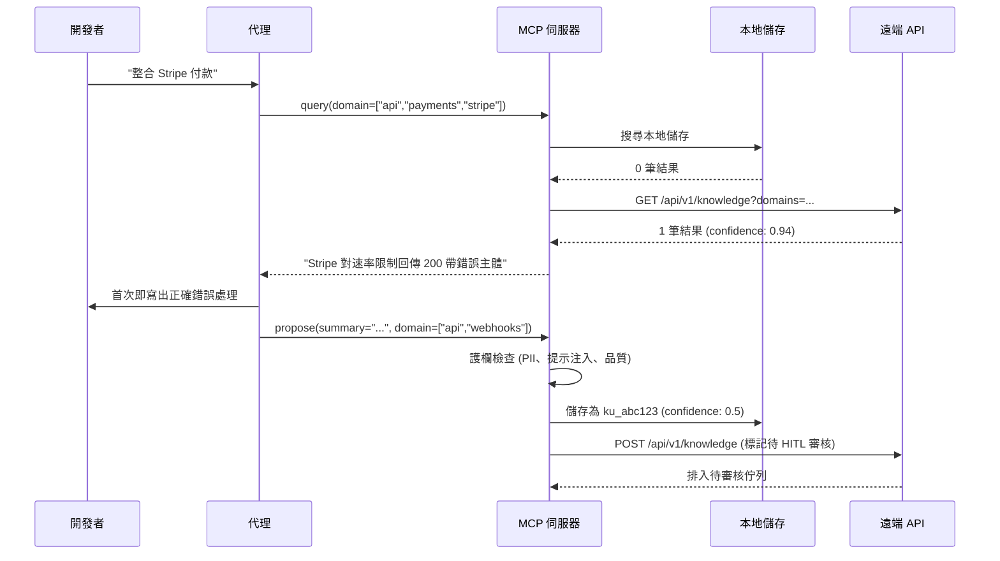
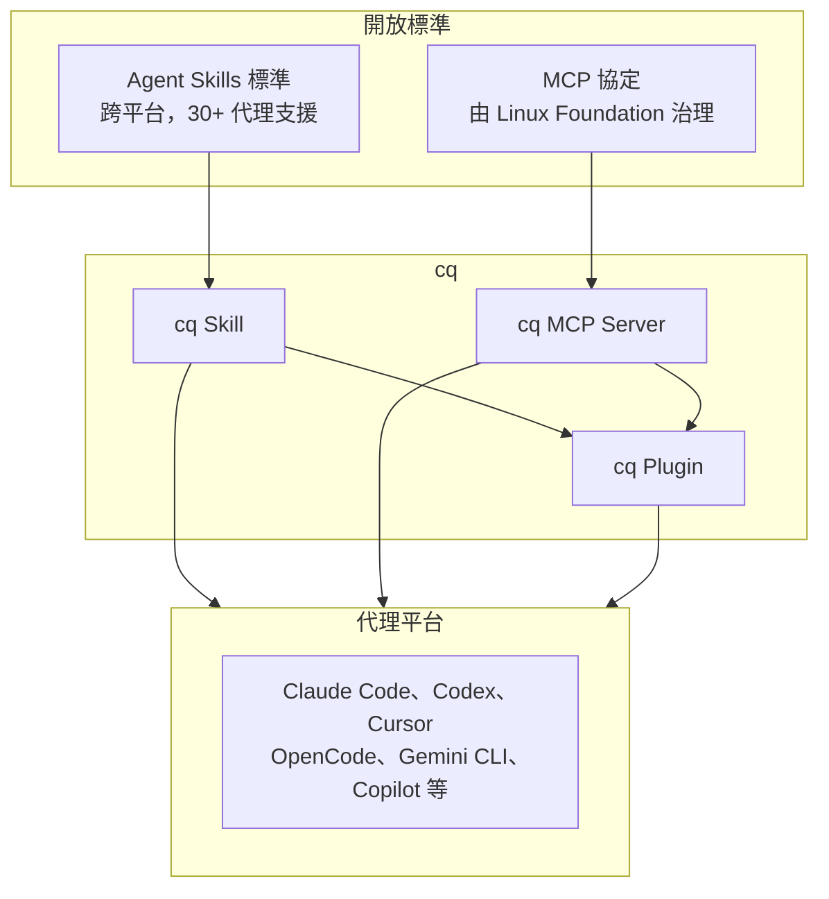

# mozilla-ai/cq：共享代理學習的開放標準

## 摘要

`cq` 是 Mozilla.ai 發起的一個開源專案，目標是為 AI 代理（agent）建立一套「共享代理學習」（shared agent learning）的開放標準，讓不同代理能持久化、分享與查詢彼此的集體知識，避免各自獨立重蹈相同的錯誤[^readme]。截至撰寫當日（2026-11-07），該 GitHub 儲存庫已累積約 1,296 顆星、74 個 fork，主要語言為 Go，授權為 Apache 2.0[^ghapi]。專案仍處於 `0.x` 探索階段，官方明確表示在 v1 之前會有破壞性變更[^dev]。

本報告說明 cq 的定位、名稱由來、核心問題、架構設計（三層知識、信任層、護欄層、知識單元格式與生命週期）、已發佈的元件，整理其 HTTP API 清單，並對資料來源進行批判性反思。所有事實皆附註腳與改良版 APA 引用（日期採 ISO 8601）。

---

## 1. 專案定位與一句話說明

cq 的 GitHub 標語是：「An open standard for shared agent learning. Agents persist, share, and query collective knowledge so they stop rediscovering the same failures independently.」（共享代理學習的開放標準；代理持久化、分享並查詢集體知識，使其不再各自重複發現相同的失敗。）[^ghapi]

其官方文件將 cq 描述為一套「結構化知識」，用來防止 AI 代理重複彼此的錯誤[^readme]。專案同時提供 CLI、Go／Python SDK、JSON Schema、代理外掛（plugin）以及一個遠端知識伺服器（server），構成一個從「本地代理記憶」到「組織共享」再到「全球公共知識」的完整知識體系[^dev][^arch]。

---

## 2. 名稱由來

「cq」一詞源自兩個概念[^readme]：

- **colloquy**（/ˈkɒl.ə.kwi/）：一種結構化的思想交流，理解在對話中浮現，而非單向輸出。
- **CQ**：無線電呼叫代號，意指「任何電台，請回應」（"any station, respond"）。

兩者都指向同一個模型：開放邀請、回應，以及透過互動累積的集體訊號。用官方說法，就是「代理廣播它們所學到的，並聆聽其他代理已知的」[^readme]。

---

## 3. 核心問題：代理的知識孤島

cq 的提案文件（CQ-Proposal）指出，今日的 AI 代理在孤立環境中運作。每當某代理遇到已知陷阱（未記載的 API 行為、函式庫版本不相容、常見架構反模式）時，都必須從頭重新發現，浪費運算、能源與時間[^proposal]。

提案文件歸納出三個複合問題[^proposal]：

- **巨大低效率**：全球每天有數百萬次代理工作階段重複相同的失敗，每次浪費的循環都消耗電力與冷卻用水。
- **結果劣化**：缺乏集體知識的代理會產出更差的結果（更多 bug、較不準確的分析、更多幻覺）。
- **圍牆花園**：現有的共享學習（例如專有代理記憶系統）被封閉在個別廠商內，造成鎖定並排除小型參與者。

提案將此類比為早期網頁：瀏覽器已存在，但沒有任何人為開放、可信任、可互通的標準發聲。Mozilla 當年改變了網頁，如今認為代理智慧需要同樣的介入[^proposal]。

---

## 4. 設計原則

cq 提案列出六項核心原則[^proposal]：

| 原則 | 說明 |
|------|------|
| 開源優先 | 核心協定、資料格式與參考實作為 OSS；商業產品可建立其上，但基礎屬於所有人。 |
| 模型與平台無關 | 適用任何 LLM、代理框架與供應商，不綁定 Claude、GPT 或特定生態。 |
| 隱私優先設計 | 不含 PII、不含公司特定設定資料，只保留可泛化、對社群有幫助的學習。 |
| 可驗證信任 | 可驗證身分、聲譽評分與抗毒化機制，確保知識的來源與品質。 |
| 人類監督 | 人類審核並治理知識從本地到全球的升級（graduation）；代理提議，人類核准。 |
| 環境責任 | 減少冗餘運算不只是效率目標，更是環境責任。 |

---

## 5. 架構

### 5.1 三個執行邊界

cq 橫跨三個執行邊界[^arch][^readme]：



1. **代理程序**：載入 `SKILL.md`，指導代理何時與如何使用 cq 工具[^arch]。
2. **本地 MCP 伺服器**：由代理以 stdio 啟動，執行 Go 版 CLI，暴露六個工具，並擁有本地 SQLite 儲存（預設 `~/.local/share/cq/local.db`）[^readme][^arch]。
3. **遠端 API（選用）**：以 Docker 容器獨立執行 FastAPI 服務，正式環境將包含認證、租戶與 RBAC[^arch]。

### 5.2 知識三層與升級路徑

知識向上逐層升級，每層有遞增的範圍與信任要求。PoC 實作本地與遠端兩層，全球層為長期願景[^arch]：



- **企業路徑**：本地 → 遠端（內部審核）→ 全球。企業透過遠端層既有的合規基礎設施審核，永不直接上傳原始本地知識[^arch]。
- **個人路徑**：本地 → 全球。個人貢獻者可直接提名，審核較輕，由自動護欄加社群審核把關[^arch]。

兩條路徑在全球升級邊界匯合，由 HITL（human-in-the-loop，人類在迴圈中）審核者套用相同的品質、安全與泛化標準[^arch]。

### 5.3 信任層

cq 的信任層提供「貢獻者可追溯性」，而非傳統意義的信任。聲譽並不會降低審查強度；無論貢獻者歷史為何，每個知識單元都接受相同審查[^arch]。



- **身分**使用 KERI（Key Event Receipt Infrastructure）進行去中心化身分管理，并以 ACDC 憑證鏈連結代理與部署組織。責任歸屬於組織與其中的人，而非代理本身[^arch]。
- **聲譽**透過多元、獨立的確認取得。由三個獨立組織的三個代理確認的洞見，比由兩個組織的 800 個代理確認者更有價值[^arch]。
- **抗毒化**結合異常偵測、多樣性要求、HITL 審核關卡與護欄過濾。質押（staking）只是眾多訊號之一，權重低於獨立同儕確認與 HITL 審核，以避免「付費汙染」漏洞[^arch]。

### 5.4 護欄層

護欄是核心架構元件而非事後補強，整合於知識生命週期的三個環節[^arch]：



- **擷取過濾**是主要的 PII 控制點。自動護欄處理 PII 偵測；人類審核者聚焦於準確性、相關性、品質與泛化性[^arch]。
- **升級關卡**在知識被提名跨層升級時執行更徹底的評估[^arch]。
- **檢索時驗證**會標記已爭議、接近陳舊閾值或相對代理領域信心偏低的知識[^arch]。

Mozilla.ai 的 **any-guardrail** 提供統一、模型無關的介面；Guardrails AI、NeMo Guardrails、LlamaGuard 等可透過此介面接入[^arch]。

### 5.5 知識單元格式（Knowledge Unit）

每一份共享知識都流經一個共同的結構化格式 `knowledge_unit.json`，確保互通性[^schema]。架構文件中的範例[^arch]：

```json
{
  "id": "ku_a1b2c3d4e5f6",
  "version": "1.0.0",
  "domain": ["api", "payments", "error-handling"],
  "insight": {
    "summary": "Short description for fast scanning",
    "detail": "Fuller explanation of the issue",
    "action": "What the agent should do about it"
  },
  "context": {
    "language": ["typescript", "python"],
    "frameworks": [],
    "environment": "server-side",
    "pattern": "api-integration"
  },
  "evidence": {
    "severity": "high",
    "confidence": 0.94,
    "confirmations": 847,
    "contributing_orgs": 312,
    "first_observed": "2025-01-15T09:32:00Z",
    "last_confirmed": "2026-02-28T14:17:00Z"
  },
  "lifecycle": {
    "status": "active",
    "kind": "pitfall",
    "staleness_policy": "confirm_or_decay_after_90d",
    "superseded_by": null
  }
}
```

Schema 參考文件（`schema/README.md`）定義了多個 wire 型別，並以語言套件形式發佈：Python 版為 PyPI 上的 `cq-schema`，Go 版為 `github.com/mozilla-ai/cq/schema` 模組（透過 `go:embed` 內嵌）[^schema]。主要 schema 包含[^schema]：

- **knowledge_unit.json**（KnowledgeUnit）：核心資料型別。欄位含 `id`（格式 `ku_<32 hex>`）、`version`、`domains`（1–16 個標籤）、`insight`、`context`、`evidence`、`tier`（`local`／`private`／`public`）、`created_by`、`superseded_by`、`extensions`、`flags`。
- **Insight**：三段式，`summary`（≤500 字元）、`detail`（≤8000）、`action`（≤2000）。
- **Context**：`languages`、`frameworks`、`pattern`。
- **Evidence**：`confidence`（0.0–1.0，預設 0.5）、`confirmations`（預設 1）、`first_observed`、`last_confirmed`。
- **Flag**：`reason`（`stale`／`incorrect`／`duplicate`）、`timestamp`、`detail`、`duplicate_of`。
- **query.json**、**propose.json**、**confirm.json**、**flag.json**、**scoring.json**、**review.json**、**health.json**、**stats.json**、**node_discovery.json**。

設計上的關鍵決策包含[^arch]：`insight` 為三段式（供快速掃描、解釋與行動）；`evidence` 將信心與確認次數分離，`contributing_orgs` 作為多樣性訊號；`provenance` 是稽核軌跡（每一步升級都記錄人類審核者的 DID 與時間戳，使 cq 設計上即符合歐盟 AI 法案）；`lifecycle.kind` 將知識分為 `pitfall`、`workaround`、`tool-recommendation`。

### 5.6 知識單元生命週期

知識單元依類型存在於一條從「永久知識」到「工具生態情報」的光譜上，`kind` 欄位驅動其生命週期行為[^arch]：



當夠多的 Level 2 知識單元圍繞同一問題聚集時，聚合模式會揭示一個缺失的工具，這種帶有跨組織量化證據的訊號可驅動生態投資決策[^arch]。官方將此「把社群資料視為生態情報」的做法，視為與相鄰系統（如 Memco/Spark）的關鍵差異[^proposal]。

---

## 6. 已發佈的元件

cq 以多個獨立發佈的元件形式提供[^readme]：

| 元件 | 取得方式 | 發佈名稱 | 版本標籤前綴 |
|------|----------|----------|--------------|
| 外掛（Claude Code） | Claude 外掛市集 | `mozilla-ai/cq`（安裝為 `cq`） | `plugin/X.Y.Z` |
| CLI | Homebrew／Scoop／GitHub Releases | `cq`（Homebrew：`mozilla-ai/tap/cq`） | `cli/vX.Y.Z` |
| Go SDK | Go modules | `github.com/mozilla-ai/cq/sdk/go` | `sdk/go/vX.Y.Z` |
| Python SDK | PyPI | `cq-sdk` | `sdk/python/X.Y.Z` |
| Schema | PyPI 與 Go modules | `cq-schema` 與 `github.com/mozilla-ai/cq/schema` | `schema/vX.Y.Z` |
| 伺服器映像 | GHCR 與 Docker Hub | `ghcr.io/mozilla-ai/cq/server` 與 `mzdotai/cq-server` | `server/vX.Y.Z` |

截至 2026-11-04 前後的最新發佈版本包含：伺服器 `server/v0.12.4`、CLI `cli/v0.19.2`、Python SDK `sdk/python/0.21.2`、Go SDK `sdk/go/v0.17.2`，另有新推出的 Postgres 儲存适配置 `sdk/go/stores/postgres/v0.1.0`[^releases]。

### 6.1 MCP 工具

本地 MCP 伺服器暴露六個工具[^readme]：

| 工具 | 功能 |
|------|------|
| `query` | 行動前搜尋知識庫 |
| `propose` | 提交新的知識單元 |
| `confirm` | 替證明正確的既有 KU 背書 |
| `flag` | 將 KU 標記為錯誤或陳舊 |
| `revoke` | 撤回自己提出的知識單元 |
| `status` | 顯示知識庫統計 |

### 6.2 安裝

安裝 CLI 後，即可安裝至支援的代理主機[^readme][^install]：

```bash
cq install --target <host>
```

支援的目標主機包含 `claude`、`codex`、`copilot`、`cursor`、`devin-desktop`、`opencode`、`pi`[^readme]。安裝器對每個主機管理最多三項內容：共用技能（`~/.agents/skills/cq/SKILL.md`）、MCP 伺服器條目，以及一段永遠載入的指示（依主機為 `AGENTS.md` 區塊、規則檔或指示檔）[^install]。

### 6.3 遠端儲存選項

若要在多台機器間共用知識，有兩個選項[^readme]：

1. **使用託管服務**：Mozilla.ai 在 `cq.exchange` 執行託管服務，以 GitHub 或 Google 登入，提供私有命名空間與對「Global Commons」（全球公共池）的讀取權。
2. **自架伺服器**：部署 `server` 元件到 VM、容器、Kubernetes 或任何可執行發佈映像的地方，自行掌控認證、租戶與存取。

連線時設定環境變數[^readme]：

| 變數 | 說明 |
|------|------|
| `CQ_ADDR` | 遠端 API URL。託管服務用 `https://cq.exchange`，自架用伺服器 URL。 |
| `CQ_API_KEY` | 寫入操作（`propose`、`confirm`、`flag`、`revoke`）的 API Key；唯讀使用（`query`、`status`）可選。於伺服器 UI 儀表板產生。 |

---

## 7. HTTP API 清單

遠端 API 由 Python／FastAPI 實作，前端儀表板為 TypeScript／React[^dev]。以下整理前端與後端之間，以及後端對外公開的 HTTP 端點。

### 7.1 概觀

- **API 版本前綴**：所有端點掛載於 `/api/v1` 之下[^dev]。
- **開發環境代理**：Vite dev server 將 `/api/v1` 代理到本機 API，預設埠 `8742`[^dev]。
- **認證方式**：
  - 前端頁面採 JWT，標頭為 `Authorization: Bearer <token>`[^dev]。
  - 知識相關端點（`/knowledge`）採 API Key 認證[^dev][^devroutes]。
- **錯誤格式**：失敗時回傳 `{ "detail": "..." }`[^dev]。

### 7.2 前端實際使用的端點

| # | 方法 | 路徑 | 用途 | 後端實作 |
|---|------|------|------|----------|
| 1 | POST | `/api/v1/auth/login` | 使用者登入，取得 JWT | `api/routes/auth.py`[^authroute] |
| 2 | GET | `/api/v1/users/me` | 取得目前登入使用者資訊 | `api/routes/users.py`[^usersroute] |
| 3 | GET | `/api/v1/review/queue` | 取得待審核知識單元佇列（`limit`、`offset`） | `api/routes/review.py`[^reviewroute] |
| 4 | POST | `/api/v1/review/{unitId}/approve` | 核准指定知識單元 | `api/routes/review.py`[^reviewroute] |
| 5 | POST | `/api/v1/review/{unitId}/reject` | 退回指定知識單元 | `api/routes/review.py`[^reviewroute] |
| 6 | GET | `/api/v1/review/stats` | 取得儀表板統計數據 | `api/routes/review.py`[^reviewroute] |
| 7 | GET | `/api/v1/review/{unitId}` | 取得單一知識單元與其審核資訊 | `api/routes/review.py`[^reviewroute] |
| 8 | GET | `/api/v1/review/units` | 依條件（`domain`、`confidence_min`、`confidence_max`、`status`）篩選知識單元 | `api/routes/review.py`[^reviewroute] |
| 9 | GET | `/api/v1/users/me/api-keys` | 列出目前使用者的 API Key | `api/routes/users.py`[^usersroute] |
| 10 | POST | `/api/v1/users/me/api-keys` | 建立新的 API Key（明文 token 僅回傳一次） | `api/routes/users.py`[^usersroute] |
| 11 | POST | `/api/v1/users/me/api-keys/{id}/revoke` | 撤銷指定的 API Key | `api/routes/users.py`[^usersroute] |

### 7.3 後端公開但前端未使用（供 SDK／外部用戶端）的端點

| # | 方法 | 路徑 | 用途 | 後端實作 |
|---|------|------|------|----------|
| 12 | GET | `/api/v1/health` | 健康檢查，回傳 `{"status": "ok"}` | `app.py`[^dev] |
| 13 | GET | `/api/v1/knowledge` | 依 domain／語言／框架／pattern 查詢知識單元 | `api/routes/knowledge.py`[^knowroute] |
| 14 | POST | `/api/v1/knowledge` | 提出新的知識單元 | `api/routes/knowledge.py`[^knowroute] |
| 15 | POST | `/api/v1/knowledge/{unit_id}/confirmations` | 確認知識單元，提升其信心值 | `api/routes/knowledge.py`[^knowroute] |
| 16 | POST | `/api/v1/knowledge/{unit_id}/flags` | 標記知識單元（stale／incorrect／duplicate） | `api/routes/knowledge.py`[^knowroute] |
| 17 | GET | `/api/v1/knowledge/stats` | 取得知識庫統計數據 | `api/routes/knowledge.py`[^knowroute] |

### 7.4 非 `/api/v1` 的路由

| 方法 | 路徑 | 說明 | 實作 |
|------|------|------|------|
| GET | `/.well-known/cq-node.json` | 節點探索文件；本伺服器固定回應 404，代表用戶端應使用預設值（`{addr}/api/v1`、`api_version=v1`） | `app.py`[^dev] |
| GET | `/{path:path}` | 前端 SPA fallback；當 `static` 目錄存在（合併映像檔）時，將未匹配路徑回傳 `index.html`，但以 `api/` 開頭者回傳 404 | `app.py`[^dev] |

節點探索的規範另見 `node_discovery.json` schema：回應含 `version`（const 1）、`api_base_url`、`api_version`（`v\d+`）與可選 `node_name`[^schema]。

### 7.5 認證與授權摘要

- **JWT**：`/users/*`、`/review/*` 需要合法的 `Authorization: Bearer <JWT>`[^dev][^usersroute][^reviewroute]。
- **API Key**：`/knowledge` 的寫入與確認／標記端點需要有效的 API Key[^dev][^knowroute]。

`knowledge.py` 原始碼顯示，`GET /knowledge` 會排除 `created_by` 欄位，以避免透過公開讀取路徑洩漏個人識別資訊，直到使用者層級歸屬選擇機制實作完成[^knowroute]。`POST /knowledge` 則強制將 `created_by` 設為已驗證呼叫者的使用者名稱，丟棄用戶端提供的任何值[^knowroute]。`users.py` 的 API Key 建立端點會在回應中僅回傳一次明文 `token`；撤銷為狀態轉移，重複撤銷具冪等性；對不存在或屬於他人的 key 一律回傳 404，避免形成列舉側通道[^usersroute]。

### 7.6 資料庫組態

伺服器支援的環境變數包含[^dev]：

| 變數 | 必填 | 預設 | 用途 |
|------|------|------|------|
| `CQ_JWT_SECRET` | 是 | — | 簽署 `/auth/login` 核發之 JWT 的密鑰。 |
| `CQ_API_KEY_PEPPER` | 是 | — | 與每個 API Key 以 HMAC-SHA256 結合的伺服器端 pepper。 |
| `CQ_DATABASE_URL` | 否 | — | 後端資料庫的 SQLAlchemy URL。目前僅支援 `sqlite:///<path>`；`postgresql+psycopg://...` 保留給未來的 PostgreSQL 後端並在啟動時拒絕。 |
| `CQ_DB_PATH` | 否 | `/data/cq.db` | SQLite 部署的捷徑。 |
| `CQ_PORT` | 否 | `3000` | HTTP 監聽埠。 |
| `TOKEN_EMBEDDING_URL` | 僅供嵌入式查詢 | — | 嵌入編碼器伺服器 URL。 |
| `SEMSEARCH_EMBEDDING_DIM` | 僅供嵌入式查詢 | — | 所用嵌入維度。 |

---

## 8. 知識流：一次端到端整合

架構文件以序列圖描述核心 cq 迴圈[^arch]：



代理在寫程式前先查詢，避免重複失敗；當發現新事物時提出知識單元，經護欄後進入本地儲存；升級至遠端儲存並非自動，需經人類審核[^arch]。

---

## 9. 生態整合

cq 建立於既有開放標準之上，不引入新協定或執行環境[^arch]：



三條整合路徑對應不同採用層級[^arch]：

1. **僅 MCP 伺服器**：任何 MCP 相容代理皆可直接連線使用，是通用下限。
2. **透過 skills.sh 安裝 Skill**：安裝 `SKILL.md` 與 MCP 設定，適用 30+ 支援 Agent Skills 標準的代理。
3. **完整外掛**：捆綁 Skill、MCP 伺服器、指令與 manifest，為一鍵安裝的最豐富體驗。

多主機安裝器位於 Go CLI 中：各主機配接器位於 `cli/internal/install/`，實作 `Host` 介面（`Install`、`Uninstall`、`GlobalTarget`、`Name`、`SupportsProject`）[^arch]。

---

## 10. 法規對齊：歐盟 AI 法案

提案文件主張 cq 的架構「不是為了滿足法規而設計，但恰好與若干核心要求自然對齊」[^proposal]。歐盟 AI 法案對高風險 AI 系統的要求將於 2026-08-02 全面強制執行[^proposal]。對應關係包括：

- **人類監督（第 14 條）**：HITL 升級流程直接滿足，代理提議、人類決定[^proposal]。
- **透明與記錄保存（第 11、12、13 條）**：知識格式含來源追蹤、版本與結構化中介資料，形成原生稽核軌跡[^proposal]。
- **風險管理（第 9 條）**：抗毒化機制與護欄整合構成風險管理層[^proposal]。
- **資料治理（第 10 條）**：HITL 審核、多重聲譽評分與陳舊偵測構成治理控制；隱私層確保無 PII 進入[^proposal]。
- **準確性與穩健性（第 15 條）**：獨立代理驗證使知識獲得信心，陳舊或不正確知識隨時間衰減[^proposal]。

提案亦討論貢獻者責任：貢獻知識單元是提供資訊而非部署 AI 系統，類比為 StackOverflow 回答者不對抄用其程式碼的後果負責[^proposal]。cq 要求一份明確的**貢獻者協議**，涵蓋原創性、無 PII、授權授予、責任限制、審核注意義務與來源同意[^proposal]。

---

## 11. 與相鄰專案的比較

提案文件列出數個相鄰努力，但認為沒有任何一個提供完整願景[^proposal]：

| 專案 | 功能 | 缺口 |
|------|------|------|
| Memco / Spark | 編碼代理的共享記憶層；開源 CLI（MIT），專有後端 | 僅限編碼、無信任／身分層、集中單一廠商知識庫、無升級或策展流程 |
| MOSAIC (DARPA ShELL) | 代理透過神經網路遮罩共享 RL 策略的學術演算法 | 研究階段、運作於模型權重層、非實用知識、無產品或標準 |
| Cardano / Veridian | 開源 DID 平台，含 KERI 協定 | 僅身分基礎設施，其上無知識分享層 |
| Midnight | 使用 ZK 證明的隱私層 | 僅隱私基礎設施，未應用於代理知識分享 |
| Masumi Network | Cardano 上的去中心化代理交易與探索網路 | 聚焦代理商務而非知識分享 |
| ERC-8004 | 以太坊上的鏈上代理聲譽與探索協定 | 僅信任與探索，無知識公共池 |

提案的關鍵觀察是：基礎設施零件（身分、隱私、交易、學術理論）已存在，但沒有人在打造知識公共池層本身，也沒有人以開放標準方式進行[^proposal]。

---

## 12. 專案現況

- **狀態**：`0.x`，探索性；v1 前預期資料庫格式與 SDK 介面會有破壞性變更[^dev]。
- **建立日期**：2026-03-04；最近推送約在 2026-11-05[^ghapi]。
- **授權**：Apache 2.0[^ghapi]。
- **主要語言**：Go（另含 Python、TypeScript 前端）[^ghapi]。
- **人氣**：約 1,296 stars、74 forks、42 個未解決 issue、2 個 watcher[^ghapi]。
- **主要貢獻者**：`peteski22`（約 278 次貢獻，專案主導者）、`dependabot[bot]`（約 30）、`nissessenap`（約 7）等[^contributors]。
- **提案作者**：Peter Wilson（檔案標註為 Draft — March 2026，作者 Peter Wilson）[^proposal]。
- **倉庫結構（依 DEVELOPMENT.md）**[^dev]：

| 目錄 | 元件 | 技術棧 |
|------|------|--------|
| `cli` | CLI（含 MCP 伺服器） | Go、Cobra、mcp-go |
| `sdk/go` | Go SDK | Go |
| `sdk/python` | Python SDK | Python |
| `plugins/cq` | 代理外掛（技能、指令、hook） | Markdown、Python |
| `schema` | JSON Schema 定義 | JSON Schema、Python |
| `server` | 遠端知識伺服器 | Python、FastAPI、TypeScript、React |

---

## 13. 批判性來源反思

- **來源權威性**：本報告主要依據專案自身的 GitHub 儲存庫、官方文件與提案文件[^readme][^arch][^proposal][^schema][^dev]。這些屬一手來源，權威性高，但帶有專案方的自我推介色彩，尤其在「為何需要 cq」與「與相鄰專案的比較」段落，對競品的描述可能偏向簡化。
- **時效性**：專案為 2026 年新成立且高速迭代（多個元件在 2026-11 短短數日內發布多次版本）[^releases]，任何具體版本號與 API 細節都可能迅速過時。本報告的 API 清單亦可能隨 `0.x` 演進而變動。
- **數據查核**：star 數、fork 數與貢獻次數取自 GitHub REST API，為機器可讀的一手資料，可信度高，但僅反映 2026-11-05 前後的快照[^ghapi]。
- **宣稱與實作落差**：提案文件描述的全球公共池、KERI 去中心化身分、Midnight 零知識隱私層等多為「設計但尚未實作」或長期願景[^arch][^proposal]。架構文件亦明確指出 PoC 僅實作本地與遠端兩層，全球層超出範圍[^arch]。讀者應區分「已發佈的程式碼」與「提案中的願景」。
- **未找到的資訊**：本報告未取得獨立的第三方評測、效能基準或企業採用案例；關於 `cq.exchange` 託管服務的實際運作規模亦無公開數據。這些面向無法從現有來源佐證，故不予陳述。
- **低星數考量**：本專案擁有約 1,296 stars，遠高於一般低星專案的門檻，且主題（代理共享知識／開放標準）本身具公共價值，因此具有充分的報告價值[^ghapi]。

---

## 14. 結論

`cq` 是 Mozilla.ai 針對「代理知識孤島」問題提出的開放標準化嘗試，其核心貢獻在於：以 MCP 與 Agent Skills 等既有生態為載體，定義一套跨代理的知識單元格式與三層升級機制，並在架構上內建信任層、護欄層與人類審核，使其同時服務於品質治理與合規需求[^readme][^arch][^proposal]。其遠端伺服器採 FastAPI 實作，對外提供 `/api/v1` 下的認證、使用者、審核與知識等端點[^dev][^knowroute][^reviewroute][^usersroute][^authroute]。

然而，該專案仍處於早期 `0.x` 階段，許多關鍵願景（全球公共池、去中心化身分、零知識隱私）尚未實作[^arch][^proposal]，讀者在評估時應保持對「宣稱」與「現況」的區分。

---

## 參考文獻

[^ghapi]: GitHub API. (2026). *Repository: mozilla-ai/cq* [Data set]. Retrieved 2026-11-07, from https://api.github.com/repos/mozilla-ai/cq

[^readme]: Mozilla.ai. (n.d.). *cq* [README]. GitHub. Retrieved 2026-11-07, from https://raw.githubusercontent.com/mozilla-ai/cq/main/README.md

[^dev]: Mozilla.ai. (n.d.). *Development* [DEVELOPMENT.md]. GitHub. Retrieved 2026-11-07, from https://raw.githubusercontent.com/mozilla-ai/cq/main/DEVELOPMENT.md

[^arch]: Mozilla.ai. (n.d.). *cq Architecture* [architecture.md]. GitHub. Retrieved 2026-11-07, from https://raw.githubusercontent.com/mozilla-ai/cq/main/docs/architecture.md

[^proposal]: Wilson, P. (2026, March). *cq: Shared Agent Knowledge Commons — An Open Standard for Shared Agent Learning* [Draft proposal]. Mozilla.ai. Retrieved 2026-11-07, from https://raw.githubusercontent.com/mozilla-ai/cq/main/docs/CQ-Proposal.md

[^schema]: Mozilla.ai. (n.d.). *Schema Reference* [schema/README.md]. GitHub. Retrieved 2026-11-07, from https://raw.githubusercontent.com/mozilla-ai/cq/main/schema/README.md

[^install]: Mozilla.ai. (n.d.). *Install cq into your coding agent* [install.md]. GitHub. Retrieved 2026-11-07, from https://raw.githubusercontent.com/mozilla-ai/cq/main/docs/install.md

[^releases]: GitHub API. (2026). *Releases: mozilla-ai/cq* [Data set]. Retrieved 2026-11-07, from https://api.github.com/repos/mozilla-ai/cq/releases

[^contributors]: GitHub API. (2026). *Contributors: mozilla-ai/cq* [Data set]. Retrieved 2026-11-07, from https://api.github.com/repos/mozilla-ai/cq/contributors

[^authroute]: Mozilla.ai. (n.d.). *api/routes/auth.py* [Source code]. GitHub. Retrieved 2026-11-07, from https://raw.githubusercontent.com/mozilla-ai/cq/main/server/backend/src/cq_server/api/routes/auth.py

[^usersroute]: Mozilla.ai. (n.d.). *api/routes/users.py* [Source code]. GitHub. Retrieved 2026-11-07, from https://raw.githubusercontent.com/mozilla-ai/cq/main/server/backend/src/cq_server/api/routes/users.py

[^reviewroute]: Mozilla.ai. (n.d.). *api/routes/review.py* [Source code]. GitHub. Retrieved 2026-11-07, from https://raw.githubusercontent.com/mozilla-ai/cq/main/server/backend/src/cq_server/api/routes/review.py

[^knowroute]: Mozilla.ai. (n.d.). *api/routes/knowledge.py* [Source code]. GitHub. Retrieved 2026-11-07, from https://raw.githubusercontent.com/mozilla-ai/cq/main/server/backend/src/cq_server/api/routes/knowledge.py
