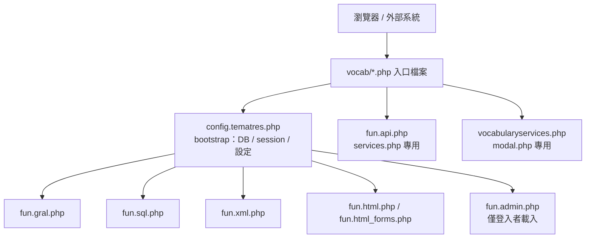
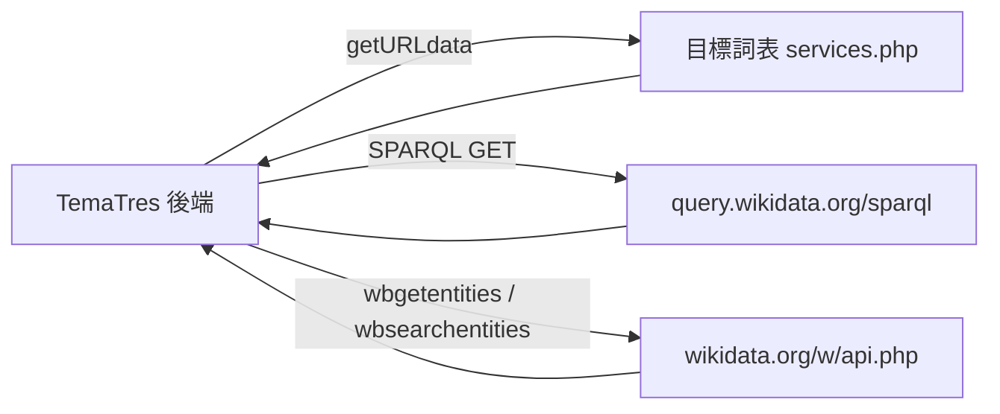

# TemaTres 前後端 HTTP API 介面清單

本文整理 **TemaTres（Vocabulary Server）** 中，前端（瀏覽器／外部呼叫者）與後端（PHP）之間所有以 HTTP 溝通的介面（endpoint）。TemaTres 是一套以 PHP 撰寫、用來管理受控詞彙、分類法、知識本體（taxonomy）、索引典（thesaurus）與詞彙表（glossary）等知識正式表徵的網頁應用程式[^repo]，本文所依據的程式碼為其 GitHub 官方儲存庫 `tematres/TemaTres-Vocabulary-Server` 的 `master` 分支[^repo]。

> **閱讀前提**：TemaTres 是無框架的程序式 PHP 應用，沒有獨立的 REST 層。所有「API」都是 `vocab/` 目錄下的入口檔案（entry file），透過 query string、POST 表單或 AJAX 呼叫。所有入口都必須先 `require "config.tematres.php"`，因此共用同一套 bootstrap（資料庫連線、session、設定與 `fun.*` 系列的輔助函式）[^services][^configmain]。

---

## 1. 專案背景

| 項目 | 內容 |
|---|---|
| 專案名稱 | TemaTres-Vocabulary-Server |
| 官方網站 | https://vocabularyserver.com |
| 授權條款 | GNU General Public License, Version 2（GPLv2，1991 年 6 月）[^readme] |
| 主要語言 | PHP[^repoapi] |
| GitHub 星號數 | 約 142 顆星、63 個 fork[^repoapi] |
| 系統需求 | 支援 `mod_rewrite` 的 HTTP 伺服器、MySQL 5.0+ 或 MariaDB、PHP 7.4+、PHP 模組 cURL 與 php-xml[^readme] |
| 最新發行版本 | v3.6.2，發佈於 2026-10-26[^releases] |
| 程式碼中的版本標記 | `$CFG["Version"] = "TemaTres 4.0"`、`$CFG["VersionWebService"] = "2.1"`[^configinc] |

需特別留意：官方 GitHub Releases 頁面最新標記為 v3.6.2[^releases]，但 `master` 分支的設定檔已標示為「TemaTres 4.0」[^configinc]。也就是說，程式碼主線已進入 4.0 開發階段，但尚未正式發行；本文所述介面以 `master` 分支程式碼為準。

---

## 2. 總覽

下表列出 `vocab/` 目錄下對外的 HTTP 入口檔案。呼叫端欄位標示典型使用情境，認證欄位則描述權限控制。

| 入口檔案 | 用途 | 呼叫端 | 方法 | 認證 |
|---|---|---|---|---|
| `services.php` | 詞表 Web Service / API（XML/JSON/SKOS） | 外部系統、前端 | GET（亦支援 rewrite） | 依設定（公開或關閉） |
| `xml.php` | schema 匯出與管理者全量匯出 | 外部系統、前端連結/表單 | GET | 部分需 admin |
| `suggest.php` | 搜尋自動完成 + 樹狀節點 | 前端 AJAX | GET | 公開 |
| `searcher.php` | 行內即時編輯（jEditable） | 前端 AJAX | POST | 需登入 |
| `modal.php` | 遠端載入的 modal 內容（詞目詳情） | 前端 AJAX | GET | 公開 |
| `login-modal.php` | 遠端載入的登入/帳號 modal | 前端 AJAX | GET / POST | 公開 |
| `sparql.php` | ARC2 SPARQL endpoint | 外部系統 | GET / POST | 讀公開，寫需登入 |
| `js.php` | 提供動態產生的 JS（含 AJAX 設定） | 前端 `<script>` | GET | 依登入狀態 |
| `index.php` | 主頁、搜尋、CSV 報表 | 前端 | GET / POST | 依詞表公開性 |
| `admin.php` | 後台 CRUD（表單送出） | 前端 | POST / GET | 需 admin/editor |
| `login.php` | 登入、忘記密碼、重設密碼 | 前端 | GET / POST | 公開 |

`vocab/.htaccess` 另外定義了對外「乾淨 URL」的改寫規則（見 §13）[^htaccess]。

下圖示意各入口檔案與共用 bootstrap 及後端函式庫的關係：



---

## 3. `services.php` — 詞表 Web Service（主要 API）

**進入點**（`vocab/services.php`）[^services]：

```php
// vocab/services.php
require "config.tematres.php";
require_once T3_ABSPATH . 'common/include/fun.api.php';
echo fetchVocabularyService(array2value("task",$_GET), array2value("arg",$_GET), array2value("output",$_GET));
```

實際分派邏輯位於 `common/include/fun.api.php` 的 `fetchVocabularyService()` 與 `evalServiceParam()` 兩函式[^funapi]。

**URL 形式**：

```text
services.php?task=<task>&arg=<arg>&output=<xml|json|skos>
```

- `task`（必填）：動作名稱。
- `arg`：動作參數，型別由 `evalServiceParam()` 決定（string / int / date / array_int / NULL）。
- `output`（選填，預設 `xml`）：`xml` | `json` | `skos`。

**未帶 task 或服務被停用時**：回傳 `describeService()` 的自我描述文件（服務清單與範例）[^funapi]。服務啟用與否由常數 `CFG_SIMPLE_WEB_SERVICE` 控制，該值來自 session 中的詞表設定[^configmain]。

**格式處理**（`fun.api.php`）[^funapi]：

- `json` → `Content-type: application/json`，`array2json(..., 'vocabularyservices')`。
- `skos` → `text/xml`，僅在 `_PUBLISH_SKOS=='1'` 時輸出真正的 SKOS，否則退回一般 XML。
- 預設 → `Content-Type: text/xml`，`array2xml(..., 'vocabularyservices')`。

每個回應都會夾帶 `<resume>` 區塊（`status`、`param`、`web_service_version`、`version`、`cant_result`）[^funapi]。

### 3.1 task 一覽

任務清單定義於 `fun.api.php` 中的 `$array_tasks` 陣列，分派則由 `fetchVocabularyService()` 的 `switch` 完成[^funapi]。

| task | arg 型別 | 說明 | 備註 |
|---|---|---|---|
| `fetchVocabularyData` | NULL | 詞表中繼資料 | 含 `status` 與 `status_date`[^funapi] |
| `fetchTopTerms` | NULL | 最上層詞目（top terms） | |
| `fetchCentralTerms` | NULL | 核心詞目 | |
| `fetchLast` | NULL | 最近建立詞目 | |
| `search` | string | 一般搜尋 | arg 長度需 ≥ `CFG_MIN_SEARCH_SIZE` |
| `fetch` | string | 精確比對搜尋 | 同上 |
| `match` | string | 自然語言比對搜尋 | |
| `searchNotes` | string | 在註記中搜尋 | |
| `suggest` | string | 開頭字母建議（僅字串） | 同上（長度限制） |
| `suggestDetails` | string | 建議並附詳細資料 | 同上 |
| `fetchSimilar` | string | 相似詞 | |
| `fetchCode` | string | 以代碼取詞目 | |
| `letter` | string | 取某字母開頭詞目 | arg 長度須為 1 |
| `fetchTerm` | int | 單一詞目基本資料 | |
| `fetchTermFull` | int | 詞目完整資料（含註記） | ⚠ 分派 case 為空，未實作回應 |
| `fetchAlt` | int | 非偏好詞（UF） | |
| `fetchDown` | int | 下位詞（NT） | |
| `fetchUp` | int | 上位結構（BT） | |
| `fetchRelated` | int | 相關詞（RT） | |
| `fetchDirectTerms` | int | 直接關聯詞（TG/TR/UF） | |
| `fetchNotes` | int | 詞目註記 | |
| `fetchURI` | int | 詞目連結的外部 URI | |
| `fetchTargetTerms` | int | 映射的目標詞目 | |
| `fetchSourceTerms` | string | 映射至本詞表的來源詞 | |
| `fetchTerms` | array_int | 逗號分隔 id 批次取詞 | 例：`arg=3,6,98` |
| `fetchRelatedTerms` | array_int | 逗號分隔 id 批次取相關詞 | |
| `randomTerm` | string | 隨機詞目（可依註記類型過濾） | 例：`arg=NA` |
| `termsSince` | date | 指定日期後新增/修改的詞目 | |
| `relationsSince` | date | 指定日期後的關聯 | 已列於 `$array_tasks`，但 `evalServiceParam` 的 switch 無對應 case |
| `sources` | string | 詞表的正規化來源清單 | |
| `termsbysource` | string | 依來源取詞 | int 驗證 |
| `notesbysource` | — | 分派 switch 中有 case，但未列於 `$array_tasks`（無法通過驗證） | |

**範例**（取自 `describeService()` 的自我描述文件）[^funapi]：

```text
services.php?task=fetchVocabularyData
services.php?task=search&arg=peace
services.php?task=fetch&arg=peace
services.php?task=suggest&arg=pea
services.php?task=fetchTerm&arg=1
services.php?task=fetchDown&arg=1
services.php?task=fetchTerms&arg=1,2,4
services.php?task=fetchCode&arg=01.03.04
services.php?task=letter&arg=a
services.php?task=termsSince&arg=2017-04-05
services.php?task=sources
services.php?task=termsbysource&arg=1
services.php?task=randomTerm&arg=NA
```

**開關**：

- `CFG_SIMPLE_WEB_SERVICE`：來自詞表設定的常數[^configmain]，預設值為 `'1'`；當其值非 `'1'` 時，整個 API 只回自我描述文件[^funapi]。
- `_PUBLISH_SKOS`：控制 `output=skos` 是否輸出真 SKOS；預設 `'2'`（即非 `1`）[^configinc][^funapi]。

---

## 4. `xml.php` — schema 匯出

**進入點**：`vocab/xml.php`[^xmlphp]。

### 4.1 單一詞目 schema（公開）

```text
xml.php?schema=<schema>&term_id=<id>
```

允許的 `schema` 為白名單：`skos, zthes, vdex, bs8723, mads, xtm, dc, json, jsonld, rss, tbx, ttl`[^xmlphp]。分派在 `common/include/fun.xml.php` 的 `selectSchema()`，各自設定對應 `Content-Type`：

| schema | 輸出 |
|---|---|
| `skos` | SKOS RDF/XML（`text/xml`） |
| `zthes` | Zthes XML |
| `vdex` | VDEX XML |
| `bs8723` | BS8723-5 XML |
| `mads` | MADS XML |
| `xtm` | Topic Map XTM |
| `dc` | Dublin Core |
| `json` | JSON（`application/json`） |
| `jsonld` | JSON-LD（`application/json`） |
| `tbx` | TBX XML |
| `rss` | RSS（`application/rss+xml`） |
| `ttl` | Turtle（`text/turtle`） |

> `schema=rss` 不需 `term_id`[^xmlphp]。

### 4.2 SKOS meta / node（公開）

```text
xml.php?skosMeta=1        → do_skos("", true)   (text/xml)
xml.php?skosNode=<id>     → do_skosNode(do_nodo_skos(<id>))  (text/xml)
```

這兩種輸出主要供 SPARQL endpoint 的 `LOAD` 指令使用（見 §8）[^xmlphp]。

### 4.3 管理者全量匯出（`dis` 參數，需 admin）

需通過 `evalUserLevel(...) == 1` 並帶上 `$_GET["dis"]`[^xmlphp]。可用值如下：

| `dis` | 動作 |
|---|---|
| `zline` / `zfile` | Zthes（line / file） |
| `moodfile` | Moodle 格式 |
| `rline` / `rfile` | 全量 SKOS（`rfile` 支援 `hasTopTermSKOS`） |
| `vfile` | 全量 VDEX |
| `siteMap` | sitemap |
| `rxtm` / `lxtm` | 全量 Topic Map |
| `BSfile` | 全量 BS8723 |
| `madsFile` | 全量 MADS |
| `marc` | MARC 權威 XML |
| `wxr` | WordPress WXR |
| `txt` | 純文字（可選 `hasTopTerm`/`includeNote`/`includeCreatedDate`/`includeTopTerm`/`includeModDate`） |
| `termAlpha` | 單詞目字母清單（`term_id`） |
| `termTree` | 單詞目樹狀清單（`term_id`） |
| `jtxt` | 階層純文字 |
| `rsql` | MySQL dump |
| `rpdf` / `spdf` | PDF（字母 / 系統） |
| `jglossary` | JSON 詞彙表（`note4gloss`、`includeAltLabel`） |
| `fdspace` | DSpace 匯出 |
| `ftbx` | 全量 TBX |
| `ttl` | 全量 Turtle |

> **佐證說明**：上述 `dis` 值皆可於 `vocab/xml.php` 的 `switch ($_GET["dis"])` 分支中逐項核對[^xmlphp]，因此屬可在原始碼中直接驗證的事實。

---

## 5. `suggest.php` — 自動完成與樹狀資料

**進入點**：`vocab/suggest.php`，回應 `Content-type: application/json`[^suggestphp]。

兩種模式分派於入口檔案最上方[^suggestphp]：

### 5.1 自動完成（autocomplete）

```text
suggest.php?query=<字串>&t=<0|其他>
```

- `query`：查詢字串（經 `XSSprevent` 處理）。
- `t`：`0` 表示一般搜尋模式，其他則用 `CFG_SUGGESTxWORD`（依字詞開頭建議，為預設）。
- 空 `query` 也會回合法 JSON：`{"query":"","suggestions":[]}`，原因是 jQuery autocomplete 外掛無法解析空回應[^suggestphp]。
- 長度須 ≥ `CFG["MIN_CHAR_SEARCH"]`，否則不回應。
- 實作：`getData4Autocompleter()`，回傳

  ```json
  {"query":"...","suggestions":[{"value":"...","data":"代碼: 詞"}]}
  ```

**前端呼叫**（`vocab/js.php`）[^jsphp]：

- 主搜尋框 `#query` → `serviceUrl: 'suggest.php'`。
- 加詞框 `#addTerms` → `serviceUrl: 'suggest.php?t=0&'`。
- 參數名 `query` 來自 jQuery autocomplete 的 `paramName: "query"`。

### 5.2 樹狀節點（jqTree）

```text
suggest.php?node=<term_id|TT>
```

- `node=TT`：列出最上層詞目。
- `node=<id>`：列出該詞目的下位詞。
- 實作：`getData4jtree()`，回傳陣列

  ```json
  [{"label":"...HTML...","id":123,"load_on_demand":true}]
  ```

**前端呼叫**：`<div id="treeTerm" data-url="suggest.php?node=TT">`，由 jqTree 按需載入[^jsphp]。

---

## 6. `searcher.php` — 行內即時編輯（AJAX）

**進入點**：`vocab/searcher.php`，回應 `Content-type: text/html`，**需登入**（判斷 session 中的 `ssuser_id`）[^searcherphp]。

以 jQuery jEditable 送出 POST，依 `$_POST` 欄位分派：

| POST 欄位 | 動作 | 後端函式 | 失敗回應 |
|---|---|---|---|
| `code_tema_id` / `code_tema` | 編輯詞目代碼 | `edit_single_code()` | `406 Not Acceptable` |
| `edit_tema_id` / `edit_tema` | 編輯詞目名稱 | `modTerm()` | `406 Not Acceptable` |
| `edit_rel_id` / `rel_rel_id` | 新增/刪除自訂關聯 | `abm_rel_rel()` | — |

**前端設定**（`vocab/js.php`）以 `.editable(...)` 綁定至 `searcher.php`[^jsphp]，例如：

- `.editable_textarea` → `code_tema_id` / `code_tema`。
- `.edit_area_term` → `edit_tema_id` / `edit_tema`。
- `.editable_selectTE` / `.editable_select2` / `.editable_select3` / `.editable_select4` → `edit_rel_id` / `rel_rel_id`（含 `relativeLabel: 'X'` 控制反轉視圖）。

> **安全觀察**：`searcher.php` 於判斷 `code_tema_id` 時以 `str_replace("code_tema","",...)` 取得 `tema_id`，再以 `is_numeric()` 檢查；`edit_tema` 亦先 `trim()` 並檢查長度[^searcherphp]。使用者輸入的實際清洗則落在被呼叫的後端函式（`modTerm()` 等）。本文不對該流程的資安強度背書，僅描述介面行為。

---

## 7. `modal.php` / `login-modal.php` — 遠端 modal 內容

**前端呼叫機制**（`vocab/js.php`）：任何帶 `class="modalTrigger"` 的 `<a>`，點擊時以 `$.get(href)` 載入內容並塞進 Bootstrap modal[^jsphp]。

### 7.1 `modal.php` — 詞目詳情

```text
modal.php?tema=<id>
modal.php?tema=<id>&tterm_id=<id>          (外部詞目)
modal.php?tvocab_id=<id>&term_id=<id>      (目標詞表詞目)
```

依參數走三種分支（`vocab/modal.php`）：若 `tvocab_id` 為數字，呼叫 `vars2tterm_uri()`；否則若 `tterm_id` 為數字，呼叫 `ARRAYtargetTerm()`；否則呼叫 `do_meta_tag()`。之後輸出完整 HTML（`HTMLmodalTerm()`）[^modalphp]。外部詞目資料由 `common/include/vocabularyservices.php` 中的 `ttermFullMetadata()` 以 HTTP 向目標詞表取得[^vocabservices]。

### 7.2 `login-modal.php` — 登入/帳號

```text
login-modal.php                          (未登入：顯示登入表單)
login-modal.php?task=recovery            (GET：忘記密碼表單)
login-modal.php  (POST task=user_recovery) (送出復原信)
login-modal.php  (POST task=login)        (登入失敗訊息)
```

已登入時改載入 `inc.misTerminos.php`（我的詞目）[^loginmodal]。

---

## 8. `sparql.php` — SPARQL Endpoint

**進入點**：`vocab/sparql.php`。需常數 `CFG_ENABLE_SPARQL == 1`，否則輸出 `MSG__disable_endpoint`[^sparqlphp]。

- 由 ARC2 提供 MySQL 後端三元組 store，`ARC2::getStoreEndpoint($config)->go("0")`[^sparqlphp]。
- **權限**：未登入僅允許 `select, construct, ask, describe`；登入者（`ssuser_nivel > 0`）額外允許 `load, insert`[^sparqlphp]。
- 資料由 `doSparqlEndpoint()`（`fun.admin.php`）透過 `LOAD <.../xml.php?skosMeta=1>` 與 `LOAD <.../xml.php?skosNode=<id>>` 載入。

啟用步驟（官方 README 說明）[^readme]：

1. 以 admin 登入，至 Administration → Configuration，將詞表設為 "ENABLE SPARQL endpoint"（預設為停用）。
2. 以 admin 登入，至 Administration → Database maintenance → Update SPARQL endpoint。

---

## 9. `js.php` — 動態 JS / AJAX 設定

**進入點**：`vocab/js.php`，`Content-Type: application/javascript`[^jsphp]。本身不是資料 API，但**定義了前端所有 AJAX 行為**：

- jEditable → `searcher.php`（§6）。
- autocomplete → `suggest.php`（§5.1）。
- jqTree → `#treeTerm[data-url]`（§5.2）。
- `modalTrigger` → `$.get(href)`（§7）。
- TinyMCE 初始化（僅登入者）。

---

## 10. `index.php` — 主頁 / 搜尋 / CSV 報表

**進入點**：`vocab/index.php`[^indexphp]。

- 一般頁面：`index.php`（GET）。
- 搜尋：`index.php?<FORM_LABEL_buscar>=<字串>`（GET）。
- 詞目：`index.php?tema=<id>`（GET）。
- **CSV 報表**：需登入且 `mod=csv`，`task` 前 3 碼為 `csv`[^indexphp]：

  ```text
  index.php?mod=csv&task=csv1..csv19
  ```

  分派於 `wichReport()`（`fun.admin.php`）：csv1 進階報表、csv2 自由詞、csv3 重複詞、csv4 多 BT、csv5 候選詞、csv6 拒絕詞、csv7 無階層詞、csv8 詞數統計、csv10 RT、csv11 非偏好詞、csv12 映射詞、csv13 偏好詞、csv14 無註記詞、csv15 全詞、csv16 全關聯、csv17 全註記、csv18 來源、csv19 詞-來源關聯。
- 表單 POST 目標：`index.php`（新增詞、關聯、URI、刪除…等）。

---

## 11. `admin.php` — 後台 CRUD

**進入點**：`vocab/admin.php`。非 admin（`evalUserLevel(...) !== 1`）會被導向 `login.php`[^adminphp]。

採傳統表單送出（POST / GET），非 AJAX。以隱藏欄位 `doAdmin` / `taskAdmin` / `task_config` / `userTask` 分派動作[^adminphp]，例如：

- 使用者管理：`userTask=A|...`、`useactua`、`usestado`。
- 詞表設定：`task_config=configvocab|rem_tvocab`。
- 目標詞表：`doAdmin=addTargetVocabulary|saveTargetVocabulary|seeTermsTargetVocabulary`。
- 來源註記：`doAdmin=saveSourceNote|addSourceNote|remSourceNote`。
- 匯入：`taskAdmin=importTab|importTag|importSkos|importXML`。
- 匯出：`doAdmin=export`。
- 批次置換：`doAdmin=bulkReplace`。
- 重建索引：`doAdmin=reindex`。
- SPARQL 更新：`doAdmin=updateEndpointNow`。
- 大量刪除：`doAdmin=massrem`。

---

## 12. `login.php` — 登入與密碼

**進入點**：`vocab/login.php`[^loginphp]。

| 請求 | 動作 |
|---|---|
| GET `login.php` | 顯示登入表單 |
| POST `task=login` | 登入 |
| GET `login.php?task=recovery` | 顯示忘記密碼表單 |
| POST `task=user_recovery` | 寄送復原信 |
| GET `login.php?action=rp&key=<key>&login=<mail>` | 重設密碼並寄出新密碼 |

其中密碼重設流程（`check_password_reset_key()`、`recovery()`、`reset_password()`）註解明確標示「From WordPress !!!」[^loginphp]，開關為 `CFG_HASH_PASS`（phpass 雜湊）。

---

## 13. Clean URL 改寫（`vocab/.htaccess`）

以 `mod_rewrite` 將對外 URL 對應到上述入口[^htaccess]：

| 對外 URL | 實際對應 |
|---|---|
| `api/<task>/<arg>/<json\|skos>` | `services.php?task=<task>&arg=<arg>&output=<output>` |
| `api/<task>/<arg>` | `services.php?task=<task>&arg=<arg>` |
| `api/<task>` | `services.php?task=<task>` |
| `api/` | `services.php` |
| `skos/<id>` | `xml.php?schema=skos&term_id=<id>` |
| `zthes/<id>` | `xml.php?schema=zthes&term_id=<id>` |
| `bs8723/<id>` | `xml.php?schema=bs8723&term_id=<id>` |
| `term/<id>` | `index.php?tema=<id>` |

改寫規則前有兩個條件：僅在請求路徑既非實體檔案也非實體目錄時才改寫（`RewriteCond %{REQUEST_FILENAME} !-f` 與 `!-d`）[^htaccess]。

---

## 14. 對外（後端 → 外部）HTTP 呼叫

後端也會主動發 HTTP 請求，屬「伺服器對伺服器」的介面：

| 目標 | 函式 | 用途 |
|---|---|---|
| 目標詞表 `services.php` | `getURLdata()`（`vocabularyservices.php`） | 取外部詞表資料、映射詞目（`fetchTerm`、`fetchDown`、`fetchDirectTerms`、`fetchVocabularyData`、`fetchCode`、`search`、`fetchSourceTerms`、`fetchLast`…）[^vocabservices] |
| `https://query.wikidata.org/sparql` | `fun.wikidata.php` | 依 QID 查下位概念（`obtenerEntidadesRelacionadasWikidata()`）[^wikidata] |
| `https://www.wikidata.org/w/api.php` | `fun.wikidata.php` | 取 Wikidata 實體、aliases、搜尋（`obtenerSinonimosWikidata()`、`buscarConceptosEnWikidataSoloIdioma()`）[^wikidata] |

傳輸：優先使用 cURL，否則退回 `file_get_contents`[^vocabservices]。Wikidata 呼叫另以 `stream_context_create()` 設定 `User-Agent` 與 `Accept-Language` 標頭[^wikidata]。



---

## 15. 請求／回應格式總表

| 入口 | 方法 | 參數 | 回應格式 |
|---|---|---|---|
| `services.php` | GET | `task, arg, output` | XML（預設）/ JSON / SKOS |
| `xml.php` | GET | `schema, term_id, skosMeta, skosNode, dis, ...` | XML / JSON / JSON-LD / RSS / Turtle / 純文字 |
| `suggest.php` | GET | `query, t` 或 `node` | JSON |
| `searcher.php` | POST | `code_tema_id/code_tema`、`edit_tema_id/edit_tema`、`edit_rel_id/rel_rel_id` | 純文字片段或 `406` |
| `modal.php` | GET | `tema, tterm_id, tvocab_id, term_id` | HTML 片段 |
| `login-modal.php` | GET/POST | `task` | HTML 片段 |
| `sparql.php` | GET/POST | SPARQL query | SPARQL XML/JSON |
| `js.php` | GET | — | `application/javascript` |
| `index.php` | GET/POST | 搜尋字串、`tema`、`mod=csv&task=csvN` | HTML / CSV |
| `admin.php` | POST/GET | `doAdmin, taskAdmin, task_config, userTask, ...` | HTML（含 redirect） |
| `login.php` | GET/POST | `task, action, key, login` | HTML（含 redirect） |

---

## 16. 注意事項 / 已知異常

以下異常均可於 `common/include/fun.api.php` 原始碼逐項核對[^funapi]：

- **統一入口**：所有 endpoint 都經由 `config.tematres.php` bootstrap；內部 `inc.*` / `fun.*` 有 `T3_ABSPATH` 守衛，無法直接請求[^funapi][^configinc]。
- **`fetchTermFull`**：在分派 `switch` 中 case 為空，未指派 `$response`，等於未實作。
- **`relationsSince`**：列於 `$array_tasks` 但 `evalServiceParam()` 的 `switch` 無對應 case，會落到 `default`（仍會分派給 `relationsSinceDate()`）。
- **`similarTerm`**：`evalServiceParam()` 的 `switch` 有 case，但不在 `$array_tasks`，永遠過不了驗證。
- **`notesbysource`**：分派 `switch` 有 case（重用 `fetchTerm4Source()`），但不在 `$array_tasks`，無法使用。
- **`termsbysource` 的描述**：在 `describeService()` 中 `task` 欄位被寫成 `resource`，與實際 `termsbysource` 不符，屬文件筆誤。
- **`fetchSourceTermsURI`**：程式碼中已被註解停用。

---

## 17. 來源批判性反思

- **權威性**：本文主要事實來自專案官方 GitHub 儲存庫的原始碼與官方 README、Releases API，屬第一手來源。程式碼事實（如 task 清單、`dis` 分支、`.htaccess` 規則）可直接在原始碼中複核，可信度高。
- **時效性**：程式碼取自 `master` 分支，抓取日為 2026-11-07。由於 `master` 已標示「TemaTres 4.0」[^configinc]，而最新正式發行版本為 v3.6.2[^releases]，兩者之間可能存在尚未發行的變更。若需對應某特定發行版本，應改以對應 tag 重新核對。
- **一致性**：README 中的系統需求（PHP 7.4+）與 `config` 檔案中的版本標記相容，未見矛盾。惟官方未在 `master` 提供正式的 4.0 說明文件，故 4.0 相關敘述以程式碼推斷為主。
- **偏誤風險**：`describeService()` 自我描述文件中的 task 清單含 `resource` 筆誤，說明連官方內建文件亦可能與實作脫節；因此本文凡涉及 task 行為，皆以分派 `switch` 與 `$array_tasks` 實作，而非以自我描述文件為唯一依據。

---

## 參考文獻

[^repo]: TemaTres. (n.d.). *TemaTres-Vocabulary-Server* [Source code repository]. Retrieved 2026-11-07, from https://github.com/tematres/TemaTres-Vocabulary-Server

[^repoapi]: GitHub. (2026). *Repository: tematres/TemaTres-Vocabulary-Server* [API metadata]. Retrieved 2026-11-07, from https://api.github.com/repos/tematres/TemaTres-Vocabulary-Server

[^releases]: GitHub. (2026). *Releases: tematres/TemaTres-Vocabulary-Server* [API release metadata]. Retrieved 2026-11-07, from https://api.github.com/repos/tematres/TemaTres-Vocabulary-Server/releases

[^readme]: TemaTres. (n.d.). *readme.md* [Project README]. Retrieved 2026-11-07, from https://raw.githubusercontent.com/tematres/TemaTres-Vocabulary-Server/master/readme.md

[^services]: TemaTres. (n.d.). *vocab/services.php* [Source code]. Retrieved 2026-11-07, from https://raw.githubusercontent.com/tematres/TemaTres-Vocabulary-Server/master/vocab/services.php

[^funapi]: TemaTres. (n.d.). *common/include/fun.api.php* [Source code]. Retrieved 2026-11-07, from https://raw.githubusercontent.com/tematres/TemaTres-Vocabulary-Server/master/common/include/fun.api.php

[^xmlphp]: TemaTres. (n.d.). *vocab/xml.php* [Source code]. Retrieved 2026-11-07, from https://raw.githubusercontent.com/tematres/TemaTres-Vocabulary-Server/master/vocab/xml.php

[^suggestphp]: TemaTres. (n.d.). *vocab/suggest.php* [Source code]. Retrieved 2026-11-07, from https://raw.githubusercontent.com/tematres/TemaTres-Vocabulary-Server/master/vocab/suggest.php

[^searcherphp]: TemaTres. (n.d.). *vocab/searcher.php* [Source code]. Retrieved 2026-11-07, from https://raw.githubusercontent.com/tematres/TemaTres-Vocabulary-Server/master/vocab/searcher.php

[^jsphp]: TemaTres. (n.d.). *vocab/js.php* [Source code]. Retrieved 2026-11-07, from https://raw.githubusercontent.com/tematres/TemaTres-Vocabulary-Server/master/vocab/js.php

[^modalphp]: TemaTres. (n.d.). *vocab/modal.php* [Source code]. Retrieved 2026-11-07, from https://raw.githubusercontent.com/tematres/TemaTres-Vocabulary-Server/master/vocab/modal.php

[^loginmodal]: TemaTres. (n.d.). *vocab/login-modal.php* [Source code]. Retrieved 2026-11-07, from https://raw.githubusercontent.com/tematres/TemaTres-Vocabulary-Server/master/vocab/login-modal.php

[^sparqlphp]: TemaTres. (n.d.). *vocab/sparql.php* [Source code]. Retrieved 2026-11-07, from https://raw.githubusercontent.com/tematres/TemaTres-Vocabulary-Server/master/vocab/sparql.php

[^indexphp]: TemaTres. (n.d.). *vocab/index.php* [Source code]. Retrieved 2026-11-07, from https://raw.githubusercontent.com/tematres/TemaTres-Vocabulary-Server/master/vocab/index.php

[^adminphp]: TemaTres. (n.d.). *vocab/admin.php* [Source code]. Retrieved 2026-11-07, from https://raw.githubusercontent.com/tematres/TemaTres-Vocabulary-Server/master/vocab/admin.php

[^loginphp]: TemaTres. (n.d.). *vocab/login.php* [Source code]. Retrieved 2026-11-07, from https://raw.githubusercontent.com/tematres/TemaTres-Vocabulary-Server/master/vocab/login.php

[^htaccess]: TemaTres. (n.d.). *vocab/.htaccess* [Source code]. Retrieved 2026-11-07, from https://raw.githubusercontent.com/tematres/TemaTres-Vocabulary-Server/master/vocab/.htaccess

[^configmain]: TemaTres. (n.d.). *vocab/config.tematres.php* [Source code]. Retrieved 2026-11-07, from https://raw.githubusercontent.com/tematres/TemaTres-Vocabulary-Server/master/vocab/config.tematres.php

[^configinc]: TemaTres. (n.d.). *common/include/config.tematres.php* [Source code]. Retrieved 2026-11-07, from https://raw.githubusercontent.com/tematres/TemaTres-Vocabulary-Server/master/common/include/config.tematres.php

[^vocabservices]: TemaTres. (n.d.). *common/include/vocabularyservices.php* [Source code]. Retrieved 2026-11-07, from https://raw.githubusercontent.com/tematres/TemaTres-Vocabulary-Server/master/common/include/vocabularyservices.php

[^wikidata]: TemaTres. (n.d.). *common/include/fun.wikidata.php* [Source code]. Retrieved 2026-11-07, from https://raw.githubusercontent.com/tematres/TemaTres-Vocabulary-Server/master/common/include/fun.wikidata.php
