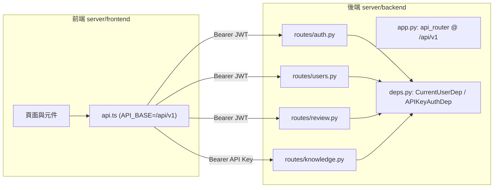

# cq 專案前端與後端之間的 HTTP API 清單

本文件整理 Mozilla AI 的 **cq** 專案中，前端網頁應用（`server/frontend`）與後端服務（`server/backend`）之間透過 HTTP 溝通的 API 端點。內容完全依據 `mozilla-ai/cq` 儲存庫 `main` 分支的原始碼撰寫，並附上出處註腳。

## 背景：cq 是什麼

cq 是一套「共享代理學習」（shared agent learning）的開放標準。它讓 AI 程式代理能持久化、分享與查詢集體知識，避免每個代理各自重複踩到相同的坑[^repo]。專案名稱來自 *colloquy*（結構化的意見交換）與無線電呼號 **CQ**（「任何電台請回答」）[^repo]。

專案為多語言組成：CLI 與 Go SDK 使用 Go；遠端伺服器後端使用 Python（FastAPI）；前端儀表板使用 TypeScript（React + Vite）[^repo]。本文件只涵蓋 `server/` 目錄下的前後端 HTTP 介面。

## 概觀

- **API 版本前綴**：所有後端端點都掛載在 `/api/v1` 之下，於 `server/backend/src/cq_server/app.py` 以 `app.include_router(api_router, prefix="/api/v1")` 統一掛載[^app]。
- **前端呼叫入口**：`server/frontend/src/api.ts`，常數 `API_BASE = "/api/v1"`（`api.ts` 第 11 行）[^apits]。
- **開發環境代理**：Vite dev server 將 `/api/v1` 代理到本機 API，目標埠由 `DEV_API_PORT` 決定，預設 `8742`[^vite]。前端 dev server 本身監聽埠 `3000`[^vite]。
- **認證方式**：
  - 前端頁面採 JWT，標頭為 `Authorization: Bearer <token>`，token 由登入端點取得並存於瀏覽器 `localStorage`（鍵名 `cq_auth_token`）[^apits]。
  - 知識相關端點（`/knowledge`）採 API Key 認證，需 `Authorization: Bearer <api-key>`[^deps]。
- **錯誤格式**：失敗時回傳 `{ "detail": "..." }`；後端將已知的服務例外（`ServiceError`）透過 `service_error_handler` 對應到對應 HTTP 狀態碼，未對應者一律回 500[^app]。

下圖描繪前端、後端路由與認證相依之間的關係：

## 前端實際使用的端點

以下端點由 `server/frontend/src/api.ts` 定義並被各頁面／元件呼叫[^apits]。

| # | 方法 | 路徑 | 用途 | 前端呼叫位置 | 後端實作 |
|---|------|------|------|--------------|----------|
| 1 | POST | `/api/v1/auth/login` | 使用者登入，取得 JWT | `api.ts` `login`；`auth.tsx` `login` 回呼 | `auth.py` `login` |
| 2 | GET | `/api/v1/users/me` | 取得目前登入使用者資訊 | `api.ts` `me`；`auth.tsx` 還原工作階段效果 | `users.py` `me` |
| 3 | GET | `/api/v1/review/queue` | 取得待審核知識單元佇列（`limit`、`offset`） | `api.ts` `reviewQueue`；`ReviewPage.tsx` `fetchNext` | `review.py` `review_queue` |
| 4 | POST | `/api/v1/review/{unit_id}/approve` | 核准指定知識單元 | `api.ts` `approve`；`ReviewPage.tsx` `handleCommit` | `review.py` `approve_unit` |
| 5 | POST | `/api/v1/review/{unit_id}/reject` | 退回指定知識單元 | `api.ts` `reject`；`ReviewPage.tsx` `handleCommit` | `review.py` `reject_unit` |
| 6 | GET | `/api/v1/review/stats` | 取得儀表板統計數據 | `api.ts` `reviewStats`；`DashboardPage.tsx` `fetchStats` | `review.py` `review_stats` |
| 7 | GET | `/api/v1/review/{unit_id}` | 取得單一知識單元與其審核資訊 | `api.ts` `getUnit`；`KnowledgeUnitModal.tsx` | `review.py` `get_unit` |
| 8 | GET | `/api/v1/review/units` | 依條件（`domain`、`confidence_min`、`confidence_max`、`status`）篩選知識單元 | `api.ts` `listUnits`；`FilteredListModal.tsx` | `review.py` `list_units` |
| 9 | GET | `/api/v1/users/me/api-keys` | 列出目前使用者的 API Key | `api.ts` `listApiKeys`；`ApiKeysPage.tsx` `refresh` | `users.py` `list_api_keys_route` |
| 10 | POST | `/api/v1/users/me/api-keys` | 建立新的 API Key（明文 token 僅回傳一次） | `api.ts` `createApiKey`；`ApiKeysPage.tsx` `handleCreate` | `users.py` `create_api_key_route` |
| 11 | POST | `/api/v1/users/me/api-keys/{key_id}/revoke` | 撤銷指定的 API Key | `api.ts` `revokeApiKey`；`ApiKeysPage.tsx` `confirmRevoke` | `users.py` `revoke_api_key_route` |

補充細節：

- 建立 API Key（#10）成功時回傳 HTTP 201[^users]；回應主體除公開欄位外額外包含一次性的 `token` 欄位，此後無法再取得[^usermodels]。
- 建立 API Key 的請求主體為 `{ name, ttl, labels }`，其中 `name` 長度 1–64、`ttl` 長度 1–16、`labels` 最多 16 個[^usermodels]。前端在送出前以 `/^\d+[smhd]$/` 驗證 TTL，並將使用者輸入的逗號分隔字串轉為 `labels` 陣列[^apikeyspage]。
- 列出 API Key（#9）會一併回傳已撤銷的鍵（`is_active: false`），供使用者稽核自己的撤銷紀錄[^users]。
- 撤銷（#11）為狀態轉移，資料列會保留並設定 `revoked_at`；重複撤銷具冪等性且會成功；當鍵不存在或屬於其他使用者時回傳 404，以避免帳號列舉[^users]。
- 審核佇列（#3）預設 `limit=20`、`offset=0`；`GET /review/units`（#8）預設 `limit=100`[^review]。
- 前端在 `request` 包裝中處理 401：收到 401 時觸發 `onUnauthorized` 回呼（由 `auth.tsx` 註冊為登出），並將錯誤主體的 `detail` 包成 `ApiError` 拋出[^apits]。
- `ReviewPage` 對 409 衝突（`KnowledgeUnitAlreadyReviewedError`）有特判，會顯示「Already reviewed」訊息[^reviewpage]。

## 後端公開但前端未使用（供 SDK／外部用戶端）的端點

這些端點不在前端 `api.ts` 中，主要由 Go／Python SDK 或 CLI 使用。

| # | 方法 | 路徑 | 用途 | 後端實作 |
|---|------|------|------|----------|
| 12 | GET | `/api/v1/health` | 健康檢查，回傳 `{"status": "ok"}` | `app.py` `health` |
| 13 | GET | `/api/v1/knowledge` | 依 domain／語言／框架／pattern 查詢知識單元 | `knowledge.py` `query_units` |
| 14 | POST | `/api/v1/knowledge` | 提出新的知識單元 | `knowledge.py` `propose_unit` |
| 15 | POST | `/api/v1/knowledge/{unit_id}/confirmations` | 確認知識單元，提升其信心值 | `knowledge.py` `confirm_unit` |
| 16 | POST | `/api/v1/knowledge/{unit_id}/flags` | 標記知識單元（stale／incorrect／duplicate） | `knowledge.py` `flag_unit` |
| 17 | GET | `/api/v1/knowledge/stats` | 取得知識庫統計數據 | `knowledge.py` `stats` |

補充細節：

- 知識查詢（#13）以 `domains` 為必填查詢參數，並可選用 `languages`、`frameworks`、`pattern`、`limit`（預設 5，需大於 0）；回應中會排除 `created_by` 以避免透過公開讀取路徑洩漏個人識別資訊[^knowledge]。
- 提出知識單元（#14）成功時回傳 HTTP 201；`created_by` 一律由後端設為已驗證呼叫者的使用者名稱，用戶端提供的值會被丟棄[^knowledge]。
- 確認（#15）與標記（#16）成功時回傳 HTTP 201，兩者回應皆排除 `created_by`[^knowledge]。
- 標記請求主體為 `{ reason }`，`reason` 為 `FlagReason` 列舉[^knowledgemodels]；前端型別將可能值列為 `stale`、`incorrect`、`duplicate`[^types]。

## 非 `/api/v1` 的路由

| 方法 | 路徑 | 說明 | 實作 |
|------|------|------|------|
| GET | `/.well-known/cq-node.json` | 節點探索文件；本伺服器固定回應 404，代表用戶端應使用預設值（`api_base_url = {addr}/api/v1`、`api_version = v1`） | `app.py` `well_known_cq_node` |
| GET | `/{path:path}` | 前端 SPA fallback；當 `static` 目錄存在（合併映像檔）時，將未匹配路徑回傳 `index.html`，但以 `api/` 開頭者回傳 404 | `app.py` `spa_fallback` |

關於節點探索：`/.well-known/cq-node.json` 的規格定義於 `schema/node_discovery.json`，必要欄位為 `version`（目前固定為 1）、`api_base_url`、`api_version`[^discovery]。當節點未提供此文件（回 404）時，用戶端會靜默採用預設值；但若回 200 且 `Content-Type: text/html`（例如把位址指到 SPA），用戶端應以錯誤處理、不得回退[^discoverydoc]。`app.py` 中刻意在應用層註冊此端點，以免 SPA catch-all 攔截該路徑而在合併映像檔下回傳 `text/html`[^app]。

## 認證與授權摘要

- **JWT（`CurrentUserDep`）**：`/users/*`、`/review/*` 需要合法的 `Authorization: Bearer <JWT>`。驗證邏輯為 `deps.py` 的 `get_current_user`：缺少或格式不符的標頭回 401（`Missing or invalid authorization header`），token 驗證失敗回 401（`Invalid or expired token`）[^deps]。
- **API Key（`APIKeyAuthDep`）**：`/knowledge` 的寫入與確認／標記端點需要有效的 API Key，驗證邏輯為 `deps.py` 的 `require_api_key`；`APIKeyService.authenticate` 執行 HMAC 比對，並以背景任務更新 `last_used_at`，任何驗證失敗一律回 401（`Invalid API key`）[^deps]。
- 401 回應會觸發前端登出流程：`api.ts` 的 `request` 在 `resp.status === 401` 時呼叫已註冊的 `onUnauthorized`，`auth.tsx` 於掛載時將其設為 `logout`[^apits][^authtsx]。

## 相關檔案

- 前端 API 封裝：`server/frontend/src/api.ts`[^apits]
- 前端型別定義：`server/frontend/src/types.ts`[^types]
- 前端認證狀態：`server/frontend/src/auth.tsx`[^authtsx]
- 後端路由：`server/backend/src/cq_server/api/routes/`（`auth.py`、`users.py`、`review.py`、`knowledge.py`）[^auth][^users][^review][^knowledge]
- 後端應用組裝：`server/backend/src/cq_server/app.py`[^app]
- 認證相依：`server/backend/src/cq_server/api/deps.py`[^deps]
- 請求／回應模型：`server/backend/src/cq_server/models/`（`users.py`、`review.py`、`knowledge.py`）[^usermodels][^reviewmodels][^knowledgemodels]

## 參考資料

[^repo]: mozilla-ai. (n.d.). *cq: An open standard for shared agent learning* [Repository]. GitHub. Retrieved 2026-11-07, from https://github.com/mozilla-ai/cq

[^app]: mozilla-ai. (n.d.). *app.py* [Source code]. GitHub. Retrieved 2026-11-07, from https://raw.githubusercontent.com/mozilla-ai/cq/main/server/backend/src/cq_server/app.py

[^apits]: mozilla-ai. (n.d.). *api.ts* [Source code]. GitHub. Retrieved 2026-11-07, from https://raw.githubusercontent.com/mozilla-ai/cq/main/server/frontend/src/api.ts

[^vite]: mozilla-ai. (n.d.). *vite.config.ts* [Source code]. GitHub. Retrieved 2026-11-07, from https://raw.githubusercontent.com/mozilla-ai/cq/main/server/frontend/vite.config.ts

[^auth]: mozilla-ai. (n.d.). *auth.py* [Source code]. GitHub. Retrieved 2026-11-07, from https://raw.githubusercontent.com/mozilla-ai/cq/main/server/backend/src/cq_server/api/routes/auth.py

[^users]: mozilla-ai. (n.d.). *users.py* [Source code]. GitHub. Retrieved 2026-11-07, from https://raw.githubusercontent.com/mozilla-ai/cq/main/server/backend/src/cq_server/api/routes/users.py

[^review]: mozilla-ai. (n.d.). *review.py* [Source code]. GitHub. Retrieved 2026-11-07, from https://raw.githubusercontent.com/mozilla-ai/cq/main/server/backend/src/cq_server/api/routes/review.py

[^knowledge]: mozilla-ai. (n.d.). *knowledge.py* [Source code]. GitHub. Retrieved 2026-11-07, from https://raw.githubusercontent.com/mozilla-ai/cq/main/server/backend/src/cq_server/api/routes/knowledge.py

[^deps]: mozilla-ai. (n.d.). *deps.py* [Source code]. GitHub. Retrieved 2026-11-07, from https://raw.githubusercontent.com/mozilla-ai/cq/main/server/backend/src/cq_server/api/deps.py

[^usermodels]: mozilla-ai. (n.d.). *users.py (models)* [Source code]. GitHub. Retrieved 2026-11-07, from https://raw.githubusercontent.com/mozilla-ai/cq/main/server/backend/src/cq_server/models/users.py

[^reviewmodels]: mozilla-ai. (n.d.). *review.py (models)* [Source code]. GitHub. Retrieved 2026-11-07, from https://raw.githubusercontent.com/mozilla-ai/cq/main/server/backend/src/cq_server/models/review.py

[^knowledgemodels]: mozilla-ai. (n.d.). *knowledge.py (models)* [Source code]. GitHub. Retrieved 2026-11-07, from https://raw.githubusercontent.com/mozilla-ai/cq/main/server/backend/src/cq_server/models/knowledge.py

[^authtsx]: mozilla-ai. (n.d.). *auth.tsx* [Source code]. GitHub. Retrieved 2026-11-07, from https://raw.githubusercontent.com/mozilla-ai/cq/main/server/frontend/src/auth.tsx

[^reviewpage]: mozilla-ai. (n.d.). *ReviewPage.tsx* [Source code]. GitHub. Retrieved 2026-11-07, from https://raw.githubusercontent.com/mozilla-ai/cq/main/server/frontend/src/pages/ReviewPage.tsx

[^apikeyspage]: mozilla-ai. (n.d.). *ApiKeysPage.tsx* [Source code]. GitHub. Retrieved 2026-11-07, from https://raw.githubusercontent.com/mozilla-ai/cq/main/server/frontend/src/pages/ApiKeysPage.tsx

[^types]: mozilla-ai. (n.d.). *types.ts* [Source code]. GitHub. Retrieved 2026-11-07, from https://raw.githubusercontent.com/mozilla-ai/cq/main/server/frontend/src/types.ts

[^discovery]: mozilla-ai. (n.d.). *node_discovery.json* [JSON Schema]. GitHub. Retrieved 2026-11-07, from https://raw.githubusercontent.com/mozilla-ai/cq/main/schema/node_discovery.json

[^discoverydoc]: mozilla-ai. (n.d.). *Node Discovery Protocol*. GitHub. Retrieved 2026-11-07, from https://raw.githubusercontent.com/mozilla-ai/cq/main/docs/node-discovery-protocol.md

---

## 來源批判性反思

- **可信度與權威性**：上述所有事實皆取自 `mozilla-ai/cq` 儲存庫 `main` 分支的原始碼與官方文件，屬第一手來源，優於二手轉述。專案由 Mozilla AI 組織維護（Apache License 2.0），具可追溯的治理與授權[^repo]。
- **時效性**：專案為 `0.x` 探索階段，開發文件明言在 v1 之前資料庫格式與 SDK 介面可能有不破壞性以外的變更[^devmd]。因此本文件反映的是 `main` 分支當下狀態，行號與結構可能隨提交變動；讀者引用前宜對照當時的 `main`。本文件檢視的時間點為 2026-11-07。
- **相互佐證**：本文件同時比對了前端的 `api.ts` 定義與後端各路由檔的裝飾器（`@router.post`、`@router.get`），以及 `app.py` 的 `/api/v1` 前綴掛載，三方一致，降低了單一檔案判讀錯誤的風險。
- **侷限**：本文件僅涵蓋 `server/` 的前後端 HTTP 介面，未涉及 CLI、Go／Python SDK 的內部呼叫（除了指出哪些端點供其使用），亦未涵蓋資料庫結構與資料模型欄位的完整列舉。

[^devmd]: mozilla-ai. (n.d.). *DEVELOPMENT.md*. GitHub. Retrieved 2026-11-07, from https://raw.githubusercontent.com/mozilla-ai/cq/main/DEVELOPMENT.md
