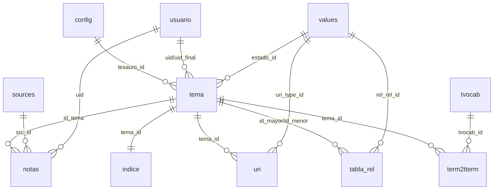

# TemaTres 詞表伺服器資料庫 Schema 研究報告

## 摘要

TemaTres（全名 TemaTres-Vocabulary-Server）是一套以 PHP 撰寫、採 GNU GPL v2 授權的開源網頁應用程式，用於管理受控詞彙（controlled vocabularies）、分類法（taxonomies）、索引典（thesauri）與詞彙表（glossaries）[^repo]。它沒有任何 ORM 或獨立的 schema migration 檔，資料庫結構完全在安裝腳本 `vocab/install.php` 內以 PHP 動態拼接的 `CREATE TABLE` 字串定義[^install]。完整安裝共建立 11 張資料表，其中 7 張為系統運作的核心表[^installcheck][^corecheck]。本報告整理其資料庫結構、各表欄位、字典表 `values` 的用途、多詞表前綴機制、SPARQL 端點所建立的額外表，以及無 migration 檔情況下的版本升級方式。

本報告為獨立文件，所有敘述與引用皆收錄於本文內。

---

## 1. 研究對象背景

### 1.1 什麼是詞表伺服器

「詞表伺服器」（vocabulary server）是一類軟體，用來發布與管理「知識的形式化表述」（formal representations of knowledge），例如受控詞彙、分類法、索引典與術語表。這類工具的核心工作是維護「詞目」（term）之間的階層與關聯關係，並以 SKOS 等標準對外提供資料[^repo]。

### 1.2 TemaTres 專案概況

| 項目 | 值 | 來源 |
|---|---|---|
| GitHub 儲存庫 | `tematres/TemaTres-Vocabulary-Server` | [^repo] |
| 建立時間 | 2010-08-11 | [^api] |
| 主要語言 | PHP（約 5.35 MB；其次為 JavaScript 約 2.00 MB） | [^apilang] |
| 授權 | GNU General Public License v2 | [^readme] |
| 版權 | Copyright (C) 2004–2021 Diego Ferreyra | [^readme] |
| 官方網站 | https://vocabularyserver.com | [^api] |
| 星號數 | 142 | [^api] |
| 分支（fork）數 | 63 | [^api] |
| 未結議題（open issues） | 29 | [^api] |
| 預設分支 | `master` | [^api] |
| 最新發布版本 | v3.6.2（2026-10-26 發布） | [^release] |
| 最後推送（push）時間 | 2026-11-05 | [^api] |

專案主題標籤包含 `classification`、`glossary`、`knowledge`、`taxonomies`、`thesaurus`、`vocabularies`[^api]。

### 1.3 系統需求

安裝需求為：支援 `mod_rewrite` 的 HTTP 伺服器、MySQL 5.0 以上（或 MariaDB）、PHP 7.4 以上，以及 cURL 與 php-xml 兩個 PHP 模組[^readme]。

---

## 2. 版本資訊

程式碼中定義了兩組版本字串[^cfg]：

| 常數 | 值 | 說明 |
|---|---|---|
| `$CFG["Version"]` | `TemaTres 4.0` | 應用程式版本 |
| `$CFG["VersionWebService"]` | `2.1` | 網路服務（Web Service）版本 |

最新的 GitHub 發布版為 **v3.6.2**，其發布內容包含：改善安全性問題、修正安裝程序錯誤、更新前端函式庫（tinymce 8.10.0、JqTree 1.9.1、JQuery-Autocomplete 2.0.7、jQuery 3.7.1、ADOdb 5.22.12），以及限制註記中允許的 HTML 標籤、移除註記中的屬性與樣式[^release]。

> 注意：`changelog.md` 內容停留在 v3.4.2，之後的版本（v3.4.3 至 v3.6.2）僅記錄於 GitHub Releases 頁面[^changelog]。

---

## 3. Schema 的定義方式

TemaTres **沒有 ORM**，也**沒有獨立的 schema migration 檔**。資料庫結構是在 `vocab/install.php` 內以函式 `SQLtematres()` 動態拼接的 `CREATE TABLE` 字串建立[^install]。安裝流程如下：

1. 檢查 `vocab/db.tematres.php` 是否存在，載入資料庫設定[^install]。
2. 以 ADOdb 連線，預設驅動為 `mysqli`[^install]。
3. 呼叫 `SQLcheckInstall()`，以「前綴開頭的表總數」判定安裝狀態；完整安裝為 11[^install]。
4. 若尚未完成，顯示安裝表單；送出後執行 `SQLtematres()` 建立所有表並寫入初始資料[^install]。

### 3.1 連線與引擎設定

連線設定集中於 `db.tematres.php`[^dbfile]：

| 設定鍵 | 預設值 | 說明 |
|---|---|---|
| `DBdriver` | `mysqli`（留空則預設） | ADOdb 驅動 |
| `DBprefix` | `lc_` | 資料表前綴 |
| `DBcharset` | `utf8` | 連線與建表字元集 |
| `DBengine` | `MyISAM` | 建表引擎（為向後相容而預設 MyISAM） |
| `CFG_HASH_PASS` | `1` | 是否儲存雜湊密碼 |

Docker 版改用環境變數並且將引擎改為 `InnoDB`[^dockerdb]；其 `docker-compose.yml` 以 MariaDB 11.4 作為資料庫服務，應用容器預設監聽 `127.0.0.1:8080` 對應容器埠 80[^compose]。

### 3.2 前綴字串串接慣例

程式碼中所有表名皆以 `$DBCFG[DBprefix]` 動態串接，例如 `$DBCFG[DBprefix]tema` 在預設前綴下即實體上的 `lc_tema`[^cfg]。文件中一律不硬編碼 `lc_`，以免破壞多詞表機制。

---

## 4. 資料表總覽

完整安裝共建立 **11 張表**[^install]。其建立順序與對應的安裝檔行號如下：

| Table 名稱 | 用途 | `install.php` 所在 |
|---|---|---|
| `config` | 詞表設定（單列 id=1；多詞表時一列一表） | 約第 198 行 |
| `indice` | 詞目的樹狀路徑索引（以 `\|` 分隔） | 約第 237 行 |
| `notas` | 每個詞目的註記 | 約第 246 行 |
| `tabla_rel` | 詞目之間的關係 | 約第 264 行 |
| `tema` | 詞目（terms） | 約第 282 行 |
| `term2tterm` | 本地詞目對應到外部目標詞表的詞 | 約第 308 行 |
| `tvocab` | 外部目標詞表（target vocabularies） | 約第 326 行 |
| `usuario` | 使用者 | 約第 344 行 |
| `values` | 通用列舉／字典表 | 約第 365 行 |
| `uri` | 詞目關聯的外部 URI（SKOS mapping） | 約第 377 行 |
| `sources` | 註記的權威來源（書目來源正規化） | 約第 390 行 |

其中 **核心 7 張**由 `checkT3instance()` 判定：`config`、`indice`、`notas`、`tabla_rel`、`tema`、`usuario`、`values`[^corecheck]。`vocab/config.tematres.php` 會檢查回傳的 `cantTables` 是否不等於 7，若不等於則導向 `install.php`[^cfgvocab]。而 `install.php` 則以 `SQLcheckInstall()==11` 判定安裝完成並導向 `index.php`[^install]。

### 4.1 關聯概觀



---

## 5. 各資料表欄位明細

### 5.1 `config`（詞表設定）

單列表（`id=1`）。當「一個 install 支援多個詞表」時，`tema.tesauro_id` 會指向其他 `config.id`[^install]。

| 欄位 | 型別 | 預設 | 說明 |
|---|---|---|---|
| `id` | int(5) unsigned | AUTO_INCREMENT | 主鍵 |
| `titulo` | varchar(255) | `''` | 詞表標題 |
| `autor` | varchar(255) | `''` | 作者／機構 |
| `idioma` | char(5) | `es` | 語言；升級後為 CHAR(6) DEFAULT `es-ES`[^upgrade] |
| `cobertura` | text | NULL | 涵蓋範圍 |
| `keywords` | varchar(255) | NULL | 關鍵字 |
| `tipo` | varchar(100) | NULL | KOS 類型（list／thesaurus／taxonomy…） |
| `polijerarquia` | tinyint(1) | `1` | 是否允許一詞多上層（polyhierarchy） |
| `cuando` | date | 必填 | 建立日期 |
| `observa` | text | NULL | 備註 |
| `url_base` | varchar(255) | NULL | 詞表 base URL |

索引：`PRIMARY KEY (id)`[^install]。

### 5.2 `tema`（詞目）

| 欄位 | 型別 | 預設 | 說明 |
|---|---|---|---|
| `tema_id` | int(10) | AUTO_INCREMENT | 主鍵 |
| `code` | varchar(150) | NULL | 詞目代碼（`code_term`）；舊版為 varchar(20/30)[^upgrade] |
| `tema` | varchar(250) | NULL | 詞目字串（FULLTEXT 索引） |
| `tema_hash` | varchar(12) | NULL | ARK／hash 唯一識別碼（UNIQUE `ndx_hash`） |
| `tesauro_id` | int(5) | 必填 | 所屬詞表 → `config.id` |
| `uid` | tinyint(3) unsigned | 必填 | 建立者 → `usuario.id` |
| `cuando` | datetime | NULL | 建立時間 |
| `uid_final` | int(5) unsigned | NULL | 最後修改者 |
| `cuando_final` | datetime | NULL | 最後修改時間 |
| `estado_id` | int(5) | `13` | 狀態 → `values.value_id`（`t_estado`） |
| `cuando_estado` | datetime | 必填 | 狀態變更時間 |
| `isMetaTerm` | BOOLEAN | FALSE | 是否為 meta-term（非主題詞，如分類標籤） |

索引：PK(`tema_id`)、UNIQUE(`tema_hash`)、KEY(`code`)、FULLTEXT(`tema`)、KEY(`cuando`,`cuando_final`)、KEY(`uid`,`uid_final`)、KEY(`tesauro_id`)、KEY(`estado_id`)、KEY(`isMetaTerm`)[^install]。

`estado_id` 對應 `values`（`value_type='t_estado'`）：`12` 候選、`13` 啟用（預設）、`14` 拒絕[^install]。程式多處以 `estado_id='13'` 篩選已發布詞目[^sql]。

### 5.3 `tabla_rel`（詞目關係）

| 欄位 | 型別 | 預設 | 說明 |
|---|---|---|---|
| `id_mayor` | int(5) | `0` | 上位／偏好端 `tema_id` |
| `id_menor` | int(5) | `0` | 下位／非偏好端 `tema_id` |
| `t_relacion` | tinyint(1) unsigned | 必填 | 關係型別 → `values.value_id` |
| `rel_rel_id` | int(22) | NULL | 自訂關係型別（細分類）→ `values.value_id` |
| `id` | int(9) unsigned | AUTO_INCREMENT | 主鍵 |
| `uid` | int(10) unsigned | `0` | 建立者 |
| `cuando` | datetime | 必填 | 建立時間 |

索引：PK(`id`)、UNIQUE `NewIndex`(`id_mayor`,`id_menor`)、KEY(`t_relacion`)、KEY(`id_menor`)、KEY(`id_mayor`)、KEY(`rel_rel_id`)[^install]。

關係型別常數定義於 `common/include/config.tematres.php`[^cfg]：

| 常數 | 值 | 意義 |
|---|---|---|
| `id_TR` | 2 | 相關詞（Termino relacionado, RT） |
| `id_TG` | 3 | 上位詞（Termino superior, BT） |
| `id_UP` | 4 | 非偏好詞（Usado por, UF） |
| `id_EQ_PARCIAL` | 5 | 部分等價（EQ_P） |
| `id_EQ` | 6 | 完全等價（EQ） |
| `id_EQ_NO` | 7 | 非等價（EQ_NO） |
| `id_EQ_INEXACTA` | 8 | 不精確等價 |

### 5.4 `notas`（詞目註記）

| 欄位 | 型別 | 預設 | 說明 |
|---|---|---|---|
| `id` | int(11) | AUTO_INCREMENT | 主鍵 |
| `id_tema` | int(11) | 必填 | → `tema.tema_id` |
| `tipo_nota` | char(3) | `NA` | 註記型別 → `values.value_code`（`t_nota`） |
| `lang_nota` | varchar(7) | NULL | 註記語言 |
| `nota` | mediumtext | 必填 | 內容（FULLTEXT 索引） |
| `cuando` | datetime | 必填 | 時間 |
| `uid` | int(22) | `0` | 作者 → `usuario.id` |
| `src_id` | int(22) | NULL | 來源 → `sources.src_id` |

索引：PK(`id`)、KEY(`id_tema`)、KEY(`orden_notas`:`tipo_nota`,`lang_nota`)、KEY(`src_id`)、FULLTEXT(`nota`)[^install]。

`tipo_nota` 對應 `values`（`value_type='t_nota'`）：`NA` 範圍註記、`NH` 歷史註記、`NB` 書目註記、`NP` 私人註記、`NC` 編目註記、`DF` 定義註記、`EX` 範例註記[^install]。

### 5.5 `indice`（樹狀路徑索引）

每個詞目一列，記錄其在樹中的路徑。路徑以 `|` 分隔詞目 id（例如 `|1|5|12`），程式以字串比對推算深度與祖先（以 `LENGTH - REPLACE` 計算深度 `tdeep`）[^sql]。

| 欄位 | 型別 | 預設 | 說明 |
|---|---|---|---|
| `tema_id` | int(11) | `0` | 主鍵，→ `tema.tema_id` |
| `indice` | varchar(250) | `''` | 樹狀路徑，如 `\|1\|5\|12` |

索引：PK(`tema_id`)、KEY(`indice`)[^install]。此表為衍生資料，可由函式 `SQLreCreateTermIndex()` 先 `TRUNCATE` 後重算（僅用於資料庫損毀或匯入 dump 後重建）[^sql]。

### 5.6 `usuario`（使用者）

| 欄位 | 型別 | 預設 | 說明 |
|---|---|---|---|
| `APELLIDO` | varchar(150) | NULL | 姓 |
| `NOMBRES` | varchar(150) | NULL | 名 |
| `uid` | int(9) unsigned | NULL | 建立此帳號的使用者 |
| `cuando` | date | NULL | 建立日期 |
| `id` | int(11) unsigned | AUTO_INCREMENT | 主鍵 |
| `mail` | varchar(255) | NULL | 帳號信箱（UNIQUE） |
| `pass` | varchar(60) | 必填 | 密碼雜湊（`CFG_HASH_PASS`） |
| `orga` | varchar(255) | NULL | 機構 |
| `nivel` | tinyint(1) unsigned | `2` | 角色：1 admin、2 editor、3 collaborator |
| `estado` | set('ACTIVO','BAJA') | `BAJA` | 帳號狀態 |
| `hasta` | datetime | 必填 | 有效期限 |
| `user_activation_key` | varchar(60) | NULL | 啟用／重設密碼金鑰 |

索引：PK(`id`)、UNIQUE(`mail`)、KEY(`pass`)、KEY(`user_activation_key`)[^install]。

> 欄位在資料庫中為大寫 `APELLIDO`／`NOMBRES`，但程式碼多以 alias 小寫存取（如 `u.nombres,u.apellido`）[^sql]。

### 5.7 `uri`（詞目的外部 URI，SKOS mapping）

| 欄位 | 型別 | 預設 | 說明 |
|---|---|---|---|
| `uri_id` | int(22) | AUTO_INCREMENT | 主鍵 |
| `tema_id` | int(22) | 必填 | → `tema.tema_id` |
| `uri_type_id` | int(22) | 必填 | → `values.value_id`（`value_type='URI_TYPE'`） |
| `uri` | tinytext | 必填 | 外部 URI |
| `uid` | int(22) | 必填 | 建立者 |
| `cuando` | timestamp | CURRENT_TIMESTAMP | 更新時間 |

索引：PK(`uri_id`)、KEY(`tema_id`)[^install]。

### 5.8 `tvocab`（外部目標詞表）

| 欄位 | 型別 | 預設 | 說明 |
|---|---|---|---|
| `tvocab_id` | int(22) | AUTO_INCREMENT | 主鍵 |
| `tvocab_label` | varchar(150) | 必填 | 標籤 |
| `tvocab_tag` | varchar(20) | 必填 | 代碼（舊版 varchar(5)）[^upgrade] |
| `tvocab_lang` | varchar(5) | NULL | 語言 |
| `tvocab_title` | varchar(200) | 必填 | 標題 |
| `tvocab_url` | varchar(250) | 必填 | 網址 |
| `tvocab_uri_service` | varchar(250) | 必填 | 該詞表的 API／URI 服務位址 |
| `tvocab_status` | tinyint(1) | 必填 | 啟用狀態 |
| `cuando` | timestamp | CURRENT_TIMESTAMP | 更新時間 |
| `uid` | int(22) | 必填 | 建立者 |

索引：PK(`tvocab_id`)、KEY(`uid`)、KEY(`tvocab_status`)[^install]。

### 5.9 `term2tterm`（詞目 → 外部目標詞表詞）

| 欄位 | 型別 | 預設 | 說明 |
|---|---|---|---|
| `tterm_id` | int(22) | AUTO_INCREMENT | 主鍵 |
| `tvocab_id` | int(22) | 必填 | → `tvocab.tvocab_id` |
| `tterm_url` | varchar(200) | 必填 | 目標詞的網頁 |
| `tterm_uri` | varchar(200) | 必填 | 目標詞的 URI |
| `tterm_string` | varchar(250) | 必填 | 目標詞字串 |
| `cuando` | timestamp | CURRENT_TIMESTAMP | 建立時間 |
| `cuando_last` | timestamp | NULL | 最後更新 |
| `uid` | int(22) | 必填 | 建立者 |
| `tema_id` | int(22) | 必填 | → `tema.tema_id` |

索引：PK(`tterm_id`)、KEY(`tvocab_id`,`cuando`,`cuando_last`,`uid`)、KEY(`tema_id`)、KEY(`target_terms`:`tterm_string`)[^install]。

### 5.10 `sources`（註記的權威來源）

| 欄位 | 型別 | 預設 | 說明 |
|---|---|---|---|
| `src_id` | int(11) | AUTO_INCREMENT | 主鍵 |
| `src_alias` | varchar(50) | 必填 | 來源簡稱 |
| `src_note` | text | NULL | 說明（舊升級路徑為 `tinytext`）[^upgrade] |
| `src_url` | tinytext | NULL | 網址 |
| `src_uri` | varchar(255) | NULL | 來源 URI |
| `src_status` | tinyint(1) | NULL | 狀態 |
| `create_date` | datetime | 必填 | 建立時間 |
| `mod_date` | datetime | NULL | 修改時間 |
| `user_id` | int(5) | `0` | 建立者 → `usuario.id` |

索引：PK(`src_id`)、KEY(`src_alias`)[^install]。

---

## 6. `values`：通用字典表

`values` 是 TemaTres 的核心「字典表」，集中存放關係型別、註記型別、詞目狀態、URI 型別，以及每個詞表的設定值（`value_type='config'`）[^install]。

| 欄位 | 型別 | 預設 | 說明 |
|---|---|---|---|
| `value_id` | int(11) | AUTO_INCREMENT | 主鍵。關係型別直接以此 id 對應 `tabla_rel.t_relacion` |
| `value_type` | varchar(64) | `0` | 值群組（見下表） |
| `value` | longtext | NULL | 值（顯示文字或設定值） |
| `value_order` | tinyint(4) | NULL | 排序 |
| `value_code` | varchar(20) | NULL | 代碼（`TR`、`TG`、`NA`、`DF`…） |

索引：PK(`value_id`)、KEY(`value_type`)[^install]。

### 6.1 `value_type` 群組

群組定義見 `$CFG["CONFIG_VAR"]`[^cfg]：

| `value_type` | 用途 | 相關欄位 |
|---|---|---|
| `2`／`3`／`4` | 詞目關係的細分類（TR／BT／UF 的子類型） | `tabla_rel.rel_rel_id` |
| `config` | 每詞表設定（`CFG_*`、`_USE_CODE`…） | `value_code` = 設定鍵 |
| `DATESTAMP` | 各類最後更新時間戳 | 供更新偵測使用 |
| `t_estado` | 詞目狀態（12／13／14） | `tema.estado_id` |
| `t_nota` | 註記型別 | `notas.tipo_nota` |
| `t_relacion` | 關係型別（2–8） | `tabla_rel.t_relacion` |
| `t_usuario` | 使用者角色字典 | `usuario.nivel` |
| `URI_TYPE` | SKOS mapping 型別（broadMatch…） | `uri.uri_type_id` |
| `METADATA` | 詞表後設資料、ARK NAAN | `CFG_ARK_NAAN` 等 |
| `CONTACT_MAIL` | 聯絡信箱 | — |
| `CFG_ARK_NAAN` | ARK NAAN 值 | — |
| `CFG_STATUS_VOCAB` | 詞表狀態時間戳（序列化） | — |

`$CFG["CONFIG_VAR"]` 的完整內容為[^cfg]：

```text
array('2','3','4','config','DATESTAMP','t_estado','t_nota','t_relacion',
      't_usuario','URI_TYPE','METADATA','CONTACT_MAIL','CFG_ARK_NAAN','CFG_STATUS_VOCAB')
```

### 6.2 安裝時寫入的初始值

`SQLtematres()` 會寫入初始字典值，`value_id` 從 1 起[^install]：

- **關係型別 `t_relacion`**：2 TR、3 TG、4 UP、5 EQ_P、6 EQ、7 EQ_NO。
- **關係細分類（type `3`／`4`）**：SP（Spelling variant）、MS（MisSpelling）、P（Partitive）、I（Instance）、AB（Abbreviation）、FT（Full form）、H（Hidden）。
- **註記型別 `t_nota`**：NA、NH、NB、NP、NC、DF、EX。
- **狀態 `t_estado`**：12 候選（C）、13 啟用（A）、14 拒絕（R）。
- **使用者角色 `t_usuario`**：1 Admin（`admin`）。
- **URI_TYPE**：`broadMatch`、`closeMatch`、`exactMatch`、`relatedMatch`、`narrowMatch`。
- **DATESTAMP**：`NOTE_CHANGE`、`TERM_CHANGE`、`TTERM_CHANGE`、`THES_CHANGE`。
- **METADATA**：`dc:contributor`、`dc:publisher`、`dc:rights`、`CFG_ARK_NAAN`。
- **config 設定值**：`_USE_CODE`、`_SHOW_CODE`、`CFG_MAX_TREE_DEEP`、`CFG_VIEW_STATUS`、`CFG_SIMPLE_WEB_SERVICE`、`CFG_NUM_SHOW_TERMSxSTATUS`、`CFG_MIN_SEARCH_SIZE`、`_SHOW_TREE`、`_PUBLISH_SKOS`、`CFG_SEARCH_METATERM`、`CFG_ENABLE_SPARQL`、`CFG_SUGGESTxWORD`、`CFG_PUBLISH`、`CFG_ALLOW_DUPLICATED`、`COPY_CLICK`。

系統另有 ARK 識別碼機制，NAAN 常數定義為 `99152/t3`[^cfg]。

---

## 7. 多詞表與前綴機制

- 前綴由 `$DBCFG["DBprefix"]` 決定，預設 `lc_`；Docker 可用環境變數 `TEMATRES_DB_PREFIX` 覆寫[^dbfile][^dockerdb]。
- `config` 支援多列以支撐「一個 install 多個詞表」：`tema.tesauro_id` 指向 `config.id`，函式 `SQLinternalTargetVocabs()` 以 `tv.id!=1` 列出非預設詞表[^sql]。
- Session 以詞表的 base URL（`$_SESSION[CFGURL]`）分組，切換詞表即切換 `values.value_type='config'` 的設定集合[^cfgvocab]。

---

## 8. SPARQL 端點與 ARC2 額外表

SPARQL 端點為選用功能，啟用時（`CFG_ENABLE_SPARQL == 1`）由 `vocab/sparql.php` 載入 ARC2 函式庫並啟動端點[^sparql]。ARC2 建立的表名為「前綴 + store_name + 後綴」，其中 `store_name` 即 `DBprefix`[^sparql]。六種後綴為[^arc2]：

| 後綴 | 用途 |
|---|---|
| `triple` | 三元組主表 |
| `g2t` | 圖（graph）對三元組的對應 |
| `id2val` | id 對值的對應（AUTO_INCREMENT） |
| `s2val` | 主語值索引（含 `val_hash`） |
| `o2val` | 受詞值索引（含 `val_hash`） |
| `setting` | 鍵值設定表 |

> ARC2 於分割述詞（`splitPredicate()`）時，會額外建立 `triple_<crc32>` 形式的表；`getTables()` 在執行期動態探索這些表[^arc2]。

端點的可用指令依使用者層級而異：一般使用者為 `select`、`construct`、`ask`、`describe`；具權限者另可 `load`、`insert`[^sparql]。

> 注意：ARC2 表與業務表共用同一個 `DBprefix`，因此 `SQLcheckInstall()` 以「前綴開頭表總數」判定安裝狀態的設計，在啟用 SPARQL 後可能受影響；管理上宜以核心 7 表判定為準[^install][^corecheck]。

---

## 9. 升級與修補（無 migration 檔）

Schema 變更由函式 `SQLupdateTemaTresVersion($ver2ver)` 以 `switch` 分版本執行 `ALTER TABLE`／`CREATE TABLE IF NOT EXISTS`／字典補值[^sql]。各版本鍵與內容如下[^sql]：

| 版本鍵 | 內容摘要 |
|---|---|
| `tema2full_text` | `tema.tema` 加入 FULLTEXT 並移除舊一般索引 |
| `2_2x3_2` | `tema`／`notas` 的 `cuando` 系列改為可 NULL；新增 `notas.src_id`、`tema.tema_hash`（含 UNIQUE `ndx_hash`）；建立 `sources` 表；`config.idioma` 改為 CHAR(6) DEFAULT `es-ES`；補寫 ARK NAAN 與各詞目 hash |
| `1_6x1_7` | 新增 `tema.isMetaTerm`（BOOLEAN，含索引）；補 config 值 `CFG_SEARCH_METATERM`、`CFG_ENABLE_SPARQL`、`CFG_SUGGESTxWORD` |
| `1_5x1_6` | `term2tterm` 新增 `target_terms` 索引；`usuario` 新增 `user_activation_key`；`usuario.pass` 加長為 varchar(60) |
| `1_4x1_5` | `tvocab.tvocab_tag` 加長為 varchar(20)；調整 `values` 欄位；`tabla_rel` 新增 `rel_rel_id`；建立 `uri` 表；補關係細分類、URI_TYPE、DATESTAMP、METADATA 字典 |
| `1_3x1_4` | 早期版本結構與字典補強 |
| `1_1x1_2`／`1x1_2` | 新增 `tema.code` 與其索引；建立 `term2tterm`、`tvocab`；`notas.nota` 加 FULLTEXT |

由管理員介面（`admin.php?doAdmin=updte...` 類路徑）觸發更新流程[^readme]。README 記載的升級步驟為：先備份（Admin → Export → SQL backup）、複製新版程式碼、登入管理員後於 Database maintenance 執行對應版本的更新[^readme]。

---

## 10. 資料庫存取慣例

- 唯一入口為 `SQL($verb, $sqlBody)`，`$verb` 主要為 `select`／`insert`／`update`，另見 `SET NAMES`、`OPTIMIZE`、`ALTER`、`CREATE`、`SHOW`、`truncate` 等用法；回傳 ADOdb recordset 或 `array("cant"=>id)`／`array("error"=>msg)`[^sql]。
- 值以 `secure_data()` 正規化與轉義；部分查詢使用參數化（`?`）[^sql]。
- 表名一律以 `$DBCFG[DBprefix]` 動態串接，勿硬編碼 `lc_`[^cfg]。

---

## 11. 已知注意事項

- `notas.nota` 與 `tema.tema` 使用 FULLTEXT 索引；MyISAM 支援良好，InnoDB 8.0 以上亦支援[^install]。
- `tabla_rel` 的 `UNIQUE (id_mayor, id_menor)` 表示同一對詞目僅能存在一種關係[^install]。
- `indice` 為衍生資料（可由樹重建），大量寫入後若不一致可透過 `SQLreCreateTermIndex()` 重建[^sql]。
- `values.value` 為 `longtext`，設定值也存於此，讀取時須依 `value_type`／`value_code` 過濾[^install]。
- SPARQL 表由 ARC2 動態建立，前綴與 `DBprefix` 共用[^sparql][^arc2]。
- 欄位命名沿用西語（`tema` = 詞目、`nota` = 註記、`cuando` = 時間），且 `usuario` 部分欄位為全大寫，程式以 alias 小寫存取，跨工具查詢時須留意大小寫[^install][^sql]。

---

## 12. 結論

TemaTres 的資料庫設計以「少量核心表 + 一張通用字典表」為特色：7 張核心表支撐詞目、關係、註記、樹狀索引、使用者與設定，另以 `values` 一張表集中管理所有列舉值。Schema 完全由 `install.php` 動態拼接，並透過 `SQLupdateTemaTresVersion()` 的版本 `switch` 完成升級，沒有外部 migration 檔；這種設計與其 PHP 單體架構一致，卻也意謂升級邏輯與資料表定義散落於程式碼中，維護時需以原始碼為唯一事實來源。

---

## 參考文獻

[^repo]: TemaTres. (n.d.). *TemaTres-Vocabulary-Server* [Computer software]. GitHub. Retrieved 2026-11-07, from https://github.com/tematres/TemaTres-Vocabulary-Server

[^api]: GitHub. (2026). *tematres/TemaTres-Vocabulary-Server repository metadata* [Data file]. GitHub REST API. Retrieved 2026-11-07, from https://api.github.com/repos/tematres/TemaTres-Vocabulary-Server

[^apilang]: GitHub. (2026). *tematres/TemaTres-Vocabulary-Server languages* [Data file]. GitHub REST API. Retrieved 2026-11-07, from https://api.github.com/repos/tematres/TemaTres-Vocabulary-Server/languages

[^release]: TemaTres. (2026, October 26). *3.6.2* [Release note]. GitHub. Retrieved 2026-11-07, from https://github.com/tematres/TemaTres-Vocabulary-Server/releases/tag/v3.6.2

[^readme]: TemaTres. (n.d.). *readme.md* [Source code]. GitHub. Retrieved 2026-11-07, from https://github.com/tematres/TemaTres-Vocabulary-Server/blob/master/readme.md

[^changelog]: TemaTres. (n.d.). *changelog.md* [Source code]. GitHub. Retrieved 2026-11-07, from https://github.com/tematres/TemaTres-Vocabulary-Server/blob/master/changelog.md

[^install]: TemaTres. (n.d.). *vocab/install.php* [Source code]. GitHub. Retrieved 2026-11-07, from https://github.com/tematres/TemaTres-Vocabulary-Server/blob/master/vocab/install.php

[^corecheck]: TemaTres. (n.d.). *common/include/fun.gral.php* （`checkT3instance()`） [Source code]. GitHub. Retrieved 2026-11-07, from https://github.com/tematres/TemaTres-Vocabulary-Server/blob/master/common/include/fun.gral.php

[^installcheck]: TemaTres. (n.d.). *vocab/install.php* （`SQLcheckInstall()`） [Source code]. GitHub. Retrieved 2026-11-07, from https://github.com/tematres/TemaTres-Vocabulary-Server/blob/master/vocab/install.php

[^dbfile]: TemaTres. (n.d.). *vocab/db.tematres.php* [Source code]. GitHub. Retrieved 2026-11-07, from https://github.com/tematres/TemaTres-Vocabulary-Server/blob/master/vocab/db.tematres.php

[^dockerdb]: TemaTres. (n.d.). *docker/db.tematres.php* [Source code]. GitHub. Retrieved 2026-11-07, from https://github.com/tematres/TemaTres-Vocabulary-Server/blob/master/docker/db.tematres.php

[^compose]: TemaTres. (n.d.). *docker/docker-compose.yml* [Source code]. GitHub. Retrieved 2026-11-07, from https://github.com/tematres/TemaTres-Vocabulary-Server/blob/master/docker/docker-compose.yml

[^cfg]: TemaTres. (n.d.). *common/include/config.tematres.php* [Source code]. GitHub. Retrieved 2026-11-07, from https://github.com/tematres/TemaTres-Vocabulary-Server/blob/master/common/include/config.tematres.php

[^cfgvocab]: TemaTres. (n.d.). *vocab/config.tematres.php* [Source code]. GitHub. Retrieved 2026-11-07, from https://github.com/tematres/TemaTres-Vocabulary-Server/blob/master/vocab/config.tematres.php

[^sql]: TemaTres. (n.d.). *common/include/fun.sql.php* [Source code]. GitHub. Retrieved 2026-11-07, from https://github.com/tematres/TemaTres-Vocabulary-Server/blob/master/common/include/fun.sql.php

[^upgrade]: TemaTres. (n.d.). *common/include/fun.sql.php* （`SQLupdateTemaTresVersion()`） [Source code]. GitHub. Retrieved 2026-11-07, from https://github.com/tematres/TemaTres-Vocabulary-Server/blob/master/common/include/fun.sql.php

[^sparql]: TemaTres. (n.d.). *vocab/sparql.php* [Source code]. GitHub. Retrieved 2026-11-07, from https://github.com/tematres/TemaTres-Vocabulary-Server/blob/master/vocab/sparql.php

[^arc2]: TemaTres. (n.d.). *common/arc2/store/ARC2_StoreTableManager.php* [Source code]. GitHub. Retrieved 2026-11-07, from https://github.com/tematres/TemaTres-Vocabulary-Server/blob/master/common/arc2/store/ARC2_StoreTableManager.php

---

## 來源評析

- **權威性**：本報告以官方儲存庫原始碼為主要證據，屬一手資料；庫內 metadata 與 release 資訊取自 GitHub 官方 REST API，可信度高。
- **時效性**：所有引用於 2026-11-07 擷取，反映 2026-11-05 最新推送與 v3.6.2 發布狀態；`changelog.md` 已明顯落後，故版本歷史以 Releases 頁面為準。
- **偏誤與限制**：所有結構性結論均來自閱讀原始碼，未經實際部署驗證；行號為約略值，可能隨版本更動。專案星號數（142）偏低，惟本主題屬專業領域，該專案仍是此類工具中具代表性的開源實作，故仍納入報告並註明其規模。
