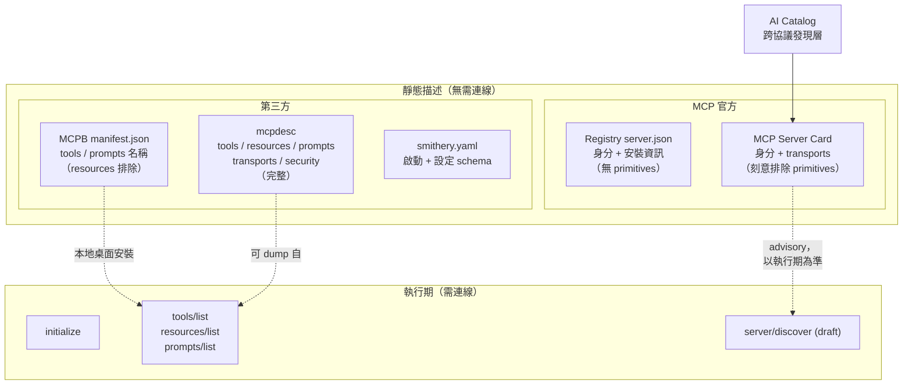

# MCP 是否存在如 OpenAPI 般的「實作無關靜態描述」規範？

## 問題界定

本報告回答的問題是：**是否存在一種標準，能夠在不與 MCP 伺服器本身互動的前提下，靜態地描述「某個特定 MCP 伺服器」所提供的能力**，如同 OpenAPI / Swagger 用一份文件描述某個 HTTP API 一樣。

需要嚴格區分兩個容易混淆的概念：

- **描述 MCP 規範本身**（例如 MCP 的規格書、JSON-RPC schema、型別定義）。這不是本報告的重點。
- **靜態描述某一個具體的 MCP 伺服器**（該伺服器有哪些 tools、resources、prompts、transports、安全需求），且此描述不需要先啟動或連線該伺服器。這才是本報告的重點。

## 結論摘要

截至 2026-11-07，答案是「**部分有，但沒有一個由 MCP 官方制定、且完整涵蓋 primitives 的單一標準**」。

- **MCP 官方核心規範**本身只提供**動態探索**（runtime discovery），也就是必須先建立連線，透過 `initialize` 與 `tools/list`、`resources/list`、`prompts/list` 等請求取得能力，並未定義靜態描述檔[^mcptools]。
- **MCP 官方已標準化的靜態格式**（Registry 的 `server.json`、MCP Server Cards）都**刻意排除** tools / resources / prompts 的描述，只描述身分、安裝與連線資訊[^registry][^sep2127]。
- **真正等同於「MCP 版 OpenAPI」的格式是第三方的 `mcpdesc`**（MCP Description），它明確定位為「Think OpenAPI, but for the Model Context Protocol」，完整描述 tools、resources、prompts、transports、security[^mcpdescformat][^apievangelist]。
- 另有數個介於兩者之間的格式（MCPB 的 `manifest.json`、Smithery 的 `smithery.yaml`、AI Catalog），各自解決部分情境[^mcpb][^aicatalog]。

換言之：若需求是「像 OpenAPI 那樣、實作無關、完整的靜態描述某個 MCP 伺服器」，目前最貼近的答案是社群專案 **mcpdesc**；而官方生態則傾向用「動態 `server/discover` + 靜態 Server Card（不含 primitives）」的組合。

## 動態探索：MCP 核心規範的預設做法

MCP 協議本質上是執行期協議。伺服器透過工具（Tools）暴露可被語言模型呼叫的能力，每個工具以名稱識別並附帶描述其 schema 的 metadata，但這些資訊是**連線後**才取得[^mcptools]。

在較新的 draft 規範中，官方新增了 `server/discover` 這個 RPC，讓用戶端在送出其他請求前，先查詢伺服器支援的協議版本、capabilities 與身分[^discover]。然而這仍是**執行期、連線內**的機制，並非可提交到版本控制、可 diff、可在伺服器啟動前閱讀的靜態artifact。

> 關鍵區分：`server/discover` 是「連線後的即時探索」，不是「連線前的靜態描述」。

## 官方靜態格式一：MCP Registry 的 `server.json`

MCP Registry 是官方集中式 metadata 儲存庫，目前處於 **preview** 階段（官方明言在 GA 前可能發生破壞性變更或資料重置），由 Anthropic、GitHub、PulseMCP、Microsoft 等主要生態成員共同支持[^registryabout]。其 metadata 以 `server.json` 格式儲存[^registryabout]。

`server.json` 的 schema（`ServerDetail`）定義為「MCP 伺服器的靜態表示（static representation）」，欄位包含 `name`、`description`、`version`、`title`、`websiteUrl`、`repository`、`icons`、`packages`、`remotes`、`_meta`[^serverschema]。

- **優點**：確實是靜態、可手寫（`mcp-publisher init` 可產生模板）、可版控[^registryquickstart]。
- **限制**：**不描述 tools / resources / prompts**。它描述的是「伺服器在哪裡、叫什麼名字、怎麼安裝與啟動」，屬於 packaging 與 discovery 層級，而非 protocol 層級的能力面[^registryabout][^serverschema]。

## 官方靜態格式二：MCP Server Cards（SEP-2127）

MCP Server Cards 由 SEP-2127 提案，狀態為 **Final**（Extensions Track），建立於 2026-01-21[^sep2127]。它定義一份自足的靜態 metadata 文件，用於**連線前探索（pre-connection discovery）**，讓用戶端在建立連線前得知可用的 transports、協議版本與連線指引[^sep2127]。

高層次的 schema（`ServerCard`）包含身分欄位（`name`、`version`、`description`、選用的 `title` / `icons` / `repository` / `websiteUrl`）、遠端 transport endpoints（URL、headers、變數模板、支援的協議版本），以及選用的 `_meta`[^sep2127][^servercardschema]。推薦的託管位置是 `GET <streamable-http-url>/server-card`，媒體型別為 `application/mcp-server-card+json`；其發現路徑則由 AI Catalog 提供[^servercarddiscovery]。

**最關鍵的設計決策是：Server Cards 刻意排除 primitives。** 官方理由記錄於 SEP-2127：

> MCP 伺服器本質上是動態的：伺服器暴露的 primitives 會因已驗證的使用者、session、設定、feature flags、部署狀態而異。靜態文件無法可靠地呈現這個介面，且目前沒有可行的替代方案能取代以登入使用者身分透過標準 list 操作（`tools/list`、`resources/list`、`prompts/list`）進行的執行期列舉。[^sep2127]

此外，Server Card 的內容被明確定義為**建議性（advisory）而非權威性（authoritative）**，用戶端不得據以做出安全或存取控制決策，且應以執行期的 `server/discover` 回應為準[^servercarddiscovery]。

因此 Server Cards 解決了「where to connect」，但**並未解決**「what does it expose」這個 OpenAPI 最核心的價值。

## 第三方格式一：mcpdesc（MCP Description）— 最接近 MCP 版 OpenAPI

**mcpdesc 是本報告問題最直接的答案。**其自我定位為：

> A portable, machine-readable format for describing what an MCP server offers, its tools, resources, prompts, transports, and security, declared in a single static document. Think OpenAPI, but for the Model Context Protocol.[^mcpdescformat]

### 定位與狀態

- **性質**：獨立的開源社群專案。最初的 MCP Description 規範與相關工具源自 **Cisco DevNet**，經 Cisco Open 釋出；此專案不代表 Cisco 的產品、服務、官方標準化行動或背書[^mcpdescrepo]。
- **版本狀態**：**0.8.0 為當前穩定版**；**0.9.0 為進行中的工作草案**（Release Candidate 2 準備中，含相對 0.8.0 的破壞性變更）；0.7.0 為前一個穩定版[^mcpdescrepo]。
- **授權**：schema 與程式碼採 Apache 2.0，文件採 CC BY 4.0[^apievangelist]。
- **社群規模**：規格倉庫 `mcpdesc/mcpdesc-specification` 星數極低（約 3 顆星），工具倉庫 `mcpdesc/core` 為 0 星[^mcpdescrepo][^mcpdesccore]。屬於早期、小眾但設計完整的專案。

### 文件結構

mcpdesc 文件的根物件欄位包含[^mcpdescdoc]:

| 屬性 | 必要 | 說明 |
| :--- | :--- | :--- |
| `mcpdesc` | 是 | 規格版本（如 `"0.8.0"`） |
| `info` | 是 | 伺服器 metadata |
| `protocolVersions` | 是 | 文件所描述的 MCP 協議修訂版本 |
| `$schema` | 否 | 供 IDE 驗證用的 JSON Schema 參照 |
| `instructions` | 否 | 使用此伺服器的自然語言指引 |
| `transports` | 否 | 宣告的 transports |
| `securitySchemes` | 否 | 可重用的具名安全方案 |
| `security` | 否 | 預設安全需求 |
| `components` | 否 | 可重用的 schema 與具名 primitive 範例 |
| `capabilities` | 否 | 依協議範圍宣告的伺服器能力 |
| `tools` | 否 | 文件宣告的 tools |
| `resources` | 否 | 文件宣告的 resources |
| `resourceTemplates` | 否 | 文件宣告的 resource templates |
| `prompts` | 否 | 文件宣告的 prompts |
| `tags` | 否 | 文件層級的分類標籤 |

最小合法文件的範例[^mcpdescdoc]：

```json
{
  "$schema": "https://mcpdesc.org/schema/mcp-description/0.8.0.json",
  "mcpdesc": "0.8.0",
  "info": { "name": "chess-rating-server", "version": "1.0.0" },
  "protocolVersions": ["2026-07-28"]
}
```

一份描述 tool 的片段[^mcpdesccompare]：

```json
{
  "tools": [
    {
      "name": "analyze_game",
      "description": "Analyze a chess game",
      "inputSchema": {
        "type": "object",
        "properties": { "pgn": { "type": "string" }, "depth": { "type": "integer" } },
        "required": ["pgn"]
      }
    }
  ]
}
```

### 與 OpenAPI 的概念對應

官方文件提供了一張對照表，這正是問題核心的答案[^mcpdesccompare]：

| OpenAPI 概念 | mcpdesc 對應 |
| :--- | :--- |
| `openapi: "3.1.0"` | `mcpdesc: "0.8.0"` |
| `info` | `info` |
| `servers` | `transports` |
| `paths` + operations | `tools`、`resources`、`prompts` |
| `components/schemas` 與 Reference Object | `components/schemas` 與 `$componentRef` |
| `security` / `securitySchemes` | `security` / `securitySchemes` |
| `tags` | 根層 `tags` |
| `x-` extensions | `x-` extensions |

mcpdesc 亦明確聲明它**不取代** MCP 協議，而是互補：協議定義執行期行為，描述檔定義伺服器提供什麼[^mcpdescrel]。

### 產生方式

`mcpcontract` CLI 可指向任一 MCP 伺服器，產出一份 mcpdesc 文件[^mcpdescformat]：

```bash
mcpcontract dump \
  --transport streamable-http \
  --url "https://your-server.example/mcp" \
  --protocol auto \
  --format yaml \
  --output server.mcpdesc.yaml
```

值得注意的是，雖然 mcpdesc 支援「從執行中的伺服器 dump 出來」以產生靜態文件，但其核心價值是文件一旦產生即可**脫離伺服器存在**：可版控、可 lint、可 diff、可 mock、可做 conformance 檢查[^apievangelist]。這與 OpenAPI 的設計優先（design-first）工作流一致。

### 生態評論

API Evangelist 的 Kin Lane 於 2026-08-19 撰文，標題即為〈There Is Finally an OpenAPI for MCP Servers, and It Is Called mcpdesc〉，指出 MCP 生態長期的缺口：所有人都在發布 MCP 伺服器，卻幾乎沒有人以機器可讀方式描述它們，而「無法閱讀、lint、diff 或驗證的合約，稱不上合約」[^apievangelist]。該文將 mcpdesc 視為填補此缺口的關鍵層，並強調其治理價值：讓組織能夠斷言某個 MCP 伺服器「應該」暴露什麼，並持續驗證「實際」暴露了什麼[^apievangelist]。

> 批判性反思：此來源為個人評論部落格，作者為 API 領域知名倡議者（Kin Lane），立場明顯支持「描述層」的價值，屬倡議性而非中立報導。其對 mcpdesc 的評價需謹慎看待；但其所引用的技術事實（mcpdesc 的結構、版本、授權）與專案官方文件一致，可相互佐證。

## 第三方格式二：MCPB 的 `manifest.json`

MCP Bundles（`.mcpb`）是供桌面應用「一鍵安裝本機 MCP 伺服器」的封裝格式，其 `manifest.json` 目前版本為 **0.3**（另有 0.4 支援 uv runtime），最後更新於 2025-12-02[^mcpb]。

與 Server Cards 不同，MCPB 的 manifest **可以**靜態列出 capabilities[^mcpb]：

- `tools`：陣列，每項含 `name` 與 `description`。
- `prompts`：陣列，含 `name`、`description`、`arguments`、`text`。
- `tools_generated` / `prompts_generated`：布林值，表示伺服器在執行期產生額外能力。

不過 MCPB 明確採取了務實的取捨：

> **Resources 未納入 manifest**，因為 MCP resources 本質上是動態的，代表伺服器在執行期依據設定、檔案系統狀態、資料庫連線等所發現的資料 URI。[^mcpb]

因此 MCPB 的靜態描述是**部分且降級**的：它可列出 tool 與 prompt 的名稱與描述，但 tool 的完整 input/output schema 只在 `_meta` 底下的平台特定欄位（如 Windows 的 `static_responses`）中才有完整定義，並非通用機制[^mcpb]。

## 第三方格式三：Smithery `smithery.yaml`

若以「描述特定 MCP 伺服器」為目標，Smithery 的設定檔是另一常見做法。Smithery 是 MCP 伺服器市集與 CLI 工具（`smithery-cli` 約 847 顆星[^smitherycli]），其 `smithery.yaml` 用於宣告伺服器的啟動方式、設定 schema 與命令對應。

> 批判性反思：本報告未能取得 `smithery.yaml` 官方規格頁的可存取快照（多個候選 URL 回應 404），因此僅能依二手敘述提及此格式存在，不對其欄位做具體斷言，以免臆測。

## 發現層：AI Catalog

AI Catalog 是跨協議的發現層，由 MCP、A2A 等多個 AI 協議的成員共同協作，目前由 Linux Foundation 托管於臨時工作倉庫[^aicatalog]。它是一個可巢狀的 JSON 容器，用來發現異質的 AI artifacts（MCP servers、A2A agent cards、Claude Code plugins、datasets、model cards 等）[^aicatalog]。

- AI Catalog 本身**不重新定義**協議特定的 artifact 格式，而是以 media type 識別每個 entry 的內容[^aicatalog]。
- 對 MCP Server Card，其 entry 的 `type` 為 `application/mcp-server-card+json`，並以 `url` 或 `data`（內嵌）指向完整卡片[^servercarddiscovery]。
- 建議發布於 `/.well-known/ai-catalog.json`，媒體型別 `application/ai-catalog+json`[^servercarddiscovery]。
- 社群規模約 240 顆星[^aicatalog]。

AI Catalog 解決的是「這個網域上有哪些 AI 服務」的發現問題，屬於 Server Cards 之上的目錄層，同樣不含 primitives。

## MCP 與 OpenAPI 之間的轉換工具

若靜態描述的實務目的是「把 MCP 能力轉成 OpenAPI 或反向生成」，已有大量工具（以下星數為檢索當日）：

| 專案 | 方向 | 說明 | 星數 |
| :--- | :--- | :--- | :--- |
| `open-webui/mcpo` | MCP → OpenAPI | 將 MCP 伺服器包裝為 OpenAPI proxy 伺服器[^mcpo] | 約 4,419 |
| `harsha-iiiv/openapi-mcp-generator` | OpenAPI → MCP | 將 OpenAPI 規格轉為 MCP 伺服器[^oapigen] | 約 643 |
| `cisco-open/mcptoolkit-contract` | 評估工具鏈 | `mcpcontract` CLI：dump、document、compare、changelog[^mcptoolkit] | 約 1 |

其中 `mcptoolkit-contract`（Apache-2.0）是 mcpdesc 規範的原始來源工具鏈，提供 `dump` 等生命週期指令[^mcpdescrepo][^mcptoolkit]。

## 整體生態定位



## 直接回答

| 需求 | 是否有標準 | 對應方案 |
| :--- | :--- | :--- |
| 靜態描述某 MCP 伺服器的**身分與連線方式** | 有（官方） | Registry `server.json`、MCP Server Card |
| 靜態描述某 MCP 伺服器的**網域層級發現** | 有（官方推動中） | Server Cards + AI Catalog |
| 靜態描述某 MCP 伺服器的**tools / resources / prompts** | 官方**刻意不做**；第三方有 | **mcpdesc**（最貼近 OpenAPI）、MCPB manifest（部分） |
| 純執行期探索能力 | 有（官方核心規範） | `initialize` + `*/list`、draft 的 `server/discover` |

**核心發現**：MCP 官方生態目前**沒有**等同於 OpenAPI 的完整靜態描述標準，而且這是官方在 SEP-2127 中**明確且刻意的設計選擇**，理由是 primitives 本質上具有動態性（因使用者、session、設定而異），靜態文件無法可靠呈現，且可能誤導用戶端[^sep2127]。若需要「實作無關、涵蓋 primitives 的完整靜態描述」，目前最接近的答案是社群專案 **mcpdesc**，但其社群規模仍小、版本仍在 0.x 演進階段[^mcpdescrepo]。

---

## 參考文獻

[^mcptools]: Model Context Protocol. (2025-06-18). Tools. Retrieved 2026-11-07, from https://modelcontextprotocol.io/specification/2025-06-18/server/tools

[^discover]: Model Context Protocol. (n.d.). Discovery. Retrieved 2026-11-07, from https://modelcontextprotocol.io/specification/draft/server/discover

[^registryabout]: Model Context Protocol. (n.d.). The MCP Registry. Retrieved 2026-11-07, from https://modelcontextprotocol.io/registry/about

[^serverschema]: Model Context Protocol. (n.d.). server.json schema (ServerDetail). Retrieved 2026-11-07, from https://github.com/modelcontextprotocol/registry/blob/main/docs/reference/server-json/draft/server.schema.json

[^registryquickstart]: Model Context Protocol. (n.d.). Quickstart: Publish an MCP Server to the MCP Registry. Retrieved 2026-11-07, from https://modelcontextprotocol.io/registry/quickstart

[^sep2127]: Model Context Protocol. (2026-01-21). SEP-2127: MCP Server Cards - HTTP Server Discovery. Retrieved 2026-11-07, from https://modelcontextprotocol.io/seps/2127-mcp-server-cards

[^servercardschema]: Model Context Protocol. (n.d.). Server Card schema (schema.ts). Retrieved 2026-11-07, from https://github.com/modelcontextprotocol/ext-server-card/blob/main/schema.ts

[^servercarddiscovery]: Model Context Protocol. (n.d.). Server Card discovery (docs/discovery.md). Retrieved 2026-11-07, from https://github.com/modelcontextprotocol/ext-server-card/blob/main/docs/discovery.md

[^mcpdescformat]: mcpdesc. (n.d.). MCP Description - 'mcpdesc'. Retrieved 2026-11-07, from https://mcpdesc.org/format/

[^mcpdescrepo]: mcpdesc. (n.d.). MCP Description Specification (README). Retrieved 2026-11-07, from https://github.com/mcpdesc/mcpdesc-specification

[^mcpdesccore]: mcpdesc. (n.d.). mcpdesc/core: Shared tooling for MCP Description consumers. Retrieved 2026-11-07, from https://github.com/mcpdesc/core

[^mcpdescdoc]: mcpdesc. (2026-11-06). 3. Document Structure. Retrieved 2026-11-07, from https://mcpdesc.org/docs/specification/0.8.0/document-structure/

[^mcpdesccompare]: mcpdesc. (2026-11-06). MCP Description vs OpenAPI — Conceptual Comparison. Retrieved 2026-11-07, from https://mcpdesc.org/docs/specification/0.8.0/guides/comparison-with-openapi/

[^mcpdescrel]: mcpdesc. (2026-11-06). Relationship to the MCP Protocol. Retrieved 2026-11-07, from https://mcpdesc.org/docs/specification/0.8.0/guides/relationship-to-mcp/

[^mcpb]: Model Context Protocol. (2025-12-02). MCPB Manifest.json Spec. Retrieved 2026-11-07, from https://github.com/modelcontextprotocol/mcpb/blob/main/MANIFEST.md

[^smitherycli]: arcadeai-labs. (n.d.). smithery-cli. Retrieved 2026-11-07, from https://github.com/arcadeai-labs/smithery-cli

[^aicatalog]: Agent-Card. (n.d.). Common AI Catalog and Registry Standard. Retrieved 2026-11-07, from https://github.com/Agent-Card/ai-catalog

[^mcpo]: open-webui. (n.d.). mcpo: A simple, secure MCP-to-OpenAPI proxy server. Retrieved 2026-11-07, from https://github.com/open-webui/mcpo

[^oapigen]: harsha-iiiv. (n.d.). openapi-mcp-generator. Retrieved 2026-11-07, from https://github.com/harsha-iiiv/openapi-mcp-generator

[^mcptoolkit]: cisco-open. (n.d.). mcptoolkit-contract. Retrieved 2026-11-07, from https://github.com/cisco-open/mcptoolkit-contract

[^apievangelist]: Lane, K. (2026-08-19). There Is Finally an OpenAPI for MCP Servers, and It Is Called mcpdesc. API Evangelist. Retrieved 2026-11-07, from https://apievangelist.com/2026/08/19/there-is-finally-an-openapi-for-mcp-servers/
