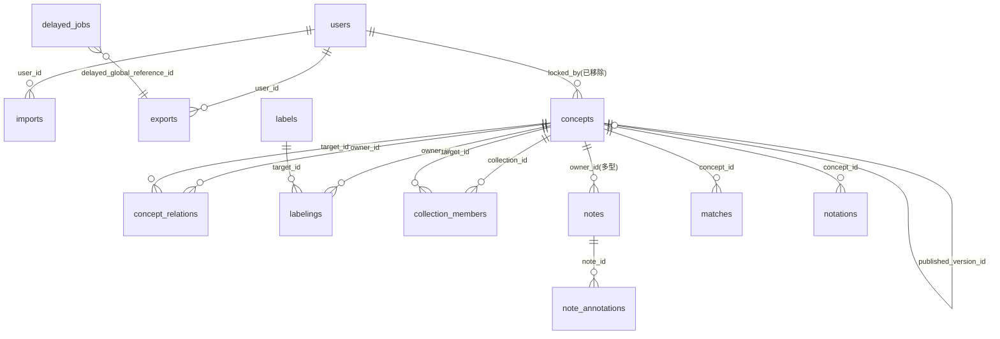

# iQvoc 資料庫 Schema 研究報告

## 摘要

iQvoc（全名 iQvoc - A SKOS(-XL) Vocabulary Management System for the Semantic Web）是一套以 Ruby on Rails 撰寫、採 Apache License 2.0 授權的開源詞彙管理系統，用於管理索引典（thesauri）、分類法（taxonomies）、分類架構與主題標目系統，並支援以 SKOS 對外發布語意網資料[^readme]。本報告聚焦其**資料庫結構的最終狀態**，內容由官方儲存庫的遷移檔（migrations）與 `app/models/` 的 ActiveRecord 模型反推整理而成。專案採「遷移鏈重建」的方式管理 schema，**沒有**提交 `db/schema.rb` 或 `db/structure.sql`[^dbtree][^apptree]，因此最終結構需以遷移鏈的淨結果為準；本報告僅呈現淨結果，不逐一追溯歷史遷移。

最終存在的主要資料表共 15 張（含框架自動建立者），另有 2 張選配的 ActiveStorage 表。iQvoc 以 STI（單表繼承）承載概念與集合、標籤與標示、關聯與註記等多型資料，並以一張通用的 `configuration_settings` 表存放執行期設定。本報告整理各表欄位、STI 型別對應、關聯圖、外部鍵與索引。

本報告為獨立文件，所有敘述與引用皆收錄於本文內。

---

## 1. 專案背景

iQvoc 由 innoQ Deutschland GmbH 建立與維護[^readme]。GitHub 儲存庫為 `innoq/iqvoc`，建立於 2010-09-01，主要語言為 Ruby（約 572 KB 原始碼），其次為 HTML（約 142 KB）與 JavaScript（約 37 KB）[^api][^apilang]。專案首頁為 http://iqvoc.net/，截至 2026-10-17 仍在更新，最後推送時間為 2026-10-07[^api]。其核心特性包含：從 SKOS 匯入既有詞彙、多語言瀏覽與導覽、編輯功能、以及將詞彙發布至語意網[^readme]。

iQvoc 支援多種知識組織系統的詞彙，包含索引典、分類法、分類架構與主題標目系統[^readme]。專案亦可作為 Rails Engine 嵌入使用，並有多個官方擴充套件（如 `iqvoc_skosxl`、`iqvoc_compound_forms` 等）[^readme]。

| 項目 | 值 | 來源 |
| --- | --- | --- |
| GitHub 儲存庫 | `innoq/iqvoc` | [^api] |
| 建立時間 | 2010-09-01 | [^api] |
| 最後推送 | 2026-10-07 | [^api] |
| 主要語言 | Ruby | [^apilang] |
| 授權 | Apache License 2.0 | [^readme] |
| 預設分支 | `main` | [^api] |
| 星號數 | 125 | [^api] |
| 分支（fork）數 | 45 | [^api] |
| 未結議題（open issues） | 56 | [^api] |

### 1.1 技術堆疊與資料庫支援

iQvoc 使用 Rails 8.1（`config.load_defaults 8.1`）與 ActiveRecord[^apprb][^gemfile]。資料庫存取層依 `Gemfile` 綁定 PostgreSQL 驅動 `pg`；MySQL 驅動 `mysql2` 則以註解形式保留，供使用者自行啟用[^gemfile]。

官方提供兩種資料庫設定範本：

- `config/database.yml.postgresql`：PostgreSQL，`encoding: unicode`，可透過環境變數 `POSTGRES_HOST`／`POSTGRES_USER`／`POSTGRES_PASSWORD`／`POSTGRES_DB` 設定[^pgyml]。
- `config/database.yml.mysql`：MySQL，`encoding: utf8mb4`[^mysql_yml]。

因此，PostgreSQL 為預設與建議組合，MySQL 則為替代選項。

---

## 2. Schema 的定義方式

iQvoc **沒有**提交 `db/schema.rb` 或 `db/structure.sql`；`db/` 目錄下僅有 `migrate/` 與 `seeds.rb`[^dbtree]。這表示資料庫結構完全由 `db/migrate/` 內一系列遷移檔依時間戳順序執行後「淨結果」決定。任何新增遷移都需考量與既有歷史遷移的交互作用。

### 2.1 縮寫與型別說明

- 本報告中 `string(n)` 代表 `varchar(n)`；未標註長度者為 Rails 預設值。
- 由於 Rails 於 MySQL 上的預設字串長度為 255，經 utf8mb4 轉換（每字元 4 位元組、索引鍵上限 3072 位元組）後，多數 `varchar` 被縮為 **191**。
- **此長度縮減只在 MySQL 生效**：utf8mb4 轉換遷移（`20180430163647`）以 `adapter_name == 'Mysql2'` 判斷，PostgreSQL 上該遷移為 no-op[^utf8mb4]。因此下表標示的長度須區分資料庫：PostgreSQL 維持原始長度，MySQL 則縮為 191。本報告於各表標註為「PostgreSQL / MySQL」形式。

---

## 3. 資料表總覽

最終存在的主要資料表如下：

| 資料表 | 用途 | 對應模型 |
| --- | --- | --- |
| `concepts` | 概念與集合（SKOS Concept / Collection），採 STI | `Concept::Base`、`Collection::Base` 等 |
| `labels` | 標籤字串（prefLabel / altLabel / hiddenLabel 的內容） | `Label::Base`、`Label::Skos::Base` |
| `labelings` | 概念／集合與標籤之間的關聯（連結表，STI 區分標籤種類） | `Labeling::Base` 及其子類 |
| `concept_relations` | 概念之間的語意關聯（broader / narrower / related） | `Concept::Relation::Base` 及其子類 |
| `collection_members` | 集合成員（集合含概念、或集合含子集合） | `Collection::Member::Base` 及其子類 |
| `notes` | 註記（多型：可屬於概念或集合） | `Note::Base` 及其子類 |
| `note_annotations` | 註記的註解（空白節點上的鍵值） | `Note::Annotated::Base` |
| `matches` | 外部詞彙對應（mapping，如 exactMatch） | `Match::Base` 及其子類 |
| `notations` | 概念的分類號／標記 | `Notation::Base` |
| `users` | 使用者（STI：User / BotUser） | `AbstractUser`、`User`、`BotUser` |
| `configuration_settings` | 執行期可調整的設定值（JSON 字串形式） | `ConfigurationSetting` |
| `imports` | 匯入工作紀錄 | `Import` |
| `exports` | 匯出工作紀錄 | `Export` |
| `delayed_jobs` | 背景工作佇列 | `Delayed::Backend::ActiveRecord::Job` |
| `schema_migrations` | Rails 遷移版本紀錄 | — |
| `ar_internal_metadata` | Rails 內部中介資料（框架自動建立） | — |

另有選配的 `active_storage_blobs`、`active_storage_attachments`，僅在啟用 ActiveStorage 引擎時存在（見第 10 節）。

### 3.1 已刪除的資料表（歷史遺跡）

下列資料表曾存在於遷移鏈中，但最終已被移除，不在最終 schema 內：`classifications`、`classifiers`（`20110408120357` 刪除）、`label_relations`（`20110408120740` 刪除）、`collections`、`collection_labels`（`20110328124300` 刪除，改存於 `concepts` 與 `labels`／`labelings`）、`collection_contents`（`20101202135420` 更名為 `collection_members`）、`job_relations`（`20150317162953` 刪除）[^create_schema][^rmxl][^dropcollect][^jobrel]。

---

## 4. 各資料表欄位明細

### 4.1 `concepts`

概念與集合共用同一張表（`Collection::Base < Concept::Base`）[^conceptbase][^collectbase]。模型 `Concept::Base` 以 `self.table_name = 'concepts'` 指定表名[^conceptbase]。

| 欄位 | 型別 | 選項 | 說明 |
| --- | --- | --- | --- |
| `id` | integer | PK | |
| `type` | string(191) | | STI 類別名稱 |
| `origin` | string(4000) | | URI 尾端識別碼；建立後由 `after_save` 產生 `_%08d` |
| `rev` | integer | default 1 | 版本號 |
| `published_at` | date | | 非空即代表已發布 |
| `published_version_id` | integer | | 指向本表，代表「自己所根據的已發布版本」 |
| `expired_at` | date | | 失效日（`Expirable`） |
| `follow_up` | date | | 待追蹤／覆核日 |
| `to_review` | boolean | | 是否處於覆核中 |
| `rdf_updated_at` | date | | 上次同步為 RDF 的時間 |
| `top_term` | boolean | default false | 是否為頂層概念 |
| `created_at` | datetime | | |
| `updated_at` | datetime | | |

索引：

- `ix_concepts_on_origin`：`origin`（MySQL 前綴長度 255）
- `ix_concepts_publ_version_id`：`published_version_id`

補充：`locked_by` 欄位曾存在（並有指向 `users` 的外部鍵），但已於 `20231012135837` 移除，最終 schema 中不存在[^rmlocked][^fk]。

### 4.2 `labels`

| 欄位 | 型別 | 選項 | 說明 |
| --- | --- | --- | --- |
| `id` | integer | PK | |
| `type` | string(191) | | STI 類別名稱（通常為 `Label::Skos::Base`） |
| `origin` | string(4000) | | |
| `language` | string(191) | | 語言代碼；`NULL` 表示無語言 |
| `value` | string(1024) | | 標籤文字 |
| `published_at` | date | | |
| `created_at` | datetime | | |
| `updated_at` | datetime | | |

索引：

- `ix_labels_on_language`：`language`
- `ix_labels_on_origin`：`origin`（MySQL 前綴長度 255）

注意：`Label::Base` **未** include `Versioning`，標籤本身不做版本分支；`rev`、`published_version_id`、`locked_by`、`expired_at`、`follow_up`、`to_review`、`rdf_updated_at` 皆已移除，最終僅保留 `published_at`[^rmxl][^labelbase]。`Label::Skos::Base` 於 `after_initialize` 時把 `published_at` 設為當下時間，且驗證 `value` 不可為空[^labelskos]。

### 4.3 `labelings`

概念／集合 ↔ 標籤的連結表。模型 `Labeling::Base` 以 `self.table_name = 'labelings'` 指定表名[^labelingbase]。

| 欄位 | 型別 | 說明 |
| --- | --- | --- |
| `id` | integer (PK) | |
| `type` | string(191) | STI：區分 prefLabel / altLabel / hiddenLabel |
| `owner_id` | integer | 指向 `concepts.id` |
| `target_id` | integer | 指向 `labels.id` |
| `created_at` | datetime | |
| `updated_at` | datetime | |

索引：

- `ix_labelings_fk_type`：`(owner_id, target_id, type)`
- `ix_labelings_on_type`：`(type)`
- `index_labelings_on_target_id`：`(target_id)`

模型端額外行為：`Labeling::Skos::Base` 對 `target` 設定 `dependent: :destroy`[^labelskosbase]。

### 4.4 `concept_relations`

| 欄位 | 型別 | 選項 | 說明 |
| --- | --- | --- | --- |
| `id` | integer | PK | |
| `type` | string(191) | | STI：關聯種類 |
| `owner_id` | integer | | 來源概念 |
| `target_id` | integer | | 目標概念 |
| `rank` | integer | default 100 | 排序權重；合法範圍 0..100 |
| `created_at` | datetime | | |
| `updated_at` | datetime | | |

索引：`ix_concept_relations_fk`：`(owner_id, target_id)`[^create_schema]。

`rank` 用於可排序的關聯，模型限制其值須落在 0..100 之間（`Concept::Validations#valid_rank_for_ranked_relations`）[^validations]。單向關聯由應用層維護（`ReverseRelationExtension`／`create_with_reverse_relation`）；`narrower` 是 `broader` 的反向關聯類別，並非由資料庫層強制[^relationbase][^broaderbase]。

### 4.5 `collection_members`

| 欄位 | 型別 | 說明 |
| --- | --- | --- |
| `id` | integer (PK) | |
| `collection_id` | integer | 指向 `concepts.id` 中的集合 |
| `target_id` | integer | 指向 `concepts.id` 中的成員（概念或子集合） |
| `type` | string(191) | STI：`Collection::Member::Skos::Base` |

此表**沒有** `created_at` / `updated_at`[^collmember]。

索引：

- `ix_collections_fk_type`：`(collection_id, target_id, type)`
- `index_collection_members_on_type`：`(type)`

外部鍵：`collection_id → concepts(id)`、`target_id → concepts(id)`，皆 `ON UPDATE CASCADE`[^fk]。模型 `Collection::Member::Base` 以 `self.table_name = 'collection_members'` 指定表名[^collmember]。`Collection::Base.tops` 會查詢 `collection_members.target_id IS NULL` 作為「無父集合」的判定[^collectbase]。

### 4.6 `notes`

多型註記表（同時屬於概念或集合其中一方）。模型 `Note::Base` 以 `self.table_name = 'notes'` 指定表名[^notebase]。

| 欄位 | 型別 | 選項 | 說明 |
| --- | --- | --- | --- |
| `id` | integer | PK | |
| `language` | string(2) | | 語言代碼 |
| `value` | string(4000) | | 內容 |
| `type` | string(50) | | STI：註記種類 |
| `owner_id` | integer | | 多型指向 |
| `owner_type` | string(191) | `NOT NULL` | 多型類別名稱 |
| `position` | integer | | 同一 owner 內的排序；建立時自動取最大值 +1 |
| `created_at` | datetime | | |
| `updated_at` | datetime | | |

索引[^create_schema]：

- `ix_notes_fk_type`：`(owner_id, owner_type, type)`
- `ix_notes_on_language`：`(language)`
- `ix_notes_on_type`：`(type)`

模型行為：`default_scope { order(position: :asc) }`；`before_validation(on: :create)` 時若 `position` 為空，自動取同一 owner 既有最大 `position` 加一；驗證 `position` 必大於 0[^notebase]。`value` 欄位在早期為 `string(1024)`，後經遷移延長為 `string(4000)`[^extnotes]。

### 4.7 `note_annotations`

註記的註解（RDF 空白節點上的述詞－值配對）。模型 `Note::Annotated::Base` 以 `self.table_name = 'note_annotations'` 指定表名[^noteann]。

| 欄位 | 型別 | 說明 |
| --- | --- | --- |
| `id` | integer (PK) | |
| `note_id` | integer | 指向 `notes.id` |
| `predicate` | string(50) | 述詞名 |
| `namespace` | string(50) | 命名空間 |
| `value` | string(1024 / MySQL 191) | 值 |
| `language` | string(191) | 語言代碼 |
| `created_at` | datetime | |
| `updated_at` | datetime | |

索引：

- `ix_note_annotations_fk`：`(note_id)`
- `index_note_annotations_on_value`：`(value)`

外部鍵：`note_annotations.note_id → notes(id)`，`ON DELETE CASCADE, ON UPDATE CASCADE`[^fk]。模型提供 `identifier` 方法，回傳 `"namespace:predicate"` 組合字串[^noteann]。`predicate` 與 `namespace` 兩欄由早期的單一 `identifier` 欄位拆分而來（`20110525103100`）[^seppred]。

### 4.8 `matches`

| 欄位 | 型別 | 說明 |
| --- | --- | --- |
| `id` | integer (PK) | |
| `concept_id` | integer | 指向 `concepts.id` |
| `type` | string(191) | STI：對應種類 |
| `value` | string(191) | 外部 URI（模型驗證須為合法 URI） |
| `created_at` | datetime | |
| `updated_at` | datetime | |

索引：`ix_matches_fk_type`：`(concept_id, type)`；`ix_matches_on_type`：`(type)`[^create_schema]。
外部鍵：`matches.concept_id → concepts(id)`，`ON DELETE CASCADE, ON UPDATE CASCADE`[^fk]。
模型 `Match::Base` 以 `self.table_name = 'matches'` 指定表名，並以自訂驗證確認 `value` 為合法 URI[^matchbase]。

### 4.9 `notations`

| 欄位 | 型別 | 說明 |
| --- | --- | --- |
| `id` | integer (PK) | |
| `concept_id` | integer | 指向 `concepts.id` |
| `value` | string(4000) | 分類號值 |
| `data_type` | string(4000) | RDF 資料型別 URI |

- 無 `type` 欄位（`Notation::Base` 為唯一類別，無 STI）[^notationbase]。
- 無時間戳欄位。
- 索引：`index_notations_on_concept_id`：`(concept_id)`。
- 外部鍵：`notations.concept_id → concepts(id)`，`ON UPDATE CASCADE`[^fk]。

### 4.10 `users`

模型 `AbstractUser` 以 `self.table_name = 'users'` 指向本表；`User` 與 `BotUser` 繼承之，構成 STI[^abstractuser][^user][^botuser]。

| 欄位 | 型別 | 選項 | 說明 |
| --- | --- | --- | --- |
| `id` | integer | PK | |
| `forename` | string(191) | | 名 |
| `surname` | string(191) | | 姓 |
| `email` | string(191) | | 唯一（不分大小寫） |
| `crypted_password` | string(191) | | Authlogic：SCrypt |
| `password_salt` | string(191) | | |
| `persistence_token` | string(191) | | |
| `perishable_token` | string(191) | | |
| `active` | boolean | | 是否啟用 |
| `role` | string(191) | | `reader` / `editor` / `publisher` / `administrator`；BotUser 為 `match_editor` |
| `telephone_number` | string(191) | | |
| `type` | string(191) | default `'User'` | STI（`20140730132113` 新增） |
| `comment` | text | | |
| `login_count` | integer | default 0, `NOT NULL` | |
| `failed_login_count` | integer | default 0, `NOT NULL` | |
| `last_request_at` | datetime | | |
| `current_login_at` | datetime | | |
| `last_login_at` | datetime | | |
| `current_login_ip` | string | | |
| `last_login_ip` | string | | |
| `created_at` | datetime | | |
| `updated_at` | datetime | | |

`comment` 與後續登入統計欄位由 `20200529053158` 一次新增[^extusers]。`AbstractUser` 以 Authlogic 的 `acts_as_authentic` 設定，密碼雜湊使用 `Authlogic::CryptoProviders::SCrypt`，並以 `validates :email, uniqueness: { case_sensitive: false }` 保證信箱唯一[^abstractuser]。`User` 與 `BotUser` 各以 `validates_inclusion_of :role` 限制角色集合[^user][^botuser]。

### 4.11 `configuration_settings`

| 欄位 | 型別 | 說明 |
| --- | --- | --- |
| `id` | integer (PK) | |
| `key` | string(191) | 設定鍵，唯一 |
| `value` | string(191) | 設定值，以 JSON 包成單元素陣列再去除外層括號的方式存放 |

- 無時間戳欄位[^cfgsettings]。
- 模型 `ConfigurationSetting` 驗證 `key` 唯一[^cfgsettingmodel]。
- 由 `Iqvoc::Configuration::InstanceConfiguration`（Singleton）讀取並快取：寫入時以 `JSON.dump([value])[1..-2]` 產生去除外層括號的 JSON 字串，讀取時以 `JSON.load("[#{value}]")[0]` 還原[^instancecfg]。
- 已知預設鍵值範例：`title`、`concept_modal_preview`、`languages.pref_labeling`、`languages.further_labelings.*`、`languages.notes`、`performance.unbounded_hierarchy`、`sources.iqvoc`、`sources.create_reverse_matches`[^corecfg]。

### 4.12 `imports`

| 欄位 | 型別 | 選項 | 說明 |
| --- | --- | --- | --- |
| `id` | integer | PK | |
| `user_id` | integer | | 執行者 |
| `output` | text（上限 1,073,741,823） | | 日誌輸出 |
| `success` | boolean | default false | |
| `finished_at` | timestamp | | |
| `import_file` | string(191) | | CarrierWave 上傳檔名 |
| `publish` | boolean | | 匯入後是否直接發布 |
| `default_namespace` | string(191) | | |
| `created_at` | datetime | | |
| `updated_at` | datetime | | |

索引：`index_imports_on_user_id`：`(user_id)`。
外部鍵：`imports.user_id → users(id)`，`ON DELETE NULLIFY, ON UPDATE CASCADE`[^fk]。
模型驗證：`import_file` 與 `default_namespace` 必填；`import_file` 以 CarrierWave `mount_uploader :import_file, RdfUploader` 掛載，檔案實際存於磁碟[^importmodel][^outputlog]。

### 4.13 `exports`

| 欄位 | 型別 | 選項 | 說明 |
| --- | --- | --- | --- |
| `id` | integer | PK | |
| `user_id` | integer | | 執行者 |
| `output` | text（上限 1,073,741,823） | | 日誌輸出 |
| `success` | boolean | default false | |
| `file_type` | integer | | enum：`0=ttl, 1=nt, 2=xml` |
| `token` | string(191) | | 檔名一部分 |
| `default_namespace` | string(191) | | 必填 |
| `zip` | boolean | default false, `NOT NULL` | 是否打包為 zip |
| `finished_at` | timestamp | | |
| `created_at` | datetime | | |
| `updated_at` | datetime | | |

索引：`index_exports_on_user_id`：`(user_id)`。
外部鍵：`exports.user_id → users(id)`，`ON DELETE NULLIFY, ON UPDATE CASCADE`[^fk]。
模型 `Export` 以 `enum :file_type, [:ttl, :nt, :xml]` 定義列舉，驗證 `default_namespace` 必填，並以 `jobs` 方法依 `delayed_jobs.delayed_global_reference_id = to_global_id.to_s` 關聯其背景工作[^exportmodel][^outputlog]。

### 4.14 `delayed_jobs`

背景工作佇列（delayed_job_active_record）[^gemfile]。

| 欄位 | 型別 | 選項 | 說明 |
| --- | --- | --- | --- |
| `id` | integer | PK | |
| `priority` | integer | default 0, `NOT NULL` | |
| `attempts` | integer | default 0, `NOT NULL` | |
| `handler` | text | `NOT NULL` | YAML 序列化的工作物件 |
| `last_error` | text | | 上次失敗原因 |
| `run_at` | datetime | | 預定執行時間 |
| `locked_at` | datetime | | 被 worker 鎖定時間 |
| `failed_at` | datetime | | 重試全數失敗時間 |
| `locked_by` | string(191) | | 處理此工作的 worker |
| `queue` | string(191) | | 佇列名稱 |
| `error_message` | string(191) | | 應用層錯誤訊息 |
| `delayed_reference_type` | string(191) | | 多型參照型別 |
| `delayed_reference_id` | integer | | 多型參照 id |
| `delayed_global_reference_id` | string(191) | | GlobalID 字串參照 |
| `created_at` | datetime | | |
| `updated_at` | datetime | | |

索引[^create_dj][^djopt]：

- `delayed_jobs_priority`：`(priority, run_at)`
- `delayed_jobs_queue`：`(queue)`
- `delayed_jobs_delayed_reference_type`：`(delayed_reference_type)`
- `delayed_jobs_delayed_reference_id`：`(delayed_reference_id)`
- `delayed_jobs_delayed_global_reference_id`：`(delayed_global_reference_id)`

### 4.15 框架資料表

| 資料表 | 欄位 |
| --- | --- |
| `schema_migrations` | `version` string(191)（PK） |
| `ar_internal_metadata` | `key` string、`value` string、`created_at`、`updated_at` |
| `active_storage_blobs` | 由 ActiveStorage 引擎管理（本專案預設未載入） |
| `active_storage_attachments` | `blob_id` 上有外部鍵指向 `active_storage_blobs(id)`（僅在表存在時建立） |

---

## 5. STI（單表繼承）型別對應

iQvoc 於初始化檔設定 `ActiveRecord::Base.store_full_sti_class = true`[^ariniter]，因此 `type` 欄位存的是**完整類別名稱**（含命名空間）。這代表修改類別命名空間時需要資料遷移配合。

### 5.1 `concepts.type`

| 值 | 說明 |
| --- | --- |
| `Concept::Skos::Base` | 一般 SKOS 概念（`Iqvoc::Concept.base_class_name`） |
| `Concept::Skos::Scheme` | 概念架構（單例，`origin = 'scheme'`） |
| `Collection::Skos::Base` | 集合基底 |
| `Collection::Skos::Unordered` | 無序集合（`Iqvoc::Collection.base_class_name`） |
| `Collection::Unordered` | 已棄用的別名，`initialize` 會發出 deprecation 警告 |

類別繼承鏈：`Concept::Base` → `Concept::Skos::Base` → `Concept::Skos::Scheme`；以及 `Concept::Base` → `Collection::Base` → `Collection::Skos::Base` → `Collection::Skos::Unordered`[^conceptbase][^collskosbase][^collunordered][^scheme]。

### 5.2 `labels.type`

| 值 |
| --- |
| `Label::Skos::Base`（繼承 `Label::Base`；初始化時自動設定 `published_at`） |

### 5.3 `labelings.type`

| 值 | RDF 述詞 | 備註 |
| --- | --- | --- |
| `Labeling::Skos::Base` | — | 基底，不會直接用於實際關聯 |
| `Labeling::Skos::PrefLabel` | `skos:prefLabel` | 每實例單一（`singular?` 為 true） |
| `Labeling::Skos::AltLabel` | `skos:altLabel` | |
| `Labeling::Skos::HiddenLabel` | `skos:hiddenLabel` | |

### 5.4 `concept_relations.type`

| 值 | RDF 述詞 | 備註 |
| --- | --- | --- |
| `Concept::Relation::Skos::Base` | — | 基底 |
| `Concept::Relation::Skos::Broader::Base` | `skos:broader` | |
| `Concept::Relation::Skos::Broader::Mono` | `skos:broader` | 預設；單一上層（`singular?` 為 true） |
| `Concept::Relation::Skos::Broader::Poly` | `skos:broader` | 已棄用，歷史資料已改為 `Mono` |
| `Concept::Relation::Skos::Narrower::Base` | `skos:narrower` | `broader` 的反向關聯類別 |
| `Concept::Relation::Skos::Related` | `skos:related` | |

### 5.5 `collection_members.type`

| 值 | RDF 述詞 |
| --- | --- |
| `Collection::Member::Skos::Base` | `skos:member` |

歷史值（已由資料遷移改掉）：`Collection::Member::Concept`、`Collection::Member::Collection`[^fixtype][^fixmember]。

### 5.6 `notes.type`

| 值 | RDF 命名空間／述詞 |
| --- | --- |
| `Note::Base` | — |
| `Note::Skos::Base` | `skos` |
| `Note::Skos::ChangeNote` | `skos:changeNote`（`Iqvoc.change_note_class_name`，每次儲存自動產生） |
| `Note::Skos::Definition` | `skos:definition` |
| `Note::Skos::EditorialNote` | `skos:editorialNote` |
| `Note::Skos::Example` | `skos:example` |
| `Note::Skos::HistoryNote` | `skos:historyNote` |
| `Note::Skos::ScopeNote` | `skos:scopeNote` |
| `Note::Rdfs::SeeAlso` | `rdfs:seeAlso` |

### 5.7 `matches.type`

| 值 | RDF 述詞 |
| --- | --- |
| `Match::Skos::Base` | — |
| `Match::Skos::CloseMatch` | `skos:closeMatch` |
| `Match::Skos::ExactMatch` | `skos:exactMatch` |
| `Match::Skos::RelatedMatch` | `skos:relatedMatch` |
| `Match::Skos::BroadMatch` | `skos:broadMatch` |
| `Match::Skos::NarrowMatch` | `skos:narrowMatch` |
| `Match::Skos::MappingRelation` | `skos:mappingRelation` |

### 5.8 `users.type`

| 值 | 角色限制 |
| --- | --- |
| `User` | `reader` / `editor` / `publisher` / `administrator` |
| `BotUser` | `match_editor`（單例，`botuser@iqvoc`） |

`AbstractUser` 以 `self.table_name = 'users'` 指向同一張表[^abstractuser][^user][^botuser]。

### 5.9 `notes.owner_type`（多型）

存放概念的實際 STI 子類名稱，可能是 `Concept::Skos::Base`、`Concept::Skos::Scheme`、`Collection::Skos::Unordered` 等[^notebase]。因此一筆註記只能屬於概念或集合其中一方。

---

## 6. 關聯圖

自我參照版本關係（`Versioning` concern）[^versioning]：

- `published_version_id` 指向同表的「已發布版本」。
- `belongs_to :published_version`：加載基準版本。
- `has_one :draft`（`foreign_key: 'published_version_id'`）：指向以本列為基礎的未發布草稿。
- 分支時 `#branch` 會複製整列並 `rev + 1`，並將 `published_version_id` 指向來源列。

---

## 7. 外部鍵約束彙總

| 來源 | 目標 | ON DELETE | ON UPDATE |
| --- | --- | --- | --- |
| `concept_relations.owner_id` | `concepts.id` | — | CASCADE |
| `concept_relations.target_id` | `concepts.id` | — | CASCADE |
| `collection_members.collection_id` | `concepts.id` | — | CASCADE |
| `collection_members.target_id` | `concepts.id` | — | CASCADE |
| `labelings.owner_id` | `concepts.id` | — | CASCADE |
| `labelings.target_id` | `labels.id` | CASCADE | CASCADE |
| `matches.concept_id` | `concepts.id` | CASCADE | CASCADE |
| `notations.concept_id` | `concepts.id` | — | CASCADE |
| `note_annotations.note_id` | `notes.id` | CASCADE | CASCADE |
| `imports.user_id` | `users.id` | NULLIFY | CASCADE |
| `exports.user_id` | `users.id` | NULLIFY | CASCADE |
| `active_storage_attachments.blob_id` | `active_storage_blobs.id` | — | — |

補充：`published_version_id`、`delayed_reference_id`、`notes.owner_id` 均**沒有**資料庫層外部鍵[^fk][^create_schema]。

---

## 8. 資料庫層索引一覽

| 資料表 | 索引名稱 | 欄位 |
| --- | --- | --- |
| `concepts` | `ix_concepts_on_origin` | `origin`（前綴 255） |
| `concepts` | `ix_concepts_publ_version_id` | `published_version_id` |
| `labels` | `ix_labels_on_language` | `language` |
| `labels` | `ix_labels_on_origin` | `origin`（前綴 255） |
| `labelings` | `ix_labelings_fk_type` | `owner_id, target_id, type` |
| `labelings` | `ix_labelings_on_type` | `type` |
| `labelings` | `index_labelings_on_target_id` | `target_id` |
| `concept_relations` | `ix_concept_relations_fk` | `owner_id, target_id` |
| `collection_members` | `ix_collections_fk_type` | `collection_id, target_id, type` |
| `collection_members` | `index_collection_members_on_type` | `type` |
| `notes` | `ix_notes_fk_type` | `owner_id, owner_type, type` |
| `notes` | `ix_notes_on_language` | `language` |
| `notes` | `ix_notes_on_type` | `type` |
| `note_annotations` | `ix_note_annotations_fk` | `note_id` |
| `note_annotations` | `index_note_annotations_on_value` | `value` |
| `matches` | `ix_matches_fk_type` | `concept_id, type` |
| `matches` | `ix_matches_on_type` | `type` |
| `notations` | `index_notations_on_concept_id` | `concept_id` |
| `imports` | `index_imports_on_user_id` | `user_id` |
| `exports` | `index_exports_on_user_id` | `user_id` |
| `delayed_jobs` | `delayed_jobs_priority` | `priority, run_at` |
| `delayed_jobs` | `delayed_jobs_queue` | `queue` |
| `delayed_jobs` | `delayed_jobs_delayed_reference_type` | `delayed_reference_type` |
| `delayed_jobs` | `delayed_jobs_delayed_reference_id` | `delayed_reference_id` |
| `delayed_jobs` | `delayed_jobs_delayed_global_reference_id` | `delayed_global_reference_id` |

---

## 9. 版本控制機制（`Versioning` concern）

適用於 `Concept::Base`（含 `Collection::Base`）；`Label::Base` 只有 `published_at`，不做版本分支[^versioning][^labelbase]。

| 欄位 | 作用 |
| --- | --- |
| `rev` | 版本序號，新分支為前一版 +1 |
| `published_version_id` | 指向自己所依據的已發布列；已發布列的此欄為 `NULL` |
| `published_at` | 非空表示已發布 |
| `to_review` | 非空表示正在覆核（`in_review?`） |
| `follow_up` | 建議覆核日期 |
| `expired_at` | 失效日期（`Expirable`：`expired` / `not_expired` scope） |
| `rdf_updated_at` | 上次 RDF 同步時間（`unsynced` scope 以此為 `NULL` 判斷） |

常用 scope：`published`、`unpublished`、`editor_selectable`、`published_with_newer_versions`、`unpublished_or_follow_up`、`by_origin`、`unsynced`[^versioning]。

狀態機（`#state`）[^versioning]：

- `published_at` 有值 → 已發布
- 未發布且 `to_review` 有值 → 覆核中
- 未發布且無 `to_review` → 已取出編輯（checked out）

`branch` 會依 `include_to_deep_cloning` 設定的關聯清單深層複製（例：`relations`、`referenced_relations`、`labelings`、`notes`＋`annotations`、`matches`、`notations`、`collection_members`）[^versioning][^conceptbase]。

---

## 10. 注意事項與陷阱

1. **沒有 `schema.rb`／`structure.sql`**：`db/` 僅有 `migrate/` 與 `seeds.rb`，schema 完全靠遷移鏈重建；新增遷移時須留意與歷史遷移的交互作用[^dbtree]。
2. **MySQL 專屬的長度縮減**：utf8mb4 轉換只在 MySQL 生效（判斷 `adapter_name == 'Mysql2'`），PostgreSQL 部署時字串長度不會被縮為 191[^utf8mb4]。若程式碼中有依賴長度的邏輯需自行確認。
3. **`note_annotations.value` 在 MySQL 上大幅縮減**：由 1024 縮為 191，長註解值可能被截斷，寫入前應於應用層驗證。
4. **`labels` 與 `concepts` 的版本能力不對稱**：`labels` 沒有 `rev`／`published_version_id`，因此標籤不會有草稿分支；`Label::Skos::Base` 在初始化時就把 `published_at` 設為當下時間[^labelskos]。
5. **`collection_members` 與 `notations` 沒有時間戳**：不要假設所有表都有 `created_at`／`updated_at`。
6. **`concepts` 同時承載概念與集合**：查詢時務必以 `type` 過濾（程式碼中大量使用 `Iqvoc::Concept.base_class_name` / `Iqvoc::Collection.base_class_name`），否則集合會被當成概念回傳。
7. **`notes.owner_type` 依賴完整類別名稱**：`store_full_sti_class = true` 表示修改類別命名空間會需要資料遷移（`20250218160045`、`20250326182601` 即為此目的）[^ariniter][^zeitwerk][^zeitcfg]。
8. **`ActiveStorage` 引擎預設未載入**：`config/application.rb` 中 `require "active_storage/engine"` 被註解；因此 `active_storage_*` 表通常不存在[^apprb]。
9. **`Iqvoc.truncation_blacklist`**：清空詞庫時會跳過 `schema_migrations`、`users`、`exports`、`imports`[^corecfg]。
10. **`imports`／`exports` 的檔案不在資料庫**：CarrierWave（`RdfUploader`）與 `Iqvoc.export_path` / `Iqvoc.upload_path` 指向檔案系統；備份時需同時處理檔案與資料列[^importmodel][^corecfg]。
11. **`configuration_settings.value` 為 JSON 字串**：以「單元素陣列去外層括號」的方式存放，須經 `InstanceConfiguration` 讀寫才能正確還原型別（Bool／String／Integer／Float／Array）[^instancecfg]。
12. **`matches.value` 須為合法 URI**：模型層以 `URI.parse` 驗證[^matchbase]。

---

## 參考文獻

[^readme]: iQvoc. (n.d.). *README.md* [Source code]. GitHub. Retrieved 2026-11-07, from https://github.com/innoq/iqvoc/blob/main/README.md

[^api]: GitHub. (2026). *innoq/iqvoc repository metadata* [Data file]. GitHub REST API. Retrieved 2026-11-07, from https://api.github.com/repos/innoq/iqvoc

[^apilang]: GitHub. (2026). *innoq/iqvoc languages* [Data file]. GitHub REST API. Retrieved 2026-11-07, from https://api.github.com/repos/innoq/iqvoc/languages

[^apptree]: iQvoc. (n.d.). *app/ directory tree* [Source code]. GitHub. Retrieved 2026-11-07, from https://github.com/innoq/iqvoc/tree/main/app

[^dbtree]: iQvoc. (n.d.). *db/ directory tree* [Source code]. GitHub. Retrieved 2026-11-07, from https://github.com/innoq/iqvoc/tree/main/db

[^gemfile]: iQvoc. (n.d.). *Gemfile* [Source code]. GitHub. Retrieved 2026-11-07, from https://github.com/innoq/iqvoc/blob/main/Gemfile

[^apprb]: iQvoc. (n.d.). *config/application.rb* [Source code]. GitHub. Retrieved 2026-11-07, from https://github.com/innoq/iqvoc/blob/main/config/application.rb

[^pgyml]: iQvoc. (n.d.). *config/database.yml.postgresql* [Source code]. GitHub. Retrieved 2026-11-07, from https://github.com/innoq/iqvoc/blob/main/config/database.yml.postgresql

[^mysql_yml]: iQvoc. (n.d.). *config/database.yml.mysql* [Source code]. GitHub. Retrieved 2026-11-07, from https://github.com/innoq/iqvoc/blob/main/config/database.yml.mysql

[^create_schema]: iQvoc. (n.d.). *db/migrate/20100927101502_create_schema.rb* [Source code]. GitHub. Retrieved 2026-11-07, from https://github.com/innoq/iqvoc/blob/main/db/migrate/20100927101502_create_schema.rb

[^utf8mb4]: iQvoc. (n.d.). *db/migrate/20180430163647_utf8mb4_conversion.rb* [Source code]. GitHub. Retrieved 2026-11-07, from https://github.com/innoq/iqvoc/blob/main/db/migrate/20180430163647_utf8mb4_conversion.rb

[^fk]: iQvoc. (n.d.). *db/migrate/20141204151558_add_foreign_key_constraints.rb* [Source code]. GitHub. Retrieved 2026-11-07, from https://github.com/innoq/iqvoc/blob/main/db/migrate/20141204151558_add_foreign_key_constraints.rb

[^rmxl]: iQvoc. (n.d.). *db/migrate/20110408120740_remove_xl_specfic_stuff.rb* [Source code]. GitHub. Retrieved 2026-11-07, from https://github.com/innoq/iqvoc/blob/main/db/migrate/20110408120740_remove_xl_specfic_stuff.rb

[^rmlocked]: iQvoc. (n.d.). *db/migrate/20231012135837_remove_locked_by.rb* [Source code]. GitHub. Retrieved 2026-11-07, from https://github.com/innoq/iqvoc/blob/main/db/migrate/20231012135837_remove_locked_by.rb

[^dropcollect]: iQvoc. (n.d.). *db/migrate/20110328124300_discard_collection_specifics.rb* [Source code]. GitHub. Retrieved 2026-11-07, from https://github.com/innoq/iqvoc/blob/main/db/migrate/20110328124300_discard_collection_specifics.rb

[^jobrel]: iQvoc. (n.d.). *db/migrate/20150317162953_drop_job_relation.rb* [Source code]. GitHub. Retrieved 2026-11-07, from https://github.com/innoq/iqvoc/blob/main/db/migrate/20150317162953_drop_job_relation.rb

[^extnotes]: iQvoc. (n.d.). *db/migrate/20110512132624_extend_notes_value_field_length.rb* [Source code]. GitHub. Retrieved 2026-11-07, from https://github.com/innoq/iqvoc/blob/main/db/migrate/20110512132624_extend_notes_value_field_length.rb

[^seppred]: iQvoc. (n.d.). *db/migrate/20110525103100_separate_note_annotation_predicates.rb* [Source code]. GitHub. Retrieved 2026-11-07, from https://github.com/innoq/iqvoc/blob/main/db/migrate/20110525103100_separate_note_annotation_predicates.rb

[^extusers]: iQvoc. (n.d.). *db/migrate/20200529053158_extend_users.rb* [Source code]. GitHub. Retrieved 2026-11-07, from https://github.com/innoq/iqvoc/blob/main/db/migrate/20200529053158_extend_users.rb

[^cfgsettings]: iQvoc. (n.d.). *db/migrate/20120119000000_create_configuration_settings.rb* [Source code]. GitHub. Retrieved 2026-11-07, from https://github.com/innoq/iqvoc/blob/main/db/migrate/20120119000000_create_configuration_settings.rb

[^create_dj]: iQvoc. (n.d.). *db/migrate/20131220134356_create_delayed_jobs.rb* [Source code]. GitHub. Retrieved 2026-11-07, from https://github.com/innoq/iqvoc/blob/main/db/migrate/20131220134356_create_delayed_jobs.rb

[^djopt]: iQvoc. (n.d.). *db/migrate/20150316103756_delayed_jobs_optimizations.rb* [Source code]. GitHub. Retrieved 2026-11-07, from https://github.com/innoq/iqvoc/blob/main/db/migrate/20150316103756_delayed_jobs_optimizations.rb

[^outputlog]: iQvoc. (n.d.). *db/migrate/20170608093748_extend_job_output_log.rb* [Source code]. GitHub. Retrieved 2026-11-07, from https://github.com/innoq/iqvoc/blob/main/db/migrate/20170608093748_extend_job_output_log.rb

[^fixtype]: iQvoc. (n.d.). *db/migrate/20130227145825_fix_collection_type.rb* [Source code]. GitHub. Retrieved 2026-11-07, from https://github.com/innoq/iqvoc/blob/main/db/migrate/20130227145825_fix_collection_type.rb

[^fixmember]: iQvoc. (n.d.). *db/migrate/20130502151221_fix_collection_member_types.rb* [Source code]. GitHub. Retrieved 2026-11-07, from https://github.com/innoq/iqvoc/blob/main/db/migrate/20130502151221_fix_collection_member_types.rb

[^zeitwerk]: iQvoc. (n.d.). *db/migrate/20250218160045_adapt_zeitwerk_naming_to_iqvoc.rb* [Source code]. GitHub. Retrieved 2026-11-07, from https://github.com/innoq/iqvoc/blob/main/db/migrate/20250218160045_adapt_zeitwerk_naming_to_iqvoc.rb

[^zeitcfg]: iQvoc. (n.d.). *db/migrate/20250326182601_adapt_zeitwerk_skos_naming_to_instance_configuration.rb* [Source code]. GitHub. Retrieved 2026-11-07, from https://github.com/innoq/iqvoc/blob/main/db/migrate/20250326182601_adapt_zeitwerk_skos_naming_to_instance_configuration.rb

[^ariniter]: iQvoc. (n.d.). *config/initializers/active_record.rb* [Source code]. GitHub. Retrieved 2026-11-07, from https://github.com/innoq/iqvoc/blob/main/config/initializers/active_record.rb

[^conceptbase]: iQvoc. (n.d.). *app/models/concept/base.rb* [Source code]. GitHub. Retrieved 2026-11-07, from https://github.com/innoq/iqvoc/blob/main/app/models/concept/base.rb

[^validations]: iQvoc. (n.d.). *app/models/concept/validations.rb* [Source code]. GitHub. Retrieved 2026-11-07, from https://github.com/innoq/iqvoc/blob/main/app/models/concept/validations.rb

[^scheme]: iQvoc. (n.d.). *app/models/concept/skos/scheme.rb* [Source code]. GitHub. Retrieved 2026-11-07, from https://github.com/innoq/iqvoc/blob/main/app/models/concept/skos/scheme.rb

[^collectbase]: iQvoc. (n.d.). *app/models/collection/base.rb* [Source code]. GitHub. Retrieved 2026-11-07, from https://github.com/innoq/iqvoc/blob/main/app/models/collection/base.rb

[^collskosbase]: iQvoc. (n.d.). *app/models/collection/skos/base.rb* [Source code]. GitHub. Retrieved 2026-11-07, from https://github.com/innoq/iqvoc/blob/main/app/models/collection/skos/base.rb

[^collunordered]: iQvoc. (n.d.). *app/models/collection/skos/unordered.rb* [Source code]. GitHub. Retrieved 2026-11-07, from https://github.com/innoq/iqvoc/blob/main/app/models/collection/skos/unordered.rb

[^collmember]: iQvoc. (n.d.). *app/models/collection/member/base.rb* [Source code]. GitHub. Retrieved 2026-11-07, from https://github.com/innoq/iqvoc/blob/main/app/models/collection/member/base.rb

[^labelbase]: iQvoc. (n.d.). *app/models/label/base.rb* [Source code]. GitHub. Retrieved 2026-11-07, from https://github.com/innoq/iqvoc/blob/main/app/models/label/base.rb

[^labelskos]: iQvoc. (n.d.). *app/models/label/skos/base.rb* [Source code]. GitHub. Retrieved 2026-11-07, from https://github.com/innoq/iqvoc/blob/main/app/models/label/skos/base.rb

[^labelingbase]: iQvoc. (n.d.). *app/models/labeling/base.rb* [Source code]. GitHub. Retrieved 2026-11-07, from https://github.com/innoq/iqvoc/blob/main/app/models/labeling/base.rb

[^labelskosbase]: iQvoc. (n.d.). *app/models/labeling/skos/base.rb* [Source code]. GitHub. Retrieved 2026-11-07, from https://github.com/innoq/iqvoc/blob/main/app/models/labeling/skos/base.rb

[^relationbase]: iQvoc. (n.d.). *app/models/concept/relation/base.rb* [Source code]. GitHub. Retrieved 2026-11-07, from https://github.com/innoq/iqvoc/blob/main/app/models/concept/relation/base.rb

[^broaderbase]: iQvoc. (n.d.). *app/models/concept/relation/skos/broader/base.rb* [Source code]. GitHub. Retrieved 2026-11-07, from https://github.com/innoq/iqvoc/blob/main/app/models/concept/relation/skos/broader/base.rb

[^notebase]: iQvoc. (n.d.). *app/models/note/base.rb* [Source code]. GitHub. Retrieved 2026-11-07, from https://github.com/innoq/iqvoc/blob/main/app/models/note/base.rb

[^noteann]: iQvoc. (n.d.). *app/models/note/annotated/base.rb* [Source code]. GitHub. Retrieved 2026-11-07, from https://github.com/innoq/iqvoc/blob/main/app/models/note/annotated/base.rb

[^matchbase]: iQvoc. (n.d.). *app/models/match/base.rb* [Source code]. GitHub. Retrieved 2026-11-07, from https://github.com/innoq/iqvoc/blob/main/app/models/match/base.rb

[^notationbase]: iQvoc. (n.d.). *app/models/notation/base.rb* [Source code]. GitHub. Retrieved 2026-11-07, from https://github.com/innoq/iqvoc/blob/main/app/models/notation/base.rb

[^abstractuser]: iQvoc. (n.d.). *app/models/abstract_user.rb* [Source code]. GitHub. Retrieved 2026-11-07, from https://github.com/innoq/iqvoc/blob/main/app/models/abstract_user.rb

[^user]: iQvoc. (n.d.). *app/models/user.rb* [Source code]. GitHub. Retrieved 2026-11-07, from https://github.com/innoq/iqvoc/blob/main/app/models/user.rb

[^botuser]: iQvoc. (n.d.). *app/models/bot_user.rb* [Source code]. GitHub. Retrieved 2026-11-07, from https://github.com/innoq/iqvoc/blob/main/app/models/bot_user.rb

[^cfgsettingmodel]: iQvoc. (n.d.). *app/models/configuration_setting.rb* [Source code]. GitHub. Retrieved 2026-11-07, from https://github.com/innoq/iqvoc/blob/main/app/models/configuration_setting.rb

[^importmodel]: iQvoc. (n.d.). *app/models/import.rb* [Source code]. GitHub. Retrieved 2026-11-07, from https://github.com/innoq/iqvoc/blob/main/app/models/import.rb

[^exportmodel]: iQvoc. (n.d.). *app/models/export.rb* [Source code]. GitHub. Retrieved 2026-11-07, from https://github.com/innoq/iqvoc/blob/main/app/models/export.rb

[^versioning]: iQvoc. (n.d.). *app/models/concerns/versioning.rb* [Source code]. GitHub. Retrieved 2026-11-07, from https://github.com/innoq/iqvoc/blob/main/app/models/concerns/versioning.rb

[^instancecfg]: iQvoc. (n.d.). *lib/iqvoc/configuration/instance_configuration.rb* [Source code]. GitHub. Retrieved 2026-11-07, from https://github.com/innoq/iqvoc/blob/main/lib/iqvoc/configuration/instance_configuration.rb

[^corecfg]: iQvoc. (n.d.). *lib/iqvoc/configuration/core.rb* [Source code]. GitHub. Retrieved 2026-11-07, from https://github.com/innoq/iqvoc/blob/main/lib/iqvoc/configuration/core.rb

---

## 來源評析

- **權威性**：本報告以官方儲存庫原始碼（遷移檔與 ActiveRecord 模型）為主要證據，屬一手資料；星號數、推送時間等庫內 metadata 取自 GitHub 官方 REST API，可信度高。
- **時效性**：所有引用於 2026-11-07 擷取，反映 2026-10-07 最新推送狀態；專案自 2010 年起持續維護，schema 演進歷時十餘年。
- **偏誤與限制**：所有結構性結論均來自閱讀原始碼與遷移鏈，未經實際部署驗證；由於專案沒有 `schema.rb`，「最終 schema」係以遷移鏈淨結果推導，欄位型別長度在 PostgreSQL 與 MySQL 上不同（詳第 2.1 節），實際型別仍以目標資料庫執行結果為準。專案星號數（125）屬中等規模，惟其為 SKOS 詞彙管理領域具代表性的成熟開源實作，故仍納入報告並註明其規模。
