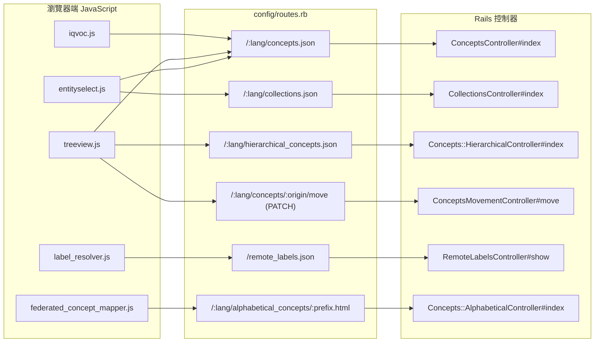

# iQvoc 前端與後端 HTTP API 清單

本報告整理 iQvoc 這個 SKOS 詞彙管理系統中，**瀏覽器端 JavaScript 直接呼叫後端**的 HTTP API，以及同時對外提供（供其他 iQvoc 實例或 LOD（Linked Open Data）用戶端使用）的 JSON / RDF API。報告內容以 iQvoc 官方原始碼儲存庫 `innoq/iqvoc`（預設分支 `main`）為根據，逐項核對路由、控制器與前端 JavaScript 檔案的實際行為。

iQvoc 是一套詞彙管理工具，結合易用的人機介面與語意網（Semantic Web）互通能力，支援主題詞表（thesauri）、分類法（taxonomies）、分類架構（classification schemes）與標題系統（subject heading systems）等知識組織系統常用的詞彙類型，並提供 SKOS 匯入、多語瀏覽、編輯功能與語意網發布[^readme]。本報告的對象是第一次接觸 iQvoc 的讀者，所有需要的背景都會在報告內說明。

---

## 1. 概述

iQvoc 是一個以 Ruby on Rails 撰寫的應用程式[^repo]。其對外行為由路由檔 `config/routes.rb` 定義[^routes]，前端互動主要可分成三類：

| 類型 | 說明 | 代表端點 |
| --- | --- | --- |
| 內部 AJAX / JSON API | 前端元件（autocomplete、treeview、modal）呼叫的 JSON 端點 | `concepts.json`、`collections.json`、`hierarchical_concepts.json` |
| HTML 片段（fragment）API | 前端取回 HTML 片段插入 DOM（modal、遠端資料集代理） | `glance`、`alphabetical_concepts`、`search`（`fragment=true`） |
| RDF / 對外 API | SKOS 詞彙資料的 RDF、搜尋、反向匹配（供外部消費） | `/:id.rdf`、`/dataset`、`/hierarchy`、`PATCH add_match` |

iQvoc 的全域格式強制行為由 `ControllerExtensions#ensure_extension` 負責：對於未帶格式（format）的 GET 請求，會將請求重新導向並補上 `.html`[^controller_extensions]。此機制是理解「為何多數端點需要明確指定格式」的關鍵。

下圖以 Mermaid 呈現前端 JavaScript、後端路由、控制器與回應格式之間的關係：



---

## 2. 前端 JavaScript 呼叫的 JSON API

### 2.1 概念查詢（Entity Selector 自動完成）

- **端點**：`GET /:lang/concepts.json`
- **控制器**：`ConceptsController#index`
- **前端呼叫者**：`app/assets/javascripts/iqvoc/entityselect.js`，該檔以 `$.getJSON(uri, { query: query }, responder)` 發出請求[^entityselect]。
- **前端資料來源**：欄位上的 `data-query-url` 屬性；`EntitySelector.sourceSelectors.default` 會讀取該屬性作為請求 URI[^entityselect]

控制器在 `format.json` 分支中的實際查詢邏輯為：先以 `Label::Base.by_query_value("%#{params[:query]}%")` 做標籤值的模糊比對，若帶有 `language` 參數則再以 `Label::Base.by_language` 限定語言，最後對 `exclude_top_terms` 參數為真時排除 top term，並以 `render json: @concepts` 回應[^concepts_ctrl]。

**查詢參數**

| 參數 | 型別 | 說明 |
| --- | --- | --- |
| `query` | String | 標籤查詢字串（以 `%...%` 模糊比對 label value） |
| `language` | String | 限定標籤語言 |
| `exclude_top_terms` | Boolean | 為真時排除 top term（新增 broader 關聯時使用） |

**回應**：由 `concept_widget_data` 方法產生的陣列[^controller_extensions]，結構如下：

```json
[ { "id": "concept_origin", "name": "顯示名稱 (additional info)", "published": true } ]
```

其中 `name` 由 concept 的 `pref_label.value` 加上可選的 `additional_info` 組成，`published` 為該 concept 是否已發布[^controller_extensions]。前端 `EntitySelector.preprocessors.default` 會將每筆轉成 `{ value, label, published }` 格式[^entityselect]。

### 2.2 集合查詢（Entity Selector 與 Collection Treeview）

- **端點**：`GET /:lang/collections.json`
- **控制器**：`CollectionsController#index`
- **前端呼叫者**：同 2.1 的 `entityselect.js`（透過 `data-query-url` 指向集合查詢端點）

控制器在 `format.json` 分支中依是否有 `root` 參數分流[^collections_ctrl]：

- **無 `root`（widget 模式）**：以 `Label::Base.by_query_value("#{params[:query]}%")`（前綴比對）查詢已發布且未過期的集合，回傳 `collection_widget_data` 陣列，結構為 `{ id: origin, name: pref_label }`[^collections_ctrl][^controller_extensions]。
- **有 `root`（treeview 模式，lazy load）**：以 `scope.by_parent_id(params[:root])` 取該節點的子集合，回傳欄位包含 `id`、`url`、`name`、`load_on_demand`、`additionalText`[^collections_ctrl]。

**查詢參數**

| 參數 | 型別 | 說明 |
| --- | --- | --- |
| `query` | String | 標籤前綴查詢（widget 模式） |
| `root` | Integer | 有值時回傳該節點的子集合（treeview 模式，lazy load） |

**回應（treeview 模式，有 `root`）** 範例：

```json
[
  {
    "id": 42,
    "url": "/en/collections/42.html",
    "name": "集合名稱",
    "load_on_demand": true,
    "additionalText": " (補充資訊)"
  }
]
```

其中 `load_on_demand` 取決於該集合是否還有子集合（`collection.subcollections.any?`），`additionalText` 則由 `additional_info` 產生[^collections_ctrl]。

### 2.3 階層樹狀資料（Concept Treeview / jqtree）

- **端點**：`GET /:lang/hierarchical_concepts.json`
- **控制器**：`Concepts::HierarchicalController#index`
- **前端呼叫者**：`app/assets/javascripts/iqvoc/treeview.js`。該檔使用 jqtree 的 `dataUrl` 回呼，展開節點時以 `uri.searchParams.append('root', node.id)` 附加根節點 ID[^treeview]。

控制器在 `format.json` 分支中對每個 concept 產生樹狀節點資料[^hierarchical_ctrl]。當 `published` 參數為 `'0'` 時，會要求 `update` 權限（草稿檢視），否則要求 `read` 權限；`broader` 參數存在時則改以 broader 方向（向上）展開[^hierarchical_ctrl]。

**查詢參數**

| 參數 | 型別 | 說明 |
| --- | --- | --- |
| `root` | Integer | 樹根節點 ID（由 jqtree 於展開時附加） |
| `published` | `0` \| `1` | `0` 表示草稿檢視（需 `update` 權限） |
| `broader` | Boolean | 有值時反向向上展開（broader 方向） |

**回應** 範例：

```json
[
  {
    "id": 17,
    "label": "概念標籤",
    "additionalText": " (補充資訊)",
    "load_on_demand": true,
    "url": "/en/concepts/17.html",
    "update_url": "/en/concepts/17/move",
    "glance_url": "/en/concepts/17/glance.html",
    "published": true
  }
]
```

其中 `url`、`update_url`（`move_concept_url`）、`glance_url`（`glance_concept_url`）皆由控制器方法動態產生，`load_on_demand` 依 `narrower_relations`（或 broader 方向下的 `broader_relations`）是否存在而定[^hierarchical_ctrl]。`treeview.js` 的 `dataUrl`、`createEntity`、`setToDraft` 皆依賴此結構[^treeview]。

### 2.4 概念明細 JSON

- **端點**：`GET /:lang/concepts/:id.json`
- **控制器**：`ConceptsController#show`
- **用途**：供外部消費（含 `links` 內的反向匹配端點），非主要前端 UI 直接呼叫

控制器在 `format.json` 分支中組合 `concept_data`，包含該概念的 `origin`、`labels`、已發布的 `relations`，以及 `links` 陣列[^concepts_ctrl]。**回應** 範例：

```json
{
  "origin": "concept_origin",
  "labels": [
    { "origin": "label_origin", "reltype": "pref_label", "value": "標籤", "lang": "en" }
  ],
  "relations": [
    { "origin": "target_origin", "labels": [ /* ... */ ], "relations": 3 }
  ],
  "links": [
    { "rel": "self",         "href": "http://host/en/concepts/concept_origin", "method": "get" },
    { "rel": "add_match",    "href": "http://host/concept_origin/add_match",    "method": "patch" },
    { "rel": "remove_match", "href": "http://host/concept_origin/remove_match", "method": "patch" }
  ]
}
```

其中 `labels` 由 `labeling_as_json` 方法序列化，該方法輸出 `origin`、`reltype`、`value`、`lang` 四個欄位[^concepts_ctrl]。`links` 中的 `add_match` 與 `remove_match` 對應第 5 節的反向匹配 API[^concepts_ctrl][^routes]。

### 2.5 樹狀節點搬移（Drag & Drop 儲存）

- **端點**：`PATCH /:lang/concepts/:origin/move`
- **控制器**：`ConceptsMovementController#move`（路由別名 `move_concept`）[^routes]
- **前端呼叫者**：`app/assets/javascripts/iqvoc/treeview.js`，以 `$.ajax({ url: updateUrl, type: 'PATCH', data: { ... } })` 發出請求[^treeview]

控制器以 `params.require(:moved_node_id)` 取得被移動的 concept，若為已發布狀態需 `branch` 權限，否則需 `update` 權限；隨後依節點是否為 top term、是否移動到最上層、或為一般內部節點搬移，在資料庫交易中建立或刪除 broader/narrower 關聯[^movement_ctrl]。

**請求參數**

| 參數 | 型別 | 說明 |
| --- | --- | --- |
| `tree_action` | `move` \| `copy` | 移動或複製（poly-hierarchy） |
| `moved_node_id` | Integer | 被移動節點 ID |
| `old_parent_node_id` | Integer | 原父節點 ID（可空） |
| `new_parent_node_id` | Integer | 新父節點 ID（可空代表移到最上層） |

**回應**：`render json: {new_node_id: moved_concept_version.id}`，格式為：

```json
{ "new_node_id": 123 }
```

前端 `setToDraft` 以 `new_node_id` 將節點更新為草稿狀態[^treeview][^movement_ctrl]。

### 2.6 遠端標籤解析（Label Resolver）

- **端點**：`GET /remote_labels.json`（路由別名 `remote_label`）[^routes]
- **控制器**：`RemoteLabelsController#show`
- **前端呼叫者**：`app/assets/javascripts/iqvoc/label_resolver.js`，以 `$.get(proxy, { concept_url: conceptURL }, ...)` 發出請求，`proxy` 來自 `<body>` 的 `data-remote-label-path`[^label_resolver]

控制器先以 `concept_url` 找出前綴相符的已知資料集（`d.url.to_s`）；若找不到對應資料集則回應 422，若找得到但取不到標籤則回應 404，成功時回應 `{ "label": ... }`[^remote_labels_ctrl]。當外部資料集服務不可用時，透過 `handle_service_unavailable` 回應 503，並附上 `error` 與 `dataset_url` 欄位[^remote_labels_ctrl]。

**查詢參數**

| 參數 | 型別 | 說明 |
| --- | --- | --- |
| `concept_url` | String | 外部資料集概念 URL；必須以已設定資料集 URL 為前綴 |

**回應狀態**

| 狀態 | 內容 |
| --- | --- |
| 200 | `{ "label": "標籤文字" }` |
| 404 | 找不到標籤 |
| 422 | `concept_url` 不屬於任何已知資料集 |
| 503 | `{ "error": "External service unavailable", "dataset_url": "..." }` |

---

## 3. 前端呼叫的 HTML 片段 API

這些端點回傳 HTML 片段（非完整頁面），由前端插入 DOM。

### 3.1 概念快速預覽（Glance Modal）

- **端點**：`GET /:lang/concepts/:id/glance.html`
- **控制器**：`ConceptsController#glance`，以 `render layout: false` 回傳不含版面的片段[^concepts_ctrl]
- **前端呼叫者**：
  - 儀表板列表 quicklook：`app/assets/javascripts/iqvoc/iqvoc.js` 中對 `.dashboard-glance-link` 的點擊事件，以 `$.get(target, ...)` 取回片段[^iqvoc_js]
  - Treeview teaser 連結：`app/assets/javascripts/iqvoc/treeview.js` 的 `buildTeaserLink`，以 `$.get(target, ...)` 取回片段[^treeview]

### 3.2 儀表板 Glance

- **端點**：`GET /:lang/dashboard_glance`（路由別名 `dashboard_glance`）[^routes]
- **控制器**：`DashboardController#glance`，以 `render layout: false` 回傳片段[^dashboard_ctrl]

控制器以 `params[:type]` 對應的類別呼叫 `by_origin(params[:origin])`，再依 `params[:published]` 是否為 `"1"` 決定取已發布或未發布物件[^dashboard_ctrl]。

**查詢參數**：`type`（類別名稱）、`origin`、`published`（`1`/`0`）。

### 3.3 遠端資料集代理（Federated Concept Mapper）

- **端點**：`GET /:lang/alphabetical_concepts/:prefix.html`
- **控制器**：`Concepts::AlphabeticalController#index`
- **前端呼叫者**：`app/assets/javascripts/iqvoc/federated_concept_mapper.js`，以 `$.ajax({ type: "GET", url: this.root.data("remote-proxy-url"), data: { prefix: encodeURIComponent(query), dataset: ..., layout: 0 } })` 發出請求[^federated_mapper]
- **解析方式**：前端以 `doc.find(".concept-item-link")` 取出項目，並讀取每個項目的 `data-resource-url` 作為比對值[^federated_mapper]

控制器中，若 `params[:dataset]` 存在則初始化資料集清單，並在符合名稱的資料集上執行 `alphabetical_search(query, I18n.locale)`；否則以本地 label 做前綴查詢[^alphabetical_ctrl]。

**查詢參數**

| 參數 | 型別 | 說明 |
| --- | --- | --- |
| `prefix` | String | 前綴查詢（前端以 `encodeURIComponent` 編碼） |
| `dataset` | String | 遠端資料集名稱 |
| `layout` | `0` | 不套用版面 |

**回應**：HTML 片段，含 `.concept-item` / `.concept-item-link` 節點。

### 3.4 搜尋結果片段

- **端點**：`GET /:lang/search.html`，並帶 `Accept: text/html; fragment=true`
- **控制器**：`SearchResultsController#index`
- **行為**：當請求標頭 `Accept` 等於 `text/html; fragment=true` 時，控制器以 `render template: 'search_results/_result_list', layout: false` 回傳結果列表片段，供非同步更新結果使用[^search_ctrl]。

---

## 4. 搜尋 API（對外，Apipie 文件化）

- **端點**：`GET /:lang/search`（`.html` / `.ttl` / `.rdf` / `.nt`）
- **控制器**：`SearchResultsController#index`，該方法以 Apipie 的 `api :GET` 與 `param` 宣告進行線上文件化[^search_ctrl]
- **文件**：`/apidoc`（Apipie 產生的內嵌 API 文件，README 中指出其位置為 `APP_URI/apidoc`）[^readme]

**查詢參數**

| 參數 | 型別 | 說明 |
| --- | --- | --- |
| `q` | String | 查詢字串（必填） |
| `qt` | `exact` \| `contains` \| `begins_with` \| `ends_with` | 查詢類型（預設 `contains`） |
| `t` | `labels` \| `pref_labels` \| `notes` | 搜尋屬性（必填） |
| `for` | `concept` \| `collection` \| `all` | 結果類型 |
| `l[]` / `l` | 語言代碼 | 標籤語言，支援 `l[]=de&l[]=en` 或 `l=de,en` |
| `c` | String | 限定集合成員 |
| `ds[]` | String | 外部資料集（聯邦搜尋） |
| `include_expired` | Boolean | 是否包含已過期概念 |
| `limit` | Integer | 上限（需 `Iqvoc.unlimited_search_results`） |
| `page` | Integer | 分頁 |

參數的合法值與說明來自控制器中的 Apipie 宣告與邏輯：`qt` 允許值定義於 `ALLOWED_QUERY_TYPES`（`exact`、`contains`、`begins_with`、`ends_with`），`t` 允許 `labels`、`pref_labels`、`notes`，`for` 允許 `concept`、`collection`、`all`[^search_ctrl]。語言參數同時支援 `l[]=de&l[]=en` 與 `l=de,en` 兩種形式，並對 `none` 做特殊處理（代表 nil 語言）[^search_ctrl]。

**錯誤行為**：當查詢字串為空白且請求格式為 API 格式（`.ttl`/`.rdf`/`.nt`）時回應 `400`；當 `type` 不是可搜尋類別或 `qt` 非合法值時亦回應 `400`[^search_ctrl]。

**RDF 回應範例**：控制器中內嵌的範例說明了 `sdc:Query` / `sdc:Result` 的結構，包含 `sdc:totalResults`、`sdc:itemsPerPage`、`sdc:searchTerms` 等欄位[^search_ctrl]。

---

## 5. 反向匹配 API（伺服器對伺服器，但由前端觸發的連結驅動）

- **端點**
  - `PATCH /:origin/add_match`（路由別名 `add_match`）
  - `PATCH /:origin/remove_match`（路由別名 `remove_match`）[^routes]
- **控制器**：`ReverseMatchesController#add_match` 與 `#remove_match`
- **跳過 CSRF**：控制器以 `skip_before_action :verify_authenticity_token` 停用 Rails 的 CSRF 驗證，以利伺服器對伺服器呼叫[^reverse_matches]
- **來源驗證**：`prepare_match` 中要求 `request.referer` 存在，且需符合 `Iqvoc.config['sources.iqvoc']` 清單中的來源（以 `starts_with?` 前綴比對）[^reverse_matches]
- **觸發者**：概念 JSON 的 `links`（見 2.4）由外部 iQvoc 來源端發出[^concepts_ctrl]

**請求參數**（由 `params.require` 取得）[^reverse_matches]

| 參數 | 說明 |
| --- | --- |
| `origin` | 已發布概念 origin（路由參數） |
| `uri` | 匹配的 URI |
| `match_class` | 匹配類別（需存在於 `Iqvoc::Concept.reverse_match_class_names` 內） |

**回應**：回應內容集中定義於 `ReverseMatchErrors` 模組的 `messages` 方法[^reverse_match_errors]：

| type | HTTP | message |
| --- | --- | --- |
| `mapping_added` | 200 | Concept mapping created. |
| `mapping_removed` | 200 | Concept mapping removed. |
| `parameter_missing` | 400 | Required parameter missing. |
| `unknown_relation` | 400 | Concept or relation is wrong. |
| `unknown_match` | 400 | Unknown match class. |
| `no_referer` | 400 | Referer is not set. |
| `unknown_referer` | 403 | Unknown referer. |
| `mapping_exists` | 409 | Concept mapping exists. |
| `in_processing` | 403 | Concept in processing |

`add_match` 在既有匹配存在時回應 `mapping_exists`；否則在交易中對已發布 concept 建立新版本、寫入匹配、發布並刪除舊版本，最後回應 `mapping_added`[^reverse_matches]。`remove_match` 找不到對應匹配時回應 `unknown_relation`，成功則回應 `mapping_removed`[^reverse_matches]。此外，`prepare_match` 在概念已有未發布版本（處理中）時回應 `in_processing`[^reverse_matches]。

---

## 6. RDF / LOD API（對外公開）

| 端點 | 控制器 | 格式 | 說明 |
| --- | --- | --- | --- |
| `GET /:id(.rdf/.ttl/.nt)` | `RdfController#show` | rdf/ttl/nt | 以內容協商取得單一概念/集合的 RDF；`.html`/`.json` 會 302 導向資源頁 |
| `GET /dataset` | `RdfController#dataset` | rdf/ttl/nt | VoID 資料集描述（含 ETag 快取） |
| `GET /scheme` | `Concepts::SchemeController#show` | html/rdf/ttl/nt | ConceptScheme（top concepts） |
| `GET /hierarchy` | `HierarchyController#index` | html/rdf/ttl/nt | 由 top concepts 往下的階層 |
| `GET /hierarchy/:root` | `HierarchyController#show` | html/rdf/ttl/nt | 特定概念的上下階層 |
| `GET /search(.rdf/.ttl/.nt)` | `SearchResultsController#index` | rdf/ttl/nt | 搜尋結果（見第 4 節） |
| `GET /remote_labels.json` | `RemoteLabelsController#show` | json | 見 2.6 |

`RdfController#show` 依 `params[:id]` 先嘗試以 origin 找到概念（依 `published` 參數決定已發布或未發布），找不到再嘗試集合；`.html` 與 `.json` 皆導向資源路徑，其他格式則渲染對應樣板[^rdf_ctrl]。`RdfController#dataset` 以 `Iqvoc.config['title']` 作為 ETag 基礎，支援 `stale?` 快取[^rdf_ctrl]。

`Concepts::SchemeController#show` 取 `Iqvoc::Concept.root_class.instance` 作為 scheme，列出已發布且未過期的 top concepts[^scheme_ctrl]。`HierarchyController` 的 `render_hierarchy` 支援 `dir`（`up` 或 `down`，預設 `down`）、`depth`（預設 3、上限 4，除非 `Iqvoc.config['performance.unbounded_hierarchy']` 為真）、`siblings`（值為 `true` 或 `1` 時包含同層節點）與 `published=0`（納入未發布概念）等參數[^hierarchy_ctrl]。

**Hierarchy 參數**：`dir`（`down`/`up`）、`depth`（預設 3，上限 4）、`siblings`、`published=0`[^hierarchy_ctrl]。

**其他**：路由中 `GET /schema` 以 `redirect('/')` 302 導向首頁[^routes]。

---

## 7. 其他表單 / 會話端點（HTML 為主）

| 端點 | 控制器 | 說明 |
| --- | --- | --- |
| `/:lang/user_session`（new/create/destroy） | `UserSessionsController` | 登入/登出 |
| `/:lang/users`（except show） | `UsersController` | 使用者管理 |
| `/:lang/imports`（index/show/create） | `ImportsController` | 匯入（`create` 以背景工作非同步處理） |
| `/:lang/exports`（index/show/create/destroy） | `ExportsController` | 匯出；另含下載路由 `download` |
| `/:lang/config`（GET/patch） | `InstanceConfigurationController` | 實例設定讀寫 |
| `/:lang/triplestore_sync`（GET/POST） | `TriplestoreSyncController` | 三元組儲存同步 |
| `/:lang/alphabetical_concepts(/:prefix)` | `Concepts::AlphabeticalController` | 字母索引（HTML） |
| `/:lang/alphabetical_collections(/:prefix)` | `Collections::AlphabeticalController` | 字母索引（集合） |
| `/:lang/untranslated_concepts/:prefix` | `Concepts::UntranslatedController` | 未翻譯概念 |
| `/:lang/expired_concepts`；`/:lang/expired_collections` | 對應 Expired 控制器 | 已過期項目 |
| `/:lang/concepts/:origin/{branch,merge,to_review,consistency_check}` | `Concepts::VersionsController` | 版本控制 |
| `/:lang/collections/:origin/{branch,merge,to_review,consistency_check}` | `Collections::VersionsController` | 集合版本控制 |

上述路由皆定義於 `config/routes.rb`[^routes]。其中匯入與匯出的背景工作（Import/Export）由 Delayed::Job 佇列處理，README 指出可透過 `rake jobs:work` 持續監看或 `rake jobs:workoff` 一次性處理[^readme]。`InstanceConfigurationController` 的 `index` 與 `update` 分別讀取與寫入設定，並依 `Iqvoc.config.defaults` 判斷合法鍵與型別[^instance_config_ctrl]。

---

## 8. 前端 → 後端對照表（速查）

| 前端檔案 | 呼叫端點 | 方法 |
| --- | --- | --- |
| `iqvoc/entityselect.js` | `/:lang/concepts.json` 或 `/:lang/collections.json` | GET |
| `iqvoc/federated_concept_mapper.js` | `data-remote-proxy-url`（`/:lang/alphabetical_concepts.html`） | GET |
| `iqvoc/label_resolver.js` | `/remote_labels.json` | GET |
| `iqvoc/iqvoc.js` | `glance` / `dashboard_glance` | GET |
| `iqvoc/treeview.js` | `/:lang/hierarchical_concepts.json` | GET |
| `iqvoc/treeview.js` | `data-update-url`（`/:lang/concepts/:origin/move`） | PATCH |
| `iqvoc/treeview.js` | `glance_url`（`/:lang/concepts/:id/glance.html`） | GET |

---

## 9. 錯誤處理（所有端點共用）

全域例外處理集中於 `ControllerExtensions` 的 `included do` 區塊，透過 `rescue_from` 攔截不同例外並導向對應的處理方法[^controller_extensions]：

| 例外 | 行為 |
| --- | --- |
| `ActiveRecord::RecordNotFound` | HTML `errors/not_found`（404）；其他格式 `head 404` |
| `CanCan::AccessDenied` | 未登入 401、已登入 403 |
| `ActionController::ParameterMissing` / `BadRequest` | `head 400` |
| `ActionController::UnknownFormat` | `head 406` |
| `Exception` | HTML `errors/server_error`（500）；其他格式 `head 500` |

`handle_access_denied` 依 `current_user` 是否存在決定狀態碼（未登入為 401、已登入為 403）[^controller_extensions]。`handle_not_found` 會先呼叫 `SearchResultsController.prepare_basic_variables` 準備搜尋所需的基礎變數，再渲染或回應 404[^controller_extensions]。

---

## 10. 備註

- JSON 端點皆位於 `scope ':lang', constraints: Iqvoc.routing_constraint do ... end` 區塊之下，`:lang` 需符合 iQvoc 的路由限制（`Iqvoc.routing_constraint`）[^routes]。
- `/remote_labels.json` 與 `PATCH /:origin/{add_match,remove_match}` 位於 `:lang` scope 之外，且不強制 `.json` 格式[^routes]。
- 反向匹配端點的 `referer` 白名單由 `Iqvoc.config['sources.iqvoc']` 控制[^reverse_matches]。
- 對外資料集連線由 `Dataset::Adaptors::Iqvoc::HttpAdaptor` 以 Faraday 實作，預設逾時為 5 秒（`DEFAULT_TIMEOUT = 5`），並在 302 時最多追蹤 3 次重導[^http_adaptor]。
- iQvoc 官方儲存庫 `innoq/iqvoc` 在檢視時約有 125 顆星、45 個 fork，授權為 Apache License 2.0，預設分支為 `main`[^repo]。此專案歷史悠久（2010 年建立），活躍度中等，但仍是語意網詞彙管理領域中具代表性的開放原始碼方案。

---

## 參考文獻

[^repo]: innoQ Deutschland GmbH. (n.d.). *iQvoc - A SKOS(-XL) Vocabulary Management System for the Semantic Web*. Retrieved 2026-11-07, from https://github.com/innoq/iqvoc

[^readme]: iQvoc. (n.d.). *README.md* [Source code]. Retrieved 2026-11-07, from https://raw.githubusercontent.com/innoq/iqvoc/main/README.md

[^routes]: iQvoc. (n.d.). *config/routes.rb* [Source code]. Retrieved 2026-11-07, from https://raw.githubusercontent.com/innoq/iqvoc/main/config/routes.rb

[^controller_extensions]: iQvoc. (n.d.). *app/controllers/concerns/controller_extensions.rb* [Source code]. Retrieved 2026-11-07, from https://raw.githubusercontent.com/innoq/iqvoc/main/app/controllers/concerns/controller_extensions.rb

[^concepts_ctrl]: iQvoc. (n.d.). *app/controllers/concepts_controller.rb* [Source code]. Retrieved 2026-11-07, from https://raw.githubusercontent.com/innoq/iqvoc/main/app/controllers/concepts_controller.rb

[^collections_ctrl]: iQvoc. (n.d.). *app/controllers/collections_controller.rb* [Source code]. Retrieved 2026-11-07, from https://raw.githubusercontent.com/innoq/iqvoc/main/app/controllers/collections_controller.rb

[^hierarchical_ctrl]: iQvoc. (n.d.). *app/controllers/concepts/hierarchical_controller.rb* [Source code]. Retrieved 2026-11-07, from https://raw.githubusercontent.com/innoq/iqvoc/main/app/controllers/concepts/hierarchical_controller.rb

[^movement_ctrl]: iQvoc. (n.d.). *app/controllers/concepts_movement_controller.rb* [Source code]. Retrieved 2026-11-07, from https://raw.githubusercontent.com/innoq/iqvoc/main/app/controllers/concepts_movement_controller.rb

[^remote_labels_ctrl]: iQvoc. (n.d.). *app/controllers/remote_labels_controller.rb* [Source code]. Retrieved 2026-11-07, from https://raw.githubusercontent.com/innoq/iqvoc/main/app/controllers/remote_labels_controller.rb

[^dashboard_ctrl]: iQvoc. (n.d.). *app/controllers/dashboard_controller.rb* [Source code]. Retrieved 2026-11-07, from https://raw.githubusercontent.com/innoq/iqvoc/main/app/controllers/dashboard_controller.rb

[^alphabetical_ctrl]: iQvoc. (n.d.). *app/controllers/concepts/alphabetical_controller.rb* [Source code]. Retrieved 2026-11-07, from https://raw.githubusercontent.com/innoq/iqvoc/main/app/controllers/concepts/alphabetical_controller.rb

[^search_ctrl]: iQvoc. (n.d.). *app/controllers/search_results_controller.rb* [Source code]. Retrieved 2026-11-07, from https://raw.githubusercontent.com/innoq/iqvoc/main/app/controllers/search_results_controller.rb

[^reverse_matches]: iQvoc. (n.d.). *app/controllers/reverse_matches_controller.rb* [Source code]. Retrieved 2026-11-07, from https://raw.githubusercontent.com/innoq/iqvoc/main/app/controllers/reverse_matches_controller.rb

[^reverse_match_errors]: iQvoc. (n.d.). *app/controllers/concerns/reverse_match_errors.rb* [Source code]. Retrieved 2026-11-07, from https://raw.githubusercontent.com/innoq/iqvoc/main/app/controllers/concerns/reverse_match_errors.rb

[^rdf_ctrl]: iQvoc. (n.d.). *app/controllers/rdf_controller.rb* [Source code]. Retrieved 2026-11-07, from https://raw.githubusercontent.com/innoq/iqvoc/main/app/controllers/rdf_controller.rb

[^scheme_ctrl]: iQvoc. (n.d.). *app/controllers/concepts/scheme_controller.rb* [Source code]. Retrieved 2026-11-07, from https://raw.githubusercontent.com/innoq/iqvoc/main/app/controllers/concepts/scheme_controller.rb

[^hierarchy_ctrl]: iQvoc. (n.d.). *app/controllers/hierarchy_controller.rb* [Source code]. Retrieved 2026-11-07, from https://raw.githubusercontent.com/innoq/iqvoc/main/app/controllers/hierarchy_controller.rb

[^instance_config_ctrl]: iQvoc. (n.d.). *app/controllers/instance_configuration_controller.rb* [Source code]. Retrieved 2026-11-07, from https://raw.githubusercontent.com/innoq/iqvoc/main/app/controllers/instance_configuration_controller.rb

[^entityselect]: iQvoc. (n.d.). *app/assets/javascripts/iqvoc/entityselect.js* [Source code]. Retrieved 2026-11-07, from https://raw.githubusercontent.com/innoq/iqvoc/main/app/assets/javascripts/iqvoc/entityselect.js

[^treeview]: iQvoc. (n.d.). *app/assets/javascripts/iqvoc/treeview.js* [Source code]. Retrieved 2026-11-07, from https://raw.githubusercontent.com/innoq/iqvoc/main/app/assets/javascripts/iqvoc/treeview.js

[^label_resolver]: iQvoc. (n.d.). *app/assets/javascripts/iqvoc/label_resolver.js* [Source code]. Retrieved 2026-11-07, from https://raw.githubusercontent.com/innoq/iqvoc/main/app/assets/javascripts/iqvoc/label_resolver.js

[^federated_mapper]: iQvoc. (n.d.). *app/assets/javascripts/iqvoc/federated_concept_mapper.js* [Source code]. Retrieved 2026-11-07, from https://raw.githubusercontent.com/innoq/iqvoc/main/app/assets/javascripts/iqvoc/federated_concept_mapper.js

[^iqvoc_js]: iQvoc. (n.d.). *app/assets/javascripts/iqvoc/iqvoc.js* [Source code]. Retrieved 2026-11-07, from https://raw.githubusercontent.com/innoq/iqvoc/main/app/assets/javascripts/iqvoc/iqvoc.js

[^http_adaptor]: iQvoc. (n.d.). *app/models/dataset/adaptors/iqvoc/http_adaptor.rb* [Source code]. Retrieved 2026-11-07, from https://raw.githubusercontent.com/innoq/iqvoc/main/app/models/dataset/adaptors/iqvoc/http_adaptor.rb
