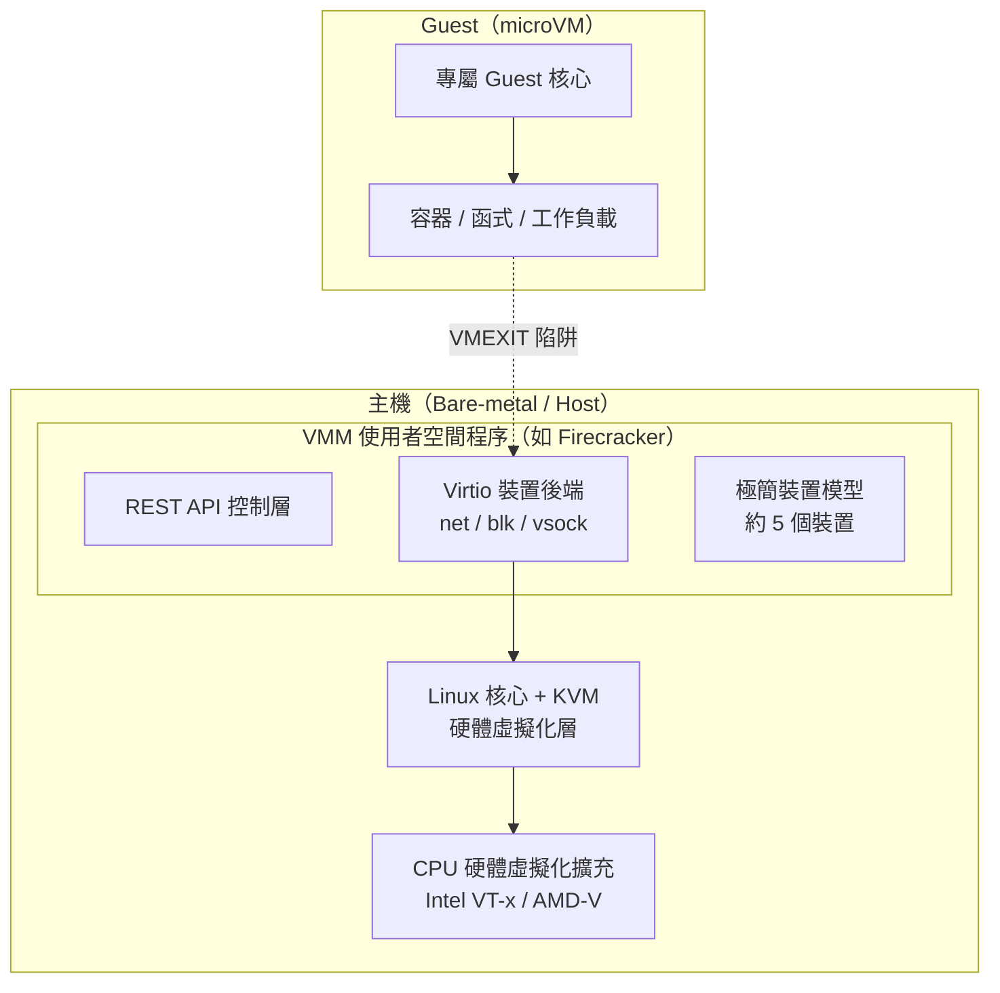
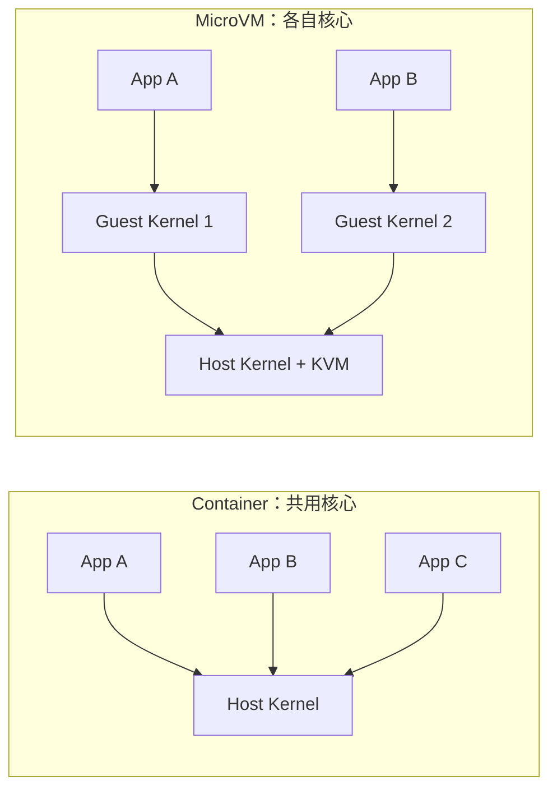

# MicroVM 是什麼？與 Container / VM 有何不同？

## 摘要

MicroVM（微型虛擬機）是一種介於傳統虛擬機（VM）與容器（Container）之間的中間技術。它保留了硬體虛擬化帶來的隔離安全性，同時把啟動時間與記憶體開銷壓縮到接近容器的水準。三者的根本差異在於「核心（kernel）是否共用」：容器共用主機核心，VM 與 microVM 各自擁有獨立核心；而 microVM 與傳統 VM 的差異則在於裝置模型（device model）與開機流程被大幅精簡。本報告依序說明 microVM 的定義與原理、與容器及傳統 VM 的差異，並介紹三種主流實作（AWS Firecracker、Kata Containers、gVisor）。

---

## 1. 什麼是 MicroVM？

MicroVM 是一種專為執行單一工作負載（通常是一個容器、一個函式，或一段不可信任的程式碼）而設計的輕量級虛擬機。它結合了傳統虛擬機「硬體強制的隔離安全」與容器「快速、高效、輕量」的兩項優勢[^mmdef]。

每個 microVM 都會啟動一套專屬的 Linux 核心，以 KVM（Kernel-based Virtual Machine）為基礎執行，並且只暴露極少量的虛擬化裝置——足以執行工作負載即可，不多做任何事[^mmdef]。

「microVM」一詞因 AWS Firecracker 於 2018 年 11 月發表而廣為人知，但同樣的概念也已被 Kata Containers、Cloud Hypervisor 等專案採用[^mmdef]。

### 1.1 運作原理

MicroVM 的技術基礎由四大部分組成：

- **KVM（硬體虛擬化）**：microVM 建立於 Linux 核心的虛擬化基礎設施 KVM 之上。KVM 利用 CPU 的硬體虛擬化擴充（Intel VT-x / AMD-V）建立虛擬執行環境，讓 guest 程式碼直接在 CPU 的「非 root」模式下執行；當執行到特權指令時，會觸發 **VMEXIT**（VM 退出）陷阱，交回主機的 VMM（Virtual Machine Monitor，虛擬機監控器）處理[^kvmioctl]。
- **極簡裝置模型（Minimal Device Model）**：傳統 VM（如 QEMU）會模擬數十種仿古裝置（USB、GPU、ACPI、BIOS、IDE 控制器、PS/2 等），microVM 則精簡到只留必要項目。以 Firecracker 為例，它只模擬「五個裝置」：virtio-net（網路）、virtio-blk（區塊儲存）、virtio-vsock（主客通訊）、序列埠（serial console）、以及一個僅支援 Ctrl+Alt+Del 重開機的鍵盤控制器[^fivedev]。
- **Virtio 傳輸層**：Virtio 是一套半虛擬化（paravirtualized）裝置 I/O 的開放標準。guest 知道自己身處虛擬環境，使用專門的前端驅動程式，透過「virtqueue」（主客記憶體共用的環狀緩衝區）通訊，可達到高效率、免複製（zero-copy）的 I/O，避免頻繁的 VMEXIT[^virtio]。
- **直接核心開機（Direct Kernel Boot）**：microVM 不使用 BIOS/UEFI，也不使用開機載入程式（GRUB 等），而是採用 Linux 64-bit Boot Protocol，直接把未壓縮的 `bzImage` 載入記憶體並跳至進入點；預設也不使用 initramfs，而是以一個極小的空 stub 取代[^bootproc]。這些省略可省下數十毫秒的開機時間。

### 1.2 關鍵指標

| 指標 | Firecracker microVM 的典型數值 |
|---|---|
| 冷開機至使用者空間 | 約 **125 毫秒**（在 i3.metal 執行個體、預設 microVM 大小下）[^boottime] |
| 每秒可建立數 | 每個主機最多 **約 150 個** microVM[^boottime] |
| 每個 microVM 記憶體開銷 | **< 5 MiB**（不含 guest 核心與 guest 記憶體）[^mem] |
| 單一主機可承載密度 | 數千個 microVM[^mem] |
| VMM 程式碼規模 | 約 5 萬行 Rust（相較 QEMU 約 200 萬行 C）[^codesize] |

---

## 2. Container（容器）

容器依賴兩項 Linux 核心功能來建立隔離環境，但**共用主機的作業系統核心**[^rhcontainer]：

- **Namespaces（命名空間）**：切割核心資源，讓每個容器擁有自己的行程、網路、掛載點、PID、使用者 ID 等視圖。從容器角度來看，它身處一個獨立的世界[^rhcontainer]。
- **Cgroups（控制群組）**：限制、計算與隔離一組行程的資源用量（CPU、記憶體、磁碟 I/O、網路）。

| 面向 | 說明 |
|---|---|
| 隔離機制 | 行程層級；共用主機核心 |
| 啟動時間 | 近乎即時（毫秒級），因為容器只是設定好 namespace / cgroup 的行程，沒有開機流程 |
| 記憶體開銷 | 極小，僅應用程式與相依套件（MB 等級） |
| 密度 | 極高，單主機可達數千個 |
| 安全邊界 | 較薄弱，依賴 seccomp、SELinux/AppArmor 等；共用核心是很大的攻擊面 |

Red Hat 指出，容器以「MB」為單位衡量，而 VM 以「GB」為單位衡量[^rhcontainer]。由於共用核心，一旦核心出現漏洞，攻擊者可能藉此逃逸並取得主機存取權[^escape]。

---

## 3. 傳統 VM（虛擬機）

VM 使用 **Hypervisor**（第一型如 KVM/Xen，第二型如 VirtualBox）來虛擬化硬體。每個 VM 執行一套**完整的 guest OS**，擁有自己的核心，與主機完全隔離[^rhvms]。

| 面向 | 說明 |
|---|---|
| 隔離機制 | 由硬體強制，透過 hypervisor；每個 VM 有獨立核心 |
| 啟動時間 | 慢（數十秒到數分鐘），需要開機一整套 OS |
| 記憶體開銷 | 高（每個 VM 通常以 GB 計） |
| 密度 | 低至中等，每個實體主機約數十個 |
| 安全邊界 | 強，獨立核心、獨立記憶體分頁、硬體虛擬化屏障 |

---

## 4. 三者並排比較

| 特性 | Container | 傳統 VM | MicroVM |
|---|---|---|---|
| 核心 | 共用主機核心 | 獨立 guest 核心 | 獨立 guest 核心 |
| 隔離機制 | Namespaces + cgroups | Hypervisor（KVM/Xen） | KVM + 極簡裝置模型 |
| 隔離強度 | 較弱（行程層級） | 強（硬體層級） | 強（硬體層級） |
| 啟動時間 | 毫秒級 | 數十秒至分鐘 | < 125 毫秒 |
| 記憶體開銷 | MB 等級 | GB 等級 | 約 5 MiB（+ guest 核心） |
| 密度 | 每主機數千 | 每主機數十 | 每主機數千 |
| 是否需要 guest OS | 否 | 是（完整 OS） | 是（精簡核心） |
| Guest 相容性 | 僅 Linux（同核心） | 任意 OS | 主要為 Linux |
| 安全態勢 | 依賴核心強化 | 強硬體屏障 | 強硬體屏障 + 行程監獄（jail） |

核心結論一句話：**容器共用核心，microVM 與 VM 各自擁有核心**[^kernelshare]。這代表容器逃逸可能危及整台主機（及其上所有容器），而 microVM 逃逸則需要先突破 guest 核心、再突破 KVM 硬體邊界，門檻高得多[^escape]。

### 4.1 MicroVM 與傳統 VM 的差異

| 面向 | 傳統 VM（QEMU/KVM） | MicroVM（Firecracker） |
|---|---|---|
| 裝置模型 | 完整：USB、GPU、ACPI、SATA、IDE、音效等 | 極簡：五個裝置 |
| BIOS/UEFI | 有（SeaBIOS、OVMF 等） | 無，直接 64-bit 開機協定 |
| 開機載入程式 | 有（GRUB、systemd-boot） | 無 |
| Guest OS 支援 | Windows、Linux、BSD 等 | 僅特定組態的 Linux |
| 硬體直通 | GPU（VFIO）、PCIe、USB | 無 |
| 程式碼規模 | 約 200 萬行 C | 約 5 萬行 Rust |
| 記憶體開銷 | 每 VMM 約 100–500+ MB | 每 microVM 約 < 5 MiB |
| 開機時間 | 數秒至數分鐘 | 100–200 毫秒 |

### 4.2 MicroVM 與容器的差異

| 面向 | 標準容器（runc） | MicroVM |
|---|---|---|
| 核心 | 共用主機核心 | 每個 microVM 有專屬核心 |
| 隔離 | Namespaces + cgroups | KVM 硬體虛擬化 + 獨立核心 |
| 逃逸風險 | 核心漏洞可能逃逸取得主機權限 | 需同時突破 guest 核心與 KVM |
| 開機時間 | 毫秒級（行程 fork） | 100–200 毫秒（核心開機） |
| 記憶體開銷 | 近乎為零 | 約 5 MiB + guest 核心 |
| 映像格式 | OCI 容器映像（分層） | 核心二進位檔 + rootfs 映像 |
| 網路 | 共用主機核心網路堆疊 | guest 內獨立的 virtio-net 堆疊 |
| 適用場景 | 一般應用部署 | 無伺服器函式、程式碼沙箱、多租戶不可信任工作負載 |

---

## 5. MicroVM 的兩種典型實作

### 5.1 AWS Firecracker

Firecracker 是 Amazon Web Services 打造的開源 VMM（虛擬機監控器），以 Apache 2.0 授權，在 GitHub 上擁有 **約 3.8 萬顆星**[^fcstar]。它於 **2018 年 11 月 26/27 日**由 AWS 的 Jeff Barr 在官方部落格發表，並於同期開源[^fcblog]。

- **起源**：AWS Lambda 於 2014 年推出時，隔離方式是為每位客戶配置專屬 EC2 執行個體——安全但效率低落。當 Lambda 成長到「數兆次執行」時，AWS 發現容器隔離不足、傳統 VM 又太慢，於是自問：「如果為今日的容器與函式世界設計一台虛擬機，它會長什麼樣子？」[^fcwhy]
- **技術淵源**：Firecracker 以 Google 的 **crosvm**（Chrome OS 虛擬機監控器，以 Rust 撰寫）為起點，AWS 開發者自 2017 年秋季開始以 Rust 改寫，看重的是 Rust 的執行緒安全與記憶體安全保證，可避免緩衝區溢位等記憶體錯誤[^fcwhy]。
- **使用場景**：Firecracker 是 **AWS Lambda** 的底層沙箱技術，也支撐 **AWS Fargate**（任務改在 microVM 上執行，可更快配置、在裸機執行個體上達到更高密度）[^fcblog]。其他採用者包括 Fly.io（所有客戶應用都跑在 Firecracker microVM 上）、Kata Containers、E2B 等[^fcusers]。

Firecracker 也展示了多層縱深防禦（defense-in-depth）安全模型，包含：以 **jailer** 程式將 VMM 放入 cgroup、namespace 與 chroot 並降權；以及在 VMM 上安裝 **seccomp-BPF** 白名單過濾器（預設拒絕，僅允許 KVM ioctl、I/O、mmap、epoll 等極少數系統呼叫）[^jailer]。

### 5.2 Kata Containers

Kata Containers 是一套開源容器執行環境，讓每個容器（或每個 Kubernetes Pod）跑在專屬的輕量 VM 內，並宣稱提供「容器的速度、VM 的安全」[^kataweb]。GitHub 主儲存庫有 **約 9.1 千顆星**，Apache 2.0 授權[^katastar]。

- **架構三層**：主機端的 **shim**（`containerd-shim-kata-v2`，接收 OCI 指令並透過 VSOCK 與 VM 溝通）、**hypervisor/VMM**（可選 QEMU、Cloud-Hypervisor、Firecracker，或 Kata 3.0 起的內建 Dragonball）、以及 guest 端的 **agent**（`kata-agent`，以 Rust 撰寫，作為 VM 內 PID 1 管理工作負載）[^kataarch]。
- **歷史**：由 Intel 的 **Clear Containers**（2015）與 Hyper.sh 的 **runV** 於 **2017 年 12 月**合併而成，託管於 OpenStack Foundation（今 Open Infrastructure Foundation）之下[^katahist]。Kata 2.0（2021）改以 Rust 重寫並採用 shim v2 架構[^katahist]。
- **驗證隔離**：AWS 部落格示範，Kata 容器內看到的核心版本與主機不同（guest `6.1.38` 對比主機 `5.15.0-1051-aws`），證實為真正的核心層級隔離——因為每個容器本質上是以不同的 guest OS 開機[^kataaws]。

### 5.3 補充：gVisor（另一種沙箱途徑）

gVisor 由 Google 於 2018 年開源，採用**第三種**截然不同的隔離途徑，既不屬於傳統容器也不算 VM[^gvisor]：

- 它攔截應用程式的**系統呼叫**，交由一個以 Go 撰寫的**使用者空間核心**（稱為 **Sentry**）處理，並**不會**把系統呼叫直接轉給主機核心[^gvisor]。
- 由 **Gofer** 行程透過 9P 協定代理所有檔案系統存取，提供額外的隔離層；Sentry 本身再以 seccomp 限制[^gvisor]。
- 與 VM/microVM 不同，gVisor **不虛擬化硬體**、不執行 guest OS、沒有需要開機的核心；啟動快（約 100 毫秒）但對系統呼叫密集的工作負載（如 Redis）會有明顯效能開銷[^gvisorperf]。

---

## 6. 綜合對照

| | Container | VM | MicroVM | gVisor |
|---|---|---|---|---|
| 隔離途徑 | 核心 namespaces | 硬體 hypervisor | 硬體 hypervisor | 使用者空間核心 |
| 安全性 | 最低 | 高 | 高 | 很高（縱深防禦） |
| 啟動時間 | 毫秒級 | 數十秒以上 | < 125 毫秒 | 約 100 毫秒 |
| 開銷 | MB 等級 | GB 等級 | 約 5 MiB | 小固定 + 變動 |
| 密度 | 最高 | 低 | 高 | 高 |
| Guest 相容性 | 完整 Linux | 任意 OS | Linux | 多數 Linux（有缺口） |

**典型使用情境**：

- **Container**：開發、CI/CD、可信任環境中的微服務。
- **VM**：需要完整 OS 隔離、Windows/Linux 並存、或舊有應用程式的工作負載。
- **MicroVM**：無伺服器（如 AWS Lambda）、多租戶容器平台、不可信任程式碼執行。
- **gVisor**：在 Kubernetes 中沙箱化不可信任容器、安全的多租戶 PaaS。

---

## 7. 結語

MicroVM 並非用來取代容器或傳統 VM，而是一項專門工具，鎖定「同時需要強隔離與快速啟動」的場景——例如無伺服器運算、短生命週期的程式碼沙箱，以及多租戶的不可信任工作負載。它用實作上的取捨換取定位上的優勢：相較容器，它換來硬體強制的隔離，代價是約 100–200 毫秒的開機時間與每實例約 15 MB 以上的記憶體；相較傳統 VM，它換來極快的開機與極低的開銷，代價是裝置支援受限、僅支援 Linux guest、且無 GPU 直通能力。

---

## 註腳與參考文獻

[^mmdef]: MicroVM 是輕量級虛擬機，結合硬體隔離與容器速度；以 KVM 執行、啟動獨立核心、僅暴露少量裝置。來源：Firecracker。 (n.d.). *Firecracker microVM*. Retrieved 2026-07-11, from https://firecracker-microvm.github.io/

[^kvmioctl]: Firecracker 使用 System、VM、vCPU 三類 KVM ioctl 與 `KVM_RUN`；特權指令觸發 VMEXIT 交回 VMM。來源：Jain, M. (2020). *Study of Firecracker MicroVM*. arXiv. Retrieved 2026-07-11, from https://arxiv.org/html/2005.12821v1

[^fivedev]: Firecracker 僅模擬五個裝置：virtio-net、virtio-blk、virtio-vsock、序列埠、以及僅供重開機的鍵盤控制器。來源：Firecracker。 (n.d.). *Firecracker microVM*. Retrieved 2026-07-11, from https://firecracker-microvm.github.io/

[^virtio]: Virtio 為半虛擬化裝置 I/O 標準，透過 virtqueue 環狀緩衝區在主客記憶體間通訊，達到免複製 I/O。來源：Jain, M. (2020). *Study of Firecracker MicroVM*. arXiv. Retrieved 2026-07-11, from https://arxiv.org/html/2005.12821v1

[^bootproc]: Firecracker 使用 Linux 64-bit Boot Protocol 直接開機，無 BIOS/開機載入程式，預設以空 stub 取代 initramfs。來源：Jain, M. (2020). *Study of Firecracker MicroVM*. arXiv. Retrieved 2026-07-11, from https://arxiv.org/html/2005.12821v1

[^boottime]: Firecracker 冷開機可低至約 125 毫秒，每秒可建立最多約 150 個 microVM。來源：Amazon Web Services. (2018, November 26). *Firecracker – Lightweight virtualization for serverless computing*. Retrieved 2026-07-11, from https://aws.amazon.com/blogs/aws/firecracker-lightweight-virtualization-for-serverless-computing/

[^mem]: Firecracker 每個 microVM 記憶體開銷約 5 MiB，單一執行個體可執行數千個 microVM。來源：Amazon Web Services. (2018, November 26). *Firecracker – Lightweight virtualization for serverless computing*. Retrieved 2026-07-11, from https://aws.amazon.com/blogs/aws/firecracker-lightweight-virtualization-for-serverless-computing/

[^codesize]: Firecracker 約 5 萬行 Rust，對比 QEMU 約 200 萬行 C。來源：Firecracker。 (n.d.). *Firecracker microVM*. Retrieved 2026-07-11, from https://firecracker-microvm.github.io/

[^rhcontainer]: 容器共用主機核心，以 namespaces 隔離資源視圖、以 cgroups 限制資源用量；以 MB 為單位衡量。來源：Red Hat. (2026, February 10). *What is a Linux container?* Retrieved 2026-07-11, from https://www.redhat.com/en/topics/containers/whats-a-linux-container

[^escape]: 容器共用核心，核心漏洞可能導致逃逸並取得主機存取權；microVM 逃逸需突破 guest 核心與 KVM 兩層。來源：Red Hat. (2026, June 24). *Containers vs. VMs: Why not both?* Retrieved 2026-07-11, from https://www.redhat.com/en/topics/containers/containers-vs-vms

[^rhvms]: VM 透過 hypervisor 虛擬化硬體，每個 VM 執行完整 guest OS 並擁有獨立核心。來源：Red Hat. (2026, June 24). *Containers vs. VMs: Why not both?* Retrieved 2026-07-11, from https://www.redhat.com/en/topics/containers/containers-vs-vms

[^kernelshare]: 容器共用核心；microVM 與 VM 各自擁有核心，是本質差異。來源：Red Hat. (2026, June 24). *Containers vs. VMs: Why not both?* Retrieved 2026-07-11, from https://www.redhat.com/en/topics/containers/containers-vs-vms

[^fcstar]: Firecracker GitHub 儲存庫約 3.8 萬顆星，Apache 2.0 授權。來源：Firecracker. (n.d.). *firecracker-microvm/firecracker*. GitHub. Retrieved 2026-07-11, from https://github.com/firecracker-microvm/firecracker

[^fcblog]: Firecracker 於 2018 年 11 月由 Jeff Barr 發表並開源；支撐 AWS Lambda 與 Fargate（Fargate 任務改於 microVM 執行）。來源：Amazon Web Services. (2018, November 26). *Firecracker – Lightweight virtualization for serverless computing*. Retrieved 2026-07-11, from https://aws.amazon.com/blogs/aws/firecracker-lightweight-virtualization-for-serverless-computing/

[^fcwhy]: Firecracker 源於 Lambda 早期以專屬 EC2 隔離的效率問題；以 Google crosvm 為起點、自 2017 年秋以 Rust 改寫。來源：Amazon Web Services. (2018, November 28). *Firecracker – open source secure, fast microVM for serverless*. Retrieved 2026-07-11, from https://aws.amazon.com/blogs/opensource/firecracker-open-source-secure-fast-microvm-serverless/

[^fcusers]: Fly.io 將所有客戶應用執行於 Firecracker microVM；其他採用者包含 E2B、Koyeb 等。來源：Fly.io. (n.d.). *Firecracker VM*. Retrieved 2026-07-11, from https://fly.io/learn/firecracker-vm/

[^jailer]: Firecracker 以 jailer 程式進行 cgroup/namespace/chroot 隔離並降權，並在 VMM 上安裝 seccomp-BPF 白名單（預設拒絕）。來源：PandaStack. (n.d.). *Firecracker VMM security model*. Retrieved 2026-07-11, from https://www.pandastack.ai/blog/firecracker-vmm-security-model/

[^kataweb]: Kata Containers 讓每個容器或 Pod 跑在專屬輕量 VM 中，提供「容器的速度、VM 的安全」。來源：Kata Containers. (n.d.). *Kata Containers*. Retrieved 2026-07-11, from https://katacontainers.io/

[^katastar]: kata-containers/kata-containers 主儲存庫約 9.1 千顆星，Apache 2.0 授權。來源：Kata Containers. (n.d.). *kata-containers/kata-containers*. GitHub. Retrieved 2026-07-11, from https://github.com/kata-containers/kata-containers

[^kataarch]: Kata 架構含主機端 shim（containerd-shim-kata-v2）、hypervisor/VMM（QEMU、Cloud-Hypervisor、Firecracker、Dragonball）與 guest 端以 Rust 撰寫的 kata-agent（PID 1）。來源：Kata Containers. (n.d.). *Architecture*. GitHub. Retrieved 2026-07-11, from https://github.com/kata-containers/kata-containers/blob/main/docs/design/architecture/README.md

[^katahist]: Kata Containers 由 Intel Clear Containers 與 Hyper.sh runV 於 2017 年 12 月合併，託管於 OpenStack Foundation（今 Open Infrastructure Foundation）；Kata 2.0（2021）改以 Rust 重寫。來源：Kata Containers. (n.d.). *Architecture history*. GitHub. Retrieved 2026-07-11, from https://github.com/kata-containers/kata-containers/blob/main/docs/design/architecture/history.md

[^kataaws]: AWS 示範 Kata 容器內核心版本（6.1.38）與主機（5.15.0-1051-aws）不同，證實核心層級隔離。來源：Amazon Web Services. (2024, May). *Enhancing Kubernetes workload isolation and security using Kata Containers*. Retrieved 2026-07-11, from https://aws.amazon.com/blogs/containers/enhancing-kubernetes-workload-isolation-and-security-using-kata-containers/

[^gvisor]: gVisor 以使用者空間核心 Sentry 攔截並重新實作系統呼叫，另以 Gofer 透過 9P 代理檔案存取，Sentry 再以 seccomp 限制。來源：gVisor. (n.d.). *What is gVisor?* Retrieved 2026-07-11, from https://gvisor.dev/docs/

[^gvisorperf]: gVisor 不虛擬化硬體、無 guest OS；對系統呼叫密集工作負載有明顯效能開銷，CPU 密集工作負載接近原生。來源：gVisor. (n.d.). *Performance guide*. Retrieved 2026-07-11, from https://gvisor.dev/docs/architecture_guide/performance/
