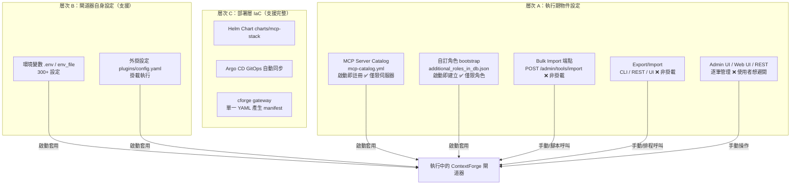

# IBM ContextForge (mcp-context-forge) 是否支援 IaC？以「掛載設定檔到容器即套用」取代 GUI／REST API 的可行性調查

## 摘要

**部分支援，但不是通用型的基礎設施即程式碼（Infrastructure as Code, IaC）。**

IBM 的 ContextForge（GitHub 專案名 `IBM/mcp-context-forge`）本質上是一個 AI 閘道器與代理，用來聯邦化（federate）大量的 MCP（Model Context Protocol）伺服器、A2A 代理與 REST／gRPC API[^readme]。它**確實提供多種「把設定檔掛載到容器、啟動時自動套用」的宣告式機制**，但這些機制**只覆蓋部分物件類型**，且**沒有任何一種機制能像 Terraform 或 Ansible 那樣，用單一宣告式設定檔管理所有閘道器物件（工具、伺服器、提示、資源、代理）**。因此，使用者的期待（把設定寫進掛載檔、取代在 GUI 逐筆新增或呼叫 RESTful API）**只能被部分滿足**。

最接近使用者期待的機制是 **MCP Server Catalog**（`mcp-catalog.yml`）：它明確被官方文件描述為「宣告式（declarative）」設定，且會在啟動時自動註冊伺服器[^catalog]。此外還有外掛設定、自訂角色 bootstrap、以及環境變數（`.env`）三種掛載／宣告式路徑。

其餘物件（例如以 REST 方式建立的在地工具、提示、資源）目前仍主要依賴 **Admin UI、REST Admin API、Bulk Import 端點、或 Export/Import CLI／API**，這些都**不是**「掛載檔案、啟動即套用」的模式[^bulkimport][^exportimport]。

截至 2026-11-08 查詢，該專案約有 **4,770 顆星**、962 個 fork[^ghapi]。

---

## 背景：這個專案是什麼

ContextForge 自我描述為「一個開源註冊中心與代理，用來聯邦化 MCP、A2A 與 REST/gRPC API，並提供集中治理、探索與可觀測性」[^readme]。它可透過 PyPI 或 Docker 部署，並能以 Redis 為後端在多叢集 Kubernetes 環境中擴展[^readme]。

專案亦可交付一個獨立容器化的 Web UI（ContextForge Web UI）與內建的 Admin UI，兩者都是「即時管理」導向的圖形介面[^readme]。也就是說，本專案的**第一公民管理方式確實是 GUI 與 REST API**；宣告式檔案設定屬於**輔助、選擇性（opt-in）**的能力。

---

## 「IaC」在此的定義界線

為避免語意混淆，本報告把使用者的問題拆成三個層次：

| 層次 | 內容 | 使用者真正關心的 |
|------|------|------------------|
| A. 執行期物件設定 | 工具、MCP 伺服器、虛擬伺服器、提示、資源、代理、角色 | 是否可用「掛載設定檔」宣告式套用 |
| B. 閘道器自身設定 | `.env`、外掛設定、快取、驗證、SSRF 等 | 是否可用「掛載設定檔」宣告式套用 |
| C. 部署層 IaC | 產生 Docker Compose／Kubernetes manifest、GitOps 同步 | 是否有 Terraform／Helm／Argo CD 等工具 |

使用者的原文「write with config mount to container to apply」主要落在 **A 與 B**。本報告逐層檢視。

---

## 一、支援「掛載設定檔、啟動即套用」的機制

### 1. MCP Server Catalog（`mcp-catalog.yml`）— 最核心的宣告式機制

官方文件明確將其定位為「定義與管理 MCP 伺服器的**宣告式**方式」，並列出「宣告式設定（Declarative Configuration）」與「啟動時自動註冊（Automatic Discovery：Servers are automatically registered on startup）」為其關鍵特性[^catalog]。

運作方式[^catalog]：

- 以 YAML 定義伺服器清單，路徑由環境變數 `MCPGATEWAY_CATALOG_FILE` 指定（預設 `mcp-catalog.yml`）。
- 以 `MCPGATEWAY_CATALOG_ENABLED=true` 啟用。
- 啟動時讀取目錄檔、註冊所有伺服器、並可自動健康檢查（`MCPGATEWAY_CATALOG_AUTO_HEALTH_CHECK`）。
- 也可在不停機情況下以 `mcpgateway catalog reload` 或 `POST /admin/catalog/reload` 重新載入。

在官方 `docker-compose.yml` 中，這個檔案**正是以唯讀方式掛載進容器**的[^compose]：

```yaml
volumes:
  - ./mcp-catalog.yml:/app/mcp-catalog.yml:ro   # mount catalog configuration
environment:
  - MCPGATEWAY_CATALOG_ENABLED=true
  - MCPGATEWAY_CATALOG_FILE=/app/mcp-catalog.yml
```

這完全符合使用者描述的「config mount to container to apply」模式，且**不需要**在 GUI 逐筆新增或在程式碼中發 REST 呼叫。**不過它的物件範圍限於「MCP 伺服器（亦即 federated gateway）」**，並非萬用。

目錄檔的欄位（`catalog_servers[]`）包含 `id`、`name`、`category`、`url`、`auth_type`、`provider`、`description` 為必填，`transport`、`tags`、`logo_url`、`documentation_url` 等為選填[^catalog]。

### 2. 外掛設定（`plugins/config.yaml`）— 宣告式掛載

ContextForge 支援一個外掛框架。外掛的啟用與設定透過 `PLUGINS_ENABLED` 與 `PLUGINS_CONFIG_FILE`（官方 compose 預設 `plugins/config.yaml`）控制[^compose]。`docker-compose.yml` 亦可把整個外掛目錄以唯讀方式掛載覆蓋（`${PLUGINS_DIR:-./plugins}:/app/plugins:ro`）[^compose]。這同樣是「掛載檔案即套用」的模式。

### 3. 自訂角色 bootstrap（`additional_roles_in_db.json`）— 啟動時載入

RBAC 章節記載了一個「Bootstrap 自訂角色」機制：管理者可在 JSON 檔中定義自訂角色，於資料庫 bootstrap 時自動建立[^rbac]。其運作符合使用者期待[^adr036][^rbac][^configpy][^bootstrapdb]：

- `MCPGATEWAY_BOOTSTRAP_ROLES_IN_DB_ENABLED`（預設 `false`）啟用。
- `MCPGATEWAY_BOOTSTRAP_ROLES_IN_DB_FILE`（預設 `additional_roles_in_db.json`）指定檔案。
- 官方 Docker Compose 範例即示範把 `./custom_roles.json` 唯讀掛載到容器，並以環境變數指向它[^rbac]。
- 設計上為冪等（idempotent）：已存在的角色會被跳過，可安全重跑[^adr036]。

程式碼層面，`mcpgateway/bootstrap_db.py` 會在 `settings.mcpgateway_bootstrap_roles_in_db_enabled` 為真時，讀取該 JSON 檔並驗證結構（必須是含 `name`、`scope`、`permissions` 的物件陣列），無效項目會被略過並記錄警告[^bootstrapdb]。`mcpgateway/config.py` 亦定義了這兩個設定項[^configpy]。

### 4. 環境變數（`.env`／`env_file`）— 閘道器自身設定

閘道器自身（層次 B）幾乎完全由環境變數驅動：官方 `.env.example` 內容超過十萬字元，涵蓋 300 多個環境變數[^readme][^envexample]。在 Docker 中，這些變數可用 `--env-file .env` 或 Compose 的 `env_file` 掛載套用，屬於標準的宣告式設定[^readme]。

值得注意的一個「宣告式即唯一真相來源」設計：`PASSTHROUGH_HEADERS_SOURCE` 可設為 `env`，讓環境變數**永遠覆蓋**資料庫設定，文件明確指出這「適合 Kubernetes／容器化部署」[^envexample]。另外 SSO 的 `SSO_AUTO_DISABLE_UNCONFIGURED_PROVIDERS` 在開啟時，會把「資料庫有、但環境變數沒宣告」的供應商自動停用，以「強制環境設定為唯一真相來源」[^envexample]。

---

## 二、**不支援**「掛載設定檔即套用」的路徑（仍以 GUI／REST／CLI 為主）

使用者想避免的「在 GUI 加 RESTful API」，在本專案中有兩個主要的替代路徑，但**兩者都不是檔案掛載式的宣告**：

### 1. Bulk Import（`POST /admin/tools/import`）

可一次匯入多個工具，支援 JSON payload、表單、或**檔案上傳**[^bulkimport]。但它是一個**呼叫端主動發起的 REST 端點**，資料在請求中傳遞，並非容器啟動時自動讀取的掛載檔。其環境變數為 `MCPGATEWAY_BULK_IMPORT_ENABLED`、`..._MAX_TOOLS`（預設 200）、`..._RATE_LIMIT`[^bulkimport]。

### 2. Export/Import（`/export`、`/import`、`mcpgateway import` CLI）

提供完整組態的匯出與匯入，涵蓋工具、gateway、虛擬伺服器、提示、資源、roots[^exportimport]。有 CLI（`mcpgateway import backup.json`）、REST（`POST /import`）與 Admin UI 三種方式，並支援衝突策略（`skip`/`update`/`rename`/`fail`）、`--dry-run`、跨環境金鑰輪替 `--rekey-secret`[^exportimport]。

官方「最佳實務」甚至建議「將匯出檔存進 Git 做版控」、「用 cron 或 CI/CD 排程匯出」[^exportimport]。**這是最接近 GitOps 的一條路，但它是「由外部排程呼叫 API／CLI」，而不是「掛載檔案、由容器啟動時套用」**。它也沒有提供「開機時自動讀取某個 import 檔」的內建旗標。

---

## 三、部署層 IaC（層次 C）— 這部分支援較完整

雖然執行期物件（層次 A）的宣告式支援有限，但**部署層**的 IaC 相當完整：

- **Helm Chart**：`charts/mcp-stack` 提供 Kubernetes 部署，支援自動擴縮、PostgreSQL/SQLite 選擇、Prometheus、RBAC 等[^readme]。
- **Argo CD（GitOps）**：官方有專門的 Argo CD 部署指南，示範建立追蹤 `charts/mcp-stack` 的 Application，並啟用自動同步（`--sync-policy automated`），讓「每次 commit 都變成自動部署或回滾」[^argocd]。
- **`cforge gateway` 部署工具**：一個「統一的宣告式方式，從單一 YAML 設定檔建置、設定、部署整個 MCP stack」，並可產生實際的 Docker Compose 或 Kubernetes manifest[^cforge]。
- 雲平台指南涵蓋 AWS（ECS/EKS）、Azure（AKS）、Google Cloud Run、IBM Code Engine、OpenShift 等[^readme]。

換句話說，**「把整個 stack 用宣告式檔案部署到叢集」是支援的**；**「把執行期物件用宣告式檔案餵給已啟動的閘道器」則只支援前述少數機制**。

---

## 四、整體關係圖



---

## 五、結論：對使用者需求的直接回答

**問：ContextForge 支援 IaC 嗎？也就是，能不能用「把設定檔掛載到容器即套用」取代在 GUI 加 RESTful API？**

**答：部分支援。**

- ✅ **可以**：以 `mcp-catalog.yml` 宣告式定義 MCP 伺服器，唯讀掛載進容器，啟動時自動註冊。這是本專案最貼近使用者期待的機制[^catalog][^compose]。
- ✅ **可以**：以外掛設定檔（`plugins/config.yaml`）、自訂角色 JSON（`additional_roles_in_db.json`）、以及環境變數 `.env` 掛載套用[^compose][^rbac][^envexample]。
- ⚠️ **不完整**：**沒有單一「全物件」宣告式設定檔**。工具、虛擬伺服器、提示、資源等並無通用的「掛載檔案、啟動即套用」機制；這些仍須走 Bulk Import、Export/Import 或 REST/GUI[^bulkimport][^exportimport]。
- ❌ **沒有**：官方未提供 Terraform provider 或 Ansible module 來管理閘道器物件（程式碼搜尋未發現 Terraform/Ansible 相關實作；`.helmignore` 中僅把 `*.tfstate`、`ansible.cfg` 等列為忽略樣式）[^helmignore]。部署層則以 Helm 與 Argo CD 為主要 IaC 途徑[^readme][^argocd]。

**實務建議**：

1. 若主要需求是「以程式化管理要聯邦的 MCP 伺服器清單」，**MCP Server Catalog 已能滿足**：寫 `mcp-catalog.yml`、掛載進容器、設好兩個環境變數即可。
2. 若需求是「把工具／提示／資源也一併宣告式管理」，目前**最接近的替代方案**是把 Export/Import 包進 CI/CD（例如在部署管線中於閘道器就緒後呼叫 `POST /import`），或使用 `cforge gateway` 這類部署工具；但這屬於「外部自動化」，而非「容器啟動即讀掛載檔」的原生能力[^exportimport][^cforge]。
3. 若需求是「整個 stack 的部署 IaC」，Helm + Argo CD 已是成熟的官方支援路徑[^argocd][^readme]。

---

## 六、來源評析（Critical Source Reflection）

- **官方性與權威性**：主要來源為專案 README、官方文件站 `ibm.github.io/mcp-context-forge`、官方 `docker-compose.yml`、`.env.example` 與原始碼（`config.py`、`bootstrap_db.py`）。這些屬第一手資料，權威性高。
- **時效性**：專案活躍（最後推送時間為 2026-11-08，查詢於 2026-11-07 至 2026-11-08）[^ghapi]。惟專案迭代快速（多處標註「Introduced in v0.7.0／v0.9.0」、含多筆「DEPRECATED」與日落日期），本報告所述機制可能隨版本變動，實際採用前應以對應版本文件為準。
- **可能的偏誤**：文件由專案維護者撰寫，傾向呈現功能完整性，未必突顯「宣告式只覆蓋部分物件」此一限制。本報告透過交叉比對物件類型（目錄、角色、工具匯入）以推導此結論。
- **未發現的證據**：未找到官方 Terraform provider 或 Ansible collection 的一手證據；此為「未發現」而非「確定不存在」，若需 100% 確認應進一步查閱官方 roadmap 與 issue。

---

## 參考文獻

[^readme]: IBM. (n.d.). *ContextForge — README*. GitHub. Retrieved 2026-11-07, from https://github.com/IBM/mcp-context-forge/blob/main/README.md

[^catalog]: IBM. (n.d.). *MCP Server Catalog — ContextForge AI Gateway*. Retrieved 2026-11-07, from https://ibm.github.io/mcp-context-forge/manage/catalog/

[^bulkimport]: IBM. (n.d.). *Bulk Import Tools — ContextForge AI Gateway*. Retrieved 2026-11-07, from https://ibm.github.io/mcp-context-forge/manage/bulk-import/

[^exportimport]: IBM. (n.d.). *Configuration Export & Import — ContextForge AI Gateway*. Retrieved 2026-11-07, from https://ibm.github.io/mcp-context-forge/manage/export-import/

[^rbac]: IBM. (n.d.). *RBAC Configuration — ContextForge AI Gateway*. Retrieved 2026-11-07, from https://github.com/IBM/mcp-context-forge/blob/main/docs/docs/manage/rbac.md

[^adr036]: IBM. (n.d.). *36 Bootstrap Custom Roles*. Retrieved 2026-11-07, from https://github.com/IBM/mcp-context-forge/blob/main/docs/docs/architecture/adr/036-bootstrap-custom-roles.md

[^argocd]: IBM. (2026, February 24). *Deploying ContextForge Stack with Argo CD*. Retrieved 2026-11-07, from https://ibm.github.io/mcp-context-forge/deployment/argocd/

[^cforge]: IBM. (n.d.). *cforge gateway - Deployment Tool — ContextForge AI Gateway*. Retrieved 2026-11-07, from https://ibm.github.io/mcp-context-forge/deployment/cforge-gateway/

[^compose]: IBM. (n.d.). *docker-compose.yml*. GitHub. Retrieved 2026-11-07, from https://github.com/IBM/mcp-context-forge/blob/main/docker-compose.yml

[^envexample]: IBM. (n.d.). *.env.example*. GitHub. Retrieved 2026-11-07, from https://github.com/IBM/mcp-context-forge/blob/main/.env.example

[^configpy]: IBM. (n.d.). *mcpgateway/config.py*. GitHub. Retrieved 2026-11-07, from https://github.com/IBM/mcp-context-forge/blob/main/mcpgateway/config.py

[^bootstrapdb]: IBM. (n.d.). *mcpgateway/bootstrap_db.py*. GitHub. Retrieved 2026-11-07, from https://github.com/IBM/mcp-context-forge/blob/main/mcpgateway/bootstrap_db.py

[^helmignore]: IBM. (n.d.). *charts/mcp-stack/.helmignore*. GitHub. Retrieved 2026-11-07, from https://github.com/IBM/mcp-context-forge/blob/main/charts/mcp-stack/.helmignore

[^ghapi]: IBM. (2026). *mcp-context-forge — repository metadata* [Data set]. GitHub REST API. Retrieved 2026-11-08, from https://api.github.com/repos/IBM/mcp-context-forge
