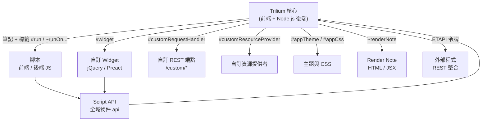

# TriliumNext/Trilium 是否有外掛／擴充機制？

## 摘要

Trilium Notes（GitHub 專案 `TriliumNext/Trilium`）**沒有傳統意義上的外掛（plugin）或擴充（extension）系統**，例如外掛市集、套件管理器或正式的 Plugin API。專案改以「腳本化」（scripting）作為擴充的核心：使用者以筆記（note）形式撰寫 JavaScript，搭配 Script API、自訂 Widget、事件觸發、自訂 REST 端點與主題（theme）來擴充功能。截至 2026 年 11 月，社群已多次提出正式外掛系統的需求，也有多個社群自製的外掛管理器原型，但官方的核心外掛管理器仍處於提案與討論階段，尚未釋出。

本報告說明該專案的基本背景、其現行的擴充機制清單、官方對「外掛系統」的立場與歷史，以及目前社群的替代方案。

---

## 1. 專案背景

`TriliumNext/Trilium` 是一套自由且開放原始碼、跨平台的階層式筆記軟體，主打建立大型個人知識庫[^repo]。其關鍵數據如下：

| 項目 | 數值 |
| --- | --- |
| 星號數（stars） | 38,735 |
| Fork 數 | 2,624 |
| 主要語言 | TypeScript |
| 授權 | AGPL-3.0 |
| 最新穩定版 | v0.106.1（2026-10-23 發佈） |
| 預設分支 | `main` |

[^repo]: GitHub. (2026). *TriliumNext/Trilium*. Retrieved 2026-11-08, from https://github.com/TriliumNext/Trilium

值得一提的是，本專案原是開發者 zadam 所建立的 `zadam/trilium`，後來 zadam 將專案交由社群專案 `TriliumNext` 接手維護，因此本文所稱「官方」指的是 TriliumNext 組織所維護的 `TriliumNext/Trilium`[^readme]。

[^readme]: TriliumNext. (2026). *Trilium Notes — README*. Retrieved 2026-11-08, from https://github.com/TriliumNext/Trilium/blob/main/README.md

---

## 2. 結論：沒有傳統外掛系統，但有完整的「腳本化」擴充體系

官方說明文件將擴充能力統稱為 Scripting（腳本化），其架構基礎在於 Trilium 本身是典型的網頁應用：前端在瀏覽器執行 HTML／CSS／JavaScript，後端在 Node.js 執行 JavaScript；由於前後端都可執行 JavaScript，使用者便能在應用內建立可執行的 JavaScript 程式碼筆記，藉此擴充功能[^scripting]。

[^scripting]: TriliumNext. (2026). *Scripting*. Trilium Notes User Guide. Retrieved 2026-11-08, from https://docs.triliumnotes.org/user-guide/scripts/

官方並未在核心提供外掛市集或套件安裝流程。截至本次檢視，官方文件的網址結構（`/user-guide/advanced-usage/plugins`）不存在，亦無 Plugin 管理頁面的官方文件[^plugin404]。目前的「擴充」是透過筆記加上特定的標籤（label `#`）與關聯（relation `~`）來達成，並沒有一個集中的外掛生命週期（安裝、更新、停用、相依性）管理機制。

[^plugin404]: 檢視 `https://docs.triliumnotes.org/user-guide/advanced-usage/plugins` 於 2026-11-08 回傳 HTTP 404 Not Found，顯示官方並無對應的「外掛」文件頁面。

---

## 3. 現行的擴充機制清單

Trilium 目前提供以下幾種擴充途徑，全部以「帶有特定屬性的筆記」為基礎：

| 機制 | 觸發方式 | 用途 |
| --- | --- | --- |
| 前端腳本 | JS 程式碼筆記，`#run=frontendStartup` 或 `#run=mobileStartup` | 啟動時修改 UI、綁定快捷鍵等 |
| 後端腳本 | JS 程式碼筆記，`#run=backendStartup`、`#run=hourly`、`#run=daily` | 自動化、資料處理 |
| 實體事件 | 關聯 `~runOnNoteCreation`、`~runOnNoteChange`、`~runOnAttributeChange` 等 | 筆記／分支／屬性異動時觸發 |
| 自訂 Widget | `#widget` 標籤的 JS/JSX 筆記 | 在左側、中央、右側面板插入 UI |
| 自訂 REST 端點 | `#customRequestHandler` 標籤 | 對外開放 `/custom/*` 端點 |
| 自訂資源提供者 | `#customResourceProvider` 標籤 | 將檔案（字型、圖片）以 URL 公開 |
| 主題 | `#appTheme` 標籤的 CSS 筆記 | 更換外觀；`#appCss` 注入樣式 |
| Render Note | `~renderNote` 關聯、HTML/JSX 筆記 | 以獨立 HTML 頁面呈現複雜擴充 |
| 外部 API（ETAPI） | 令牌驗證的 REST API | 讓外部程式與 Trilium 互動 |

### 3.1 腳本與 Script API

程式碼筆記分為前端與後端兩種執行環境，兩者都可用全域變數 `api` 存取應用功能，例如 `api.showMessage("Hello world.")`[^scriptapi]。前端 API 提供 `createNote`、`searchForNotes`、`activateNote`、`openTabWithNote`、`runOnBackend` 等大量方法；後端 API 則負責筆記內容的新增、修改、加解密與匯入匯出[^frontendapi]。官方明確標註：Script API 目前仍是實驗性，未來版本可能變動[^scriptapi]。

[^scriptapi]: TriliumNext. (2026). *Script API*. Trilium Notes User Guide. Retrieved 2026-11-08, from https://docs.triliumnotes.org/user-guide/scripts/script-api/

[^frontendapi]: TriliumNext. (2026). *Frontend API*. Trilium Notes User Guide. Retrieved 2026-11-08, from https://docs.triliumnotes.org/user-guide/scripts/script-api/frontend-api.html

### 3.2 自訂 Widget

Widget 是前端腳本的一種特例，用於在應用的特定區域渲染 UI 元件。可放置於 `left-pane`、`center-pane`、`note-detail-pane`、`right-pane` 等位置。自 v0.101.0 起，Widget 支援以 Preact／JSX 撰寫（`import { defineWidget } from "trilium:preact"`），與舊版 jQuery 風格（`api.BasicWidget`）並存[^widget]。

[^widget]: TriliumNext. (2026). *Custom Widgets*. Trilium Notes User Guide. Retrieved 2026-11-08, from https://docs.triliumnotes.org/user-guide/scripts/frontend-basics/custom-widget/

### 3.3 事件

腳本可由事件觸發。全域事件以標籤定義，例如 `#run=backendStartup`、`#run=hourly`、`#run=daily`；實體事件則以關聯定義，例如 `~runOnNoteCreation`、`~runOnNoteChange`、`~runOnNoteDeletion`、`~runOnBranchCreation`、`~runOnAttributeChange` 等。被觸發的實體可透過 `api.originEntity` 取得[^backevents]。前端亦支援 `#run=frontendStartup`、`#run=mobileStartup`[^frontevents]。

[^backevents]: TriliumNext. (2026). *Backend Events*. Trilium Notes User Guide. Retrieved 2026-11-08, from https://docs.triliumnotes.org/user-guide/scripts/backend-basics/events.html

[^frontevents]: TriliumNext. (2026). *Frontend Events*. Trilium Notes User Guide. Retrieved 2026-11-08, from https://docs.triliumnotes.org/user-guide/scripts/frontend-basics/events.html

### 3.4 自訂 REST 端點與資源提供者

帶有 `#customRequestHandler` 標籤的後端腳本可開放公開的 REST 端點，路徑以 `/custom/` 為前綴，標籤值為比對路徑的正規表達式，腳本可用 `api.req` 與 `api.res`（Express.js 物件）處理請求；官方提醒這些端點預設完全未經認證，需自行處理驗證[^crh]。另一個機制 `#customResourceProvider` 則讓匯入的檔案（如字型、圖片）可透過 URL 公開存取，常見用途是搭配主題載入自訂字型[^crp]。

[^crh]: TriliumNext. (2026). *Custom Request Handler*. Trilium Notes User Guide. Retrieved 2026-11-08, from https://docs.triliumnotes.org/user-guide/advanced-usage/custom-request-handler

[^crp]: TriliumNext. (2026). *Custom Resource Providers*. Trilium Notes User Guide. Retrieved 2026-11-08, from https://docs.triliumnotes.org/user-guide/advanced-usage/custom-resource-providers

### 3.5 主題與外觀

使用者可建立 CSS 程式碼筆記並標上 `#appTheme=<名稱>` 來建立自訂主題；加上 `#appThemeBase=next` 可基於 TriliumNext 的現代主題（另有 `next-light`、`next-dark`）[^theme]。官方說明主題可匯出為 `.tar` 壓縮檔分享，但提醒匯入不受信任的來源可能有執行腳本的風險[^theme]。

[^theme]: TriliumNext. (2026). *Themes*. Trilium Notes User Guide. Retrieved 2026-11-08, from https://docs.triliumnotes.org/user-guide/concepts/themes

### 3.6 ETAPI（外部 REST API）

Trilium 自 v0.50 起提供公開的 REST API，稱為 ETAPI，須以令牌（token）驗證，可用於外部整合與自動化；官方提供 OpenAPI 格式的規格，並有第三方用戶端函式庫（如 Python 的 `trilium-py`）[^etapi]。

[^etapi]: TriliumNext. (2026). *ETAPI (REST API)*. Trilium Notes User Guide. Retrieved 2026-11-08, from https://docs.triliumnotes.org/user-guide/advanced-usage/etapi

### 3.7 擴充架構示意

下圖以 mermaid 呈現 Trilium 的擴充機制如何環繞核心應用運作。

---

## 4. 官方對「外掛系統」的立場與歷史

儘管腳本化能力強大，社群長年反映「缺少正式外掛系統」，官方也多次承認目前的腳本機制不等同於易用的外掛系統。

### 4.1 Issue #986：Community Code Library / Plugin System

最早且最具代表性的需求是 Issue #986（2020-04-26 開設，標題為「Community Code Library / Plugin System」），至今仍為 open 狀態，累積約 27 則留言[^issue986]。原維護者 zadam 在討論中指出，雖然可用 ZIP 分享的方式散佈腳本，但存在多項弱點：沒有集中的外掛庫、API 版本演進可能不相容、缺乏版本相容性中介資料、匯入後難以升級等。zadam 表示希望看到某種外掛系統，並認為其本質是「現有腳本之上的封裝層」，但強調自己無暇推動，需要他人主導[^issue986]。

[^issue986]: GitHub. (2026). *Community Code Library / Plugin System · Issue #986 · TriliumNext/Trilium*. Retrieved 2026-11-08, from https://github.com/TriliumNext/Trilium/issues/986

### 4.2 Discussion #1873：Plugin system

類似的想法也出現在 Discussion #1873（2021-04-20），提出者建議建立「外掛系統／腳本目錄」以便在社群間散佈功能。zadam 在回覆中重申：現行腳本分享機制對「一般使用者」並不友善，缺少集中儲存庫、版本中介資料與升級路徑；他認為理想的外掛系統應是在腳本之上的封裝層，並處理「設定與外掛本體的區隔」，但需要有人投入開發[^disc1873]。

[^disc1873]: GitHub. (2021). *Plugin system · Discussion #1873 · TriliumNext/Trilium*. Retrieved 2026-11-08, from https://github.com/zadam/trilium/discussions/1873

### 4.3 尚未合併的官方外掛管理器 PR #10824

2026 年出現了一項實質嘗試：Pull Request #10824「feat(plugins): add plugin manager settings and operation locking」，作者為 iansherr，於 2026-08-02 建立、2026-10-17 關閉但**未合併**（merged_at 為 null）[^pr10824]。該 PR 的說明指出：

> Trilium 目前的 `main` 分支沒有第一級（first-class）的外掛或附加元件生態系、沒有 Plugins 設定頁面，也沒有 Community Packages 管理器。在此之前，擴充功能通常是透過插入或部署 JavaScript 來交付。[^pr10824]

該 PR 提出在設定中加入 Plugins 頁面、支援多個登錄（registry）URL、外掛中介資料驗證（識別碼、版本、HTTPS 來源、SHA-256 完整性、相容性範圍）等，並附上測試。惟其最終被關閉而非合併，標示著官方核心外掛管理器在該時間點尚未落地[^pr10824]。

[^pr10824]: GitHub. (2026). *feat(plugins): add plugin manager settings and operation locking · Pull Request #10824 · TriliumNext/Trilium*. Retrieved 2026-11-08, from https://github.com/TriliumNext/Trilium/pull/10824

### 4.4 Discussion #11026：集中式外掛管理的意見徵集

2026-08-15，BeatLink 開設 Discussion #11026「Gathering Feedback and Input for Centralized Plugin/Addon/Extension Management」，指出 Trilium 雖有良好的外掛**開發**架構（腳本、render note、widget、launcher 等），但「沒有集中或結構化的方式把外掛分享給社群」。其提案涵蓋安裝／解除安裝／更新、啟用／停用、相依性管理、設定結構描述、多來源儲存庫，以及審查回饋與回報制度。該討論至 2026-08-16 僅有 2 位參與者，未被官方回覆，屬早期意見徵集階段[^disc11026]。

[^disc11026]: GitHub. (2026). *Gathering Feedback and Input for Centralized Plugin/Addon/Extension Management · Discussion #11026 · TriliumNext*. Retrieved 2026-11-08, from https://github.com/orgs/TriliumNext/discussions/11026

---

## 5. 社群替代方案

在官方機制尚未到位的情況下，社群自行開發了多個外掛管理器原型與清單：

| 方案 | 類型 | 說明 |
| --- | --- | --- |
| awesome-trilium（Nriver，965 星號） | 精選清單 | 收錄社群的主題、Widget、腳本、API 擴充、ETAPI 等[^awesome] |
| TriliumNext-script-manager（ricolandia） | 外掛管理器原型 | 以單一 JS 前端筆記實作，可抓取登錄清單、一鍵安裝／解除安裝，支援 `sourceUrl`／`manifestUrl`／`zipUrl` 三種安裝方式，作者稱之為「官方外掛系統仍在路線圖上時的社群過渡方案」[^disc9954] |
| trilium-addon-manager（BeatLink） | 附加元件管理器 | 由社群開發、被 Discussion #11026 引用為先行作品[^disc11026] |
| trilium-plugins／Plugin Update Checker（browneyedsoul） | 更新檢查腳本 | 比對 GitHub release 標籤與已安裝版本，顯示更新通知[^disc9394] |
| Trilium-chat（soulsands） | 範例外掛 | 在 Trilium 內整合 ChatGPT／Ollama 的社群外掛[^awesome] |

[^awesome]: Nriver. (2026). *awesome-trilium: A collection of interesting Trilium Notes extensions*. Retrieved 2026-11-08, from https://github.com/Nriver/awesome-trilium

[^disc9954]: GitHub. (2026). *Trilium - Plugin Manager · Discussion #9954 · TriliumNext/Trilium*. Retrieved 2026-11-08, from https://github.com/orgs/TriliumNext/discussions/9954

[^disc9394]: GitHub. (2026). *Trilium Plugin Update Checker · Discussion #9394 · TriliumNext/Trilium*. Retrieved 2026-11-08, from https://github.com/orgs/TriliumNext/discussions/9394

值得注意的是，上述 Discussion #9954 的作者曾公開表示願意將外掛管理器程式碼捐贈給專案，但截至本次檢視，官方維護者尚未在該討論中回應[^disc9954]。

---

## 6. 來源批判與限制

- **時效性**：本主題變動快速。官方在 2026 年已有多項提案與 PR 活動，核心外掛管理器可能隨時改變狀態。本報告反映的是 2026-11 中旬的狀態。
- **一手與二手並用**：機制說明主要來自官方文件（一手）；外掛系統的歷史與社群方案來自 GitHub issue／discussion 與社群 repo（部分為一手發言，部分為二手整理）。
- **GitHub API 部分受限**：檢視過程中部分 GitHub API 與網頁請求回傳 403／504，因此少數社群 repo 的最新星號數未能逐一取得；本報告僅標註於可佐證處。
- **官方立場的時點**：zadam 等人「腳本不等於外掛系統」的論述多為 2020-2021 年，至今仍具參考性，但需留意近年專案已由 TriliumNext 接手，方向可能調整。
- **無官方承諾**：無論 Issue #986、Discussion #11026 或 PR #10824，皆未形成已釋出的官方外掛系統，閱讀時不應將其視為既定功能。

---

## 7. 總結

- **直接結論**：`TriliumNext/Trilium` 目前**沒有**傳統的外掛／擴充系統（無市集、無套件管理器、無正式 Plugin API）。
- **現行替代**：以 JavaScript 腳本筆記為核心，搭配 Script API、自訂 Widget、事件、自訂 REST 端點、資源提供者、主題與 ETAPI，構成一套功能強大但門檻較高的擴充體系。
- **官方態度**：多年來承認腳本機制不等同易用的外掛系統，曾有多項提案與一項未合併的外掛管理器 PR，核心外掛管理器仍待落地。
- **社群生態**：已有精選清單與多個外掛管理器／更新檢查原型，顯示需求明確，但尚未被官方核心採納。
