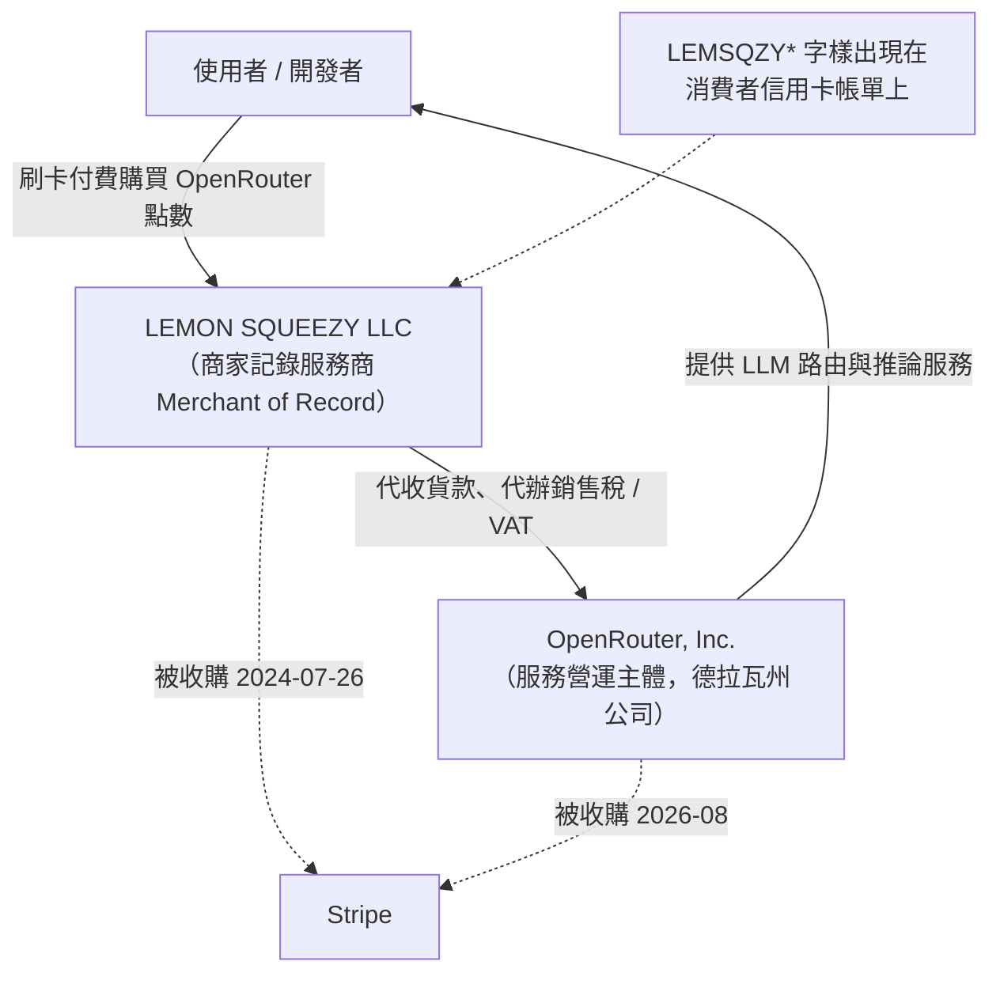

# OpenRouter 與 LEMON SQUEEZY LLC 的關係為何？

## 摘要

`openrouter.ai` 這項服務的營運主體是 **OpenRouter, Inc.**（德拉瓦州註冊公司），而 **LEMON SQUEEZY LLC** 是另一家獨立的公司，本業是「商家記錄服務商」（Merchant of Record，MoR），提供金流、稅務與合規代辦。兩者**不是同一家公司**，也**不是母子公司或控股關係**；可考的關係是**商業往來**：LEMON SQUEEZY LLC 曾作為 OpenRouter 的商家記錄服務商，替其代收信用卡款項並代為處理銷售稅／VAT，因此部分使用者的信用卡或銀行帳單上才會出現「LEMON SQUEEZY LLC」或「LEMSQZY\*」字樣。

需要說明的是：「OpenRouter 採用 Lemon Squeezy 作為商家記錄服務商」這一點，目前最直接的公開證據是一則 Reddit 討論串的**標題**（本文無法取得其內文），屬於較弱的來源；其餘一、二手資料則可佐證這類合作在 AI SaaS 產業中很常見，且與 Lemon Squeezy 的商業模式一致。詳見下文〈來源可信度批判〉。

---

## 一、兩個實體分別是什麼

### 1.1 OpenRouter, Inc.（服務營運主體）

OpenRouter 是「大型語言模型聚合器／路由服務」，讓開發者用單一介面存取數百家模型供應商的 API[^orTerms]。其官方文件一致載明營運主體為 **OpenRouter, Inc.**：

- 服務條款開頭：「Welcome, and thank you for your interest in **OpenRouter, Inc.**（『OpenRouter』、『we』或『us』）」[^orTerms]
- 企業授權合約記載較完整：「**OpenRouter Inc., a Delaware corporation** with offices at 169 Madison Ave #2404, New York NY 10016, United States」[^orEnterprise]

即：OpenRouter, Inc. 是一家**德拉瓦州註冊公司**，主要辦公地址在美國紐約市麥迪遜大道 169 號。創辦團隊為 Alex Atallah、Louis Vichy 與 Chris Clark，並於 2023 年成立[^orJoining]。

### 1.2 LEMON SQUEEZY LLC（商家記錄服務商）

Lemon Squeezy 是一個讓軟體公司銷售數位產品、訂閱與授權的平台。它對外定位自己是 **Merchant of Record**：「Lemon Squeezy is a Merchant of Record, which means digital sales taxes and compliance are taken care of for you」[^lsMoR]。作為商家記錄服務商，它在帳面上是消費者交易的**賣方**，因此消費者的信用卡／銀行帳單上會出現 Lemon Squeezy 而非原始軟體商的名字[^lsWhyCharge]。

其帳單上的交易描述子（statement descriptor）為「**LEMSQZY\***」加商店代號[^lsDescriptor]。此外，Lemon Squeezy 已於 **2024 年 7 月 26 日被 Stripe 收購**[^lsAcquired]；其後期對外賣方主體名稱變更為「**Sold through Link, LLC f/k/a Lemon Squeezy LLC**」[^lsWhyCharge]。

---

## 二、兩者的關係：商家記錄（Merchant of Record）往來

把兩者關係畫成簡圖如下：

核心概念：**OpenRouter, Inc. 與 LEMON SQUEEZY LLC 是兩家不同的法人**。當 OpenRouter 採用 Lemon Squeezy 作為商家記錄服務商時，交易的「法律賣方」會顯示為 Lemon Squeezy，這正是消費者帳單上出現「LEMON SQUEEZY LLC」的原因。這是一種**供應商／服務商**關係，而非所有權關係。

### 為什麼採用商家記錄服務商？

對一家跨國販售數位服務的公司而言，自行在全球各稅務管轄區註冊、申報並繳納銷售稅與 VAT 是沉重負擔。商家記錄服務商（MoR）代為承擔這類義務，代價是較高的手續費（Lemon Squeezy 為每筆 5% + 0.5 美元起）[^chaincatcher]。ChainCatcher 一篇分析 Stripe 收購 Lemon Squeezy 的文章，即以此類 AI SaaS 公司（年營收 1,000 萬美元）為例說明 MoR 的成本結構[^chaincatcher]。

---

## 三、時間線

| 時間 | 事件 | 來源 |
|---|---|---|
| 2023 | OpenRouter 成立，OpenRouter, Inc. 為營運主體 | [^orJoining] |
| 2024-07-26 | Stripe 收購 Lemon Squeezy | [^lsAcquired] |
| 2025 年（Reddit 討論） | 出現「OpenRouter uses Lemon Squeezy as merchant of record」討論串 | [^redditMoR] |
| 2026-04-06 | Managed Payments 法律賣方主體由 LemonSqueezy LLC 改為「Sold through Link, LLC」 | [^chaincatcher] |
| 2026-06-22 | OpenRouter 企業授權合約載明 OpenRouter Inc. 為德拉瓦州公司 | [^orEnterprise] |
| 2026-08-19 | OpenRouter 宣布加入 Stripe | [^orJoining] |

值得注意的是，OpenRouter 現行服務條款第 4.5 條載明其第三方支付處理商為 **Stripe 與 Coinbase**：「OpenRouter accepts payment through our third-party payment processors, **Stripe and Coinbase**」[^orTerms]；其稅務 ID 說明文件亦寫道「OpenRouter uses **Stripe** for payments and tax handling」[^orTaxId]。這表示在 Stripe 收購 OpenRouter（2026-08）之後，OpenRouter 的支付基礎設施進一步整合進 Stripe 體系。

---

## 四、常見誤解：兩者不是同一家公司

由於兩個名字常同時出現在 OpenRouter 使用者的付款情境中，容易產生混淆。應釐清：

- **OpenRouter, Inc.**＝服務營運主體，德拉瓦州公司[^orEnterprise]。
- **LEMON SQUEEZY LLC**＝獨立的商家記錄服務商，2024 年被 Stripe 收購，後更名為「Sold through Link, LLC」[^lsAcquired][^chaincatcher]。
- 兩者**皆被 Stripe 收購**，但這是「同一個買家先後買下兩家不同公司」，不代表兩家公司彼此之間有股權關係。

---

## 五、來源可信度批判

1. **最直接的證據偏弱。** 主張「OpenRouter 使用 Lemon Squeezy 作為商家記錄服務商」最直接的公開線索，是 Reddit `r/OpenRouterAI` 上一則標題為「OpenRouter uses Lemon Squeezy as merchant of record」的討論串[^redditMoR]。本文撰寫期間，Reddit 對自動化存取封鎖（403），無法取得該串內文與留言，因此僅能以標題作為**間接佐證**，其可靠性低於官方文件。
2. **官方文件未提及 Lemon Squeezy。** 檢視 OpenRouter 現行服務條款、隱私政策、企業合約、稅務 ID 說明與開發文件，均未出現「Lemon Squeezy」字樣[^orTerms][^orEnterprise][^orTaxId]。OpenRouter 官方僅列出 Stripe 與 Coinbase 為支付處理商。這與「曾有 MoR 往來」並不矛盾（MoR 屬後端金流安排），但也意味著缺乏官方第一手確認。
3. **Lemon Squeezy 的性質可佐證此類合作。** Lemon Squeezy 自身文件明確說明其為商家記錄服務商、帳單會顯示「LEMSQZY\*」，且其客戶涵蓋數千家數位產品／軟體公司[^lsWhyCharge][^lsMoR]。這使「某段期間 OpenRouter 的刷卡交易由 Lemon Squeezy 代收並顯示於帳單」在機制上完全合理。
4. **社群討論屬類比而非直接關聯。** Hacker News 上關於 Stripe 收購 OpenRouter 的討論，將 Lemon Squeezy 與 OpenRouter 並列，是在描述「Stripe 先後收購兩家公司」的趨勢與擔憂，並非陳述兩家公司之間的直接關係，不應誤讀[^hnComment]。
5. **一手資料優先。** 本文結論中「OpenRouter, Inc. 為德拉瓦州公司」「Stripe 與 Coinbase 為其支付處理商」「Lemon Squeezy 為 MoR 且被 Stripe 收購」等要點，均以公司自身文件為準，屬高可信度。

---

## 六、結論

- **OpenRouter 與 LEMON SQUEEZY LLC 是兩家彼此獨立的公司，沒有母子、控股或同一法人的關係。**
- 可考的關係是**商業往來**：LEMON SQUEEZY LLC 曾作為 OpenRouter 的**商家記錄服務商（Merchant of Record）**，代收刷卡款項並代辦銷售稅／VAT，因此部分 OpenRouter 使用者的信用卡／銀行帳單會出現「LEMON SQUEEZY LLC」或「LEMSQZY\*」字樣。
- 兩者**先後都被 Stripe 收購**（Lemon Squeezy：2024；OpenRouter：2026），但這是同一個買家的兩樁獨立交易，並非兩家公司互相關聯。
- 此結論中「曾以 Lemon Squeezy 為 MoR」的部分，最直接的公開證據偏弱（僅見於一則無法取得內文的 Reddit 標題），惟 Lemon Squeezy 的商業模式與 OpenRouter 官方未否認的金流安排，使此關係高度合理。若需百分之百確認，建議查閱實際 OpenRouter 交易收據或發票上的賣方名稱。

---

## 參考文獻

[^orTerms]: OpenRouter. (2026). *Terms of Service*. Retrieved 2026-11-10, from https://openrouter.ai/terms

[^orEnterprise]: OpenRouter. (2026, June 22). *Enterprise Access Agreement*. Retrieved 2026-11-10, from https://openrouter.ai/terms-of-service-enterprise

[^orTaxId]: OpenRouter. (n.d.). *Adding a Tax ID to Your Invoices*. Retrieved 2026-11-10, from https://openrouter.ai/docs/cookbook/administration/tax-id.md

[^orJoining]: OpenRouter. (2026, August 19). *OpenRouter is Joining Stripe*. Retrieved 2026-11-10, from https://openrouter.ai/blog/announcements/openrouter-is-joining-stripe/

[^lsMoR]: Lemon Squeezy. (n.d.). *Merchant of Record*. Retrieved 2026-11-10, from https://www.lemonsqueezy.com/reporting/merchant-of-record

[^lsWhyCharge]: Lemon Squeezy. (n.d.). *Why did Lemon Squeezy charge me?* Retrieved 2026-11-10, from https://www.lemonsqueezy.com/why-did-lemon-squeeezy-charge-me

[^lsDescriptor]: Lemon Squeezy. (n.d.). *LEMSQZY\* Statement Descriptor*. Retrieved 2026-11-10, from https://docs.lemonsqueezy.com/help/getting-started/statement-descriptor

[^lsAcquired]: Lemon Squeezy. (2024, July 26). *Stripe acquires Lemon Squeezy*. Retrieved 2026-11-10, from https://www.lemonsqueezy.com/blog/stripe-acquires-lemon-squeezy

[^chaincatcher]: ChainCatcher. (2026, November 10). *The chess game of payment giant MoR: Why did Stripe still need to step in after acquiring Lemon Squeezy?* Retrieved 2026-11-10, from https://www.chaincatcher.com/en/article/2303254

[^redditMoR]: Reddit. (2025). *OpenRouter uses Lemon Squeezy as merchant of record* [Online forum post]. r/OpenRouterAI. Retrieved 2026-11-10, from https://www.reddit.com/r/OpenRouterAI/comments/1i8tfi8/openrouter_uses_lemon_squeezy_as_merchant_of/

[^hnComment]: Hacker News. (2026, July 25). *Stripe in talks to buy OpenRouter for about $10B* [Comment by user digitalhobbit]. Retrieved 2026-11-10, from https://news.ycombinator.com/item?id=49029249
