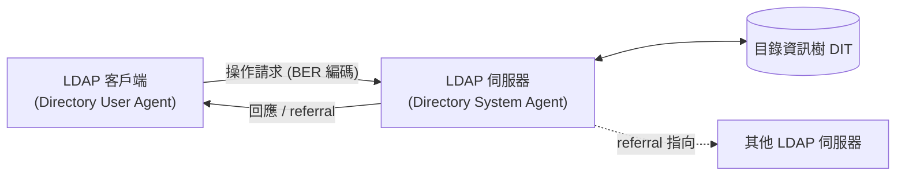
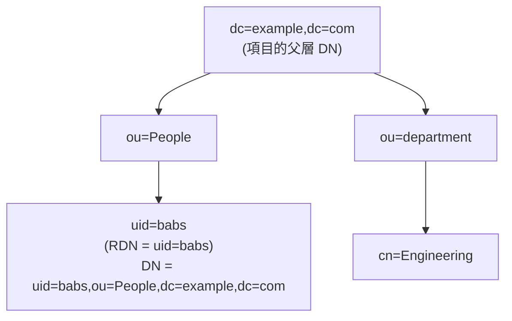
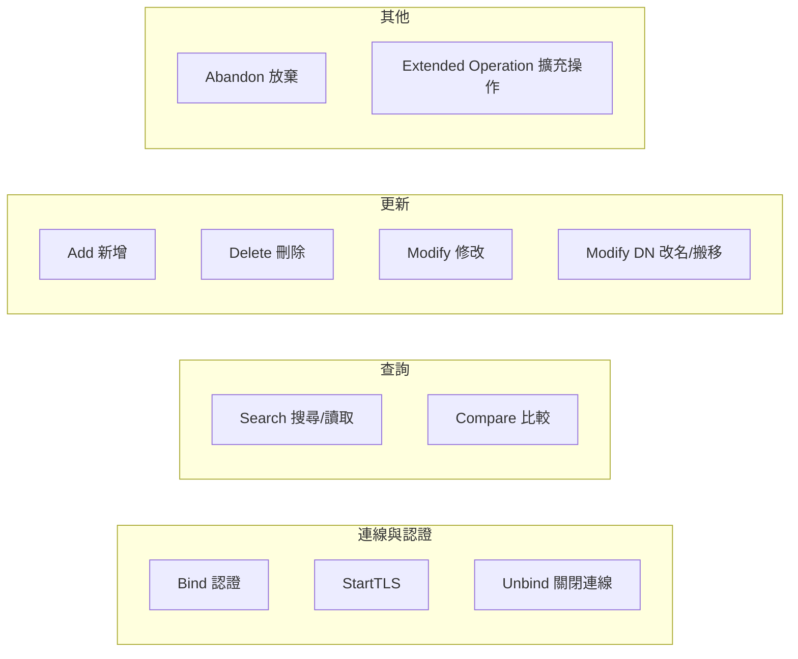

# LDAP (Lightweight Directory Access Protocol) 介紹

## 1. 什麼是 LDAP

**輕量型目錄存取協定**（Lightweight Directory Access Protocol，縮寫 LDAP，讀作 /ˈɛl.dæp/）是一套網際網路協定，用於存取遵循 X.500 資料與服務模型的目錄資訊服務[^wiki-ldap]。所謂「目錄服務」在此脈絡下，指的是讓整個網路上的使用者、系統、網路、服務與應用程式得以共享資訊的機制；常見例子包含企業電子郵件通訊錄、電話簿等有組織的紀錄集合[^wiki-ldap]。

LDAP 最常見的用途，是作為集中儲存使用者名稱與密碼的地方，讓許多不同的應用程式與服務都能連線到 LDAP 伺服器來驗證使用者身分[^wiki-ldap]。因此它常被當作企業內部的「身分驗證與通訊錄」基礎設施。

「輕量型」（Lightweight）一詞源自它與其前身 DAP 的比較：它不像 DAP 那樣耗用大量網路與運算資源，因而更容易在網際網路上實作與部署[^wiki-ldap]。

## 2. 歷史與 X.500 的關係

電信業者在累積約 70 年管理電話簿的經驗後，對目錄需求的掌握相當成熟，並把「目錄服務」的概念引進資訊技術與電腦網路領域，最終促成國際電信聯盟（ITU）在 1980 年代制定完整的 X.500 規範[^wiki-ldap]。

X.500 目錄服務傳統上是透過 X.511 的 **目錄存取協定**（Directory Access Protocol，DAP）存取，而 DAP 需要完整的 OSI 協定堆疊，實作成本高昂。LDAP 最初的設計目標，就是作為一個「輕量級替代方案」，讓使用者能透過更簡單、且已經普及的 TCP/IP 協定堆疊來存取 X.500 目錄服務[^wiki-ldap]。其目錄存取模型借鏡了 DIXIE 與 Directory Assistance Service (DAS) 兩個協定[^wiki-ldap]。

- LDAP 由密西根大學的 Tim Howes、Isode Limited 的 Steve Kille、Nexor 的 Colin Robbins，以及 Performance Systems International 的 Wengyik Yeong 於 1993 年左右共同創造[^wiki-ldap]。
- 1996 年，Mark Wahl、Tim Howes 與 Steve Kille 在 IETF 主導下開始發展 LDAPv3，並於 1997 年首次發表，取代 LDAPv2，新增了擴充性、整合 Simple Authentication and Security Layer（SASL），並更貼近 1993 年版的 X.500[^wiki-ldap]。
- LDAP 早期曾被稱為 **Lightweight Directory Browsing Protocol**（LDBP），後來因為協定範圍從「瀏覽與搜尋」擴展到「目錄更新」而更名[^wiki-ldap]。
- LDAP 對後續多項協定產生影響，包括 X.500 的後續版本、XML Enabled Directory (XED)、DSML、SPML 與 SLP；它同時也是微軟 **Active Directory** 的基礎[^wiki-ldap]。

## 3. 主要技術規格文件

LDAPv3 的完整技術規格由 IETF 的「LDAP Technical Specification Road Map」RFC 4510 及其引用文件組成[^rfc4510]。核心文件包括：

| 文件 | 標題 | 說明 |
| --- | --- | --- |
| RFC 4510 | LDAP: Technical Specification Road Map | 規格總覽與導引 |
| RFC 4511 | LDAP: The Protocol | 協定元素、語意與編碼[^rfc4511] |
| RFC 4512 | LDAP: Directory Information Models | X.500 資料模型在 LDAP 的套用[^rfc4512] |
| RFC 4513 | LDAP: Authentication Methods and Security Mechanisms | 認證與安全機制[^rfc4513] |
| RFC 4514 | LDAP: String Representation of Distinguished Names | DN 字串表示法[^rfc4514] |
| RFC 4515 | LDAP: String Representation of Search Filters | 搜尋篩選器字串表示法[^rfc4515] |
| RFC 4516 | LDAP: Uniform Resource Locator | LDAP URL 格式[^rfc4516] |
| RFC 4517 | LDAP: Syntaxes and Matching Rules | 語法與比對規則 |
| RFC 4518 | LDAP: Internationalized String Preparation | 國際化字串準備 |
| RFC 4519 | LDAP: Schema for User Applications | 使用者應用的 schema[^rfc4519] |

LDAP 伺服器在提供服務時，**必須**遵循 X.500（1993 年版）系列標準；但這並不要求伺服器自身使用任何 X.500 協定，只要 LDAP 介面不違反 X.500 的資料與服務模型即可[^rfc4510]。

## 4. 協定模型與運作方式

LDAP 採用**客戶端—伺服器模型**：一個或多個 LDAP 伺服器（又稱 Directory System Agent，DSA）儲存目錄資訊樹（DIT）的資料；客戶端連上伺服器並提出問題，伺服器回覆答案，或回覆一個指向其他伺服器的指標（referral）[^openldap-intro]。

不論客戶端連上哪一台 LDAP 伺服器，看到的目錄視圖都相同：在某一台伺服器上呈現的名稱，在另一台伺服器上會指向同一個項目。這是全域目錄服務的重要特性[^openldap-intro]。



客戶端一開起連線（LDAP session），伺服器的授權／認證狀態預設為**匿名**（anonymous），此時客戶端不必以 Bind 作為第一個訊息；伺服器必須把它視為在匿名 Bind 之後執行[^rfc4513]。

每次客戶端送出的請求與伺服器回應，都會被包進一個共同的封套 **LDAPMessage**，其中包含 `messageID` 與選用的 `controls`。所有協定操作都以 ASN.1 描述，並使用 ASN.1 **Basic Encoding Rules (BER)** 的子集在網路上傳輸[^rfc4511]。請求的 `messageID` 必須非零，且在同一 session 中不可與任何進行中的請求重複；數值 0 保留給 unsolicited notification[^rfc4511]。

## 5. 通訊埠與連線安全

LDAP 相關的預設通訊埠如下：

- **389**：LDAP（`ldap`）的預設 TCP/UDP 通訊埠[^wiki-ldap]。
- **636**：LDAPS（LDAP over TLS/SSL）的通訊埠[^wiki-ldap]。

LDAP 本身最初設計時並未加密，因此容易遭受中間人（man-in-the-middle）攻擊，攻擊者可在 bind 過程中攔截憑證。緩解方式是在每次涉及憑證的 bind 時強制使用 LDAPS 或 StartTLS[^wiki-ldap]。

**LDAPS 與 StartTLS 的差異**在於[^wiki-ldap]：

1. LDAPS：連線建立後、任何 LDAP 訊息傳輸**之前**就先建立 TLS（不經過 StartTLS 操作），且一旦 TLS 關閉就必須關閉連線。
2. StartTLS：在已建立的 LDAP session 上，透過 **StartTLS 擴充操作**升級為 TLS，可用 `ldap` 這個標準 URL scheme，而非另開 `ldaps` scheme。

RFC 4513 要求：支援任何非匿名認證機制的 LDAP 實作，**必須**支援 simple Bind 的「名稱／密碼」機制，並且**必須**能以 StartTLS 建立 TLS 來保護它[^rfc4513]。伺服器若支援以明文傳輸密碼的認證機制，**必須**具備政策機制，要求已安裝 TLS 層、或提供其他資料機密性機制、或對該操作回傳 `confidentialityRequired` 結果碼[^rfc4513]。

## 6. 目錄結構（Directory Structure）

LDAP 提供的介面遵循 1993 年版 X.500 模型的目錄結構[^wiki-ldap]：

- 一個**項目（entry）**由一組**屬性（attribute）**組成。
- 一個屬性有名稱（**屬性型別**或**屬性描述**）以及一個或多個**值**。屬性的定義來自 **schema**。
- 每個項目都有唯一的識別名稱：**Distinguished Name（DN）**。DN 由其自身的 **Relative Distinguished Name（RDN）** 加上父項目的 DN 串接而成。

可用「檔案路徑」來類比：若 `/foo/bar/myfile.txt` 是 DN，則 `myfile.txt` 就是 RDN[^wiki-ldap]。例如 `cn=John Doe,dc=example,dc=com` 中，`cn=John Doe` 是 RDN，而 `dc=example,dc=com` 是父項目的 DN，其中 `dc` 代表 Domain Component[^wiki-ldap]。



OpenLDAP 文件提供了兩種常見的命名風格示意：傳統命名以國別、組織為階層（`o=...`、`c=...`），而網際網路命名則以網域名稱為階層（`dc=...`）[^openldap-intro]。

### 6.1 命名：RDN 與 DN

- **RDN**（Relative Distinguished Name）由一個或多個「屬性值斷言（AttributeValueAssertion，AVA）」組成；這些 AVA 的值必須是項目的「識別值」，且 RDN 必須在其所有兄弟項目中唯一[^rfc4512]。
- **DN** 是項目的完整名稱，等於「RDN 串接其直屬上層項目的 DN」，可無歧義地指向樹中的一個項目[^rfc4512]。
- DN 的字串表示法由 RFC 4514 定義，會將需要逸出（escape）的字元處理，例如開頭的空白或 `#`、結尾的空白，以及 `"`、`+`、`,`、`;`、`<`、`>`、`\` 和 NUL 字元[^rfc4514]。

RFC 4514 亦規定了實作**必須**辨識的屬性型別簡短名稱[^rfc4514]：

| 字串 | X.500 屬性型別 |
| --- | --- |
| CN | commonName (2.5.4.3) |
| L | localityName (2.5.4.7) |
| ST | stateOrProvinceName (2.5.4.8) |
| O | organizationName (2.5.4.10) |
| OU | organizationalUnitName (2.5.4.11) |
| C | countryName (2.5.4.6) |
| STREET | streetAddress (2.5.4.9) |
| DC | domainComponent (0.9.2342.19200300.100.1.25) |
| UID | userId (0.9.2342.19200300.100.1.1) |

### 6.2 項目的結構

一個項目由一組屬性構成，屬性分為兩類[^rfc4512]：

- **使用者屬性（user attribute）**：代表使用者提供的資訊。
- **運算屬性（operational attribute）**：代表伺服器維護的行政／運算資訊，例如 `creatorsName`、`createTimestamp`、`modifiersName`、`modifyTimestamp`。運算屬性通常不可見，除非在搜尋中明確指名，否則不會被回傳[^rfc4512]。

一個屬性的「屬性型別」決定它是否可有多個值、其值的語法與比對規則等；一個屬性中不得有兩個等價的值[^rfc4512]。

### 6.3 LDIF 範例

下圖為一個以 **LDAP Data Interchange Format（LDIF）** 表示的項目範例。LDIF 是一種純文字格式（相對於 LDAP 本身是二進位協定），常用於在目錄伺服器之間匯入／匯出目錄資訊[^wiki-ldap][^rfc2849]：

```ldif
dn: cn=John Doe,dc=example,dc=com
cn: John Doe
givenName: John
sn: Doe
telephoneNumber: +1 888 555 6789
telephoneNumber: +1 888 555 1232
mail: john@example.com
manager: cn=Barbara Doe,dc=example,dc=com
objectClass: inetOrgPerson
objectClass: organizationalPerson
objectClass: person
objectClass: top
```

其中 `dn` 是項目的識別名稱，本身既不是屬性、也不屬於項目的內容；其餘各行則列出項目的屬性[^wiki-ldap]。

## 7. 操作（Operations）

LDAP 定義了一組操作供客戶端請求，伺服器則回傳回應[^wiki-ldap][^rfc4511]：



以下逐一說明核心操作的語意：

### 7.1 Bind（認證）

Bind 操作的用途是在客戶端與伺服器之間交換認證資訊，可視為「認證」操作[^rfc4511]。BindRequest 中包含三個欄位[^rfc4511]：

- `version`：用戶端欲使用的協定版本，本文件描述第 3 版；若伺服器不支援該版本，**必須**回傳 `protocolError`。
- `name`：客戶端想以此身分綁定的目錄物件名稱；可為空字串以進行匿名綁定。
- `authentication`：認證資訊，其選擇包含 `simple` 與 `sasl`。

Simple Bind 提供三種認證機制[^rfc4513]：

1. **匿名（anonymous）**：`name` 長度為零且密碼長度為零。
2. **未認證（unauthenticated）**：`name` 長度非零但密碼長度為零；此時所帶 DN 僅供追蹤（記錄）用途，不得用於認證或授權。
3. **名稱／密碼**：`name` 長度非零且密碼長度非零。

> **安全警告**：未認證 Bind 有顯著安全風險。使用者若本想進行名稱／密碼認證卻誤提供空密碼，可能導致實作不良的客戶端請求「未認證」存取；因此伺服器**預設應該**以 `unwillingToPerform` 拒絕未認證 Bind 請求[^rfc4513]。

SASL Bind 則支援多種機制（如 Kerberos、TLS 用戶端憑證對應的 EXTERNAL 機制等）[^wiki-ldap]。EXTERNAL 機制可讓客戶端要求伺服器依下層安全層（通常為 TLS）已建立的憑證來決定授權身分[^rfc4513]。

### 7.2 Search（搜尋與讀取）

Search 操作同時用於搜尋與讀取項目，其參數包括[^wiki-ldap]：

- `baseObject`：搜尋的基準物件名稱。
- `scope`：搜尋範圍，可為 `baseObject`（僅基準項目）、`singleLevel`（基準之下的直接子項）或 `wholeSubtree`（整個子樹）[^rfc4511]。
- `filter`：篩選條件。
- `derefAliases`：是否及如何跟隨 alias 項目。
- `attributes`：要回傳的屬性。
- `sizeLimit`、`timeLimit`：回傳項目數上限與搜尋時間上限（不得覆蓋伺服器本身的限制）。
- `typesOnly`：是否只回傳屬性型別而不回傳值。

RFC 4512 指出，若要以程式模擬 X.500 的「list」操作，可用 `singleLevel` 搜尋搭配檢查 `objectClass` 屬性是否存在的篩選器；模擬「read」操作則可用 `baseObject` 搜尋搭配相同篩選器[^rfc4511]。

### 7.3 搜尋篩選器（Search Filter）

篩選器以**前序（Polish／prefix）表示法**書寫，並定義於 RFC 4515[^rfc4515]。範例[^rfc4515][^wiki-ldap]：

```
(cn=Babs Jensen)
(!(cn=Tim Howes))
(&(objectClass=Person)(|(sn=Jensen)(cn=Babs J*)))
(o=univ*of*mich*)
```

其中 `&` 代表 AND、`|` 代表 OR、`!` 代表 NOT。`*` 用於子字串或 present 篩選（如 `objectClass=*` 表示屬性存在）[^rfc4515]。

一個常見的誤解是 LDAP 資料區分大小寫；實際上，**比對規則（matching rule）與排序規則**決定了比對與比較行為。若確實需要區分大小寫的比對，須使用可擴充比對（extensible match）篩選器，例如 `(givenName:caseExactMatch:=John)`[^wiki-ldap]。

篩選器中的特殊字元 `*`、`(`、`)`、`\` 與 NUL 必須以反斜線加兩位十六進位數逸出，例如 `(cn=*\2A*)`[^rfc4515]。

### 7.4 Compare（比較）

Compare 操作接受一個 DN、一個屬性名稱與一個屬性值，檢查該項目是否含有該屬性且值相符[^wiki-ldap]。

### 7.5 Add / Delete / Modify / Modify DN

- **Add**：插入新項目。若 DN 已存在，伺服器不會新增重複項目，而會回傳結果碼 68 `entryAlreadyExists`；欲新增項目的直屬上層必須存在[^wiki-ldap]。
- **Delete**：刪除項目，請求必須含目標 DN；伺服器在處理刪除時不 dereference alias。一般僅能刪除**葉項目**（沒有下屬的項目），部分伺服器支援子樹刪除控制項以刪除整個子樹[^wiki-ldap]。
- **Modify**：修改既有項目，每個變更為 `add`、`delete` 或 `replace` 之一。另有 Modify-Increment 擴充（RFC 4525），可將可遞增屬性值以指定量遞增[^wiki-ldap]。
- **Modify DN**：搬移或改名項目，接受新的 RDN、選用的新父項 DN，以及是否刪除與舊 RDN 相符之值的旗標；伺服器可能支援整個子樹的改名[^wiki-ldap]。

一個更新操作是原子性的：其他操作只會看到新項目或舊項目。但 LDAP 本身**不**定義跨多個操作的事務；若先讀取再修改，其他客戶端可能已在中間修改了該項目[^wiki-ldap]。

### 7.6 Extended Operation 與 StartTLS

Extended Operation 是通用操作，用來定義原協定未包含的新操作，其中最著名的擴充即為 StartTLS，其他例子包括 Cancel 與 Password Modify[^wiki-ldap]。StartTLS 建立 TLS 後可提供資料機密性與完整性保護；TLS 協商期間伺服器會傳送 X.509 憑證以證明身分，客戶端亦可傳送憑證；之後客戶端可使用 SASL/EXTERNAL，要求伺服器依下層（通常是 TLS）建立的憑證推導身分[^wiki-ldap]。

### 7.7 Abandon 與 Unbind

- **Abandon**：請求伺服器中止以某個 message ID 指名的操作；伺服器不一定會照做，且 Abandon 與被成功放棄的操作都不會送出回應[^wiki-ldap][^rfc4511]。
- **Unbind**：放棄所有未完成操作並關閉連線，沒有回應。其名稱源自歷史，**並非** Bind 的反操作；客戶端應使用 Unbind 而非直接關閉連線，以便伺服器優雅地關閉並釋放資源[^wiki-ldap][^rfc4511]。

伺服器也可能送出 **Unsolicited Notification**，這不是對任何請求的回應，用於通知例外狀況（例如連線逾時前）。此類通知的 `messageID` 為 0[^wiki-ldap][^rfc4511]。

## 8. LDAP URL

LDAP 具有一套 URI scheme，客戶端對其支援程度不一，伺服器則在 referral 與 continuation reference 中回傳它，格式定義於 RFC 4516[^wiki-ldap][^rfc4516]：

```
ldap://host:port/DN?attributes?scope?filter?extensions
```

各欄位說明[^wiki-ldap]：

- `host`：LDAP 伺服器的 FQDN 或 IP 位址。
- `port`：伺服器通訊埠，預設 389。
- `DN`：作為搜尋基準的識別名稱。
- `attributes`：以逗號分隔、要取得的屬性清單。
- `scope`：搜尋範圍，可為 `base`（預設）、`one` 或 `sub`。
- `filter`：搜尋篩選器，如 `(objectClass=*)`。
- `extensions`：LDAP URL 格式的擴充。

RFC 4516 定義了欄位缺省時的預設值：`port` 預設為 TCP 389、缺省的 `dn` 為零長度 DN（`""`）、缺省的 `scope` 為 `base`、缺省的 `filter` 為 `(objectClass=*)`[^rfc4516]。範例[^rfc4516]：

```
ldap://ldap.example.com/cn=John%20Doe,dc=example,dc=com
ldap:///dc=example,dc=com??sub?(givenName=John)
```

其中第二例的「三個斜線」代表省略 host（使用預設伺服器），「兩個問號」代表省略 attributes[^wiki-ldap]。

## 9. Schema（綱要）

目錄中各子樹項目的內容，由**目錄 schema** 這套關於「目錄資訊樹（DIT）結構」的定義與約束所規範[^wiki-ldap]。schema 的元素包含[^wiki-ldap]：

- **Attribute Syntaxes**：定義屬性可儲存的資訊種類。
- **Matching Rules**：定義如何對屬性值做比較。
- **Matching Rule Uses**：指出哪些屬性型別可搭配特定比對規則使用。
- **Attribute Types**：定義屬性的 OID、名稱，並連結其語法與比對規則。
- **Object Classes**：定義具名屬性集合，並分類為必要屬性與選用屬性。
- **Name Forms**：定義項目 RDN 應包含的屬性集規則。
- **Content Rules**：定義項目可搭配的物件類別與屬性之額外約束。
- **Structure Rule**：定義某項目可擁有哪些種類的下屬項目。

物件類別（object class）分為三種[^rfc4512]：

- **Abstract（抽象）**：提供供其他類別繼承的特性基礎，項目不能直接屬於抽象類別，除非它同時屬於繼承該抽象類別的結構或輔助類別。所有項目的最高層抽象類別是 `top`。
- **Structural（結構）**：用於 DIT 的結構規範，每個項目有「恰好一個」結構物件類別。
- **Auxiliary（輔助）**：用於擴充項目的特性（例如增加允許的屬性）。

每個項目**必須**有 `objectClass` 屬性；伺服器**必須**確保項目符合使用者與系統 schema 規則[^rfc4512]。

以下為 RFC 4519 定義的兩個範例[^rfc4519]：

```
# 屬性型別：cn (commonName)
( 2.5.4.3 NAME 'cn' SUP name )

# 物件類別：person
( 2.5.6.6 NAME 'person'
   SUP top
   STRUCTURAL
   MUST ( sn $ cn )
   MAY ( userPassword $ telephoneNumber $ seeAlso $ description ) )
```

也就是說，一個屬於 `person` 的項目**必須**有 `sn`（姓氏）與 `cn`（常見名稱），並**可**有 `userPassword`、`telephoneNumber` 等屬性[^rfc4519]。

客戶端可透過讀取項目之 `subschemaSubentry` 運算屬性，得知是哪個 subschema（子）項目控制該項目，再以 `(objectClass=subschema)` 為篩選器的 baseObject 搜尋，取得伺服器支援的 schema 定義[^rfc4512]。

## 10. 常見實作

### 10.1 OpenLDAP

**OpenLDAP** 是 OpenLDAP Project 開發的自由、開放原始碼 LDAP 實作，採用其自有的 BSD 風格授權「OpenLDAP Public License」[^wiki-openldap]。專案由 Kurt Zeilenga 於 1998 年發起，方式是從密西根大學的 LDAP 參考原始碼複製而來[^wiki-openldap]。

其主要組件包括[^wiki-openldap]：

- **slapd**：獨立執行的 LDAP 常駐程式（daemon）及相關模組與工具。
- **lloadd**：獨立的 LDAP 負載平衡代理伺服器。
- **函式庫**：實作 LDAP 協定與 ASN.1 BER 的函式庫。
- **客戶端工具**：`ldapsearch`、`ldapadd`、`ldapdelete` 等。

slapd 支援 LDAPv3、SASL 強認證、TLS 憑證認證、存取控制、國際化（Unicode）、多個資料庫後端（如建構於 LMDB 的 MDB 後端）、多個資料庫實例、複寫（單提供者／多消費者、多提供者），以及可透過 LDAP 動態設定等能力[^openldap-intro]。其資料庫後端不使用關聯式資料庫，而採用嵌入式鍵值儲存 LMDB，以在不犧牲可靠性的前提下取得更高效能與延展性[^openldap-intro]。

### 10.2 微軟 Active Directory

LDAP 是微軟 Active Directory 的基礎[^wiki-ldap]。在 Active Directory 中，**Kerberos 用於認證步驟，而 LDAP 用於授權步驟**[^wiki-ldap]。

### 10.3 389 Directory Server

**389 Directory Server**（前身為 Fedora Directory Server）是 Red Hat 開發的 LDAP 伺服器，名稱「389」取自 LDAP 使用的通訊埠號[^wiki-389ds]。它是一個符合 RFC 4511 的伺服器[^wiki-389ds]。其歷史可追溯至 1996 年密西根大學 SLAPD 專案開發者被 Netscape 延攬後，程式碼被分支為 Netscape Directory Server，經過 AOL、Sun、Oracle 等公司的輾轉演變，最終由 Red Hat 於 2005 年以 GPL 釋出[^wiki-389ds]。389 Directory Server 支援多主複寫、MemberOf、Class of Service 等非 RFC 的專案專屬功能[^wiki-389ds]。

### 10.4 其他用途

由於 LDAP 逐漸普及，許多廠商也把它當作存取其他服務的協定，例如透過 LDAP 存取 SQL 資料庫（OpenLDAP 的 back-sql 後端即提供此能力）[^wiki-ldap][^openldap-intro]。此外，Unix 的使用者與群組資訊也可儲存於 LDAP，並透過 PAM 與 NSS 模組存取[^wiki-ldap]。

## 11. 安全考量

### 11.1 LDAP Injection（注入攻擊）

**LDAP injection** 是類似 SQL injection 的攻擊，當實作 LDAP 的應用程式未妥善處理使用者輸入（sanitization）時就可能發生[^wiki-ldap][^owasp-inj]。舉例來說，若某搜尋查詢允許使用者以 `cn` 屬性依姓名搜尋，惡意使用者可能以 `*` 字元取代合法姓名，而 `*` 會匹配任何具有 `cn` 屬性的物件；若應用程式有此弱點，可能顯示該搜尋使用者原本無權查看的屬性[^wiki-ldap]。

OWASP 指出 LDAP injection 攻擊常見的原因有二[^owasp-cheat]：

1. 缺乏更安全、參數化的 LDAP 查詢介面。
2. LDAP 被廣泛用於對系統使用者進行認證。

**主要防禦**包含[^owasp-cheat]：

- **以正確的 LDAP 編碼函式逸出所有變數**：DN 與搜尋篩選器需要**不同的逸出規則**，分別定義於 RFC 4514 與 RFC 4515。應避免自行撰寫逸出程式碼，改用對應情境的函式庫編碼器。
  - DN 必須逸出的字元：`\ # + < > , ; " =` 以及開頭或結尾的空白。
  - 搜尋篩選器必須逸出的字元：`* ( ) \ NUL`。
- **使用會自動保護的框架**：如 .NET 的 LINQ to LDAP，會在建立 LDAP 查詢時自動進行 LDAP 編碼。

**附加防禦**包含[^owasp-cheat]：

- **最小權限**：將 LDAP 綁定帳號的權限降到最低，以降低成功注入攻擊的損害。
- **允許清單輸入驗證**：在輸入進入 LDAP 查詢之前偵測未授權輸入。

OWASP 特別提醒：已認證的 LDAP bind 只建立「已認證的授權狀態」，**並不會**阻止使用者輸入改變應用程式建構的搜尋篩選器；即使應用程式以有效憑證綁定，仍須套用搜尋篩選器逸出[^owasp-cheat]。此外，使用名稱／密碼認證時應在綁定前拒絕空密碼，因為「非空名稱 + 空密碼」會形成未認證 bind、建立匿名授權；此情況下即使回傳成功，也不能證明使用者身分[^owasp-cheat]。

Java 安全與不安全寫法對照範例[^owasp-cheat]：

```java
// 不安全：使用者輸入直接串接到篩選器
String filter = "(&(uid=" + userInput + ")(objectClass=person))";

// 安全：使用者輸入以參數方式傳入
String filter = "(&(uid={0})(objectClass=person))";
ctx.search("ou=users,dc=example,dc=com", filter, new Object[]{ userInput }, controls);
```

### 11.2 中間人攻擊

LDAP 最初建立時並未加密，這使其容易受到中間人攻擊——攻擊者可在 bind 過程中攔截憑證。此攻擊可透過在每次涉及憑證的 bind 時強制使用 LDAPS 或 StartTLS 來緩解[^wiki-ldap]。RFC 4513 也指出，若 LDAP session 未建立資料完整性與隱私服務（例如透過 StartTLS、IPsec 或合適的 SASL 機制），就容易遭受中間人攻擊以檢視與修改傳輸中的資訊[^rfc4513]。

RFC 4513 列出的基本威脅包括[^rfc4513]：未經授權透過資料檢索操作存取目錄資料、透過監看他人存取而取得資料、透過監看他人存取而取得可重複使用的認證資訊、未經授權修改目錄資料或設定資訊、阻斷服務（DoS）、偽冒（spoofing）與連線劫持（hijacking）。

### 11.3 隱私

DN 通常包含對所命名項目的描述性資訊，可能涵蓋姓名、電子郵件或 TCP/IP 位址、實體位置、組織屬性等，這些在某些國家受隱私法保護。因此伺服器實作者宜支援 DIT 結構規則與 name forms，讓管理者能選擇合適的命名屬性，並運用存取控制限制敏感資訊用於命名[^rfc4514]。運算屬性亦然：它們通常不可見，除非明確指名[^rfc4512]。

## 12. 何時使用 LDAP

OpenLDAP 文件指出，當你需要**資料被集中管理、儲存，並透過標準化方法存取**時，就適合使用目錄伺服器[^openldap-intro]。產業中常見用途包括（但不限於）[^openldap-intro]：

- 機器認證（Machine Authentication）
- 使用者認證（User Authentication）
- 使用者／系統群組
- 通訊錄（Address book）
- 組織呈現
- 資產追蹤
- 電話資訊儲存
- 使用者資源管理
- 電子郵件位址查詢
- 應用程式設定儲存
- PBX 設定儲存

相對地，當你發現需要「把目錄硬凹成別的用途」時，可能就需要重新設計；若只有單一應用程式需要使用與操作你的資料，或許也不適合用 LDAP[^openldap-intro]。

## 13. 小結

LDAP 是一套以 X.500 資料模型為基礎、設計為「輕量級」的目錄存取協定，廣泛用於集中式身分認證與通訊錄。其核心包含：以 DN 唯一識別項目、以物件類別與屬性構成 schema、以 BER 編碼的 LDAPMessage 交換操作、以 Bind 進行認證，以及以 StartTLS／LDAPS 保障連線安全。在實作上，OpenLDAP 是主要的開放原始碼實作，而微軟 Active Directory 亦以 LDAP 作為授權基礎。使用 LDAP 時，最重要的安全課題是正確逸出 DN 與篩選器以防注入攻擊，並避免以明文傳輸憑證。

## 參考文獻

[^wiki-ldap]: Wikipedia. (2026). *Lightweight Directory Access Protocol*. Retrieved 2026-11-07, from https://en.wikipedia.org/wiki/Lightweight_Directory_Access_Protocol

[^rfc4510]: Zeilenga, K. (Ed.). (2006, June). *Lightweight Directory Access Protocol (LDAP): Technical Specification Road Map* (RFC 4510). Internet Engineering Task Force. Retrieved 2026-11-07, from https://www.rfc-editor.org/rfc/rfc4510.txt

[^rfc4511]: Sermersheim, J. (Ed.). (2006, June). *Lightweight Directory Access Protocol (LDAP): The Protocol* (RFC 4511). Internet Engineering Task Force. Retrieved 2026-11-07, from https://www.rfc-editor.org/rfc/rfc4511

[^rfc4512]: Zeilenga, K. (2006, June). *Lightweight Directory Access Protocol (LDAP): Directory Information Models* (RFC 4512). Internet Engineering Task Force. Retrieved 2026-11-07, from https://www.rfc-editor.org/rfc/rfc4512.txt

[^rfc4513]: Harrison, R. (Ed.). (2006, June). *Lightweight Directory Access Protocol (LDAP): Authentication Methods and Security Mechanisms* (RFC 4513). Internet Engineering Task Force. Retrieved 2026-11-07, from https://www.rfc-editor.org/rfc/rfc4513.txt

[^rfc4514]: Zeilenga, K. (Ed.). (2006, June). *Lightweight Directory Access Protocol (LDAP): String Representation of Distinguished Names* (RFC 4514). Internet Engineering Task Force. Retrieved 2026-11-07, from https://www.rfc-editor.org/rfc/rfc4514.txt

[^rfc4515]: Smith, M. (Ed.), & Howes, T. (2006, June). *Lightweight Directory Access Protocol (LDAP): String Representation of Search Filters* (RFC 4515). Internet Engineering Task Force. Retrieved 2026-11-07, from https://www.rfc-editor.org/rfc/rfc4515.txt

[^rfc4516]: Smith, M. (Ed.), & Howes, T. (2006, June). *Lightweight Directory Access Protocol (LDAP): Uniform Resource Locator* (RFC 4516). Internet Engineering Task Force. Retrieved 2026-11-07, from https://www.rfc-editor.org/rfc/rfc4516.html

[^rfc4519]: Sciberras, A. (Ed.). (2006, June). *Lightweight Directory Access Protocol (LDAP): Schema for User Applications* (RFC 4519). Internet Engineering Task Force. Retrieved 2026-11-07, from https://www.rfc-editor.org/rfc/rfc4519.txt

[^rfc2849]: Good, G. (2000, June). *The LDAP Data Interchange Format (LDIF) - Technical Specification* (RFC 2849). Internet Engineering Task Force. Retrieved 2026-11-07, from https://www.rfc-editor.org/rfc/rfc2849.txt

[^openldap-intro]: OpenLDAP Foundation. (2011-2026). *OpenLDAP Software 2.6 Administrator's Guide: Introduction to OpenLDAP Directory Services*. Retrieved 2026-11-07, from https://www.openldap.org/doc/admin26/intro.html

[^wiki-openldap]: Wikipedia. (2026). *OpenLDAP*. Retrieved 2026-11-07, from https://en.wikipedia.org/wiki/OpenLDAP

[^wiki-389ds]: Wikipedia. (2026). *389 Directory Server*. Retrieved 2026-11-07, from https://en.wikipedia.org/wiki/389_Directory_Server

[^owasp-inj]: OWASP Foundation. (n.d.). *LDAP Injection*. Retrieved 2026-11-07, from https://owasp.org/www-community/attacks/LDAP_Injection

[^owasp-cheat]: OWASP Foundation. (n.d.). *LDAP Injection Prevention Cheat Sheet*. Retrieved 2026-11-07, from https://cheatsheetseries.owasp.org/cheatsheets/LDAP_Injection_Prevention_Cheat_Sheet.html
