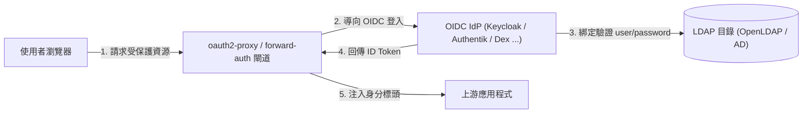
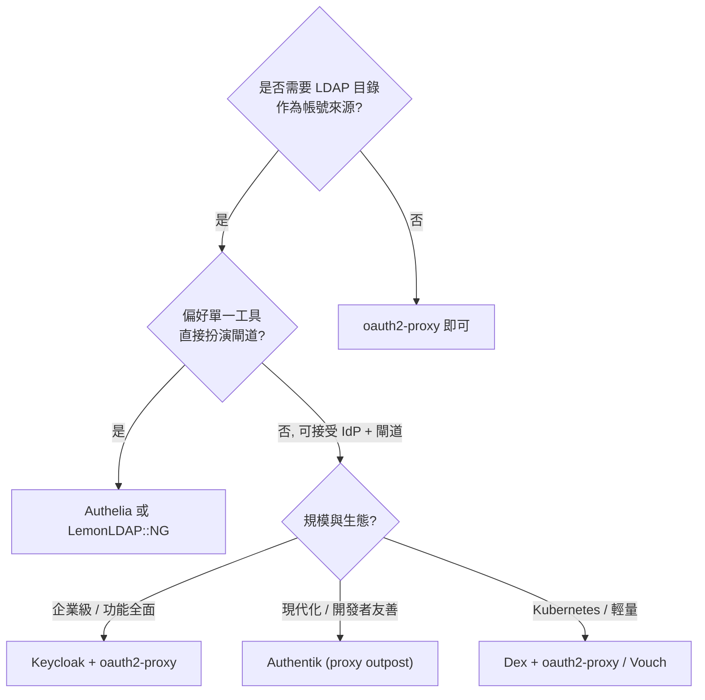

# oauth2-proxy 的 FOSS 替代方案：支援 LDAP 的身分驗證閘道

## 摘要

`oauth2-proxy` 是一套以 Go 撰寫、採用 MIT 授權的開源反向代理，用於為自架 Web 應用程式提供 OAuth2 / OpenID Connect (OIDC) 驗證[^o2p-repo]。然而，`oauth2-proxy` 本身**不支援**直接以 LDAP (Lightweight Directory Access Protocol) 作為驗證來源；其設計是作為 OAuth2 / OIDC 的 client，向外部身分提供者 (Identity Provider, IdP) 換取權杖，再將使用者資訊以 HTTP 標頭轉發給上游服務[^o2p-cfg]。

因此，若要「以 LDAP 目錄作為帳號來源」且「具備類似 oauth2-proxy 的閘道 / forward-auth 角色」，實務上有兩類 FOSS 方案：

1. **原生支援 LDAP 的身分驗證閘道 (auth gateway)**：直接把 LDAP 目錄當成第一因素，本身即扮演 forward-auth / 反向代理角色，例如 Authelia、LemonLDAP::NG。
2. **支援 LDAP 的 IdP，再搭配 oauth2-proxy 或同類 forward-auth 元件**：由 IdP 以 LDAP 驗證使用者，對外提供 OIDC / OAuth2，例如 Keycloak、Authentik、Dex、Casdoor、Zitadel，再串接 `oauth2-proxy`、Vouch Proxy 或各 proxy 的 forward-auth 外掛。

本報告以官方文件、GitHub API 與專案原始碼授權檔為依據，整理各方案的角色、授權、語言與 LDAP 支援程度[^gh-api]。

## 問題背景：oauth2-proxy 與 LDAP 的關係

`oauth2-proxy` 官方設定文件中，身分來源選項 (`--provider`) 涵蓋 Google、Microsoft Entra ID、GitHub、login.gov、Keycloak 以及通用 OIDC / OAuth2，**並無 LDAP provider**[^o2p-cfg]。它能讀取 htpasswd 檔案作為額外的帳密來源 (`--htpasswd-file`)，但這與目錄服務整合無關[^o2p-cfg]。專案 README 亦明確將其定位為「以 OAuth2 / OIDC 保護應用程式的反向代理或中介軟體」[^o2p-repo]。

換言之，`oauth2-proxy` 只能間接支援 LDAP：需先有一個「以 LDAP 為後端」的 OIDC IdP，再由 `oauth2-proxy` 以 OIDC 串接。下圖說明此關係：

## 候選方案總覽

下表整理各方案的關鍵屬性。星號數取自 GitHub API (擷取於 2026-11-10)，為近似值[^gh-api]。授權、語言與 LDAP 支援程度取自各專案官方文件與授權檔。

| 專案 | 角色 | LDAP 支援 | 語言 | 授權 | GitHub 星數 |
| --- | --- | --- | --- | --- | --- |
| Authelia | forward-auth 閘道 + OIDC IdP | 原生 (第一因素後端) | Go | Apache-2.0 | 約 29.6k |
| LemonLDAP::NG | Web SSO 平台 + 反向代理 handler | 原生 (多後端之一) | Perl | GPL (主程式) | 主庫約 84 |
| caddy-security (AuthCrunch) | Caddy forward-auth 外掛 | 原生 | Go | Apache-2.0 | 約 2.3k |
| Authentik | IdP + proxy outpost | 原生 (LDAP source) | Python | MIT | 約 26.3k |
| Keycloak | IdP | 原生 (User Federation) | Java | Apache-2.0 | 約 37.8k |
| Dex | OIDC IdP | 原生 (connector) | Go | Apache-2.0 | 約 11.2k |
| Casdoor | IdP / IAM | 原生 | Go | Apache-2.0 | 約 14.8k |
| Zitadel | IdP | 原生 (IdP 範本) | Go | AGPL-3.0 | 約 15.6k |
| Apereo CAS | 集中式 SSO 伺服器 | 原生 (authentication handler) | Java | Apache-2.0 | 約 11.4k |
| Kanidm | 身分管理平台 | 原生 (內建 LDAP) | Rust | MPL-2.0 | 約 5.6k |
| Pomerium | identity-aware access proxy | 需外部 OIDC IdP，無原生 LDAP | Go | Apache-2.0 | 約 5.1k |
| Vouch Proxy | Nginx forward-auth | 無 (僅 OAuth2/OIDC) | Go | MIT | 約 3.3k |
| Ory Oathkeeper | IAP / access proxy | 無原生 LDAP | Go | Apache-2.0 | 約 3.6k |
| Tinyauth | 輕量 forward-auth | 原生 (LDAP 後端) | Go | AGPL-3.0 | 約 8.5k |
| thomseddon/traefik-forward-auth | Traefik forward-auth | 無 (僅 Google/OIDC) | Go | MIT | 約 2.4k |
| Apache Syncope | 身分治理 / IdM | 原生 (external resource) | Java | Apache-2.0 | 約 0.35k |
| nginxinc/nginx-ldap-auth | Nginx auth_request 範例 | 原生 (LDAP) | Python | BSD-2-Clause | 約 0.71k |

## A. 原生支援 LDAP 的身分驗證閘道

### A.1 Authelia

Authelia 是最貼近「原生 LDAP 版 oauth2-proxy」定位的方案。它是一套 Go 撰寫、Apache-2.0 授權的單一登入與多因素入口網站，可作為 Nginx、Traefik、Caddy、HAProxy 等反向代理的 forward-auth / auth-request 後端[^authelia-repo]。其第一因素 (first factor) 支援兩種後端：`ldap` 與 `file`，其中 LDAP 後端可直接對 OpenLDAP、Active Directory 等目錄進行綁定驗證，並支援 `base_dn`、`users_filter`、`groups_filter`、StartTLS、LDAPS、連線池等完整選項[^authelia-ldap]。除身分驗證外，Authelia 亦內建 OIDC Provider 與 TOTP / WebAuthn 第二因素[^authelia-ldap]。

其 GitHub 收錄主題即包含 `ldap`、`sso`、`forward-auth`，並標示為 OpenID Certified[^authelia-repo]。對「LDAP 目錄 + 多應用程式保護」的場景，Authelia 可說是最直接的 `oauth2-proxy` 替代品。

### A.2 LemonLDAP::NG

LemonLDAP::NG (LL::NG) 是一套歷史悠久 (起源於 2000 年代) 的 Perl Web 單一登入平台，提供 WebSSO、SAML、CAS、OIDC 與 HTTP 標頭式驗證[^llng-doc]。其官方認證後端清單中明確列出 **LDAP**，可同時作為驗證、使用者資料庫與密碼資料庫 (Authentication / Users / Password 三欄皆打勾)[^llng-doc]。LL::NG 以「handler」形式部署於 Nginx、Traefik、Caddy、Apache 或 Node.js 之上，扮演保護後端應用的反向代理角色[^llng-doc]。

此專案的主 GitHub 鏡像 (`LemonLDAPNG/lemonldap-ng`) 星數僅約 84，但其發行主要以 Debian / Ubuntu / RHEL 套件與 Docker 映像流通，且官方專案歷史與採用度遠高於 GitHub 星數所反映者[^llng-repo]。評估時不宜僅憑星數判斷。

### A.3 Authentik

Authentik (goauthentik) 是一套 Python 撰寫、MIT 授權的身分驗證「黏著層」，同時具備 IdP 與 proxy outpost 兩種角色[^authentik-repo][^authentik-license]。它可將 LDAP 目錄設為 **LDAP Source** (同步使用者與群組)，亦可透過 LDAP outpost 對外提供 LDAP 介面[^authentik-license]。其 proxy provider / outpost 可在 Nginx、Traefik 或獨立模式下扮演 forward-auth 閘道，功能上足以取代 `oauth2-proxy` 的代理保護角色[^authentik-repo]。

需注意授權結構：`authentik/enterprise/` 目錄使用另一套授權，其餘大部分內容為 MIT[^authentik-license]。

### A.4 Keycloak

Keycloak 為 Red Hat 主導、Apache-2.0 授權的 Java IdP，星數約 37.8k，是企業級最常見的選擇[^keycloak-repo]。其「User Federation」機制原生支援 **LDAP 與 Active Directory**，可設定儲存模式、編輯模式、多伺服器容錯、LDAPS、同步與 attribute mapper[^keycloak-ldap]。Keycloak 本身是 IdP，對外提供 OIDC / OAuth2 與 SAML；要取得類似 `oauth2-proxy` 的閘道功能，需再搭配 `oauth2-proxy`、各 proxy 的 OIDC 外掛或 `keycloak-gatekeeper` 類元件[^keycloak-doc]。

### A.5 Dex

Dex (dexidp) 為 CNCF 生態常用的 Go / Apache-2.0 OIDC 身分提供者，星數約 11.2k[^dex-repo]。其最大特色是「可插拔 connector」，官方內建 **LDAP connector**，支援 OpenLDAP、FreeIPA 與 Active Directory 的 userSearch / groupSearch (含巢狀群組遞迴)[^dex-ldap]。Dex 是 IdP 角色，常被 Kubernetes 作為 OIDC 來源；若前端以 `oauth2-proxy` 或 Vouch Proxy 串接 Dex，即可達到「LDAP 為帳號源、OIDC 為介面」的效果。官方亦提醒 LDAP 綁定使用明文密碼，強烈建議以 TLS / LDAPS 保護[^dex-ldap]。

### A.6 Casdoor

Casdoor 為 Go / Apache-2.0 的開源 IAM / IdP，星數約 14.8k，支援 OAuth、OIDC、SAML、CAS、LDAP、SCIM、WebAuthn 等[^casdoor-repo]。其 GitHub 描述即明列 `ldap` 能力，可作為「LDAP 為後端、OIDC 為前端」的整合點[^casdoor-repo]。

### A.7 Zitadel

Zitadel 為 Go 撰寫、AGPL-3.0 授權的 IdP，星數約 15.6k[^zitadel-repo]。它提供 **Active Directory / LDAP** IdP 範本，登入流程為：連線 LDAP → 以 BindDN 綁定 → SearchQuery 找 UserDN → 以使用者帳密再綁定 → 對應屬性[^zitadel-ldap]。與 Keycloak 相同，Zitadel 是 IdP，需與 forward-auth 元件搭配才能完全取代 `oauth2-proxy` 的閘道角色。

### A.8 其他 IdP / IdM

- **Apereo CAS**：Java / Apache-2.0 的集中式 SSO 伺服器，星數約 11.4k，具備 LDAP authentication handler，並收錄 `ldap-authentication` 主題[^cas-repo]。
- **Kanidm**：Rust / MPL-2.0 的身分管理平台，星數約 5.6k，內建 LDAP 介面並收錄 `ldap` 主題[^kanidm-repo]。
- **Apache Syncope**：Java / Apache-2.0 的身分治理 (IdM) 系統，星數約 0.35k，可將 LDAP 目錄視為外部資源進行同步與驗證[^syncope-repo]。
- **WSO2 Identity Server**：Java / Apache-2.0，星數約 0.89k，支援 LDAP 使用者儲存[^wso2-repo]。

### A.9 其他原生 LDAP 的閘道 / forward-auth 元件

- **caddy-security (AuthCrunch)**：Go / Apache-2.0 的 Caddy v2 AAA 外掛，星數約 2.3k，直接以 Caddy 模組形式提供登入入口與存取政策[^caddysec-repo]。其描述明列支援 **LDAP**、OpenID Connect、OAuth 2.0、SAML 與本機帳號，並具備表單式與 Basic 驗證、JWT / PASETO 授權與 MFA[^caddysec-repo]。對已在用 Caddy 的環境，它是「Caddy 版的 oauth2-proxy 且原生吃 LDAP」的直觀選擇；官方亦強調其為非商業、OSI 授權之專案[^authcrunch]。
- **nginxinc/nginx-ldap-auth**：Nginx 官方示範專案，Python / BSD-2-Clause，星數約 0.71k，透過 `ngx_http_auth_request_module` 以 LDAP 進行驗證[^nginxldap]。屬最小範例而非完整產品，但足以作為建構「Nginx + LDAP forward-auth」的參考[^nginxldap]。

## B. 不支援 LDAP 的 forward-auth 元件 (需搭配 IdP)

以下專案本身定位與 `oauth2-proxy` 幾乎相同 (forward-auth / access proxy)，但**不原生支援 LDAP**，需先接一個 OIDC IdP：

- **Pomerium**：Go / Apache-2.0 的 identity-aware access proxy，星數約 5.1k。官方文件明確指出 Pomerium **本身不是 IdP**，需搭配任何符合 OIDC 的 IdP；其 LDAP 目錄整合 (directory sync) 屬 Enterprise 功能[^pomerium-auth]。
- **Vouch Proxy**：Go / MIT，星數約 3.3k，專為 Nginx `auth_request` 設計，僅支援 OAuth / OIDC 登入[^vouch-repo]。
- **Ory Oathkeeper**：Go / Apache-2.0 的 Identity & Access Proxy (IAP)，星數約 3.6k；其驗證以 Ory 生態 (Kratos) 與 JWT 為主，無原生 LDAP[^oathkeeper-repo]。
- **thomseddon/traefik-forward-auth**：Go / MIT，星數約 2.4k，為 Traefik 提供 Google / OIDC forward-auth，無原生 LDAP[^tfa-repo]。

補充：**Tinyauth** (Go / AGPL-3.0，星數約 8.5k) 原為純 OIDC 的精簡 forward-auth，但官方 README 現已明列支援 **OAuth、LDAP 與存取控制**，並可作為 Traefik / Nginx / Caddy 的驗證中介軟體[^tinyauth-repo]。因此 Tinyauth 現可歸類為「原生支援 LDAP 的 forward-auth 閘道」，惟其仍標示為積極開發中、設定可能變動，採用前宜詳閱版本說明[^tinyauth-repo]。

## 選型建議

- **只要一個工具、原生吃 LDAP、扮演 forward-auth 閘道**：首選 **Authelia**；若環境使用 Caddy，選 **caddy-security**；若需要 SAML / CAS 等更廣協定與既有 Perl 生態，選 **LemonLDAP::NG**；偏好極簡選 **Tinyauth**。
- **已決定採用 IdP + 閘道架構**：企業環境選 **Keycloak**；偏好現代化 UI 與 proxy outpost 選 **Authentik**；Kubernetes 情境選 **Dex**。
- **不確定需要 LDAP**：維持 `oauth2-proxy` 搭配既有 OIDC IdP 即可，無須更換。

## 來源批判性反思

- **星數並非採用度**：LemonLDAP::NG 主 GitHub 鏡像僅約 84 星，但其以發行版套件流通，實際部署量遠高於此；判斷小眾但成熟專案時需輔以官方文件與套件庫佐證[^llng-repo]。
- **授權差異影響商用**：Zitadel 為 AGPL-3.0、Tinyauth 為 AGPL-3.0、LemonLDAP::NG 主程式為 GPL、Authentik 部分目錄另授權，雲端或閉源再散布前須確認授權義務[^zitadel-repo][^tinyauth-repo][^authentik-license]。
- **「支援 LDAP」語意分歧**：Keycloak / Dex / Zitadel 的 LDAP 支援是「以 LDAP 為後端來驗證」，但它們本身是 IdP，不等於 `oauth2-proxy` 那樣的閘道；Pomerium 則僅在 Enterprise 版本提供目錄同步[^pomerium-auth]。選型時須區分「IdP 角色」與「forward-auth 閘道角色」。
- **資料時點**：本報告的星數與授權擷取於 2026-11-10，專案狀態可能隨時間變動[^gh-api]。

## 參考文獻

[^o2p-repo]: OAuth2 Proxy. (n.d.). *oauth2-proxy/oauth2-proxy: A reverse proxy that provides authentication with Google, Azure, OpenID Connect and many more identity providers* [Source code README]. GitHub. Retrieved 2026-11-10, from https://github.com/oauth2-proxy/oauth2-proxy

[^o2p-cfg]: OAuth2 Proxy. (n.d.). Configuration overview. *OAuth2 Proxy Documentation*. Retrieved 2026-11-10, from https://oauth2-proxy.github.io/oauth2-proxy/configuration/overview

[^gh-api]: GitHub. (2026). *GitHub REST API: Repositories* [Data set]. Retrieved 2026-11-10, from https://api.github.com/repos

[^authelia-repo]: Authelia. (n.d.). *authelia/authelia: The Single Sign-On Multi-Factor portal for web apps* [Source code README]. GitHub. Retrieved 2026-11-10, from https://github.com/authelia/authelia

[^authelia-ldap]: Authelia. (n.d.). LDAP. *Authelia Documentation*. Retrieved 2026-11-10, from https://www.authelia.com/configuration/first-factor/ldap/

[^llng-doc]: LemonLDAP::NG. (n.d.). Documentation for LemonLDAP::NG 2.0. *LemonLDAP::NG Documentation*. Retrieved 2026-11-10, from https://lemonldap-ng.org/documentation/latest/

[^llng-repo]: LemonLDAP::NG. (n.d.). *LemonLDAPNG/lemonldap-ng: LemonLDAP::NG main code* [Source code repository]. GitHub. Retrieved 2026-11-10, from https://github.com/LemonLDAPNG/lemonldap-ng

[^authentik-repo]: Authentik. (n.d.). *goauthentik/authentik: The authentication glue you need* [Source code README]. GitHub. Retrieved 2026-11-10, from https://github.com/goauthentik/authentik

[^authentik-license]: Langhammer, J. (2023). *authentik LICENSE* [Source code license file]. GitHub. Retrieved 2026-11-10, from https://github.com/goauthentik/authentik/blob/main/LICENSE

[^keycloak-repo]: Keycloak. (n.d.). *keycloak/keycloak: Open Source Identity and Access Management For Modern Applications and Services* [Source code repository]. GitHub. Retrieved 2026-11-10, from https://github.com/keycloak/keycloak

[^keycloak-ldap]: Keycloak. (n.d.). Lightweight Directory Access Protocol (LDAP) and Active Directory. *Server Administration Guide*. Retrieved 2026-11-10, from https://www.keycloak.org/docs/latest/server_admin/

[^keycloak-doc]: Keycloak. (n.d.). Open Source Identity and Access Management. *Keycloak Documentation*. Retrieved 2026-11-10, from https://www.keycloak.org/documentation

[^dex-repo]: Dex IdP. (n.d.). *dexidp/dex: OpenID Connect (OIDC) identity and OAuth 2.0 provider with pluggable connectors* [Source code repository]. GitHub. Retrieved 2026-11-10, from https://github.com/dexidp/dex

[^dex-ldap]: Dex IdP. (n.d.). Authentication Through LDAP. *Dex Documentation*. Retrieved 2026-11-10, from https://dexidp.io/docs/connectors/ldap/

[^casdoor-repo]: Casdoor. (n.d.). *casdoor/casdoor: An open-source Agent-first Identity and Access Management (IAM)... supporting ... LDAP ...* [Source code repository]. GitHub. Retrieved 2026-11-10, from https://github.com/casdoor/casdoor

[^zitadel-repo]: ZITADEL. (n.d.). *zitadel/zitadel: ZITADEL - Identity infrastructure, simplified for you* [Source code repository]. GitHub. Retrieved 2026-11-10, from https://github.com/zitadel/zitadel

[^zitadel-ldap]: ZITADEL. (n.d.). Configure LDAP as an Identity Provider in ZITADEL. *ZITADEL Docs*. Retrieved 2026-11-10, from https://zitadel.com/docs/guides/integrate/identity-providers/ldap

[^cas-repo]: Apereo CAS. (n.d.). *apereo/cas: Apereo CAS - Identity & Single Sign On for all earthlings and beyond* [Source code repository]. GitHub. Retrieved 2026-11-10, from https://github.com/apereo/cas

[^kanidm-repo]: Kanidm. (n.d.). *kanidm/kanidm: Kanidm: A simple, secure, and fast identity management platform* [Source code repository]. GitHub. Retrieved 2026-11-10, from https://github.com/kanidm/kanidm

[^syncope-repo]: Apache Software Foundation. (n.d.). *apache/syncope: Apache Syncope* [Source code repository]. GitHub. Retrieved 2026-11-10, from https://github.com/apache/syncope

[^wso2-repo]: WSO2. (n.d.). *wso2/product-is: WSO2 Identity Server source code* [Source code repository]. GitHub. Retrieved 2026-11-10, from https://github.com/wso2/product-is

[^pomerium-auth]: Pomerium. (n.d.). Authentication and Single Sign-On (SSO). *Pomerium Documentation*. Retrieved 2026-11-10, from https://www.pomerium.com/docs/capabilities/authentication

[^vouch-repo]: Vouch. (n.d.). *vouch/vouch-proxy: an SSO and OAuth / OIDC login solution for Nginx using the auth_request module* [Source code repository]. GitHub. Retrieved 2026-11-10, from https://github.com/vouch/vouch-proxy

[^oathkeeper-repo]: Ory. (n.d.). *ory/oathkeeper: A cloud native Identity & Access Proxy / API (IAP)* [Source code repository]. GitHub. Retrieved 2026-11-10, from https://github.com/ory/oathkeeper

[^tinyauth-repo]: Tinyauth. (n.d.). *tinyauthapp/tinyauth: The tiniest OpenID Certified authorization and authentication server you have ever seen* [Source code repository]. GitHub. Retrieved 2026-11-10, from https://github.com/tinyauthapp/tinyauth

[^caddysec-repo]: Greenberg, P. (n.d.). *greenpau/caddy-security: Authentication, Authorization, and Accounting (AAA) App and Plugin for Caddy v2* [Source code repository]. GitHub. Retrieved 2026-11-10, from https://github.com/greenpau/caddy-security

[^authcrunch]: AuthCrunch. (n.d.). *AuthCrunch: Authentication and authorization for Caddy*. Retrieved 2026-11-10, from https://authcrunch.com/

[^nginxldap]: NGINX. (n.d.). *nginxinc/nginx-ldap-auth: Example of LDAP authentication using ngx_http_auth_request_module* [Source code repository]. GitHub. Retrieved 2026-11-10, from https://github.com/nginxinc/nginx-ldap-auth

[^tfa-repo]: Seddon, T. (n.d.). *thomseddon/traefik-forward-auth: Minimal forward authentication service that provides Google/OpenID oauth based login for the traefik reverse proxy* [Source code repository]. GitHub. Retrieved 2026-11-10, from https://github.com/thomseddon/traefik-forward-auth
