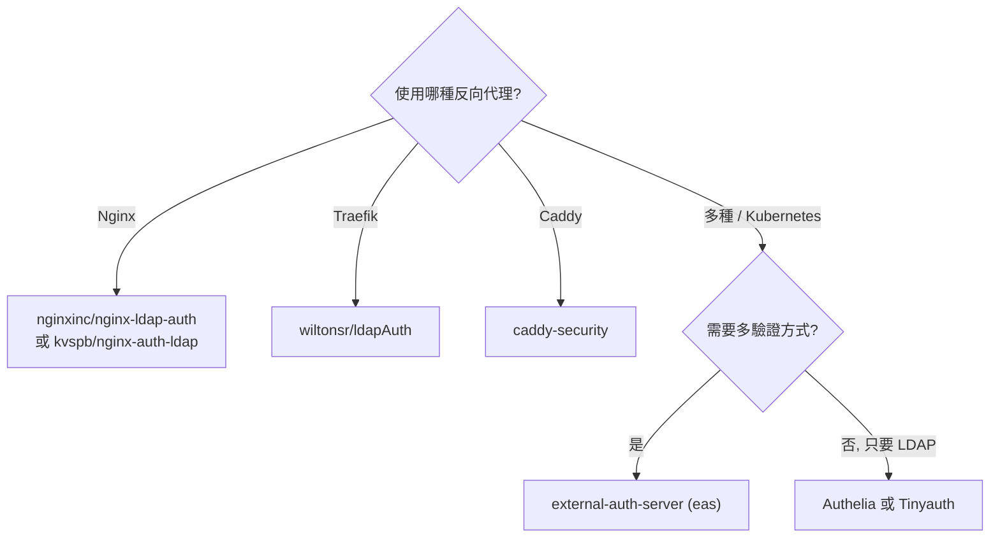

# 可與 LDAP 整合的身分驗證代理 (Auth Proxy) 總覽

## 摘要

本文僅收錄一類工具：**身分驗證代理 (authentication proxy)**，也就是以 forward-auth / reverse-proxy auth middleware 的形式，擋在後端 Web 應用程式之前，並**直接以 LDAP (Lightweight Directory Access Protocol) 目錄**作為帳號密碼驗證來源的 FOSS 元件[^ldap-def]。

本文**刻意排除**身分提供者 (Identity Provider, IdP) 類方案 (例如 Keycloak、Authentik、Dex、Casdoor、Zitadel、Apereo CAS、Kanidm、WSO2、Apache Syncope、Gluu/Janssen 等)，因為那些產品的角色是「對外簽發 OIDC / SAML 權杖」，而非「在反向代理層直接以 LDAP 擋請求」。

以下依「整合方式」分類：Nginx `auth_request` 代理、Traefik 中介軟體 / ForwardAuth、Caddy 外掛，以及可搭配任意反向代理的獨立 forward-auth 服務。所有星號數為 GitHub API 於 2026-11-10 之近似值[^gh-api]。

## 候選方案總覽

| 專案 | 整合方式 | LDAP 支援 | 語言 | 授權 | GitHub 星數 |
| --- | --- | --- | --- | --- | --- |
| Authelia | 任意 proxy forward-auth | 原生 (第一因素後端) | Go | Apache-2.0 | 約 29.6k |
| Tinyauth | 任意 proxy forward-auth | 原生 (LDAP 後端) | Go | AGPL-3.0 | 約 8.5k |
| external-auth-server (eas) | 任意 proxy forward-auth | 原生 (LDAP 外掛) | JavaScript | MIT | 約 0.34k |
| caddy-security (AuthCrunch) | Caddy 外掛 | 原生 | Go | Apache-2.0 | 約 2.3k |
| LemonLDAP::NG | 任意 proxy handler | 原生 (多後端之一) | Perl | GPL (主程式) | 主庫約 84 |
| nginxinc/nginx-ldap-auth | Nginx auth_request | 原生 | Python | BSD-2-Clause | 約 0.71k |
| kvspb/nginx-auth-ldap | Nginx 原生模組 | 原生 | C / Python | BSD-2-Clause | 約 0.76k |
| wiltonsr/ldapAuth | Traefik 中介軟體外掛 | 原生 | Go | Apache-2.0 | 約 0.13k |
| bluewalk/caddy-ldap-basic-auth | Caddy 外掛 | 原生 | Go | MIT | 約 5 |
| BeyazAdam/ldap-auth-proxy | 獨立反向代理 | 原生 | Rust | MIT | 約 0 |
| anudeepd/ldapgate | 獨立代理 / FastAPI middleware | 原生 | Python | MIT | 約 0 |

## A. 可搭配任意反向代理的獨立 forward-auth 服務

這類服務只提供一個 HTTP 驗證端點 (external / forward auth)，由 Nginx、Traefik、Envoy、Ambassador、Istio、Caddy 等反向代理在每個請求時呼叫，最接近 oauth2-proxy 的 forward-auth 使用模式。

### A.1 Authelia

Authelia 是最成熟的「原生 LDAP forward-auth 閘道」。它是一套 Go 撰寫、Apache-2.0 授權的驗證與授權伺服器，可作為 Nginx `auth_request`、Traefik ForwardAuth、Caddy、HAProxy 的驗證後端[^authelia-repo]。其第一因素 (first factor) 後端支援 `ldap` 與 `file` 兩種，LDAP 後端可直接對 OpenLDAP、Active Directory、FreeIPA、GLAuth、LLDAP 等目錄進行綁定驗證，並提供 `base_dn`、`users_filter`、`groups_filter`、`group_search_mode`、StartTLS、LDAPS、連線池與屬性對應等完整選項[^authelia-ldap]。它同時內建 TOTP / WebAuthn 第二因素與存取控制規則[^authelia-ldap]。

### A.2 Tinyauth

Tinyauth 主打「最小」的驗證與授權伺服器，Go 撰寫、AGPL-3.0 授權[^tinyauth-repo]。其官方 README 說明它可作為應用程式的驗證中介軟體，支援 **OAuth 與 LDAP 及存取控制**，並可搭配 Traefik、Nginx、Caddy 等主流反向代理[^tinyauth-repo]。它亦通過 OpenID Certified (Basic OP) 認證，但在此處的定位是 forward-auth 閘道，而非 IdP[^tinyauth-repo]。專案自述仍在積極開發、設定可能變動，採用前宜詳閱版本說明[^tinyauth-repo]。

### A.3 external-auth-server (eas)

`external-auth-server` (簡稱 `eas`) 是一套 JavaScript / Node.js 撰寫、MIT 授權的 external / forward auth 服務，設計目標是「一次部署、保護多個服務」[^eas-repo]。它以可串接的驗證外掛 (authentication plugins) 為架構，官方明列支援 **LDAP**、htpasswd、OpenID Connect、oauth2、JWT 等多種外掛，且同一組態可啟用多個外掛形成驗證鏈[^eas-repo]。它支援任何具備 external / forward auth 能力的反向代理，官方文件中列出 Traefik、Nginx、ingress-nginx、nginx-ingress-controller、Ambassador、Istio、HAProxy Ingress、Contour、Envoy 等整合範例[^eas-repo]。對 Kubernetes 環境提供 Helm chart[^eas-repo]。

### A.4 LemonLDAP::NG

LemonLDAP::NG (LL::NG) 為 Perl 撰寫的 Web 單一登入平台，其官方認證後端清單明列 **LDAP**，可同時作為驗證、使用者資料庫與密碼資料庫[^llng-doc]。它透過「handler」形式部署在 Nginx、Traefik、Caddy、Apache 或 Node.js 之上，扮演保護後端應用的角色[^llng-doc]。其主 GitHub 鏡像星數僅約 84，但發行主要以 Debian / Ubuntu / RHEL 套件與 Docker 映像流通，實際採用度遠高於星數所示[^llng-repo]。

## B. Nginx `auth_request` / 原生模組

Nginx 生態存在兩種 LDAP 驗證作法：外部驗證常駐程式 (daemon) 搭配 `ngx_http_auth_request_module`，以及直接編入 Nginx 的原生模組。

### B.1 nginxinc/nginx-ldap-auth

Nginx 官方 (nginxinc) 提供的示範專案，Python 撰寫、BSD-2-Clause 授權[^nginxldap]。它以 `ngx_http_auth_request_module` 為基礎，透過一支會說 LDAP 的常駐程式對目錄驗證使用者，屬最小可用的參考實作而非完整產品[^nginxldap]。

### B.2 kvspb/nginx-auth-ldap

社群維護的 **Nginx 原生 LDAP 驗證模組**，C 為主、BSD-2-Clause 授權，星數約 0.76k[^kvspb-repo]。它以 Nginx 模組形式直接嵌入，提供 `ldap_server`、`ldap_binddn`、`ldap_search`、`ldap_require` 等指令，可在 Nginx 組態中直接對 LDAP 群組做授權判斷[^kvspb-repo]。相較 daemon 方案，少了額外常駐程式，但需重新編譯 Nginx。

## C. Traefik 中介軟體 / ForwardAuth

### C.1 wiltonsr/ldapAuth

`ldapAuth` 是一套 Go 撰寫、Apache-2.0 授權的 **Traefik 中介軟體外掛**，官方描述其目標是「以類似 Traefik Enterprise 的方式，透過 LDAP 進行驗證」[^wiltonsr-repo]。它以 Traefik Plugin 形式發布 (見 Traefik Plugins 市集)[^wiltonsr-repo]。對純 Traefik 環境而言，它是最直接的「Traefik + LDAP」選項。

### C.2 external-auth-server 與 Traefik

`eas` 亦提供 Traefik 的 forward auth 整合範例 (address 指向 eas 的 `/verify` 端點並附帶 `config_token`)[^eas-repo]。若需要同時支援多種驗證方式，eas 的彈性較單一 LDAP 外掛更高。

## D. Caddy 外掛

### D.1 caddy-security (AuthCrunch)

`caddy-security` 是 Go 撰寫、Apache-2.0 授權的 Caddy v2 AAA 外掛，星數約 2.3k[^caddysec-repo]。其描述明列支援 **LDAP**、本機帳號、OpenID Connect、OAuth 2.0、SAML 等驗證方式，並具備表單式與 Basic 驗證、JWT / PASETO 授權與 MFA[^caddysec-repo]。它以 Caddy 外掛形式直接提供登入入口與存取政策，官方專案 (AuthCrunch) 強調其為非商業、OSI 授權[^authcrunch]。對已使用 Caddy 的環境，它是「Caddy 版且原生吃 LDAP 的驗證閘道」。

### D.2 bluewalk/caddy-ldap-basic-auth

社群小型外掛，Go 撰寫、MIT 授權[^bluewalk-repo]。它以 HTTP Basic Authentication 對 LDAP / LDAPS 驗證憑證，並可要求使用者屬於特定群組 (`group_membership_dn` / `group_membership_attr`)，亦內建連線池與登入速率限制[^bluewalk-repo]。功能聚焦、星數低，適合當作輕量參考或自建基底。

## E. 獨立 LDAP 反向代理 (低星數新專案)

以下專案屬獨立反向代理或中介軟體，設計上直接以 LDAP 驗證後把身分寫入 HTTP 標頭轉發，但皆為新專案 (星數極低)，僅供評估參考[^gh-api]：

- **BeyazAdam/ldap-auth-proxy**：Rust / MIT，自述為「輕量的 Active Directory / LDAP 驗證反向代理」，用於保護內部看板、API、管理介面，會把使用者身分與群組成員注入 HTTP 標頭[^beyazadam-repo]。
- **anudeepd/ldapgate**：Python / MIT，自述為「輕量的 LDAP/AD 驗證代理與 FastAPI 中介軟體」，可作為獨立反向代理或 FastAPI middleware[^ldapgate-repo]。

## 選型建議

- **最成熟、跨代理的選擇**：**Authelia** (任意 proxy forward-auth，原生 LDAP + MFA)。
- **極簡、希望設定單純**：**Tinyauth** (原生 LDAP，OpenID Certified，注意仍為活躍開發)。
- **Kubernetes / 需要 LDAP 與 OIDC 並存**：**external-auth-server** (外掛式，可串接多種驗證)。
- **綁定特定反向代理**：Nginx 用 `nginx-ldap-auth` (daemon) 或 `kvspb/nginx-auth-ldap` (原生模組)；Traefik 用 `wiltonsr/ldapAuth`；Caddy 用 `caddy-security`。

## 來源批判性反思

- **「IdP」與「閘道」角色須分清**：本文刻意排除 IdP；但少數工具 (如 Authelia、Tinyauth、LemonLDAP::NG) 同時具備 OIDC Provider 能力，本文僅就其「forward-auth / 反向代理驗證閘道」角色論述[^authelia-repo][^tinyauth-repo][^llng-doc]。
- **星數不代表成熟度與採用度**：LemonLDAP::NG 主 GitHub 鏡像僅約 84 星，但以發行版套件流通；反之 `eas` (約 0.34k) 與 `wiltonsr/ldapAuth` (約 0.13k) 星數雖低，卻分別是成熟的多代理 forward-auth 與官方 Traefik 外掛[^llng-repo][^eas-repo][^wiltonsr-repo]。
- **授權差異影響商用**：Tinyauth 為 AGPL-3.0、LemonLDAP::NG 主程式為 GPL，雲端或閉源再散布前須確認授權義務；`bluewalk/caddy-ldap-basic-auth` 的 GitHub 授權欄為空，但其 README 標示 MIT，仍建議以儲存庫實際 LICENSE 檔案為準[^tinyauth-repo][^bluewalk-repo]。
- **資料時點**：星數與授權擷取於 2026-11-10，專案狀態可能隨時間變動[^gh-api]。

## 參考文獻

[^ldap-def]: Wikipedia contributors. (2026). Lightweight Directory Access Protocol. *Wikipedia*. Retrieved 2026-11-10, from https://en.wikipedia.org/wiki/Lightweight_Directory_Access_Protocol

[^gh-api]: GitHub. (2026). *GitHub REST API: Repositories* [Data set]. Retrieved 2026-11-10, from https://api.github.com/repos

[^authelia-repo]: Authelia. (n.d.). *authelia/authelia: The Single Sign-On Multi-Factor portal for web apps* [Source code README]. GitHub. Retrieved 2026-11-10, from https://github.com/authelia/authelia

[^authelia-ldap]: Authelia. (n.d.). LDAP. *Authelia Documentation*. Retrieved 2026-11-10, from https://www.authelia.com/configuration/first-factor/ldap/

[^tinyauth-repo]: Tinyauth. (n.d.). *tinyauthapp/tinyauth: The tiniest OpenID Certified authorization and authentication server you have ever seen* [Source code README]. GitHub. Retrieved 2026-11-10, from https://github.com/tinyauthapp/tinyauth

[^eas-repo]: Hansen, T. (n.d.). *travisghansen/external-auth-server: easy auth for reverse proxies* [Source code README]. GitHub. Retrieved 2026-11-10, from https://github.com/travisghansen/external-auth-server

[^llng-doc]: LemonLDAP::NG. (n.d.). Documentation for LemonLDAP::NG 2.0. *LemonLDAP::NG Documentation*. Retrieved 2026-11-10, from https://lemonldap-ng.org/documentation/latest/

[^llng-repo]: LemonLDAP::NG. (n.d.). *LemonLDAPNG/lemonldap-ng: LemonLDAP::NG main code* [Source code repository]. GitHub. Retrieved 2026-11-10, from https://github.com/LemonLDAPNG/lemonldap-ng

[^nginxldap]: NGINX. (n.d.). *nginxinc/nginx-ldap-auth: Example of LDAP authentication using ngx_http_auth_request_module* [Source code repository]. GitHub. Retrieved 2026-11-10, from https://github.com/nginxinc/nginx-ldap-auth

[^kvspb-repo]: kvspb. (n.d.). *kvspb/nginx-auth-ldap: LDAP authentication module for nginx* [Source code repository]. GitHub. Retrieved 2026-11-10, from https://github.com/kvspb/nginx-auth-ldap

[^wiltonsr-repo]: wiltonsr. (n.d.). *wiltonsr/ldapAuth: An open source Traefik Middleware that enables authentication via LDAP in a similar way to Traefik Enterprise* [Source code repository]. GitHub. Retrieved 2026-11-10, from https://github.com/wiltonsr/ldapAuth

[^caddysec-repo]: Greenberg, P. (n.d.). *greenpau/caddy-security: Authentication, Authorization, and Accounting (AAA) App and Plugin for Caddy v2* [Source code repository]. GitHub. Retrieved 2026-11-10, from https://github.com/greenpau/caddy-security

[^authcrunch]: AuthCrunch. (n.d.). *AuthCrunch: Authentication and authorization for Caddy*. Retrieved 2026-11-10, from https://authcrunch.com/

[^bluewalk-repo]: bluewalk. (n.d.). *bluewalk/caddy-ldap-basic-auth: HTTP Basic Authentication for Caddy v2 using an LDAP server* [Source code README]. GitHub. Retrieved 2026-11-10, from https://github.com/bluewalk/caddy-ldap-basic-auth

[^beyazadam-repo]: BeyazAdam. (n.d.). *BeyazAdam/ldap-auth-proxy: A lightweight Active Directory / LDAP authentication reverse proxy* [Source code repository]. GitHub. Retrieved 2026-11-10, from https://github.com/BeyazAdam/ldap-auth-proxy

[^ldapgate-repo]: anudeepd. (n.d.). *anudeepd/ldapgate: Lightweight LDAP/AD authentication proxy and FastAPI middleware* [Source code repository]. GitHub. Retrieved 2026-11-10, from https://github.com/anudeepd/ldapgate
