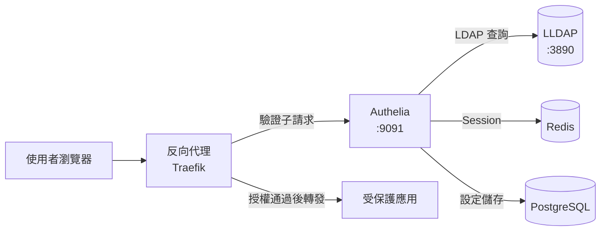

# 以 Authelia 搭配 LDAP 身分提供者（IdP）建立驗證代理（Auth Proxy）：Docker Compose 實作指南

## 摘要

本文說明如何使用 [Authelia](https://github.com/authelia/authelia) 作為**驗證代理（auth proxy／forward-auth 閘道）**，並以 **LDAP 目錄服務作為身分提供者（Identity Provider, IdP）**，透過 **Docker Compose** 完成一整套可運作的部署。本文涵蓋：

- Authelia 的角色與 forward-auth 架構
- 以反向代理（Traefik）承接自動化驗證子請求
- 以 LLDAP（輕量 LDAP）作為 IdP 的完整設定
- 對應的 `docker-compose.yml` 與 `configuration.yml`
- 密鑰（secrets）產生、存取控制（access control）規則與驗證步驟

> 本文為獨立文件，所有背景知識與設定檔內容皆完整收錄，讀者無需其他前置資料即可重現。

---

## 1. Authelia 是什麼？

Authelia 是一套開源的**兩因素驗證（Two-Factor Authentication, 2FA）與單一登入（Single Sign-On, SSO）驗證伺服器**，官方定位為「反向代理的夥伴（companion of reverse proxies）」，也就是「作為反向代理的延伸，提供驗證相關功能」[^intro]。它負責處理：

- 第一因素驗證（帳號／密碼）
- 多種第二因素驗證（TOTP、安全金鑰等）
- 第二因素裝置註冊時的身分驗證
- 自助密碼重設
- 失敗次數過多後的帳號封鎖（regulation）
- 逐資源的授權政策（可要求 1FA、2FA 或直接拒絕）

Authelia 在 GitHub 上的星等約為 **29.6k**（截至 2026 年），最新穩定版為 **v4.39.28**（2026-09-17 發布）[^gh]。

### 1.1 關鍵設計：Authelia 與反向代理「並存」而非「夾在中間」

官方文件強調一個容易誤解的重點：Authelia **直接與反向代理連線，但從不直接與後端應用連線**；客戶端送往受保護 API 的內容（payload）永遠不會到達 Authelia，只有驗證相關的資訊會傳遞過去[^intro]。

因此整體拓樸如下（Mermaid 示意）：



反向代理必須被設定為：每一個進來的請求都產生一個**驗證子請求（authentication subrequest）**送往 Authelia，而 Authelia 回覆反向代理「放行」或「阻擋（導向登入入口或回傳 401）」[^intro][^proxyauth]。

---

## 2. Forward-Auth（代理授權）概念

### 2.1 什麼是 Forward-Auth？

Forward-auth（正向驗證）是一種機制：**反向代理把驗證與授權決策「委外」給一個外部服務（即 Authelia）**。反向代理本身不驗證使用者，而是透過一個 HTTP 子請求把原始請求的詮釋資料（metadata）送給 Authelia，並依 Authelia 的回應決定放行或拒絕[^proxyauth]。

### 2.2 四種代理授權實作

Authelia 針對不同代理提供四種實作端點[^proxyauth]：

| 實作 | 端點 | 適用代理 |
|---|---|---|
| `ForwardAuth` | `/api/authz/forward-auth` | Traefik、Caddy、HAProxy、Skipper |
| `ExtAuthz` | `/api/authz/ext-authz` | Envoy |
| `AuthRequest` | `/api/authz/auth-request` | NGINX、NGINX Proxy Manager、SWAG |
| `Legacy` | `/api/verify` | 舊版設定（已棄用） |

### 2.3 驗證流程（6 步）

依官方架構說明[^arch]：

1. 未驗證使用者首次請求受保護資源，觸及反向代理。
2. 反向代理送出驗證子請求給 Authelia；Authelia 偵測到**沒有 session cookie**，回覆「未驗證」。
3. 反向代理將使用者**重新導向**至 Authelia 驗證入口（例如 `https://auth.example.com`）。
4. 使用者在入口完成驗證（1FA，必要時再加 2FA），取得一個對受保護網域子網域皆有效的 **session cookie**。
5. 使用者被導回原始資源。
6. 後續請求會帶上 session cookie，Authelia 驗證通過後回覆 HTTP 200，代理放行至後端。Authelia 亦可注入身分標頭（`Remote-User`、`Remote-Groups`、`Remote-Email`、`Remote-Name`）。

> **重要限制**：Authelia 僅能運作於 **HTTPS** 之上，因為 session cookie 需要安全連線[^intro]。

### 2.4 支援的反向代理

官方「Supported Proxies」頁面列出支援矩陣[^proxies]：Traefik、Caddy（v2.5.1+）、NGINX（需 `ngx_http_auth_request_module`）、Envoy、HAProxy（需 lua 模組）、Skipper、NGINX Proxy Manager、SWAG 均支援；Apache 與 IIS 則**不支援**。

本文示範以 **Traefik** 作為反向代理（官方標示為 `ForwardAuth` 實作）。

---

## 3. 為何選 LDAP 作為 IdP，以及 LLDAP 的定位

Authelia 的驗證後端（`authentication_backend`）可為「檔案式（file）」或「LDAP 式（ldap）」[^ldap]。要使用**既有目錄服務（如 Active Directory、OpenLDAP）作為身分提供者**，即採用 LDAP 後端。

本文的 IdP 選擇 **LLDAP**（Light LDAP），原因：

- Authelia 官方**原生支援** `implementation: 'lldap'`，並內建對應的預設篩選器與屬性映射，設定極簡[^lldaplogin]。
- LLDAP 是輕量、易維護的 LDAP 實作，GitHub 星等約 **6.6k**，最新版本 **v0.6.3**[^lldapgh]。
- 內建 Web 管理介面（連接埠 **17170**），方便新增使用者與群組[^lldapinstall]。

若你的環境已有 OpenLDAP 或 Active Directory，只需把 `implementation` 改為對應值（見第 6.3 節）並依該實作的預設值調整即可。

---

## 4. 目錄結構

Docker Compose 部署的建議目錄結構如下[^docker]：

```
your-project/
├── compose.yml
├── authelia/
│   ├── configuration.yml
│   └── secrets/
│       ├── SESSION_SECRET
│       ├── STORAGE_ENCRYPTION_KEY
│       ├── JWT_SECRET
│       └── STORAGE_PASSWORD
├── lldap/            # LLDAP 資料
├── redis/            # Redis session 資料
└── postgres/         # Authelia 設定儲存資料
```

- 設定檔掛載至容器的 `/config`，其中必須有 `configuration.yml`[^docker]。
- 密鑰目錄掛載至 `/secrets`，Authelia 以 `_FILE` 結尾的環境變數讀取[^secrets]。

---

## 5. 完整 Docker Compose 範例

以下 `compose.yml` 整合了五個服務：`traefik`（反向代理）、`authelia`（驗證代理）、`lldap`（IdP）、`redis`（session 儲存）、`postgres`（設定儲存）。結構以官方「lite」範例為基礎擴充 LDAP 與 PostgreSQL[^composelite][^traefikdocs]。

```yaml
---
networks:
  net:
    driver: 'bridge'

services:
  authelia:
    image: 'docker.io/authelia/authelia:4.39.28'
    container_name: 'authelia'
    volumes:
      - './authelia:/config'
      - './authelia/secrets:/secrets'
    networks:
      net: {}
    environment:
      TZ: 'Asia/Taipei'
      AUTHELIA_SESSION_SECRET_FILE: '/secrets/SESSION_SECRET'
      AUTHELIA_STORAGE_ENCRYPTION_KEY_FILE: '/secrets/STORAGE_ENCRYPTION_KEY'
      AUTHELIA_IDENTITY_VALIDATION_RESET_PASSWORD_JWT_SECRET_FILE: '/secrets/JWT_SECRET'
      AUTHELIA_STORAGE_POSTGRES_PASSWORD_FILE: '/secrets/STORAGE_PASSWORD'
      AUTHELIA_AUTHENTICATION_BACKEND_LDAP_PASSWORD_FILE: '/secrets/LDAP_PASSWORD'
    labels:
      traefik.enable: 'true'
      traefik.http.routers.authelia.rule: 'Host(`auth.example.com`)'
      traefik.http.routers.authelia.entrypoints: 'https'
      traefik.http.routers.authelia.tls: 'true'
      traefik.http.routers.authelia.tls.certresolver: 'letsencrypt'
      traefik.http.middlewares.authelia.forwardAuth.address: 'http://authelia:9091/api/authz/forward-auth'
      traefik.http.middlewares.authelia.forwardAuth.trustForwardHeader: 'true'
      traefik.http.middlewares.authelia.forwardAuth.maxResponseBodySize: '8192'
      traefik.http.middlewares.authelia.forwardAuth.authResponseHeaders: 'Remote-User,Remote-Groups,Remote-Name,Remote-Email'
    depends_on:
      - redis
      - postgres
      - lldap
    restart: 'unless-stopped'
    healthcheck:
      disable: true

  redis:
    image: 'redis:alpine'
    container_name: 'redis'
    volumes:
      - './redis:/data'
    networks:
      net: {}
    restart: 'unless-stopped'

  postgres:
    image: 'postgres:16-alpine'
    container_name: 'postgres'
    volumes:
      - './postgres:/var/lib/postgresql/data'
    networks:
      net: {}
    environment:
      POSTGRES_USER: 'authelia'
      POSTGRES_PASSWORD: 'authelia'
      POSTGRES_DB: 'authelia'
    restart: 'unless-stopped'

  lldap:
    image: 'lldap/lldap:stable'
    container_name: 'lldap'
    volumes:
      - './lldap:/data'
    networks:
      net: {}
    environment:
      TZ: 'Asia/Taipei'
      LLDAP_JWT_SECRET: 'REPLACE_WITH_RANDOM'
      LLDAP_KEY_SEED: 'REPLACE_WITH_RANDOM'
      LLDAP_LDAP_BASE_DN: 'dc=example,dc=com'
      LLDAP_LDAP_USER_PASS: 'CHANGE_ME'
    ports:
      - '17170:17170'   # LLDAP Web 管理介面
    restart: 'unless-stopped'

  traefik:
    image: 'traefik:v3.6.13'
    container_name: 'traefik'
    volumes:
      - './traefik:/etc/traefik'
      - '/var/run/docker.sock:/var/run/docker.sock'
    networks:
      net: {}
    labels:
      traefik.enable: 'true'
      traefik.http.routers.api.rule: 'Host(`traefik.example.com`)'
      traefik.http.routers.api.entrypoints: 'https'
      traefik.http.routers.api.service: 'api@internal'
      traefik.http.routers.api.tls: 'true'
      traefik.http.routers.api.tls.certresolver: 'letsencrypt'
      traefik.http.routers.api.middlewares: 'authelia@docker'
    ports:
      - '80:80/tcp'
      - '443:443/tcp'
      - '443:443/udp'
    command:
      - '--api'
      - '--providers.docker=true'
      - '--providers.docker.exposedByDefault=false'
      - '--entrypoints.http=true'
      - '--entrypoints.http.address=:80'
      - '--entrypoints.http.http.redirections.entrypoint.to=https'
      - '--entrypoints.http.http.redirections.entrypoint.scheme=https'
      - '--entrypoints.https=true'
      - '--entrypoints.https.address=:443'
      - '--certificatesResolvers.letsencrypt.acme.email=your-email@your-domain.com'
      - '--certificatesResolvers.letsencrypt.acme.storage=/etc/traefik/acme.json'
      - '--certificatesResolvers.letsencrypt.acme.httpChallenge.entryPoint=http'
      - '--log=true'
      - '--log.level=DEBUG'

  secure:
    image: 'traefik/whoami'
    container_name: 'secure'
    networks:
      net: {}
    labels:
      traefik.enable: 'true'
      traefik.http.routers.secure.rule: 'Host(`secure.example.com`)'
      traefik.http.routers.secure.entrypoints: 'https'
      traefik.http.routers.secure.tls: 'true'
      traefik.http.routers.secure.tls.certresolver: 'letsencrypt'
      traefik.http.routers.secure.middlewares: 'authelia@docker'
    restart: 'unless-stopped'
```

重點說明：

- **受保護的應用**（此例為 Traefik 的 `whoami` 示範服務）只需在 labels 加上 `traefik.http.routers.<name>.middlewares: 'authelia@docker'`，即套用 Authelia forward-auth 中介層[^traefikdocs][^composelite]。
- **Authelia 容器連接埠為 9091**；由於 Traefik 與 Authelia 同在 `net` 網路，不需對外暴露 9091[^docker]。
- **`maxResponseBodySize: '8192'`** 與 **`authResponseHeaders`** 為 forward-auth 的建議設定[^composelite]。
- 生產環境建議把映像固定於特定版本標籤（此例 `4.39.28`）而非 `latest`，因 Authelia 迭代快速且含破壞性變更[^docker]。

---

## 6. Authelia `configuration.yml`

### 6.1 核心設定（含 LDAP 後端與 PostgreSQL 儲存）

將以下內容寫入 `authelia/configuration.yml`。LDAP 區塊採 `implementation: 'lldap'`，其餘屬性由 Authelia 內建預設值填入[^lldaplogin]；儲存後端採 PostgreSQL[^postgres]。

```yaml
---
server:
  address: 'tcp://:9091'

log:
  level: 'debug'

totp:
  issuer: 'example.com'

identity_validation:
  reset_password:
    jwt_secret: 'REPLACE_WITH_RANDOM_64_CHARS'

authentication_backend:
  ldap:
    implementation: 'lldap'
    address: 'ldap://lldap:3890'
    base_dn: 'DC=example,DC=com'
    user: 'UID=authelia,OU=people,DC=example,DC=com'
    password: 'REPLACE_WITH_LDAP_PASSWORD'

access_control:
  default_policy: 'deny'
  rules:
    - domain: 'auth.example.com'
      policy: 'bypass'
    - domain: 'secure.example.com'
      policy: 'two_factor'
    - domain: 'traefik.example.com'
      policy: 'one_factor'

session:
  secret: 'REPLACE_WITH_RANDOM_64_CHARS'
  cookies:
    - name: 'authelia_session'
      domain: 'example.com'
      authelia_url: 'https://auth.example.com'
      expiration: '1 hour'
      inactivity: '5 minutes'
  redis:
    host: 'redis'
    port: 6379

regulation:
  max_retries: 3
  find_time: '2 minutes'
  ban_time: '5 minutes'

storage:
  encryption_key: 'REPLACE_WITH_RANDOM_64_CHARS'
  postgres:
    address: 'tcp://postgres:5432'
    database: 'authelia'
    username: 'authelia'
    password: 'REPLACE_WITH_POSTGRES_PASSWORD'
    timeout: '5s'

notifier:
  filesystem:
    filename: '/config/notification.txt'
```

### 6.2 LDAP 後端 `implementation: 'lldap'` 的內建預設值

採用 `lldap` 實作時，下列項目**無需手動設定**，Authelia 會自動套用[^lldaplogin]：

| 項目 | 預設值 |
|---|---|
| `additional_users_dn` | `OU=people` |
| `additional_groups_dn` | `OU=groups` |
| `username_attribute` | `uid` |
| `mail_attribute` | `mail` |
| `display_name_attribute` | `cn` |
| `group_name_attribute` | `cn` |
| `member_of_attribute` | `memberOf` |
| `users_filter` | `(&(\|({username_attribute}={input})({mail_attribute}={input}))(objectClass=person))` |
| `groups_filter` | `(&(member={dn})(objectClass=groupOfUniqueNames))` |

> 官方亦註明：LLDAP 沒有可供判斷**帳號停用／鎖定、密碼過期、帳號過期**的屬性，因此預設篩選器中不含這類排除條件[^lldaplogin]。

> `groups_filter` 的實際預設值以 Authelia 原始碼為準（`groupOfUniqueNames`），文件頁面可能顯示為 `groupOfNames`[^schema]。

### 6.3 改用其他 LDAP 實作（OpenLDAP／Active Directory）

Authelia 支援的 `implementation` 有效值共有六種（預設為 `custom`）[^ldapintg][^schema]：

| 值 | 目標目錄 | 預設 `username` 屬性 |
|---|---|---|
| `custom` | 通用（**不提供** `users_filter`／`groups_filter` 預設，須自行填寫） | `uid` |
| `activedirectory` | Microsoft Active Directory | `sAMAccountName` |
| `rfc2307bis` | RFC2307bis 相容伺服器（如 OpenLDAP） | `uid` |
| `freeipa` | FreeIPA | `uid` |
| `lldap` | LLDAP | `uid` |
| `glauth` | GLAuth | `cn` |

若 IdP 不是 LLDAP，`authentication_backend.ldap` 需改為對應實作並填入相關篩選器[^ldap]。以下為常見對應：

**OpenLDAP（rfc2307 系）**[^composelite]：

```yaml
authentication_backend:
  ldap:
    implementation: 'rfc2307bis'
    address: 'ldap://openldap:389'
    base_dn: 'DC=example,DC=com'
    user: 'CN=admin,DC=example,DC=com'
    password: 'REPLACE_WITH_LDAP_PASSWORD'
    additional_users_dn: 'OU=users'
    additional_groups_dn: 'OU=groups'
    users_filter: '(&(|({username_attribute}={input})({mail_attribute}={input}))(objectClass=person))'
    groups_filter: '(&(member={dn})(objectClass=groupOfNames))'
```

**Active Directory**[^ldap]：

`implementation: 'activedirectory'` 時，`username` 預設為 `sAMAccountName`、`display_name` 為 `displayName`、`group_name` 為 `cn`，且 `users_filter`／`groups_filter` 皆有內建預設值，通常只需提供 `address`、`base_dn`、`user`、`password`[^ldap]。

> **使用 secret file 提供 LDAP 密碼**：可將密碼寫入檔案並設定環境變數 `AUTHELIA_AUTHENTICATION_BACKEND_LDAP_PASSWORD_FILE`（見第 5 節 compose 範例）；亦可對 `authentication_backend.ldap.tls.certificate_chain` 與 `...tls.private_key` 使用對應的 `_FILE` 變數。注意同一密鑰**不可**同時以設定檔與 `_FILE` 變數提供，否則 Authelia 會啟動失敗[^secrets]。

### 6.4 LDAP 後端關鍵欄位說明

依官方第一因素 LDAP 設定頁[^ldap]：

| 欄位 | 必填 | 說明 |
|---|---|---|
| `address` | 是 | LDAP URL，格式 `[scheme://]host[:port]`；支援 `ldap`、`ldaps`、`ldapi` |
| `implementation` | 否 | `custom` / `activedirectory` / `rfc2307` / `lldap` 等，決定預設篩選器與屬性 |
| `base_dn` | 情境必填 | 所有查詢的基礎容器，如 `DC=example,DC=com` |
| `additional_users_dn` | 否 | 附加在使用者查詢路徑，如 `OU=users` |
| `additional_groups_dn` | 否 | 附加在群組查詢路徑，如 `OU=groups` |
| `users_filter` | 情境必填 | 判斷合法使用者的篩選器，含 `{username_attribute}` 與 `{input}` 佔位符 |
| `groups_filter` | 情境必填 | 群組篩選器，含 `{dn}` 佔位符 |
| `user` | 是 | 查詢／改密用的 bind 帳號 DN |
| `password` | 是 | bind 帳號密碼，建議改用 secret file |
| `attributes.username` | 情境必填 | 對應 Authelia 使用者名稱，必須與 `users_filter` 中的 `{username_attribute}` 一致 |
| `attributes.mail` | 情境必填 | 電子郵件，密碼重設與裝置註冊的關鍵 |
| `attributes.group_name` | 情境必填 | 決定群組名稱的屬性 |

> **唯一性要求**：使用者必須能被 `username` 屬性唯一識別，若兩名使用者共用同一值，驗證將失敗。AD 建議用 `sAMAccountName`，其他實作建議用 `uid`[^ldap]。

---

## 7. 存取控制（access control）

`access_control` 採**由上而下、首個完全符合的規則勝出**的順序評估；若無任何規則符合，則套用 `default_policy`[^acl]。

`default_policy` 可為 `deny`（建議）、`bypass`、`one_factor`、`two_factor`。官方強烈建議設為 `deny`[^acl]。

規則支援的條件（同一規則內所有條件為 AND，條件內的多值為 OR）[^acl]：

| 條件 | 說明 |
|---|---|
| `domain` / `domain_regex` | 主機名稱（支援萬用字元與正規表達式） |
| `subject` | 已驗證使用者屬性，前綴 `user:`、`group:`、`oauth2:client:` |
| `networks` | 來源 IP／CIDR，或 `definitions.network` 中命名的網路 |
| `methods` | HTTP 方法 |
| `resources` | URL 路徑正規表達式（區分大小寫） |
| `query` | 查詢參數鍵值與運算子 |
| `policy` | 動作：`deny` / `bypass` / `one_factor` / `two_factor` |

完整範例[^acl]：

```yaml
access_control:
  default_policy: 'deny'
  rules:
    - domain: 'public.example.com'
      policy: 'bypass'

    - domain: '*.example.com'
      policy: 'bypass'
      methods:
        - 'OPTIONS'

    - domain: 'secure.example.com'
      policy: 'two_factor'

    - domain: 'dev.example.com'
      resources:
        - '^/groups/dev([/?].*)?$'
      subject: 'group:dev'
      policy: 'two_factor'
```

> **注意**：`subject` 不能與 `policy: bypass` 併用，因為識別主體需先完成至少 `one_factor` 驗證[^acl]。

---

## 8. 密鑰（Secrets）產生

Authelia 支援以 `_FILE` 結尾的環境變數從檔案載入密鑰，避免明碼寫入設定檔[^secrets]。建議產生下列密鑰：

| 密鑰用途 | 設定鍵 | 最小長度 | 建議 |
|---|---|---|---|
| Session 密鑰 | `session.secret` | 無明文規定 | 64+ 位隨機英數 |
| 儲存加密金鑰 | `storage.encryption_key` | **20 字元** | 64+ 位隨機英數 |
| 重設密碼 JWT 密鑰 | `identity_validation.reset_password.jwt_secret` | 無明文規定 | 64+ 位隨機英數 |
| 資料庫密碼 | `storage.postgres.password` | 依資料庫 | 依資料庫 |

產生隨機值（官方建議 64 位英數）[^genvalues]：

```bash
# 方法一：用 Authelia 自身 CLI
docker run --rm authelia/authelia:4.39.28 \
  authelia crypto rand --length 64 --charset alphanumeric

# 方法二：用 OpenSSL
openssl rand -hex 64
```

將輸出分別寫入 `authelia/secrets/` 下的 `SESSION_SECRET`、`STORAGE_ENCRYPTION_KEY`、`JWT_SECRET`、`STORAGE_PASSWORD`、`LDAP_PASSWORD`。

若使用**檔案式驗證後端**（非 LDAP），需以 argon2id 產生密碼雜湊[^genvalues]：

```bash
docker run --rm -it authelia/authelia:4.39.28 \
  authelia crypto hash generate argon2
```

Authelia 的 argon2id 預設參數為 `iterations=3`、`memory=65536 KiB`、`parallelism=4`；雜湊須以 `$argon2id$` 開頭[^genvalues]。**本文採用 LDAP 後端，此步驟可略過**，因為密碼由 LLDAP 管理。

---

## 9. 啟動與驗證步驟

1. **建立目錄與密鑰**：建立第 4 節結構，產生第 8 節的密鑰檔案。
2. **設定 DNS／憑證**：`auth.example.com`、`secure.example.com` 等指向主機；Traefik 以 Let's Encrypt 自動簽發憑證（見 compose 的 `certresolver`）[^traefikdocs]。
3. **啟動**：
   ```bash
   docker compose -f compose.yml up -d
   ```
4. **建立 LDAP 使用者**：開啟 `http://<host>:17170` 的 LLDAP 管理介面（管理員 DN 預設為 `cn=admin,ou=people,dc=example,dc=com`），新增使用者與群組[^lldapinstall]。別忘了建立供 Authelia 綁定用的服務帳號 `authelia`（即設定中 `user: 'UID=authelia,OU=people,...'`）。
5. **檢查健康狀態**：Authelia 健康檢查端點為 `/api/health`（容器埠 9091），伺服器接受請求時回傳 HTTP 200[^docker]。verbose 版本 `/api/health/verbose` 會額外探測儲存、session、使用者後端，全數通過回 200，否則回 503[^docker]。
6. **測試保護效果**：瀏覽 `https://secure.example.com`，應被導向 Authelia 入口要求登入；登入後再回跳即通過。`https://traefik.example.com` 依規則只需 `one_factor`，可對照驗證授權政策差異。

---

## 10. 常見注意事項

- **必須 HTTPS**：session cookie 需要安全連線，Authelia 無法在純 HTTP 下正常運作[^intro]。
- **cookie 網域**：`session.cookies[].domain` 需為受保護網域的根網域（如 `example.com`），`authelia_url` 指向驗證入口[^composelite]。
- **多實例／HA**：跨多個 Authelia 實例時，Redis session 儲存為必要[^composelite]。
- **版本固定**：避免使用 `latest`，改固定版本標籤以降低破壞性變更風險[^docker]。
- **權限與非 root**：可用 `user: '1000:1000'` 直接指定非 root 使用者，或使用 `PUID`／`PGID` 讓容器從 root 降權後自行調整檔案權限[^docker]。

---

## 參考文獻

[^intro]: Authelia. (n.d.). Introduction. Retrieved 2026-11-07, from https://www.authelia.com/overview/prologue/introduction/

[^arch]: Authelia. (n.d.). Architecture. Retrieved 2026-11-07, from https://www.authelia.com/overview/prologue/architecture/

[^proxies]: Authelia. (n.d.). Supported proxies. Retrieved 2026-11-07, from https://www.authelia.com/overview/prologue/supported-proxies/

[^proxyauth]: Authelia. (n.d.). Proxy authorization. Retrieved 2026-11-07, from https://www.authelia.com/reference/guides/proxy-authorization/

[^ldap]: Authelia. (n.d.). LDAP. Retrieved 2026-11-07, from https://www.authelia.com/configuration/first-factor/ldap/

[^lldaplogin]: Authelia. (n.d.). LLDAP. Retrieved 2026-11-07, from https://www.authelia.com/integration/ldap/lldap/

[^traefikdocs]: Authelia. (n.d.). Traefik. Retrieved 2026-11-07, from https://www.authelia.com/integration/proxies/traefik/

[^docker]: Authelia. (n.d.). Docker. Retrieved 2026-11-07, from https://www.authelia.com/integration/deployment/docker/

[^acl]: Authelia. (n.d.). Access control. Retrieved 2026-11-07, from https://www.authelia.com/configuration/security/access-control/

[^secrets]: Authelia. (n.d.). Secrets. Retrieved 2026-11-07, from https://www.authelia.com/configuration/methods/secrets/

[^genvalues]: Authelia. (n.d.). Generating secure values. Retrieved 2026-11-07, from https://www.authelia.com/reference/guides/generating-secure-values/

[^postgres]: Authelia. (n.d.). PostgreSQL. Retrieved 2026-11-07, from https://www.authelia.com/configuration/storage/postgres/

[^composelite]: Authelia. (n.d.). examples/compose/lite/compose.yml [Source code]. Retrieved 2026-11-07, from https://github.com/authelia/authelia/blob/master/examples/compose/lite/compose.yml

[^lldapinstall]: lldap. (n.d.). Install. Retrieved 2026-11-07, from https://github.com/lldap/lldap/blob/main/docs/install.md

[^gh]: authelia/authelia. (n.d.). Retrieved 2026-11-07, from https://github.com/authelia/authelia

[^lldapgh]: lldap/lldap. (n.d.). Retrieved 2026-11-07, from https://github.com/lldap/lldap

[^ldapintg]: Authelia. (n.d.). LDAP integration. Retrieved 2026-11-07, from https://www.authelia.com/integration/ldap/introduction/

[^schema]: authelia/authelia. (n.d.). internal/configuration/schema/authentication.go [Source code]. Retrieved 2026-11-07, from https://github.com/authelia/authelia/blob/master/internal/configuration/schema/authentication.go
