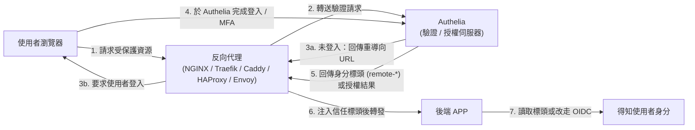
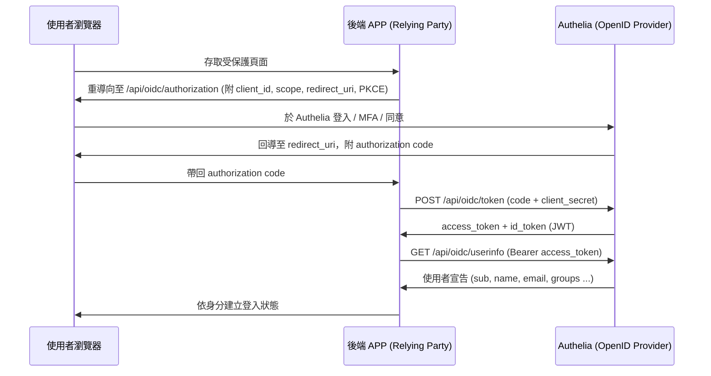

# 當 APP 不自行實作 AuthN，改由 Authelia 保護後，APP 如何取得使用者的 AuthN 資訊？

## 摘要

當一個應用程式（以下稱 APP）不自行實作身分驗證（AuthN, Authentication）功能，而是交由反向代理（reverse proxy）搭配 Authelia 來保護時，APP 要取得「目前登入的使用者是誰」這種 AuthN 資訊，主要有兩條路徑：**(1) 信任標頭單一登入（Trusted Header SSO / Forward Auth）**，由反向代理在通過驗證後，把 Authelia 回傳的身分標頭注入到送往 APP 的請求中；以及 **(2) OpenID Connect（OIDC）**，APP 本身扮演 Relying Party，透過 Authelia 提供的 OIDC Provider 端點，以標準流程取得 ID Token 與 UserInfo。本文說明這兩種機制的原理、可取得的資訊欄位、設定方式與安全性考量。[^intro]

---

## 1. 背景：Authelia 在架構中的角色

Authelia 是一個開源的身分驗證與授權伺服器（authentication and authorization server），以 Go 語言撰寫，採用 Apache 2.0 授權，在 GitHub 上約有 2.96 萬顆星（約 29,600 stars），最新版本為 v4.39.28（2026-09-17 發布）。它的定位是「為網頁應用程式提供單一登入（SSO）的多因素入口（SSO Multi-Factor portal for web applications）」，支援多因素驗證（MFA/2FA）、WebAuthn/Passkey、TOTP、LDAP 等，並且是 OpenID 認證（OpenID Certified™）的 OpenID Connect 1.0 Provider。[^github][^overview]

在典型部署中，Authelia 站在反向代理（如 NGINX、Traefik、Caddy、HAProxy、Envoy/Istio）之後，使用者先被導向 Authelia 完成登入，Authelia 再告訴反向代理「這個請求已通過驗證，使用者是誰」，反向代理才把請求轉發給後端的 APP。整個架構如下圖所示。



依據整合方式的不同，APP 取得 AuthN 資訊的方法分成下列兩大類。

---

## 2. 方法一：信任標頭單一登入（Trusted Header SSO / Forward Auth）

### 2.1 原理

這種模式又稱 **trusted header authentication**、**header authentication**、**header SSO**。其流程是：反向代理對 Authelia 的授權端點發出一個「轉送驗證（forward authentication）」請求；若驗證成功，Authelia 會以 **回應標頭（response headers）** 的形式回傳使用者的身分。反向代理（不是瀏覽器）再負責把這些標頭注入到它送往 APP 的請求中。[^trusted]

關鍵觀念：**這些標頭不是給瀏覽器看的，而是供內部（反向代理 → APP）溝通使用**。Authelia 官方明確指出，這些標頭是回傳給反向代理，再由反向代理注入 APP 的 HTTP 端點請求；APP 則自行決定是否信任這些標頭，若信任，便可據此自動把使用者登入。[^trusted]

### 2.2 可取得的身分標頭

Authelia 的 `/api/authz/*` 或舊版 `/api/verify` 端點在轉送驗證成功後會回傳下列預設標頭，可經由信任網路由反向代理轉發給 APP：[^trusted][^authz]

| 標頭名稱 | 說明 | 範例 |
|---|---|---|
| `Remote-User` | 使用者的使用者名稱（username） | `john` |
| `Remote-Groups` | 使用者所屬群組（以逗號分隔） | `admin,dev` |
| `Remote-Name` | 使用者的顯示名稱（display name） | `John Smith` |
| `Remote-Email` | 使用者的電子郵件地址 | `jsmith@example.com` |

這些標頭的名稱與其對應的「使用者屬性（user attribute）」可以在 Authelia 的 `server.endpoints.authz.<name>.headers` 中自行改寫；官方範例即把 `Remote-User` 對映到 `username`、`Remote-Groups` 對映到 `groups`、`Remote-Name` 對映到 `display_name`、`Remote-Email` 對映到 `email`。此設定會**完全取代**預設標頭，因此若仍需要上述四個預設標頭，必須一併寫入。[^authz]

值得注意的是，除了 `Remote-User`、`Remote-Groups`、`Remote-Name`、`Remote-Email` 之外，社群常提到的 `Remote-Sub`、`Remote-Session-Username`、`Remote-Session-Id`、`Remote-Roles`、`Remote-Hidden-Groups` 等標頭，在官方反向代理設定範例中並未被明確列出；Envoy 與 Istio 因採 `remote-*`、`authelia-*` 前綴萬用字元，才會自動放行任意符合前綴的標頭。[^proxies]

### 2.3 Authelia 的授權端點（Authorization Endpoints）

Authelia 提供幾種轉送驗證「實作（implementation）」，分別對應不同反向代理。預設端點如下表：[^proxy-authz]

| 名稱 | 路徑 | 實作 | 對應反向代理 |
|---|---|---|---|
| `forward-auth` | `/api/authz/forward-auth` | ForwardAuth | Traefik、Caddy、HAProxy（Lua 外掛）、Skipper |
| `ext-authz` | `/api/authz/ext-authz` | ExtAuthz | Envoy（HTTP ExtAuthz Filter） |
| `auth-request` | `/api/authz/auth-request` | AuthRequest | NGINX（`auth_request` 模組） |
| `legacy` | `/api/verify` | Legacy | 舊版相容 |

### 2.4 各反向代理的設定範例

**NGINX（`auth_request`）**：使用內部 location 呼叫 Authelia，並以 `auth_request_set` 取出回應標頭、再以 `proxy_set_header` 注入上游。AuthRequest 實作本身**不支援自動重導向**，需由 NGINX 設定負責，Authelia 會以 `Location` 標頭回傳應重導向的 URL。[^nginx][^proxy-authz]

```nginx
location /internal/authelia/authz {
    internal;
    proxy_pass http://authelia:9091/api/authz/auth-request;
    proxy_set_header X-Original-Method $request_method;
    proxy_set_header X-Original-URL $scheme://$host$request_uri;
    proxy_set_header X-Forwarded-For $remote_addr;
}

location / {
    auth_request /internal/authelia/authz;

    auth_request_set $user   $upstream_http_remote_user;
    auth_request_set $groups $upstream_http_remote_groups;
    auth_request_set $name   $upstream_http_remote_name;
    auth_request_set $email  $upstream_http_remote_email;

    proxy_set_header Remote-User   $user;
    proxy_set_header Remote-Groups $groups;
    proxy_set_header Remote-Name   $name;
    proxy_set_header Remote-Email  $email;

    proxy_pass http://app:8080;
}
```

**Traefik（ForwardAuth）**：以 ForwardAuth 中介軟體呼叫 Authelia，並用 `authResponseHeaders` 指定要轉發的身分標頭。[^traefik]

```yaml
http:
  middlewares:
    authelia:
      forwardAuth:
        address: 'http://authelia:9091/api/authz/forward-auth'
        trustForwardHeader: true
        authResponseHeaders:
          - 'Remote-User'
          - 'Remote-Groups'
          - 'Remote-Email'
          - 'Remote-Name'
```

**Caddy（`forward_auth`）**：以 `copy_headers` 複製 Authelia 回傳的標頭到上游請求。[^caddy]

```caddyfile
nextcloud.example.com {
    forward_auth authelia:9091 {
        uri /api/authz/forward-auth
        copy_headers Remote-User Remote-Groups Remote-Email Remote-Name
    }
    reverse_proxy nextcloud:80
}
```

**HAProxy（Lua 外掛）**：透過 `lua.auth-intercept` 指定要擷取的身分標頭清單（`remote-user,remote-groups,remote-name,remote-email`）。[^haproxy]

**Envoy / Istio（ExtAuthz）**：以 `allowed_upstream_headers`（Envoy）或 `headersToUpstreamOnAllow`（Istio）設定允許轉發給上游的標頭，通常直接指定前綴 `remote-*` 與 `authelia-*` 萬用字元。[^envoy]

### 2.5 安全性考量

Authelia 官方對此模式有明確的安全建議：[^trusted]

- 這些標頭**只應注入到 APP、不應回傳給瀏覽器**。
- APP 應設定一份「信任來源網路（trusted remote networks）」清單，只信任來自反向代理的請求。
- APP 偵測到的來源位址，是**反向代理的 TCP 來源位址**（不是 Authelia 的位址），因為標頭是由代理送到 APP 的。
- 反向代理必須確保**只有 Authelia 能設定這些標頭**，其他來源的標頭一律不得轉發，應由 Authelia 的標頭取代。
- 在 Docker 環境中，需使用代理容器在共用網路上的**靜態 IP**；不應以整個 Docker 網路作為信任範圍，因為任何被入侵的容器都可能據此繞過驗證。

---

## 3. 方法二：OpenID Connect（APP 作為 Relying Party）

### 3.1 原理

若希望 APP 與 Authelia 之間的整合有標準協定可循、不依賴標頭代理，可讓 APP 扮演 OIDC 的 **Relying Party（RP）**。Authelia 通過 OpenID Connect 1.0 認證，實作 Basic OP、Implicit OP、Hybrid OP、Form Post OP、Config OP 等 profile，因此支援標準的 OIDC 程式庫。[^overview][^oidc-intro]

在此模式下，APP 不會「被動接收」身分，而是**主動發起 OIDC 授權流程**：把使用者導向 Authelia 授權端點，完成登入後取回授權碼（authorization code），再以自身憑證向 Token 端點換取存取權杖（access token）與 ID Token，最後以存取權杖向 UserInfo 端點取得使用者身分宣告。流程如下圖。



### 3.2 Authelia 提供的 OIDC 端點

所有路徑相對於 Authelia 的根網址（例如 `https://auth.example.com`）：[^oidc-intro]

| 端點 | 路徑 | APP 的用途 |
|---|---|---|
| Discovery（OIDC） | `/.well-known/openid-configuration` | 自動探索所有端點 |
| Discovery（OAuth 2.0 AS Metadata） | `/.well-known/oauth-authorization-server` | 同上（OAuth 2.0 版本） |
| JWKS | `/jwks.json` | 取得公鑰，驗證 ID Token 簽章 |
| Authorization | `/api/oidc/authorization` | 發起授權流程 |
| Token | `/api/oidc/token` | 以授權碼換取 token、更新 token |
| UserInfo | `/api/oidc/userinfo` | 以 access token 取得使用者宣告 |
| Pushed Authorization Request (PAR) | `/api/oidc/pushed-authorization-request` | 後通道預先註冊授權請求（RFC 9126） |
| Device Authorization | `/api/oidc/device-authorization` | 裝置流程（RFC 8628） |
| Introspection | `/api/oidc/introspection` | 檢查 token 是否仍有效（RFC 7662） |
| Revocation | `/api/oidc/revocation` | 撤銷 token（RFC 7009） |

### 3.3 如何取得使用者身分：ID Token 與 UserInfo

取得身分資訊有兩個來源，官方**建議優先使用 UserInfo 端點**：[^claims][^oidc-intro]

- **ID Token**：預設為「最小化」的 JWT，僅含規格必要宣告，例如 `iss`、`sub`、`aud`、`exp`、`iat`、`auth_time`、`nonce`、`amr`、`azp`、`jti`。像 `name`、`email`、`preferred_username`、`groups` 等身分宣告**預設不在 ID Token 內**。若某個 APP 硬性要求 ID Token 內含身分宣告，可透過 `claims_policies` 的 `id_token` 欄位把宣告複製進去，但 Authelia 官方**強烈不建議**這樣做，正確做法是使用 UserInfo 端點。[^claims]
- **UserInfo 端點**：APP 以存取權杖作為 Bearer Token（`Authorization: Bearer <access_token>`）向 `/api/oidc/userinfo` 發出 GET 或 POST 請求，即可取得依所請求 scope 授權的宣告（JSON；若設定簽章則為 JWT）。這是符合規格且被推薦的取得方式。[^claims][^oidc-intro]
- 另有 **claims 請求參數**（Claims Parameter）可在授權請求時明確要求特定宣告回傳於 ID Token 或 UserInfo。[^claims]

### 3.4 可用的 scope 與對應宣告

| Scope | 主要宣告 | 預設位置 |
|---|---|---|
| `openid` | `sub`、`amr`、`azp` 等 ID Token 基本宣告；`rat`、`scope`、`scp`、`client_id`（UserInfo） | ID Token / UserInfo |
| `profile` | `name`（display_name）、`family_name`、`given_name`、`preferred_username`（username）、`nickname`、`picture`、`locale` 等 | UserInfo |
| `email` | `email`、`email_verified`、`alt_emails` | UserInfo |
| `groups` | `groups` | **預設為 UserInfo**（非 ID Token） |
| `address` | `address` 及其子宣告 | UserInfo |
| `phone` | `phone_number`、`phone_number_verified` | UserInfo |
| `offline_access` | 允許發放 refresh token（採單次使用輪替） | Token |
| `authelia.bearer.authz` | 取得可用於代理轉送授權流程的 bearer token | Token |

特別提醒：`groups` scope 的預設位置是 **UserInfo 而非 ID Token**，這與部分用戶端的預期不同；若用戶端需要 ID Token 內含群組，必須以 claims policy 明確複製。[^claims]

### 3.5 APP 端註冊與設定範例

APP 需在 Authelia 的 `identity_providers.oidc.clients` 中**靜態註冊**（Authelia 目前不支援動態客戶端註冊 DCR），提供 `client_id`、`client_secret`、`redirect_uris`、`scopes` 等。[^clients]

**Grafana 範例（明確指定各端點）**：[^grafana]

```ini
[auth.generic_oauth]
enabled = true
client_id = grafana
client_secret = insecure_secret
auth_url = https://auth.example.com/api/oidc/authorization
token_url = https://auth.example.com/api/oidc/token
api_url = https://auth.example.com/api/oidc/userinfo
scopes = openid profile email groups
use_pkce = true
```

**MinIO 範例（使用 discovery URL 自動探索）**：[^minio]

```shell
MINIO_IDENTITY_OPENID_CONFIG_URL=https://auth.example.com/.well-known/openid-configuration
MINIO_IDENTITY_OPENID_CLIENT_ID=minio
MINIO_IDENTITY_OPENID_CLIENT_SECRET=insecure_secret
MINIO_IDENTITY_OPENID_SCOPES=openid,profile,email,groups
MINIO_IDENTITY_OPENID_REDIRECT_URI=https://minio.example.com/oauth_callback
```

MinIO 以 discovery URL 當作 issuer，會自動從中繼資料找到 authorization、token、userinfo、jwks 各端點；Grafana 則直接寫明各端點 URL。兩者皆為官方文件中常見的整合範例。[^grafana][^minio]

---

## 4. 兩種方法的比較與選擇

| 面向 | 信任標頭 SSO（Forward Auth） | OpenID Connect |
|---|---|---|
| AuthN 資訊載體 | HTTP 標頭（`Remote-User` 等） | ID Token / UserInfo（JSON 宣告） |
| 由誰主導 | 反向代理主導，APP 被動接收標頭 | APP 主動發起 OIDC 流程 |
| 標準化程度 | 非標準，各家實作不同 | 標準 OIDC/OAuth 2.0，可用標準程式庫 |
| 資訊豐富度 | 預設僅使用者名稱、群組、顯示名稱、Email | 依 scope 可取得 profile、email、groups、address、phone 等 |
| 需要的設定 | 反向代理注入標頭；APP 需信任代理來源 | Authelia 註冊 client；APP 設 client id/secret 與端點 |
| 續期 / 登出 | 依賴 Cookie Session | 支援 refresh token 輪替、revocation、introspection |
| 主要風險 | 標頭偽造（需嚴格的信任來源控管） | 客戶端憑證管理、token 洩漏防護 |

簡言之：**若 APP 只要能知道「登入者名稱／群組／Email」，且已由反向代理保護**，信任標頭 SSO 是最簡潔的方案；**若 APP 需要標準協定、更豐富的個人資料、refresh 與撤銷能力，或不希望依賴標頭**，則應採用 OIDC。[^trusted][^oidc-intro]

---

## 5. 安全性總結

- **信任標頭模式**：務必限制信任來源網路、確保只有 Authelia 能設定這些標頭、不將標頭回傳給瀏覽器、Docker 環境使用代理靜態 IP。[^trusted]
- **OIDC 模式**：APP 端憑證（`client_secret`）須妥善保管；ID Token 須以 JWKS 公鑰驗證簽章；身分宣告優先透過 UserInfo 取得，而非勉力塞進 ID Token。[^claims][^oidc-intro]
- Authelia 亦提供 **OAuth 2.0 Bearer Token Usage**（`authelia.bearer.authz` scope），可讓已註冊的 OAuth 客戶端以 bearer token 取代 Session Cookie 進行轉送授權流程；此機制需明確設定授權端點允許 `Bearer` scheme、使用新版 session 設定，且客戶端須符合嚴格安全條件（強制 PAR + PKCE S256、`explicit` 同意模式、僅允許 `code` 回應類型與 `form_post` 回應模式等）。[^bearer]

---

## 6. 結論

當 APP 不自行實作 AuthN、改由 Authelia 保護時，APP 取得使用者 AuthN 資訊的方式取決於整合模式：

1. **信任標頭 SSO（Forward Auth）**：反向代理呼叫 Authelia 的 `/api/authz/*`（或 `/api/verify`）端點，驗證成功後由 Authelia 回傳身分標頭，反向代理再將其注入送往 APP 的請求。APP 讀取 `Remote-User`、`Remote-Groups`、`Remote-Name`、`Remote-Email` 即可得知登入者。[^trusted][^authz]
2. **OpenID Connect**：APP 作為 Relying Party，透過 Authelia 的 authorization、token、userinfo、jwks 等端點，以標準 OIDC 流程取得 ID Token 與（建議使用的）UserInfo 身分宣告。[^oidc-intro][^claims]

---

## 參考文獻

[^intro]: Authelia. (n.d.). *Introduction*. Retrieved 2026-11-07, from https://www.authelia.com/integration/prologue/introduction/

[^github]: Authelia. (n.d.). *authelia/authelia: The Single Sign-On Multi-Factor portal for web apps, now OpenID Certified™*. GitHub. Retrieved 2026-11-07, from https://github.com/authelia/authelia

[^overview]: Authelia. (n.d.). *Overview / Introduction*. Retrieved 2026-11-07, from https://www.authelia.com/overview/prologue/introduction/

[^trusted]: Authelia. (2026-09-25). *Trusted Header SSO*. Retrieved 2026-11-07, from https://www.authelia.com/integration/trusted-header-sso/introduction/

[^authz]: Authelia. (2026-09-27). *Server Authz Endpoints*. Retrieved 2026-11-07, from https://www.authelia.com/configuration/miscellaneous/server-endpoints-authz/

[^proxy-authz]: Authelia. (2026-09-25). *Proxy Authorization*. Retrieved 2026-11-07, from https://www.authelia.com/reference/guides/proxy-authorization/

[^proxies]: Authelia. (n.d.). *Proxies*. Retrieved 2026-11-07, from https://www.authelia.com/integration/proxies/introduction/

[^nginx]: Authelia. (n.d.). *NGINX*. Retrieved 2026-11-07, from https://www.authelia.com/integration/proxies/nginx/

[^traefik]: Authelia. (n.d.). *Traefik*. Retrieved 2026-11-07, from https://www.authelia.com/integration/proxies/traefik/

[^caddy]: Authelia. (n.d.). *Caddy*. Retrieved 2026-11-07, from https://www.authelia.com/integration/proxies/caddy/

[^haproxy]: Authelia. (n.d.). *HAProxy*. Retrieved 2026-11-07, from https://www.authelia.com/integration/proxies/haproxy/

[^envoy]: Authelia. (n.d.). *Envoy*. Retrieved 2026-11-07, from https://www.authelia.com/integration/proxies/envoy/

[^oidc-intro]: Authelia. (n.d.). *OpenID Connect 1.0*. Retrieved 2026-11-07, from https://www.authelia.com/integration/openid-connect/introduction/

[^claims]: Authelia. (n.d.). *OpenID Connect 1.0 Claims*. Retrieved 2026-11-07, from https://www.authelia.com/integration/openid-connect/openid-connect-1.0-claims/

[^clients]: Authelia. (n.d.). *OpenID Connect 1.0 Clients*. Retrieved 2026-11-07, from https://www.authelia.com/configuration/identity-providers/openid-connect/clients/

[^grafana]: Authelia. (n.d.). *Grafana*. Retrieved 2026-11-07, from https://www.authelia.com/integration/openid-connect/clients/grafana/

[^minio]: Authelia. (n.d.). *MinIO*. Retrieved 2026-11-07, from https://www.authelia.com/integration/openid-connect/clients/minio/

[^bearer]: Authelia. (2026-09-25). *OAuth 2.0 Bearer Token Usage*. Retrieved 2026-11-07, from https://www.authelia.com/integration/openid-connect/oauth-2.0-bearer-token-usage/

---

## 附註：資料來源的批判性反思

- **來源權威性**：本文主要引用 Authelia 官方文件與官方 GitHub 儲存庫，屬第一手權威來源；版本資訊（v4.39.28、2026-09-17）以官方 GitHub 為準。
- **時效性**：Authelia 官方文件多個頁面標示最後更新於 2026-09-25 至 2026-09-27，與本文擷取日期（2026-11-07）相距不遠，內容具高度時效性。惟 Authelia 迭代快速，實作前仍應以最新官方文件為準。
- **侷限性**：關於 `Remote-Sub`、`Remote-Session-Id`、`Remote-Roles` 等標頭，官方反向代理設定範例未明確列出，社群可能有不同說法；本文僅陳述官方文件明確記載之內容，並標註不確定處。
- **未盡查證之處**：各反向代理之完整設定（含 Lua 外掛、Envoy/Istio 細節）僅摘要關鍵片段，未逐一實測。
