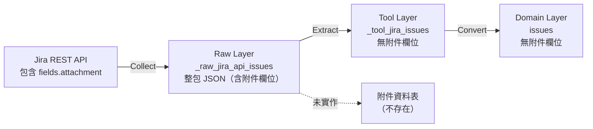

# Apache DevLake 能否把 Jira 的附件（Attachment）同步進資料庫？

## 摘要

**不行。**截至 2026-11-13，Apache DevLake 的 Jira plugin 不會把 Jira 議題（issue）的附件同步到資料庫中任何一個資料表。

具體來說，以下四件事全部為「否」：

1. Jira plugin 的資料表註冊清單中**沒有任何**與附件相關的資料表。
2. Jira plugin 的資料模型（tool layer 的 `JiraIssue` struct）中**沒有**附件欄位。
3. Domain layer schema（`issues`、`issue_comments` 等資料表）中**沒有**附件資料表或欄位。
4. Jira plugin 的資料同步政策（Data Sync Policy）所列出的 subtask 清單中，**沒有**任何附件收集任務。

不過有一個關鍵且容易被誤解的地方：因為 DevLake 在抓取 Jira 議題時使用了 `fields=*all`，Jira API 回應中的 `attachment` 欄位**會**隨著整包原始 JSON 被存進 raw layer 的 `_raw_jira_api_issues` 資料表。也就是說，附件的中繼資料（檔名、大小、MIME type、下載 URL、上傳者等）其實「躺在」raw layer 裡，只是沒有被解析（extract）成 tool layer 或 domain layer 的結構化資料。而附件檔案的**二進位內容本身**則完全沒有被下載。

換句話說：**DevLake 目前可以說是把附件資訊「順手存進了暫存區」，但沒有把它變成可查詢的正式資料。**

---

## 研究問題

本研究要回答的問題是：

> Apache DevLake（以下簡稱 DevLake）在把 Jira 當作資料來源時，是否支援將 Jira 議題上的附件（attachment）同步到資料庫？

為避免語意模糊，本文把「同步附件」拆成三個層次分別檢驗：

| 層次 | 說明 | 本文判定 |
| --- | --- | --- |
| L1：附件「檔案內容」 | 把附件的二進位檔案下載並存進資料庫或物件儲存 | 否 |
| L2：附件「中繼資料」結構化 | 把檔名、大小、MIME type、下載 URL 等解��成資料表欄位 | 否 |
| L3：附件「中繼資料」原文留存 | 原始 API 回應 JSON 中剛好含有附件欄位，被整包存入 raw layer | 是（但未解析） |

---

## 背景

### Apache DevLake 是什麼

Apache DevLake 是一套開源的開發者資料平台（dev data platform），用來從各種 DevOps 工具擷取（ingest）、分析並視覺化分散的開發資料，以產生工程效能、開發者體驗與社群成長相關的洞察[^repo]。專案位於 GitHub 的 `apache/devlake`，採用 Apache-2.0 授權[^repo]。

### Jira plugin

DevLake 支援把 Jira 當作資料來源之一，支援 Jira Cloud 與 Server / Data Center 7.x 以上版本，透過 Jira REST API 蒐集資料[^sources]。DevLake 的架構分為三層：raw layer（原始 API 回應 JSON）、tool layer（各工具特定的結構化資料）、domain layer（跨工具抽象化後的通用 schema）[^domain]。

上圖即為本文的核心結論：附件資訊在 raw layer 之後就「斷線」了。

---

## 判定依據

### 依據一：官方「支援資料來源」頁面的收集範圍表未列出附件

DevLake 官方文件的 Supported Data Sources 頁面列出了每個 plugin 所蒐集的 domain layer entity。在 Jira 欄位中，被蒐集的 entity 包含 `boards`、`board_issues`、`board_sprints`、`issue_changelogs`、`issue_comments`、`issue_worklogs`、`issues`、`sprint_issues`、`sprints`、`project_mapping`、`project`、`accounts`、`issue_labels` 等，然而**完全沒有任何與附件相關的 entity**[^sources]。

### 依據二：官方「Jira 資料同步政策」的 subtask 清單不含附件任務

同一份文件列出了 Jira plugin 的所有同步 subtsak 及其預估請求數與是否支援增量同步[^sources]：

| Subtask 名稱 | 預估最大請求數 | 支援增量 | 支援時間過濾 |
| --- | --- | --- | --- |
| CollectStatusMeta | 1 | 否 | - |
| CollectProjectsMeta | <10 | 否 | - |
| CollectIssueTypesMeta | <10 | 否 | - |
| CollectIssuesMeta | <10^4 | 是 | 是 |
| CollectIssueChangelogsMeta | 1000 ~ 10^5 | 是 | 是 |
| CollectAccountsMeta | <10^3 | 否 | 否 |
| CollectWorklogsMeta | 1000 ~ 10^5 | 是 | 是 |
| CollectRemotelinksMeta | 1000 ~ 10^5 | 是 | 是 |
| CollectSprintsMeta | <100 | 否 | 否 |
| CollectEpicsMeta | <100 | 否 | 是 |

清單中**沒有** `CollectAttachments` 或任何類似名稱的 subtask[^sources]。而「有沒有對應的 subtask」正是 DevLake 裡判斷「某類資料會不會被同步」最直接的標準，因為每個 subtask 就是一段獨立的擷取或轉換工作。

### 依據三：原始碼層級的證據

#### 3.1 資料表註冊清單沒有附件表

Jira plugin 在 `GetTablesInfo()` 中註冊它會建立的所有資料表[^impl]。清單內容為：`ApiMyselfResponse`、`JiraAccount`、`JiraBoard`、`JiraBoardIssue`、`JiraBoardSprint`、`JiraConnection`、`JiraIssue`、`JiraIssueChangelogItems`、`JiraIssueChangelogs`、`JiraIssueCommit`、`JiraIssueLabel`、`JiraIssueType`、`JiraProject`、`JiraRemotelink`、`JiraServerInfo`、`JiraSprint`、`JiraSprintIssue`、`JiraSprintReport`、`JiraStatus`、`JiraWorklog`、`JiraIssueComment`、`JiraIssueRelationship`、`JiraScopeConfig`、`JiraIssueField`[^impl]。

其中**沒有任何** `JiraAttachment` 之類的 struct。由於資料表是由這些 struct 經 GORM 自動遷移（auto-migrate）產生，沒有 struct 就等於沒有資料表。

#### 3.2 tool layer 的議題模型沒有附件欄位

tool layer 的 `JiraIssue` struct（對應 `_tool_jira_issues` 資料表）定義了所有會被結構化保存的欄位，包括 `IssueId`、`IssueKey`、`Summary`、`Description`、`Type`、`StatusName`、`StoryPoint`、`CreatorAccountId`、`AssigneeAccountId`、`PriorityName`、`SprintId`、`ResolutionDate`、`Components`、`FixVersions`、`ChangelogTotal`、`WorklogTotal`、`CommentTotal`、`Subtask` 等等[^model]，其中**沒有** `Attachment`、`AttachmentCount` 或 `HasAttachment` 等任何欄位。

作為對照，同一個 repo 中的 TAPD plugin 的 `TapdStory` 模型就明確含有 `AttachmentCount` 與 `HasAttachment` 欄位[^tapd]。這說明「在模型中記錄附件資訊」在 DevLake 的技術架構上完全做得到，只是 Jira plugin 沒有這樣做。

#### 3.3 API 回應模型與擷取邏輯不處理附件

Jira plugin 用來承接 API 回應的 `Issue` struct（在 `tasks/apiv2models/issue.go`）中，`Fields` 底下明確定義了 `Issuetype`、`Parent`、`Sprint`、`ClosedSprints`、`Project`、`FixVersions`、`Resolution`、`Created`、`Epic`、`Priority`、`Labels`、`Issuelinks`、`Assignee`、`Status`、`Components`、`Description`、`Timetracking`、`Summary`、`Creator`、`Subtasks`、`Reporter`、`Worklog`、`Comment` 等欄位，但**沒有** `Attachment` 欄位[^apimodel]。

該 struct 的 `ExtractEntities()` 方法回傳的實體種類為：sprints、issue、comments、worklogs、changelogs、changelogItems、users；`toToolLayer()` 方法也只把上述欄位映射進 `JiraIssue`[^apimodel]。附件從未被處理。

同樣地，`issue_extractor.go` 的 `extractIssues()` 函式會輸出 issue、comment、worklog、changelog、changelog item、user、board issue、label、component、fix version、issue link 等結果，但不含任何附件結果[^extractor]。

#### 3.4 收集請求雖然抓了附件欄位，但沒有專屬的收集任務

`issue_collector.go` 中的議題收集請求設定了 `query.Set("fields", "*all")`[^collector]，意味著 Jira API 會把所有欄位（包含 `attachment`）都回傳。這正是「raw layer 裡有附件欄位」的原因，但**沒有任何** collector 去專門處理這些附件（例如呼叫附件下載 API）。

### 依據四：Domain Layer Schema 沒有附件資料表

DevLake 官方文件的 Domain Layer Schema 頁面詳列了 domain layer 的所有資料表與欄位。在「Domain 1 - Issue Tracking」分類下，與議題相關的資料表有 `issues`、`issue_assignees`、`issue_labels`、`issue_comments`、`issue_changelogs`、`issue_worklogs`、`issue_relationships`、`issue_repo_commits`、`issue_custom_array_fields`、`boards`、`board_issues`、`sprints`、`sprint_issues`、`board_sprints`、`incidents`、`incident_assignees` 等[^domain]。

其中**沒有** `issue_attachments` 資料表；`issues` 資料表的欄位清單（`id`、`issue_key`、`url`、`title`、`description`、`type`、`status`、`story_point`、`creator_id`、`assignee_id`、`created_date`、`resolution_date` 等）也**沒有**附件欄位[^domain]。

### 依據五：社群從未提出此功能需求

在 `apache/devlake` 的 GitHub issues 中，以標題搜尋 "attachment"，或搜尋 "jira attachment"，均得到 **0 筆結果**；以 "attach" 搭配 "jira" 搜尋得到的結果全部是其他主題（例如 Jira 連線、API 版本、欄位過長錯誤等），沒有任何一筆是在要求同步附件[^issuesearch]。GitHub Discussions 的附件相關搜尋結果同樣與 Jira 附件同步無關[^discsearch]。

這代表：此功能不仅未實作，連社群需求都尚未被正式提出（因此也不存在 maintainer 對其「不支援」或「在 roadmap 上」的公��回覆）。

---

## 重要細節：raw layer 其實含有附件中繼資料

上述結論若不補充這一點，很容易被誤讀為「DevLake 完全沒有碰到附件資料」。事實並非如此。

因為議題收集請求帶了 `fields=*all`[^collector]，Jira 回傳的每一筆議題 JSON 都會包含 `attachment` 欄位（型別是陣列），而 DevLake 會把整包回應原文存進 raw layer 的 `_raw_jira_api_issues` 資料表。這一點可以由 DevLake 自己的 e2e 測試資料佐證：其測試用 fixture 檔案 `backend/plugins/jira/e2e/raw_tables/_raw_jira_api_issues_for_due_date.csv` 中，每一筆議題的 raw JSON 內容都可見到 `"attachment": []` 這個欄位[^e2efixture]。

因此在 DevLake 中：

- 附件的中繼資料**存在於** raw layer（`_raw_jira_api_issues` 的 `data` 欄位內的 JSON）。
- 附件的中繼資料**不存在於** tool layer 或 domain layer 的結構化欄位。
- 附件的檔案內容**完全沒有**被下載。

這也解釋了為什麼「DevLake 有沒有同步 Jira 附件」這個問題容易產生兩極答案：只看 raw layer 的人會說「有」，只查 domain layer 資��表的人會說「沒有」。以「能否用 SQL 查詢附件」這個實務標準來看，答案仍然是「不行」。

---

## Jira API 本身確實有提供附件資料

之所以會有「理論上做得到」的想像，是因為 Jira 官方 REST API 本來就提供完整的附件資訊與下載端點[^atlissue][^atlatt]：

- 取得議題（`GET /rest/api/3/issue/{issueIdOrKey}`）的回應中，`fields.attachment` 是一個陣列，每個元素包含 `id`、`filename`、`size`、`mimeType`、`content`（下載 URL）、`created`、`author`、`self`、`thumbnail`[^atlissue]。
- 使用 JQL 搜尋議題（`POST /rest/api/3/search`）的回應同樣包含 `fields.attachment`[^atlissue]。
- 另有專門的附件 API 群組可下載檔案內容：`GET /rest/api/3/attachment/content/{id}` 取得附件內容，`GET /rest/api/3/attachment/thumbnail/{id}` 取得縮圖，`GET /rest/api/3/attachment/{id}` 取得附件中繼資料[^atlatt]。

換句話說，資料來源端（Jira）願意給，是 DevLake 這一端沒有實作解析與下載。

---

## 若真的需要 Jira 附件資料，可以怎麼做

以下依「不修改 DevLake 原始碼」到��修改原始碼」排序。

### 做法一：用 customize plugin 從 raw layer 撈出附件中繼資料

DevLake 內建 `customize` plugin，可以在 domain layer 資料表上新增以 `x_` 為前綴的欄位，並用 JSON path（底層使用 `github.com/tidwall/gjson`）從 raw layer 資料表抽取值填入[^customize]。官方文件中的範例即是從 `_raw_jira_api_issues` 抽取 `fields.status.name` 寫入 `issues` 資料表的自訂欄位[^customize]。

因此理論上可以宣告類似 `x_attachment_names` 的自訂欄位，並用 gjson 路徑（例如指向 `fields.attachment` 底下第 N 筆的 `filename`）取值。需要特別注意的是：

- 官方文件明確示範的是**純量路徑**（`fields.status.name`）；若要一次取整個附件陣列，需要自行設計路徑（例如逐筆索引），此用法未見於官方文件範例，**需自行驗證**[^customize]。
- `customize` 支援的欄位型別只有 varchar(255)、text、bigint、float、timestamp、array 六種，且陣列型別會另建 `issue_custom_array_fields` 資料表以存放 `issue_id`、`field_id`、`field_value`[^customize][^domain]。
- 這條路徑**只處理中繼資��**，**不會**下載附件檔案內容。

### 做法二：直接呼叫 Jira API 自行取得

既然附件資訊與內容都能由 Jira REST API 取得[^atlissue][^atlatt]，最直接的方式是繞過 DevLake，自行以 Jira API token 呼叫議題查詢與附件下載端點，再自行落地。這樣做的缺點是要自行處理認證、分頁與增量同步，等於重造 DevLake 已經做好的周邊機制。

### 做法三：改寫／擴充 DevLake 的 Jira plugin

若要原生支援，需要新增的元件至少有：附件資料表模型（例如 `JiraAttachment`）與其對應的 migration script、附件欄位的 API 回應模型、`ExtractEntities()` 中的附件解析邏輯、以及（若要存檔案內容）呼叫 `GET /rest/api/3/attachment/content/{id}` 的下載 collector。這是原始碼層級的改動，屬於 feature development 而非設定調整。

---

## 限制與批判性反思

本文的證據來源與其可信度差異如下，讀者應據此調整信心程度：

- **原始碼與資料表註冊清單**是「實際行為」最強的證據。本文直接檢視了 `apache/devlake` 的 `main` 分支上的模型、擷取器、收集器與 plugin 實作檔[^model][^apimodel][^extractor][^collector][^impl]，因此對「目前不支援」的判定信心很高。
- **官方文件**（Supported Data Sources、Domain Layer Schema、Jira plugin 頁面）代表「設計意圖」與「對外承諾」。文件與原始碼在此議題上一致，皆顯示不支援[^sources][^domain][^jiraplugin]。
- **GitHub issue 搜尋**只能反映「平台上被公開記錄的需求」。搜尋為 0 筆不等���沒有人���要此功能，也可能是使用者直接在 Slack、企業內部或 fork 中處理。因此本文對「社群從未提出需求」的敘述，應理解為「在 GitHub 公開 issue / PR / discussion 中查無記錄」[^issuesearch][^discsearch]。
- **時效性限制**：本文所有判定以擷取當日（2026-11-13）的 `main` 分支與線上文件為準。DevLake 為活躍專案（repository 的 `pushed_at` 為 2026-11-12）[^repo]，未來可能新增支援，屆時本文結論需要更新。
- **未涵蓋範圍**：本文未實際部署 DevLake 進行端對端測試，也未窮盡所有社群管道（如 Slack 歷史訊息）。此外，本文未驗證 `customize` plugin 處理「物件陣列」路徑的實際可行性，該部分已於上節明確標示為需自行驗證。
- **未被回答的問題**：若 DevLake 曾在任何版本支援過附件，本文並未追溯版本歷史來確認；本文只確認現行 `main` 分支的狀態。

---

## 結論

回答原始問題：**Apache DevLake 不能把 Jira 的附件同步進資料庫。**

- 沒有附件資料表、沒有附件欄位、沒有附件 subtask、domain layer 也沒有附件 entity。
- 唯一「碰到」附件的地方是 raw layer：由於議題收集使用 `fields=*all`，Jira 回應中的 `attachment` 陣列會隨原始 JSON 一起被存在 `_raw_jira_api_issues` 中，但從未被解析，且附件檔案內容也從未被下載。
- 若只需附件中繼資料，可嘗試用 `customize` plugin 從 raw layer 以 JSON path 抽出（純量路徑有官方範例，陣列路徑需自行驗證）；若需要完整支援，則必須修改 DevLake 的 Jira plugin 原始碼。

---

## 參考資料

[^repo]: Apache Software Foundation. (n.d.). *apache/devlake* [Source code repository]. GitHub. Retrieved 2026-11-13, from https://github.com/apache/devlake （截至 2026-11-13，該 repository 有 3,198 顆星、839 個 fork，授權為 Apache-2.0，`pushed_at` 為 2026-11-12；資料取自 https://api.github.com/repos/apache/devlake ）

[^sources]: Apache DevLake. (n.d.). *Supported Data Sources*. Apache DevLake Documentation. Retrieved 2026-11-13, from https://devlake.apache.org/docs/Overview/SupportedDataSources

[^domain]: Apache DevLake. (n.d.). *Domain Layer Schema*. Apache DevLake Documentation. Retrieved 2026-11-13, from https://devlake.apache.org/docs/DataModels/DevLakeDomainLayerSchema

[^jiraplugin]: Apache DevLake. (n.d.). *Jira*. Apache DevLake Documentation (v1.0). Retrieved 2026-11-13, from https://devlake.apache.org/docs/v1.0/Plugins/jira

[^impl]: Apache DevLake. (n.d.). *backend/plugins/jira/impl/impl.go* [Source code]. GitHub. Retrieved 2026-11-13, from https://raw.githubusercontent.com/apache/devlake/main/backend/plugins/jira/impl/impl.go

[^model]: Apache DevLake. (n.d.). *backend/plugins/jira/models/issue.go* [Source code]. GitHub. Retrieved 2026-11-13, from https://raw.githubusercontent.com/apache/devlake/main/backend/plugins/jira/models/issue.go

[^tapd]: Apache DevLake. (n.d.). *backend/plugins/tapd/models/story.go* [Source code]. GitHub. Retrieved 2026-11-13, from https://raw.githubusercontent.com/apache/devlake/main/backend/plugins/tapd/models/story.go

[^apimodel]: Apache DevLake. (n.d.). *backend/plugins/jira/tasks/apiv2models/issue.go* [Source code]. GitHub. Retrieved 2026-11-13, from https://raw.githubusercontent.com/apache/devlake/main/backend/plugins/jira/tasks/apiv2models/issue.go

[^extractor]: Apache DevLake. (n.d.). *backend/plugins/jira/tasks/issue_extractor.go* [Source code]. GitHub. Retrieved 2026-11-13, from https://raw.githubusercontent.com/apache/devlake/main/backend/plugins/jira/tasks/issue_extractor.go

[^collector]: Apache DevLake. (n.d.). *backend/plugins/jira/tasks/issue_collector.go* [Source code]. GitHub. Retrieved 2026-11-13, from https://raw.githubusercontent.com/apache/devlake/main/backend/plugins/jira/tasks/issue_collector.go

[^e2efixture]: Apache DevLake. (n.d.). *backend/plugins/jira/e2e/raw_tables/_raw_jira_api_issues_for_due_date.csv* [Test fixture]. GitHub. Retrieved 2026-11-13, from https://github.com/apache/devlake/blob/main/backend/plugins/jira/e2e/raw_tables/_raw_jira_api_issues_for_due_date.csv

[^atlissue]: Atlassian. (n.d.). *The Jira Cloud platform REST API: Issues* (Get issue; Search for issues using JQL). Atlassian Developer Documentation. Retrieved 2026-11-13, from https://developer.atlassian.com/cloud/jira/platform/rest/v3/api-group-issues/#api-rest-api-3-issue-issueidorkey-get

[^atlatt]: Atlassian. (n.d.). *The Jira Cloud platform REST API: Issue attachments*. Atlassian Developer Documentation. Retrieved 2026-11-13, from https://developer.atlassian.com/cloud/jira/platform/rest/v3/api-group-issue-attachments/

[^customize]: Apache DevLake. (n.d.). *Customize*. Apache DevLake Documentation. Retrieved 2026-11-13, from https://devlake.apache.org/docs/Plugins/customize

[^issuesearch]: Apache DevLake. (n.d.). *Issues* [Search results for "attachment" in title, and for "attach" combined with "jira", in apache/devlake]. GitHub. Retrieved 2026-11-13, from https://github.com/apache/devlake/issues?q=is%3Aissue+%22attachment%22+in%3Atitle

[^discsearch]: Apache DevLake. (n.d.). *Discussions* [Search results for "attachment" in apache/devlake]. GitHub. Retrieved 2026-11-13, from https://github.com/apache/devlake/discussions?discussions_q=attachment
