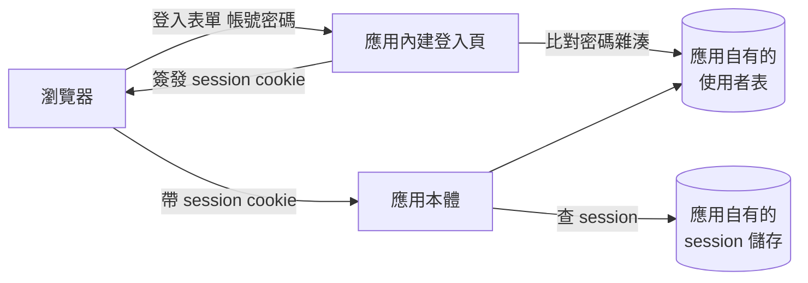
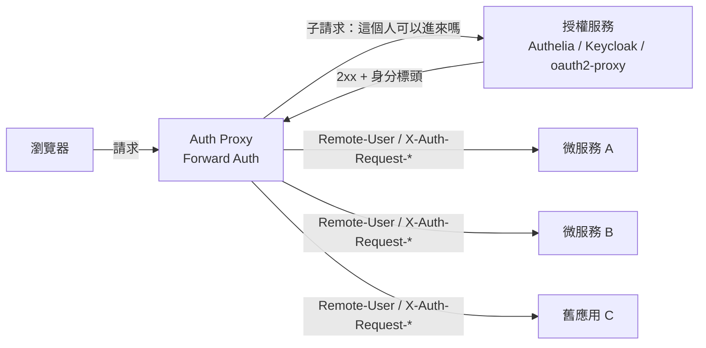
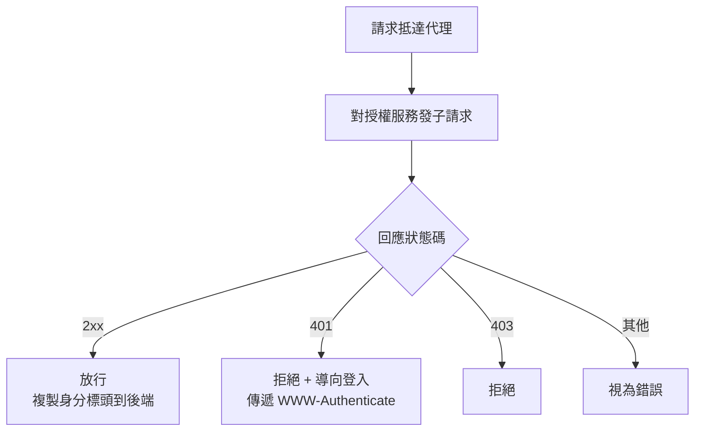
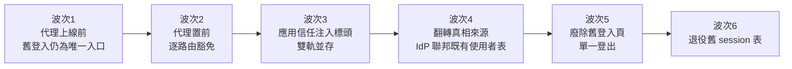
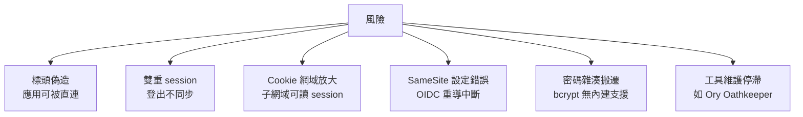
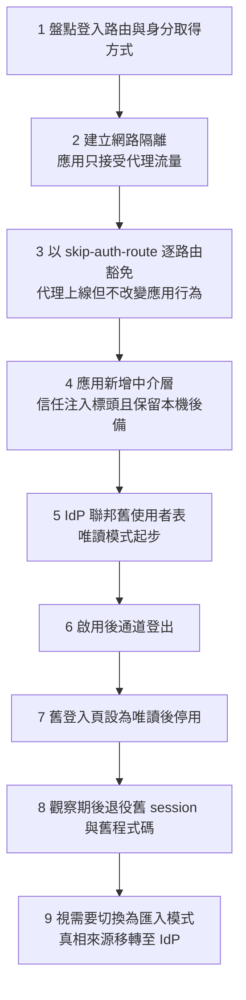

# 既有自建登入（AuthN）的 Web 應用，如何遷移至 Auth Proxy 微服務架構以實現 SSO

## 摘要

許多 Web 應用在早期自行實作登入功能：自己的使用者資料表、自己的密碼雜湊、自己的 session cookie、自己的登入頁面。當這類應用要被放進以「Auth Proxy（身分感知反向代理，identity-aware proxy）」為核心的微服務架構，並與其他服務共用單一登入（Single Sign-On，SSO）時，真正的困難不在於「如何架一層代理」，而在於**兩套獨立的身分層如何調和**：舊應用有自己的 session 與帳號來源，代理帶來的是另一套 session 與帳號來源。

本報告先定義問題，再拆解 Auth Proxy 與 Forward Auth 的技術契約，接著提出以「絞殺者模式（Strangler Fig）」為框架的分階段遷移路徑，並針對「既有使用者資料如何延續」「雙重 session 與單一登出」「標頭偽造與 Cookie 網域的安全性取捨」三個關鍵難題給出具體作法與工具對照。本報告為獨立文件，讀者無需任何前置背景。

---

## 1. 背景與問題定義

### 1.1 舊架構長什麼樣子

一個「已經自己做完 AuthN」的典型 Web 應用具有以下四個特徵：

- 應用自己維護使用者資料表（帳號、電子郵件、密碼雜湊、角色）。
- 應用自己比對密碼雜湊（可能是 bcrypt、PBKDF2、Argon2，或更舊的 MD5、SHA1）。
- 應用自己簽發 session cookie，並在自己的資料庫或記憶體中保存 session 狀態。
- 應用自己提供登入頁與登出端點。

換句話說，**這個應用本身就是一個既小又完整的身分提供者（IdP）**，只是它只服務自己。



### 1.2 目標架構長什麼樣子

Auth Proxy 架構把「誰是使用者」這件事從應用內部抽離到邊緣（edge）。所有請求先經過一個身分感知代理，代理在放行前完成認證，並把「已認證的使用者身分」以標頭（header）形式注入送往後端的請求[^nginx-authreq][^traefik-fwd][^caddy-fwd][^envoy-extauthz]。



### 1.3 真正的衝突點

問題在於：**舊應用 C 同時保有自己的 session 與登入頁**。於是使用者會體驗到兩個彼此獨立的身分層：SSO 這一層說「你已登入」，但舊應用那一層仍在自己的 cookie 上做判斷。若沒有刻意調和，就會出現「已經從 SSO 登出、卻仍能操作舊應用」這種安全缺口。

### 1.4 目標架構必須回答的四個問題

| 問題 | 內容 |
|---|---|
| 邊緣如何認證？ | 誰負責登入、誰簽發 cookie、cookie 放在哪個網域 |
| 身分如何向內傳遞？ | 用什麼標頭、由誰注入、後端如何確認標頭來自可信代理 |
| 既有使用者資料如何延續？ | 搬遷密碼雜湊，或讓 IdP 反向查詢既有資料庫 |
| 如何分階段上線而不中斷？ | 過渡期兩套登入並存時，誰優先、如何切換、如何退場 |

---

## 2. Auth Proxy 與 Forward Auth 架構

### 2.1 核心契約

Forward Auth 的共同模式是：代理在轉發請求前，先對授權服務發出一次內部請求；授權服務回應 **2xx** 代表放行，其他狀態碼代表拒絕[^nginx-authreq][^traefik-fwd][^caddy-fwd][^envoy-extauthz]。放行時，授權服務可在回應中附帶身分標頭，代理再把這些標頭複製到送往後端的請求上[^traefik-fwd][^caddy-fwd]。

### 2.2 各代理的實作差異

#### nginx `auth_request`（1.5.4+，需 `--with-http_auth_request_module`）

nginx 官方模組 `ngx_http_auth_request_module` 會在處理主請求前發出子請求（subrequest）[^nginx-authreq]。規則如下[^nginx-authreq]：

- 子請求回 **2xx** → 放行。
- 回 **401** → 拒絕，且把子請求回應中的 `WWW-Authenticate` 傳給客戶端。
- 回 **403** → 拒絕。
- 其他狀態碼 → 視為錯誤。

`auth_request_set $var $upstream_http_<name>;` 可把子請求回應的標頭存成主請求的 nginx 變數；由於子請求不該攜帶原始請求主體，慣例會搭配 `proxy_pass_request_body off;` 與 `proxy_set_header Content-Length "";`[^nginx-authreq]。

以下是 Authelia 官方文件中的標準寫法[^authelia-nginx]：

```nginx
# 伺服器層級：宣告授權端點
set $upstream_authelia http://authelia:9091/api/authz/auth-request;

# 內部授權端點（外部無法直接存取）
location /internal/authelia/authz {
    internal;
    proxy_pass $upstream_authelia;
    proxy_set_header X-Original-Method $request_method;
    proxy_set_header X-Original-URL    $scheme://$http_host$request_uri;
    proxy_set_header X-Forwarded-For   $remote_addr;
    proxy_set_header Content-Length    "";
    proxy_set_header Connection        "";
    proxy_pass_request_body            off;
}

# 受保護的應用
location / {
    auth_request /internal/authelia/authz;
    auth_request_set $user   $upstream_http_remote_user;
    auth_request_set $groups $upstream_http_remote_groups;
    auth_request_set $mail   $upstream_http_remote_email;
    auth_request_set $name   $upstream_http_remote_name;

    proxy_set_header Remote-User   $user;
    proxy_set_header Remote-Groups $groups;
    proxy_set_header Remote-Email  $mail;
    proxy_set_header Remote-Name   $name;

    # 未認證時導向登入頁
    auth_request_set $redirection_url $upstream_http_location;
    error_page 401 =302 $redirection_url;

    proxy_pass http://app_backend;
}
```

#### Traefik ForwardAuth

Traefik 的 ForwardAuth 中介軟體同樣以 2XX 代表放行；非 2XX 時，把授權伺服器的回應直接回給客戶端[^traefik-fwd]。它會自動附上 `X-Forwarded-Method`、`X-Forwarded-Proto`、`X-Forwarded-Host`、`X-Forwarded-Uri`、`X-Forwarded-For`[^traefik-fwd]。

主要設定欄位包含：`address`、`authResponseHeaders`（複製到後續轉發請求，同名會被覆蓋）、`authResponseHeadersRegex`、`authRequestHeaders`、`forwardBody`、`maxBodySize`、`maxResponseBodySize`、`headerField`、`preserveRequestMethod`、`preserveLocationHeader`、`addAuthCookiesToResponse`、`authSigninURL`[^traefik-fwd]。舊的 `trustForwardHeader` 已棄用，應改用進入點（entrypoint）層級的 `forwardedHeaders.trustedIPs`[^traefik-fwd]。

#### Caddy `forward_auth`

Caddy 的 `forward_auth` 是 `reverse_proxy` 加上 `handle_response` 的語法糖[^caddy-fwd]：

```caddy
forward_auth [<matcher>] [<upstreams...>] {
    uri <to>
    copy_headers <fields...>
}
```

它固定使用 GET、改寫 URI，並附上 `X-Forwarded-Method` 與 `X-Forwarded-Uri`[^caddy-fwd]。2xx 放行；其他狀態碼拒絕，並把授權伺服器的回應複製回客戶端。`copy_headers` 支援 `Before>After` 改名語法[^caddy-fwd]。

#### Envoy `ext_authz`

Envoy 的 external authorization 過濾器支援 HTTP 與 gRPC 兩種介面[^envoy-extauthz]：

- **HTTP**：設定 `http_service`（`server_uri`、`path_prefix`、`path_override`、`authorization_request`、`authorization_response`、`retry_policy`）。HTTP **200** 放行；非 200 拒絕（預設回 403）[^envoy-extauthz]。
- **gRPC**：實作 `Authorization.Check(CheckRequest) → CheckResponse`[^envoy-extauthz]。

`allowed_upstream_headers` 與 `allowed_upstream_headers_to_append` 決定哪些授權回應標頭會被複製到上游請求；`authorization_response.allowed_client_headers` 決定哪些回傳給客戶端；可用 `x-envoy-auth-headers-to-remove` 移除不想要的標頭[^envoy-extauthz]。安全相關設定：`failure_mode_allow` 預設 false、`status_on_error` 預設 403、`shadow_mode`[^envoy-extauthz]。另有一組統計指標：ok / denied / error / disabled / failure_mode_allowed / invalid[^envoy-extauthz]。

#### ingress-nginx（Kubernetes）

ingress-nginx 以 annotation 實作外部認證：`auth-url`、`auth-signin`、`auth-response-headers`、`auth-method`、`auth-request-redirect`、`auth-snippet`、`auth-always-set-cookie`、`auth-cache-key`、`auth-cache-duration`（預設 `200 202 401 5m`）、`auth-keepalive*`、`auth-proxy-set-headers`、`enable-global-auth`[^ingress-nginx]。同樣是 2xx 放行，其他狀態碼拒絕並可導向登入[^ingress-nginx]。

### 2.3 契約對照



---

## 3. 身分標頭的傳遞

### 3.1 Authelia 的標頭

Authelia 在放行時回傳 `Remote-User`、`Remote-Groups`、`Remote-Email`、`Remote-Name`[^authelia-nginx]。Authelia 對外提供多個端點[^authelia-endpoints]：

- `/api/authz/forward-auth`：供 Traefik、Caddy、HAProxy、Skipper 使用。
- `/api/authz/auth-request`：供 nginx 使用，另有 `/api/authz/auth-request/basic`。
- ExtAuthz：供 Envoy 使用。
- `/api/verify`：較早期的端點，現行整合指南已改採 `/api/authz/auth-request`[^authelia-endpoints]。

### 3.2 oauth2-proxy 的標頭

oauth2-proxy 提供多種身分標頭模式[^oauth2proxy]:

- `--set-xauthrequest`：注入 `X-Auth-Request-User`、`X-Auth-Request-Email`、`X-Auth-Request-Groups`、`X-Auth-Request-Preferred-Username`；搭配 `--pass-access-token` 可再加 `X-Auth-Request-Access-Token`[^oauth2proxy]。
- `--pass-user-headers`（預設 true）：注入 `X-Forwarded-User`、`X-Forwarded-Groups`、`X-Forwarded-Email`、`X-Forwarded-Preferred-Username`[^oauth2proxy]。
- `--pass-basic-auth`（預設 true）：以 Basic Auth 傳遞身分[^oauth2proxy]。
- `--pass-access-token` → `X-Forwarded-Access-Token`；`--pass-authorization-header` → `Authorization: Bearer <ID token>`[^oauth2proxy]。
- `--skip-auth-strip-headers`（預設 true）：放行時是否要移除客戶端自行帶入的同名標頭[^oauth2proxy]。
- `--prefer-email-to-user`、`--pass-host-header`（預設 true）、`--set-authorization-header`、`--set-basic-auth`、`--allowed-group`[^oauth2proxy]。
- `--skip-auth-route`：以 `method=path_regex` 格式設定豁免路徑，是分階段切換的關鍵工具[^oauth2proxy]。

### 3.3 Authentik 的標頭

authentik 的 outpost 注入 `X-authentik-username`、`X-authentik-groups`、`X-authentik-entitlements`、`X-authentik-email`、`X-authentik-name`、`X-authentik-uid`，以及 `X-authentik-meta-outpost`、`X-authentik-meta-provider`、`X-authentik-meta-app`、`X-authentik-meta-version`；在 Traefik 與 Caddy 下可再選擇性加上 `X-authentik-jwt` 與 `X-authentik-meta-jwks`[^authentik-headers]。outpost 預設監聽 9000 / 9443，路徑為 `/outpost.goauthentik.io/auth/{nginx,traefik,envoy,caddy}`[^authentik-headers]。

### 3.4 標頭模式的根本風險

**這些標頭只能存在於代理與後端之間**。Authelia 官方明確警告：Trusted Header SSO 所使用的標頭屬於內部使用，**絕不可被送回瀏覽器，也絕不可接受來自客戶端的同名標頭**[^authelia-trusted]。Django 官方文件同樣要求：採用 Remote User 認證的部署，**不可部署在客戶端能自行提供該標頭的位置**[^django-remoteuser]。

---

## 4. 將「已有自建登入」的應用接上代理：絞殺者模式分波次遷移

絞殺者模式的核心是：先在新舊系統之間**插入一層間接（代理 / 閘道）**，再以薄切片（thin slice）逐步把功能與流量從舊系統搬到新系統，最後讓舊系統退場[^fowler]。以下六個波次是把該模式套用到本情境的具體化。



### 波次 1：盤點與準備（代理尚未接管流量）

- 盤點應用實際使用的登入相關路由：登入頁、登出端點、密碼重設、API 端點、健康檢查、靜態資源、Webhook。
- 盤點應用如何取得身分：cookie 名稱、session 儲存位置、PDF、附表。
- 確認代理與應用之間的網路是否**只有代理能到達應用**。這是後續所有標頭信任的前提。Gitea 官方文件直接寫明「Gitea 必須只能經由代理存取」[^gitea-auth]。
- 決定 Cookie 網域策略（見第 7 節）。

### 波次 2：代理置前，逐路由豁免

把代理接到應用前面，但**先不要讓應用改變任何行為**。此時應用仍在自己的 cookie 上判斷身分，代理只是多了一層認證。為了不擋掉應用自己的登入流程，必須把登入相關路徑設為豁免：

- oauth2-proxy：`--skip-auth-route=GET=/login`、`--skip-auth-route=POST=/login`、`--skip-auth-route=GET=/logout`[^oauth2proxy]。
- Authelia：以 `rules` 的 `resources` / `methods` 搭配 `bypass` 策略達成等效效果[^authelia-access]。

此階段的目標是**可逆**：一旦出現問題，把代理移開即可回到原狀。

### 波次 3：應用改為信任注入標頭，雙軌並存

這是風險最高、也最關鍵的一步。應用要在「沒有注入標頭時仍用自己的登入」與「有注入標頭時改信任代理」之間取得平衡。

**跨語言通用模式**：在認證中介層（middleware）中按以下順序判斷：

1. 請求是否帶有可信的注入標頭（且來源 IP 在代理白名單內）？
2. 是 → 以該標頭指定的身分建立／更新本機 session。
3. 否 → 退回原有的本機登入判斷。

**具體框架實作**：

- **Django**：使用 `RemoteUserMiddleware` 或 `PersistentRemoteUserMiddleware` 搭配 `RemoteUserBackend` / `AllowAllUsersRemoteUserBackend`[^django-remoteuser]。注意事項[^django-remoteuser]：
  - 必須放在 `AuthenticationMiddleware` **之後**。
  - `AUTHENTICATION_BACKENDS` 必須保留 `ModelBackend` 作為後備，否則所有人都無法登入。
  - `RemoteUserMiddleware` 會在**每個請求**重檢標頭；標頭消失時登出並使 session 失效。`PersistentRemoteUserMiddleware` 則保留 session。
  - 預設 `header = "REMOTE_USER"` 是 WSGI 環境變數鍵，客戶端無法偽造；但**在 ASGI 下代理必須負責剝除它**。
  - 自訂標頭（例如 `HTTP_AUTHUSER`）必須由代理剝除，因為 `X-Auth-User` 與 `X-Auth_User` 都會正規化為 `HTTP_X_AUTH_USER`。

- **Grafana**：`[auth.proxy]` 區段提供 `enabled`、`header_name`（預設 `X-WEBAUTH-USER`）、`header_property`（`username` 或 `email`）、`auto_sign_up`、`sync_ttl`（預設 15 分鐘）、`whitelist`（IP / CIDR，防止偽造）、`headers`（映射名稱 / 角色 / 電子郵件 / 群組等額外標頭）、`enable_login_token`（預設 false）、`headers_encoded`[^grafana-authproxy]。Grafana 會把使用者快取進自己的資料庫，之後每 `sync_ttl` 重新同步一次[^grafana-authproxy]。

- **Gitea**：`ENABLE_REVERSE_PROXY_AUTHENTICATION`（預設 false）、`ENABLE_REVERSE_PROXY_AUTHENTICATION_API`（預設 false）、`REVERSE_PROXY_AUTHENTICATION_USER`（預設 `X-WEBAUTH-USER`）、`REVERSE_PROXY_AUTHENTICATION_EMAIL`（預設 `X-WEBAUTH-EMAIL`）、`REVERSE_PROXY_AUTHENTICATION_FULL_NAME`、`ENABLE_REVERSE_PROXY_AUTO_REGISTRATION`（預設 false）、`REVERSE_PROXY_TRUSTED_PROXIES`（預設 `127.0.0.0/8,::1/128`）、`REVERSE_PROXY_LIMIT`（預設 1）、`REVERSE_PROXY_LOGOUT_REDIRECT`[^gitea-auth][^gitea-config]。

### 波次 4：翻轉真相來源（讓 IdP 聯邦既有使用者表）

這是本報告最重要的建議。**不要搬遷密碼雜湊，直接讓 IdP 反向查詢既有資料庫。**

Keycloak 的 **User Storage SPI** 正好為此設計[^keycloak-dev]：

- 核心介面：`UserStorageProvider`（含 `preRemove` 生命週期）、`UserStorageProviderFactory`。
- 能力介面：`UserLookupProvider`（**登入必需**）、`UserQueryProvider`、`UserRegistrationProvider`、`UserBulkUpdateProvider`。
- 憑證驗證：`CredentialInputValidator`（`supportsCredentialType`、`isConfiguredFor`、`isValid`）；讀取時不可更新則使用 `CredentialInputUpdater` 並拋出 `ReadOnlyException`。
- 註冊方式：於 `META-INF/services/org.keycloak.storage.UserStorageProviderFactory` 宣告。
- 執行模型：provider 實例**每個交易（transaction）建立一次**，使用後呼叫 `close()`[^keycloak-dev]。
- 官方範例：`user-storage-simple`、`user-storage-jpa`[^keycloak-dev]。

**聯邦（federated）與匯入（import）的差異**[^keycloak-dev]：

| 模式 | 行為 | 適用 |
|---|---|---|
| 聯邦 | 不寫入本機；adapter 回傳 null 或拋 `ReadOnlyException` | 舊系統仍是唯一真相來源 |
| 匯入 | 首次存取時於 Keycloak 建立本機副本並設 `setFederationLink`，作為「持久化使用者快取」 | 逐步把真相來源搬到 Keycloak |

Keycloak 官方文件明確支持漸進遷移：**「若您正把 Keycloak 遷為官方使用者儲存並要淘汰舊的外部儲存，您可以慢慢把應用遷移到 Keycloak；當所有應用都遷移完畢，再解除匯入使用者的連結，並讓舊的 legacy 外部儲存退場。」**[^keycloak-dev]

同一原則也適用於 **LDAP / AD 聯邦**[^keycloak-admin]：

- Edit Mode：`READ_ONLY` / `WRITABLE` / `UNSYNCED`；Import Users 開關。
- **「Keycloak 從不匯入密碼。密碼驗證一律在 LDAP 伺服器上進行。」**[^keycloak-admin]
- 同步設定：`fullSyncPeriod`、`changedSyncPeriod`、`batchSizeForSync`（預設 1000）。
- 連線：Connection URL（以空白分隔可做故障轉移）、Connection Timeout（預設 5000 ms）、Priority。
- 注意：provider 之間**沒有故障轉移**，一個 provider 失敗會直接取消該次呼叫[^keycloak-admin]。

**若真的必須遷移密碼雜湊**（不建議，但可行）：Keycloak 的 `PasswordHashProvider` 提供 `policyCheck`、`encodedCredential`、`verify` 三方法[^keycloak-dev]。內建支援演算法[^keycloak-dev]：

| 演算法 | 迭代 / 參數 | 備註 |
|---|---|---|
| `argon2` | 依參數 | 預設（非 FIPS） |
| `pbkdf2-sha512` | 210,000 | FIPS 模式預設 |
| `pbkdf2-sha256` | 600,000 | |
| `pbkdf2`（SHA1） | 1,300,000 | 已棄用 |

**Keycloak 沒有內建 bcrypt**，若舊系統用 bcrypt，必須自行實作 `PasswordHashProvider`，或在 User Storage SPI 中以 `CredentialInputValidator` 直接在舊資料庫上驗證（後者是本報告建議的路線）。預設演算法可用 `--spi-password-hashing--provider-default=<alg>` 指定[^keycloak-dev]。

**OWASP 對舊雜湊升級的建議**[^owasp-password]（若走遷移路線時適用）：

- Argon2id 優先（例如 m=19456、t=2、p=1 等已接受的參數組合）；scrypt 為後備；bcrypt 僅供 legacy（cost ≥ 10，且有 72 位元組長度限制）。
- PBKDF2-HMAC-SHA256 建議 600,000 次；SHA512 建議 220,000 次；SHA1 建議 1,400,000 次（僅 legacy）。
- 升級手法：強制到期重設、分層雜湊（如 `bcrypt(md5(password))`）、於下次成功登入時重新雜湊、於下次認證時提高 work factor、過渡期允許混合演算法、以 PHC 字串格式保存演算法與參數。

### 波次 5：廢除舊登入頁，實作單一登出

- 移除或停用舊登入頁路由，讓所有未認證請求都由代理導向 IdP。
- 啟用單一登出，見第 6 節。
- 驗證「從 IdP 登出後，舊應用是否立即失效」。

### 波次 6：退役舊 session 表與舊程式碼

- 確認無任何流量走舊 session 路徑後，才移除舊的 session 儲存與登入程式碼。
- 保留舊密碼欄位一段觀察期，以備回退。

---

## 5. 網路與信任邊界：標頭信任的成立條件

注入標頭只有在「客戶端無法繞過代理直接觸及後端」時才有意義。以下是可操作的檢查項。

### 5.1 應用只能經由代理存取

- 網路層：以防火牆 / 安全群組 / Kubernetes NetworkPolicy 限制後端只接受來自代理的流量。
- Gitea 官方明言「Gitea 必須只能經由代理存取」[^gitea-auth]；Azure AD Application Proxy 官方亦要求「採用標頭式認證的應用，其存取應限制為僅來自連接器的流量」[^azure-headers]。

### 5.2 設定應用的信任代理清單

以代理的 **TCP 來源位址**設定應用（或 IdP）的可信 IP[^authelia-access]。實務細節[^authelia-access]：

- Docker 環境：為代理容器指定**靜態 IP**，**不要**信任整個 Docker 網段。
- Kubernetes 環境：改用服務網格（service mesh）處理。
- 驗證測試：對一條「該 IP 可 bypass」的規則，偽造送出 `X-Forwarded-For: 169.254.1.2`。若設定正確應得到 302（被要求登入）；若得到 200 則代表**設定有漏洞**[^authelia-access]。

### 5.3 東－西向（service-to-service）的身分驗證

邊緣的 forward auth 只處理南北向流量。服務之間的身分屬於東－西向問題，Istio 提供對應機制[^istio-security]：

- `PeerAuthentication`：設定 `mtls.mode` 為 `STRICT` / `PERMISSIVE` / `DISABLE`，可精細到 `portLevelMtls`[^istio-security]。
- SPIFFE 身分由 Kubernetes Service Account 推導；istiod 的 CA 簽署 CSR；Istio agent 透過 SDS 分送憑證並自動輪替[^istio-security]。
- `RequestAuthentication`：以 `jwtRules`（issuer + jwksUri）驗證 JWT。無效 token 會被拒絕，未帶 token 的請求預設被允許[^istio-security]。
- `AuthorizationPolicy`：`selector`、`action`（ALLOW / DENY / CUSTOM）、`rules.from/to/when`；評估順序為 CUSTOM → DENY → ALLOW[^istio-security]。`requestPrincipals: ["*"]` 表示必須有有效 JWT；可依 `request.auth.claims[iss]` 等宣告條件做匹配[^istio-security]。

### 5.4 跨服務的使用者身分傳遞

當服務 A 需要以「使用者本人的身分」呼叫服務 B 時，RFC 8693 Token Exchange 是標準作法[^rfc8693]：

- `grant_type=urn:ietf:params:oauth:grant-type:token-exchange`[^rfc8693]。
- 參數：`subject_token`、`subject_token_type`、`actor_token`、`actor_token_type`、`resource`、`audience`、`scope`、`requested_token_type`[^rfc8693]。
- Token 型別 URN：`access_token`、`refresh_token`、`id_token`、`saml1`、`saml2`、`jwt`[^rfc8693]。
- 假冒（impersonation）與代理（delegation）的差異由 `act` 宣告表達代理鏈[^rfc8693]。
- 典型微服務用法：前端資源伺服器把使用者 token 換成一個範圍更窄的 token，再交給後端服務[^rfc8693]。

若服務 B 只拿到不透明（opaque）token，則使用 RFC 7662 Token Introspection[^rfc7662]：POST 表單編碼，必填 `token`，可選 `token_type_hint`；回應必含 `active`，並可含 `scope`、`client_id`、`username`、`token_type`、`exp`、`iat`、`sub`、`aud`、`iss`、`nbf`、`jti`[^rfc7662]。內省端點必須使用 TLS 並要求授權[^rfc7662]。

---

## 6. 雙重 Session 與單一登出

### 6.1 問題的樣貌

代理有自己的 session（例如 Authelia 的 cookie），應用也有自己的 session。**兩者的生命週期不同步**，會產生三種症狀：

1. 從 SSO 登出後，直接訪問應用仍然可用（因為應用 cookie 還在）。
2. 應用登出後，SSO 仍處於登入狀態，再次訪問應用會「被自動登入」，使用者困惑。
3. 權限變更（角色調整、停用帳號）不會即時反映到應用。

### 6.2 解決方案一：後通道登出（Back-Channel Logout）

OIDC Back-Channel Logout 1.0（Final，2023-12-15）讓 IdP 在 session 結束時，**以伺服器對伺服器的方式**通知每個 RP[^oidc-bcl]：

- 註冊參數：`backchannel_logout_uri`、`backchannel_logout_session_required`[^oidc-bcl]。
- 通知內容是一個 **Logout Token** JWT，含 `iss`、`aud`、`iat`、`exp`、`jti`，以及內容含 `http://schemas.openid.net/event/backchannel-logout` 的 `events`；還要包含 `sub` 與 / 或 `sid`[^oidc-bcl]。
- **必須不含 `nonce`**；`typ` 建議為 `logout+jwt`[^oidc-bcl]。
- 驗證步驟定義於規格 §2.6；驗證失敗時應回 400[^oidc-bcl]。

這是本情境最可靠的解法，因為它不依賴瀏覽器行為。

### 6.3 解決方案二：RP 發起的登出（RP-Initiated Logout）

OIDC RP-Initiated Logout 1.0（Final，2022-09-12）[^oidc-rpil]：

- `end_session_endpoint`：IdP 提供的登出端點。
- `id_token_hint`（建議提供）。
- `post_logout_redirect_uri`：必須與預先註冊的 `post_logout_redirect_uris` **完全相符**。
- `state`、`client_id`。

此機制由前端觸發，適合「使用者主動按登出」的情境。

### 6.4 解決方案三：前通道登出（Front-Channel Logout）

OIDC Front-Channel Logout 1.0（Final，2022-09）由 IdP 以隱藏 iframe 載入各 RP 的登出 URI[^oidc-fcl]。可靠性較低，且會被瀏覽器的第三方 Cookie 封鎖機制破壞。

### 6.5 解決方案四：Session Management

OIDC Session Management 1.0 讓 RP 的 iframe 與 OP 的 iframe 以 `postMessage` 輪詢，使用 `client_id` 與 `session_state`，並以 `prompt=none` 重新驗證[^oidc-session]。輪詢有成本，實務上常作為前通道登出的補充。

### 6.6 應用仍保有自己 session 時的收斂策略

若短期內無法完全移除應用自有的 session，建議：

- 應用 session 的有效期**不得長於** IdP session 的有效期。
- 應用 session 應記錄**簽發時所用的 IdP session id**（`sid`），以便後通道登出時精準撤銷。
- 應用應在每個請求（或短期快取內）確認 IdP session 仍有效。
- Django 的 `RemoteUserMiddleware` 的「每次請求重檢標頭、標頭消失即登出」行為[^django-remoteuser]，正是這個策略的現成實作。

### 6.7 前端最佳實務（BFF）

`draft-ietf-oauth-browser-based-apps-27`（2026-07-06）是本主題的 Best Current Practice[^browser-apps]：

- 隱含流程（implicit）**MUST NOT** 使用（§7.2）[^browser-apps]。
- **BFF（Backend for Frontend）模式 §6.1**：使用機密客戶端（confidential client），token 只保存在伺服器端，瀏覽器只持有 cookie session[^browser-apps]。
- Cookie 要求：`Secure` 與 `HttpOnly` **MUST**；`SameSite=Strict` **SHOULD**；**SHOULD NOT** 設定 `Domain`；**SHOULD** 使用 `__Host-Http-` 前綴；客戶端 session 應加密[^browser-apps]。
- CSRF 防護為 **MUST**（§6.1.3.3）[^browser-apps]。
- Session 生命期應與 refresh token 生命期對齊（§6.1.2.2）[^browser-apps]。

---

## 7. Cookie、SameSite 與網域：SSO 能否成立的前提

### 7.1 Cookie 屬性的正確理解

- `SameSite` 有 `Strict`、`Lax`、`None`；`Lax` 自 Chrome 80 起是瀏覽器預設值，且存在一個寬鬆變體（"Lax-allowing-unsafe"），允許在設定後 2 分鐘內進行跨站 POST[^mdn-cookie][^webdev-samesite]。
- `SameSite=None` **必須**搭配 `Secure`[^mdn-cookie]。
- `Domain` 開頭的點會被忽略；省略 `Domain` 會得到**主機專屬 cookie**，設定 `Domain` 則會與所有子網域共用[^mdn-cookie]。
- 值不可為公共後綴（public suffix）[^mdn-cookie]。
- `__Secure-` 前綴需要 `Secure` 且走 HTTPS；`__Host-` 前綴需要 `Secure`、`Path=/` 且**不可設 `Domain`**[^mdn-cookie]。

### 7.2 網域與 SameSite 的實務取捨

| 情境 | 設定 | 結果 |
|---|---|---|
| 應用與 IdP 同網域 | `SameSite=Lax` | nginx `auth_request` 可行：頂層 GET 導覽會帶上 session cookie |
| 需要跨子網域 SSO | 將 Cookie `Domain` 提升到父網域 | SSO 成立，但**任一子網域被攻陷即可讀取 session cookie**（安全取捨） |
| 使用 `SameSite=Strict` | — | 會破壞 OIDC 重導流程 |

Authelia 的 session cookie 預設 `same_site` 為 `lax`（過去為 `none`），並明確警告 `strict`「在許多使用情境下無法運作」[^authelia-session]。

### 7.3 會話管理安全要求

OWASP Session Management Cheat Sheet 的相關要求[^owasp-session]：

- Session ID 需至少 64 bits 的 CSPRNG 熵（驗證用 token 需至少 128 bits）。
- `Secure` 與 `HttpOnly` 為必要。
- 應明確設定 `SameSite`（偏好 `Strict`），且**絕不**在未搭配 `Secure` 時使用 `None`。
- **不要設定 `Domain`**（跨子網域暴露 session）；也不要把不同安全等級的應用放在同一網域。
- 建議使用 `__Host-` 前綴；只有在確實需要跨子網域共用時才使用 `__Secure-`。
- 閒置逾時：高價值 2–5 分鐘、低風險 15–30 分鐘；絕對逾時 4–8 小時。
- **任何權限變更（登入、改密碼、角色變更）都必須更新 session ID**，以防 session fixation。
- 登出必須在伺服器端失效，並附加 `Clear-Site-Data` 與 `Cache-Control: no-store`。
- 記錄 session ID 的加鹽雜湊，絕不記錄原始值。

注意：該 Cheat Sheet **未提供明確的 SSO 指引**，但其關於 `Domain` 的警告與 SSO 直接相關——這正是 SSO 便利性與安全性之間的張力所在。

### 7.4 Authelia session 設定要點

Authelia 的 session 設定包含[^authelia-session]：`session.secret`、`session.name`（預設 `authelia_session`）、`session.same_site`、`session.inactivity`（5m）、`session.expiration`（1h）、`session.remember_me`（1M）；每個 cookie 可設定 `domain`、`authelia_url`、`default_redirection_url`、`name`、`same_site`、`inactivity`、`expiration`、`remember_me`；`session.redis` 可讓 Authelia 變成無狀態 / 高可用[^authelia-session]。`domain` 必須是 `authelia_url` 主機名稱的後綴或相等，且不可為公共後綴或 `localhost`[^authelia-session]。

Authelia 存取控制規則的重點[^authelia-access]：`default_policy` 預設為 `deny`；`rules[]` 可依 `domain` / `domain_regex`、`policy`（`deny|bypass|one_factor|two_factor`）、`subject`（巢狀清單表示 AND/OR）、`networks`、`methods`、`resources`、`query` 匹配；**首個匹配者勝出**[^authelia-access]。

### 7.5 其他身分傳遞機制的安全前提

- **RFC 7636 PKCE**：`code_verifier` 為 43–128 個未保留字元、≥256 bits 熵；`code_challenge_method` 支援 `plain`（SHOULD NOT）與 `S256`（MTI，必須實作）[^rfc7636]。範例：verifier `dBjftJeZ4CVP-mB92K27uhbUJU1p1r_wW1gFWFOEjXk` 對應 challenge `E9Melhoa2OwvFrEMTJguCHaoeK1t8URWbuGJSstw-cM`[^rfc7636]。
- **OAuth 2.0 安全 BCP**（`draft-ietf-oauth-security-topics-29`，2024-06-03）[^oauth-bcp]：
  - 公開客戶端 **MUST** 使用 refresh token 輪替或寄送者約束（sender-constrained）的 refresh token（§2.2.2、§4.14.2）。
  - 存取 token 建議使用 mTLS（RFC 8705）或 DPoP（RFC 9449）做寄送者約束（§2.2.1、§4.10.1）。
  - 洩漏途徑：§4.1 重導 URI 驗證、§4.2 Referer、§4.3 瀏覽器歷史、§4.9 偽造 / 被攻陷的資源伺服器。
  - PKCE 對公開客戶端為 **MUST**、對機密客戶端為 RECOMMENDED（§2.1.1）；AS **MUST** 支援 PKCE，且 **MUST** 防禦 PKCE 降級攻擊（§4.8）。
  - **該文件沒有 session 管理 / SSO 登出的章節**；僅 §4.14.2 提到 AS 可在登出或改密碼時撤銷 refresh token。請勿推論其涵蓋 SSO 登出。
- **憑證填充防禦**：MFA 是最有效的手段（Microsoft 指出約可防範 99.9% 的帳號盜用），其餘包含 CAPTCHA、IP 緩解、裝置 / 連線指紋（JA3）、不可預測的使用者名稱、多步驟登入、要求 JS、劣化處理、通知使用者；另可檢查洩漏密碼（Pwned Passwords，ASVS 2.1.7）[^owasp-stuffing]。

---

## 8. 工具選型比較

### 8.1 邊緣授權 / 代理層

| 專案 | GitHub Stars | 授權 | 最新版本 | 特點 |
|---|---|---|---|---|
| Authelia | 29.6k | Apache-2.0 | v4.39.28（2026-09-17） | 端點齊全，nginx 整合範例完整，文件對標頭信任強調明確 |
| oauth2-proxy | 15.4k | MIT | v7.15.6（2026-11-05） | 標頭模式最多，`--skip-auth-route` 適合分階段切換 |
| authentik | 26.3k | MIT 核心 + EE | 2026.8.5（2026-10-21） | 完整 IdP 功能，outpost 支援多種代理 |
| Zitadel | 15.6k | AGPL-3.0 | v4.20.2（2026-11-09） | 現代化 IdP，AGPL 授權需注意 |
| Keycloak | 37.8k | Apache-2.0 | 26.8.2（2026-11-05） | User Storage SPI / LDAP 聯邦最完整，適合翻轉真相來源 |
| Pomerium | 5.1k | Apache-2.0 / Community License | v0.34.1（2026-11-11） | 身分感知代理導向 |
| Ory Oathkeeper | 3.6k | Apache-2.0 | v26.2.0（2026-03-20） | **版本相對停滯，需留意維護活躍度** |

（以上 Stars 與版本為 2026-11-13 檢視時的時點快照。）

### 8.2 反向代理 / 閘道層

| 專案 | GitHub Stars | 授權 | 最新版本 | Forward Auth 支援 |
|---|---|---|---|---|
| Traefik | 65.5k | MIT | v3.7.19（2026-11-13） | ForwardAuth 中介軟體，設定欄位最豐富 |
| Envoy | 29.2k | Apache-2.0 | v1.40.2（2026-10-27） | `ext_authz`（HTTP / gRPC），統計與安全選項最完整 |

### 8.3 舊系統 SSO 閘道（商業方案，供對照）

- **Cloudflare Access**：身分感知代理，簽發 `CF_Authorization` JWT cookie 與 `Cf-Access-Jwt-Assertion` 標頭；應用可對 `https://<team>.cloudflareaccess.com/cdn-cgi/access/certs` 取得 JWKS 驗證 JWT；session 時間分為全域 / 應用 / 政策 / 客戶端四層；支援逐應用、逐使用者撤銷；登出端點為 `/cdn-cgi/access/logout`[^cf-access-jwt][^cf-access-session]。**這是「舊應用不動程式碼也能接上 SSO」的代表性作法**：應用只要願意驗證一個 JWT 即可。
- **Azure AD Application Proxy**：雲端服務 + 地端連接器。三種橋接舊應用自有登入的方式[^azure-headers][^azure-kcd][^azure-password]：
  1. **標頭式 SSO**：把 ID token 的 claims 映射成 HTTP 標頭，支援值轉換。
  2. **Kerberos 限制委派（KCD）**：適用 IWA / SPNEGO 應用。
  3. **密碼保存（password vaulting）**：把保存的憑證重放進表單登入。
  官方文件警告：「標頭式認證應用的存取應限制為僅來自連接器的流量」[^azure-headers]。上線流程建議先把前置驗證設為 **Passthrough**，再切換為 Entra ID[^azure-overview]。
- **Okta Access Gateway**：反向代理設備，DMZ worker 節點 + 管理節點，輸入 SAML、輸出標頭注入，提供「Generic Header App」；建議以應用現有的 Apache `mod_header` 設定作為要注入哪些標頭的參考；需留意黏性 session 與保留的 cookie 名稱[^okta-oag]。**PingAccess** 是 Microsoft 對「需要進階標頭轉換的 Entra ID 情境」所推薦的搭配方案[^okta-oag]。

### 8.4 依據情境的選擇建議

- **舊應用願意改程式碼**：Keycloak（User Storage SPI 聯邦舊資料庫）+ 任一 Forward Auth 代理。這是最乾淨的路線。
- **舊應用不願或不能改程式碼**：Cloudflare Access 或 Azure AD Application Proxy（標頭式 SSO），把身分以標頭 / JWT 方式餵給應用。
- **已經使用 Kubernetes**：ingress-nginx annotation 或 Istio（`RequestAuthentication` + `AuthorizationPolicy`），並以 `PeerAuthentication` 處理東－西向 mTLS。
- **只需輕量邊緣認證**：Authelia 或 oauth2-proxy，設定與維運成本最低。
- **需要漸進切換**：oauth2-proxy 的 `--skip-auth-route` 是最直接的工具。

---

## 9. 風險與常見陷阱



1. **標頭偽造**：最嚴重且最常見。若應用可被直接觸及，攻擊者只要送出 `Remote-User: admin` 就能冒充任何人。對策：網路隔離 + 信任 IP 清單 + 以 `X-Forwarded-For` 偽造測試驗證[^authelia-access][^gitea-auth][^azure-headers]。
2. **雙重 session**：見第 6 節。對策：後通道登出 + 應用 session 不得長於 IdP session。
3. **Cookie 網域放大**：為跨子網域 SSO 而提升 `Domain`，等於把 session 暴露給所有子網域[^owasp-session]。對策：嚴格管理子網域，或改用 `__Host-` 前綴（但代價是無法跨子網域共用）。
4. **SameSite 設定錯誤**：`Strict` 會打斷 OIDC 重導流程；`None` 未搭配 `Secure` 會被瀏覽器拒絕[^authelia-session][^mdn-cookie]。
5. **密碼雜湊搬遷**：Keycloak 無內建 bcrypt[^keycloak-dev]。對策：優先採聯邦查詢而非雜湊搬遷；真的必須搬遷時，依 OWASP 的漸進升級手法處理[^owasp-password]。
6. **工具維護活躍度**：Ory Oathkeeper 的最新版本日期明顯落後於同類專案，選型時應納入評估。
7. **相依於瀏覽器行為的登出機制**：前通道登出與 Session Management 依賴 iframe / 第三方 Cookie，會被瀏覽器政策破壞[^oidc-fcl][^oidc-session]。對策：以伺服器對伺服器的後通道登出為主[^oidc-bcl]。

---

## 10. 結論與建議路徑

### 10.1 核心結論

1. **Auth Proxy 解決的是邊緣認證，不是應用內部的身分模型。** 舊應用仍會有自己的 session，兩者必須刻意調和。
2. **最乾淨的橋接方式是讓 IdP 聯邦既有使用者資料庫**，而不是搬遷密碼雜湊。Keycloak 的 User Storage SPI（搭配 `CredentialInputValidator`）與 LDAP 聯邦都支援「舊系統仍是真相來源」，且官方明確支持漸進遷移[^keycloak-dev][^keycloak-admin]。
3. **分階段上線（絞殺者模式）是必要條件**，不是加分項。過渡期必須能讓兩套登入並存，並可隨時回退。
4. **標頭信任只有在網路層保證應用不可被直連時才成立**[^authelia-trusted][^django-remoteuser][^gitea-auth]。
5. **單一登出必須以伺服器對伺服器的後通道登出實作**，不可依賴瀏覽器端機制[^oidc-bcl]。

### 10.2 建議的落地順序



### 10.3 給不同情境讀者的最短路徑

- **想最快看到成效**：Authelia（或 oauth2-proxy）+ nginx `auth_request`，用 `bypass` 規則或 `--skip-auth-route` 保住舊登入。
- **想一次到位**：Keycloak（User Storage SPI 聯邦舊資料庫）+ Traefik ForwardAuth 或 Envoy `ext_authz`。
- **Kubernetes 環境**：ingress-nginx 外部認證 annotation + Istio 東－西向 mTLS。
- **舊應用完全不能改**：Cloudflare Access 或 Azure AD Application Proxy 的標頭式 SSO。

---

## 參考文獻

[^authelia-access]: Authelia. (n.d.). *Access control*. Retrieved 2026-11-13, from https://www.authelia.com/configuration/security/access-control/
[^authelia-endpoints]: Authelia. (n.d.). *Endpoints*. Retrieved 2026-11-13, from https://www.authelia.com/configuration/miscellaneous/endpoints/
[^authelia-nginx]: Authelia. (n.d.). *NGINX*. Retrieved 2026-11-13, from https://www.authelia.com/integration/proxies/nginx/
[^authelia-session]: Authelia. (n.d.). *Session configuration*. Retrieved 2026-11-13, from https://www.authelia.com/configuration/session/introduction/
[^authelia-trusted]: Authelia. (n.d.). *Trusted header SSO*. Retrieved 2026-11-13, from https://www.authelia.com/integration/trusted-header-sso/introduction/
[^authentik-headers]: Authentik. (n.d.). *Proxy providers (headers)*. Retrieved 2026-11-13, from https://docs.goauthentik.io/add-secure-apps/providers/proxy/
[^azure-headers]: Microsoft. (n.d.). *Header-based single sign-on with Application Proxy*. Retrieved 2026-11-13, from https://learn.microsoft.com/en-us/entra/identity/app-proxy/application-proxy-configure-single-sign-on-with-headers
[^azure-kcd]: Microsoft. (n.d.). *Kerberos constrained delegation with Application Proxy*. Retrieved 2026-11-13, from https://learn.microsoft.com/en-us/entra/identity/app-proxy/how-to-configure-sso-with-kcd
[^azure-overview]: Microsoft. (n.d.). *What is Microsoft Entra Application Proxy?*. Retrieved 2026-11-13, from https://learn.microsoft.com/en-us/entra/identity/app-proxy/overview-what-is-app-proxy
[^azure-password]: Microsoft. (n.d.). *Password vaulting with Application Proxy*. Retrieved 2026-11-13, from https://learn.microsoft.com/en-us/entra/identity/app-proxy/application-proxy-configure-single-sign-on-password-vaulting
[^browser-apps]: OAuth 2.0 for Browser-Based Applications (draft-ietf-oauth-browser-based-apps-27). (2026-07-06). IETF. Retrieved 2026-11-13, from https://datatracker.ietf.org/doc/draft-ietf-oauth-browser-based-apps/
[^caddy-fwd]: Caddy. (n.d.). *forward_auth (Caddyfile directive)*. Retrieved 2026-11-13, from https://caddyserver.com/docs/caddyfile/directives/forward_auth
[^cf-access-jwt]: Cloudflare. (n.d.). *Validating JSON web tokens (JWTs)*. Retrieved 2026-11-13, from https://developers.cloudflare.com/cloudflare-one/access-controls/applications/http-apps/authorization-cookie/validating-json/
[^cf-access-session]: Cloudflare. (n.d.). *Session management*. Retrieved 2026-11-13, from https://developers.cloudflare.com/cloudflare-one/access-controls/applications/http-apps/authorization-cookie/session-management/
[^django-remoteuser]: Django Software Foundation. (n.d.). *How to authenticate using REMOTE_USER*. Retrieved 2026-11-13, from https://docs.djangoproject.com/en/stable/howto/auth-remote-user/
[^envoy-extauthz]: Envoy Project. (n.d.). *External authorization*. Retrieved 2026-11-13, from https://www.envoyproxy.io/docs/envoy/latest/configuration/http/http_filters/ext_authz_filter
[^fowler]: Fowler, M. (2018-06-29). *StranglerFigApplication*. Retrieved 2026-11-13, from https://martinfowler.com/bliki/StranglerFigApplication.html
[^gitea-auth]: Gitea. (n.d.). *Authentication*. Retrieved 2026-11-13, from https://docs.gitea.com/administration/authentication
[^gitea-config]: Gitea. (n.d.). *Configuration cheat sheet*. Retrieved 2026-11-13, from https://docs.gitea.com/administration/config-cheat-sheet
[^grafana-authproxy]: Grafana Labs. (n.d.). *Configure auth proxy authentication*. Retrieved 2026-11-13, from https://grafana.com/docs/grafana/latest/setup-grafana/configure-security/configure-authentication/auth-proxy/
[^ingress-nginx]: Kubernetes ingress-nginx. (n.d.). *Annotations — external authentication*. Retrieved 2026-11-13, from https://kubernetes.github.io/ingress-nginx/user-guide/nginx-configuration/annotations/#external-authentication
[^istio-security]: Istio. (n.d.). *Security*. Retrieved 2026-11-13, from https://istio.io/latest/docs/concepts/security/
[^keycloak-admin]: Keycloak. (n.d.). *Server administration guide — user federation*. Retrieved 2026-11-13, from https://www.keycloak.org/docs/latest/server_admin/index.html
[^keycloak-dev]: Keycloak. (n.d.). *Server development guide — user storage SPI*. Retrieved 2026-11-13, from https://www.keycloak.org/docs/latest/server_development/index.html
[^mdn-cookie]: MDN Web Docs. (n.d.). *Set-Cookie*. Retrieved 2026-11-13, from https://developer.mozilla.org/en-US/docs/Web/HTTP/Reference/Headers/Set-Cookie
[^nginx-authreq]: NGINX. (n.d.). *Module ngx_http_auth_request_module*. Retrieved 2026-11-13, from https://nginx.org/en/docs/http/ngx_http_auth_request_module.html
[^oauth-bcp]: OAuth 2.0 Security Best Current Practice (draft-ietf-oauth-security-topics-29). (2024-06-03). IETF. Retrieved 2026-11-13, from https://datatracker.ietf.org/doc/draft-ietf-oauth-security-topics/
[^oauth2proxy]: OAuth2 Proxy. (n.d.). *Overview of configuration options*. Retrieved 2026-11-13, from https://oauth2-proxy.github.io/oauth2-proxy/configuration/overview
[^oidc-bcl]: OpenID Foundation. (2023-12-15). *OpenID Connect back-channel logout 1.0*. Retrieved 2026-11-13, from https://openid.net/specs/openid-connect-backchannel-1_0.html
[^oidc-fcl]: OpenID Foundation. (2022-09-12). *OpenID Connect front-channel logout 1.0*. Retrieved 2026-11-13, from https://openid.net/specs/openid-connect-frontchannel-1_0.html
[^oidc-rpil]: OpenID Foundation. (2022-09-12). *OpenID Connect RP-initiated logout 1.0*. Retrieved 2026-11-13, from https://openid.net/specs/openid-connect-rpinitiated-1_0.html
[^oidc-session]: OpenID Foundation. (n.d.). *OpenID Connect session management 1.0*. Retrieved 2026-11-13, from https://openid.net/specs/openid-connect-session-1_0.html
[^okta-oag]: Okta. (n.d.). *Okta Access Gateway*. Retrieved 2026-11-13, from https://help.okta.com/en-us/content/topics/access-gateway/access-gateway-overview.htm
[^owasp-password]: OWASP. (n.d.). *Password storage cheat sheet*. Retrieved 2026-11-13, from https://cheatsheetseries.owasp.org/cheatsheets/Password_Storage_Cheat_Sheet.html
[^owasp-session]: OWASP. (n.d.). *Session management cheat sheet*. Retrieved 2026-11-13, from https://cheatsheetseries.owasp.org/cheatsheets/Session_Management_Cheat_Sheet.html
[^owasp-stuffing]: OWASP. (n.d.). *Credential stuffing prevention cheat sheet*. Retrieved 2026-11-13, from https://cheatsheetseries.owasp.org/cheatsheets/Credential_Stuffing_Prevention_Cheat_Sheet.html
[^rfc7636]: Sakimura, N., Bradley, J., & Agarwal, N. (2015-09). *Proof Key for Code Exchange by OAuth Public Clients* (RFC 7636). IETF. Retrieved 2026-11-13, from https://www.rfc-editor.org/rfc/rfc7636
[^rfc7662]: Richer, J. (Ed.). (2015-10). *OAuth 2.0 Token Introspection* (RFC 7662). IETF. Retrieved 2026-11-13, from https://www.rfc-editor.org/rfc/rfc7662
[^rfc8693]: Jones, M., Nadalin, A., Campbell, B., Bradley, J., & Mortimore, C. (2020-01). *OAuth 2.0 Token Exchange* (RFC 8693). IETF. Retrieved 2026-11-13, from https://www.rfc-editor.org/rfc/rfc8693
[^traefik-fwd]: Traefik Labs. (n.d.). *ForwardAuth*. Retrieved 2026-11-13, from https://doc.traefik.io/traefik/reference/routing-configuration/http/middlewares/forwardauth/
[^webdev-samesite]: web.dev. (n.d.). *SameSite cookies explained*. Retrieved 2026-11-13, from https://web.dev/articles/samesite-cookies-explained
