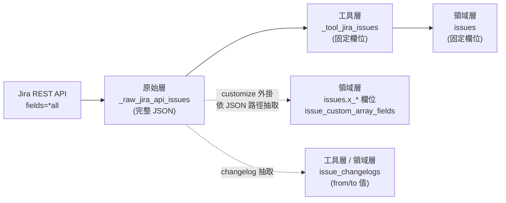
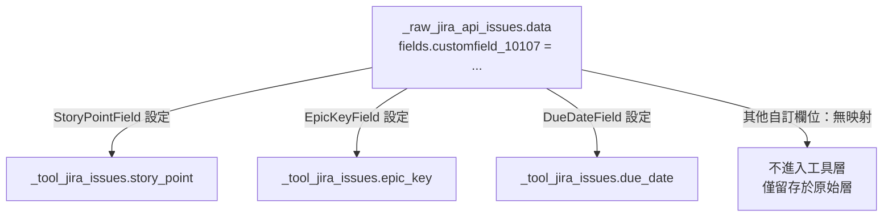

# DevLake 是否會將 Jira 議題的自訂欄位「值」同步進資料庫？

## 摘要

**不會（預設情況下）。** Apache DevLake 的 Jira 外掛在**工具層（tool layer）**的 `_tool_jira_issues` 資料表中，**只保留少數幾個由設定映射而來、被「正規化」過的欄位**（例如 story point、epic key、due date），並**不儲存某一張 Jira 議題上一般自訂欄位（如 `customfield_10107`）當下的值**[^jira-model][^jira-extractor]。自訂欄位的**原始值**只會以完整 JSON 的形式留在**原始層（raw layer）**的 `_raw_jira_api_issues.data` 中[^raw-schema]，而**領域層（domain layer）**的 `issues` 資料表預設也**沒有**對應的欄位[^domain-schema]。

若使用者要讓「某張議題的某個自訂欄位值」真正落到資料表欄位中，官方指定的做法是另外啟用 **`customize` 外掛**，手動在領域層資料表新增 `x_` 開頭的欄位，並以 JSON 路徑（例如 `fields.customfield_10107`）從原始層把值抽出來填入[^customize][^issue-5047]。

需要留意一個容易混淆的例外：**議題變更紀錄（changelog）確實有儲存自訂欄位的「變更前後值」**。Jira 的 `issue_changelogs`（領域層）與 `_tool_jira_issue_changelog_items`（工具層）會逐筆記錄欄位異動，包含 `customfield_*` 的 from/to 值，但那是**歷史異動**，不是**當前值**[^changelog-model][^changelog-convertor][^changelog-snapshot]。

因此，問題中「專案有哪些自訂欄位」與「某張票的自訂欄位值」在 DevLake 中是兩件不同的事：

| 問題 | DevLake 是否有現成的儲存位置 | 位置 |
| --- | --- | --- |
| 這個 Jira 專案／站台有哪些自訂欄位 | 有 | `_tool_jira_issue_fields`（欄位定義）[^jira-field-model] |
| 某張議題某個自訂欄位「現在的」值 | 沒有（需 `customize` 外掛） | 原始層 JSON，或 `customize` 新增的 `x_*` 欄位[^customize] |
| 某張議題某個自訂欄位「變更的」歷史 | 有（僅限有 changelog 的外掛） | `issue_changelogs`、`_tool_jira_issue_changelog_items`[^changelog-convertor] |

## 背景：DevLake 的三層資料架構

Apache DevLake 是一套開源的開發資料平台，用來彙整 Jira、GitHub、GitLab、Jenkins 等工具中零散的開發資料並產生工程指標[^repo]。其資料流分為三層[^architecture]：

1. **原始層（Raw layer）**：以 JSON 原封不動儲存資料來源 API 的回應，資料表以 `_raw_` 為前綴，例如 `_raw_jira_api_issues`。此層的設計目的是避免重複呼叫 API（呼叫外部 API 通常是最耗時的一步），並讓日後想用不同方式轉換資料時仍可回溯[^raw-schema]。
2. **工具層（Tool layer）**：把各工具獨有的 JSON 展開成貼近該工具結構的關聯式資料表，資料表以 `_tool_` 為前綴，例如 `_tool_jira_issues`[^tool-schema]。
3. **領域層（Domain layer）**：把工具層的資料再抽象成跨工具通用的模型，例如 `issues`、`pull_requests`、`cicd_pipelines`，是預建儀表板與指標的基礎[^domain-schema]。



## Jira 外掛的實際實作

### 原始層：完整自訂欄位值確實有被收下來

Jira 議題的收集器在查詢時固定帶上 `fields=*all`，並展開 changelog[^jira-collector]：

```text
query.Set("expand", "changelog")
query.Set("fields", "*all")
```

這代表 API 回傳的每一張議題都包含全部的欄位，含所有 `customfield_XXXXX`。因此**在原始層的 `_raw_jira_api_issues.data` 裡，某張票的自訂欄位值是被完整保存的**[^jira-collector][^raw-schema]。問題只在於「後續兩層是否把它變成欄位」。

### 工具層：`_tool_jira_issues` 沒有自訂欄位值的欄位

`_tool_jira_issues` 的定義（Go 結構）列出的欄位是固定的，例如 `Summary`、`Description`、`Type`、`StatusName`、`StoryPoint`、`OriginalEstimateMinutes`、`PriorityName`、`ParentId`、`DueDate`、`FixVersions` 等等，**沒有任何 `customfield_*` 或通用的「自訂欄位值」欄位**[^jira-model]。

在抽取階段，`Fields.AllFields`（也就是包含全部欄位的 map）**只被用來取出三種可設定映射的欄位**[^jira-extractor]：

- **Story point**：由設定中的 `StoryPointField` 指定要對應到 `_tool_jira_issues.story_point`[^jira-extractor]。
- **Epic key**：由 `EpicKeyField` 指定（Jira Cloud 與 company-managed 專案常把 epic key 放在自訂欄位而非 `fields.epic`）[^jira-extractor]。
- **Due date**：由 `DueDateField` 指定，預設為系統欄位 `duedate`[^jira-extractor]。

換句話說，**除了這三個被「指定映射」的欄位之外，其餘自訂欄位在工具層會被丟棄**，只存在於原始層。官方文件對這段的描述也一致：設定頁的 Issue Tracking 轉換規則只提供「Issue Type 標準化」「Story Point 映射」「Epic Key 映射」這幾項[^jira-config]。



### 領域層：`issues` 也沒有自訂欄位值

領域層的 `issues` 結構同樣只有通用欄位（`StoryPoint`、`Priority`、`Component`、`Severity`、`FixVersions` 等），沒有 `customfield_*`[^domain-issue-go]。官方 domain layer schema 文件中，`issues` 表唯一與自訂欄位相關的條目是 `x_custom_field_1`，其說明為「**當使用 customize 外掛**把 Jira 原始層欄位轉換為領域層欄位時才可用」[^domain-schema]。

```
`x_custom_field_1` | It depends on the type of the converted field | The value of
the custom field. This field is available when utilizing the customize plugin to
convert Jira's raw layer fields to the domain layer fields.
```

並列的 `issue_custom_array_fields` 資料表則用來存放**陣列型別**的自訂欄位值，欄位為 `issue_id`、`field_id`、`field_value`，說明中也明講「使用 customize 外掛時才可用」[^domain-schema]。

### 欄位「定義」 vs 欄位「值」

DevLake **有**收集「這個 Jira 站台有哪些欄位（含自訂欄位）」的資訊。Jira 外掛會呼叫 `api/2/field` 收集欄位定義，存成 `_tool_jira_issue_fields`，內容包含欄位 ID（如 `customfield_10014`）、名稱、`custom: true/false`、`schema.custom`、`schema.type` 等[^jira-field-collector][^jira-field-model]。這正是使用者所說「**專案有哪些自訂欄位**」的那部分。

但這是**欄位的中介資料（metadata）**，不含任何一張票的欄位值[^jira-field-model]。

## 例外：changelog 會記錄自訂欄位的異動前後值

**議題變更歷史**是自訂欄位值唯一會被「展開成欄位」儲存的地方，但仍非「當前值」。

- 工具層：`_tool_jira_issue_changelogs` 記錄變更事件（作者、時間、對應的 `issue_id`）；`_tool_jira_issue_changelog_items` 以 `(connection_id, changelog_id, field)` 為主鍵，儲存 `field`、`field_id`、`from_value`／`from_string`、`to_value`／`to_string`[^changelog-model]。
- 領域層：`issue_changelogs` 的欄位包含 `field_id`、`field_name`、`original_from_value`、`original_to_value`、`from_value`、`to_value`[^domain-schema][^changelog-convertor]。
- 轉換器會依欄位名稱做特例處理（`assignee`／`reporter` 轉為 account id、`Sprint` 轉為 sprint id、`status` 轉為標準狀態），**其餘欄位則保留原始字串值**[^changelog-convertor]。

官方 e2e 快照檔可直接佐證：`issue_changelogs` 的內容包含 `customfield_10014`（Epic Link）、`customfield_10019`（Rank）、`customfield_10020`（Sprint）等自訂欄位的 from/to 值，例如：

```
jira:JiraIssueChangelogItems:2:10659:Epic Link,
jira:JiraIssue:2:10063,jira:JiraAccount:2:5e9711ba...,
customfield_10014,Epic Link,,EE-11,,,2020-06-12T00:21:20.929+00:00,...
```

[^changelog-snapshot]

因此可以這樣理解：**DevLake 知道某張票的 Epic Link 是什麼時候從空值變成 `EE-11`，但不會直接告訴你「這張票現在的 Epic Link 是 EE-11」**（除非 Epic Link 被指定為 `epicKeyField`，那就會落到 `epic_key`）。

## 要拿到自訂欄位的「值」，官方做法：`customize` 外掛

`customize` 外掛提供三種能力：在領域層資料表新增／刪除欄位、從原始層資料表抽取值填入指定欄位、以及從 CSV 匯入資料[^customize]。官方文件明確要求**新增欄位名稱必須以 `x_` 開頭**，並支援 `varchar(255)`、`text`、`bigint`、`float`、`timestamp`、`array` 六種型別[^customize]。

其抽取規則是：指定領域層資料表（`table`）、原始層資料表（`rawDataTable`）、篩選條件（`rawDataParams`）與映射（`mapping`，鍵為新欄位名、值為 JSON 路徑），內部使用 `tidwall/gjson` 套件解析[^customize]。官方範例是從 `_raw_jira_api_issues` 取 `fields.status.name` 填入 `issues.x_test`：

```json
[
  [
    {
      "plugin": "customize",
      "options": {
        "transformationRules": [
          {
            "table": "issues",
            "rawDataTable": "_raw_jira_api_issues",
            "rawDataParams": "{\"ConnectionId\":1,\"BoardId\":8}",
            "mapping": { "x_test": "fields.status.name" }
          }
        ]
      }
    }
  ]
]
```

[^customize]

而在社群中，同樣的 JSON 路徑寫法也被用來抽 Jira 自訂欄位，例如映射 `"x_teams": "fields.customfield_10107"`[^issue-4317]。針對「要如何在 DevLake 使用 Jira 自訂欄位做儀表板」這類提問，維護者的回覆一貫是**請使用 `customize` 外掛**，把原始層的欄位映射到領域層資料表[^issue-4910][^issue-5047]。開發者說明亦指出：customize 可讓使用者「新增／刪除領域層欄位、從原始層資料表抽值填入某些欄位」，並允許以自訂欄位在 `issues` 等資料表上建立自己的儀表板[^domain-schema][^customize]。

陣列型別（例如多選的自訂欄位）則會被拆進 `issue_custom_array_fields`，官方提供的查詢範例如下[^domain-schema]：

```sql
select count(*) as issue_count, field_value
from issues
  join issue_custom_array_fields on issues.id = issue_custom_array_fields.issue_id
where field_id = 'x_product_lines'
group by field_value;
```

### 值得注意的實作細節

- `customize` 的抽取器是把領域層資料表 **LEFT JOIN** 原始層資料表，依 `_raw_data_table` 與 `_raw_data_params` 過濾，再用 gjson 取路徑[^customize-extractor]。因此該外掛**依賴原始層資料仍在**；若對應的原始紀錄已被清除，該列會被跳過並記錄警告[^customize-extractor]。
- 當目標資料表是 `issues` 且取出的值是陣列時，會先刪除該議題該欄位的既有紀錄再逐筆寫入 `issue_custom_array_fields`，以避免重複[^customize-extractor]。

## 對照：其他外掛如何處理自訂欄位值

不同外掛的處理方式各不相同，可作為 DevLake 設計取向的佐證：

| 外掛 | 自訂欄位值的儲存方式 | 位置 |
| --- | --- | --- |
| Jira | 不儲存（僅少數映射欄位）；需 customize 外掛 | 原始層 JSON[^jira-extractor] |
| TAPD | 有專屬的長表儲存每個自訂欄位的值 | 工具層 `_tool_tapd_*_custom_field_value`[^tapd-custom] |
| YouTrack | 把整個 `customFields` 陣列序列化成 JSON 字串保留 | 工具層 `_tool_youtrack_issues.custom_fields_json`[^youtrack-model] |
| Teambition | 以 JSON 序列化欄位存放於專案與任務 | 工具層 `team_*`／`task` 的 `customfields`[^teambition] |

其中 TAPD 的作法最接近「欄位值」的關聯式儲存：其 `_tool_tapd_task_custom_field_value` 以 `(connection_id, task_id, custom_field)` 為主鍵，欄位含 `name` 與 `custom_value`[^tapd-custom]。YouTrack 的模型註解則說明其策略是「用設定的欄位名稱與 `$type` 把眾所皆知的欄位攤平成專屬欄位，並把整個 `customFields` 陣列序列化進 `CustomFieldsJson` 當作 catch-all，讓被丟棄的欄位仍可還原而不需重新收集」[^youtrack-model]。

Teambition 外掛（WIP）則以 `gorm:"serializer:json"` 把 `customfields` 存成 text 欄位[^teambition]。

## 結論與實務建議

1. **直接回答**：DevLake **預設不會**把「某張 Jira 議題的某個自訂欄位值」同步成資料庫欄位。它只把值留在原始層的 JSON 中，工具層與領域層只保留少數被設定映射的欄位（story point／epic key／due date）。
2. **「專案有哪些自訂欄位」是另一回事**：那是 `_tool_jira_issue_fields` 的欄位定義，DevLake 確實有收集。
3. **要拿到「值」，用 `customize` 外掛**：在領域層資料表新增 `x_` 欄位，設定 `rawDataTable: "_raw_jira_api_issues"` 與 JSON 路徑（如 `fields.customfield_10107`）即可；陣列型別會落到 `issue_custom_array_fields`。
4. **changelog 是歷史異動，不是當前值**：`issue_changelogs` 對 `customfield_*` 有 from/to 紀錄，但無法回答「這張票現在這個欄位是什麼」。
5. **若需要精確掌握自訂欄位的歷史軌跡**，可組合 `_tool_jira_issue_changelog_items`（工具層完整 from/to 與 `field_id`）與 `issue_changelogs`（領域層正規化後的值）來分析。

### 版本與來源說明

本報告的程式碼引用以 `apache/devlake` 官方儲存庫 `main` 分支為準。該儲存庫於檢索時約有 **3,198 個 stars**，屬活躍專案[^repo]。文件站有 `Next`、`v1.0 (Stable)` 等多個版本分支，本報告引用的文件頁面若無特別註明，皆為預設顯示的 `Next` 版本[^domain-schema]。需要留意的是，文件站與程式碼可能隨版本演進而有落差，實際行為請以對應版本的原始碼為準。

## 參考文獻

[^architecture]: Apache DevLake. (n.d.). *Overview — Architecture*. Retrieved 2026-11-13, from https://devlake.apache.org/docs/Overview/Architecture

[^changelog-convertor]: Apache Software Foundation. (n.d.). *issue_changelog_convertor.go* [Source code]. Apache DevLake (main branch). Retrieved 2026-11-13, from https://github.com/apache/devlake/blob/main/backend/plugins/jira/tasks/issue_changelog_convertor.go

[^changelog-model]: Apache Software Foundation. (n.d.). *issue_changelog.go* [Source code]. Apache DevLake (main branch). Retrieved 2026-11-13, from https://github.com/apache/devlake/blob/main/backend/plugins/jira/models/issue_changelog.go

[^changelog-snapshot]: Apache Software Foundation. (n.d.). *issue_changelogs.csv* [End-to-end test snapshot]. Apache DevLake (main branch). Retrieved 2026-11-13, from https://github.com/apache/devlake/blob/main/backend/plugins/jira/e2e/snapshot_tables/issue_changelogs.csv

[^customize]: Apache DevLake. (n.d.). *Customize*. Retrieved 2026-11-13, from https://devlake.apache.org/docs/Plugins/customize/

[^customize-extractor]: Apache Software Foundation. (n.d.). *customized_fields_extractor.go* [Source code]. Apache DevLake (main branch). Retrieved 2026-11-13, from https://github.com/apache/devlake/blob/main/backend/plugins/customize/tasks/customized_fields_extractor.go

[^domain-issue-go]: Apache Software Foundation. (n.d.). *issue.go* [Source code, domain layer ticket model]. Apache DevLake (main branch). Retrieved 2026-11-13, from https://github.com/apache/devlake/blob/main/backend/core/models/domainlayer/ticket/issue.go

[^domain-schema]: Apache DevLake. (n.d.). *Domain Layer Schema*. Retrieved 2026-11-13, from https://devlake.apache.org/docs/DataModels/DevLakeDomainLayerSchema/

[^issue-4317]: narrowizard. (2023, February 3). *[Bug][customize] failed when using irregular custom field name* [GitHub issue #4317]. Apache DevLake. Retrieved 2026-11-13, from https://github.com/apache/devlake/issues/4317

[^issue-4910]: ArsKorotaev. (2023, April 12). *[Question][Jira] Jira custom fields* [GitHub issue #4910]. Apache DevLake. Retrieved 2026-11-13, from https://github.com/apache/devlake/issues/4910

[^issue-5047]: arcfree. (2023, April 27). *[Question][Jira] How can DevLake collect the custom fields on the Jira issue? I didn't succeed even though I used customize* [GitHub issue #5047]. Apache DevLake. Retrieved 2026-11-13, from https://github.com/apache/devlake/issues/5047

[^jira-collector]: Apache Software Foundation. (n.d.). *issue_collector.go* [Source code]. Apache DevLake (main branch). Retrieved 2026-11-13, from https://github.com/apache/devlake/blob/main/backend/plugins/jira/tasks/issue_collector.go

[^jira-config]: Apache DevLake. (n.d.). *Jira*. Retrieved 2026-11-13, from https://devlake.apache.org/docs/Configuration/Jira/

[^jira-extractor]: Apache Software Foundation. (n.d.). *issue_extractor.go* [Source code]. Apache DevLake (main branch). Retrieved 2026-11-13, from https://github.com/apache/devlake/blob/main/backend/plugins/jira/tasks/issue_extractor.go

[^jira-field-collector]: Apache Software Foundation. (n.d.). *issue_field_collector.go* [Source code]. Apache DevLake (main branch). Retrieved 2026-11-13, from https://github.com/apache/devlake/blob/main/backend/plugins/jira/tasks/issue_field_collector.go

[^jira-field-model]: Apache Software Foundation. (n.d.). *issue_field.go* [Source code]. Apache DevLake (main branch). Retrieved 2026-11-13, from https://github.com/apache/devlake/blob/main/backend/plugins/jira/models/issue_field.go

[^jira-model]: Apache Software Foundation. (n.d.). *issue.go* [Source code, Jira plugin tool layer model]. Apache DevLake (main branch). Retrieved 2026-11-13, from https://github.com/apache/devlake/blob/main/backend/plugins/jira/models/issue.go

[^raw-schema]: Apache DevLake. (n.d.). *Raw Layer Schema*. Retrieved 2026-11-13, from https://devlake.apache.org/docs/DataModels/RawLayerSchema/

[^repo]: Apache Software Foundation. (n.d.). *apache/devlake* [GitHub repository]. Retrieved 2026-11-13, from https://github.com/apache/devlake

[^tapd-custom]: Apache Software Foundation. (n.d.). *task_custom_field_value.go* [Source code]. Apache DevLake (main branch). Retrieved 2026-11-13, from https://github.com/apache/devlake/blob/main/backend/plugins/tapd/models/task_custom_field_value.go

[^teambition]: Apache Software Foundation. (n.d.). *task.go* [Source code, Teambition plugin model]. Apache DevLake (main branch). Retrieved 2026-11-13, from https://github.com/apache/devlake/blob/main/backend/plugins/teambition/models/task.go

[^tool-schema]: Apache DevLake. (n.d.). *Tool Layer Schema*. Retrieved 2026-11-13, from https://devlake.apache.org/docs/DataModels/ToolLayerSchema/

[^youtrack-model]: Apache Software Foundation. (n.d.). *issue.go* [Source code, YouTrack plugin model]. Apache DevLake (main branch). Retrieved 2026-11-13, from https://github.com/apache/devlake/blob/main/backend/plugins/youtrack/models/issue.go
