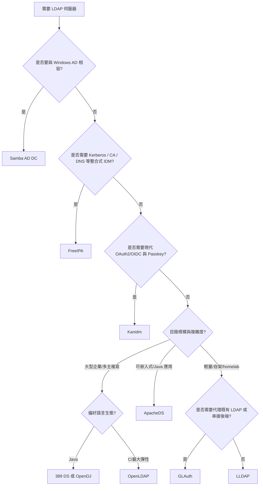

# 自由開源軟體(FOSS)的 LDAP 伺服器方案彙整

## 摘要

LDAP(Lightweight Directory Access Protocol，輕量目錄存取協定)是一種用於查詢與修改目錄服務(Directory Service)的協定，廣泛被用於集中管理帳號、群組、權限與組織資訊。本文以 2026 年 11 月的現況為準，彙整目前主要且仍在維護的自由開源軟體(FOSS, Free and Open-Source Software)LDAP 伺服器實作，並區分為「完整目錄服務」(以 OpenLDAP、389 Directory Server、ApacheDS、OpenDJ 為代表)與「輕量認證伺服器／整合式身分管理平台」(以 LLDAP、GLAuth、Kanidm、FreeIPA、Samba AD DC 為代表)兩大類，最後提出選型建議。

## 背景：LDAP 是什麼

LDAP 是一種以樹狀結構(Hierarchical)儲存與查詢資料的通訊協定[^whatisldap]。目錄服務通常用來保存使用者帳號、群組、裝置與組織單位(Organizational Unit)，並提供認證(Bind)與查詢(Search)能力，因此常被作為單一登入(Single Sign-On)與應用程式統一帳號來源的基礎[^whatisldap]。

在自由開源軟體的脈絡下，「LDAP 伺服器」一詞其實涵蓋兩種相當不同的產品：

- **完整／通用目錄伺服器**：實作接近完整的 LDAPv3 規範，支援多主複寫(Multi-master Replication)、細緻的存取控制清單(ACL)、Schema 擴充與多種後端資料庫，適合大型企業與複雜的目錄需求。
- **輕量／專用認證伺服器**：只實作應用程式實際需要的 LDAP 子集，訴求設定簡單、資源佔用低，常搭配自架服務(如 Nextcloud、Authelia、Jellyfin)作為帳號來源。

以下分別介紹。

---

## 一、完整目錄服務

### 1. OpenLDAP

OpenLDAP 是歷史最悠久、被視為 LDAP 參考實作(De facto reference implementation)的伺服器，主要守護程式為 `slapd`[^openldap-main]。其特色在於高度可設定性與 overlay/module(模組)擴充機制，可支援 `syncrepl` 多主複寫、細緻 ACL、以及多種資料庫後端[^openldap-main]。

| 項目 | 內容 |
|---|---|
| 官方網站 | <https://www.openldap.org/>[^openldap-main] |
| 原始碼 | 官方 Git：<https://git.openldap.org>[^openldap-devel]；GitHub 鏡像：<https://github.com/openldap/openldap>[^openldap-gh] |
| 授權條款 | OpenLDAP Public License v2.8(非限制性的自由開源授權，經 OSI 認可)[^openldap-license] |
| 主要語言 | C[^openldap-gh] |
| GitHub 星數 | 約 611[^openldap-gh] |
| 最新版本 | 功能版本 2.7.2、LTS 版本 2.6.16[^openldap-roadmap] |
| 維護狀態 | 活躍；2.7 為新功能分支，2.6 為長期支援分支，並已規劃 OpenLDAP 2.8(2027)[^openldap-roadmap] |

維護主體為 OpenLDAP Foundation，一個成立於 1998 年的非營利法人，統籌 OpenLDAP Project 的志工開發[^openldap-foundation]。

### 2. 389 Directory Server(389 DS)

389 Directory Server 源自 Netscape Directory Server，現由 Red Hat 支持，是企業級 Linux 環境中常見的 LDAP 伺服器，也是 FreeIPA 的 LDAP 後端[^port389-main]。其最大特色是成熟的多供應者複寫(Multi-supplier Replication)與衝突解決機制[^port389-features]。

| 項目 | 內容 |
|---|---|
| 官方網站 | <https://www.port389.org/>[^port389-main] |
| 原始碼 | <https://github.com/389ds/389-ds-base>[^port389-gh] |
| 授權條款 | GPLv3+(核心另有 MIT、OpenLDAP、OpenSSL 等元件授權)[^port389-license] |
| 主要語言 | C(逐步導入 Rust)[^port389-gh] |
| GitHub 星數 | 約 300[^port389-gh] |
| 最新版本 | 389-ds-base 3.3.1(2026-09-07)[^port389-release] |
| 維護狀態 | 活躍；同時維護 3.3、3.2、3.1、3.0 等多個版本系列[^port389-gh] |

功能包含 LDAPv3 相容、SASL/GSSAPI(Kerberos)、TLS、線上重建索引、備份還原、屬性加密，以及基於 Cockpit 的網頁管理主控台 `cockpit-389-ds`[^port389-features]。

### 3. Apache Directory Server(ApacheDS)

ApacheDS 由 Apache 軟體基金會維護，以 Java 撰寫，設計上強調**可嵌入式**(Embeddable)，可作為函式庫內嵌於 Java 應用程式中[^apacheds-main]。它通過 Open Group 的 LDAPv3 認證，並支援多主複寫、X.500 授權、密碼原則，以及以 LDIF 為主的設定方式[^apacheds-main]。

| 項目 | 內容 |
|---|---|
| 官方網站 | <https://directory.apache.org/apacheds/>[^apacheds-main] |
| 原始碼 | <https://github.com/apache/directory-server>[^apacheds-gh] |
| 授權條款 | Apache License 2.0[^apacheds-main] |
| 主要語言 | Java[^apacheds-gh] |
| GitHub 星數 | 約 189[^apacheds-gh] |
| 最新版本 | 2.0.0.AM27(Alpha 里程碑版本)[^apacheds-download] |
| 維護狀態 | 仍在提交程式碼，但長期停留在 2.0.0-AMx 里程碑階段，尚無穩定版[^apacheds-download] |

需特別注意：ApacheDS 多年來未發布正式穩定版(Stable Release)，導入前應評估此風險[^apacheds-download]。

### 4. OpenDJ(Open Identity Platform)

OpenDJ 原為 Sun Microsystems 的 OpenDS，後經 ForgeRock 商業化，現由社群的 Open Identity Platform 接手維護，是 Java 生態中活躍的 LDAPv3 伺服器[^opendj-main]。特色包含多主複寫、REST2LDAP(以 JSON over HTTP 存取目錄)、以及可外接關聯式與 NoSQL 資料庫後端[^opendj-main]。

| 項目 | 內容 |
|---|---|
| 官方網站 | <https://www.openidentityplatform.org/opendj>[^opendj-main] |
| 原始碼 | <https://github.com/OpenIdentityPlatform/OpenDJ>[^opendj-gh] |
| 授權條款 | CDDL 1.1(Common Development and Distribution License)[^opendj-gh] |
| 主要語言 | Java[^opendj-gh] |
| GitHub 星數 | 約 445[^opendj-gh] |
| 最新版本 | OpenDJ 5.2.0(2026-10-21)[^opendj-release] |
| 維護狀態 | 活躍；5.x 系列在一年內密集發布多個版本[^opendj-release] |

附帶說明：原 ForgeRock OpenDJ 已不再由 ForgeRock 維護，社群分支為目前的延續；更早期的 OpenDS 已終止[^opendj-main]。

---

## 二、輕量認證伺服器與整合式身分管理平台

### 5. LLDAP

LLDAP 是一套以 Rust 撰寫、訴求「輕量、易上手」的 LDAP 伺服器，主打自架(homelab)與中小型應用場景，提供網頁管理介面與 GraphQL API[^lldap-main]。

| 項目 | 內容 |
|---|---|
| 原始碼 | <https://github.com/lldap/lldap>[^lldap-gh] |
| 授權條款 | GPL-3.0[^lldap-gh] |
| 主要語言 | Rust(WASM/Yew 前端)[^lldap-gh] |
| GitHub 星數 | 約 6,600[^lldap-gh] |
| 最新版本 | v0.6.3(2026-05-01)[^lldap-release] |
| 維護狀態 | 活躍，社群貢獻者眾多[^lldap-gh] |

支援 SQLite(預設)、MySQL/MariaDB、PostgreSQL 等後端[^lldap-faq]。重要限制包括：無內建 OAuth/OIDC、無複寫(單一實例)、不支援上游 LDAP 代理(Proxy/Chaining)，且專案 FAQ 自承「匯流排係數(Bus Factor)= 1」，不建議大型組織採用[^lldap-faq]。

### 6. GLAuth

GLAuth 是以 Go 撰寫的輕量 LDAP 認證伺服器，主打開箱即用、無需 `slapd` 複雜設定，常見於開發、CI 與 homelab 情境[^glauth-main]。

| 項目 | 內容 |
|---|---|
| 官方網站 | <https://glauth.github.io/>[^glauth-main] |
| 原始碼 | <https://github.com/glauth/glauth>[^glauth-gh] |
| 授權條款 | MIT[^glauth-gh] |
| 主要語言 | Go[^glauth-gh] |
| GitHub 星數 | 約 2,900[^glauth-gh] |
| 最新版本 | GLAuth v2.5.4(2026-09-13)[^glauth-release] |
| 維護狀態 | 活躍；約每 4 週發布一次[^glauth-release] |

其最大優勢是**可插拔的後端設定**：支援設定檔(TOML)、S3、SQL 資料庫，以及**代理到既有 LDAP**(Proxy/Chaining)，可將多個後端串接，例如在上游 LDAP 前加上兩步驟驗證[^glauth-backends]。限制包含無網頁管理介面、設定變更需重啟、無複寫、無 Schema 擴充、預設未啟用 LDAPS(需自行開啟 TLS)[^glauth-backends]。

### 7. Kanidm

Kanidm 是以 Rust 撰寫的現代化身分管理平台(Identity Management Platform)，定位不只是 LDAP 伺服器，而是整合 OAuth2/OIDC、WebAuthn/Passkey、RADIUS 與 SSH 金鑰派送的完整 IDM 方案[^kanidm-main]。

| 項目 | 內容 |
|---|---|
| 官方網站 | <https://kanidm.com/>[^kanidm-main] |
| 原始碼 | <https://github.com/kanidm/kanidm>[^kanidm-gh] |
| 授權條款 | MPL-2.0(Mozilla Public License)[^kanidm-gh] |
| 主要語言 | Rust[^kanidm-gh] |
| GitHub 星數 | 約 5,600[^kanidm-gh] |
| 最新版本 | v1.12.1(2026-11-13)[^kanidm-release] |
| 維護狀態 | 活躍；發布節奏快速[^kanidm-release] |

關鍵限制：其 **LDAP 介面為唯讀**，透過 LDAP 的所有寫入都會被拒絕，官方說明原因是 LDAP 簡單的鍵值結構無法表達 Kanidm 的複雜資料型別[^kanidm-ldap]。此外不支援 StartTLS(僅支援 LDAPS，理由是 StartTLS 存在安全問題)，且使用自有資料庫、不支援外部 SQL[^kanidm-ldap]。

### 8. FreeIPA

FreeIPA 是整合式身分管理解決方案，並非單純的 LDAP 伺服器，而是把多個元件綁成一套：以 389 Directory Server 作為 LDAP 後端、MIT Kerberos 作為 KDC、Dogtag 作為 CA、BIND + `bind-dyndb-ldap` 作為 DNS，並以 SSSD 作為客戶端快取[^freeipa-main]。

| 項目 | 內容 |
|---|---|
| 官方網站 | <https://www.freeipa.org/>[^freeipa-main] |
| 原始碼 | GitHub 鏡像：<https://github.com/freeipa/freeipa>[^freeipa-gh] |
| 授權條款 | GPL-3.0[^freeipa-gh] |
| 主要語言 | Python(部分元件為 C)[^freeipa-gh] |
| GitHub 星數 | 約 1,300[^freeipa-gh] |
| 最新版本 | FreeIPA 4.13.5[^freeipa-release] |
| 維護狀態 | 活躍，由 Red Hat 支持[^freeipa-main] |

功能包含網頁管理介面、CLI 與 JSONRPC API、集中管理密碼／SSH 金鑰／SUDO 規則／SELinux 設定、以及與 Active Directory 的跨領域信任(Cross-realm Trust)[^freeipa-main]。

### 9. Samba AD DC

Samba 的 AD DC(Active Directory Domain Controller)，在自由開源軟體中以 LDAP 後端(實際為 LDB)提供與 Windows AD 相容的目錄服務，是「以 FOSS 取代 Microsoft AD」的主要選項[^samba-main]。

| 項目 | 內容 |
|---|---|
| 官方網站 | <https://www.samba.org/>[^samba-main] |
| 原始碼 | 官方 Git：<https://git.samba.org>；GitHub 鏡像：<https://github.com/samba-team/samba>[^samba-gh] |
| 授權條款 | GPLv3[^samba-gh] |
| 主要語言 | C(Python 用於建置與工具)[^samba-gh] |
| GitHub 星數 | 約 1,200[^samba-gh] |
| 最新版本 | 4.25.1 / 4.24.8(2026-10-23 / 2026-10-12)[^samba-history] |
| 維護狀態 | 活躍，多個穩定系列並行維護[^samba-history] |

除 LDAP 目錄外，Samba AD DC 亦提供 SMB/CIFS 檔案與列印服務、Kerberos KDC、DNS 伺服器、AD 信任與群組原則(Group Policy)[^samba-main]。

---

## 三、方案比較

| 方案 | 授權 | 星數 | 最新版本 | 語言 | 定位 | 複寫 | 網頁管理 | 備註 |
|---|---|---|---|---|---|---|---|---|
| OpenLDAP | OpenLDAP Public License 2.8[^openldap-license] | ~611[^openldap-gh] | 2.7.2 / 2.6.16[^openldap-roadmap] | C | 通用目錄 | 有(syncrepl)[^openldap-main] | 無 | 參考實作、彈性最高 |
| 389 DS | GPLv3+[^port389-license] | ~300[^port389-gh] | 3.3.1[^port389-release] | C | 企業目錄 | 有(多供應者)[^port389-features] | 有(Cockpit)[^port389-features] | FreeIPA 的後端 |
| ApacheDS | Apache 2.0[^apacheds-main] | ~189[^apacheds-gh] | 2.0.0.AM27[^apacheds-download] | Java | 可嵌入式 | 有 | Apache Directory Studio | 長期無穩定版[^apacheds-download] |
| OpenDJ | CDDL 1.1[^opendj-gh] | ~445[^opendj-gh] | 5.2.0[^opendj-release] | Java | 通用目錄 | 有(多主)[^opendj-main] | 有 | REST2LDAP、NoSQL 後端 |
| LLDAP | GPL-3.0[^lldap-gh] | ~6,600[^lldap-gh] | v0.6.3[^lldap-release] | Rust | 輕量認證 | 無[^lldap-faq] | 有[^lldap-main] | 匯流排係數=1[^lldap-faq] |
| GLAuth | MIT[^glauth-gh] | ~2,900[^glauth-gh] | v2.5.4[^glauth-release] | Go | 輕量／代理 | 無[^glauth-backends] | 無[^glauth-backends] | 可代理上游 LDAP[^glauth-backends] |
| Kanidm | MPL-2.0[^kanidm-gh] | ~5,600[^kanidm-gh] | v1.12.1[^kanidm-release] | Rust | 整合式 IDM | 有(兩節點)[^kanidm-main] | 有(自助式)[^kanidm-main] | LDAP 唯讀[^kanidm-ldap] |
| FreeIPA | GPL-3.0[^freeipa-gh] | ~1,300[^freeipa-gh] | 4.13.5[^freeipa-release] | Python | 整合式 IDM | 有(繼承 389 DS)[^freeipa-main] | 有[^freeipa-main] | Kerberos + CA + DNS |
| Samba AD DC | GPLv3[^samba-gh] | ~1,200[^samba-gh] | 4.25.1 / 4.24.8[^samba-history] | C | AD 相容目錄 | 有[^samba-main] | 部分 | 可取代 Microsoft AD[^samba-main] |

### 選型決策示意圖

## 四、選型建議

- **大型企業、需要多主複寫與成熟 ACL**：優先考慮 **389 Directory Server** 或 **OpenLDAP**；若生態偏好 Java，則為 **OpenDJ**[^port389-features][^openldap-main][^opendj-main]。
- **希望一次取得 Kerberos、CA、DNS 等完整身分管理**：**FreeIPA**[^freeipa-main]。
- **要取代 Microsoft Active Directory**：**Samba AD DC**[^samba-main]。
- **想要現代化認證(OIDC、Passkey、RADIUS)並相容 LDAP**：**Kanidm**，但務必注意其 LDAP 介面唯讀[^kanidm-ldap]。
- **自架服務(Nextcloud、Authelia 等)的簡單帳號來源**：**LLDAP**，但應留意其無複寫與匯流排係數風險[^lldap-faq]。
- **開發／CI／需要代理或串接既有 LDAP**：**GLAuth**[^glauth-backends]。
- **需要在 Java 應用中內嵌目錄**：**ApacheDS**，但須承擔長期無穩定版的風險[^apacheds-download]。

## 五、來源反思(Source Reflection)

撰寫本文時針對來源的權威性、時效性與可能偏誤進行以下考量：

1. **優先採用官方來源**：版本號、授權條款與維護狀態以各專案官方網站與官方程式碼儲存庫為主，GitHub 星數則取自儲存庫頁面，屬會隨時間變動的動態指標[^openldap-gh][^port389-gh][^lldap-gh][^glauth-gh][^kanidm-gh]。
2. **版本與日期可能快速變動**：開源專案發布頻繁(例如 Kanidm、GLAuth、OpenDJ 皆為高頻發布)，本文所列版本為 2026-11 前後之快照，實際導入前應再次確認官方最新版本[^kanidm-release][^glauth-release][^opendj-release]。
3. **專案自陳限制的可信度**：LLDAP 的「匯流排係數=1」與 Kanidm 的「LDAP 唯讀」皆為專案官方文件所明載，屬第一手陳述，可信度較高，但也代表這些限制短期內不易改變[^lldap-faq][^kanidm-ldap]。
4. **ApacheDS 的維護狀態需保留判斷**：官方下載頁顯示最新為 Alpha 里程碑版本，官方並未宣稱已進入穩定版，因此「仍在維護但無穩定版」為對現有證據的謹慎描述，而非對其品質的定論[^apacheds-download]。
5. **GitHub 星數不等於品質**：星數反映社群關注度，與企業成熟度、支援度並非正相關(例如企業級部署量極大的 OpenLDAP、389 DS 星數反而低於新興的 LLDAP、Kanidm)，選型時不應以星數作為唯一依據[^openldap-gh][^lldap-gh]。

## 參考文獻

[^whatisldap]: Lightweight Directory Access Protocol. (n.d.). In *Wikipedia*. Retrieved 2026-11-13, from https://en.wikipedia.org/wiki/Lightweight_Directory_Access_Protocol

[^openldap-main]: OpenLDAP Foundation. (n.d.). *OpenLDAP*. Retrieved 2026-11-13, from https://www.openldap.org/

[^openldap-devel]: OpenLDAP Foundation. (n.d.). *Development*. Retrieved 2026-11-13, from https://www.openldap.org/devel/

[^openldap-foundation]: OpenLDAP Foundation. (n.d.). *The OpenLDAP Foundation*. Retrieved 2026-11-13, from https://www.openldap.org/foundation/

[^openldap-license]: OpenLDAP Foundation. (2003-08-17). *The OpenLDAP Public License, Version 2.8*. Retrieved 2026-11-13, from https://www.openldap.org/software/release/license.html

[^openldap-roadmap]: OpenLDAP Foundation. (n.d.). *OpenLDAP Release Roadmap*. Retrieved 2026-11-13, from https://www.openldap.org/software/roadmap.html

[^openldap-gh]: OpenLDAP Project. (n.d.). *openldap/openldap* [Source code]. GitHub. Retrieved 2026-11-13, from https://github.com/openldap/openldap

[^port389-main]: 389 Directory Server Project. (n.d.). *389 Directory Server*. Retrieved 2026-11-13, from https://www.port389.org/

[^port389-features]: 389 Directory Server Project. (n.d.). *Features*. Retrieved 2026-11-13, from https://www.port389.org/docs/389ds/FAQ/features.html

[^port389-license]: 389 Directory Server Project. (n.d.). *Licensing*. Retrieved 2026-11-13, from https://www.port389.org/docs/389ds/FAQ/licensing.html

[^port389-release]: 389 Directory Server Project. (2026-09-07). *Release 3.3.1*. Retrieved 2026-11-13, from https://www.port389.org/docs/389ds/releases/release-3-3-1.html

[^port389-gh]: 389 Directory Server Project. (n.d.). *389ds/389-ds-base* [Source code]. GitHub. Retrieved 2026-11-13, from https://github.com/389ds/389-ds-base

[^apacheds-main]: Apache Software Foundation. (n.d.). *Apache Directory Server (ApacheDS)*. Retrieved 2026-11-13, from https://directory.apache.org/apacheds/

[^apacheds-download]: Apache Software Foundation. (n.d.). *Downloads*. Retrieved 2026-11-13, from https://directory.apache.org/apacheds/downloads.html

[^apacheds-gh]: Apache Software Foundation. (n.d.). *apache/directory-server* [Source code]. GitHub. Retrieved 2026-11-13, from https://github.com/apache/directory-server

[^opendj-main]: Open Identity Platform. (n.d.). *OpenDJ*. Retrieved 2026-11-13, from https://www.openidentityplatform.org/opendj

[^opendj-release]: Open Identity Platform. (n.d.). *Releases — OpenDJ* [Source code releases]. GitHub. Retrieved 2026-11-13, from https://github.com/OpenIdentityPlatform/OpenDJ/releases

[^opendj-gh]: Open Identity Platform. (n.d.). *OpenIdentityPlatform/OpenDJ* [Source code]. GitHub. Retrieved 2026-11-13, from https://github.com/OpenIdentityPlatform/OpenDJ

[^lldap-main]: LLDAP Project. (n.d.). *LLDAP — Light LDAP implementation*. Retrieved 2026-11-13, from https://github.com/lldap/lldap

[^lldap-faq]: LLDAP Project. (n.d.). *Frequently Asked Questions*. Retrieved 2026-11-13, from https://github.com/lldap/lldap/blob/main/docs/faq.md

[^lldap-release]: LLDAP Project. (n.d.). *Releases — lldap* [Source code releases]. GitHub. Retrieved 2026-11-13, from https://github.com/lldap/lldap/releases

[^lldap-gh]: LLDAP Project. (n.d.). *lldap/lldap* [Source code]. GitHub. Retrieved 2026-11-13, from https://github.com/lldap/lldap

[^glauth-main]: GLAuth Project. (n.d.). *GLAuth*. Retrieved 2026-11-13, from https://glauth.github.io/

[^glauth-backends]: GLAuth Project. (n.d.). *Backends*. Retrieved 2026-11-13, from https://glauth.github.io/docs/backends.html

[^glauth-release]: GLAuth Project. (n.d.). *Releases — glauth* [Source code releases]. GitHub. Retrieved 2026-11-13, from https://github.com/glauth/glauth/releases

[^glauth-gh]: GLAuth Project. (n.d.). *glauth/glauth* [Source code]. GitHub. Retrieved 2026-11-13, from https://github.com/glauth/glauth

[^kanidm-main]: Kanidm Project. (n.d.). *Kanidm*. Retrieved 2026-11-13, from https://kanidm.com/

[^kanidm-ldap]: Kanidm Project. (n.d.). *LDAP Integration*. Retrieved 2026-11-13, from https://kanidm.github.io/kanidm/stable/integrations/ldap.html

[^kanidm-release]: Kanidm Project. (n.d.). *Releases — kanidm* [Source code releases]. GitHub. Retrieved 2026-11-13, from https://github.com/kanidm/kanidm/releases

[^kanidm-gh]: Kanidm Project. (n.d.). *kanidm/kanidm* [Source code]. GitHub. Retrieved 2026-11-13, from https://github.com/kanidm/kanidm

[^freeipa-main]: FreeIPA Project. (n.d.). *FreeIPA*. Retrieved 2026-11-13, from https://www.freeipa.org/

[^freeipa-release]: FreeIPA Project. (n.d.). *Release Notes 4.13.5*. Retrieved 2026-11-13, from https://www.freeipa.org/release-notes/4-13-5.html

[^freeipa-gh]: FreeIPA Project. (n.d.). *freeipa/freeipa* [Source code]. GitHub. Retrieved 2026-11-13, from https://github.com/freeipa/freeipa

[^samba-main]: Samba Team. (n.d.). *Samba*. Retrieved 2026-11-13, from https://www.samba.org/

[^samba-release]: Samba Team. (2026). *VERSION* [Source code]. Samba Git repository. Retrieved 2026-11-13, from https://raw.githubusercontent.com/samba-team/samba/master/VERSION

[^samba-history]: Samba Team. (n.d.). *Samba Release History / Previous Release Announcements*. Retrieved 2026-11-13, from https://www.samba.org/samba/history/

[^samba-gh]: Samba Team. (n.d.). *samba-team/samba* [Source code]. GitHub. Retrieved 2026-11-13, from https://github.com/samba-team/samba
