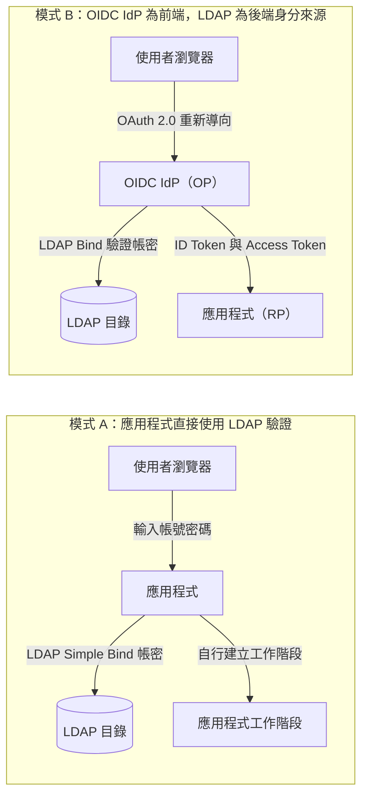
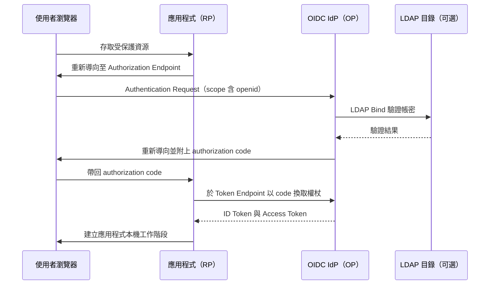

# 使用 LDAP 或 OIDC 作為 SSO 身分提供者（IdP）的優劣比較

## 摘要

在規劃單一簽入（Single Sign-On，以下簡稱 SSO）時，常見的疑問是「應該用 LDAP 還是 OIDC 來當身分提供者（Identity Provider，以下簡稱 IdP）？」這個問題本身隱含一個重要的分類錯誤：LDAP 是一套「目錄存取協定」，OIDC 是一套「以身分為目的的驗證協定」；兩者並非同一層級的替代品[^rfc4510][^oidccore]。

本文先釐清兩者的定位差異，再分別列出以 LDAP 作為驗證後端、以 OIDC 作為 SSO 協定時的優點與缺點，最後給出決策指引。核心結論是：在現代瀏覽器與雲端應用情境中，LDAP 適合作為「身分資料來源（identity store）」，而 OIDC 適合作為「對外提供 SSO 的協定」；實務上的最佳解通常是「LDAP 後端 + OIDC 前端」的混合架構。

---

## 1. 先定義清楚：LDAP 與 OIDC 是什麼

### 1.1 LDAP 是目錄存取協定

LDAP（Lightweight Directory Access Protocol）是用來存取「分散式目錄服務」的網際網路協定，其資料與服務模型遵循 X.500[^rfc4510]。LDAPv3 的技術規範由一系列 RFC 組成，其中 RFC 4510 是規範藍圖，RFC 4511 定義協定本身，RFC 4513 定義驗證方法與安全機制[^rfc4510]。

LDAP 的驗證動作稱為 **Bind（綁定）**：用戶端透過 Bind 操作把驗證資訊交給目錄伺服器，藉此建立一個「授權身分」供後續操作使用[^rfc4513][^ldapbind]。Bind 提供的驗證方式分為兩大類：

- **Simple 驗證**：以項目的 DN 加上密碼證明身分；密碼以未經任何混淆的形式傳送，因此強烈建議只在加密連線上使用[^ldapbind]。
- **SASL 驗證**：透過 Simple Authentication and Security Layer 可插入幾乎任何驗證機制（例如一次性密碼等）[^ldapbind]。

LDAP 標準在設計上把授權視為「本地事務（local matter）」，標準本身不提供跨網域的網頁 SSO；它提供的是查詢、擷取、修改目錄內容，以及一組安全功能的存取方式[^rfc4513]。

### 1.2 OIDC 是建立在 OAuth 2.0 上的身分層

OpenID Connect 1.0（OIDC）是建立於 OAuth 2.0 之上的「簡單身分層」，讓用戶端能依據授權伺服器所執行的驗證來確認使用者身分，並以可互通的 REST 風格取得基本的個人資料[^oidccore]。OIDC 在 OAuth 2.0 的授權流程上加入 **ID Token**（一個 JWT），用來攜帶「驗證事件」的宣告[^oidccore]。

官方定義的關鍵角色包括[^oidccore]：

- **OpenID Provider（OP）**：能夠驗證使用者並提供宣告的 OAuth 2.0 授權伺服器，即一般所稱的 IdP。
- **Relying Party（RP）**：需要使用者驗證與宣告的 OAuth 2.0 用戶端，即一般所稱的應用程式或服務提供者。

OIDC 實作上常以 Authorization Code Flow 為主，其步驟為：用戶端發出帶有 `openid` scope 的驗證請求、授權伺服器驗證使用者、取得使用者同意、以 authorization code 回應用戶端、用戶端在 Token Endpoint 以 code 換取 ID Token 與 Access Token、用戶端驗證 ID Token 並取出使用者識別碼[^oidccore]。授權端點與 Token 端點的通訊都必須使用 TLS[^oidccore]。

OIDC 的可互通性很大程度來自 **Discovery**：OP 在 `/.well-known/openid-configuration` 提供 OpenID Provider Configuration Document，內含授權端點、Token 端點、支援的宣告與簽章金鑰中繼資料（如 `jwks_uri`）[^msftoidc]。OAuth 2.0 授權伺服器中繼資料的通用格式則規範於 RFC 8414，其中 `issuer` 為必要欄位，且必須與請求中繼資料所用的 issuer 標識完全一致，以防範冒充攻擊[^rfc8414]。

---

## 2. 關鍵釐清：LDAP 不是瀏覽器 SSO 協定

把 LDAP 當成「SSO 的 IdP 選項」時，必須先理解一件事實：**瀏覽器從不直接開啟 LDAP 連線**。LDAP 的典型角色是後端的帳號目錄與密碼驗證來源；真正對瀏覽器與應用程式提供 SSO 的，是站在目錄前面的 IdP（例如 Keycloak、Microsoft Entra ID、Okta 等），由 IdP 以 OIDC 或 SAML 對應用程式發行權杖[^rfc4513][^oidccore]。

兩種常見架構的差異可用下圖表示：

在模式 A 中，每個應用程式都必須自行收集使用者密碼、自行與目錄連線、自行管理登入狀態；這正是常見的「密碼反模式」，且每個應用都必須各自實作帳號列舉防護、節流、多因子等機制[^owaspauth]。在模式 B 中，應用程式永遠看不到使用者的密碼，驗證責任集中在 IdP，應用程式只信任 IdP 簽發的權杖[^oidccore]。

模式 B 的完整流程如下：

這個架構之所以可行，是因為 IdP 可以把 LDAP 當成使用者儲存庫與密碼驗證來源，而對外仍以 OIDC 提供 SSO[^oidccore][^rfc4513]。

---

## 3. 以 LDAP 作為驗證來源的優點

1. **開放且成熟的標準**：LDAP 是定義良好的協定，RFC 4511 明確規範用戶端如何編碼請求、伺服器如何編碼回應；市面上有大量目錄伺服器與用戶端 API 可選，選擇其中一個並不代表被永久綁定[^ldapwhy]。
2. **輕量且高效**：LDAP 訊息以 ASN.1 BER 編碼，是緊湊的二進位格式，比 JSON 或 XML over HTTP 更精簡；且 LDAP 使用持久連線，連線可維持數小時甚至數天，對效能與擴充性有明顯助益[^ldapwhy]。
3. **細緻的存取控制與逐使用者操作**：目錄伺服器通常提供細粒度的存取控制，限制特定使用者可存取的項目、屬性與值；相較於許多 SQL/NoSQL 應用共用單一帳號，LDAP 應用常以終端使用者身分執行操作，能更好地限制活動並提供更佳的稽核軌跡[^ldapwhy]。
4. **內建密碼政策與多種驗證機制**：目錄伺服器普遍提供密碼政策功能（強編碼、禁止弱密碼等），並可透過 SASL 支援多種驗證類型，包括以一次性密碼實作的雙因子選項[^ldapwhy]。
5. **適合作為組織的唯一事實來源**：企業級與網際網路規模的公司普遍以 LDAP 目錄作為帳號、群組與裝置資訊的中央來源，這正是它能長期存在的原因[^ldapwhy]。雲端服務也把同類目錄包裝成託管服務，例如 AWS Directory Service 提供的 Microsoft AD 與 LDAP 相容目錄，並可用於相容應用與 Linux SSH 等 LDAP 應用[^awsds]。
6. **涵蓋非瀏覽器協定**：需要驗證的對象不限於網頁。當情境是網路設備、電子郵件伺服器、印表機或作業系統登入等非 HTTP 通訊端時，LDAP 才是直接可用的選項[^ldapwhy]。

---

## 4. 以 LDAP 作為驗證來源的缺點

### 4.1 沒有原生 SSO，且應用程式必須經手密碼

LDAP 的 Simple Bind 以明文形式傳送密碼，「把密碼揭露給伺服器」是這套機制固有的安全風險[^rfc4513]。更重要的是，採此模式的應用程式本身也必須收集並處理使用者的原始密碼，這與現代「驗證委派」原則相違背；OWASP 明確建議驗證（AuthN）與授權（AuthZ）應透過不要求密碼的協定處理[^owaspauth]。此外，LDAP 本身不提供跨網域的瀏覽器 SSO，因此每個應用都得各自實作登入[^rfc4513]。

### 4.2 傳輸安全高度依賴正確設定

因為 Simple Bind 會明文傳輸密碼，LDAP 規範要求實作在缺乏資料機密性保護時，預設應停用名稱／密碼驗證，並在必要時讓伺服器以 `confidentialityRequired` 回應[^rfc4513]。即使改用 StartTLS 也有風險：明文傳輸本身會讓連線暴露於中間人攻擊，而攻擊者可以移除 root DSE 中的 StartTLS 宣告，導致安全層級被協商降級為明文，因此雙方都必須自行確認並同意已達到的安全層級[^rfc4513]。

### 4.3 Unauthenticated Bind 的實作陷阱

Simple Bind 允許「有名稱但密碼為空」的請求，此時會建立匿名的授權狀態。規範指出這在實務上經常被誤用：用戶端可能把一個成功的 Bind 當成「已驗證該 DN 的身分」，但實際上只是進入了匿名狀態；而使用者若不小心送出空密碼，也可能被實作不良的用戶端轉為匿名存取[^rfc4513]。RFC 4513 因此建議用戶端介面應禁止空密碼輸入，伺服器預設也應以 `unwillingToPerform` 拒絕此類請求[^rfc4513]。OWASP 亦提醒：使用名稱／密碼驗證時，必須在綁定前拒絕空密碼，否則一個成功的結果並不代表已證明使用者身分[^owaspldapcheat]。

### 4.4 LDAP Injection

若應用程式把使用者輸入直接串進 LDAP 查詢，就可能遭到 LDAP Injection；這與 SQL Injection 手法類似，可導致未授權查詢、權限提升，甚至目錄樹內容被修改[^owaspldap]。OWASP 指出 LDAP Injection 之所以常見，正是因為缺乏更安全的參數化查詢介面，加上 LDAP 被廣泛用於使用者驗證[^owaspldapcheat]。防禦上必須依情境選用正確的編碼函式（DN 值依 RFC 4514、搜尋篩選器依 RFC 4515），並避免自行撰寫跳脫邏輯[^owaspldapcheat]。

### 4.5 缺乏現代 SSO 所需的權杖語意

LDAP 的 Bind 是「全有全無」的驗證：一旦綁定成功，用戶端就取得該 DN 對應目錄所允許的權限，協定中沒有等同於 OAuth 2.0 存取權杖的「範圍（scope）」、到期時間或可個別撤銷的權杖概念[^rfc4513][^oidccore]。相對地，OIDC 的 ID Token 必須包含 `iss`、`sub`、`aud`、`exp`、`iat` 等必要宣告，並必須以 JWS 簽章[^oidccore]，這些都讓權杖具有可驗證、可限時、可限對象的性質。

### 4.6 不利於現代網路邊界

LDAP 使用二進位協定與專屬連線埠，對防火牆與 NAT 環境並不友善；當身分來源位於內網、IdP 位於雲端時，通常必須額外部署連接器或代理才能打通[^awsds]。這也解釋了為何許多雲端 IdP 會提供 AD/LDAP 連接器作為橋接元件。

### 4.7 沒有原生的多因子與同意流程

LDAP 協定本身沒有標準的多因子驗證概念，也沒有讓使用者就屬性釋出表達同意的機制。NIST SP 800-63C 在探討聯邦身分時，要求 IdP 在把任何使用者屬性傳送給 RP 之前，必須取得使用者明確的通知與正向確認[^nist63c]。這類同意與風險式驗證的控制，屬於 IdP 層的職責，而非 LDAP 目錄層。

---

## 5. 以 OIDC 作為 SSO 協定的優點

1. **專為瀏覽器與行動應用的 SSO 而設計**：OIDC 讓用戶端能依據授權伺服器執行的驗證來確認使用者身分，並取得基本資料，且以可互通的 REST 風格進行[^oidccore]。授權伺服器（即 OIDC 的 OP）本身就是「授權伺服器」這個角色，同時可發行 ID Token 與 Access Token[^oktaoauth]。
2. **應用程式不必接觸密碼**：驗證在 IdP 完成，應用程式只接收權杖。Okta 明確指出 OIDC 以 OAuth 2.0 為基礎延伸出使用者驗證與 SSO 能力，並定義可取得使用者資料的 scope[^oktaoauth]。OWASP 也建議使用不需密碼的驗證協定，並將 OIDC 用於驗證／SSO[^owaspauth]。
3. **強制 TLS 與可驗證的權杖**：OIDC 要求與授權端點的通訊必須使用 TLS[^oidccore]，授權伺服器中繼資料的規範亦要求實作必須支援 TLS[^rfc8414]。ID Token 為以 JWS 簽章的 JWT，用戶端可據此驗證簽章與宣告[^oidccore]。
4. **標準化的探索與註冊**：OP 於 `/.well-known/openid-configuration` 提供設定文件中繼資料；身分驗證函式庫通常會自動完成探索，開發者不必手寫對應的請求與回應[^msftoidc]。RFC 8414 進一步把此中繼資料格式一般化，使其可套用於更廣泛的 OAuth 2.0 情境[^rfc8414]。
5. **可涵蓋多種用戶端型態與機器對機器情境**：實務上，伺服器端網頁、單頁應用與原生應用適合使用 Authorization Code（含 PKCE）流程，而無終端使用者的服務則可使用 Client Credentials 流程[^oktaoauth]。PKCE 可防止授權碼注入，Okta 建議所有 OAuth 用戶端盡可能採用 Authorization Code 加 PKCE[^oktaoauth]。
6. **IdP 可集中施行強驗證**：由於驗證集中在 IdP，可在該層部署抗釣魚的驗證方式。以 Microsoft Entra ID 為例，通行金鑰（passkeys／FIDO2）以來源綁定的公開金鑰密碼學為基礎，可作為多因子驗證，且幾乎無法被釣魚，並能據此取得對雲端與地端資源的 SSO[^msftpwdless]。
7. **有助於降低橫向風險**：單一簽入的前提是使用者不必為每個 RP 各自持有憑證，這可減少憑證數量與重複管理的負擔[^nist63c]。

---

## 6. 以 OIDC 作為 SSO 協定的缺點

### 6.1 必須維運額外的 IdP，成為關鍵單點

OIDC 需要一個 IdP 存在。這個 IdP 必須管理簽章金鑰與金鑰輪替、發布 JWKS、處理用戶端註冊、管理權杖的撤銷與內省、追蹤工作階段、以及發布正確的探索中繼資料[^oidccore][^rfc8414][^oktaoauth]。IdP 因此成為所有 RP 的共同相依元件；一旦 IdP 不可用或設定錯誤，所有 SSO 都會受影響。

### 6.2 權杖處理與驗證本身是一門學問

ID Token 必須被正確驗證（簽章、發行者、對象、到期時間、nonce 等）[^oidccore]。Microsoft 明確建議不要手動驗證權杖，而應使用驗證函式庫，因為手動實作容易出錯[^msftoidc]。RFC 8414 也提醒，若用戶端接受了以某個 issuer 標識發布、但實際上由攻擊者掌握端點與金鑰的中繼資料文件，就可能被冒充[^rfc8414]。換言之，OIDC 的安全性很大程度取決於實作正確性，而非協定自動保證。

### 6.3 工作階段管理與登出仍有多個實作缺口

OIDC 的工作階段管理規範以跨來源 iframe 與 `postMessage` 輪詢 OP 以判斷登入狀態，規範本身就指出：部分瀏覽器開始預設封鎖第三方內容，可能導致所需狀態無法取得，Cookie 實作甚至可能每次輪詢都回傳「已變更」，造成重複驗證的無限迴圈[^oidcsession]。

登出同樣不完美。OIDC Back-Channel Logout 的規範自陳其限制：後通道通訊無法使用前端所維持的工作階段狀態，因此所有必要狀態都必須顯式傳遞，RP 還必須自行實作終止工作階段的機制；更關鍵的是，RP 的後通道登出 URI 必須能從所有使用的 OP 連線到，這意味著若採用公開 OP，RP 不能位於防火牆或 NAT 之後[^oidcbclogout]。此外，OIDC 的登出被拆成多份規範（工作階段管理、前端通道登出、後通道登出、RP 發起的登出），實作者必須自行選擇支援哪些組合併理解各自的缺口[^oidcsession][^oidcbclogout]。

### 6.4 依賴瀏覽器對第三方內容的政策

如前述，瀏覽器隱私政策（第三方 Cookie 封鎖）會直接影響依賴前端 iframe 的工作階段偵測機制[^oidcsession]。雖然後通道登出被認為不受此類變動影響[^oidcsession]，但整體而言，OIDC 的部分機制與瀏覽器生態的演進緊密相關。

### 6.5 不涵蓋非 HTTP 的驗證場景

OIDC 是建立在 HTTP 與 REST 風格的互動上[^oidccore]。對於作業系統登入、SSH、網路設備、印表機、資料庫等非 HTTP 的驗證場景，OIDC 並非直接可用的工具；這些場景仍是 LDAP 之類目錄協定的主場[^ldapwhy]。

### 6.6 品質與合規必須自行檢核

NIST SP 800-63C 定義聯邦保證等級（FAL），並要求以簽章、加密、對象限制等方式保護斷言；例如在部分前端通道情境下，RP 必須要求 FAL2 以上，以保護斷言內容不洩漏給瀏覽器等第三方[^nist63c]。這意味著導入 OIDC 不代表自動符合規範，仍需依使用情境選擇並驗證適當的等級與防護。

---

## 7. 綜合比較

下表整理兩種做法的關鍵差異（層級與定位為本文核心）。

| 面向 | LDAP（作為驗證來源） | OIDC（作為 SSO 協定） |
| --- | --- | --- |
| 協定定位 | 目錄存取協定[^rfc4510] | 建立在 OAuth 2.0 上的身分層[^oidccore] |
| 是否為瀏覽器 SSO | 否，瀏覽器不直接連 LDAP[^rfc4513] | 是，專為驗證與 SSO 設計[^oktaoauth] |
| 資料格式 | ASN.1 BER／LDIF[^ldapwhy] | JSON／JWT[^oidccore] |
| 傳輸與連線 | TCP，常用持久連線[^ldapwhy] | HTTPS／REST[^oidccore][^msftoidc] |
| 應用程式是否經手密碼 | 是（Simple Bind 明文傳密碼）[^rfc4513] | 否，驗證在 IdP 完成[^oidccore] |
| 傳輸加密要求 | 需自行以 TLS／StartTLS 保護，且有降級風險[^rfc4513] | 規範要求使用 TLS[^oidccore][^rfc8414] |
| 權杖範圍與到期 | 無此概念，綁定為全有全無[^rfc4513] | ID Token 具必要宣告與簽章[^oidccore] |
| 多因子驗證 | 無原生支援，須以 SASL 等外加[^ldapwhy] | 可在 IdP 集中施行，含抗釣魚通行金鑰[^msftpwdless] |
| 使用者同意 | 無標準機制 | 規範要求取得同意／授權後才釋出資訊[^oidccore][^nist63c] |
| 探索與互通 | 標準協定，但無 SSO 中繼資料[^ldapwhy] | Discovery 中繼資料，常見函式庫自動處理[^msftoidc][^rfc8414] |
| 主要風險 | LDAP Injection、明文綁定、空密碼誤判[^owaspldap][^rfc4513] | 實作複雜度、IdP 單點、登出缺口、第三方 Cookie 政策[^oidcsession][^oidcbclogout] |
| 適用場景 | 目錄為唯一事實來源、非 HTTP 驗證、地端既有系統[^ldapwhy][^awsds] | 網頁／行動 SSO、雲端應用、需強驗證與權杖授權[^oidccore][^oktaoauth] |

---

## 8. 決策指引

以下以「你要解決的問題」為軸線給出建議：

- **你需要一個集中、權威的帳號目錄（唯一事實來源），且驗證對象包含非瀏覽器協定**：選 LDAP，並善用目錄伺服器的密碼政策、存取控制與稽核能力[^ldapwhy]。
- **你需要網頁或行動應用的單一簽入，且不希望應用程式接觸使用者密碼**：選 OIDC，讓驗證集中在 IdP[^oidccore][^oktaoauth]。
- **你想在既有 LDAP 目錄上提供現代 SSO**：採混合架構，把 LDAP 當後端身分來源、把 OIDC 當對外協定；這是本文認為最務實的答案[^rfc4513][^oidccore]。
- **你需要多因子或抗釣魚驗證**：把強驗證放在 IdP 層（例如通行金鑰／FIDO2），而非期待目錄協定本身提供[^msftpwdless][^ldapwhy]。
- **你面對的必須符合特定保證等級（例如政府或金融）**：依 NIST SP 800-63C 的 FAL 要求，逐項檢核簽章、加密與對象限制等控制[^nist63c]。

需要注意的是，任何採用 LDAP 名稱／密碼驗證的實作，都應同時處理空密碼拒絕、正確的 DN 與篩選器編碼，以及最小權限綁定帳號等防禦，否則會落入上述的常見陷阱[^owaspldapcheat][^rfc4513]。

---

## 9. 常見迷思

- **「LDAP 就是一種 SSO」**：不是。LDAP 提供目錄查詢與 Bind 驗證，本身不提供跨網域的瀏覽器 SSO[^rfc4513]。
- **「用了 OIDC 就不用管目錄」**：OIDC 不負責儲存使用者；它需要一個身分來源，該來源可以（也經常）是 LDAP 目錄[^oidccore][^rfc4513]。
- **「OIDC 一定比 LDAP 安全」**：OIDC 在協定層要求 TLS 與可驗證權杖[^oidccore][^rfc8414]，但其實作複雜度帶來新的失敗模式，例如權杖驗證錯誤、探索中繼資料被冒充、以及登出與工作階段偵測的缺口[^msftoidc][^oidcsession][^oidcbclogout]。
- **「LDAP 已經過時」**：LDAPv3 是成熟的電信等級協定，且因是大型企業與網際網路規模公司的關鍵元件，供應商競爭持續推動效能、擴充性與創新[^ldapwhy]。

---

## 參考文獻

[^rfc4510]: Zeilenga, K. (Ed.). (2006, June). *Lightweight Directory Access Protocol (LDAP): Technical Specification Road Map* (RFC 4510). Internet Engineering Task Force. Retrieved 2026-11-13, from https://www.rfc-editor.org/rfc/rfc4510.txt

[^rfc4513]: Harrison, R. (Ed.). (2006, June). *Lightweight Directory Access Protocol (LDAP): Authentication Methods and Security Mechanisms* (RFC 4513). Internet Engineering Task Force. Retrieved 2026-11-13, from https://datatracker.ietf.org/doc/html/rfc4513

[^rfc8414]: Jones, M., Sakimura, N., & Bradley, J. (2018, June). *OAuth 2.0 Authorization Server Metadata* (RFC 8414). Internet Engineering Task Force. Retrieved 2026-11-13, from https://www.rfc-editor.org/rfc/rfc8414.txt

[^oidccore]: Sakimura, N., Bradley, J., Jones, M., de Medeiros, B., & Mortimore, C. (2023, December 15). *OpenID Connect Core 1.0 incorporating errata set 2*. OpenID Foundation. Retrieved 2026-11-13, from https://openid.net/specs/openid-connect-core-1_0.html

[^oidcsession]: de Medeiros, B., Agarwal, N., Sakimura, N., Bradley, J., & Jones, M. (2022, September 12). *OpenID Connect Session Management 1.0*. OpenID Foundation. Retrieved 2026-11-13, from https://openid.net/specs/openid-connect-session-1_0.html

[^oidcbclogout]: Jones, M., & Bradley, J. (2023, December 15). *OpenID Connect Back-Channel Logout 1.0 incorporating errata set 1*. OpenID Foundation. Retrieved 2026-11-13, from https://openid.net/specs/openid-connect-backchannel-1_0.html

[^ldapbind]: LDAP.com. (n.d.). *The LDAP Bind Operation*. Retrieved 2026-11-13, from https://ldap.com/the-ldap-bind-operation/

[^ldapwhy]: LDAP.com. (n.d.). *Why Choose LDAP?* Retrieved 2026-11-13, from https://ldap.com/why-choose-ldap/

[^owaspldap]: OWASP Foundation. (n.d.). *LDAP Injection*. Retrieved 2026-11-13, from https://owasp.org/www-community/attacks/LDAP_Injection

[^owaspldapcheat]: OWASP Foundation. (n.d.). *LDAP Injection Prevention Cheat Sheet*. OWASP Cheat Sheet Series. Retrieved 2026-11-13, from https://cheatsheetseries.owasp.org/cheatsheets/LDAP_Injection_Prevention_Cheat_Sheet.html

[^owaspauth]: OWASP Foundation. (n.d.). *Authentication Cheat Sheet*. OWASP Cheat Sheet Series. Retrieved 2026-11-13, from https://cheatsheetseries.owasp.org/cheatsheets/Authentication_Cheat_Sheet.html

[^oktaoauth]: Okta. (n.d.). *OAuth 2.0 and OpenID Connect overview*. Okta Developer. Retrieved 2026-11-13, from https://developer.okta.com/docs/concepts/oauth-openid/

[^msftoidc]: Microsoft. (2026). *OpenID Connect (OIDC) on the Microsoft identity platform*. Microsoft Learn. Retrieved 2026-11-13, from https://learn.microsoft.com/en-us/entra/identity-platform/v2-protocols-oidc

[^msftpwdless]: Microsoft. (2026). *Passkeys (FIDO2) authentication method in Microsoft Entra ID*. Microsoft Learn. Retrieved 2026-11-13, from https://learn.microsoft.com/en-us/entra/identity/authentication/concept-authentication-passwordless

[^nist63c]: Grassi, P. A., Richer, J. P., Squire, S. K., Fenton, J. L., & Nadeau, E. M. (2017, June). *Digital Identity Guidelines: Federation and Assertions* (NIST Special Publication 800-63C). National Institute of Standards and Technology. Retrieved 2026-11-13, from https://pages.nist.gov/800-63-3/sp800-63c.html

[^awsds]: Amazon Web Services. (n.d.). *What is AWS Directory Service?* AWS Directory Service Administration Guide. Retrieved 2026-11-13, from https://docs.aws.amazon.com/directoryservice/latest/admin-guide/what_is.html
