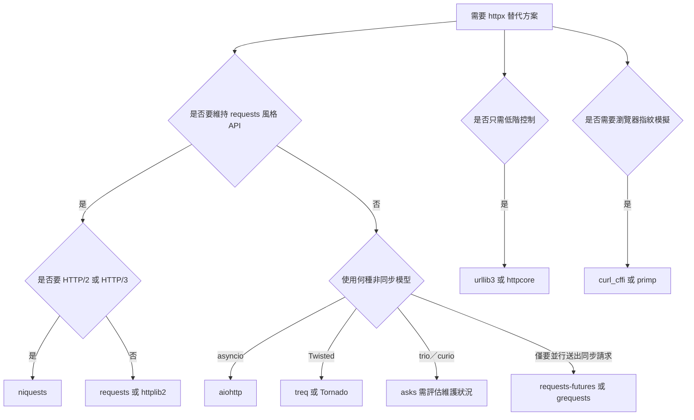

# Python HTTP 客戶端函式庫：httpx 的 FOSS 替代方案

## 摘要

`httpx` 是 Python 生態系中一個功能完整的 HTTP 客戶端函式庫，本身即為自由與開源軟體（FOSS，BSD-3-Clause 授權）[^httpx-repo][^httpx-pypi]。本文因此把問題理解為：在同樣屬於 FOSS 的前提下，有哪些函式庫可以作為 `httpx` 的替代或補位選項。本文整理 19 個開源專案，依「同步 Requests 風格」、「非同步」、「低階傳輸層」、「HTTP/2、HTTP/3 進階」與「瀏覽器指紋模擬」五類說明，並比較其授權、星數、同步／非同步能力、HTTP/2 支援與維護活躍度，最後提供選擇建議與來源批判性反思。

## 背景：httpx 是什麼

`httpx` 由 Encode 組織開發，定位為「下一代的 Python HTTP 客戶端」，具備與 `requests` 大致相容的 API，同時內建命令列客戶端、支援 HTTP/1.1 與 HTTP/2，並提供同步與非同步兩種介面[^httpx-pypi]。它依賴 `httpcore` 作為傳輸層實作，並以 `h11` 支援 HTTP/1.1、`certifi` 處理憑證、`idna` 處理國際化網域[^httpx-pypi]。在 GitHub 上 `encode/httpx` 約有 15,786 顆星，授權為 BSD-3-Clause，最新發佈版本為 0.28.1[^httpx-repo][^httpx-pypi]。

## 為何需要替代方案

尋找替代方案通常出於以下需求：

- **Requests 相容性優先**：許多開發者想要「幾乎不必改動程式碼」的替代品。`requests` 專案目前處於功能凍結（feature freeze）狀態，`niquests` 即以「Requests 的 drop-in replacement」為賣點填補此空缺[^niquests-pypi]。
- **非同步典範不同**：`httpx` 的 async 支援以 `anyio` 為基礎，若專案本身使用 `asyncio` 或 `Twisted`、`trio`，可能更偏好原生整合該事件迴圈的函式庫[^httpx-pypi][^aiohttp-repo][^treq-repo]。
- **HTTP/2、HTTP/3 或特殊傳輸需求**：需要 HTTP/3 over QUIC、DNS over HTTPS、後量子安全或瀏覽器 TLS 指紋模擬時，部分專案提供更專門的支援[^niquests-pypi][^curl-cffi-repo]。
- **僅需低階控制或最小依賴**：若只要連線池與重試，可改用更底層的 `urllib3` 或 `httpcore`[^urllib3-repo][^httpcore-repo]。

## 候選專案

### 一、同步、Requests 風格

**requests**（約 54,698 星，Apache-2.0）是 Python 最廣為使用的 HTTP 函式庫，主打「HTTP for Humans」，支援連線池、Session 與 Cookie 持續性、TLS/SSL 驗證、Basic/Digest 認證、自動解壓縮、多部分檔案上傳、SOCKS 代理與串流下載等[^requests-repo][^requests-pypi]。目前官方支援 Python 3.10 以上版本，最新版本 2.34.2[^requests-pypi]。

**niquests**（約 2,478 星，Apache-2.0）自我定位為 `requests` 的 drop-in replacement，原始碼即為 `requests` 的 fork[^niquests-repo][^niquests-pypi]。它預設使用 HTTP/2、支援 HTTP/3 over QUIC、DNS over HTTPS/TLS/QUIC、OCSP 憑證撤銷檢查、Happy Eyeballs、WebSocket、Server-Sent Events 與非同步 Session 等[^niquests-pypi]。最新版本 3.21.3[^niquests-pypi]。

**httplib2**（約 513 星，MIT 類型授權）是小型而快速的同步客戶端，支援持久連線與快取，早期以 Google App Engine 支援聞名[^httplib2-repo][^httplib2-license]。

**requests-futures**（約 2,221 星，Apache-2.0）在 `requests` 之上加入 `concurrent.futures` 的非同步包裝，讓同步 API 能以執行緒池並行送出請求[^requests-futures-repo][^requests-futures-license]。

**grequests**（約 4,568 星，BSD-2-Clause）以 gevent 為基礎，把 `requests` 與綠色執行緒結合，適合需要大量並行但不想改寫為 async/await 的情境[^grequests-repo]。

### 二、非同步

**aiohttp**（約 16,606 星，Apache-2.0）是 asyncio 生態系最具代表性的客戶端／伺服器框架，同時提供 HTTP 客戶端與伺服器功能[^aiohttp-repo]。

**asks**（約 513 星，MIT）以 trio 與 curio 為基礎，提供「requests 風格」的非同步 API[^asks-repo]。其最後一次推送時間為 2022 年，維護活躍度明顯偏低，選用前需評估[^asks-repo]。

**treq**（約 604 星，MIT）建立在 Twisted 的 HTTP 客戶端之上，提供類似 `requests` 的 API，適合已採用 Twisted 事件迴圈的專案[^treq-repo][^treq-license]。

**Tornado**（約 22,164 星，Apache-2.0）本身是 Web 框架與非同步網路函式庫，其 `AsyncHTTPClient` 可作為非同步 HTTP 請求的基礎[^tornado-repo]。

### 三、低階傳輸層

**urllib3**（約 4,081 星，MIT）是使用者導向的 HTTP 客戶端，提供連線池、重試與執行緒安全等基礎設施，實務上常被 `requests` 與其他高階函式庫作為底層使用[^urllib3-repo][^urllib3-license]；`httpx` 的設計亦曾參考 urllib3 的網路層經驗[^httpx-pypi]。

**httpcore**（約 549 星，BSD-3-Clause）是 `httpx` 的底層傳輸實作，提供極小化的 HTTP 客戶端核心；若需要自行組裝高階 API 可直接使用[^httpcore-repo]。

**h2**（約 1,043 星，MIT）是純 Python 的 HTTP/2 協定實作，可搭配其他傳輸層使用[^h2-repo]。

**pycurl**（約 1,170 星，LGPL-2.1）是 libcurl 的 Python 綁定，能取得 curl 完整的功能與成熟的協定支援，但需注意其 LGPL 授權與相依 C 函式庫的特性[^pycurl-repo]。

### 四、HTTP/2、HTTP/3 進階

**niquests**（見前述）預設 HTTP/2，並可選用 HTTP/3 over QUIC 與後量子安全等進階功能[^niquests-pypi]。

**hyper**（約 1,046 星，MIT）曾是 Python 的 HTTP/2 實作方案，但該專案已被標記為 archived（封存），不建議用於新專案[^hyper-repo]。

### 五、瀏覽器指紋模擬與反爬情境

**curl_cffi**（約 6,862 星，MIT）是 curl-impersonate fork 的 Python 綁定，可模仿瀏覽器的 TLS／JA3／HTTP2 指紋[^curl-cffi-repo]。

**primp**（約 629 星，MIT）是以 Rust 實作的 HTTP 客戶端綁定，主打模仿瀏覽器行為[^primp-repo]。

**tls-client**（約 1,942 星，BSD-3-Clause）本體為 Go 實作，提供可選擇特定客戶端 TLS 指紋的 HTTP 客戶端，並有 Python 等語言的綁定[^tls-client-repo]。

**hrequests**（約 1,024 星，MIT）定位為「給人類用的網頁抓取工具」，整合 gevent、`requests` 與 Playwright，並具備 TLS 相關能力[^hrequests-repo]。

## 綜合比較

| 專案 | 星數 | 授權 | 同步 | 非同步 | HTTP/2（內建） | 維護活躍度（最後推送） |
| --- | --- | --- | --- | --- | --- | --- |
| httpx（基準） | 15,786 | BSD-3-Clause | 是 | 是 | 選用 | 2026-10-02[^httpx-repo] |
| requests | 54,698 | Apache-2.0 | 是 | 否 | 否 | 2026-11-02[^requests-repo] |
| niquests | 2,478 | Apache-2.0 | 是 | 是 | 預設 | 2026-11-09[^niquests-repo] |
| aiohttp | 16,606 | Apache-2.0 | 否 | 是 | 否（另有 HTTP/2 生態整合） | 2026-11-13[^aiohttp-repo] |
| urllib3 | 4,081 | MIT | 是 | 否 | 否 | 2026-11-13[^urllib3-repo] |
| httpcore | 549 | BSD-3-Clause | 是 | 是 | 選用 | 2026-01-08[^httpcore-repo] |
| pycurl | 1,170 | LGPL-2.1 | 是 | 否 | 依 libcurl | 2026-11-07[^pycurl-repo] |
| treq | 604 | MIT | 否 | 是（Twisted） | 否 | 2026-11-01[^treq-repo] |
| tornado | 22,164 | Apache-2.0 | 否 | 是 | 否 | 2026-11-13[^tornado-repo] |
| httplib2 | 513 | MIT 類型 | 是 | 否 | 否 | 2026-10-28[^httplib2-repo] |
| asks | 513 | MIT | 否 | 是（trio／curio） | 否 | 2022-05-17[^asks-repo] |
| requests-futures | 2,221 | Apache-2.0 | 是（執行緒池） | 否 | 否 | 2026-10-26[^requests-futures-repo] |
| grequests | 4,568 | BSD-2-Clause | 是（gevent） | 否 | 否 | 2024-08-08[^grequests-repo] |
| h2 | 1,043 | MIT | 不適用（協定層） | 不適用 | 是（協定實作） | 2026-11-09[^h2-repo] |
| hyper | 1,046 | MIT | 是 | 否 | 是 | 2021-04-29（已封存）[^hyper-repo] |
| curl_cffi | 6,862 | MIT | 是 | 是 | 是（含指紋模擬） | 2026-10-27[^curl-cffi-repo] |
| primp | 629 | MIT | 是 | 否 | 是（含指紋模擬） | 2026-09-13[^primp-repo] |
| tls-client | 1,942 | BSD-3-Clause | 是 | 否 | 是（含指紋模擬） | 2026-11-11[^tls-client-repo] |
| hrequests | 1,024 | MIT | 是（gevent） | 否 | 否 | 2024-12-01[^hrequests-repo] |

所有列出的專案皆為自由與開源軟體，且分屬寬鬆授權（MIT／BSD／Apache-2.0），唯獨 `pycurl` 採 LGPL-2.1，若需靜態連結或再散布，需額外確認授權條件[^pycurl-repo]。

## 選擇建議

- **想最小幅度遷移並取得現代功能**：優先考慮 `niquests`，其 API 與 `requests`／`httpx` 相近且內建 HTTP/2[^niquests-pypi]。
- **既有 asyncio 專案**：`aiohttp` 是成熟且活躍度高的選擇[^aiohttp-repo]。
- **只需要底層連線池與重試**：`urllib3` 或 `httpcore`[^urllib3-repo][^httpcore-repo]。
- **反爬或需模仿瀏覽器指紋**：`curl_cffi`、`primp`、`tls-client`、`hrequests` 皆為候選[^curl-cffi-repo][^primp-repo][^tls-client-repo][^hrequests-repo]。
- **不建議新專案採用**：`asks` 與 `hyper` 分別因維護停滯與專案封存，風險較高[^asks-repo][^hyper-repo]。

## 來源批判性反思

本文資料主要來自 GitHub 官方 API 與 PyPI 套件資訊，優點是可由專案自身的中介資料取得客觀事實（星數、授權、推送時間、版本與相依），但仍有以下限制：

1. **星數並非品質保證**：星數僅反映關注度，`grequests` 與 `hrequests` 星數高但推送時間分別停留在 2024 年，活躍度不足以直接推論穩定度[^grequests-repo][^hrequests-repo]。
2. **維護活躍度以「最後推送時間」代理**：此指標無法反映議題處理速度、發佈頻率或安全修補品質，宜輔以 Issue 數量與 Release 節奏判斷。
3. **功能宣稱多為專案自述**：如 `niquests` 的 HTTP/3、後量子安全等功能來自其官方文件，本文未進行獨立效能或相容性實測[^niquests-pypi]。
4. **授權摘要需人工複核**：`httplib2` 的授權在 GitHub 顯示為其他（NOASSERTION），實際檔案內容為 MIT 類型條款，兩者存在落差，採用前應以專案內 LICENSE 檔為準[^httplib2-repo][^httplib2-license]。
5. **生態系變動快速**：`requests` 處於功能凍結、`httpx` 最新發佈版本仍為 0.28.1，相關狀態可能隨時間改變，本文時效以擷取日期為準[^requests-pypi][^httpx-pypi]。

## 參考文獻

[^httpx-repo]: Encode. (n.d.). *httpx* [Source code]. Retrieved 2026-11-13, from https://github.com/encode/httpx

[^httpx-pypi]: PyPI. (n.d.). *httpx 0.28.1*. Retrieved 2026-11-13, from https://pypi.org/project/httpx/

[^requests-repo]: Python Software Foundation. (n.d.). *requests* [Source code]. Retrieved 2026-11-13, from https://github.com/psf/requests

[^requests-pypi]: PyPI. (n.d.). *requests 2.34.2*. Retrieved 2026-11-13, from https://pypi.org/project/requests/

[^niquests-repo]: Jawah. (n.d.). *niquests* [Source code]. Retrieved 2026-11-13, from https://github.com/jawah/niquests

[^niquests-pypi]: PyPI. (n.d.). *niquests 3.21.3*. Retrieved 2026-11-13, from https://pypi.org/project/niquests/

[^aiohttp-repo]: aio-libs. (n.d.). *aiohttp* [Source code]. Retrieved 2026-11-13, from https://github.com/aio-libs/aiohttp

[^urllib3-repo]: urllib3. (n.d.). *urllib3* [Source code]. Retrieved 2026-11-13, from https://github.com/urllib3/urllib3

[^urllib3-license]: urllib3. (n.d.). *LICENSE.txt*. Retrieved 2026-11-13, from https://raw.githubusercontent.com/urllib3/urllib3/main/LICENSE.txt

[^httpcore-repo]: Encode. (n.d.). *httpcore* [Source code]. Retrieved 2026-11-13, from https://github.com/encode/httpcore

[^pycurl-repo]: pycurl. (n.d.). *PycURL – Python interface to libcurl* [Source code]. Retrieved 2026-11-13, from https://github.com/pycurl/pycurl

[^treq-repo]: Twisted. (n.d.). *treq* [Source code]. Retrieved 2026-11-13, from https://github.com/twisted/treq

[^treq-license]: Twisted. (n.d.). *LICENSE*. Retrieved 2026-11-13, from https://raw.githubusercontent.com/twisted/treq/trunk/LICENSE

[^tornado-repo]: Tornado Web. (n.d.). *Tornado* [Source code]. Retrieved 2026-11-13, from https://github.com/tornadoweb/tornado

[^httplib2-repo]: httplib2. (n.d.). *httplib2* [Source code]. Retrieved 2026-11-13, from https://github.com/httplib2/httplib2

[^httplib2-license]: httplib2. (n.d.). *LICENSE*. Retrieved 2026-11-13, from https://raw.githubusercontent.com/httplib2/httplib2/master/LICENSE

[^asks-repo]: theelous3. (n.d.). *asks* [Source code]. Retrieved 2026-11-13, from https://github.com/theelous3/asks

[^requests-futures-repo]: McFarland, R. (n.d.). *requests-futures* [Source code]. Retrieved 2026-11-13, from https://github.com/ross/requests-futures

[^requests-futures-license]: McFarland, R. (n.d.). *LICENSE*. Retrieved 2026-11-13, from https://raw.githubusercontent.com/ross/requests-futures/main/LICENSE

[^grequests-repo]: spyoungtech. (n.d.). *grequests* [Source code]. Retrieved 2026-11-13, from https://github.com/spyoungtech/grequests

[^h2-repo]: Python Hyper. (n.d.). *h2* [Source code]. Retrieved 2026-11-13, from https://github.com/python-hyper/h2

[^hyper-repo]: Python Hyper. (n.d.). *hyper* [Source code]. Retrieved 2026-11-13, from https://github.com/python-hyper/hyper

[^curl-cffi-repo]: lexiforest. (n.d.). *curl_cffi* [Source code]. Retrieved 2026-11-13, from https://github.com/lexiforest/curl_cffi

[^primp-repo]: deedy5. (n.d.). *primp* [Source code]. Retrieved 2026-11-13, from https://github.com/deedy5/primp

[^tls-client-repo]: bogdanfinn. (n.d.). *tls-client* [Source code]. Retrieved 2026-11-13, from https://github.com/bogdanfinn/tls-client

[^hrequests-repo]: daijro. (n.d.). *hrequests* [Source code]. Retrieved 2026-11-13, from https://github.com/daijro/hrequests
