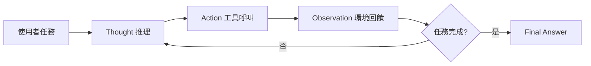
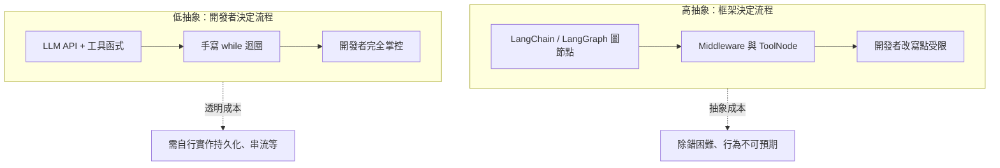
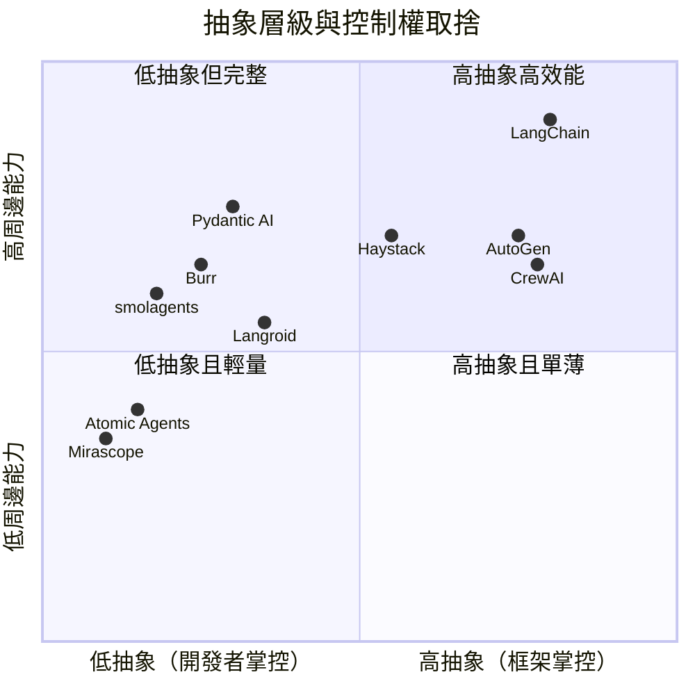

# LangChain 的自由軟體替代方案：以 ReAct 代理框架與彈性為核心的調查

## 摘要

本報告調查可作為 LangChain 替代品的自由與開放原始碼軟體（Free and Open Source Software, FOSS）代理框架，篩選標準有二：（一）能夠實作 ReAct（Reasoning + Acting）風格的工具呼叫迴圈；（二）相對於 LangChain 提供更低抽象層、更高控制權或更佳的可觀測性。報告先界定 ReAct 模式的定義與 LangChain 現行實作方式，再逐一整理十二個候選專案，最後以「抽象層級 × 控制權」與「語言生態」兩個維度給出選型建議。

本報告所有事實均來自公開網路資料，並以註腳標示來源；星號數為 2026-11-14 自 GitHub API 取得的即時數值。

---

## 一、背景：什麼是 ReAct 代理迴圈

ReAct 由 Yao 等人於 2022 年提出，其核心是把「語言推理」與「外部動作」交錯在同一個迴圈中執行[^react-paper]。模型每一步先產生一段不影響外部環境的推理文字（Thought），再輸出一個具體動作（Action），環境回傳觀察結果（Observation），如此循環直到產生最終答案[^react-paper]。

論文將此形式化為對動作空間的擴增：$\hat{A} = A \cup L$，其中 $A$ 是原本的動作空間，$L$ 是語言空間；$L$ 中的「想法」不改變環境，但能協助模型歸納與更新計畫[^react-paper]。原始實驗顯示，在 HotpotQA 與 FEVER 等知識密集任務上，ReAct 的表現優於純動作或純思維鏈；而在 ALFWorld 與 WebShop 等互動決策任務上，ReAct 的成功率分別達到 71% 與 40%，明顯優於僅有動作的基線[^react-paper]。

值得注意的是，論文也指出 ReAct 的主要失敗模式是「推理錯誤」（約占失敗案例 47%），原因在於交錯步驟的結構限制降低了模型的彈性[^react-paper]。這一點正好說明為何「框架過度約束」會成為實務痛點，也是本報告尋找「更彈性」替代方案的出發點。



上圖為 ReAct 迴圈的一般形式：Thought、Action、Observation 三步交錯，直到模型自行判定任務完成[^react-paper]。

### LangChain 目前的實作方式

LangChain 現行的 `create_agent` 建立在 LangGraph 之上，把代理定義為「模型 + 外殼（harness）」，外殼包含提示詞、工具與 middleware[^lc-agents]。其圖結構只有兩個節點：`call_model` 與 `tools`，並以條件邊判斷模型輸出是否含有 tool calls；若有則進入工具節點執行並回填結果，若無則結束[^lc-react-agent]。這個結構本質上就是 ReAct 迴圈的一種實作[^lc-react-agent]。

星號數方面，LangChain 主儲存庫約 149,478 顆星，LangGraph 約 44,939 顆星，兩者皆為 MIT 授權[^lc-repo][^lg-repo]。由於兩者同屬同一廠商，LangGraph 不能算作「LangChain 的替代品」，而是其官方底層；本報告因此不將其列為候選，僅作為比較基準。

---

## 二、為何「更低抽象」是主流訴求

Anthropic 在 2024 年底的工程文章中明確指出：最成功的代理實作「並非使用複雜框架或專門函式庫，而是以簡單、可組合的模式建構」[^anthropic-agents]。文章並警告，框架「常創造額外的抽象層，遮蔽底層的提示詞與回應，使除錯更加困難」，並可能「誘使開發者在更簡單的設定就足夠時增加複雜度」[^anthropic-agents]。

該文的建議是：直接使用 LLM API 起步，許多模式只需數十行程式碼即可實作；若確實要使用框架，務必理解底層程式碼，因為「對底層行為的錯誤假設是客戶錯誤的常見來源」[^anthropic-agents]。

這段論述幾乎可視為「反框架（anti-framework）」流派共同的宣言，也是本報告中 Mirascope、smolagents、Pydantic AI 等專案定位的理論基礎。



上圖說明兩種路線的取捨：高抽象換取開發速度但犧牲可預期性；低抽象換取控制權但需自行補齊周邊能力[^anthropic-agents]。

---

## 三、候選方案總覽

下表整理本報告納入評估的 FOSS 框架。星號數與授權狀態皆取自各專案 GitHub 儲存庫的即時資料（2026-11-14）。

| 專案 | 主要語言 | 授權 | 星號數 | 抽象定位 |
|---|---|---|---|---|
| smolagents | Python | Apache-2.0 | 30,363 | 極簡，約千行核心 |
| Pydantic AI | Python | MIT | 21,201 | 型別安全，低魔術 |
| Agno | Python | Apache-2.0 | 43,184 | 輕量高效能代理平台 |
| Atomic Agents | Python | MIT | 6,329 | 原子化元件組合 |
| Mirascope | Python | MIT | 1,535 | 自稱「反框架」 |
| Langroid | Python | MIT | 4,149 | 多代理訊息傳遞 |
| DSPy | Python | MIT | 39,041 | 宣告式程式化，非提示詞 |
| Haystack | Python | Apache-2.0 | 27,004 | 管線與顯式控制 |
| LlamaIndex | Python | MIT | 52,896 | 文件處理與資料代理 |
| CrewAI | Python | MIT | 60,876 | 角色扮演式多代理 |
| AutoGen | Python | CC-BY-4.0 | 61,810 | 對話式多代理 |
| Microsoft Agent Framework | Python / .NET | MIT | 14,668 | 企業級工作流 |
| OpenAI Agents SDK | Python | MIT | 30,664 | 輕量多代理工作流 |
| Google ADK | Python | Apache-2.0 | 22,210 | 程式碼優先工具包 |
| Strands Agents | Python / TypeScript | Apache-2.0 | 9,205 | 模型驅動迴圈 |
| Apache Burr | Python | Apache-2.0 | 2,599 | 狀態機與可觀測性 |
| Mastra | TypeScript | Apache-2.0（部分例外） | 29,512 | TypeScript 原生框架 |
| Vercel AI SDK | TypeScript | Apache-2.0 | 27,929 | 前端整合工具包 |

各專案的星號與授權分別來自其 GitHub 儲存庫資訊[^smolagents-repo][^pydantic-repo][^agno-repo][^atomic-repo][^mirascope-repo][^langroid-repo][^dspy-repo][^haystack-repo][^llamaindex-repo][^crewai-repo][^autogen-repo][^maf-repo][^openai-agents-repo][^adk-repo][^strands-repo][^burr-repo][^mastra-repo][^vercel-repo]。

以下依「貼近 ReAct 與低抽象」程度分組說明。

---

## 四、第一梯隊：最貼近「低抽象 ReAct」的選擇

### 4.1 smolagents（Hugging Face）

smolagents 是一個 Python 函式庫，官方文件明言其「代理邏輯約在千行程式碼內」、「我們把抽象保持在貼近原始程式碼的最小形狀」[^smolagents-docs]。所有代理都繼承自單一的 `MultiStepAgent` 類別，該類別本身就是 ReAct 框架的抽象化[^smolagents-react]。

其迴圈機制相當透明：先把系統提示與使用者查詢寫入記憶體（`SystemPromptStep` 與 `TaskStep`），接著進入 while 迴圈，將記憶體轉為 LLM 可讀的聊天訊息、送出給模型、解析動作、執行並記錄為 `ActionStep`，最後執行 `agent.step_callbacks`[^smolagents-react]。

它有兩種代理型態：`CodeAgent` 以 Python 程式碼片段表達工具呼叫，`ToolCallingAgent` 則採用常見的 JSON 工具呼叫格式[^smolagents-react]。官方文件指出，選擇取決於需求，例如網頁瀏覽常需在每次頁面互動後等待，JSON 工具呼叫較為合適[^smolagents-react]。

smolagents 亦支援多模態輸入、可從 MCP 伺服器取得工具、可直接包裝 LangChain 工具，並提供命令列工具[^smolagents-docs]。對想「擺脫 LangChain 抽象但仍沿用既有生態」的使用者，這是遷移成本最低的選項之一。

**彈性評語**：核心極小、可完整改寫迴圈行為；缺點是持久化、狀態檢查點等生產級能力需自行補齊。

### 4.2 Pydantic AI

Pydantic AI 的專案標語是「How Python does AI」，強調端到端的型別安全[^pydantic-repo]。其官方文件在比較頁中明確將自己定位為 LangChain 與 LangGraph 的替代路線，並在比較表中逐項對照[^pydantic-compare]。

它的設計核心是「代理（Agent）」而非「圖（Graph）」：開發者以 Pydantic 模型宣告輸出結構，工具即以 Python 函式加上裝飾器定義，整個工具呼叫迴圈由框架驅動，但可透過 hooks 與 capabilities 介入每一個階段[^pydantic-docs]。文件中可見大量「Loop Customization」章節，包含選擇模型、模型回退、準備工具、改寫歷史、處理事件流等介入點[^pydantic-docs]。

對需要「結構化輸出 + 可測試性」的團隊而言，Pydantic AI 的型別安全是相對 LangChain 最直接的優勢；其生態亦已整合 Temporal、DBOS、Prefect、Restate 等多種持久化執行後端[^pydantic-docs]。

**彈性評語**：抽象層比 LangChain 薄得多，且不強制圖結構；代價是仍需接受其 `Agent` 生命週期模型。

### 4.3 Atomic Agents

Atomic Agents 自述為「極輕量且模組化的框架」，其設計哲學是「原子性（atomicity）」：以小型、可重用的元件組合出應用[^atomic-docs]。它建立在 Instructor 之上，並以 Pydantic 進行資料與結構驗證[^atomic-docs]。

其關鍵主張是「所有邏輯與控制流程都以 Python 撰寫」，使開發者能套用傳統軟體工程的最佳實務，而不犧牲彈性或清晰度[^atomic-docs]。官方列出的特性包含模組化、可預測性（以 Pydantic 定義明確的輸入輸出結構）、可擴充性與細粒度控制[^atomic-docs]。

星號數約 6,329，社群規模遠小於 LangChain，但對於偏好「自己寫流程、只借用元件」的開發者，其心智負擔極低[^atomic-repo]。

**彈性評語**：幾乎沒有強制的執行模型，適合當成工具庫而非框架使用；風險是生態與範例相對稀薄。

### 4.4 Mirascope

Mirascope 直接自稱「The LLM Anti-Framework」（反框架）[^mirascope-repo]。其首頁範例展示了一個完全由開發者掌控的 ReAct 迴圈：

```python
response = librarian("Recommend some sci-fi books")
while response.tool_calls:
    tool_outputs = response.execute_tools()
    response = response.resume(tool_outputs)
print(response.text())
```

這段程式碼清楚顯示其立場：工具呼叫的迴圈由使用者自己寫，框架只提供 `execute_tools` 與 `resume` 兩個原語[^mirascope-site]。工具以 `@llm.tool` 裝飾器定義，模型呼叫以 `@llm.call` 裝飾器包裝，並可疊加 `@ops.version()` 取得版本控管、追蹤與成本計算[^mirascope-site]。

星號數約 1,535，屬於本清單中規模最小者之一，但其「反框架」定位恰好對應本報告的核心問題[^mirascope-repo]。

**彈性評語**：目前最貼近「不強加抽象」的選項；代價是必須自行處理重試、持久化、多代理協調等機制。

### 4.5 Langroid

Langroid 的定位是「以多代理程式設計駕馭 LLM」，其核心抽象是「代理 + 任務（Task）」的訊息傳遞模型[^langroid-repo]。官方文件提供從簡單聊天代理、工具代理、檢索代理到三代理路由的漸進式教學[^langroid-docs]。

其特色在於對「工具訊息處理」有極細緻的設計，文件中有專門章節討論工具處理器（tool handlers）、工具來源汙染追蹤（tool-origin taint tracking）、訊息路由、任務終止條件等[^langroid-docs]。這些都是 LangChain 較少直接暴露的層級。

星號數約 4,149，社群中等，但文件深度在小型專案中相當突出[^langroid-repo]。

**彈性評語**：適合多代理協作場景，且對訊息流有完整控制；單代理簡單任務則顯得偏重。

---

## 五、第二梯隊：不同哲學但同樣提供高控制權

### 5.1 DSPy

DSPy 的口號是「程式化而非提示詞化（programming — not prompting — language models）」[^dspy-repo]。它不把焦點放在 ReAct 迴圈的形式上，而是把「簽章（signature）—模組（module）—優化器（optimizer）」三層抽象作為核心，讓開發者以資料驅動方式自動改進提示與少樣本範例[^dspy-repo]。

對本報告的意義在於：若痛點是「LangChain 的鏈條難以調優」，DSPy 提供的是另一條路徑，即以編譯式優化取代手工串接。星號數約 39,041，學術背景深厚[^dspy-repo]。

**彈性評語**：抽象層與 LangChain 不同而非更薄；適合願意以評估資料換取品質的團隊。

### 5.2 Haystack（deepset）

Haystack 自述為「開放原始碼的 AI 編排框架」，強調「對檢索、路由、記憶與生成有明確控制」的模組化管線與代理工作流[^haystack-repo]。其設計以元件（Component）與管線（Pipeline）為單位，開發者明確宣告每個節點與連接關係。

星號數約 27,004，授權為 Apache-2.0[^haystack-repo]。相較 LangChain 的隱式鏈結，Haystack 的管線是顯式且可視化的，這在除錯上是一大優勢。

**彈性評語**：管線顯式、控制明確；但若要實作自由形式的 ReAct 迴圈，仍需自行組合。

### 5.3 LlamaIndex

LlamaIndex 目前自述為「AI 的文件處理平台」，其代理與工作流能力建立在其資料處理能力之上[^llamaindex-repo]。星號數約 52,896，MIT 授權[^llamaindex-repo]。

嚴格說來 LlamaIndex 更偏向 RAG 與資料索引，代理只是其中一環；但對「以文件為中心的 ReAct 代理」而言，其工具與檢索整合度仍是重要選項。

**彈性評語**：資料層強大，代理層則非其最薄之處。

### 5.4 CrewAI 與 AutoGen

CrewAI 以「角色扮演式自主代理」為核心，讓多個具角色設定的代理協作完成任務[^crewai-repo]。星號數約 60,876，MIT 授權[^crewai-repo]。

AutoGen 則以對話式多代理為核心，其儲存庫描述為「代理式 AI 的程式設計框架」[^autogen-repo]。星號數約 61,810，授權標示為 CC-BY-4.0[^autogen-repo]。此授權對軟體而言較不尋常，實際使用前應確認其程式碼授權細節。

兩者的共同問題是：抽象層並不比 LangChain 薄，只是換了一套心智模型（角色／對話）。因此它們更適合「多代理協作」需求，而非「更彈性的 ReAct 迴圈」。

**彈性評語**：多代理能力強，但並非低抽象路線。

### 5.5 Microsoft Agent Framework 與 Semantic Kernel

Microsoft Agent Framework 自述為「建構、編排與部署 AI 代理與多代理工作流的框架」，同時支援 Python 與 .NET[^maf-repo]。星號數約 14,668，MIT 授權[^maf-repo]。它可視為 Semantic Kernel 與 AutoGen 兩條產品線的整合後繼者。

Semantic Kernel 為較早期的微軟方案，以 C# 為主要語言，星號數約 28,764，MIT 授權[^sk-repo]。

**彈性評語**：企業整合與 .NET 生態是主要賣點；抽象層並不特別薄。

### 5.6 OpenAI Agents SDK 與 Google ADK

OpenAI Agents SDK 自述為「輕量、強大的多代理工作流框架」，星號數約 30,664，MIT 授權[^openai-agents-repo]。其「輕量」是相對於舊版 Swarm 實驗專案而言，實際抽象仍包含 agent、handoff、guardrail 等概念。

Google ADK 自述為「開放原始碼、程式碼優先的 Python 工具包」，強調「彈性與控制」[^adk-repo]。星號數約 22,210，Apache-2.0 授權[^adk-repo]。

**彈性評語**：兩者皆屬「廠商中立性較低但整合度高」的選項；對已深度使用對應雲端生態的團隊價值最大。

### 5.7 Strands Agents

Strands Agents 由 AWS 相關團隊維護，儲存庫描述為「建構代理外殼並端到端控制它」，支援 Python 與 TypeScript，並強調「任何模型、任何雲端」[^strands-repo]。星號數約 9,205，Apache-2.0 授權[^strands-repo]。Anthropic 的框架清單亦曾點名此專案[^anthropic-agents]。

**彈性評語**：模型驅動的迴圈設計，抽象程度中等；跨語言支援是其差異點。

### 5.8 Apache Burr

Burr 現已進入 Apache 基金會，自述為「建構會做決策的應用（聊天機器人、代理、模擬等）」，並強調「在你自己的基礎設施上監控、追蹤、持久化與執行」[^burr-repo]。其核心抽象是狀態機（state machine）而非圖或鏈。星號數約 2,599，Apache-2.0 授權[^burr-repo]。

其前身專案 ControlFlow 目前已被歸檔，儲存庫標示為 `archived: true`，開發已轉向 Burr[^controlflow-repo]。

**彈性評語**：狀態機模型對需要精確重放與持久化的場景極有價值；社群規模偏小。

---

## 六、TypeScript 生態的選項

### 6.1 Mastra

Mastra 自述為「現代 TypeScript 的 AI 應用與代理框架」[^mastra-repo]。其核心概念包含 Agent、Workflow、Memory、Knowledge 與 Harness，並提供 Studio 作為互動式開發介面[^mastra-docs]。星號數約 29,512[^mastra-repo]。

授權需特別注意：其 `LICENSE.md` 明示，位於任何名為 `ee/` 目錄下的內容（包含 `packages/core/auth/ee`、`agent-builder/ee`、`editor/ee`）適用另一份授權；其餘內容則為 Apache-2.0[^mastra-license]。這是一種「開放核心（open core）」模式，嚴格說來並非全專案 FOSS。

### 6.2 Vercel AI SDK

Vercel AI SDK 自述為「TypeScript 的 AI 工具包」，是免費開放原始碼函式庫，用於建構 AI 應用與代理[^vercel-repo]。星號數約 27,929，授權為 Apache-2.0[^vercel-license]。

其定位偏向「模型抽象 + 串流 UI 整合」，代理迴圈需由開發者自行組裝，因此抽象層相對薄；對 Next.js 生態使用者尤其自然。

---

## 七、橫向比較

### 7.1 抽象層級與控制權



上圖為本報告作者依各專案文件所述設計所作的主觀定位，非客觀量測；x 軸表示框架介入程度，y 軸表示開箱即用的周邊能力（持久化、串流、可觀測性等）。

### 7.2 依需求選型

| 需求 | 建議 |
|---|---|
| 想要最小核心、可完全改寫 ReAct 迴圈 | smolagents 或 Mirascope |
| 想要型別安全與可測試性 | Pydantic AI |
| 想要自己寫流程、只借用元件 | Atomic Agents |
| 想要多代理訊息傳遞與細緻控制 | Langroid |
| 想要以評估資料自動優化提示 | DSPy |
| 想要顯式管線與檢索控制 | Haystack |
| 想要狀態機與精確重放 | Apache Burr |
| 團隊以 TypeScript 為主 | Mastra（注意授權）或 Vercel AI SDK |
| 已深度綁定特定雲端生態 | OpenAI Agents SDK、Google ADK 或 Strands Agents |

---

## 八、批判性反思

**來源偏誤**：本報告大量引用各專案自身的官方文件與 README，這些材料本質上具有行銷性質，會傾向放大優點並淡化限制。例如「極簡」、「輕量」、「千行程式碼」等描述多為自我宣稱，未經獨立量測[^smolagents-docs][^atomic-docs][^mirascope-repo]。

**失衡的比較來源**：Anthropic 的工程文章雖被廣泛引用，但其立場亦非中立，該公司同時推銷自家的代理 SDK[^anthropic-agents]。其對框架的批評應理解為「業界觀察 + 商業立場」的混合。

**專案成熟度差異**：星號數從 1,535 到 61,810 橫跨兩個數量級，直接以星號數排序會誤導。星號反映的是曝光度而非品質；Mirascope 與 Atomic Agents 的低星號可能源於行銷資源不足，而非設計缺陷[^mirascope-repo][^atomic-repo]。

**授權風險**：Mastra 的 `ee/` 目錄例外與 AutoGen 的 CC-BY-4.0 標示，皆需在採用前由法務或授權審查確認，不應僅依 GitHub 的 SPDX 標籤判斷[^mastra-license][^autogen-repo]。

**時效性**：代理框架生態變化極快。本報告中多個專案（Pydantic AI 的 capabilities 體系、Mastra 的 harness 概念、Strands 的 harness SDK 命名）在 2025 至 2026 年間經歷重大重構，任何超過半年的評估都可能失效。使用前應重新核對最新文件。

**未被驗證的假設**：本報告未對任何框架進行實際程式碼撰寫與基準測試。所有「彈性」判斷均基於文件所描述的可介入點數量與執行模型，而非實測；實際開發體驗可能與文件敘述有落差。

---

## 九、結論

若問題的核心是「LangChain 的抽象層遮蔽了提示詞與工具呼叫的實際行為，導致難以除錯與客製」，則最直接的答案是 **Mirascope** 與 **smolagents**：前者以「反框架」為設計前提，後者以「千行核心」為賣點，兩者都把手寫 ReAct 迴圈的權力交還給開發者[^mirascope-site][^smolagents-docs]。

若問題的核心是「想要型別安全與可維護性，但不要 LangChain 的鏈式抽象」，則 **Pydantic AI** 是最完整的折衷方案，其比較文件亦明確以 LangChain 為對照對象[^pydantic-compare]。

若需求其實落在「多代理協作」而非「單一 ReAct 迴圈」，則 CrewAI、AutoGen、Langroid 各有其模型，但它們並不比 LangChain 更薄，只是換了心智模型。

最後需強調：Anthropic 的建議值得作為決策前提——先嘗試用 LLM API 直接寫出迴圈，只在確實需要時才引入框架，並確保理解框架底層程式碼[^anthropic-agents]。在多數情況下，一個百餘行的 ReAct 迴圈加上良好的工具設計，可能比任何框架都更「彈性」。

---

## 參考資料

[^react-paper]: Yao, S., Zhao, J., Yu, D., Du, N., Shafran, I., Narasimhan, K., & Cao, Y. (2023). ReAct: Synergizing reasoning and acting in language models. *ICLR 2023*. Retrieved 2026-11-14, from https://arxiv.org/abs/2210.03629

[^lc-agents]: LangChain. (n.d.). Agents. Retrieved 2026-11-14, from https://python.langchain.com/docs/concepts/agents/

[^lc-react-agent]: LangChain AI. (n.d.). ReAct agent template (graph.py). Retrieved 2026-11-14, from https://github.com/langchain-ai/react-agent/blob/main/src/react_agent/graph.py

[^lc-repo]: LangChain AI. (n.d.). langchain: The agent engineering platform [Source code]. GitHub. Retrieved 2026-11-14, from https://github.com/langchain-ai/langchain

[^lg-repo]: LangChain AI. (n.d.). langgraph: Build resilient agents [Source code]. GitHub. Retrieved 2026-11-14, from https://github.com/langchain-ai/langgraph

[^anthropic-agents]: Anthropic. (2024-12-19). Building effective agents. Retrieved 2026-11-14, from https://www.anthropic.com/engineering/building-effective-agents

[^smolagents-docs]: Hugging Face. (n.d.). smolagents documentation. Retrieved 2026-11-14, from https://huggingface.co/docs/smolagents/en/index

[^smolagents-react]: Hugging Face. (n.d.). How do multi-step agents work? Retrieved 2026-11-14, from https://huggingface.co/docs/smolagents/en/conceptual_guides/react

[^smolagents-repo]: Hugging Face. (n.d.). smolagents: A barebones library for agents that think in code [Source code]. GitHub. Retrieved 2026-11-14, from https://github.com/huggingface/smolagents

[^pydantic-repo]: Pydantic. (n.d.). pydantic-ai: How Python does AI [Source code]. GitHub. Retrieved 2026-11-14, from https://github.com/pydantic/pydantic-ai

[^pydantic-docs]: Pydantic. (n.d.). Pydantic AI documentation. Retrieved 2026-11-14, from https://pydantic.dev/docs/ai/overview/

[^pydantic-compare]: Pydantic. (n.d.). Pydantic AI vs LangChain & LangGraph. Retrieved 2026-11-14, from https://pydantic.dev/docs/ai/comparisons/vs-langchain-langgraph/

[^agno-repo]: Agno. (n.d.). agno: The self-managing agent platform [Source code]. GitHub. Retrieved 2026-11-14, from https://github.com/agno-agi/agno

[^atomic-docs]: Vaneetvelde, K. (n.d.). Atomic Agents documentation (2.15.0). Retrieved 2026-11-14, from https://eigenwise.github.io/atomic-agents/

[^atomic-repo]: Eigenwise. (n.d.). atomic-agents: Building AI agents, atomically [Source code]. GitHub. Retrieved 2026-11-14, from https://github.com/Eigenwise/atomic-agents

[^mirascope-repo]: Mirascope. (n.d.). mirascope: The LLM Anti-Framework [Source code]. GitHub. Retrieved 2026-11-14, from https://github.com/Mirascope/mirascope

[^mirascope-site]: Mirascope. (n.d.). Mirascope: The LLM Anti-Framework. Retrieved 2026-11-14, from https://mirascope.com

[^langroid-repo]: Langroid. (n.d.). langroid: Harness LLMs with multi-agent programming [Source code]. GitHub. Retrieved 2026-11-14, from https://github.com/langroid/langroid

[^langroid-docs]: Langroid. (n.d.). Getting started. Retrieved 2026-11-14, from https://langroid.github.io/langroid/quick-start/

[^dspy-repo]: Stanford NLP. (n.d.). DSPy: The framework for programming—not prompting—language models [Source code]. GitHub. Retrieved 2026-11-14, from https://github.com/stanfordnlp/dspy

[^haystack-repo]: deepset. (n.d.). haystack: Open-source AI orchestration framework [Source code]. GitHub. Retrieved 2026-11-14, from https://github.com/deepset-ai/haystack

[^llamaindex-repo]: Run Llama. (n.d.). llama_index: The document processing platform for AI [Source code]. GitHub. Retrieved 2026-11-14, from https://github.com/run-llama/llama_index

[^crewai-repo]: CrewAI. (n.d.). crewAI: Framework for orchestrating role-playing, autonomous AI agents [Source code]. GitHub. Retrieved 2026-11-14, from https://github.com/crewAIInc/crewAI

[^autogen-repo]: Microsoft. (n.d.). autogen: A programming framework for agentic AI [Source code]. GitHub. Retrieved 2026-11-14, from https://github.com/microsoft/autogen

[^maf-repo]: Microsoft. (n.d.). agent-framework: A framework for building, orchestrating and deploying AI agents [Source code]. GitHub. Retrieved 2026-11-14, from https://github.com/microsoft/agent-framework

[^sk-repo]: Microsoft. (n.d.). semantic-kernel: Integrate cutting-edge LLM technology quickly and easily into your apps [Source code]. GitHub. Retrieved 2026-11-14, from https://github.com/microsoft/semantic-kernel

[^openai-agents-repo]: OpenAI. (n.d.). openai-agents-python: A lightweight, powerful framework for multi-agent workflows [Source code]. GitHub. Retrieved 2026-11-14, from https://github.com/openai/openai-agents-python

[^adk-repo]: Google. (n.d.). adk-python: An open-source, code-first Python toolkit for building AI agents [Source code]. GitHub. Retrieved 2026-11-14, from https://github.com/google/adk-python

[^strands-repo]: Strands Agents. (n.d.). harness-sdk: Build an agent harness and control it end-to-end [Source code]. GitHub. Retrieved 2026-11-14, from https://github.com/strands-agents/harness-sdk

[^burr-repo]: Apache Software Foundation. (n.d.). burr: Build applications that make decisions [Source code]. GitHub. Retrieved 2026-11-14, from https://github.com/apache/burr

[^controlflow-repo]: Prefect Archive. (n.d.). ControlFlow: Take control of your AI agents [Source code, archived]. GitHub. Retrieved 2026-11-14, from https://github.com/prefect-archive/ControlFlow

[^mastra-repo]: Mastra AI. (n.d.). mastra: The modern TypeScript framework for AI-powered applications and agents [Source code]. GitHub. Retrieved 2026-11-14, from https://github.com/mastra-ai/mastra

[^mastra-docs]: Mastra AI. (n.d.). Get started with Mastra. Retrieved 2026-11-14, from https://mastra.ai/docs

[^mastra-license]: Mastra AI. (n.d.). LICENSE.md. Retrieved 2026-11-14, from https://github.com/mastra-ai/mastra/blob/main/LICENSE.md

[^vercel-repo]: Vercel. (n.d.). ai: The AI Toolkit for TypeScript [Source code]. GitHub. Retrieved 2026-11-14, from https://github.com/vercel/ai

[^vercel-license]: Vercel. (n.d.). LICENSE. Retrieved 2026-11-14, from https://github.com/vercel/ai/blob/main/LICENSE
