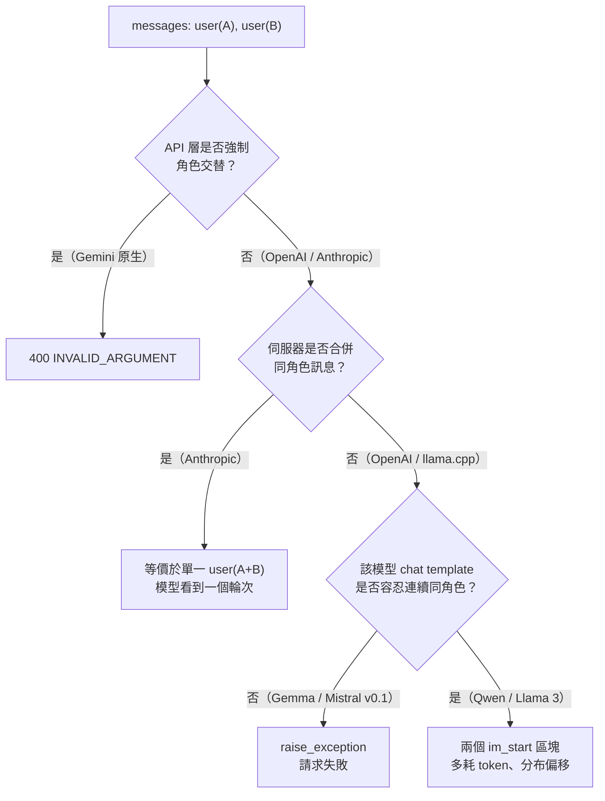

# 多個 user 訊息 vs 單一 user 訊息：OpenAI-compatible Chat Completions 的實際差異

## 摘要

在 OpenAI-compatible 的 Chat Completions 介面中，把同一段輸入拆成多個連續 `user` 訊息，與合併成單一 `user` 訊息，**在語意上並非等價**。API 規格本身對「連續同角色訊息」沒有強制規定[^openai-ref]，但實際送進模型的內容取決於三層：

1. **API 層**：是否接受連續 `user`（多數接受，Anthropic 會自動合併[^anthropic-ref]）
2. **Chat template 層**：每個訊息是否各自產生角色標頭（ChatML、Llama 3、Gemma 皆是；且部分模板直接拋出例外拒絕[^qwen-tpl][^llama3-tpl][^gemma-tpl]）
3. **模型層**：模型在預訓練／微調時是否看過「連續同角色」的序列

因為這三層在不同供應商實作不一致，結果從「完全等價」到「直接 400 錯誤」都有可能。



---

## 一、底層原理：訊息列表最終只是一串 token

Chat 模型本質上是自迴歸語言模型，`messages` 陣列最後必須被壓成**單一 token 序列**才能餵給模型。這個轉換由 chat template（Jinja）完成。Hugging Face 官方文件明確指出：聊天「不是一段可以直接 tokenize 的字串，而是一連串訊息，每則訊息包含 role 與 content」，必須先經過模板轉換[^hf-blog]。

以 ChatML 為例，模板是：

```jinja

{{ '<|im_start|>' + message['role'] + '\n' + message['content'] + '<|im_end|>' + '\n' }}

```

也就是每一則訊息都會產生完整的 `<|im_start|>user ... <|im_end|>` 區塊[^hf-blog]。因此：

| 寫法 | 實際送進模型的文字 |
| --- | --- |
| 單一 user 訊息（內容 `A` + `B`） | `<|im_start|>user\nAB<|im_end|>\n` |
| 兩個連續 user 訊息 | `<|im_start|>user\nA<|im_end|>\n<|im_start|>user\nB<|im_end|>\n` |

**這兩者對模型而言是不同的輸入序列**，不是同一件事的不同包裝。

---

## 二、Token 成本差異（可量化）

OpenAI 官方 cookbook 的計價函式顯示每則訊息固定有 `tokens_per_message = 3` 的額外開銷，代表 `<|im_start|>`、角色字串、`<|im_end|>` 等控制 token[^tiktoken]。實務上意味著：

- 拆成 N 則 user 訊息，比合併成 1 則多花約 `3 × (N-1)` 個 token 的控制碼，外加每則訊息間的換行。
- 在長對話、agent 迴圈、RAG 灌資料的場景中，若每次工具結果都獨立成一則訊息，這個開銷會累積得很明顯。

也有技術部落格直接拆解 ChatML 的文法，指出「每一則訊息都會增加約 3 個 overhead token，這正是 API 回報的 token 數總比單純編碼內文高的原因」[^salmanq]。

---

## 三、各供應商行為對照

### 3.1 OpenAI 官方 Chat Completions

OpenAI API 參考文件對 `messages` 的描述僅是「A list of messages comprising the conversation so far」，並只要求 `minItems: 1`，**沒有規定角色必須交替**，也沒有記載任何合併行為[^openai-ref]。文件在講對話狀態管理時提到「用交替的 user 與 assistant 訊息承載對話歷史」，但那是在描述一種慣用模式，而非硬性約束[^openai-conv]。

實務結論：**接受，且不保證合併**。由於 OpenAI 自家模型使用 ChatML 系格式，兩則連續 user 訊息基本上會被編碼成兩個 `<|im_start|>user` 區塊。

### 3.2 Anthropic Messages API（含透過相容層存取）

Anthropic 官方文件寫得非常直白：

> 「我們的模型被訓練成在交替的 `user` 與 `assistant` 對話輪次上運作。……**請求中連續的 `user` 或 `assistant` 輪次會被合併成單一輪次。**」[^anthropic-ref]

也就是說，在原生 Anthropic 語意下，「兩則連續 user」與「一則合併 user」**在模型看到的層面是等價的**（合併方式為文字串接）。但要注意這是「伺服器端幫你合併」，並非所有相容層都照做。

有 GitHub issue 記錄了這個行為的歷史：早期 Messages API 要求嚴格交替，後來放寬為自動合併[^gh565]。

### 3.3 Google Gemini

Gemini 是本文比較的對象中最嚴格的一個。官方文件在 `generateContent` 的多輪對話說明中，原文寫道：

> 「要建立多輪對話，你定義一個含有多個 `Content` 物件的 `contents` 陣列。API 會把整段歷史當作下一次回應的上下文。**每個 `Content` 物件的 `role` 應該在 `user` 與 `model` 之間交替。**」（原文："To build a conversation with multiple turns, you define the `contents` array with multiple `Content` objects. The API will use this entire history as context for the next response. The `role` for each `Content` object should alternate between `user` and `model`."）[^gemini-gencontent]

同一頁的「重點整理」段落也重申：

> 「管理對話歷史：使用 REST API 的聊天應用，逐輪附加 `Content` 物件來建構 `contents` 陣列，**在 `\"user\"` 與 `\"model\"` 角色之間交替**。」[^gemini-gencontent]

須注意這段指示的適用範圍：文件把「手動交替」的要求定位在**手動組裝 `contents` JSON 的 REST API 使用者**身上；若改用 SDK 的 Chat helper（例如 `client.chats.create()`），SDK 會自行處理交替[^gemini-gencontent]。

違反時的錯誤有兩種表現形式。第一種來自 REST API 的原始回應：

```json
{
  "error": {
    "code": 400,
    "message": "Request contains consecutive messages with the same role: user.",
    "status": "INVALID_ARGUMENT"
  }
}
```

第二種是 SDK 包裝後的訊息：

> `Invalid argument provided to Gemini: 400 Please ensure that multiturn requests alternate between user and model.`

兩者皆為 400 錯誤[^gemini-err1][^gemini-err2]。此外 `Content.role` 的定義本身就限縮為 `user` 或 `model` 兩種值[^gemini-content]。

**重要補充**：由於 Google 官方文件把交替描述為「應該（should）」而非絕對硬性規則，且這條指示主要針對手動組裝 REST 請求的使用者，因此對於「連續 user 是否一定失敗」不能一概而論。實測上最穩妥的假設仍是「會失敗」，但見下方關於新模型可能放寬的討論。

須注意一個可能的鬆動：Vercel AI SDK 的 issue 在 2026 年中以「無法重現」關閉，維護者測試 `gemini-2.5-flash` 時即使送出兩則連續 `user` 仍成功回應，暗示新版模型可能已在伺服器端放寬或靜默合併[^gemini-err2]。同一限制也持續影響工具呼叫實作：平行工具呼叫會產生連續同角色 `contents`，因而觸發交替檢查而 400[^hermes-55125]。

因此實務上的正確態度是：**不要依賴交替會被強制執行（可能靜默通過，但語意未定），也不要依賴連續同角色一定失敗**。若要把 Prompts 拆成多輪，請在客戶端明確插入 `model` 角色的回應佔位，或以單一 `user` 訊息搭配 content block 來表達分段。

**結論：把 Prompt A、Prompt B 拆成兩則 user 訊息送進 Gemini，是本文所列供應商中風險最高的一個。**

### 3.4 開源模型（ChatML / Llama 3 / Gemma / Mistral 模板）

這是差異最劇烈的一層。**多個主流開源模型的官方 chat template 直接對連續同角色拋出例外**：

**Qwen 2.5（ChatML）** 的 `tokenizer_config.json` 中，`for` 迴圈逐則輸出 `<|im_start|>role\ncontent<|im_end|>\n`，沒有任何合併邏輯，也沒有交替檢查[^qwen-tpl]。因此兩則 user 訊息 → 兩個 `im_start` 區塊。

**Llama 3** 的官方模板：

```jinja


{{ content }}

```

同樣是逐則輸出角色標頭，不檢查、不合併[^llama3-tpl]。

**Gemma 2** 的模板則直接把交替規則寫成斷言：

```jinja
{% if (message['role'] == 'user') != (loop.index0 % 2 == 0) %}
{{ raise_exception('Conversation roles must alternate user/assistant/user/assistant/...') }}

```

遇到連續兩則 `user` 會直接 `raise_exception`[^gemma-tpl]。

**Mistral 7B Instruct v0.1** 同樣有：

```jinja
{%- if (message['role'] == 'user') != (loop.index0 % 2 == 0) %}
    {{- raise_exception('After the optional system message, conversation roles must alternate ...') }}

```

並把 user 內容包在 `[INST] ... [/INST]` 之中[^mistral-tpl]。

結論：**在自行架設（vLLM、llama.cpp、Transformers、TGI）並使用原生模板時，拆成多個 user 訊息可能直接讓請求失敗。**

### 3.5 中介層與推理伺服器是否會自動合併

**LiteLLM**：明確會合併。其 Rust 端 `factory.rs` 的模組註解寫道，把 OpenAI 訊息列表轉成 Anthropic / Bedrock 形式時需要「system prompt 抽出、**連續同角色輪次合併**、文字區塊不得為空」，並附有 `merges_consecutive_same_role_turns()` 測試[^litellm]。

**llama.cpp**：不會因為角色相同而合併。其 `chat.cpp` 中的 `messages_inp_normalizer` 只處理 `content` 是字串或 typed array 的正規化（`supports_string_content` / `supports_typed_content`），以及把 `developer` 映射為 `system`、把不支援 system 的模板的前導 system 併入下一則訊息；**沒有「同角色合併」這段邏輯**[^llamacpp]。訊息會原樣交給 Jinja 模板逐則渲染。

**Hugging Face Transformers** 的 `apply_chat_template()` 本身**不做任何合併**：它把 `messages` 陣列逐則交給該模型的 Jinja 模板渲染[^hff-docs]。官方文件甚至間接承認「連續同角色」不是模型預期的輸入形態：

> 「[`TextGenerationPipeline`] 預設會把 `add_generation_prompt` 設為 `True` 以開始新訊息。然而，若對話中最後一則訊息是 `assistant` 角色，它會假設那是 prefill 並改為 `continue_final_message=True`。**這是因為多數模型不支援多則連續的 assistant 訊息。**」[^hff-docs]

換句話說，HF 的立場是「連續同角色是異常狀況，需要特別處理」，而不是「等價於合併」。

**vLLM**：其 Anthropic 相容端點早期未合併連續 assistant 訊息，導致工具呼叫率下降，後續以 PR 補上「轉換前先合併連續 assistant 訊息」；該 PR 特別說明**只合併 assistant、不合併 user**，因為 user 訊息中混有 `tool_result` 區塊時，合併可能導致歷史順序被重排[^vllm-issue][^vllm-pr]。

這說明一件重要的事：**「是否合併」不是一致性保證，而是各實作各自的決定，且可能隨時變動。**

### 3.6 未能查證的供應商

以下幾家同樣常被當作 OpenAI-compatible 使用，但本文**未取得官方文件或原始碼層級的明確證據**說明其是否合併連續同角色訊息：Ollama、OpenRouter、Groq、Together AI、Azure OpenAI、LM Studio。

其中 Azure OpenAI 在語意上等同 OpenAI，理論上套用相同結論；其餘各家多為特定開源模型的代理（例如 Groq 主要服務 Llama 系列、Together AI 服務多種開源模型），因此**行為很可能跟著底層模型是否有交替斷言而變**——也就是說，同一家代理不同模型可能得到不同結果。此處明確標示為未查證，不應視為本文結論的一部分。

---

## 三補、供應商行為速查表

| 供應商 / 層 | 接受連續 user？ | 是否合併？ | 依據 |
| --- | --- | --- | --- |
| OpenAI Chat Completions | 是 | 未記載、不保證 | 規格沉默[^openai-ref] |
| Anthropic Messages | 是 | **是，官方明載** | 官方文件[^anthropic-ref] |
| Google Gemini（`contents`） | 官方要求交替；實測多為 400 | 否，直接拒絕 | 官方原文「should alternate」[^gemini-gencontent] + 社群錯誤[^gemini-err1] |
| LiteLLM（中介） | 是 | **是，主動合併** | 原始碼與測試[^litellm] |
| llama.cpp（伺服器） | 是 | 否 | 原始碼[^llamacpp] |
| vLLM（Anthropic 相容） | 是 | 僅合併 assistant | PR 說明[^vllm-pr] |
| HF Transformers | 是 | 否 | 文件 + 模板[^hff-docs] |
| Qwen 2.5 模板 | 是 | 否（逐則輸出角色標頭） | tokenizer_config[^qwen-tpl] |
| Llama 3 模板 | 是 | 否 | tokenizer_config[^llama3-tpl] |
| Gemma 2 模板 | **否（raise_exception）** | 否 | tokenizer_config[^gemma-tpl] |
| Mistral v0.1 模板 | **否（raise_exception）** | 否 | tokenizer_config[^mistral-tpl] |

---

## 四、除了 token 之外，還有哪些實質差異

### 4.1 提示注入與指令優先序

把輸入拆成多則 user 訊息，等於在序列中插入多個「使用者發言邊界」。對於在「單一 user 輪次」上訓練的模型而言，這會讓後面的內容看起來像**另一輪新指令**，而不是同一段內容的續篇。這在防禦提示注入時是雙面刃：

- 好處：若把「不可信的外部內容」放進獨立訊息，某些模型較容易區分「這是資料」與「這是使用者指令」。
- 風險：反之，若把使用者真正的最新指令拆到後面，前面的內容可能被模型視為「上一輪已被處理完的對話」，對其權重反而下降。

### 4.2 模型行為與分布偏移

Hugging Face 的說明指出，使用與訓練時不同的 chat 格式會造成「嚴重的、靜默的效能退化」——不會拋錯，只是模型表現變差，而且極難除錯[^hf-blog]。連續同角色訊息正是典型的分布偏移：多數模型在微調資料中從未見過連續兩個 `user` 區塊。

實務上常見症狀：模型重述前言、把第二則訊息當成獨立新任務、忽略第一則訊息的部分要求，或回答時只針對最後一則訊息。

### 4.3 前綴快取（prompt caching）與可快取性

多則訊息的切分方式改變了 token 前綴的實際內容。若你頻繁變動「前半段是否合併」，即使文字總量相同，快取前綴也會不同，導致 prompt cache 命中率歸零。反之，把穩定的長內容固定成單一訊息、只在尾端追加新訊息，通常對前綴快取較友善。

### 4.4 內容區塊（content blocks）與多模態

OpenAI 的 `content` 可以是字串或 typed array（text / image 等）。合併多則訊息時，若原本各自帶有圖片，就必須決定圖片在新陣列中的相對位置；而**合併動作本身可能改變圖文交錯順序**。vLLM 的 PR 正是基於這個理由拒絕合併 user 訊息[^vllm-pr]。因此多模態情境下，合併並非無損操作。

### 4.5 參數與欄位粒度

`name`、`cache_control`、`reasoning_content` 等欄位是**掛在單則訊息上**的。合併後這些欄位只能保留一份，需要人為決定取捨（例如快取斷點要放在哪裡）。這也是 Anthropic 的文件把 `cache_control` 設計在 content block 層級的原因之一[^anthropic-ref]。

---

## 五、決策建議

| 情境 | 建議 |
| --- | --- |
| 同一段輸入、只是想分段排版 | **合併成單一 user 訊息**。省 token、避免分布偏移。 |
| 需要表達「這是新的一輪追問」 | 拆成多則，但確保中間有 assistant 回應，維持交替。 |
| 要把不可信外部內容與使用者指令隔離 | 可用獨立訊息，但優先考慮用 content block 或明確的界定標記，而非依賴角色邊界。 |
| 使用開源模型自架（vLLM / llama.cpp / Transformers） | 先確認該模型的 chat template 是否對連續同角色 `raise_exception`。Gemma、Mistral v0.1 系列會直接失敗。 |
| 跨供應商可攜性 | 假設「不合併」，並在客戶端自行正規化（合併連續同角色）以取得一致行為。 |

---

## 六、如何自行驗證

最直接的方法是把 API 回報的 `usage.prompt_tokens` 拿來比對：

1. 送出一則 user 訊息，內容為 `A + B`，記錄 `prompt_tokens`。
2. 送出兩則連續 user 訊息，內容分別為 `A`、`B`，記錄 `prompt_tokens`。
3. 若兩者相同 → 該端點有合併（或模板不產生角色標頭）。
4. 若後者多出固定量的 token → 端點未合併，每則訊息都產生了完整的角色區塊。

若要更精確，可在自架環境直接把 `apply_chat_template()` 的輸出印出來，或對該字串做 tokenize 後比較長度。

自架環境的驗證程式碼（Hugging Face Transformers）：

```python
from transformers import AutoTokenizer

tok = AutoTokenizer.from_pretrained("Qwen/Qwen2.5-7B-Instruct")

merged = [{"role": "user", "content": "A\nB"}]
split = [{"role": "user", "content": "A"}, {"role": "user", "content": "B"}]

for name, msgs in (("merged", merged), ("split", split)):
    try:
        ids = tok.apply_chat_template(msgs, tokenize=True, add_generation_prompt=True)
        print(name, len(ids), tok.decode(ids))
    except Exception as exc:
        print(name, "FAILED:", exc)
```

在 Gemma 2 或 Mistral v0.1 這類帶有交替斷言的模板上，`split` 會直接印出 `FAILED`，而 `merged` 正常；在 Qwen 2.5 上兩者都會成功，但 `len(ids)` 不同，差額即為多出來的 `<|im_start|>`、`user`、`<![CDATA[<]]>|im_end|>` 等控制碼。

---

## 七、限制與不確定性

- OpenAI 官方文件並未明確記載「是否合併連續 user 訊息」，本文對其行為的判斷基於規格文件的沉默、ChatML 模板的結構，以及 token 計數的公開算法，屬**推論而非官方保證**[^openai-ref][^tiktoken]。
- Anthropic 的自動合併是官方明載行為[^anthropic-ref]，但各家「OpenAI-compatible」相容層是否照做並不一致，需逐一實測。
- Gemini 的交替要求有官方原文可引（`generateContent` 頁面，「should alternate between `user` and `model`」）[^gemini-gencontent]，但該處用詞為 "should" 且限定於手動組裝 REST 請求的情境，並非無條件硬性規則；錯誤訊息則來自多個社群回報[^gemini-err1][^gemini-err2]。Vercel AI SDK 的 issue 在 2026 年中以「無法重現」關閉，顯示新版 Gemini 模型可能已放寬[^gemini-err2]，本文無法確定目前的統一狀態。
- Ollama、OpenRouter、Groq、Together AI、LM Studio 等同樣常見的 OpenAI-compatible 端點，本文未取得官方文件或原始碼層級的證據，故不列入結論。
- 各供應商的自動合併行為主要見於其「原生 API」的文件；經由第三方相容層存取時，實際行為以該相容層為準，需逐一實測。
- 各家行為隨時可能變更（vLLM 的合併邏輯本身就是在近期才補上）[^vllm-pr]，本文結論應視為 2026 年 11 月的快照。

---

## 參考資料

[^openai-ref]: OpenAI. (n.d.). *API Reference — Chat Completions: Create chat completion*. Retrieved 2026-11-13, from https://platform.openai.com/docs/api-reference/chat/create

[^openai-conv]: OpenAI. (n.d.). *Conversation state*. Retrieved 2026-11-13, from https://platform.openai.com/docs/guides/conversation-state

[^anthropic-ref]: Anthropic. (n.d.). *Create a Message — Messages API reference*. Retrieved 2026-11-13, from https://platform.claude.com/docs/en/api/messages/create

[^gh565]: Anthropic. (n.d.). *Consecutive user messages: API behavior discussion* [Issue #565]. Retrieved 2026-11-13, from https://github.com/anthropics/anthropic-sdk-typescript/issues/565

[^gemini]: Google. (n.d.). *Text generation — Gemini API*. Retrieved 2026-11-13, from https://ai.google.dev/gemini-api/docs/text-generation

[^gemini-gencontent]: Google. (n.d.). *Text generation — generateContent API* [Multi-turn conversations (chat)]. Retrieved 2026-11-13, from https://ai.google.dev/gemini-api/docs/generate-content/text-generation

[^gemini-err1]: LangChain. (2024, April). *ChatGoogleGenerativeAIError: Invalid argument provided to Gemini: 400* [Question 78402786]. Stack Overflow. Retrieved 2026-11-13, from https://stackoverflow.com/questions/78402786/

[^gemini-err2]: Vercel. (2026). *@ai-sdk/google does not merge consecutive same-role messages (unlike @ai-sdk/anthropic), causing Gemini alternation errors* [Issue #15950, closed as not reproducible]. GitHub. Retrieved 2026-11-13, from https://github.com/vercel/ai/issues/15950

[^hermes-55125]: NousResearch. (2026). *Native Gemini: parallel tool calls emit consecutive same-role contents and 400 on the alternation check* [Issue #55125]. GitHub. Retrieved 2026-11-13, from https://github.com/NousResearch/hermes-agent/issues/55125

[^gemini-content]: Google. (n.d.). *Generating content — Gemini API reference*. Retrieved 2026-11-13, from https://ai.google.dev/api/generate-content

[^hf-blog]: Carrigan, M. (2023, October 3). *Chat templates*. Hugging Face Blog. Retrieved 2026-11-13, from https://huggingface.co/blog/chat-templates

[^hff-docs]: Hugging Face. (n.d.). *Chat templating*. Transformers documentation. Retrieved 2026-11-13, from https://huggingface.co/docs/transformers/main/en/chat_templating

[^tiktoken]: OpenAI. (n.d.). *How to count tokens with tiktoken*. OpenAI Cookbook. Retrieved 2026-11-13, from https://github.com/openai/openai-cookbook/blob/main/examples/How_to_count_tokens_with_tiktoken.ipynb

[^salmanq]: Quazi, S. (n.d.). *The grammar of LLM special tokens*. Retrieved 2026-11-13, from https://www.salmanq.com/blog/llm-special-tokens/

[^qwen-tpl]: Alibaba Cloud. (n.d.). *Qwen2.5-7B-Instruct tokenizer_config.json*. Hugging Face. Retrieved 2026-11-13, from https://huggingface.co/Qwen/Qwen2.5-7B-Instruct/blob/main/tokenizer_config.json

[^llama3-tpl]: Meta. (n.d.). *Meta-Llama-3-8B-Instruct tokenizer_config.json*. Hugging Face. Retrieved 2026-11-13, from https://huggingface.co/NousResearch/Meta-Llama-3-8B-Instruct/blob/main/tokenizer_config.json

[^gemma-tpl]: Google. (n.d.). *Gemma-2-9B-it tokenizer_config.json* [ungated mirror]. Hugging Face. Retrieved 2026-11-13, from https://huggingface.co/unsloth/gemma-2-9b-it/blob/main/tokenizer_config.json

[^mistral-tpl]: Mistral AI. (n.d.). *Mistral-7B-Instruct-v0.1 tokenizer_config.json*. Hugging Face. Retrieved 2026-11-13, from https://huggingface.co/mistralai/Mistral-7B-Instruct-v0.1/blob/main/tokenizer_config.json

[^litellm]: BerriAI. (n.d.). *litellm/rust/crates/core-utils/src/prompt_templates/factory.rs*. GitHub. Retrieved 2026-11-13, from https://github.com/BerriAI/litellm

[^llamacpp]: ggml-org. (n.d.). *common/chat.cpp*. llama.cpp. GitHub. Retrieved 2026-11-13, from https://github.com/ggml-org/llama.cpp/blob/master/common/chat.cpp

[^vllm-issue]: vLLM Project. (2026). *Anthropic Messages endpoint does not merge consecutive assistant messages* [Issue #65411]. Retrieved 2026-11-13, from https://github.com/vllm-project/vllm/issues/65411

[^vllm-pr]: vLLM Project. (2026, November 3). *Merge consecutive assistant messages before conversion* [Pull request #65414]. Retrieved 2026-11-13, from https://github.com/vllm-project/vllm/pull/65414
