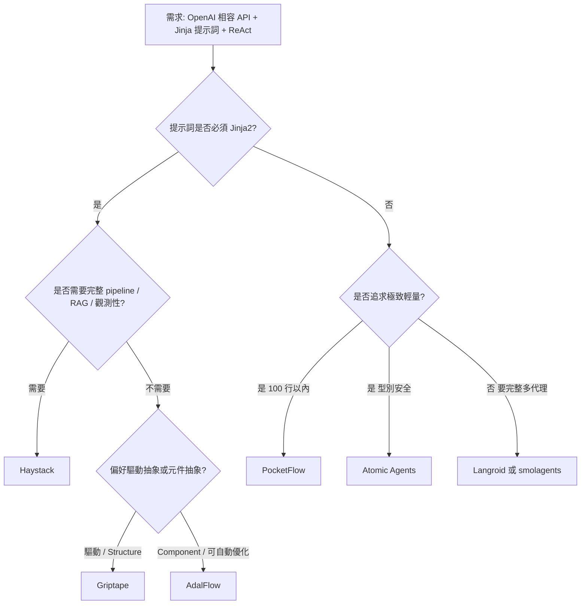

# 輕量級開源 ReAct 代理框架替代方案：以 OpenAI 相容 API 與 Jinja 提示詞管理為核心

> 檢索日期：2026-11-14。本報告為獨立文件，所有上下文均收錄於本文，不引用其他報告或檔案。

## 摘要

LangChain 雖然功能完整，但套件龐大、抽象層多、版本迭代頻繁，對只需要「呼叫 OpenAI 相容 API + Jinja 模板管理提示詞 + 跑一個 ReAct 迴圈」的專案而言往往過重。本報告調查 2026 年 11 月時點的開放原始碼替代方案，並以三項硬性條件篩選：

1. **可呼叫 OpenAI 相容 API**（可自訂 `base_url`／端點，以便接 vLLM、Ollama、OpenRouter、LiteLLM 等）。
2. **以 Jinja2 管理提示詞**（能以 `.j2`／`.jinja2` 檔或 Jinja 語法渲染）。
3. **輕量、職責單一**，並支援工具呼叫的 ReAct 迴圈。

結論：**Griptape**、**AdalFlow**、**Haystack** 是少數「三項全滿足且仍在維護」的成熟選項；**PocketFlow** 與 **Atomic Agents** 在「輕量」與「可控性」上最極致，但提示詞管理不走 Jinja2；多數其他框架（Mirascope、PydanticAI、magentic、Langroid、Agno）刻意採用 Python 原生 f-string 或 Pydantic schema，而非 Jinja2。另有數個極低星（<200）的新興專案精準符合需求，但成熟度不足，僅供概念參考。

## 1. 研究背景與問題定義

發問者的需求可拆解為四個維度：

- **協定**：呼叫 OpenAI 相容的 Chat Completions API，而非綁定單一供應商 SDK。
- **提示詞管理**：以 Jinja 模板獨立管理提示詞，便於版本控制與外部編輯。
- **代理模式**：ReAct（Thought → Action → Observation）工具呼叫迴圈，而非僅是無狀態的補全。
- **權衡**：比 LangChain「更輕量、更靈活」，亦即抽象層少、依賴少、可讀性高。

## 2. 評估準則

| 準則 | 說明 |
| --- | --- |
| 授權 | 是否為 OSI 認可的開放原始碼授權（MIT／Apache-2.0 等） |
| 維護狀態 | 最近推送時間、是否已封存（archived） |
| Jinja2 | 是否以 Jinja2（或 Jinja 語法）為提示詞模板機制 |
| OpenAI 相容 | 是否支援自訂端點／`base_url` |
| ReAct | 是否內建或易於實作工具呼叫迴圈 |
| 星星數 | 作為社群關注度的粗略代理指標（注意：非品質保證） |

## 3. 候選方案總覽

下表星星數為 2026-11-14 透過 GitHub REST API 查得；標「未即時查證」者為本次未取得 API 數據。

| 專案 | 星星數 | 授權 | 語言 | Jinja2 模板 | OpenAI 相容端點 | 核心抽象 |
| --- | --- | --- | --- | --- | --- | --- |
| Griptape | 2,587 | Apache-2.0 | Python | ✅ `.j2` 檔 | ✅（Driver 可換） | Task／Structure／Driver |
| AdalFlow | 4,234 | MIT | Python | ✅ `jinja2.Template` | ✅ | Component／Generator／Agent |
| Haystack | 未即時查證 | Apache-2.0 | Python | ✅ `ChatPromptBuilder` | ✅ | Pipeline／Component |
| Semantic Kernel → MS Agent Framework | 未即時查證 | MIT | Python／.NET／Java | ✅ `Jinja2PromptTemplate` | ✅（含 Ollama） | Kernel／Agent／Plugin |
| PocketFlow | 11,321 | MIT | Python | ❌（零依賴） | 自行實作 | Graph／Node |
| Atomic Agents | 6,329 | MIT | Python | ❌（Pydantic） | ✅（Instructor 供應商） | AtomicAgent／Schema |
| smolagents | 30,363 | Apache-2.0 | Python | ⚠️ 未證實 | ✅ `api_base` | Agent／Tool |
| Langroid | 4,149 | MIT | Python | ❌ | ✅ | Agent／Task |
| Mirascope | 1,535 | MIT | Python | ❌（`str.format`／f-string） | ✅ | 裝飾器 `@llm.call` |
| magentic | 2,428 | MIT | Python | ❌（`str.format`） | ✅ `base_url` | 裝飾器 `@prompt` |
| Burr | 未即時查證 | Apache-2.0 | Python | ❌ | 不限（狀態機） | Action／State |
| promplate | 31 | 未標示／未驗證 | Python | ⚠️ 類 Jinja（`{{ }}`，自製引擎） | ✅ `base_url` | Template／Node／Chain |
| funcchain | 341 | MIT | Python | ✅（README 宣稱） | ✅（走 LangChain 後端） | Python 函式 `chain()` |
| PydanticAI | 21,201 | MIT | Python | ❌（f-string） | ✅ | Agent／Tool／Schema |
| Agno | 43,184 | Apache-2.0 | Python | ❌ | ✅ | Agent／Team |
| Outlines | 16,009 | Apache-2.0 | Python | ✅（`Template` 類） | ✅ | 結構化生成 |
| Fabric | 44,632 | MIT | Go | ❌（Markdown 模式檔） | ✅（含 Ollama 相容端點） | Pattern／CLI／REST |

## 4. 第一梯隊：三項條件皆滿足

### 4.1 Griptape

Griptape 明確以 Jinja2 作為提示詞引擎。其原始碼 `griptape/utils/j2.py` 定義一個 `J2` 類別，包裝 `jinja2.sandbox.SandboxedEnvironment` 並以 `FileSystemLoader` 指向 `griptape/templates/` 目錄，同時提供 `render()`（檔案模板）與 `render_from_string()`（行內模板）兩種方法[^griptape-j2]。提示詞模板以 `.j2` 副檔名存放於 `griptape/templates/` 之下，例如 `tasks/prompt_task/system.j2`、`rulesets/rulesets.j2`、`memory/meta/meta_memory.j2`[^griptape-repo]。`PromptTask._process_task_input()` 會把輸入字串交由 `J2().render_from_string(...)` 渲染[^griptape-impl]。

Griptape 的核心抽象是 **Structures**（Agents／Pipelines／Workflows）＋ **Tasks**（核心建構單元）＋ **Drivers**（可抽換的供應商介面，涵蓋 OpenAI 等多家 LLM）[^griptape-repo]。其 README 範例以 `OpenAiChatPromptDriver` 搭配 `PromptTask` 執行，並示範帶工具的 `Workflow`[^griptape-repo]。Griptape 提供了工具呼叫與 chain-of-thought 推理，屬於輕中度框架：比 LangChain 精簡，但比 PocketFlow 重。

**注意**：本次未即時查證 `OpenAiChatPromptDriver` 是否可直接傳入自訂 `base_url`；由於 Driver 為可設定抽象，實務上通常可透過驅動參數指向 OpenAI 相容端點，但使用前建議以官方文件確認。

### 4.2 AdalFlow

AdalFlow 以「PyTorch 風格、可自動優化」為號召，核心是 `Component` 與 `Generator`[^adalflow-repo]。其提示詞引擎直接使用 Jinja2：`adalflow/core/prompt_builder.py` 匯入 `from jinja2 import Template, Environment, StrictUndefined, meta`，以 `Environment(undefined=StrictUndefined, trim_blocks=True, ...)` 建立渲染環境，並以 `meta.find_undeclared_variables()` 自動抽取模板變數[^adalflow-prompt]。它支援巢狀模板（把一個 `Prompt` 當作另一個的變數），以及 `to_dict`／`from_dict` 的序列化[^adalflow-prompt]。

AdalFlow 提供 `OpenAIClient` 與 `Agent`＋`Runner` 的組合，範例展示以工具（calculator、web_search）進行多步 ReAct 式迴圈，並支援同步、非同步、串流三種模式[^adalflow-repo]。授權為 MIT，且是清單中最直接滿足「Jinja2 + OpenAI 相容 + Agent 迴圈」的專案之一。

### 4.3 Haystack（deepset）

Haystack 是 production-ready 的 RAG／Agent 編排框架，其 `ChatPromptBuilder` 元件以 Jinja2 語法渲染聊天提示詞，並使用名為 `HaystackSandboxedEnvironment` 的沙箱環境，另提供 `ChatMessageExtension`、`Jinja2TimeExtension` 等擴充[^haystack-builder]。授權為 Apache-2.0（可由該檔案的 SPDX 標頭與授權徽章佐證）[^haystack-builder]。它支援 OpenAI、Azure OpenAI、Ollama、Mistral 等多家供應商，並可透過 Hayhooks 對外暴露為 OpenAI 相容的 chat completion 端點[^haystack-repo]。

Haystack 的哲學是「明確控制 context 流動」，元件化程度高、可觀測性強；代價是抽象層比 PocketFlow 多，對「極輕量」需求而言略重。

### 4.4 Semantic Kernel（現更名為 Microsoft Agent Framework）

Semantic Kernel 內建 `Jinja2PromptTemplate` 類別，以 `ImmutableSandboxedEnvironment` 渲染 Jinja2 提示詞，並可把 Kernel 外掛函式注入模板成為 helper[^sk-jinja]。它支援 OpenAI、Azure OpenAI、Hugging Face、NVIDIA、Ollama 等供應商[^sk-repo]，授權為 MIT[^sk-repo]。

**重要警示**：Semantic Kernel 已由 Microsoft 官方宣布由 **Microsoft Agent Framework** 接棒，後者已發布 1.0 生產版本，官方建議新開發改用 Agent Framework 並參考遷移指南[^sk-repo]。因此 Semantic Kernel 應視為「維持可用但非首選」的選項。

## 5. 第二梯隊：輕量極致，但提示詞不走 Jinja2

### 5.1 PocketFlow

PocketFlow 是宣告「100 行、零依賴、零供應商鎖定」的極簡框架，核心抽象只有 Graph／Node，其 README 以對照表直指 LangChain 約 405K 行、CrewAI 約 18K 行，而自身僅 100 行、約 56KB[^pocketflow-repo]。它支援 Agent、Workflow、RAG、Multi-Agent 等設計模式，並在 cookbook 中提供 ReAct 研究代理範例[^pocketflow-repo]。

PocketFlow **不管理提示詞模板**（正是零依賴的設計後果），因此若要 Jinja2，需自行接上 Jinja2。它適合願意自組積木、追求最大透明度的團隊。

### 5.2 Atomic Agents

Atomic Agents 以「原子化」為設計哲學：每個 agent、tool、context provider 都單一職責、可重用、可組合[^atomic-repo]。它建立在 Instructor 與 Pydantic 之上，輸出以 schema 保證一致性；供應商相容性由 Instructor 提供，官方明文表示可接「任何 OpenAI 相容 API，例如 OpenRouter、MiniMax、EdenAI」[^atomic-repo]。

其 `SystemPromptGenerator` 以結構化欄位（background／steps／output_instructions）組裝系統提示詞，**不是 Jinja2**[^atomic-repo]。授權 MIT。若重視可預測性與型別安全、且可接受以 Python 物件而非 Jinja 檔管理提示詞，這是很輕的選擇。

### 5.3 smolagents

smolagents 主打「程式碼代理」：代理人的動作以 Python 程式碼片段表達，而非 JSON 工具呼叫，官方稱可減少約 30% 步驟[^smolagents-repo]。核心 `agents.py` 不到 1,000 行，授權 Apache-2.0[^smolagents-repo]。它明確支援 OpenAI 相容端點，例如 `OpenAIModel(model_id=..., api_base="https://openrouter.ai/api/v1", api_key=...)`[^smolagents-repo]，並內建 ReAct 風格的迴圈。

**待釐清**：本次未能成功取得其提示詞模板原始碼，故無法證實其是否使用 Jinja2 管理提示詞（有一份二手來源如此主張，但未經一級來源佐證，故本報告不採信）。就 ReAct 與 OpenAI 相容而言，它是強候選。

### 5.4 Langroid

Langroid 自稱「直覺、輕量、可擴充且有原則」的多代理框架，由 CMU／UW-Madison 研究者發起，核心抽象為 Agent（訊息轉換器）與 Task（包裹 Agent、驅動迴圈）[^langroid-repo]。它不使用 LangChain，並可搭配「任何以 OpenAI 相容 API 提供的模型」，包含 ollama、LiteLLM、glhf 等[^langroid-repo]。授權 MIT。

其提示詞以 Python 字串／f-string 撰寫，**無 Jinja2 機制**[^langroid-repo]。它對工具呼叫支援完整（含 OpenAI function-calling 與自有的 `ToolMessage`），且有多代理協作、RAG 等能力，屬「輕量但不以模板為核心」的流派。

### 5.5 Mirascope

Mirascope 自稱「LLM Anti-Framework」，以單一裝飾器 `@llm.call` 統一多家模型[^mirascope-repo]。需特別澄清：其 v1 的 `@prompt_template` 採 **Python `str.format` 語法**（原始碼 `format_template()` 最終呼叫 `.format(**values)`），**並非 Jinja2**[^mirascope-template]；v2 則進一步採用 f-string 與裝飾器風格[^mirascope-repo]。因此 Mirascope 極輕量、也支援各家供應商，但**不滿足 Jinja2 條件**。

### 5.6 magentic

magentic 以 `@prompt`／`@chatprompt`／`@prompt_chain` 裝飾器把 LLM 整合進 Python 函式，`@prompt_chain` 會自動解析函式呼叫並回饋給 LLM，達到 ReAct 式多步迴圈[^magentic-repo]。它支援自訂 `base_url`（含 Ollama、Azure、LiteLLM、LocalAI）[^magentic-repo]，授權 MIT。其模板為 Python `format` 佔位符，**不是 Jinja2**[^magentic-repo]。

### 5.7 Burr（Apache 孵化中）

Burr 以狀態機（`@action` ＋ `State`）為核心，明確不管「你怎麼呼叫 LLM」，只負責串接與狀態管理，並附帶一個可即時追蹤／監控的 UI[^burr-repo]。授權 Apache-2.0，已進入 Apache 孵化器[^burr-repo]。它**不涉及提示詞模板**，因此與 Jinja2 條件無關，但作為「比 LangChain 更清楚、更易除錯」的編排層值得留意。

## 6. 精準符合但極低星的新興專案（僅供參考）

以下專案在小規模檢索中出現，特徵與需求高度吻合，但社群極小、成熟度與長期維護存疑，**不建議直接用於生產**：

- **promplate**（31 星）：自製的類 Jinja 模板（`{{ }}` 內可執行任意 Python 運算式）＋ Node／Chain ＋ callback 機制，並內建 `ChatComplete(base_url=...)` 可打 OpenAI 相容端點，GitHub topics 亦標記 `jinja2`[^promplate-repo][^promplate-dev]。近一年仍有推送（2025-12-04），但生態極小、授權欄位未標示。
- **funcchain**（341 星）：README 明確列出「📝 jinja templating for prompts」，以 Python 函式＋`chain()` 表達提示詞，後端為 LangChain，可切換 OpenAI 或本地模型[^funcchain-repo]。但最後推送為 2024-11-19，距今約兩年[^funcchain-repo]，屬**停滯**狀態。
- 其他二手檢索提及的低星專案（如 mamba-agents、agentc、Comet、AmritaCore）宣稱以 `.jinja2`／Jinja2 搭配 ReAct，但星星數多在數十以下且本次未經一級來源逐一驗證，僅記錄為日後追蹤名單。

## 7. 已淘汰或不再建議

| 專案 | 狀態 | 依據 |
| --- | --- | --- |
| ControlFlow | **已封存**，併入 Marvin | GitHub 標示 `archived: true`，最後推送 2025-08-22[^controlflow-repo] |
| OpenAI Swarm | 已被 OpenAI Agents SDK 取代，僅教學用途 | README 明示建議遷移[^swarm-repo] |
| Microsoft PromptFlow | 將於 2027-04-20 退役，官方建議遷移至 MS Agent Framework | README 警示[^promptflow-repo] |
| Semantic Kernel | 官方已由 Microsoft Agent Framework 接棒 | README 警示[^sk-repo] |

## 8. 決策建議

**若三項條件皆為硬需求**：首選 **Griptape**（`.j2` 檔＋Driver 抽象＋完整工具鏈）或 **AdalFlow**（Jinja2 直接內建＋可自動優化提示詞）；若專案已具備 pipeline 架構，**Haystack** 的 `ChatPromptBuilder` 是最成熟的 Jinja2 方案。

**若 Jinja2 可放寬**：**PocketFlow**（最輕、最透明）或 **Atomic Agents**（型別安全、可預測）最貼近「比 LangChain 更輕更靈活」的訴求。

## 9. 來源批判性反思

- **時效性**：本領域迭代極快，多個框架在 2025–2026 年間改名或接棒（Semantic Kernel→MS Agent Framework；ControlFlow→Marvin；Swarm→Agents SDK；PromptFlow 宣布退役）。星星數與維護狀態會迅速變動，本報告數據截止於 2026-11-14。
- **權威性差異**：Griptape 的 Jinja2 使用、AdalFlow 的 Jinja2 使用、Haystack 的 `ChatPromptBuilder`、Semantic Kernel 的 `Jinja2PromptTemplate`，均以**原始碼一級來源**佐證，可信度高。相對地，smolagents 的「Jinja2」主張來自二手摘要，未經原始碼確認，故本報告明確標示為未證實並不予採信。
- **宣稱與事實的落差**：宣稱「輕量」不等於「提示詞好管理」。PocketFlow 的「零依賴」正是其不內建模板引擎的原因；讀者須區分「框架輕」與「功能符合」。
- **星星數的偏誤**：星星數受行銷與曝光影響，非品質保證。Fabric 逾 4 萬星但本質是提示詞庫／CLI，而非 ReAct 代理框架；Outlines 逾 1.6 萬星但主業是結構化生成。低星專案（<200 星）並非必然不佳，僅代表驗證不足。
- **利益揭露**：多數框架的官方 README 帶有自我推銷與對競品的貶抑（例如 PocketFlow 以行數對比貶低 LangChain）。本報告已盡量以原始碼與中性事實為主，但對「文宣式數字」應保留懷疑。

## 10. 結論

在 2026 年 11 月的時點，能同時滿足「OpenAI 相容 API ＋ Jinja2 提示詞 ＋ 輕量 ReAct」的成熟開放原始碼專案並不多。**Griptape** 與 **AdalFlow** 是最貼近的兩把瑞士刀：前者以 `.j2` 檔與 Driver 抽象取勝，後者以 Jinja2 內建與自動優化取勝。**Haystack** 適合已在做 pipeline／RAG 的團隊。若願意以 Python 物件或 f-string 取代 Jinja2，則 **PocketFlow**、**Atomic Agents**、**smolagents**、**magentic** 在輕量與靈活度上表現突出。建議先以最小範例（單一工具＋單一 Jinja 模板＋單一 ReAct 迴圈）在 Griptape 與 AdalFlow 上各做一次 spike，再依團隊偏好定案。

## 參考文獻

[^griptape-j2]: Griptape. (n.d.). *griptape/utils/j2.py* [Source code]. Retrieved 2026-11-14, from https://github.com/griptape-ai/griptape/blob/main/griptape/utils/j2.py

[^griptape-repo]: Griptape. (n.d.). *Griptape: Modular Python framework for AI agents and workflows* [Computer software]. Retrieved 2026-11-14, from https://github.com/griptape-ai/griptape

[^griptape-impl]: Griptape. (n.d.). *griptape/tasks/prompt_task.py* [Source code]. Retrieved 2026-11-14, from https://github.com/griptape-ai/griptape/blob/main/griptape/tasks/prompt_task.py

[^adalflow-repo]: SylphAI. (n.d.). *AdalFlow: The library to build & auto-optimize LLM applications* [Computer software]. Retrieved 2026-11-14, from https://github.com/SylphAI-Inc/AdalFlow

[^adalflow-prompt]: SylphAI. (n.d.). *adalflow/core/prompt_builder.py* [Source code]. Retrieved 2026-11-14, from https://github.com/SylphAI-Inc/AdalFlow/blob/main/adalflow/adalflow/core/prompt_builder.py

[^haystack-builder]: deepset. (n.d.). *haystack/components/builders/chat_prompt_builder.py* [Source code]. Retrieved 2026-11-14, from https://github.com/deepset-ai/haystack/blob/main/haystack/components/builders/chat_prompt_builder.py

[^haystack-repo]: deepset. (n.d.). *Haystack: The open source AI framework for production ready RAG & Agents* [Computer software]. Retrieved 2026-11-14, from https://github.com/deepset-ai/haystack

[^sk-jinja]: Microsoft. (n.d.). *semantic_kernel/prompt_template/jinja2_prompt_template.py* [Source code]. Retrieved 2026-11-14, from https://github.com/microsoft/semantic-kernel/blob/main/python/semantic_kernel/prompt_template/jinja2_prompt_template.py

[^sk-repo]: Microsoft. (n.d.). *Semantic Kernel* [Computer software]. Retrieved 2026-11-14, from https://github.com/microsoft/semantic-kernel

[^pocketflow-repo]: The Pocket. (n.d.). *PocketFlow: 100-line LLM framework* [Computer software]. Retrieved 2026-11-14, from https://github.com/The-Pocket/PocketFlow

[^atomic-repo]: Eigenwise. (n.d.). *Atomic Agents: Building AI agents, atomically* [Computer software]. Retrieved 2026-11-14, from https://github.com/Eigenwise/atomic-agents

[^smolagents-repo]: Hugging Face. (n.d.). *smolagents: a barebones library for agents that think in code* [Computer software]. Retrieved 2026-11-14, from https://github.com/huggingface/smolagents

[^langroid-repo]: Langroid. (n.d.). *Langroid: Harness LLMs with Multi-Agent Programming* [Computer software]. Retrieved 2026-11-14, from https://github.com/langroid/langroid

[^mirascope-repo]: Mirascope. (n.d.). *Mirascope: The LLM Anti-Framework* [Computer software]. Retrieved 2026-11-14, from https://github.com/Mirascope/mirascope

[^mirascope-template]: Mirascope. (n.d.). *mirascope/core/base/_utils/_format_template.py* [Source code]. Retrieved 2026-11-14, from https://github.com/Mirascope/mirascope/blob/v1.0.0/mirascope/core/base/_utils/_format_template.py

[^magentic-repo]: Collins, J. (n.d.). *magentic: Seamlessly integrate LLMs as Python functions* [Computer software]. Retrieved 2026-11-14, from https://github.com/jackmpcollins/magentic

[^burr-repo]: Apache Software Foundation. (n.d.). *Apache Burr (incubating)* [Computer software]. Retrieved 2026-11-14, from https://github.com/apache/burr

[^promplate-repo]: Promplate. (n.d.). *Promplate core: Light but flexible templating and FSM framework* [Computer software]. Retrieved 2026-11-14, from https://github.com/promplate/core

[^promplate-dev]: Promplate. (n.d.). *Promplate: the prompting framework*. Retrieved 2026-11-14, from https://promplate.dev/

[^funcchain-repo]: Shroominic. (n.d.). *funcchain: build cognitive systems, pythonic* [Computer software]. Retrieved 2026-11-14, from https://github.com/shroominic/funcchain

[^controlflow-repo]: Prefect. (n.d.). *ControlFlow* [Computer software]. Retrieved 2026-11-14, from https://github.com/prefect-archive/ControlFlow

[^swarm-repo]: OpenAI. (n.d.). *Swarm (experimental, educational)* [Computer software]. Retrieved 2026-11-14, from https://github.com/openai/swarm

[^promptflow-repo]: Microsoft. (n.d.). *Prompt flow* [Computer software]. Retrieved 2026-11-14, from https://github.com/microsoft/promptflow

[^fabric-repo]: Miessler, D. (n.d.). *Fabric: An open-source framework for augmenting humans using AI* [Computer software]. Retrieved 2026-11-14, from https://github.com/danielmiessler/Fabric

[^outlines-repo]: dottxt. (n.d.). *Outlines: Structured Outputs* [Computer software]. Retrieved 2026-11-14, from https://github.com/dottxt-ai/outlines

[^pydanticai-repo]: Pydantic. (n.d.). *PydanticAI: How Python does AI* [Computer software]. Retrieved 2026-11-14, from https://github.com/pydantic/pydantic-ai

[^agno-repo]: Agno. (n.d.). *Agno: The self-managing agent platform* [Computer software]. Retrieved 2026-11-14, from https://github.com/agno-agi/agno
