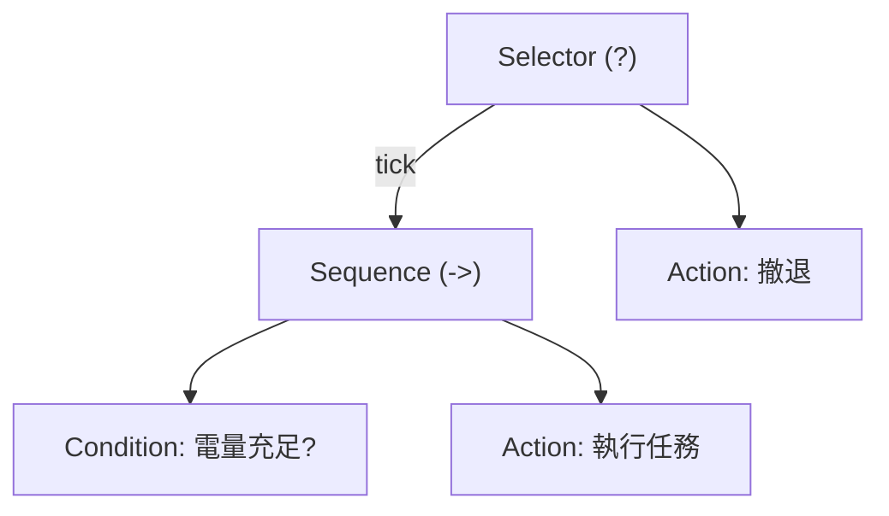

# Python 行為樹 (Behavior Tree) 函式庫調查

## 摘要

行為樹 (Behavior Tree, BT) 是一種用於組織決策邏輯的樹狀結構，由「葉節點」(Leaf) 執行實際動作或條件判斷，並由「複合節點」(Composite，如 Sequence、Selector) 與「裝飾節點」(Decorator) 控制執行流程[^bt-what]。它原本大量應用於遊戲 AI 與機器人領域，近年也被用於大型語言模型 (LLM) 代理的流程編排。

本報告針對「Python 有哪些行為樹函式庫」進行調查。結論先說：**目前維護最活躍、生態最完整的純 Python 行為樹函式庫是 `py_trees`**；若需求偏向 async/await 的輕量組合風格，可考慮 `async-btree`；若需要與產業標準的 C++ 函式庫 `BehaviorTree.CPP` 一致的行為，則其 Python 綁定仍不成熟，不建議用於正式專案。

本報告的所有事實均來自公開網路來源，並於 2026-11-14 擷取。

---

## 什麼是行為樹

行為樹以「tick」為單位驅動：每次 tick 從根節點往下傳遞，節點回傳 `SUCCESS`、`FAILURE` 或 `RUNNING` 三種狀態之一，父節點依子節點狀態決定下一步[^bt-what]。相較於有限狀態機 (FSM)，行為樹在模組化與可讀性上通常更有優勢[^bt-fsm]。

上圖為示意：`Selector` 依序嘗試子節點，只要有一個成功即成功；`Sequence` 則要求所有子節點成功才算成功。

---

## 主流純 Python 函式庫

### 1. py_trees（最推薦）

`py_trees` 是目前 Python 生態中資料最完整、維護最活躍的行為樹實作[^pytrees-repo]。其定位是「為機器人等領域快速開發中等規模決策引擎」[^pytrees-pypi]。

| 項目 | 內容 |
| --- | --- |
| GitHub | https://github.com/splintered-reality/py_trees |
| 星數 | 655（2026-11-14 擷取）[^pytrees-repo] |
| 授權 | BSD-3-Clause[^pytrees-pypi] |
| 最新版本 | 2.6.0，2026-09-10 發布[^pytrees-rel260] |
| 語言 | 純 Python（支援 3.10 / 3.12 / 3.14）[^pytrees-pypi] |
| 安裝 | `pip install py_trees` 或 conda-forge[^pytrees-pypi] |
| 維護者 | Daniel Stonier、Sebastian Castro[^pytrees-pypi] |

**功能特色**[^pytrees-pypi]：

- 提供 Behaviours、Decorators、Sequences、Selectors、Parallels 與 BehaviourTree 等節點。
- Blackboard 機制用於節點間資料共享。
- 內建常用行為、裝飾器與慣用語 (idioms) 函式庫。
- **Ports API 與 XML 解析器**，可採用宣告式 (declarative) 方式定義行為樹，XML 格式與 `BehaviorTree.CPP` 風格相容[^pytrees-rel250]。
- 可序列化為 dot graph，或在終端機以 ASCII/Unicode 呈現。
- 以 `uv` 管理開發環境，支援 Python 3.14[^pytrees-rel250]。

**版本演進**[^pytrees-pypi]：

- `2.3.x`（2025-01）：新增 Python 3.12 支援、移除 3.8。
- `2.4.x`（2025-11）：新增 `ForEach` 裝飾器與 `CompareBlackboardVariables`。
- `2.5.x`（2026-07）：實驗性 Ports API 與 XML 解析、改用 `uv`、支援 Python 3.14。
- `2.6.x`（2026-09）：改良 Ports API（改為類別屬性）、XML 預設值與效能。

**生態系**[^pytrees-pypi]：

| 週邊套件 | 用途 | 星數（2026-11-14） |
| --- | --- | --- |
| `py_trees_ros` | ROS 2 整合的樹管理器與行為[^pytreesros-repo] | 234 |
| `py_trees_js` | 執行期視覺化的 JavaScript 函式庫與 PyQt 檢視器[^pytreesjs-pypi] | — |
| `py_trees_ros_viewer` | 基於 Qt/ROS 2 的視覺化工具[^pytrees-pypi] | — |

`py_trees_js` 可提供摺疊子樹、縮放、時間軸回放、Blackboard 檢視與活動記錄等功能[^pytreesjs-pypi]。

**適合情境**：機器人、ROS 2、遊戲 AI、一般中等規模決策引擎。

### 2. async-btree（輕量、async 風格）

`async-btree` 以「協程 + 函數式組合」為核心，明確主張不使用類別繼承樹，也不使用 XML/JSON/YAML 設定檔，所有商業邏輯即為一般的 Python 函式[^asyncbtree-pypi]。

| 項目 | 內容 |
| --- | --- |
| GitHub | https://github.com/geronimo-iia/async-btree |
| 星數 | 45（2026-11-14 擷取）[^asyncbtree-repo] |
| 授權 | MIT[^asyncbtree-pypi] |
| 最新版本 | 3.0.1，2026-09-06 發布[^asyncbtree-pypi] |
| 語言 | 純 Python（需 3.11+）[^asyncbtree-pypi] |
| 安裝 | `pip install async-btree`[^asyncbtree-pypi] |
| 後端 | anyio（asyncio / trio / asyncio+uvloop）[^asyncbtree-pypi] |

**設計取捨**[^asyncbtree-pypi]：

- 以 truthy/falsy 表示節點狀態（`SUCCESS`/`FAILURE` 即 `True`/`False`）。
- 以 Python 內建 `contextvars` 取代自訂 Blackboard 類別。
- 以 `@node_metadata` 裝飾器建立抽象樹，可用 `analyze()` 與 `stringify_analyze()` 輸出樹狀結構。
- 提供 sequence、fallback/selector、decision、switch、parallele、parallel_race、repeat_while/until、retry、timeout_after、cooldown、delay 等豐富原語。

**適合情境**：以 asyncio/trio 撰寫的非同步應用、偏好函數式風格且不需要設定檔的專案。

---

## 其他 Python 行為樹實作

### 3. task_behavior_engine（Toyota Research Institute）

| 項目 | 內容 |
| --- | --- |
| GitHub | https://github.com/ToyotaResearchInstitute/task_behavior_engine |
| 星數 | 77（2026-11-14 擷取）[^tbe-repo] |
| 授權 | Apache-2.0[^tbe-repo] |
| 最後推送 | 2021-04-23[^tbe-repo] |

以 Python 撰寫的任務引擎，採用 OOP 風格（Behaviors、Decorators、Nodes），以 callback（`run_cb`、`configure_cb` 等）驅動，並使用 Blackboard 共享資料[^asyncbtree-pypi]。雖仍公開，但已多年未更新，屬研究性質程式庫。

### 4. behavior3py

| 項目 | 內容 |
| --- | --- |
| GitHub | https://github.com/behavior3/behavior3py |
| 星數 | 104（2026-11-14 擷取）[^b3py-repo] |
| 授權 | MIT[^b3py-repo] |
| 最後推送 | 2018-10-21[^b3py-repo] |

Behavior3 JavaScript 函式庫的官方 Python 移植，支援 JSON 匯入/匯出與複合/裝飾/動作節點，並可讓單一樹實例服務多個代理[^b3py-repo]。程式碼量極小，且已長期未更新。

### 5. pybts

| 項目 | 內容 |
| --- | --- |
| GitHub | https://github.com/atompilot/pybts |
| 星數 | 7（2026-11-14 擷取）[^pybts-repo] |
| 最後推送 | 2024-12-04[^pybts-repo] |

建構於 `py_trees` 之上的封裝，支援 JSON/XML 載入與匯出、執行期視覺化與歷史資料分析[^pybts-repo]。星數低且更新停滯，僅在需要其網頁視覺化功能時可考慮。

### 6. Dendron（LLM 代理專用）

| 項目 | 內容 |
| --- | --- |
| GitHub | https://github.com/RichardKelley/dendron |
| 授權 | BSD[^dendron-pypi] |
| 最新版本 | 0.2.0，2025-01-11 發布[^dendron-pypi] |

將行為樹應用於大型語言模型代理的結構化編排，並發表於 arXiv 論文〈Behavior Trees Enable Structured Programming of Language Model Agents〉[^dendron-pypi]。適合研究 LLM 代理流程，屬小众且早期階段專案。

### 7. pi_trees

| 項目 | 內容 |
| --- | --- |
| GitHub | https://github.com/pirobot/pi_trees |
| 星數 | 34（2026-11-14 擷取）[^pitrees-repo] |
| 最後推送 | 2019-10-18[^pitrees-repo] |

早期的 Python/ROS 行為樹函式庫，README 明確表示已停止維護[^asyncbtree-pypi]，僅供歷史參考。

---

## 與 C++ 標準函式庫的關係：BehaviorTree.CPP

`BehaviorTree.CPP` 是機器人與遊戲 AI 領域的產業標準 C++ 行為樹函式庫，擁有約 4,295 顆星、MIT 授權，且持續活躍維護[^btcpp-repo]。

它本身是 **C++17** 函式庫，並非純 Python。社群曾嘗試提供 Python 綁定，例如 `behaviortreepy` 與 `pybehaviortree`，但這些綁定專案多為早期工作、功能不完整或已停止維護。因此若要在 Python 中使用 `BehaviorTree.CPP` 的行為語意，較實務的做法是改用 `py_trees`（其 2.5.x 起已支援相容的 XML 格式）[^pytrees-rel250]。

---

## 容易混淆的非行為樹套件

搜尋時應注意以下名稱相近、但**並非**行為樹函式庫的套件：

- `btree` / `BTrees`：B-tree 資料結構（B 樹），常用於 ZODB 資料庫索引，與行為樹無關。
- `treebeard` / `django-treebeard`：Jupyter Notebook 雲端排程工具／Django 的樹狀資料結構函式庫，與行為樹無關。

---

## 綜合比較

| 函式庫 | 星數 | 授權 | 最新版本 / 最後更新 | 維護狀態 | 風格 |
| --- | --- | --- | --- | --- | --- |
| **py_trees** | 655 | BSD-3-Clause | 2.6.0 (2026-09) | 非常活躍 | OOP、Blackboard、XML |
| **async-btree** | 45 | MIT | 3.0.1 (2026-09) | 活躍 | 協程、函數式組合 |
| task_behavior_engine | 77 | Apache-2.0 | 2021-04 | 停滯 | OOP、callback |
| behavior3py | 104 | MIT | 2018-10 | 停滯 | JSON 驅動 |
| pybts | 7 | — | 2024-12 | 低度 | 基於 py_trees |
| Dendron | 97 | BSD | 0.2.0 (2025-01) | 研究/低度 | LLM 代理 |
| pi_trees | 34 | — | 2019-10 | 已停止 | ROS 1 時代 |
| BehaviorTree.CPP | 4,295 | MIT | v4.9 | 非常活躍 | C++（Python 綁定不成熟） |

---

## 建議

1. **一般用途、機器人或需要長期維護**：選 `py_trees`。它是唯一同時具備高星數、活躍維護、完整文件、視覺化工具與 ROS 2 生態的純 Python 選擇。
2. **非同步應用、偏好函數式風格**：選 `async-btree`。輕巧、無設定檔、支援 asyncio/trio/uvloop。
3. **需要 C++ 效能或與既有 `BehaviorTree.CPP` 資產互通**：直接使用 `BehaviorTree.CPP`（C++），或改用 `py_trees` 的相容 XML 格式，而非依賴不成熟的 Python 綁定。
4. **LLM 代理編排**：可研究 `Dendron`，但需注意其早期階段與小眾定位。

---

## 參考文獻

[^bt-what]: BehaviorTree. (n.d.). *BT basics*. Retrieved 2026-11-14, from https://www.behaviortree.dev/bt_basics/

[^bt-fsm]: Simpson, C. (2014, July 17). *Behavior trees for AI: How they work*. Gamasutra. Retrieved 2026-11-14, from https://www.gamasutra.com/blogs/ChrisSimpson/20140717/221339/Behavior_trees_for_AI_How_they_work.php

[^pytrees-repo]: Splintered Reality. (n.d.). *py_trees*. GitHub. Retrieved 2026-11-14, from https://github.com/splintered-reality/py_trees

[^pytrees-pypi]: Stonier, D., Usmani, N., & Staniaszek, M. (2026). *py-trees 2.6.0* [Computer software]. PyPI. Retrieved 2026-11-14, from https://pypi.org/project/py-trees/

[^pytrees-rel260]: Splintered Reality. (2026, September 10). *Release 2.6.x*. GitHub. Retrieved 2026-11-14, from https://github.com/splintered-reality/py_trees/releases/tag/2.6.0

[^pytrees-rel250]: Splintered Reality. (2026, July 14). *Release 2.5.x*. GitHub. Retrieved 2026-11-14, from https://github.com/splintered-reality/py_trees/releases/tag/2.5.0

[^pytreesros-repo]: Splintered Reality. (n.d.). *py_trees_ros*. GitHub. Retrieved 2026-11-14, from https://github.com/splintered-reality/py_trees_ros

[^pytreesjs-pypi]: Stonier, D., & Castro, S. (2026). *py-trees-js 0.7.0* [Computer software]. PyPI. Retrieved 2026-11-14, from https://pypi.org/project/py-trees-js/

[^asyncbtree-repo]: Guibert, J. (n.d.). *async-btree*. GitHub. Retrieved 2026-11-14, from https://github.com/geronimo-iia/async-btree

[^asyncbtree-pypi]: Guibert, J. (2026). *async-btree 3.0.1* [Computer software]. PyPI. Retrieved 2026-11-14, from https://pypi.org/project/async-btree/

[^tbe-repo]: Toyota Research Institute. (n.d.). *task_behavior_engine*. GitHub. Retrieved 2026-11-14, from https://github.com/ToyotaResearchInstitute/task_behavior_engine

[^b3py-repo]: Behavior3. (n.d.). *behavior3py*. GitHub. Retrieved 2026-11-14, from https://github.com/behavior3/behavior3py

[^pybts-repo]: atompilot. (n.d.). *pybts*. GitHub. Retrieved 2026-11-14, from https://github.com/atompilot/pybts

[^dendron-pypi]: Kelley, R. (2025). *dendron 0.2.0* [Computer software]. PyPI. Retrieved 2026-11-14, from https://pypi.org/project/dendron/

[^pitrees-repo]: pirobot. (n.d.). *pi_trees*. GitHub. Retrieved 2026-11-14, from https://github.com/pirobot/pi_trees

[^btcpp-repo]: BehaviorTree. (n.d.). *BehaviorTree.CPP*. GitHub. Retrieved 2026-11-14, from https://github.com/BehaviorTree/BehaviorTree.CPP
