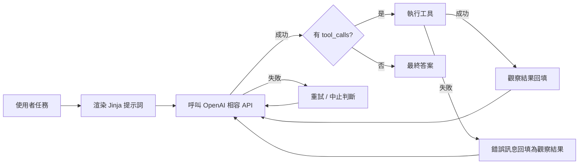
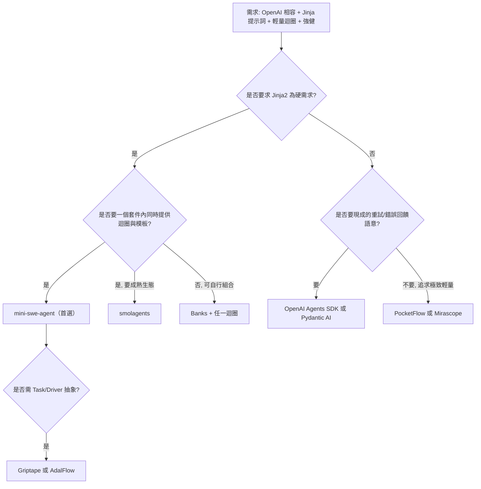

# 直接呼叫 OpenAI 相容 API、以 Jinja 管理提示詞的輕量 ReAct 代理迴圈：自由軟體方案調查

> 檢索日期：2026-11-14。本報告為獨立文件，所有背景與上下文均收錄於本文。

## 摘要

本報告針對一組明確的工程需求，調查可用的自由與開放原始碼軟體（Free and Open Source Software, FOSS）方案。需求可拆解為四點：

1. **直接呼叫 OpenAI 相容 API**：可自訂 `base_url`／端點，以便接 vLLM、Ollama、OpenRouter、LiteLLM、各家雲端代管端點。
2. **以 Jinja 管理提示詞**：提示詞以 Jinja2 模板獨立存放與渲染，而非寫死在 Python 字串或 f-string 中。
3. **不要多餘包裝**：只要一個「代理迴圈（agent loop）」實作，不要額外的抽象層、供應商鎖定或框架生命週期模型。
4. **強健性**：當模型 API 呼叫失敗、或工具呼叫失敗時，代理不應輕易整個崩壞，而應有可預期的重試、錯誤回饋與終止策略。

核心結論：**mini-swe-agent** 是目前最貼近這四項需求組合的專案，它在同一個套件內同時提供「約百行的代理迴圈」、「Jinja2 模板（`StrictUndefined`）」、「可設定 `api_base` 的模型層」與「以例外為基礎、明確定義的錯誤處理流程」[^mswea-repo][^mswea-default][^mswea-controlflow]。若偏好更成熟的生態與更完整的錯誤回饋語意，**smolagents** 是第二選擇，它同樣以 Jinja2 渲染提示詞，並內建針對速率限制的指數退避重試與工具錯誤回饋機制[^smolagents-repo][^smolagents-agents][^smolagents-utils]。若只缺「Jinja 提示詞層」而不缺迴圈，**Banks** 是可獨立搭配任何迴圈的 Jinja 提示詞語言[^banks-repo]。**OpenAI Agents SDK** 與 **Pydantic AI** 的錯誤處理設計最完整，但兩者都不以 Jinja2 管理提示詞，且抽象層明顯較厚[^oai-tools][^pyd-ai-retries]。

本報告所有事實均來自公開網路資料，並以註腳標示來源；星號數為本次自各專案 GitHub 頁面取得的即時數值。

---

## 一、需求形式化

為了讓後續比較有一致的判準，先把四項需求轉成可檢核的條件。

| 需求 | 可檢核條件 | 常見失敗點 |
| --- | --- | --- |
| OpenAI 相容 | 能以參數指定 `base_url`／`api_base`，或可直接注入自建的 OpenAI 用戶端 | 綁死單一供應商 SDK；只支援自家代管端點 |
| Jinja 提示詞 | 以 `jinja2.Template` 或 `.j2` 檔渲染，且未定義變數會報錯（`StrictUndefined`） | 用 f-string／`str.format`；模板錯誤靜默變成空字串 |
| 無多餘包裝 | 迴圈程式碼可被完整閱讀與改寫；無強制的生命週期或圖結構 | 抽象層遮蔽提示詞與回應，難以除錯 |
| 強健性 | API 錯誤有重試與可中止清單；工具錯誤回饋給模型而非直接崩潰；有步數／成本上限 | 工具例外直接往上拋，整個迴圈中斷 |



上圖為需求所描述的迴圈：兩個容易斷鏈的節點分別是「API 呼叫失敗」與「工具呼叫失敗」，強健性設計即在處理這兩條失敗路徑。

---

## 二、候選方案總覽

下表星號數為 2026-11-14 自各專案 GitHub 頁面取得；「Jinja」欄指是否以 Jinja2 為提示詞機制。

| 專案 | 星號數 | 授權 | Jinja2 提示詞 | 自訂端點 | 迴圈規模 | 錯誤處理亮點 |
| --- | --- | --- | --- | --- | --- | --- |
| mini-swe-agent | 9.6k | MIT | ✅ `StrictUndefined` | ✅ `api_base`（litellm） | 約百行 | 例外式控制流、格式錯誤計數、tenacity 重試 |
| smolagents | 30.4k | Apache-2.0 | ✅ `StrictUndefined` | ✅ `api_base` | 約千行 | 工具錯誤回饋、429 指數退避 |
| OpenAI Agents SDK | 30.7k | MIT | ❌ | ✅ 自建 client | 中等 | `failure_error_function`、`RunErrorHandlers` |
| Pydantic AI | 21.2k | MIT | ❌ | ✅ `OpenAIProvider` | 中等 | 八層重試模型、`ModelRetry` |
| Griptape | 2.6k | Apache-2.0 | ✅ `.j2` 檔 | ✅ `base_url` | 中等偏重 | `ErrorArtifact` 承載工具錯誤 |
| AdalFlow | 4.2k | MIT | ✅ `jinja2.Template` | ✅ `base_url` | 中等 | 錯誤寫入 `observation` 欄位 |
| PocketFlow | 11.3k | MIT | ❌ 零依賴 | 自行實作 | 100 行 | 無內建重試 |
| Langroid | 4.1k | MIT | ❌ | ✅ | 中等 | `ToolMessage` 訊息流 |
| Mirascope | 1.5k | MIT | ❌ f-string | ✅ | 極小 | 使用者自行處理 |
| Banks | 129 | MIT | ✅ 原生 Jinja2 | 不涉及 | 僅提示詞層 | 沙箱環境、版本註冊表 |
| tinyagent | 40 | Apache-2.0 | ❌ | ✅ any-llm | 小 | `AgentRunError` 包裝 |
| mcp-agent | 8.6k | Apache-2.0 | ❌ | ✅ | 中等 | 可接 Temporal 做持久化 |

各專案星號與授權分別取自其 GitHub 頁面[^mswea-repo][^smolagents-repo][^oai-repo][^pyd-repo][^griptape-repo][^adalflow-repo][^pocketflow-repo][^langroid-repo][^mirascope-repo][^banks-repo][^tinyagent-repo][^mcpagent-repo]。

---

## 三、第一梯隊：四項需求同時滿足

### 3.1 mini-swe-agent（SWE-agent 團隊）

mini-swe-agent 的自我定位是「100 行的 AI 代理」，官方描述強調「對代理類別而言只有約百行 Python」、「沒有花俏的依賴」[^mswea-repo]。它的核心類別 `DefaultAgent` 的 `run()` 就是一個 `while True` 迴圈，每次呼叫 `step()`，而 `step()` 的實作僅為 `return self.execute_actions(self.query())`[^mswea-controlflow]。

**Jinja2 提示詞**：`DefaultAgent` 直接 `from jinja2 import StrictUndefined, Template`，並以 `Template(template, undefined=StrictUndefined).render(**self.get_template_vars())` 渲染系統與任務模板[^mswea-default]。預設配置檔 `default.yaml` 中的 `system_template`、`instance_template`、`observation_template`、`format_error_template` 全部是 Jinja 模板，其中 `observation_template` 甚至用 `` 條件判斷是否顯示例外資訊[^mswea-config]。這是「以 Jinja 管理提示詞」最完整的實作之一。

**自訂端點**：模型層可透過 `model_kwargs` 直接傳遞給 `litellm.completion`，官方文件示範 `model_kwargs: {custom_llm_provider: "openai", api_base: "https://..."}`，並以 vLLM 的 `hosted_vllm/...` 與 `api_base: "http://localhost:8000/v1"` 為具體範例[^mswea-local]。另有 `OpenRouterModel`、`PortkeyModel` 等直接以 `requests` 呼叫的實作[^mswea-openrouter]。

**強健性**：這是本專案最值得借鏡之處。它以例外定義控制流，所有控制例外繼承 `InterruptAgentFlow`，包括 `Submitted`（任務完成）、`LimitsExceeded`（成本／步數超限）、`TimeExceeded`（牆鐘時間超限）、`FormatError`（輸出格式錯誤）、`UserInterruption`（使用者中斷）[^mswea-exceptions]。`run()` 的 `try/except` 區塊會攔截 `FormatError`，累計 `n_consecutive_format_errors`，超過 `max_consecutive_format_errors`（預設 3）才以 `RepeatedFormatError` 結束；其他 `InterruptAgentFlow` 則把訊息加入軌跡後繼續迴圈[^mswea-default]。

API 層的重試使用 `tenacity.Retrying`：`stop_after_attempt` 預設 10 次（可用環境變數調整）、`wait_exponential(multiplier=1, min=4, max=60)`，並以 `retry_if_not_exception_type(abort_exceptions)` 排除不該重試的例外[^mswea-retry]。`LitellmModel` 定義的 `abort_exceptions` 包含 `UnsupportedParamsError`、`NotFoundError`、`PermissionDeniedError`、`ContextWindowExceededError`、`AuthenticationError` 與 `KeyboardInterrupt`，因此「金鑰錯誤」這類重試無用的狀況會直接中止而非空轉[^mswea-litellm]。工具（bash）呼叫的錯誤同樣不是崩潰，而是被格式化為觀察訊息；`format_toolcall_observation_messages` 甚至為未執行的動作補上 `{"exception_info": "action was not executed"}`，確保動作與輸出的配對不會錯位[^mswea-actions]。

**評語**：四項需求全中，且錯誤處理是「設計過」而非事後補上。代價是它預設以 bash 為單一工具、以軟體工程任務為主要場景，若要做通用代理需自行擴充工具定義；此外它的持久化、串流等生產級能力較薄。

### 3.2 smolagents（Hugging Face）

smolagents 官方描述「代理邏輯約在千行程式碼內」、「我們把抽象保持在貼近原始程式碼的最小形狀」[^smolagents-repo]。`agents.py` 的 import 區塊直接出現 `from jinja2 import StrictUndefined, Template`，並提供 `populate_template()` 以 `Template(template, undefined=StrictUndefined).render(**variables)` 渲染[^smolagents-agents]。其 `PromptTemplates` 結構定義了 `system_prompt`、`planning`、`managed_agent`、`final_answer` 等模板欄位，可逐項覆寫[^smolagents-agents]。這證實了它的提示詞機制確實走 Jinja2。

**自訂端點**：`OpenAIServerModel`（即 `OpenAIModel` 的別名）接受 `api_base` 與 `api_key`，官方 README 示範 `OpenAIModel(model_id=..., api_base="https://openrouter.ai/api/v1", api_key=...)`[^smolagents-repo][^smolagents-models]。

**強健性**：`utils.py` 定義完整的例外階層，`AgentError` 為基底，下轄 `AgentParsingError`、`AgentExecutionError`、`AgentMaxStepsError`、`AgentToolCallError`、`AgentToolExecutionError`、`AgentGenerationError`[^smolagents-utils]。關鍵在於 `agents.py` 的迴圈：`except AgentGenerationError` 會直接重新拋出（因為那是實作錯誤而非模型錯誤），而 `except AgentError` 則只記錄 `action_step.error = e` 並繼續迭代[^smolagents-agents]。工具執行失敗時，錯誤訊息被包成「Error executing tool '{name}' with arguments ... Please try again or use another tool」，也就是**把錯誤當成觀察結果餵回模型**[^smolagents-agents]。

API 層有自製的 `Retrying` 類別，常數為 `RETRY_WAIT = 60`、`RETRY_MAX_ATTEMPTS = 3`、`RETRY_EXPONENTIAL_BASE = 2`、`RETRY_JITTER = True`，且 `retry_predicate=is_rate_limit_error`，即只針對速率限制重試[^smolagents-models]。測試檔中有一則 `test_retry_on_rate_limit_error` 驗證兩次失敗後第三次成功，並檢查退避時間落在 0.67 至 0.73 秒之間[^smolagents-models]。

**評語**：生態成熟、錯誤語意清楚，且確實以 Jinja2 管理提示詞。代價是抽象層比 mini-swe-agent 厚（`MultiStepAgent` 生命週期、記憶體步驟模型），若追求「可在一頓飯內讀完」的透明度則略遜一籌。

---

## 四、第二梯隊：部分滿足

### 4.1 OpenAI Agents SDK

迴圈設計清楚：`Runner.run()` 依序「呼叫模型 → 若為最終輸出則結束 → 若為 handoff 則換代理 → 否則執行工具呼叫並重新迴圈」，超過 `max_turns` 會拋出 `MaxTurnsExceeded`[^oai-running]。例外階層包含 `AgentsException`、`MaxTurnsExceeded`、`ModelBehaviorError`、`ModelRefusalError`、`ModelTimeoutError`、`ToolTimeoutError`、`UserError` 等[^oai-exceptions]。

工具錯誤處理是它的強項：`default_tool_error_function` 會回傳固定字串 `"An error occurred while running the tool."` 作為模型可見的訊息，且刻意**不暴露例外內容**；若把 `failure_error_function` 明確設為 `None`，則例外會被拋出而非轉為訊息[^oai-toolpy]。此外 `RunConfig` 接受 `tool_error_formatter` 回呼，可依錯誤種類（例如 `approval_rejected`）自訂模型可見的錯誤文字[^oai-toolerrorfmt]。也就是說，工具失敗預設「不中斷迴圈、回饋給模型」，且可逐工具覆寫。API 層另有 `get_openai_retry_advice()`，會依 `x-should-retry` 標頭、網路錯誤、逾時，以及狀態碼 408／409／429／5xx 判斷是否建議重試，並在請求帶有狀態（`previous_response_id`／`conversation_id`）時標記重放安全性[^oai-retry]。

**自訂端點**：可用 `set_default_openai_client(AsyncOpenAI(base_url="...", api_key="..."))` 或環境變數 `OPENAI_BASE_URL`，也可用 `set_default_openai_api("chat_completions")` 切到 Chat Completions[^oai-config]。

**不滿足之處**：提示詞是 `instructions` 純字串，**沒有 Jinja2 機制**[^oai-running]。此外它內建 handoffs、guardrails、sessions、tracing、voice、realtime 等大量概念，對「只要一個迴圈」的需求而言是額外重量[^oai-repo]。

### 4.2 Pydantic AI

Pydantic AI 官方文件明確把自己定位為「型別化、可擴充的代理迴圈」，並提供 `OpenAIProvider` 與自訂 `AsyncOpenAI` 用戶端（可設定 `base_url`）[^pyd-repo][^pyd-openai]。

其重試文件是本次調查中**最完整的一份**：它把「重試」拆成八個層次，包括傳輸層、供應商 SDK、持久化執行引擎、模型回退、模型請求嘗試、工具重試、輸出重試與請求 hook；並提醒各層預算不相乘共享，若不指定單一重試擁有者，一次邏輯呼叫可能產生 $N \times F \times M \times K$ 次網路請求[^pyd-ai-retries]。工具層的重試以 `retries={'tools': N}` 設定，會在訊息歷史留下 `ToolReturnPart` 且 `outcome='retried'`；文件也明確指出「重試一次工具呼叫」與「重試一次 API 請求」是不同層次，前者要模型多跑一輪，後者是網路層的事[^pyd-ai-retries]。

**不滿足之處**：提示詞走 Python 物件與 f-string，沒有 Jinja2；且它仍要求接受 `Agent` 生命週期模型[^pyd-repo]。

### 4.3 Griptape

Griptape 以 Jinja2 為提示詞引擎：`griptape/utils/j2.py` 定義 `J2` 類別，包裝 `jinja2.sandbox.SandboxedEnvironment`，以 `FileSystemLoader` 指向 `templates/` 目錄，並啟用 `trim_blocks` 與 `lstrip_blocks`[^griptape-j2]。任務模板以 `.j2` 檔存放，例如 `tasks/prompt_task/assistant_output_schema_validation_subtask.j2`[^griptape-j2]。

**自訂端點**：`OpenAiChatPromptDriver` 明確具有 `base_url` 欄位，並接受自建 `client`[^griptape-driver]。

**強健性**：`ActionsSubtask.attach_to()` 在解析工具動作失敗時，會捕捉例外並以 `ErrorArtifact(f"ToolAction input parsing error: {e}", exception=e)` 記錄，而非崩潰[^griptape-subtask]。`PromptTask` 有 `max_subtasks` 上限（預設 20）與 `DEFAULT_MAX_STEPS = 20`[^griptape-task]。

**評語**：四項需求大致滿足，但抽象層為 Task／Structure／Driver 三層，比 mini-swe-agent 與 smolagents 重，屬「輕中度框架」[^griptape-repo]。

### 4.4 AdalFlow

AdalFlow 直接以 Jinja2 建立提示詞：其 `Prompt` 系統使用 `jinja2` 的 `Template`，其 ReAct 代理的系統提示詞常數 `DEFAULT_REACT_AGENT_SYSTEM_PROMPT` 本身就是一段 Jinja 模板，內含 `{{max_steps}}`、``、`` 等語法[^adalflow-react]。`OpenAIClient` 具有 `base_url` 欄位，同步與非同步用戶端皆以此建立[^adalflow-client]。

**強健性**：`ReActAgent` 的 docstring 明言「若執行失敗，錯誤訊息會存入 `observation` 欄位，讓我們可以自動優化它以修正錯誤」，且 `max_steps` 預設 10、`DEFAULT_MAX_STEPS = 10`[^adalflow-react][^adalflow-agent]。

**注意**：`react.py` 檔頭已標示「Note: This will be deprecated soon, use Agent + Runner instead.」，官方建議改用 `Agent` 搭配 `Runner`[^adalflow-react]。因此若選用 AdalFlow，應以新的 `Agent`／`Runner` 為主，而非 `ReActAgent`。

---

## 五、第三梯隊：極輕量，但需自行補齊需求

### 5.1 PocketFlow

PocketFlow 宣稱「100 行、零依賴、零供應商鎖定」，README 以行數對照表直指 LangChain 約 405K 行、CrewAI 約 18K 行，而自身僅 100 行[^pocketflow-repo]。它的抽象只有 Graph／Node，並在 cookbook 提供 ReAct 研究代理範例[^pocketflow-repo]。

**不滿足之處**：正因為「零依賴」，它**不管理提示詞模板**，因此沒有 Jinja2；也沒有內建重試或錯誤回饋機制，API 失敗與工具失敗的處理需完全自行實作[^pocketflow-repo]。

### 5.2 Mirascope

Mirascope 自稱「The LLM Anti-Framework」，其 README 範例展示一個完全由使用者掌控的 ReAct 迴圈[^mirascope-repo]：

```python
response = librarian("I want a fantasy book")
while response.tool_calls:
    response = response.resume(response.execute_tools())
```

工具以 `@llm.tool` 裝飾，模型呼叫以 `@llm.call` 包裝，框架只提供 `execute_tools` 與 `resume` 兩個原語[^mirascope-repo]。這最貼近「不要多餘包裝」，但提示詞是 Python f-string，**沒有 Jinja2**，且重試、持久化、錯誤回饋都需自行處理。

### 5.3 Langroid

Langroid 以 Agent／Task 的訊息傳遞為核心，可搭配任何以 OpenAI 相容 API 提供的模型，並對工具訊息處理有細緻設計（`ToolMessage` 等）[^langroid-repo]。提示詞以 Python 字串撰寫，**無 Jinja2 機制**[^langroid-repo]。適合多代理場景，單代理簡單任務則偏重。

### 5.4 Banks：可獨立搭配的 Jinja 提示詞層

若「迴圈」與「提示詞層」可以分開選，Banks 值得單獨考慮。它自述為「以 Jinja 為基礎的 LLM 提示詞語言」，官方文件明確表示「Banks 本質上是 Jinja2，再加上專為 LLM 提示詞設計的功能」[^banks-docs]。

其關鍵能力是**直接把模板渲染成聊天訊息清單**，而非單一字串：

```jinja

You are a {{ persona }}


Hello, how are you?

```

渲染結果是 `ChatMessage` 物件清單，可轉為字典直接餵給 OpenAI 相容端點[^banks-repo]。此外它提供模板註冊表（`DirectoryTemplateRegistry`）以從檔案系統載入 `.jinja` 檔、版本控管與中介資料，並使用 Jinja2 沙箱環境以降低伺服器端模板注入（SSTI）風險[^banks-docs][^banks-repo]。

**注意**：Banks 只處理提示詞，不提供代理迴圈，因此需與上列任一迴圈方案搭配。其星號數僅約 129，社群規模小[^banks-repo]。

### 5.5 tinyagent（Mozilla AI）與 any-llm

tinyagent 自述為「極簡代理框架」，其代理迴圈建立於 any-llm 之上，提供 MCP 工具支援、OpenTelemetry 追蹤與 callback 系統[^tinyagent-repo]。錯誤處理上，非預期例外會被包成 `AgentRunError`，而繼承 `AgentCancel` 的例外則會直接往外傳，讓應用程式能區分「預期停止」與「非預期錯誤」[^tinyagent-agent]。callback 可在 `before_tool_execution` 中計數並在超過上限時中止[^tinyagent-repo]。

**注意**：星號數僅約 40，且 commit 數僅 8，屬極新專案；提示詞為 `instructions` 字串，無 Jinja2[^tinyagent-repo]。any-llm 則是其底層的供應商抽象層（約 2.3k 星），提供統一的 `completion()` 介面並可沿用 LiteLLM 的環境變數設定[^anyllm-repo]。

---

## 六、對照組：LangChain 現在的錯誤處理設計

LangChain 現行 `create_agent` 以 middleware 形式提供錯誤處理，官方文件列出多個預建 middleware，其中與本報告直接相關者為[^lc-middleware]：

| Middleware | 作用 |
| --- | --- |
| Tool error | 攔截工具執行例外，轉為模型可見的錯誤訊息而非中止執行 |
| Tool retry | 以指數退避自動重試失敗的工具呼叫 |
| Model retry | 以指數退避自動重試失敗的模型呼叫 |
| Model fallback | 主要模型失敗時自動回退到替代模型 |
| Model call limit | 限制模型呼叫次數以控制成本 |

`ToolErrorMiddleware` 的實作明確說明其語意：`on_error` 對每個工具例外被呼叫，回傳內容則把例外轉為 `ToolMessage(status="error")`，回傳 `None` 則讓例外往外傳；也就是「處理是可選的」，未處理的例外會原樣往上拋，不會被序列化給模型[^lc-toolerror]。文件亦提醒該 middleware **本身不重試**，需與 `ToolRetryMiddleware` 以 `on_failure="error"` 組合[^lc-middleware]。

這組設計可視為「錯誤處理該有哪些層次」的良好參考清單，即使最終不使用 LangChain，也值得照抄其分層概念。

---

## 七、選型建議



**若四項皆為硬需求**：首選 **mini-swe-agent**。它是唯一在「同一個約百行的迴圈」內同時提供 Jinja2（`StrictUndefined`）、`api_base` 設定、以及設計過的例外式錯誤處理（重試中止清單、格式錯誤計數、成本與時間上限）的專案[^mswea-default][^mswea-retry][^mswea-exceptions]。

**若重視生態與成熟度**：選 **smolagents**。它的 Jinja2 使用與工具錯誤回饋語意同樣明確，且社群規模大一個量級[^smolagents-agents][^smolagents-models]。

**若只想補上 Jinja 提示詞層**：以 **Banks** 搭配自寫迴圈，或搭配 Mirascope 的 `execute_tools`／`resume` 原語，可得到最大透明度[^banks-repo][^mirascope-repo]。

**若願意放寬 Jinja2 條件**：**OpenAI Agents SDK** 的 `failure_error_function` 與 `RunErrorHandlers` 提供了最省心的工具錯誤處理[^oai-toolpy]；**Pydantic AI** 的八層重試模型則提供了最完整的重試語意地圖，值得作為自寫迴圈時的設計藍本[^pyd-ai-retries]。

**實作建議**：無論選哪一個，建議先以最小範例（單一工具、單一 Jinja 模板、單一迴圈）做一次 spike，並刻意注入兩種失敗：一次 HTTP 429 與一次工具拋出例外，觀察代理是否如預期重試或回饋，而非中斷。這正是本報告四項需求中最容易被忽略、卻最影響長期穩定性的部分。

---

## 八、來源批判性反思

- **時效性**：本領域迭代極快。AdalFlow 的 `react.py` 已標示即將棄用並建議改用 `Agent` + `Runner`[^adalflow-react]；Mozilla 的 any-agent 已進入軟性棄用（soft deprecation），建議新專案改用 tinyagent[^anyagent-repo]。任何選型都應在導入前重新確認專案狀態。
- **「輕量」宣稱的落差**：PocketFlow 的「100 行」與「零依賴」互為因果，正是它不內建模板引擎與重試機制的原因[^pocketflow-repo]。讀者須區分「框架輕」與「需求滿足」。同理，smolagents 的「約千行」僅指代理邏輯，整個套件仍包含模型、工具、監控等模組[^smolagents-repo]。
- **一手與二手證據**：本報告中關於 Jinja2 使用的判斷，均以**原始碼**為證（`agents.py` 的 import、`j2.py` 的 `SandboxedEnvironment`、`default.py` 的 `Template` 呼叫），而非行銷文案，可信度較高[^smolagents-agents][^griptape-j2][^mswea-default]。相對地，部分專案的錯誤處理語意僅能從文件與型別簽章推得，實作細節未逐一驗證。
- **星號數的偏誤**：星號數受曝光與行銷影響，非品質保證。Banks 僅約 129 星、tinyagent 僅約 40 星，但兩者的功能定位精準；反之 LangChain 逾 14.9 萬星，其抽象層卻正是本報告需求想要避開的對象[^banks-repo][^tinyagent-repo][^lc-repo]。
- **利益揭露**：多數框架的官方文件帶有自我推銷與對競品的比較。本報告已盡量以原始碼與中性事實為主，並在引述官方比較時明確標示來源。

---

## 九、結論

在 2026 年 11 月的時點，「直接呼叫 OpenAI 相容 API ＋ 以 Jinja 管理提示詞 ＋ 只要一個強健的 ReAct 迴圈」這組需求的最佳匹配是 **mini-swe-agent**：它的迴圈可以在一次閱讀內被完整理解，提示詞以 `StrictUndefined` 的 Jinja2 模板管理，模型層可指向任何 OpenAI 相容端點，而錯誤處理以例外階層明確區分「該重試」「該回饋給模型」「該中止」三種情況[^mswea-default][^mswea-retry][^mswea-exceptions]。**smolagents** 是可接受略厚抽象時的最佳替代[^smolagents-agents]。若需求允許把提示詞層與迴圈層拆開，**Banks** 提供了最乾淨的 Jinja 聊天訊息渲染能力，可搭配任何迴圈[^banks-repo]。而 **OpenAI Agents SDK** 與 **Pydantic AI** 雖不滿足 Jinja2 條件，其錯誤處理分層設計仍是自寫迴圈時最有價值的參考[^oai-toolpy][^pyd-ai-retries]。

---

## 參考文獻

[^mswea-repo]: SWE-agent. (n.d.). *mini-swe-agent: The 100 line AI agent that solves GitHub issues or helps you in your command line* [Computer software]. Retrieved 2026-11-14, from https://github.com/SWE-agent/mini-swe-agent

[^mswea-default]: SWE-agent. (n.d.). *src/minisweagent/agents/default.py* [Source code]. Retrieved 2026-11-14, from https://github.com/SWE-agent/mini-swe-agent/blob/main/src/minisweagent/agents/default.py

[^mswea-controlflow]: SWE-agent. (n.d.). *Agent control flow* [Documentation]. Retrieved 2026-11-14, from https://mini-swe-agent.com/latest/advanced/control_flow/

[^mswea-config]: SWE-agent. (n.d.). *src/minisweagent/config/default.yaml* [Source code]. Retrieved 2026-11-14, from https://github.com/SWE-agent/mini-swe-agent/blob/main/src/minisweagent/config/default.yaml

[^mswea-exceptions]: SWE-agent. (n.d.). *src/minisweagent/exceptions.py* [Source code]. Retrieved 2026-11-14, from https://github.com/SWE-agent/mini-swe-agent/blob/main/src/minisweagent/exceptions.py

[^mswea-retry]: SWE-agent. (n.d.). *src/minisweagent/models/utils/retry.py* [Source code]. Retrieved 2026-11-14, from https://github.com/SWE-agent/mini-swe-agent/blob/main/src/minisweagent/models/utils/retry.py

[^mswea-litellm]: SWE-agent. (n.d.). *src/minisweagent/models/litellm_model.py* [Source code]. Retrieved 2026-11-14, from https://github.com/SWE-agent/mini-swe-agent/blob/main/src/minisweagent/models/litellm_model.py

[^mswea-actions]: SWE-agent. (n.d.). *src/minisweagent/models/utils/actions_toolcall.py* [Source code]. Retrieved 2026-11-14, from https://github.com/SWE-agent/mini-swe-agent/blob/main/src/minisweagent/models/utils/actions_toolcall.py

[^mswea-local]: SWE-agent. (n.d.). *Local models* [Documentation]. Retrieved 2026-11-14, from https://mini-swe-agent.com/latest/models/local_models/

[^mswea-openrouter]: SWE-agent. (n.d.). *src/minisweagent/models/openrouter_model.py* [Source code]. Retrieved 2026-11-14, from https://github.com/SWE-agent/mini-swe-agent/blob/main/src/minisweagent/models/openrouter_model.py

[^smolagents-repo]: Hugging Face. (n.d.). *smolagents: a barebones library for agents that think in code* [Computer software]. Retrieved 2026-11-14, from https://github.com/huggingface/smolagents

[^smolagents-agents]: Hugging Face. (n.d.). *src/smolagents/agents.py* [Source code]. Retrieved 2026-11-14, from https://github.com/huggingface/smolagents/blob/main/src/smolagents/agents.py

[^smolagents-utils]: Hugging Face. (n.d.). *src/smolagents/utils.py* [Source code]. Retrieved 2026-11-14, from https://github.com/huggingface/smolagents/blob/main/src/smolagents/utils.py

[^smolagents-models]: Hugging Face. (n.d.). *src/smolagents/models.py* [Source code]. Retrieved 2026-11-14, from https://github.com/huggingface/smolagents/blob/main/src/smolagents/models.py

[^oai-repo]: OpenAI. (n.d.). *OpenAI Agents SDK: A lightweight, powerful framework for multi-agent workflows* [Computer software]. Retrieved 2026-11-14, from https://github.com/openai/openai-agents-python

[^oai-running]: OpenAI. (n.d.). *Running agents* [Documentation]. Retrieved 2026-11-14, from https://openai.github.io/openai-agents-python/running_agents/

[^oai-tools]: OpenAI. (n.d.). *Tools* [Documentation]. Retrieved 2026-11-14, from https://openai.github.io/openai-agents-python/tools/

[^oai-toolpy]: OpenAI. (n.d.). *src/agents/tool.py* [Source code]. Retrieved 2026-11-14, from https://github.com/openai/openai-agents-python/blob/main/src/agents/tool.py

[^oai-exceptions]: OpenAI. (n.d.). *Exceptions* [Documentation]. Retrieved 2026-11-14, from https://openai.github.io/openai-agents-python/ref/exceptions/

[^oai-retry]: OpenAI. (n.d.). *src/agents/models/_openai_retry.py* [Source code]. Retrieved 2026-11-14, from https://github.com/openai/openai-agents-python/blob/main/src/agents/models/_openai_retry.py

[^oai-config]: OpenAI. (n.d.). *Configuration* [Documentation]. Retrieved 2026-11-14, from https://openai.github.io/openai-agents-python/config/

[^oai-toolerrorfmt]: OpenAI. (n.d.). *examples/agent_patterns/human_in_the_loop_custom_rejection.py* [Source code]. Retrieved 2026-11-14, from https://github.com/openai/openai-agents-python/blob/main/examples/agent_patterns/human_in_the_loop_custom_rejection.py

[^pyd-repo]: Pydantic. (n.d.). *Pydantic AI: How Python does AI* [Computer software]. Retrieved 2026-11-14, from https://github.com/pydantic/pydantic-ai

[^pyd-openai]: Pydantic. (n.d.). *OpenAI* [Documentation]. Retrieved 2026-11-14, from https://ai.pydantic.dev/models/openai/

[^pyd-ai-retries]: Pydantic. (n.d.). *Retries* [Documentation]. Retrieved 2026-11-14, from https://ai.pydantic.dev/retries/

[^pyd-tools]: Pydantic. (n.d.). *Function Tools* [Documentation]. Retrieved 2026-11-14, from https://ai.pydantic.dev/tools/

[^griptape-repo]: Griptape. (n.d.). *Griptape: Modular Python framework for AI agents and workflows* [Computer software]. Retrieved 2026-11-14, from https://github.com/griptape-ai/griptape

[^griptape-j2]: Griptape. (n.d.). *griptape/utils/j2.py* [Source code]. Retrieved 2026-11-14, from https://github.com/griptape-ai/griptape/blob/main/griptape/utils/j2.py

[^griptape-driver]: Griptape. (n.d.). *griptape/drivers/prompt/openai_chat_prompt_driver.py* [Source code]. Retrieved 2026-11-14, from https://github.com/griptape-ai/griptape/blob/main/griptape/drivers/prompt/openai_chat_prompt_driver.py

[^griptape-task]: Griptape. (n.d.). *griptape/tasks/prompt_task.py* [Source code]. Retrieved 2026-11-14, from https://github.com/griptape-ai/griptape/blob/main/griptape/tasks/prompt_task.py

[^griptape-subtask]: Griptape. (n.d.). *griptape/tasks/actions_subtask.py* [Source code]. Retrieved 2026-11-14, from https://github.com/griptape-ai/griptape/blob/main/griptape/tasks/actions_subtask.py

[^adalflow-repo]: SylphAI. (n.d.). *AdalFlow: The library to build & auto-optimize LLM applications* [Computer software]. Retrieved 2026-11-14, from https://github.com/SylphAI-Inc/AdalFlow

[^adalflow-react]: SylphAI. (n.d.). *adalflow/components/agent/react.py* [Source code]. Retrieved 2026-11-14, from https://github.com/SylphAI-Inc/AdalFlow/blob/main/adalflow/adalflow/components/agent/react.py

[^adalflow-agent]: SylphAI. (n.d.). *adalflow/components/agent/agent.py* [Source code]. Retrieved 2026-11-14, from https://github.com/SylphAI-Inc/AdalFlow/blob/main/adalflow/adalflow/components/agent/agent.py

[^adalflow-client]: SylphAI. (n.d.). *adalflow/components/model_client/openai_client.py* [Source code]. Retrieved 2026-11-14, from https://github.com/SylphAI-Inc/AdalFlow/blob/main/adalflow/adalflow/components/model_client/openai_client.py

[^pocketflow-repo]: The Pocket. (n.d.). *PocketFlow: 100-line LLM framework* [Computer software]. Retrieved 2026-11-14, from https://github.com/The-Pocket/PocketFlow

[^mirascope-repo]: Mirascope. (n.d.). *Mirascope: The LLM Anti-Framework* [Computer software]. Retrieved 2026-11-14, from https://github.com/mirascope/mirascope

[^langroid-repo]: Langroid. (n.d.). *Langroid: Harness LLMs with Multi-Agent Programming* [Computer software]. Retrieved 2026-11-14, from https://github.com/langroid/langroid

[^banks-repo]: Masci, M. (n.d.). *Banks: LLM prompt language based on Jinja* [Computer software]. Retrieved 2026-11-14, from https://github.com/masci/banks

[^banks-docs]: Masci, M. (n.d.). *Welcome to Banks* [Documentation]. Retrieved 2026-11-14, from https://masci.github.io/banks/

[^tinyagent-repo]: Mozilla AI. (n.d.). *tinyagent: Minimalist framework for running and monitoring an agent* [Computer software]. Retrieved 2026-11-14, from https://github.com/mozilla-ai/tinyagent

[^tinyagent-agent]: Mozilla AI. (n.d.). *src/tinyagent/agent.py* [Source code]. Retrieved 2026-11-14, from https://github.com/mozilla-ai/tinyagent/blob/main/src/tinyagent/agent.py

[^anyagent-repo]: Mozilla AI. (n.d.). *any-agent: A single interface to use and evaluate different agent frameworks* [Computer software]. Retrieved 2026-11-14, from https://github.com/mozilla-ai/any-agent

[^anyllm-repo]: Mozilla AI. (n.d.). *any-llm: Communicate with an LLM provider using a single interface* [Computer software]. Retrieved 2026-11-14, from https://github.com/mozilla-ai/any-llm

[^mcpagent-repo]: LastMile AI. (n.d.). *mcp-agent: Build effective agents using Model Context Protocol and simple workflow patterns* [Computer software]. Retrieved 2026-11-14, from https://github.com/lastmile-ai/mcp-agent

[^lc-repo]: LangChain. (n.d.). *LangChain: The agent engineering platform* [Computer software]. Retrieved 2026-11-14, from https://github.com/langchain-ai/langchain

[^lc-middleware]: LangChain. (n.d.). *Prebuilt middleware* [Documentation]. Retrieved 2026-11-14, from https://docs.langchain.com/oss/python/langchain/middleware/built-in

[^lc-toolerror]: LangChain. (n.d.). *libs/langchain_v1/langchain/agents/middleware/tool_error.py* [Source code]. Retrieved 2026-11-14, from https://github.com/langchain-ai/langchain/blob/master/libs/langchain_v1/langchain/agents/middleware/tool_error.py
