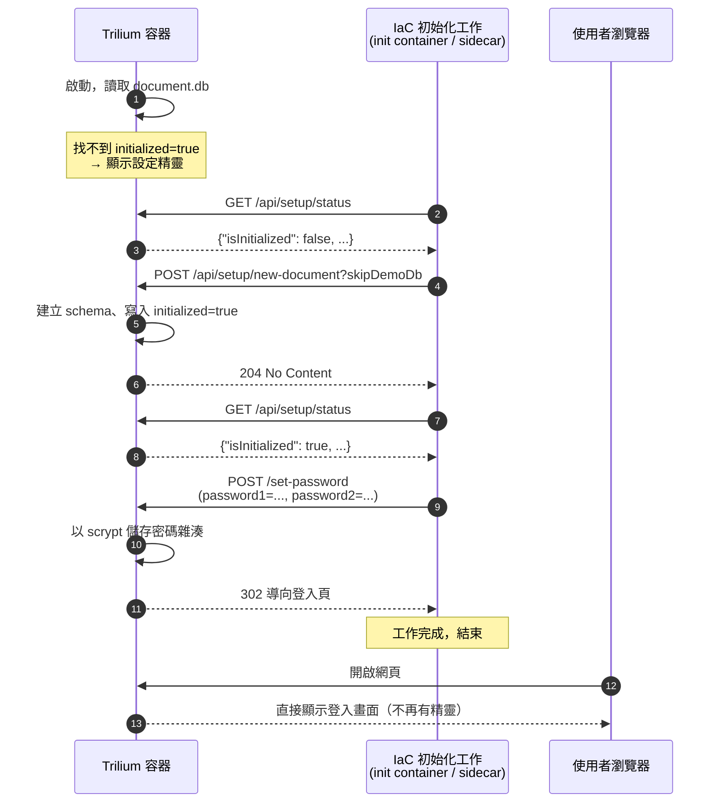

# Trilium 於 Docker 中的無人值守初始化：能否跳過 Web 設定精靈以支援 IaC？

## 摘要

**結論：Trilium 沒有提供任何「環境變數」或「設定檔」選項可以直接跳過設定精靈或預先指定密碼。** 官方設定參考中不存在此類選項[^cfg-doc][^cfg-sample]。不過，設定精靈在瀏覽器裡做的事情，全部都由一組未加 CSRF 保護的 HTTP 端點完成，因此可以用非互動方式（init container、sidecar、`docker exec` 或 CI 步驟）重現：

1. `POST /api/setup/new-document` — 建立資料庫（可帶 `?skipDemoDb` 跳過範例內容）
2. `POST /set-password` — 設定初始密碼（`application/x-www-form-urlencoded`，欄位 `password1`／`password2`）

這正是 Trilium 專案自身 E2E 測試程式所用的流程[^e2e]，也是第三方工具實際採用的做法[^serverbox][^droid]。此外，若把 `noAuthentication=true` 打開，第二步（設定密碼）整個不需要，只剩下建立資料庫這一個呼叫[^auth-doc][^bootstrap-src]。

換言之：**「不能靠設定檔跳過」但「可以用兩個 HTTP 呼叫完成」，所以 IaC 是可行的**，代價是你依賴的是標記為內部（internal）的 setup API，而非對外承諾的 ETAPI。

---

## 1. 研究對象與現況

| 專案 | 網址 | 星數 | 狀態 |
| --- | --- | --- | --- |
| TriliumNext/Trilium（現行社群版） | https://github.com/TriliumNext/Trilium | 38,932 | 活躍，未封存（AGPL-3.0）[^repo] |
| zadam/trilium（原作者版） | https://github.com/zadam/trilium | — | 已移轉，GitHub API 查詢會重導向至 TriliumNext/Trilium[^zadam-api] |

原始作者的 `zadam/trilium` 已移交社群，API 端點 `https://api.github.com/repos/zadam/trilium` 回傳的 `full_name` 是 `TriliumNext/Trilium`，`id` 亦相同（92111509）[^zadam-api]，因此本報告以 **TriliumNext/Trilium** 為準。官方 Docker 映像為 `triliumnext/trilium`，預設資料目錄在容器內是 `/home/node/trilium-data`[^docker-doc][^compose-official]。

> 注意：由於兩者共用同一個 repo id，無法在本次研究中取得獨立的 `zadam/trilium` 統計數字；凡本報告引用之技術細節，皆以現行 TriliumNext 版為驗證對象。

---

## 2. 為什麼設定精靈會擋住 IaC

Trilium 的「是否已初始化」由資料庫中的 `options` 表決定：`SELECT value FROM options WHERE name = 'initialized'` 必須為 `"true"`[^sql-init]。在首次啟動時該值不存在，伺服器便回報未初始化，並讓瀏覽器顯示設定精靈；相關判斷散落在 `bootstrap` 回應的 `dbInitialized`／`passwordSet`／`loggedIn` 三個旗標[^bootstrap-src]。

設定精靈的完整狀態機包含 `selectLanguage`、`firstOptions`、`createNewDocumentOptions`、`createNewDocumentEmpty` 等階段[^setup-tsx]，而每一步都只是打 HTTP 端點；瀏覽器本身不持有任何必要的秘密。這代表「需要人類」其實是**UI 上的限制，而不是安全機制上的限制**。



---

## 3. 官方是否提供「跳過精靈」的設定？

### 3.1 環境變數：沒有可預設密碼或跳過精靈的選項

官方設定文件列出「完整」的環境變數清單，格式為 `TRILIUM_[SECTION]_[KEY]`，其中 `General`、`Network`、`Session`、`Sync`、`MultiFactorAuthentication`、`Logging`、`Development` 各節皆無「初始密碼」或「跳過設定」的項目[^cfg-doc]。`config-sample.ini` 同樣只有 `instanceName`、`noAuthentication`、`noBackup`、`noDesktopIcon`、`readOnly` 等一般選項[^cfg-sample]。

配置優先序為：**環境變數 > `config.ini` > 預設值**[^cfg-doc]。另外，`config.ini` 位於資料目錄內，且官方明確指出它「只有在啟動應用並建立資料庫之後才會出現」[^cfg-doc]，這對 IaC 是個陷阱：想靠掛載 `config.ini` 來達成首次設定，時序上並不可靠，應改用環境變數。

### 3.2 唯一相關的選項：`noAuthentication`

`noAuthentication=true`（或 `TRILIUM_GENERAL_NOAUTHENTICATION=true`）會關閉 Trilium 的認證[^auth-doc]。原始碼顯示其效果比字面上更廣：在 `bootstrap` 中，設定密碼與登入頁的分支都帶有 `!noAuthentication` 條件，因此開啟此選項時**「設定初始密碼」這一步會被完全略過**[^bootstrap-src]。在 v0.94.1 之後，它也會連帶繞過 TOTP 多因素認證[^auth-doc]。

這個選項適合「前面已有反向代理做認證、Trilium 只在本機或內網監聽」的情境（官方文件即如此建議）[^auth-doc]，但它**不能**跳過建立資料庫的步驟，且會讓任何能連上該埠的人取得完整存取權，屬於高風險設定。

### 3.3 透過同步（Sync）建立：另一條路

`POST /api/setup/sync-from-server` 可以讓新實例直接從既有的同步伺服器拉下整個知識庫，然後才建立本機資料庫[^setup-api][^routes-core]。若你已經有一個「種子」實例，這條路可以避免每次部署都產生空白資料庫；但它同樣需要呼叫端提供同步伺服器密碼與（若有 TOTP）一次性密碼[^setup-api]，並沒有比較自動。

---

## 4. 實務可行的自動化流程

### 4.1 兩個呼叫的最小版本

```sh
# 1) 建立資料庫（不加 ?skipDemoDb 則會匯入範例筆記）
curl -fsS -X POST "http://trilium:8080/api/setup/new-document?skipDemoDb" \
     -H 'Content-Type: application/json' \
     -d '{"locale":"zh_TW"}'

# 2) 設定初始密碼（表單格式，非 JSON）
curl -fsS -X POST "http://trilium:8080/set-password" \
     --data-urlencode "password1=${TRILIUM_PASSWORD}" \
     --data-urlencode "password2=${TRILIUM_PASSWORD}"
```

上述兩個端點都**沒有**套用 CSRF 中介層[^routes-core]，這也是為什麼純 `curl`／`fetch` 就能成功。`new-document` 近年新增了 `checkSetupAuth` 中介層，但它只在「精靈背後真的躺著一個既有知識庫」時才會要求密碼（`hasExistingData() && isPasswordSet()`）[^setup-auth][^setup-api][^routes-core]；全新實例不受影響。

### 4.2 就緒判斷：`GET /api/setup/status`

這個端點不需要認證，回傳 `isInitialized`、`schemaExists`、`authRequired`、`secondFactorRequired`、`hasExistingData` 等欄位[^setup-api]。它同時適合當成容器的 health check／readiness probe，以及初始化工作等待資料庫就緒的輪詢目標。官方 Docker Compose 的第三方範例即用它作為 healthcheck 指令[^serverbox]。

### 4.3 真實世界的範例：`seed-mcp` 一次性工作

`lollipopkit/flutter_server_box` 的 Trilium 應用範本提供了一個可直接參考的 IaC 實作[^serverbox]：

- 主服務 `trilium` 設定 healthcheck（輪詢 `/api/setup/status`）。
- 一次性服務 `seed-mcp` 以 `depends_on: condition: service_healthy` 等待主服務健康後才啟動。
- 該工作用 Node 的 `fetch` 依序呼叫 `/api/setup/status`、`/api/setup/new-document`、`/set-password`，再以 `/login` 取得 session cookie、以 `/api/options/mcpEnabled/true` 開啟功能，最後用 `/etapi/auth/login` 產生 ETAPI token 寫入共用目錄。
- 它以 `restart: "no"` 明確表示這是「跑完即結束」的工作。

這段程式同時展示了兩個重要技巧：**以 healthcheck 作為啟動順序屏障**，以及**非互動取得 ETAPI token**（因為 token 無法由環境變數預先注入，見第 5 節）。

### 4.4 另一種做法：把 `document.db` 直接「烤」進映像或資料卷

`FliegendeWurst/TriliumDroid` 的 Nix 建置流程展示了另一條路[^droid]：它先啟動 `trilium-server`、呼叫 `/api/setup/new-document` 與 `/set-password`、關閉伺服器，再把產生的 `document.db` 打包成建置產物。這實際上是「預先產生一份已初始化的資料庫」，部署時直接掛載即可，連初始化工作都不需要。

代價是密碼與資料庫金鑰被固定在建置產物中，且日後變更密碼需走應用內流程；適合一次性、內部環境，不適合多環境差異化的正式部署。

### 4.5 若只要「不設密碼」

設定 `TRILIUM_GENERAL_NOAUTHENTICATION=true` 後，初始化只剩 `POST /api/setup/new-document` 一個呼叫[^bootstrap-src][^auth-doc]。這是本研究中**最接近「純宣告式」的做法**，但安全性由前置的認證代理承擔。

---

## 5. 常見誤解與注意事項

### 5.1 `TRILIUM_ETAPI_TOKEN` 不是伺服器設定

此環境變數只出現在 Trilium repo 的 `.mcp.json` 與 MCP 相關文件中，是**用戶端**（Claude Code 等）用來帶入 ETAPI token 的變數[^mcp-json][^claude-md]，它不在官方環境變數清單裡[^cfg-doc]，伺服器不會讀取它、更不會用它建立 token。要取得 ETAPI token 必須先有密碼，再以 `POST /etapi/auth/login` 換取（或於 Options → ETAPI 手動產生）[^etapi-doc]。

### 5.2 「需要人類」的來源是 `initialized` 這個選項

只要 `options` 表裡的 `initialized` 不是 `"true"`，實例就自認未初始化，並讓所有「未初始化才允許」的守衛生效[^sql-init]。這解釋了為何不能靠刪除或欺騙檔案狀態來跳過——必須真的建立資料庫。

### 5.3 這些端點是「內部 API」，不是 ETAPI

`/api/setup/*` 與 `/set-password` 屬於標記為 internal 的路由群（`apps/server/internal.openapi.yaml`）[^openapi]，與對外承諾向後相容的 ETAPI 不同。實際上，專案自己的 E2E 測試就直接呼叫它們[^e2e]，因此短期內變動風險不高，但**版本升級時仍應以 smoke test 驗證**，並在 CI 中固定映像版本（官方文件也建議避免使用 `latest` 標籤）[^docker-doc]。

### 5.4 相關的近期演進

PR #12423（多使用者支援）引入了「由管理員產生一次性 setup link、使用者自行設定密碼」的流程[^pr-12423]。這代表上游對「初始密碼」的設計正在改變，未來若採多使用者模式，自動化腳本可能需要配合調整；本次研究時該功能已合併於 v0.107 週期[^pr-12423]。

### 5.5 Docker 執行細節

官方映像預設以 root 啟動、把資料目錄交給 `node`（UID/GID 1000，可用 `USER_UID`／`USER_GID` 覆寫）後降權執行[^start-docker][^docker-doc]。自 v0.107.0 起也可用 `--user`／`securityContext.runAsNonRoot` 完全以非 root 執行，但此時必須先確保主機上的資料目錄已屬於該使用者，且 `USER_UID`／`USER_GID` 會被忽略[^k8s-doc][^docker-doc]。這對 IaC（例如 Kubernetes 的 `fsGroup`、唯讀根檔案系統）是必要的設定細節。

---

## 6. 建議的 IaC 方案

以風險由低到高排序：

| 方案 | 需要人類互動 | 依賴內部 API | 適用情境 |
| --- | --- | --- | --- |
| init container 呼叫兩個端點（4.1） | 否 | 是 | 一般自架、保留密碼認證 |
| 搭配 `noAuthentication=true`（4.5） | 否 | 是（僅一個） | 前端已有認證代理 |
| 預先烤製 `document.db`（4.4） | 否（離線一次） | 是（僅建置期） | 固定內容、單一環境 |
| 由既有實例同步（3.3） | 否 | 是 | 多實例叢集 |
| 手動開網頁設定精靈 | 是 | 否 | 一次性、非自動化 |

實務上最常見、也最可控的是第一種：讓 Trilium 主容器照常啟動，另以一個 `restart: "no"` 的一次性容器（或 `docker compose run` 步驟）等待 `/api/setup/status` 回報健康後，依序送出 `new-document` 與 `set-password`，並讓它具備**冪等性**——先檢查 `isInitialized`，已初始化就跳過，密碼已設定時 `/set-password` 會回 400 而非 500，可據此判定為「已完成」[^serverbox]。

---

## 7. 尚待驗證與限制

- 本報告未能在獨立環境實際執行 Docker 容器驗證上述流程；所有結論來自官方文件、上游原始碼與第三方專案的公開設定檔。原始碼層級的證據（端點註冊、中介層、`initialized` 判斷）應足以推定行為，但仍建議以一次實測作為最終確認。
- `zadam/trilium` 最後一版（社群所述的 v0.63.7）是否同樣支援此兩端點流程，本次未取得獨立證據；GitHub API 對該路徑的回應被重導向至 TriliumNext/Trilium[^zadam-api]。
- Trilium 迭代頻繁（v0.107.0 為近期版本，v0.108.0 里程碑進行中）[^pr-12589]，`/api/setup/*` 屬內部 API，未來可能變動。

---

## 參考文獻

[^repo]: TriliumNext. (n.d.). *TriliumNext/Trilium: Build your personal knowledge base with Trilium Notes* [Source code]. GitHub. Retrieved 2026-11-14, from https://github.com/TriliumNext/Trilium

[^zadam-api]: GitHub. (n.d.). *Repositories — zadam/trilium* [REST API response]. Retrieved 2026-11-14, from https://api.github.com/repos/zadam/trilium

[^cfg-doc]: TriliumNext. (n.d.). *Configuration (config.ini or environment variables)*. In User Guide. Retrieved 2026-11-14, from https://github.com/TriliumNext/Trilium/blob/main/docs/User%20Guide/User%20Guide/Advanced%20Usage/Configuration%20(config.ini%20or%20environment%20variables).md

[^cfg-sample]: TriliumNext. (n.d.). *config-sample.ini* [Source code]. Retrieved 2026-11-14, from https://github.com/TriliumNext/Trilium/blob/main/apps/server/src/assets/config-sample.ini

[^auth-doc]: TriliumNext. (n.d.). *Authentication*. In User Guide, Server Installation. Retrieved 2026-11-14, from https://github.com/TriliumNext/Trilium/blob/main/docs/User%20Guide/User%20Guide/Installation%20&%20Setup/Server%20Installation/Authentication.md

[^docker-doc]: TriliumNext. (n.d.). *Using Docker*. In User Guide, Server Installation. Retrieved 2026-11-14, from https://github.com/TriliumNext/Trilium/blob/main/docs/User%20Guide/User%20Guide/Installation%20&%20Setup/Server%20Installation/1.%20Installing%20the%20server/Using%20Docker.md

[^k8s-doc]: TriliumNext. (n.d.). *Using Kubernetes*. In User Guide, Server Installation. Retrieved 2026-11-14, from https://github.com/TriliumNext/Trilium/blob/main/docs/User%20Guide/User%20Guide/Installation%20&%20Setup/Server%20Installation/1.%20Installing%20the%20server/Using%20Kubernetes.md

[^datadir-doc]: TriliumNext. (n.d.). *Data directory*. In User Guide, Installation & Setup. Retrieved 2026-11-14, from https://github.com/TriliumNext/Trilium/blob/main/docs/User%20Guide/User%20Guide/Installation%20&%20Setup/Data%20directory.md

[^compose-official]: TriliumNext. (n.d.). *docker-compose.yml* [Source code]. Retrieved 2026-11-14, from https://github.com/TriliumNext/Trilium/blob/master/docker-compose.yml

[^start-docker]: TriliumNext. (n.d.). *start-docker.sh* [Source code]. Retrieved 2026-11-14, from https://github.com/TriliumNext/Trilium/blob/main/apps/server/start-docker.sh

[^sql-init]: TriliumNext. (n.d.). *sql_init.ts* [Source code]. Retrieved 2026-11-14, from https://github.com/TriliumNext/Trilium/blob/main/packages/trilium-core/src/services/sql_init.ts

[^bootstrap-src]: TriliumNext. (n.d.). *apps/server/src/routes/index.ts* [Source code]. Retrieved 2026-11-14, from https://github.com/TriliumNext/Trilium/blob/main/apps/server/src/routes/index.ts

[^routes-core]: TriliumNext. (n.d.). *packages/trilium-core/src/routes/index.ts* [Source code]. Retrieved 2026-11-14, from https://github.com/TriliumNext/Trilium/blob/main/packages/trilium-core/src/routes/index.ts

[^routes-server]: TriliumNext. (n.d.). *apps/server/src/routes/routes.ts* [Source code]. Retrieved 2026-11-14, from https://github.com/TriliumNext/Trilium/blob/main/apps/server/src/routes/routes.ts

[^setup-api]: TriliumNext. (n.d.). *packages/trilium-core/src/routes/api/setup.ts* [Source code]. Retrieved 2026-11-14, from https://github.com/TriliumNext/Trilium/blob/main/packages/trilium-core/src/routes/api/setup.ts

[^setup-auth]: TriliumNext. (n.d.). *setup_auth.ts* [Source code]. Retrieved 2026-11-14, from https://github.com/TriliumNext/Trilium/blob/main/packages/trilium-core/src/services/setup_auth.ts

[^setup-mode]: TriliumNext. (n.d.). *setup_mode.ts* [Source code]. Retrieved 2026-11-14, from https://github.com/TriliumNext/Trilium/blob/main/packages/trilium-core/src/services/setup_mode.ts

[^setup-tsx]: TriliumNext. (n.d.). *apps/client/src/setup.tsx* [Source code]. Retrieved 2026-11-14, from https://github.com/TriliumNext/Trilium/blob/main/apps/client/src/setup.tsx

[^login-src]: TriliumNext. (n.d.). *apps/server/src/routes/login.ts* [Source code]. Retrieved 2026-11-14, from https://github.com/TriliumNext/Trilium/blob/main/apps/server/src/routes/login.ts

[^e2e]: TriliumNext. (n.d.). *apps/server/e2e/sync/sync-instance.ts* [Source code]. Retrieved 2026-11-14, from https://github.com/TriliumNext/Trilium/blob/main/apps/server/e2e/sync/sync-instance.ts

[^openapi]: TriliumNext. (n.d.). *apps/server/internal.openapi.yaml* [Source code]. Retrieved 2026-11-14, from https://github.com/TriliumNext/Trilium/blob/main/apps/server/internal.openapi.yaml

[^etapi-doc]: TriliumNext. (n.d.). *ETAPI (REST API)*. In User Guide, Advanced Usage. Retrieved 2026-11-14, from https://github.com/TriliumNext/Trilium/blob/main/docs/User%20Guide/User%20Guide/Advanced%20Usage/ETAPI%20(REST%20API).md

[^mcp-json]: TriliumNext. (n.d.). *.mcp.json* [Source code]. Retrieved 2026-11-14, from https://github.com/TriliumNext/Trilium/blob/main/.mcp.json

[^claude-md]: TriliumNext. (n.d.). *CLAUDE.md — MCP Server* [Source code]. Retrieved 2026-11-14, from https://github.com/TriliumNext/Trilium/blob/main/CLAUDE.md

[^serverbox]: lollipopkit. (n.d.). *store/apps/triliumnext.trilium/compose.yaml* [Source code]. In flutter_server_box. GitHub. Retrieved 2026-11-14, from https://github.com/lollipopkit/flutter_server_box/blob/main/store/apps/triliumnext.trilium/compose.yaml

[^droid]: FliegendeWurst. (n.d.). *flake.nix* [Source code]. In TriliumDroid. GitHub. Retrieved 2026-11-14, from https://github.com/FliegendeWurst/TriliumDroid/blob/master/flake.nix

[^pr-12423]: eliandoran. (2026, November 1). *feat(users): manage users, setup links and username sign-in* (Pull request 12423). GitHub. Retrieved 2026-11-14, from https://github.com/TriliumNext/Trilium/pull/12423

[^pr-12589]: renovate[bot]. (2026, November 12). *chore(deps): update playwright monorepo to v1.65.0* (Pull request 12589). GitHub. Retrieved 2026-11-14, from https://github.com/TriliumNext/Trilium/pull/12589
