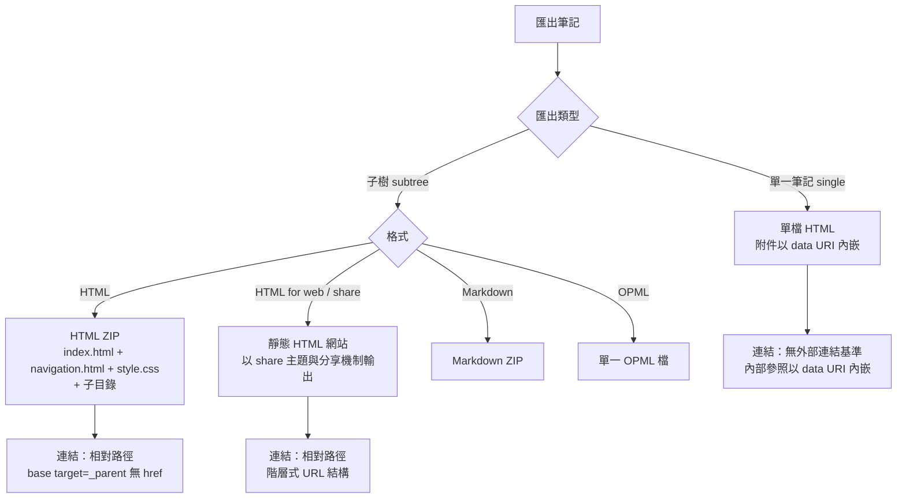
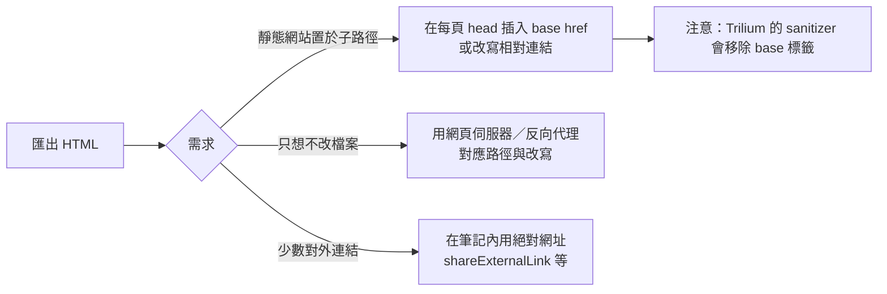

# Trilium Notes 的 HTML 匯出能否更改 base URL？

## 摘要

**結論：不行。** Trilium Notes（TriliumNext 版本）的 HTML 匯出功能，不論是「一般 HTML ZIP 匯出」、「靜態 HTML（可發佈網站）」或「單檔 HTML 匯出」，都沒有提供任何使用者可及的設定（UI 選項、`config.ini` 設定、環境變數或筆記標籤）來更改匯出結果中的 base URL 或連結基準位址[^export-dialog][^config-ini]。

匯出檔中的連結一律由程式內部以**相對路徑**計算產生[^zip-ts]；頁面 `<head>` 中唯一的 `<base>` 元素只帶 `target="_parent"`，不含 `href`，用途是讓外部連結在框架中開啟，而不是設定基準位址[^html-ts]。

若確實需要在自架網站的子路徑（例如 `https://example.com/notes/`）下運作，只能**事後修改**匯出檔案，或改用其他部署層手法（見本文最後一節）。

---

## 背景：Trilium Notes 與版本狀態

Trilium Notes 是一套個人知識庫筆記軟體，支援自架伺服器、桌面版與同步功能[^repo]。本文所稱的 Trilium 指 `TriliumNext/Trilium` 這個活躍分支（原專案 `zadam/trilium` 已移交社群維護），截至 2026-11-14 約有 38,931 顆星、授權為 AGPL-3.0[^repo]。

因此下文討論的程式碼與文件，皆以 `TriliumNext/Trilium` 的 `main` 分支為準。

---

## HTML 匯出的三種形式

Trilium 的 HTML 相關匯出實際上分成三種，彼此的連結產生方式不同，但**都無法設定 base URL**。



### 1. 一般 HTML ZIP 匯出

匯出對話框中選擇「HTML」格式時，產出一個 ZIP，內含 `index.html`、`navigation.html`、`style.css` 以及各筆記的 HTML 檔案[^html-ts]。官方文件描述此格式為「不包含任何樣式或額外功能」的原始 HTML[^static-html-doc]。

每個文字筆記的頁面會被加上固定的 HTML 模板，其中包含：

```html
<base target="_parent">
```

程式碼註解明確說明其用途：「`<base>` 元素會確保外部連結可以被開啟」，並連到 GitHub issue #1289 的討論[^html-ts]。該 `<base>` **沒有 `href` 屬性**，因此不會改變相對連結的解析基準[^html-ts]。

### 2. 靜態 HTML 網站（文件中所稱的 share 格式）

這是「與 Sharing 功能相同版面」的靜態輸出，官方文件稱之為 static HTML，建議用於 GitHub Pages、Cloudflare Pages 等靜態託管[^static-html-doc]。文件說明其 URL 結構是階層式的，例如 `docs.triliumnotes.org/user-guide/concepts/navigation/tree-concepts`[^static-html-doc]。

這正是本文問題最可能的情境：使用者想把匯出的網站放在某個網域的子路徑下，因而想調整 base URL。但文件僅列出結構差異，並未提供任何 base URL 選項[^static-html-doc]。

### 3. 單檔 HTML 匯出

單一筆記匯出成 HTML 時，程式會把圖片與附件以 base64 `data:` URI **內嵌**進檔案本身，使該檔自給自足[^single-ts]。內部筆記連結在此模式下無法指向其他筆記（因為只有一個檔案），因此也無所謂 base URL 設定[^single-ts]。

---

## 匯出對話框實際提供的選項（沒有 base URL）

從前端原始碼可看到，匯出對話框（`apps/client/src/widgets/dialogs/export.tsx`）只有兩組選擇：

- **要匯出什麼**：子樹（此筆記與所有子筆記）或僅單一筆記[^export-dialog]。
- **格式**：HTML、Markdown；子樹匯出額外提供「HTML for web（share）」與 OPML[^export-dialog]。

對話框最後只顯示一段說明文字（例如「一個 ZIP 壓縮檔，文字筆記以 HTML 儲存……」），沒有任何關於 URL、主機名稱或連結基準的欄位[^export-dialog]。實際匯出時，前端僅組出下載網址：

```
api/branches/{branchId}/export/{type}/{format}/{taskId}
```

其中沒有可傳入 base URL 的參數[^export-dialog]。

---

## 為何無法更改：逐層檢查

### 設定檔與環境變數

伺服器設定範例 `config-sample.ini` 的分區為 `[General]`、`[Network]`、`[Session]`、`[Sync]`、`[MultiFactorAuthentication]`、`[Security]` 等，**沒有任何與匯出 base URL 相關的鍵**[^config-ini]。

相對地，OAuth 相關的 `oauthBaseUrl`、`oauthIssuerBaseUrl` 確實存在於設定中，但那是身分驗證端點，與 HTML 匯出無關[^config-ini]。這說明「base URL」一詞在 Trilium 設定裡僅出現於認證情境，而非匯出情境。

### 筆記標籤（attributes）

Sharing 功能的屬性參考表中，最接近 base URL 概念的是 `#shareOpenGraphURL`，但文件明確說明它的作用僅限於：

> 「調整 `og:url` 與 `twitter:url` 中繼屬性。它同時也是相對 `og:image` 網址的補全基準……」[^sharing-doc]

也就是說，它影響的是社群預覽用的 meta 標籤與 OpenGraph 圖片絕對化，**不會改寫頁面內實際的連結**[^sharing-doc][^page-ts]。其餘如 `#shareAlias`（可讀網址別名）、`#shareRoot`、`#shareExternalLink`（單筆記對外導向）皆不涉及全域 base URL[^sharing-doc]。

### 程式內部的連結產生邏輯

匯出時的連結由 `getNoteTargetUrl()` 產生：它比對來源與目標筆記的路徑，以 `"../".repeat(...)` 逐層回推，再串接目標檔名或目錄名，全程只產生相對路徑[^zip-ts]。整個函式的輸入只有筆記 ID 與 meta，不存在注入 base URL 的參數[^zip-ts]。

### 匯出 API 的參數

匯出服務對外介面為：

```
exportToZipFile(noteId, format, zipFilePath, zipExportOptions?)
```

以及 HTTP 路由 `api/branches/:branchId/export/:type/:format/:taskId`[^zip-ts][^export-route]。`zipExportOptions` 的型別為 `AdvancedExportOptions`[^adv-options]，其欄位為：

| 欄位 | 作用 |
| --- | --- |
| `skipHtmlTemplate` | 只保留筆記內容，不套用 `<html>` 模板 |
| `skipExtraFiles` | 不產生 `navigation.html`、`index.html`、`style.css` |
| `excludeProtected` | 受保護筆記以 `[protected]` 匯出 |
| `customRewriteLinks` | **程式化**自訂連結改寫函式 |

其中唯一能改變連結輸出的只有 `customRewriteLinks`，它是給程式呼叫者（例如官方文件建置流程、ETAPI 呼叫端）傳入的自訂函式，**不是** UI、設定檔或環境變數可及的選項[^adv-options][^zip-ts]。一般使用者無法透過介面使用它。

### 唯一的 baseUrl 例外：官方文件建置流程

在整個 TriliumNext 程式庫中搜尋 `baseUrl`，出現在 `apps/edit-docs/` 與 `apps/build-docs/` 之中，例如 `edit-docs-config.yaml` 裡的：

```yaml
baseUrl: "https://docs.triliumnotes.org"
```

這個設定是 TriliumNext 團隊用來建置自家文件網站（docs.triliumnotes.org）的**內部工具設定**[^edit-config]。它被用於產生說明系統的 `docUrl` 標籤，以及把文件內 web view 的根相對網址絕對化[^help-meta]。它不隨發行版提供給終端使用者，也不是筆記匯出功能的一部分[^build-docs]。

換言之，「Trilium 有 baseUrl 概念」這個印象可能來自此處，但它屬於開發流程，而非使用者功能。

---

## 若真的需要特定 base URL，可行的變通做法

以下皆為**事後加工或部署層**手段，不是 Trilium 內建設定。



1. **在 `head` 插入 `<base href="...">`**。這是最直觀的做法：對所有 HTML 檔插入一行 `<base href="https://example.com/notes/">`，即可讓相對連結改以該位址解析。務必注意：Trilium 用戶端的 HTML 清理器（sanitizer）把 `base` 列在禁止標籤中[^sanitizer]，因此**不能**在筆記內容裡寫 `<base>` 就指望它生效；必須在匯出後的檔案上處理。

2. **批次改寫相對連結**。以腳本對匯出檔案做字串替換或使用 HTML 解析器改寫 `href`／`src`，適用於檔名結構已知的情況。

3. **由網頁伺服器或反向代理處理**。例如讓靜態網站直接掛在網域根目錄，或以代理改寫路徑，不改動檔案。官方文件本身即採此類靜態託管（Cloudflare Pages）[^static-html-doc]。

4. **針對個別對外連結改用絕對網址**。在 Sharing 情境可用 `#shareExternalLink` 讓指向某筆記的連結導向外部網址（值必須是含 scheme 的絕對網址）[^sharing-doc]；但這只影響指向該筆記的連結，不是全域 base URL[^sharing-doc]。

5. **自訂 share template／注入 HTML**。Sharing 支援 `~shareHtml` 搭配 `#shareHtmlLocation` 將 HTML 片段注入 `head`／`body`／`content`[^sharing-doc]。這在**線上 Sharing**情境可用，但對「匯出靜態檔」的 base URL 需求幫助有限，且同樣受限於清理與模板機制。

---

## 來源評析與限制

- **一手程式碼 vs 官方文件**：本報告的核心結論（無 base URL 設定）同時由「官方文件未列此選項」與「原始碼中不存在此參數」兩方面佐證，兩者一致[^export-dialog][^zip-ts][^static-html-doc]。
- **時效性**：Trilium 開發活躍（`main` 分支持續更新），本文資訊截至 2026-11-14。若日後新增相關設定，需重新查核。
- **未找到有無相關 issue 的明確請求**：在 `TriliumNext/Trilium` 的 issue 搜尋中，未發現明確要求「HTML 匯出可設定 base URL」的項目；相關討論多集中在分享、靜態匯出與路徑長度等主題[^issue-558]。因此本報告不做「社群有此需求」的推論。

## 參考文獻

[^export-dialog]: TriliumNext. (n.d.). export.tsx [Source code]. GitHub. Retrieved 2026-11-14, from https://github.com/TriliumNext/Trilium/blob/main/apps/client/src/widgets/dialogs/export.tsx
[^config-ini]: TriliumNext. (n.d.). config-sample.ini [Source code]. GitHub. Retrieved 2026-11-14, from https://github.com/TriliumNext/Trilium/blob/main/apps/server/src/assets/config-sample.ini
[^zip-ts]: TriliumNext. (n.d.). zip.ts [Source code]. GitHub. Retrieved 2026-11-14, from https://github.com/TriliumNext/Trilium/blob/main/packages/trilium-core/src/services/export/zip.ts
[^html-ts]: TriliumNext. (n.d.). html.ts [Source code]. GitHub. Retrieved 2026-11-14, from https://github.com/TriliumNext/Trilium/blob/main/packages/trilium-core/src/services/export/zip/html.ts
[^single-ts]: TriliumNext. (n.d.). single.ts [Source code]. GitHub. Retrieved 2026-11-14, from https://github.com/TriliumNext/Trilium/blob/main/packages/trilium-core/src/services/export/single.ts
[^adv-options]: TriliumNext. (n.d.). abstract_provider.ts [Source code]. GitHub. Retrieved 2026-11-14, from https://github.com/TriliumNext/Trilium/blob/main/packages/trilium-core/src/services/export/zip/abstract_provider.ts
[^export-route]: TriliumNext. (n.d.). export.ts [Source code, API route]. GitHub. Retrieved 2026-11-14, from https://github.com/TriliumNext/Trilium/blob/main/packages/trilium-core/src/routes/api/export.ts
[^static-html-doc]: TriliumNext. (n.d.). Exporting static HTML for web publishing. User Guide. Retrieved 2026-11-14, from https://docs.triliumnotes.org/user-guide/advanced-usage/sharing/static-html
[^sharing-doc]: TriliumNext. (n.d.). Sharing. User Guide. Retrieved 2026-11-14, from https://docs.triliumnotes.org/user-guide/advanced-usage/sharing
[^page-ts]: TriliumNext. (n.d.). page.ts [Source code, share-theme page model]. GitHub. Retrieved 2026-11-14, from https://github.com/TriliumNext/Trilium/blob/main/packages/share-theme/src/model/page.ts
[^sanitizer]: TriliumNext. (n.d.). sanitize_content.ts [Source code]. GitHub. Retrieved 2026-11-14, from https://github.com/TriliumNext/Trilium/blob/main/apps/client/src/services/sanitize_content.ts
[^edit-config]: TriliumNext. (n.d.). edit-docs-config.yaml [Configuration file]. GitHub. Retrieved 2026-11-14, from https://github.com/TriliumNext/Trilium/blob/main/edit-docs-config.yaml
[^help-meta]: TriliumNext. (n.d.). help_meta_generator.ts [Source code]. GitHub. Retrieved 2026-11-14, from https://github.com/TriliumNext/Trilium/blob/main/apps/edit-docs/src/help_meta_generator.ts
[^build-docs]: TriliumNext. (n.d.). build-docs.ts [Source code]. GitHub. Retrieved 2026-11-14, from https://github.com/TriliumNext/Trilium/blob/main/apps/build-docs/src/build-docs.ts
[^repo]: TriliumNext. (n.d.). Trilium [Source repository]. GitHub. Retrieved 2026-11-14, from https://github.com/TriliumNext/Trilium
[^issue-558]: CrashLaker. (2019, June 4). Easy way to export trilium to static website (Issue #558) [Issue]. GitHub. Retrieved 2026-11-14, from https://github.com/TriliumNext/Trilium/issues/558
