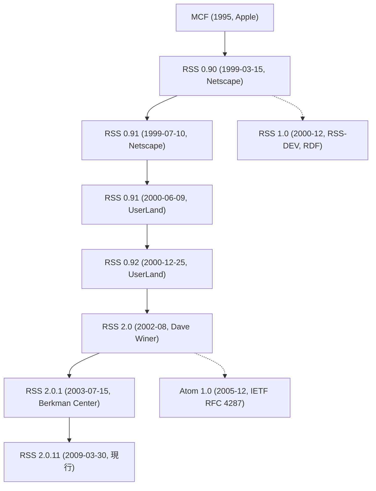
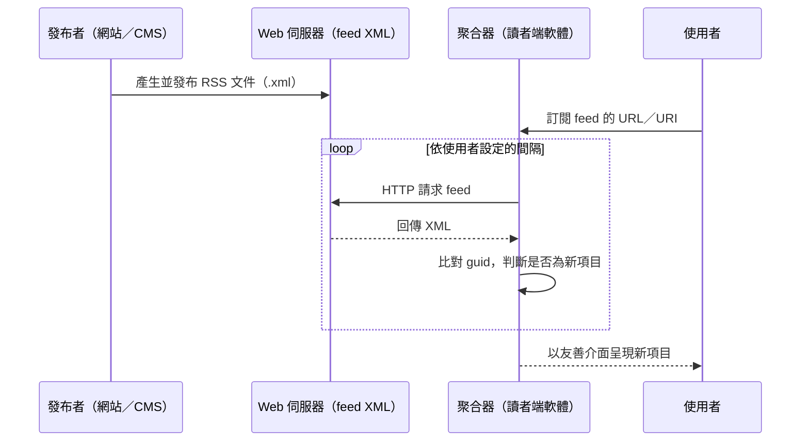

# Really Simple Syndication (RSS) 介紹

## 摘要

RSS 是一系列網頁摘要（web feed）格式的統稱，用來讓使用者與程式以標準化、電腦可讀的方式取得網站的更新內容[^rss-wiki]。訂閱者可透過「新聞聚合器」（news aggregator，也稱 RSS 閱讀器）同時追蹤多個網站，由軟體定期檢查是否有新內容，免除逐一手動造訪網站的需要[^rss-wiki]。雖然 RSS 的名稱自 1999 年以來數度變更定義，且與 Atom 等後起格式競爭，但它仍是部落格、新聞頭條、播客（podcast）等內容發布的基礎格式之一[^rss-wiki][^britannica]。

---

## 1. 名稱與定義

「RSS」這個縮寫在不同版本中有三種展開方式，但都指向同一種「聯合供稿」（syndication）技術[^rss-wiki][^cjk-rss]：

- **RDF Site Summary**：RSS 0.90 與 RSS 1.0 使用此名稱[^rss-wiki]。
- **Rich Site Summary**：RSS 0.91 由 Netscape 的 Dan Libby 重新命名為此[^rss-wiki]。
- **Really Simple Syndication**：RSS 2.0 由 Dave Winer 於 2002 年發布時採用此名稱，也是目前最廣為人知的解釋[^rss-wiki][^rss-spec]。

在中文世界，RSS 常譯為「簡易資訊聚合」或「聚合內容」[^cjk-rss]。其核心目的是：將多個網站的更新整合為摘要，並自動通知訂閱者，讓讀者能快速掌握重要資訊、再選擇性點擊閱讀全文[^cjk-rss]。

一份 RSS 文件（稱為 feed、web feed 或 channel）包含全文或摘要文字，以及發布日期、作者姓名等中介資料（metadata），並以純 XML 檔案描述[^rss-wiki]。

---

## 2. 歷史與版本演進

### 2.1 前身

網頁聯合供稿的構想在 RSS 出現前已有數次嘗試，但都未達成廣泛普及。將網站資訊結構化的基本想法最早可追溯至 1995 年，由 Ramanathan V. Guha 及其在 Apple 先進技術小組（Advanced Technology Group）的同事所開發的 Meta Content Framework（MCF）[^rss-wiki]。更早的相關格式還包括 Channel Definition Format（1997）等[^rss-history]。

### 2.2 RSS 的誕生（Netscape 時期）

- **RSS 0.90**：由 Netscape 的 Dan Libby、Ramanathan V. Guha 與 Eckart Walther 建立，1999 年 3 月 15 日發布，供 My.Netscape.Com 入口網站使用，最初稱為 *RDF Site Summary*[^rss-wiki][^rss-history]。
- **RSS 0.91（Netscape 版）**：1999 年 7 月 10 日由 Dan Libby 發布，移除了 RDF 元素並納入 Dave Winer 的新聞供稿格式元素，並將名稱改為 *Rich Site Summary*[^rss-wiki][^rss-history]。

Netscape 在 2001 年 4 月、被 AOL 收購重整期間，將 RSS 支援從 My.Netscape.Com 移除，並撤下相關文件與工具，這成為 Netscape 在 RSS 發展上長達八年的最後一次參與[^rss-wiki]。

### 2.3 分裂與多方角力

Netscape 退出後，兩個互不隸屬的陣營填補了空缺[^rss-wiki]：

- **RSS-DEV Working Group**：成員包含 Aaron Swartz、Guha 及 O'Reilly Media、Moreover 的代表，於 2000 年 12 月發布 **RSS 1.0**，重新採用 *RDF Site Summary* 名稱、重新引入 RDF，並新增 XML 命名空間支援，採用 Dublin Core 等中介資料詞彙[^rss-wiki]。
- **Dave Winer / UserLand Software**：2000 年 12 月 25 日發布 **RSS 0.92**，主要新增 `<enclosure>` 元素，使音訊檔案得以夾帶於 feed 中，成為播客發展的濫觴；他同時發布後來被撤回的 RSS 0.93、0.94 草案[^rss-wiki][^rss-history]。

UserLand 曾於 2001 年向美國專利商標局（USPTO）申請 RSS 商標註冊，但未回覆審查要求，申請於 2001 年 12 月遭駁回[^rss-wiki]。

### 2.4 RSS 2.0 與規範凍結

- **RSS 2.0**：2002 年（一說 8 月 19 日）由 Dave Winer 發布，名稱定為 *Really Simple Syndication*，移除 0.94 草案中的 `type` 屬性並加入命名空間支援；為保持對 0.92 的向後相容，命名空間支援僅適用於 feed 內夾帶的其他內容，而非 RSS 2.0 元素本身[^rss-wiki][^rss-history]。
- **RSS 2.0.1**：2003 年 7 月 15 日，Winer 與 UserLand 將 RSS 2.0 規範的著作權轉讓給哈佛大學 Berkman Klein Center for Internet & Society[^webfeed-wiki][^rss-spec]。
- **RSS 2.0.11（現行版本）**：由 RSS Advisory Board 於 2009 年 3 月 30 日發布，是目前的最新版本[^rss-history][^rss-spec]。

規範明確指出，RSS 在實務上已凍結於 2.0.1 版，未來若有 2.0.2、2.0.3 等版本，僅為釐清規範之用，不會新增功能；後續發展應透過模組、命名空間，或全新的供稿格式（例如 Atom）進行[^rss-spec]。

### 2.5 治理與 Atom 的出現

- 2003 年 1 月，Rogers Cadenhead 在 Dave Winer 未參與的情況下重新啟動 **RSS Advisory Board**，目標是延續 RSS 格式的發展並釐清規格模糊之處[^webfeed-wiki]。
- 由於 Winer 與 RSS-DEV Working Group 都沒有 Netscape 的背書，雙方都無法宣稱對 RSS 名稱或格式擁有正式主導權，這場爭議促使社群在 2003 年 6 月起另闢蹊徑，建立全新的 **Atom** 格式[^webfeed-wiki]。Atom Syndication Format 於 2005 年 12 月成為 IETF 提案標準 RFC 4287[^atom-wiki]。



---

## 3. 技術結構

RSS 是 XML 的一種方言，所有 RSS 檔案都必須符合 W3C 公布的 XML 1.0 規範[^rss-spec]。文件最上層是一個 `<rss>` 元素，帶有必填的 `version` 屬性；符合現行規範時該屬性值必須是 `2.0`。`<rss>` 之下有唯一的 `<channel>` 元素，內含頻道的中介資料與內容[^rss-spec]。

### 3.1 `<channel>` 必填元素

- `<title>`：頻道名稱，通常與網站標題相同[^rss-spec]。
- `<link>`：對應 HTML 網站的 URL[^rss-spec]。
- `<description>`：描述頻道的片語或句子[^rss-spec]。

### 3.2 `<channel>` 常見選填元素

- `<language>`：頻道語言代碼[^rss-spec]。
- `<copyright>`：內容著作權聲明[^rss-spec]。
- `<managingEditor>`／`<webMaster>`：編輯與技術聯絡人的電子郵件[^rss-spec]。
- `<pubDate>`／`<lastBuildDate>`：發布與最後更新時間，須符合 RFC 822 日期格式[^rss-spec]。
- `<category>`：頻道分類，可帶 `domain` 屬性[^rss-spec]。
- `<generator>`：產生此 feed 的程式名稱[^rss-spec]。
- `<docs>`：指向格式規範文件的 URL[^rss-spec]。
- `<cloud>`：輕量級發布／訂閱協定，讓程式註冊以接收更新通知[^rss-spec]。
- `<ttl>`：time to live，單位為分鐘，表示頻道在被重新抓取前可快取多久[^rss-spec]。
- `<image>`：可隨頻道顯示的 GIF、JPEG 或 PNG 圖片[^rss-spec]。
- `<rating>`／`<textInput>`／`<skipHours>`／`<skipDays>`：PICS 評等、文字輸入框，以及提示聚合器可略過抓取的時段[^rss-spec]。

### 3.3 `<item>` 元素

一個 channel 可包含任意數量的 `<item>`，代表一則新聞、部落格文章或離散的更新；所有 item 子元素皆為選填，但 `<title>` 與 `<description>` 至少要有一個[^rss-spec][^rss-profile]。

- `<title>`：項目標題[^rss-spec]。
- `<link>`：項目的 URL[^rss-spec]。
- `<description>`：項目摘要，適合以 HTML 呈現[^rss-spec][^rss-profile]。
- `<author>`：作者的電子郵件[^rss-spec]。
- `<category>`：項目所屬分類，可多個[^rss-spec]。
- `<comments>`：該項目的留言頁 URL[^rss-spec]。
- `<enclosure>`：附件媒體物件，具 `url`、`length`、`type` 三個必填屬性，是播客的技術基礎[^rss-spec]。
- `<guid>`：全域唯一識別碼，聚合器用以判斷項目是否為新內容；可帶 `isPermaLink` 屬性[^rss-spec]。
- `<pubDate>`：項目發布時間[^rss-spec]。
- `<source>`：標示該項目轉載自另一個 feed，需帶 `url` 屬性[^rss-spec]。

### 3.4 範例文件

```xml
<?xml version="1.0" encoding="UTF-8"?>
<rss version="2.0">
  <channel>
    <title>範例新聞網</title>
    <link>http://news.example.com/</link>
    <description>範例新聞網站的即時頭條</description>
    <language>zh-tw</language>
    <lastBuildDate>Sat, 14 Nov 2026 09:42:31 GMT</lastBuildDate>
    <item>
      <title>頭條：RSS 簡介</title>
      <link>http://news.example.com/2026/11/14/rss.htm</link>
      <description>這是一則範例新聞摘要。</description>
      <guid isPermaLink="true">http://news.example.com/2026/11/14/rss.htm</guid>
      <pubDate>Sat, 14 Nov 2026 09:00:00 GMT</pubDate>
    </item>
  </channel>
</rss>
```

### 3.5 資料型別與互通性注意事項

RSS Best Practices Profile 對實務撰寫提出多項建議[^rss-profile]：

- 純文字元素中的 `&` 與 `<` 建議使用十六進位字元參照（`&#x26;`、`&#x3C;`）編碼，以獲得最廣泛的聚合器支援。
- 日期時間值建議使用四位數年份與 Universal Time（例如 `Thu, 04 Oct 2007 23:59:45 +0000`）[^rss-profile]。
- 電子郵件建議採用 `username@hostname.tld (Real Name)` 格式[^rss-profile]。
- URL 必須以 IANA 註冊的 URI scheme 開頭，不得使用相對 URL[^rss-profile]。
- 為獲得最廣泛支援，一個 item 不建議包含多於一個 `<enclosure>`[^rss-profile]。
- `<ttl>`、`<skipDays>`、`<skipHours>`、`<rating>`、`<textInput>` 等元素的聚合器支援稀疏；TTL 應被視為發布者的更新頻率建議，而非硬性規則[^rss-profile]。

此外，雖然理論上 channel 內的項目數量沒有限制，部分新聞聚合器不支援大於 150 KB 的 RSS 檔案，例如依賴 Windows Common Feed List 的應用程式可能將過大的檔案視為損毀而拒開，將檔案控制在該大小以內可提升互通性[^rss-wiki]。

---

## 4. 運作流程

RSS 採用「拉取」（pull）模式，與電子郵件或即時通訊的「推送」（push）模式不同：訂閱者可隨時取消訂閱[^aggregator-wiki]。聚合器會依使用者設定的間隔檢查新內容並取回更新[^aggregator-wiki]。



---

## 5. 自動探索與 feed 圖示

**RSS 自動探索（autodiscovery）** 讓瀏覽器與其他軟體能自動找到網站的 feed。作法是於網頁的 `<head>` 中加入 `<link>` 元素[^rss-autodiscovery]：

```html
<link rel="alternate" type="application/rss+xml" title="RSS"
      href="http://feeds.example.com/example">
```

- `rel` 必須為小寫的 `alternate`，且不得包含其他關鍵字[^rss-autodiscovery]。
- `type` 必須為小寫的 MIME 型別，RSS 1.0 與 RSS 2.0 皆為 `application/rss+xml`[^rss-autodiscovery]。
- `href` 為 feed 的 URL，建議使用完整 URL[^rss-autodiscovery]。

自動探索獲得 Mozilla Firefox 2.0、Microsoft Internet Explorer 7.0 等瀏覽器支援，當瀏覽器發現可用 feed 時，會在網址列顯示共通的 feed 圖示，使用者點擊即可訂閱[^rss-autodiscovery]。RSS 的橘色方形圖示（白色無線電波圖案）由 Mozilla 設計師 Stephen Horlander 創作；2005 年 12 月 Microsoft Internet Explorer 與 Outlook 團隊宣布採用，數月後 Opera Software 跟進，使該圖示成為 RSS 與 Atom feed 的業界標準[^webfeed-wiki][^rss-wiki]。RSS 在 2005 至 2006 年間因主要瀏覽器採用該圖示而達到廣泛使用[^rss-wiki]。

---

## 6. 與 Atom 的比較

Atom 是為了取代或與 RSS 競爭而生的格式。CNET 曾如此描述其創作者的動機：Winer 的對手在尋求一個能釐清 RSS 模糊之處、整合多個版本、擴充能力，並納入傳統標準組織轄下的新格式[^atom-wiki]。Atom 的主要技術差異包括[^atom-wiki]：

- **日期格式**：RSS 2.0 依賴 RFC 822 時間戳，Atom 工作組改用 RFC 3339（ISO 8601 的子集）。
- **國際化**：RSS 詞彙只能標示整個 feed 的語言，無法為個別項目或文字元素指定語言；Atom 使用標準 `xml:lang` 屬性，可為每段人類可讀內容指定語言情境，並支援國際化資源識別碼（IRI）。
- **模組化**：RSS 詞彙的元素通常無法在其他 XML 詞彙中重用；Atom 語法特意設計成允許元素在 feed 文件之外重複使用，因此在 RSS 2.0 feed 中看到 `atom:link` 元素是常見現象[^atom-wiki][^rss-profile]。

然而 Atom 的採用存在障礙[^atom-wiki]：

- RSS 2.0 對 `<enclosure>` 的支援直接催生了播客，因此 RSS 2.0 仍是播客首選格式；Apple 的 iTunes 曾支援 Atom，但於 2023 年放棄並要求播客使用 RSS 2.0。
- 許多網站只發布單一格式，例如 CNN 與《紐約時報》僅提供 RSS 2.0。
- 新聞報導日益以「RSS」泛稱 RSS 2.0、RSS 1.0 與 Atom 等各種變體。

就元素對應而言，`channel` 對應 Atom 的 `feed`、`item` 對應 `entry`、`guid` 對應 `id`、`pubDate` 對應 `published`、`description` 對應 `summary` 或 `content`、`image` 對應 `logo`、`copyright` 對應 `rights`[^webfeed-wiki]。

---

## 7. 模組與命名空間

RSS 模組的目的是在不修改核心規範的前提下延伸基本 XML 結構，透過 XML 命名空間宣告嚴密控制的詞彙，以標準化方式表達更多樣的概念與關係[^rss-wiki][^cjk-rss]。RSS 2.0 的規則是：feed 可以包含規範未描述的元素與屬性，但這些元素與屬性必須定義於某個命名空間中[^rss-spec]。常見的命名空間模組包括[^rss-wiki][^rss-profile]：

- **Media RSS（MRSS）2.0**：多媒體相關擴充[^rss-wiki]。
- **OpenSearch RSS 2.0**：搜尋相關擴充[^rss-wiki]。
- **Atom 命名空間**：以 `atom:link` 標示 feed 自身的 URL（`rel="self"`），使 feed 更具可攜性、自足性與可快取性；RSS 規範本身無此機制[^rss-profile]。
- **Content 命名空間**：`content:encoded` 可較 `description` 更精確地定義項目的完整內容[^rss-profile]。
- **Dublin Core 命名空間**：`dc:creator` 用以標示作者，限制比必須填電子郵件的 `<author>` 寬鬆，可避免以可被濫用的形式洩漏電子郵件[^rss-profile]。
- **Slash 命名空間**：`slash:comments` 記錄項目收到的留言數[^rss-profile]。

RSS Advisory Board 與 Validator 也提供驗證工具，可測試 RSS 文件的有效性[^rss-spec][^rss-profile]。

---

## 8. 常見應用場景

### 8.1 新聞與部落格

新聞網站與部落格是最常見的 feed 來源，但 feed 也用於傳遞結構化資訊，從氣象資料到搜尋結果皆可[^webfeed-wiki]。RSS 興起的關鍵之一是《紐約時報》採用該格式，被視為讓 RSS 地位成為事實標準的「引爆點」[^aggregator-wiki]。

### 8.2 播客

播客透過 RSS 發布。使用者將 RSS feed 加入播客用戶端後，用戶端即可列出可用集數並下載或串流播放。若要被收錄於播客目錄，每一集須提供標題、描述、封面圖、分類、語言與分級標示[^rss-wiki]。

### 8.3 訂閱閱讀器

RSS 可透過 RSS 閱讀器、Feed Reader 或 aggregator 等網頁式或桌面式軟體閱讀；標準 XML 檔格式允許資訊發布一次後由不同程式閱覽[^cjk-rss]。使用者以輸入 feed 的 URI（而非一般所稱的 URL）或點擊瀏覽器上的 RSS 圖示來訂閱[^cjk-rss]。常見閱讀器包括 Feedly、Inoreader、The Old Reader、Reeder、Fluent Reader 等[^cjk-rss][^aggregator-wiki]。

### 8.4 BitTorrent 與 broadcatching

部分 BitTorrent 等點對點應用也支援 RSS；提供 `.torrent` 檔案連結的 feed 可讓使用者在內容發布時自動訂閱並下載，此機制稱為 broadcatching[^rss-wiki][^cjk-rss][^aggregator-wiki]。

### 8.5 RSS 轉電子郵件

IFTTT、Zapier 等服務可依使用者選擇與排程，將 RSS 更新送到電子郵件收件匣；反之也有服務將電子郵件送到 RSS 閱讀器。Gmane 等服務則允許透過 NNTP 訂閱 feed。部分電子郵件用戶端（例如 Mozilla Thunderbird）原生支援 RSS[^rss-wiki]。

### 8.6 訂閱清單交換與 OPML

OPML（Outline Processor Markup Language）是 UserLand Software 開發的 XML 大綱格式，最常見的用途是在 feed 聚合器之間交換 web feed 清單。Mozilla Thunderbird 與多數 RSS 閱讀器網站及應用程式都支援以 OPML 匯入與匯出 RSS 訂閱清單[^opml-wiki]。不過 OPML 也受到批評，例如其 `type` 屬性過於任意、MIME 型別不明確，互通性幾乎完全依賴內容生產者未載於文件的慣例[^opml-wiki]。

### 8.7 與電子郵件訂閱相較的優勢

與透過電子郵件接收頻繁更新的內容相比，web feed 有以下優點[^webfeed-wiki]：

- 訂閱時不需揭露電子郵件地址，因而不增加垃圾郵件、病毒、釣魚與身分盜竊等風險。
- 不需寄送退訂請求，只要從聚合器移除 feed 即可。
- 每個 feed URL 自成一組項目，項目自動分類，不像信箱需依使用者自訂規則排序。

---

## 9. 現況與復興

Facebook、Twitter 等大型網站過去曾提供 RSS feed，但已縮減或移除支援；Shiira、FeedDemon，尤其 Google Reader 等廣泛使用的閱讀器，都在 2013 年以 RSS 人氣下滑為由停止服務[^rss-wiki][^cjk-rss]。Apple 的 OS X Mountain Lion 版 Mail 與 Safari 移除了 RSS 支援，之後在 Safari 8 部分恢復[^rss-wiki]。Mozilla Firefox 64.0 版移除 RSS 支援，Google Chrome 與舊版 Microsoft Edge 從未內建[^rss-wiki]。

然而自 2010 年代晚期起，RSS 再度受到關注。2018 年《Wired》刊出題為「It's Time for an RSS Revival」的文章，指出相較於社群媒體的演算法與追蹤器，RSS 讓使用者對內容握有更多控制權；當時 Feedly 是最受歡迎的 RSS 閱讀器[^rss-wiki]。2021 年起，Windows 上的新版 Microsoft Edge 與 Android 上的 Google Chrome 也加入追蹤 RSS feed 的功能[^rss-wiki]。

---

## 10. 優點與限制

**優點**

- 標準化、電腦可讀的更新通知機制，免去逐一檢查網站[^rss-wiki]。
- 拉取模式讓使用者完全掌控訂閱與取消訂閱，不需揭露身分[^aggregator-wiki][^webfeed-wiki]。
- 開放格式，免費且為 XML 基礎，易於以各種程式處理[^rss-wiki]。
- 透過命名空間可擴充，且與 Atom 相容性高，多數閱讀器同時支援兩者[^rss-profile][^webfeed-wiki]。

**限制**

- 規範長期凍結於 2.0.1，新功能只能靠模組或新格式[^rss-spec]。
- 歷史上的多版本分裂（0.9x／1.0／2.0）造成混淆與相容性問題[^rss-wiki][^cjk-rss]。
- 規範在某些細節上模糊，導致聚合器行為分歧（例如多個 `<enclosure>`、`<ttl>` 的語意、`content:encoded` 與 `description` 的呈現）[^rss-profile]。
- 相對缺乏為個別元素指定語言的能力，國際化支援不如 Atom[^atom-wiki]。
- 大型瀏覽器與閱讀器廠商陸續移除內建支援，使用者需自行選擇第三方工具[^rss-wiki]。

---

## 11. 來源批判性反思

- **維基百科**：本文多數歷史與現況敘述引用英文維基百科的 RSS、Web feed、News aggregator、Atom、OPML 條目。維基百科為社群共筆，品質不齊；其 RSS 條目的「歷史」段落本身掛有「需要更新」的維護模板（標記於 2013 年），News aggregator 條目亦被指出寫作風格偏向個人隨筆且資料截至 2015 年、2020 年。因此本文在引用時，優先以文末列出的原始規範與 RFC 互相印證，並以維基內容作為導覽而非最終定論[^rss-wiki][^webfeed-wiki][^aggregator-wiki]。
- **規範原始文件**：RSS 2.0 Specification、RSS History、RSS Best Practices Profile、RSS Autodiscovery 皆由 RSS Advisory Board 發布，屬第一手且具權威性，但需注意其立場——該委員會自 2006 年起在 Dave Winer 未參與下獨立運作，且其規範版本編號（2.0.2 至 2.0.11）並非所有開發者都承認，因此其「現行版本」的說法應理解為該委員會的觀點[^rss-spec][^rss-history][^webfeed-wiki]。
- **日期與版本落差**：不同來源對 RSS 2.0 的發布月份記載不一（維基百科寫 2002 年 9 月，RSS Advisory Board 的歷史頁寫 8 月 19 日）。本文並陳兩者，不強行統一，讀者若需精確日期應以原始規範文件為準[^rss-wiki][^rss-history]。
- **中文維基百科**：中文條目對「歷史」與「發展」段落的敘述較零散、翻譯痕跡明顯，且同樣掛有「需要補充來源」與「需要更新」模板，故本文僅將其用於補充中文譯名與閱讀器舉例，未用於關鍵事實主張[^cjk-rss]。
- **無法取得之來源**：曾嘗試引用《大英百科全書》的 RSS 條目作為第三方權威佐證，但該站以 403 拒絕本次擷取，故未納入引用；此處據實說明，未以推測內容填補[^britannica]。

---

## 參考文獻

[^rss-wiki]: Wikipedia contributors. (2026). RSS. In *Wikipedia, The Free Encyclopedia*. Retrieved 2026-11-14, from https://en.wikipedia.org/wiki/RSS

[^webfeed-wiki]: Wikipedia contributors. (2026). Web feed. In *Wikipedia, The Free Encyclopedia*. Retrieved 2026-11-14, from https://en.wikipedia.org/wiki/Web_feed

[^aggregator-wiki]: Wikipedia contributors. (2026). News aggregator. In *Wikipedia, The Free Encyclopedia*. Retrieved 2026-11-14, from https://en.wikipedia.org/wiki/News_aggregator

[^atom-wiki]: Wikipedia contributors. (2026). Atom (web standard). In *Wikipedia, The Free Encyclopedia*. Retrieved 2026-11-14, from https://en.wikipedia.org/wiki/Atom_(web_standard)

[^opml-wiki]: Wikipedia contributors. (2026). OPML. In *Wikipedia, The Free Encyclopedia*. Retrieved 2026-11-14, from https://en.wikipedia.org/wiki/OPML

[^cjk-rss]: 維基百科編者. (2026). RSS. 於《維基百科，自由的百科全書》. Retrieved 2026-11-14, from https://zh.wikipedia.org/wiki/RSS

[^rss-spec]: RSS Advisory Board. (2009, March 30). *RSS 2.0 specification (version 2.0.11)*. Retrieved 2026-11-14, from https://www.rssboard.org/rss-specification

[^rss-history]: RSS Advisory Board. (n.d.). *Specification history*. Retrieved 2026-11-14, from https://www.rssboard.org/rss-history

[^rss-profile]: RSS Advisory Board. (2007, October 15). *Really Simple Syndication best practices profile (version 1.0)*. Retrieved 2026-11-14, from https://www.rssboard.org/rss-profile

[^rss-autodiscovery]: RSS Advisory Board. (2006, November 27). *RSS autodiscovery (version 1.0)*. Retrieved 2026-11-14, from https://www.rssboard.org/rss-autodiscovery

[^britannica]: Encyclopaedia Britannica. (n.d.). *RSS* [Attempted retrieval returned HTTP 403 Forbidden]. Retrieved 2026-11-14, from https://www.britannica.com/technology/RSS
