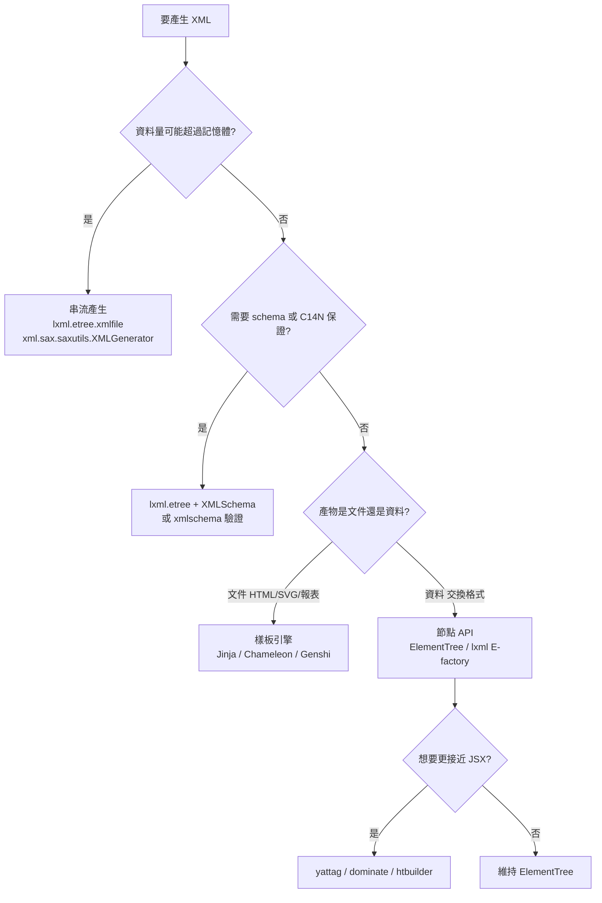

# 用 Python 產生 XML 檔案的方法比較：指令式節點、樣板引擎與 JSX 風格語法

本報告調查「在 Python 中產生（寫出）XML 檔案」的主要技術路線。內容涵蓋標準函式庫、`lxml`、產生器（builder）DSL、樣板引擎，以及字典與資料模型轉 XML 等家族，並就正確性、安全性、效能與維護狀態提出可查證的事實與選用建議。

所有事實均附註腳與 APA 格式參考文獻，參考文獻日期採 ISO 8601（YYYY-MM-DD）。查核日期為 2026-11-14。

## 1. 摘要：分層的結論

若把「產生 XML」拆成三件事：**正確性**（escape、編碼、namespace、CDATA）、**規模**（是否需要串流）、**可讀性**（程式碼是否好寫好讀），可得以下結論：

1. **機器對機器、需要 schema 保證的情境，應使用 DOM 或節點 API**，首選 `xml.etree.ElementTree` 或 `lxml.etree`。序列化器會自動處理 escape，且建構出來的樹可再送進 schema 驗證器[^et-doc][^lxml-apidoc]。
2. **需要極大檔案（GB 級）或無法保證記憶體上限時，應使用串流（incremental）產生**：`lxml.etree.xmlfile` 或 `xml.sax.saxutils.XMLGenerator`[^lxml-api][^saxutils]。
3. **純字串拼接（f-string、`%`、`str.join`）是唯一「保證錯誤」的做法**。它不會 escape，直接對應 CWE-91 XML Injection 的定義[^cwe91]。
4. **樣板引擎（Jinja、Mako、Genshi、Chameleon）適合「文件導向」產物**（HTML、SVG、報表、RSS）。用在機器交換格式時，escape 正確性取決於樣板作者是否在每個上下文正確使用過濾器，且缺乏 schema 驗證[^jinja-templates][^jinja-sandbox]。
5. **JSX 風格與純函式 builder 家族**（`lxml.builder.E`、`yattag`、`dominate`、`htbuilder`）提供最佳的可讀性與「就是 Python」的組合性，代價是額外相依，且多數專案社群規模較小[^lxml-builder][^yattag][^dominate][^htbuilder]。
6. **`dict` 轉 XML 的工具（`dicttoxml`、`xmltodict.unparse`）無法保證保真**。官方文件自承「僅涵蓋常見的 90% 情境」，屬性順序、混合內容順序、多重頂層註解都不保留[^xmltodict]。`dicttoxml` 自 2022-12-23 起未再更新[^dicttoxml]。



## 2. 標準函式庫路線

### 2.1 `xml.etree.ElementTree`：多數情境的預設答案

官方文件對這個模組的第一句描述是「實作簡單且有效率的 API，用於解析與建立 XML 資料」[^et-doc]。自 Python 3.3 起，該模組「只要可用就會使用快速實作」，而 `xml.etree.cElementTree` 別名自 3.3 起被棄用[^et-doc]。

建立節點的核心是 `Element` 與 `SubElement`：

```python
import xml.etree.ElementTree as ET

root = ET.Element("catalog")
book = ET.SubElement(root, "book", {"id": "1"})
book.text = "Python"
ET.SubElement(book, "price").text = "9.99"

tree = ET.ElementTree(root)
tree.write("out.xml", encoding="utf-8", xml_declaration=True,
           short_empty_elements=True)
```

`SubElement(parent, tag, /, attrib={}, **extra)` 的簽章在 Python 3.15 有兩項變更：`attrib` 可為 `frozendict`，且 `parent` 與 `tag` 改為僅位置參數（positional-only）[^et-doc]。

序列化參數方面，`ElementTree.write()` 的簽章為
`write(file, encoding='us-ascii', xml_declaration=None, default_namespace=None, method='xml', *, short_empty_elements=True)`，其中[^et-doc]：

- `xml_declaration`：`False` 表示永不輸出宣告、`True` 表示一定輸出、`None`（預設）表示「只有在編碼不是 US-ASCII 或 UTF-8 或 Unicode 時才輸出」。
- `encoding`：預設 `us-ascii`。`tostring()` 另支援 `encoding="unicode"` 以取得 `str` 而非 `bytes`[^et-doc]。
- `method`：可為 `"xml"`、`"html"`、`"text"`。
- `short_empty_elements`：Python 3.4 新增。`True`（預設）輸出 `<a/>`，`False` 輸出 `<a></a>`[^et-doc]。

`tostring()` 的簽章為
`tostring(element, encoding='us-ascii', method='xml', *, xml_declaration=None, default_namespace=None, short_empty_elements=True)`。其中 `xml_declaration` 與 `default_namespace` 為 Python 3.8 新增，`short_empty_elements` 為 3.4 新增[^et-doc]。

**美化輸出有兩種機制，語意不同**：

- `xml.etree.ElementTree` 沒有 `pretty_print` 參數。標準函式庫提供的是 `indent()`。
- `xml.etree.ElementTree.indent(tree, space='  ', level=0)` 於 Python 3.9 新增，文件說明為「對子樹附加空白以在視覺上縮排，可用於產生美化輸出」，`space` 預設為兩個空白[^et-doc]。注意它**修改樹本身**（把空白寫進 `text` 與 `tail`），因此必須在序列化之前呼叫。

**namespace 行為**：以 Clark 表示法 `{uri}local` 建立的標籤在序列化時，會查詢全域註冊表 `register_namespace(prefix, uri)`（Python 3.2 新增）。文件說明「註冊表是全域的，任何既有對應（無論是該 prefix 或該 URI）都會被移除」，且「此 namespace 中的標籤與屬性會盡可能以給定 prefix 序列化」[^et-doc]。若沒有註冊，序列化器會自行合成 `ns0`、`ns1` 這類前綴。

**escape 行為與其極限**（最常被誤解的部分）：

- 序列化時，`ElementTree` 對**文字內容**會 escape `&`、`<`、`>`；對**屬性值**則另外 escape `"` 與 `'`[^et-doc]。
- 但標準函式庫**不驗證、也不 escape 非法的控制字元**。Python 3.15 才新增 `xml.is_valid_text(data)` 這類檢查函式，其文件說明合法 XML 1.0 字元「幾乎都可使用，除了 C0 控制字元（不含 TAB、CR、LF）、代理對（surrogate）字元與特殊 Unicode 字元 U+FFFE、U+FFFF」[^xmlmod]。換言之，**寫入端並不會替你擋掉這些字元**，你必須自己驗證或清理。
- 打錯字元的代價是產出無法解析的文件，而不是例外。這正是「序列化器有 escape 但仍需輸入驗證」的原因[^cwe91]。

**CDATA**：`xml.etree.ElementTree` 的序列化器沒有產生 `<![CDATA[ ... ]]>` 的機制，文件中亦未提供。若一定要 CDATA，需改用其他方案（見 3.3 與 4.1）。同一頁文件另指出解析端「目前會跳過 XML 註解、處理指令與文件類型宣告」，但**用 API 手動插入的**註解與處理指令會被輸出[^et-doc]。

**`TreeBuilder` 的定位**：文件說明它是「泛用元素結構建構器，把一連串 start、data、end、comment、pi 呼叫轉換為良構（well-formed）的元素結構。可用它搭配自訂解析器建立元素結構」[^et-doc]。它是**解析端**的 target，不是產生工具，也不解決串流寫出的問題。

**其他版本重點**：

- `canonicalize(xml_data=None, *, out=None, from_file=None, **options)` 為 C14N 2.0 轉換函式，Python 3.8 新增。選項含 `with_comments`、`strip_text`、`rewrite_prefixes`、`qname_aware_tags`、`qname_aware_attrs`、`exclude_attrs`、`exclude_tags`[^et-doc]。
- `iterparse()` 與 `XMLPullParser` 皆為**解析端**工具。文件明講 `iterparse()` 的樹「只是逐步建構，並非逐步釋放」[^et-doc]。
- Python 3.13 為 `iterparse()` 迭代器新增 `close()`。3.15 起若迭代器開啟檔案卻未明確關閉，會發出 `ResourceWarning`[^et-doc]。
- Python 3.14 起，對 `Element` 取真假值（truth value）被棄用[^whatsnew314]。

### 2.2 `xml.dom.minidom`：可用但官方已引導使用者改道

`minidom` 是 DOM 的最小實作。文件第一段就寫明：「並非已熟悉 DOM 的使用者，應考慮改用 `xml.etree.ElementTree` 模組來處理 XML」[^minidom]。它的實用價值在於兩點：

- `Node.writexml(writer, indent='', addindent='', newl='', encoding=None, standalone=None)`：`indent` 是當前節點縮排、`addindent` 是子節點的遞增縮排、`newl` 是換行字串。Python 3.8 起保留使用者指定的屬性順序，3.9 新增 `standalone`[^minidom]。
- `Node.toprettyxml(indent='\t', newl='\n', encoding=None, standalone=None)`：回傳美化後的文件，`indent` 預設為 tab[^minidom]。

已知缺陷（文件自承）：`DOMException` 未被支援，改用一般 Python 例外如 `TypeError`、`AttributeError`。`DOMTimeStamp` 與 `EntityReference` 未實作。`removeAttribute()` 與 `removeAttributeNS()` 在找不到屬性時會拋 `NotFoundErr`，與 DOM 規格「無作用」的規定不同[^minidom]。此外 `xml.dom` 本身**並未被標記為棄用**（被棄用的是 `xml.etree.cElementTree`）[^xmlmod][^et-doc]。

### 2.3 `xml.sax.saxutils`：真正的串流寫出工具

標準函式庫中唯一「以事件驅動方式寫出 XML」的官方機制，是 `XMLGenerator`。其建構子為
`XMLGenerator(out=None, encoding='iso-8859-1', short_empty_elements=False)`。文件敘述：「此類別實作 `ContentHandler` 介面，把 SAX 事件寫回一份 XML 文件。換句話說，以 `XMLGenerator` 作為 content handler 會重現被解析的原始文件。`out` 應為 file-like 物件，預設 `sys.stdout`。`encoding` 預設 `iso-8859-1`。`short_empty_elements` 控制無內容元素的格式：`False`（預設）輸出成對的起訖標籤，`True` 輸出單一自閉合標籤。」`short_empty_elements` 於 3.2 新增[^saxutils]。

注意此處的預設值與 `ElementTree` **相反**（`XMLGenerator` 預設 `False`，`ElementTree` 預設 `True`）[^saxutils][^et-doc]。

兩個配套的 escaping 函式[^saxutils]：

- `escape(data, entities={})`：escape `&`、`<`、`>`。可傳入 `entities` 字典做額外替換，且「`&`、`<`、`>` 即使提供了 `entities` 也一律會被 escape」。文件特別警告：「此函式只應用於 escape 那些無法直接用在 XML 中的字元，不要當成一般字串轉換函式使用。」
- `quoteattr(data, entities={})`：類似 `escape()`，但額外把資料準備成屬性值。它會依內容挑選引號字元以盡量避免編碼引號。若資料中同時有單引號與雙引號，會把雙引號編碼並以雙引號包住。

`xml.sax` 套件本身只文件化解析端（reader、handler、input source），**沒有**「用 SAX 事件寫出 XML」的獨立 API。寫出必須靠 `saxutils.XMLGenerator`[^saxdoc][^saxutils]。

### 2.4 串流產生的第三條路：`et-xmlfile`

若需要低記憶體寫出但不想引入 `lxml`，社群套件 `et-xmlfile` 是常見替代。其說明文字指出「XML 可能吃掉大量記憶體，`et_xmlfile` 是建立大型 XML 檔案的低記憶體函式庫。雖然標準函式庫已包含增量解析器 `iterparse`，但寫出 XML 時並無對應工具」[^etxmlfile]。本報告未能查核該套件的最新版本與最後更新時間，此點列為研究限制（見第 10 節）。

## 3. `lxml`：功能最完整的單一選擇

`lxml` 是 libxml2 與 libxslt 的 Python 綁定，提供 ElementTree API 的超集，並支援 XPath、RelaxNG、XML Schema、XSLT、C14N 等[^lxml-pypi]。目前狀態（本報告查核時）：

- PyPI 上最新版本為 **6.1.3，發佈於 2026-09-02**。授權 BSD-3-Clause，`requires_python` 為 `>=3.8`[^lxml-pypi]。
- 專案首頁同時列出 **7.0.0a3（alpha）** 與穩定版。官方效能頁面註記「Generated on: 2026-06-16」[^lxml-perf][^lxml-pypi]。
- GitHub 倉庫 `lxml/lxml` 有 **3,073 stars**，授權 BSD-3-Clause，最近一次 push 為 2026-11-13[^lxml-gh]。

### 3.1 序列化與美化輸出

`lxml.etree.tostring()` 支援 `encoding`、`method`（`'xml'`、`'html'`、`'text'`、`'c14n'`、`'c14n2'`）、`xml_declaration`、`pretty_print`、`with_tail`、`standalone`、`doctype`、`exclusive`、`inclusive_ns_prefixes`、`with_comments`、`strip_text` 等參數。`ElementTree.write()` 另支援 `compression`（GZip level 1 至 9）[^lxml-apidoc]。

`pretty_print` 的行為在官方 FAQ 有明確界定：美化輸出「意味著對內容加入空白」，而實作會「只在不會影響資料的情況下加入空白，也就是只在不含資料的節點之間」。若資料是從檔案解析而來且含無意義空白，須先用 `remove_blank_text=True` 解析，讓解析器丟掉空白文字節點，之後序列化時才能安全縮排[^lxml-faq]。

`lxml` 另有 `etree.indent(root)`（4.5 新增），它**會改變記憶體中的樹**（呼叫後 `root.text` 變成 `'\n  '`）。此點與 `pretty_print` 只在輸出階段加空白不同[^lxml-tutorial]。

CDATA 方面，`lxml` 的解析器**預設會剝除 CDATA 並以純文字取代**（`strip_cdata=True`）。若要保留，需 `etree.XMLParser(strip_cdata=False)`。若要主動產生 CDATA，使用 `etree.CDATA` 工廠包裝文字[^lxml-api]：

```python
from lxml import etree

el = etree.Element("content")
el.text = etree.CDATA("a & b")
print(etree.tostring(el, encoding="unicode"))
# <content><![CDATA[a & b]]></content>
```

文件同時提醒一個陷阱：「注意 `.text` 屬性並不會給出任何提示，說明該文字內容被 CDATA 包裹」[^lxml-api]。

### 3.2 C14N（Canonical XML）與數位簽章

`lxml.etree` 支援 C14N 1.0 與 C14N 2.0：「以 `ElementTree.write()` 或 `tostring()` 序列化 XML 樹時，可傳入 `method="c14n"`（1.0）或 `method="c14n2"`（2.0）。此外有 `etree.canonicalize()`，可在不於記憶體中建立樹的情況下，把已序列化的 XML 轉成標準形式。」[^lxml-api] 例如：

```python
c14n_xml = etree.canonicalize("<root><test z='1' y='2'/></root>")
print(c14n_xml)   # <root><test y="2" z="1"></test></root>
```

標準函式庫的 `xml.etree.ElementTree.canonicalize()` 文件則說明了**為何這件事對簽章重要**：「標準化是讓 XML 輸出一致化，使位元組級比較與數位簽章成為可能。它削減了 XML 序列化器的自由度。主要限制關於 namespace 宣告的位置、屬性的排序，以及可忽略的空白。」[^et-doc] 這也是「以字串或樣板拼接 XML 之後再去簽章」會踩雷的根本原因：屬性順序或空白的任何差異都會改變標準化位元組，導致簽章驗證失敗[^lxml-api][^et-doc]。

### 3.3 增量與串流產生：`lxml.etree.xmlfile`

自 lxml 3.1 起提供 `xmlfile` API，以 `with` 陳述式增量產生 XML。官方說明其目的：

> 「其主要目的是自由且安全地把外圍元素與已建好的記憶體中樹混合，例如寫出由大量重複子樹組成的文件（如資料庫傾印）。但在記憶體用量重要、或 XML 天然是按序列步驟產生的許多情況下，它都很有用。」

以及關鍵的記憶體論述：「一種常見模式是有數個巢狀的 `element()` 區塊，然後在迴圈中建立記憶體中的 XML 子樹，並逐一寫入 XML 檔。如此一來，它們在建立後即可從記憶體移除。這可大幅降低應用程式的記憶體足跡，同時讓整體 XML 產生保持簡單、安全且正確。」[^lxml-api]

參數與版本：`close=True`（3.4 起）讓 lxml 在離開 context manager 時呼叫物件的 `.close()`。`buffered=False`（3.4 起）完全停用緩衝。`xf.flush()`（3.4 起）可明確沖出緩衝內容。3.4.1 起另有對應的 `htmlfile`。4.0 起支援 async coroutine[^lxml-api]。

```python
from lxml import etree

with etree.xmlfile("big.xml", encoding="utf-8") as xf:
    xf.write_declaration(standalone=True)
    with xf.element("dump"):
        for row in rows:                  # rows 可為產生器
            el = etree.Element("row", id=str(row.id))
            el.text = row.value
            xf.write(el)
            el = None                     # 立即讓它可被回收
```

### 3.4 驗證：把「產出的東西對不對」變成可執行檢查

`lxml.etree` 提供 `DTD`、`RelaxNG`、`XMLSchema`、`Schematron` 四個驗證器類別，皆提供 `validate(etree)`（回傳 `True` 或 `False`）、`assertValid(etree)`（失敗時拋 `DocumentInvalid`）、`assert_()`（失敗時拋 `AssertionError`），以及 `error_log` 屬性以讀取錯誤細節[^lxml-apidoc]。這是「產生 XML」這一側最容易被忽略、但效益最高的一步：在寫檔或送出前，用同一份 XSD 驗證自己產出的樹。

### 3.5 解析器安全預設值

`lxml.etree.XMLParser` 的預設值包含 `no_network=True`（阻止網路存取相關檔案）、`resolve_entities='internal'`、`strip_cdata=True`[^lxml-apidoc]。FAQ 指出：「自 5.x 版起，lxml 預設停用外部實體展開（XXE）。若你確實想允許以該功能把外部檔案載入 XML 文件，必須明確設定 `resolve_entities=True`。」[^lxml-faq] 另有一則官方說明指出 `resolve_entities` 的預設值原本是 `True`，在 **lxml 6.1 改為 `'internal'`**[^lxml-apidoc]。

需要留意的是，lxml 6.1.3 的版本說明提到一個已修正的問題：**外部參數實體（external parameter entity）在 `resolve_entities="internal"` 下仍被允許解析**[^lxml-pypi]。這代表「版本升級」本身就是安全維護的一部分。

## 4. 產生器、DSL 與 JSX 風格家族

這一族的共同特徵是：用 Python 的函式呼叫、關鍵字參數與 context manager 來「描述」樹，而不是字串拼接。

### 4.1 `lxml.builder.E`（E-factory）

不需要額外安裝（已含於 lxml）。文件定義其價值：「與一般 Element 工廠不同，E 工廠允許你傳入的不只是標籤與一些可選屬性。你還可以傳入文字與其他元素。文字會被加為 `text` 或 `tail`，元素會被插到正確位置。」[^lxml-builder]

```python
from lxml import etree as ET
from lxml.builder import E

ET.tostring(E("tag", "text", key="value"))
# b'<tag key="value">text</tag>'
ET.tostring(E("tag", E("subtag", "text"), "tail"))
# b'<tag><subtag>text</subtag>tail</tag>'
```

namespace 可透過 `ElementMaker(namespace=..., nsmap=...)` 設定。`from lxml.builder import E` 取得的即是 `ElementMaker` 的單例[^lxml-builder]。文件中的 HTML 產生範例也示範了如何用小型 helper（例如 `CLASS(v)` 回傳 `{'class': v}`，因為 `class` 是 Python 保留字）與 `E.p(...)` 混搭[^lxml-builder]。

### 4.2 `yattag`

- PyPI 版本 **1.16.1，發佈於 2024-11-02**。專案自我描述為「以可讀、簡潔且 pythonic 的方式產生 HTML 或 XML。純 Python 的網頁樣板引擎替代方案。」[^yattag]
- API 主體是 `Doc().tagtext()` 取得 `doc, tag, text`，再以 `with tag('html'):` 巢狀建構。另有 `doc.stag('input', ...)` 產生自閉合標籤[^yattag]。
- GitHub `leforestier/yattag` 有 **349 stars**，最近一次 push 為 2024-11-02。GitHub API 回報授權欄位為 `null`（PyPI 的分類標籤則標示 LGPL）[^yattag-gh]。
- **注意：距離最後一次 push 已約兩年，更新頻率低。**

### 4.3 `dominate`

- PyPI 版本 **3.1.0，發佈於 2026-10-30**。專案描述為「以優雅的 DOM API 建立與操作 HTML 文件，讓你能用純 Python 極精簡地寫 HTML 頁面，免除學習另一種樣板語言的需要」[^dominate-release]。
- GitHub `Knio/dominate` 有 **1,830 stars**，授權 LGPL-3.0，最近一次 push 為 2026-11-02[^dominate-gh]。
- 3.1.0 的 release note 顯示它仍在吸收社群 PR，包含 Python 3.14 支援、asyncio 相容性修正、數值為 0 的屬性值保留等[^dominate-release]。名稱雖為 HTML 導向，但其 DOM 模型搭配 `method="xml"` 序列化即可產出 XML。

### 4.4 `htbuilder`

- PyPI 版本 **0.9.0，發佈於 2025-01-09**，`requires_python >=3.7`，授權 Apache-2[^htbuilder]。
- 其 PyPI 摘要直接點題：「一個純函式的 Python HTML builder。想想 JSX，而不是樣板。」README 開頭亦寫「為什麼要用樣板語言，當你可以直接用函式？」[^htbuilder]
- API 特色是不用 context manager：`div(id='container')[ ul(_class='x')[ li('a'), li('b') ] ]`。底線會被轉成連字號（`my_element(foo_bar="baz")` 產生 `<my-element foo-bar="baz">`），前後底線會被剝除（`_class` 變 `class`，用以避開保留字）[^htbuilder]。
- 專案同時提供 `styles()`、`classes()`、`fonts()` 等輔助函式，以及 `htbuilder.units`、`htbuilder.funcs` 子模組[^htbuilder]。作者為 Thiago Teixeira。本報告未取得其 stars 精確值，列為限制。

### 4.5 其他小型 builder 套件的存活狀況

快速掃描顯示此領域有大量已死或近乎已死的專案（皆為 PyPI 上的發佈時間）：

| 套件 | 最後發佈 | 狀態評估 |
|---|---|---|
| `xmlbuilder` | 1.0（2011-12-14） | 實質死亡，逾 14 年未更新[^xmlbuilder] |
| `markyp` | 0.2307.0（2023-06-30） | 更新停滯，逾 2 年，社群極小[^markyp] |
| `yattag` | 1.16.1（2024-11-02） | 低度維護，約 2 年無 push[^yattag][^yattag-gh] |
| `htbuilder` | 0.9.0（2025-01-09） | 邊緣存活，約 22 個月無發佈[^htbuilder] |
| `dominate` | 3.1.0（2026-10-30） | 活躍[^dominate-release][^dominate-gh] |

也就是說：**在 builder 家族中，只有 `lxml.builder.E`（隨 lxml 維護）與 `dominate` 具備明確的活躍維護證據**，其餘須自行承擔維護風險。

### 4.6 真正的 JSX 風格與 t-string：PEP 750

Python 3.14 引入了 **template strings（t-strings）**。PEP 750 狀態為 **Final**，對應 Python 版本為 **3.14**[^pep750]。語法是在字串前加 `t`：

```python
from string.templatelib import Template

name = "World"
template: Template = t"Hello {name}"
assert template.strings[0] == "Hello "
assert template.interpolations[0].value == "World"
```

`Template` 具有 `strings` 與 `interpolations` 兩個屬性。`Interpolation` 具有 `value`、`expression`、`conversion`、`format_spec`[^pep750]。PEP 明言此機制的動機之一是安全：

> 「f-strings 沒有辦法在插值被合併進最終字串之前攔截並轉換它們。因此，f-strings 的不謹慎使用可能導致安全漏洞。」（PEP 以 SQL injection 與 XSS 為例）

PEP 亦給出 HTML 範例，其中 `html()` 處理器會 escape 插值，使 `t"<p>{evil}</p>"` 變成 `<p>&lt;script&gt;...&lt;/script&gt;</p>`[^pep750]。同時 PEP 明確說明它**不是**要靠來取代 Jinja：「像 Jinja 這類專案在使用者自訂、設計師或內容創作者撰寫的樣板情境下仍有需要。PEP 750 設想的 DSL 是：非靜態的部分就是 Python，同樣的作用域規則、型別、運算式語法。」[^pep750]

實務評價：t-strings 提供了一條「讓 escape 由處理器集中負責」的正規管道，是 Python 官方對「別再手動拼接 XML 或 HTML」的語言層回應。但它本身**不是 XML 產生器**，仍需自行實作處理器。

### 4.7 語法風格對照

以下用同一份結構（含屬性與巢狀子元素）示範四種風格，突顯可讀性差異。

**風格 A：指令式節點（`ElementTree`）**

```python
root = ET.Element("order", {"id": "A1"})
item = ET.SubElement(root, "item", {"sku": "X"})
ET.SubElement(item, "qty").text = "2"
```

**風格 B：E-factory（`lxml.builder`）**

```python
root = E.order({"id": "A1"}, E.item({"sku": "X"}, E.qty("2")))
```

**風格 C：context manager（`yattag`）**

```python
doc, tag, text = Doc().tagtext()
with tag("order", id="A1"):
    with tag("item", sku="X"):
        with tag("qty"):
            text("2")
```

**風格 D：純函式與索引（`htbuilder`）**

```python
root = order(id="A1")[ item(sku="X")[ qty("2") ] ]
```

四者的共同優點是**屬性與文字都由函式參數進入，而非字串插值**，因此 escape 由函式庫負責[^et-doc][^lxml-builder][^yattag][^htbuilder]。差別在於：A 與 B 產生標準 XML 樹物件（可驗證、可 XPath、可序列化為多種方法），C 與 D 產生字串（輕量但沒有結構可驗證）[^lxml-apidoc][^yattag][^htbuilder]。

## 5. 樣板引擎路線

### 5.1 Jinja

- 官方文件版本標示為 **3.1.x**。GitHub `pallets/jinja` 有 **11,816 stars**，授權 BSD-3-Clause，最近一次 push 為 2025-06-14[^jinja-doc][^jinja-gh]。
- 文件名言：「Jinja 樣板就是一個文字檔。Jinja 可以產生任何以文字為基礎的格式（HTML、XML、CSV、LaTeX 等）。樣板不需要特定副檔名。」[^jinja-templates]

關鍵選項與過濾器（皆為官方文件用語）[^jinja-api][^jinja-templates]：

- `autoescape`：設為 `True` 即預設啟用 XML 與 HTML 自動 escape。自 2.4 起亦可為一個 callable（接收樣板名稱、回傳 bool）。官方建議搭配 `select_autoescape()` 使用，並在文件中註記「未來版本的 Jinja 可能基於安全理由預設啟用自動 escape，因此建議現在就明確設定而不是依賴預設值」[^jinja-api]。
- `xmlattr` 過濾器：「既不是 `none` 也不是 `undefined` 的值會自動被 escape，因此可安全地接受不受信任的使用者輸入。」但另有一條限制：「使用者輸入不應作為此過濾器的鍵。若任何鍵含有空白、`/`、`>` 或 `=`，會以 `ValueError` 失敗。」[^jinja-templates]
- `tojson` 過濾器：「把物件序列化為 JSON 字串，並標記為可安全在 HTML 中輸出。此過濾器僅供 HTML 文件使用。」並附警告：「回傳字串在 HTML 文件與 `<script>` 標籤中是安全的。例外是以雙引號包住的 HTML 屬性，此時應改用單引號或 `|forceescape` 過濾器。」[^jinja-templates]
- 空白控制：`trim_blocks`（預設 `False`，移除區塊後的第一個換行）、`lstrip_blocks`（預設 `False`，移除行首到區塊前的空白與 tab）、`newline_sequence`（`'\r'`、`'\n'`、`'\r\n'`，預設 `'\n'`）、`keep_trailing_newline`（預設 `False`，會剝掉結尾單一換行）[^jinja-api][^jinja-templates]。
- `SandboxedEnvironment`：以沙箱方式產生程式碼，「若樣板試圖存取不安全的程式碼，會拋出 `SecurityError`」。另提供 `ImmutableSandboxedEnvironment` 等變體[^jinja-sandbox]。
- **最值得引用的一段警告**（在沙箱安全性考量中）：「Jinja 只產生文字，它不瞭解例如 JavaScript 程式碼。取決於樣板輸出將如何被使用，你可能需要做其他後處理來限制輸出。」[^jinja-sandbox] 這句話正是「autoescape 不等於端到端安全」的官方表述。

### 5.2 Mako

- PyPI 版本 **1.4.3，發佈於 2026-09-22**。授權 MIT。描述為「用 Python 寫的樣板函式庫。它提供熟悉的非 XML 語法，可編譯成 Python 模組以獲得最大效能。」並自陳「概念上，Mako 是一種嵌入式 Python（Python Server Page）語言」[^mako-pypi]。
- GitHub `sqlalchemy/mako` 有 **463 stars**，授權 MIT，最近一次 push 為 2026-09-22[^mako-gh]。
- 由於它是「非 XML 語法加上可嵌入 Python」，用來產生 XML 時，escape 完全落在作者手上。Mako 的官方定位是「超快且輕量的樣板」（Hyperfast and lightweight templating for the Python platform）[^mako-pypi]。

### 5.3 Genshi

- PyPI 版本 **0.7.12，發佈於 2026-10-26**。授權 BSD。描述為「一組整合元件，用於解析、產生與處理 HTML、XML 或其他文字內容，以在網頁上產生輸出。主要特色是樣板語言，受 Kid 強烈啟發。」[^genshi]
- GitHub `edgewall/genshi` 有 **99 stars**（低於 100），最近一次 push 為 2026-10-26[^genshi-gh]。**它並未死亡**（2026 年 10 月仍有發佈），但社群規模小。
- 其設計特徵是「具 namespace 感知的 XML 樣板」：樣板本身必須是良構 XML 文件。相關生態中另有 `chameleon.genshi`，提供以 Chameleon 編譯器實作的快速 Genshi 樣板實作。本報告未查核該套件版本，列為限制。

### 5.4 Chameleon（Zope Page Templates 與 TAL）

- PyPI 版本 **4.6.1，發佈於 2026-11-13**（報告前一日）。授權為 BSD-like（Repoze license）。`requires_python >=3.11`。自我描述為「給 Python 用的 HTML 與 XML 樣板引擎。它使用 page templates 語言。」[^chameleon]
- GitHub `malthe/chameleon` 有 **190 stars**，最近一次 push 為 2026-11-13[^chameleon-gh]。
- 4.6.1 的 changelog 內容包括「新增 Python 3.15 相容性」、「在未知 TALES 運算式型別時拋出 `ExpressionError`」、「修正 `_resolve_dotted` 讓相對名稱的每個前置點各上升一層模組」等[^chameleon]。這顯示它仍是活躍維護的專案。
- 語言基礎是 ZPT 的 **TAL、METAL、I18N** 三個 namespace：TAL 控制流程與內容替換、METAL 提供巨集與 slot、I18N 處理翻譯。其重大設計差異在於**樣板是 XML 文件本身**，因此樣板的良構性由解析器強制檢查。

### 5.5 MarkupSafe：escape 的實際實作層

- PyPI 版本 **3.0.4，發佈於 2026-10-02**。授權 BSD-3-Clause。描述為「實作一個文字物件，會 escape 字元使其可安全用於 HTML 與 XML。具有特殊意義的字元會被替換，以顯示為真正的字元。這可減緩注入攻擊，意味著不受信任的使用者輸入可以安全地顯示在頁面上。」[^markupsafe]
- GitHub `pallets/markupsafe` 有 **702 stars**，最近一次 push 為 2026-10-03[^markupsafe-gh]。
- README 範例顯示 `escape("<script>alert(...)</script>")` 會得到 `Markup('&lt;script&gt;...')`。`Markup` 是 `str` 的子類別，其方法與運算子會 escape 其引數[^markupsafe]。

### 5.6 樣板引擎用於 XML 的結構性弱點

把上述引擎放回「產生 XML」的脈絡，會看到三個共同限制：

1. **樣板引擎不知道自己在哪個上下文插值**。同一個 `{{ v }}` 可能落在文字節點、屬性值、標籤名或 CDATA 中，而這四個位置需要不同的 escape 規則[^jinja-sandbox][^cwe91]。
2. **樣板輸出是字串，不是樹**。因此無法直接送進 `XMLSchema`、`RelaxNG` 或 `Schematron` 驗證器做「產生前驗證」，除非再解析一次[^lxml-apidoc]。
3. **對簽章類用途不友善**。屬性順序與空白的差異會改變 C14N 結果[^et-doc][^lxml-api]。

不過，第 5.3 與 5.4 節的 Genshi 與 Chameleon 是一個例外方向：它們要求樣板本身是良構 XML，因此「標籤層級的結構錯誤」會被解析器在編譯期就擋下，這是純文字樣板（Jinja、Mako）沒有的保護[^genshi][^chameleon]。

## 6. 字典轉 XML 與資料綁定、schema codegen

### 6.1 `xmltodict`（含 `unparse`）

- PyPI 版本 **1.0.4，發佈於 2026-02-22**。授權 MIT。`requires_python >=3.9`[^xmltodict]。
- GitHub `martinblech/xmltodict` 有 **5,758 stars**，最近一次 push 為 2026-08-19[^xmltodict-gh]。
- `unparse(input_dict, output=None, encoding='utf-8', ..., full_document=True, short_empty_elements=False, attr_prefix='@', cdata_key='#text', pretty=False, indent='\t', newl='\n', expand_iter=None)` 可以把字典轉回 XML。文件強調「`attr_prefix` 的預設值是 `@`，`cdata_key` 的預設值是 `#text`」，也提醒「當從字典建立 XML 時，值為空 list 的鍵會被跳過（例如 `{'a': []}` 不會產生 `<a>` 元素）」[^xmltodict]。
- **保真度限制（官方自述）**：「`xmltodict` 旨在涵蓋常見的 90% 情境。它不保留每一個 XML 細節（屬性順序、混合內容順序、多個頂層註解）。若需要精確保真，請使用完整的 XML 函式庫，例如 lxml。」另外「使用 `expand_iter` 會破壞 roundtripping」[^xmltodict]。
- 安全爭議值得記錄：`xmltodict` 曾被指派 **CVE-2025-9375，但該 CVE 是有爭議的（disputed）**。維護者的說明指出，根本問題在於 Python 標準函式庫的 `xml.sax.saxutils.XMLGenerator` API **不驗證 XML 元素名稱**，也未提供內建方式驗證。`xmltodict` 只是把鍵直接傳給 `XMLGenerator` 的薄包裝，因此同一問題也存在於標準函式庫本身。維護者並認為以 `xml.sax.saxutils.escape()` 作為「安全用法」的建議是**不正確的**：「`escape()` 只適用於字元資料與屬性值，誤用於元素名稱時會產生無效的 XML。目前 Python 標準函式庫中沒有安全且有文件記載的方式來驗證 XML 元素名稱。」[^xmltodict]

最後這點對本報告的主題極為重要：**元素名稱與標籤名稱，是「產生 XML」時唯一沒有標準工具替你驗證的地方**。若標籤名稱來自使用者輸入，必須自行以白名單驗證[^xmltodict][^cwe91]。

### 6.2 `dicttoxml`（建議避免）

- PyPI 版本 **1.7.16，發佈於 2022-12-23**。授權 GPL-2.0（GNU GPL v2）。`requires_python >=3.6`[^dicttoxml]。
- GitHub `quandyfactory/dicttoxml` 有 **384 stars**，但最近一次 push 為 **2022-12-23**[^dicttoxml-gh]。**已逾三年未更新。**
- 其行為（取自 PyPI 敘述）：會前置 `<?xml version="1.0" encoding="UTF-8" ?>` 並以 `<root>` 包裹，可用 `root=False` 停用。`custom_root=` 可改根元素名。**預設會為每個元素加上 `type` 屬性**（可用 `attr_type=False` 關閉）。`cdata=True` 可包 CDATA。無效的 XML 元素名會被改成 `key` 並以 `name` 屬性保留原名（但名稱中的空白會被轉為底線）。`datetime` 會轉成 ISO 格式字串[^dicttoxml]。

也就是：它**不可控地改變你的資料模型**（自動加 `type`、自動改標籤名），因此不適合作為交換格式產生器。若需要「字典轉 XML」，`xmltodict.unparse` 至少語意更誠實且仍在維護[^xmltodict][^dicttoxml]。

### 6.3 資料模型與 schema 導向：`pydantic-xml`、`xsdata`、`xmlschema`

- **`pydantic-xml`**：PyPI 版本 **2.22.0，發佈於 2026-10-18**。授權 Unlicense（公共領域）。`requires_python >=3.10`。GitHub `dapper91/pydantic-xml` 有 **257 stars**，最近一次 push 為 2026-10-18[^pydxml][^pydxml-gh]。它讓 pydantic 模型以 `attr()`、`element()`、`text` 綁定 XML 結構，並支援 `Dict`、`List`、`Set`、`Tuple`、`Union`、泛型模型、computed field。解析器可選 `lxml` 或標準函式庫 `xml.etree.ElementTree`[^pydxml]。
  - 明確**不支援**：pydantic `dataclasses`、callable discriminators[^pydxml]。
- **`xsdata`**：PyPI 版本 **26.10，發佈於 2026-10-16**。授權 MIT。`requires_python >=3.10`。GitHub `tefra/xsdata` 有 **455 stars**，最近一次 push 為 2026-11-02[^xsdata][^xsdata-gh]。它是「完整的資料綁定函式庫，讓開發者把 XML 與 JSON 文件當作簡單物件使用，而不是使用 DOM。程式碼產生器支援 XML schemas、DTD、WSDL 定義、XML 與 JSON 文件，產出帶型別提示與綁定中介資料的簡單 dataclasses」[^xsdata]。產生的類別可用 `XmlParser` 解析，亦可序列化回 XML。
  - **安全相關變更**：26.10 的 changelog 第一條即為「**預設停用 `LxmlEventHandler` 的外部實體解析**」[^xsdata]。
- **`xmlschema`**：PyPI 版本 **4.3.2，發佈於 2026-06-30**。授權 MIT。GitHub `sissaschool/xmlschema` 有 **475 stars**，最近一次 push 為 2026-06-30[^xmlschema-gh]。它同時是 XSD 驗證器與編解碼器，並可做 XML 到 Python dict 到 JSON 的轉換[^xmlschema-gh]。

以 XSD 驅動工作流的典型好處是：**產生 XML 與驗證 XML 共用同一份 schema 事實來源**，因此可在寫檔前就攔下錯誤，而不必等到下游系統拒收[^lxml-apidoc][^xmlschema-gh]。

### 6.4 JSON 轉 XML 為何不可逆

若工作流是「先有 JSON，再轉 XML」，須知道這個轉換本質上是有損的。差異來源是 XML 具備 JSON 沒有的特性[^json-xml]：

- **屬性**：XML 元素可同時有屬性與子內容，JSON 沒有原生屬性概念。慣例（如 `@attr` 前綴）是任意的。
- **namespace**：XML 支援帶 namespace 的元素，JSON 沒有原生支援。
- **混合內容**：XML 允許文字與子元素交錯，JSON 沒有對應表示。
- **註解與處理指令**：XML 有 `<!-- -->` 與 `<?pi?>`，JSON 沒有。
- **CDATA**：XML 有 `<![CDATA[ ... ]]>`，JSON 沒有對應。
- **文件類型宣告**：DTD 與 DOCTYPE 沒有 JSON 類比。
- **順序**：XML 元素順序有意義，JSON 物件鍵依規格無序。
- **單一元素與複數元素**：同一位置是單一子元素或陣列，各慣例處理方式不同。

具體慣例方面：**BadgerFish** 把元素名變物件屬性、文字內容放 `$`、屬性放在以 `@` 開頭的屬性、namespace 放 `@xmlns`，而它的侷限是「若元素的文字內容全為空白會被丟棄」，且無法處理混合內容（例如 `<p>text <strong>bold</strong> more text</p>`）。**Parker** 慣例則是「有損的，它單純忽略 XML 屬性。優點是產生更精簡乾淨的 JSON」[^json-xml]。

實務建議：若需要 JSON 與 XML 之間的可靠往返，應在資料模型中顯式保留屬性、namespace 與順序的資訊，而不是依賴通用的轉換慣例[^json-xml][^xmltodict]。

## 7. 正確性與安全性

### 7.1 escape 規則與其易錯處

XML 1.0 對寫入端的最基本要求如下[^wiki-xml]：

- `&` 與 `<` 在字元資料中必須 escape。
- `>` 除特定情形外可不必 escape，但字面字串 `]]>` 不得出現在字元資料中。
- 屬性值中若以單引號或雙引號作定界，對應的引號字元必須 escape。
- 五個預定義實體為 `&lt;`、`&gt;`、`&amp;`、`&apos;`、`&quot;`。

合法字元方面，XML 1.0 只接受 U+0009（tab）、U+000A（LF）、U+000D（CR）三個 C0 控制字元。其餘 U+0000 至 U+001F 控制字元、代理對區段（U+D800 至 U+DFFF）、U+FFFE 與 U+FFFF 皆不合法[^wiki-xml][^xmlmod]。XML 1.0 亦建議使用 UTF-8 且**不要** BOM[^wiki-xml]。

> 研究限制聲明：W3C 規格頁（`https://www.w3.org/TR/xml/`）在本報告的抓取過程中回應失敗，因此上述規則係轉引自維基百科的 XML 條目與 Python 標準函式庫文件。兩者在相關段落互相一致[^wiki-xml][^xmlmod]。

寫在 Python 裡的實務含意是：

- `ElementTree` 與 `lxml` 會替你 escape 文字與屬性中的關鍵字元[^et-doc][^lxml-apidoc]。
- 但**沒有任何一者會替你驗證控制字元**。Python 3.15 才提供 `xml.is_valid_text()` 這個檢查函式，且它不是序列化器的自動行為[^xmlmod]。
- 且**沒有任何一者會替你驗證標籤名稱**。這正是前面 `xmltodict` 的 CVE 爭議核心[^xmltodict]。

### 7.2 唯一不可原諒的做法：字串拼接

CWE-91「XML Injection」的定義是：「產品未能適當中和 XML 中使用的特殊元素，使攻擊者可在 XML 被終端系統處理之前修改其語法、內容或指令。」其延伸說明直接點出：「XML 中的特殊元素可包括保留字或字元，例如 `<`、`>`、`"` 與 `&`，這些可被用來新增資料或修改 XML 語法。」標準的緩解策略列在 Input Validation 之下：「假設所有輸入都是惡意的。採用『接受已知良好』的輸入驗證策略，即使用一份嚴格符合規格的許可清單。拒絕任何未嚴格符合規格的輸入，或把它轉換成符合規格的東西。」[^cwe91]

CWE-91 在 CWE 階層中是 CWE-74（Improper Neutralization of Special Elements in Output Used by a Downstream Component）的子項，並擁有多個子項，包括 CWE-643（Improper Neutralization of Data within XPath Expressions）與 CWE-652（Improper Neutralization of Data within XQuery Expressions）[^cwe91]。它也被對應到 CAPEC-250（XML Injection）與 CAPEC-83（XPath Injection）[^cwe91]。

相關但不同的一個弱點是 **CWE-611 XML External Entity（XXE）**。XXE 主要被描述為**解析**端的風險（處理的 XML 文件可含指向控制範圍外文件的實體 URI），但它在「同時讀寫 XML 的管線」中同樣重要：若該管線會再解析使用者可控的 XML，其解析器設定就必須一併處理。標準緩解是「許多 XML 解析器與驗證器可設定為停用外部實體展開」[^cwe611]。OWASP 的建議更強硬：「盡可能停用文件類型定義（DTD）。若解析器支援，就拒絕 DOCTYPE 宣告。若應用真的需要 DTD，則停用外部實體解析與外部 DTD 載入，並限制實體展開。」並補充「除非明確需要，否則停用 XInclude，因為它可不經 DTD 就載入資源」[^owasp-xxe]。

Python 標準函式庫的 `xml` 文件頁面在 XML security 一節列出四種攻擊型態[^xmlmod]：

- **billion laughs 或指數實體展開**：「使用多層巢狀實體。每個實體多次引用另一個實體，最終實體定義含一小段字串。指數展開會產生數 GB 的文字，消耗大量記憶體與 CPU 時間。」
- **quadratic blowup 實體展開**：「與 billion laughs 類似，也濫用實體展開。它不採用巢狀實體，而是把一個含數千字元的大實體重複多次。效率不如指數情形，但它避免觸發禁止深層巢狀實體的解析器計數器。」
- **decompression bomb**：「適用於所有能解析壓縮 XML 串流的 XML 函式庫，例如 gzip 化的 HTTP 串流或 LZMA 壓縮檔。」該頁並明確指出 `xmlrpc` 對此攻擊是脆弱的。
- **large tokens**：「Expat 需要重新解析未完成的 token。若沒有 Expat 2.6.0 引入的保護，這可能導致二次方執行時間，被用來對應用程式造成阻斷服務。」此問題編號為 CVE-2023-52425。

該頁同時給出關鍵的版本資訊：「**Expat 版本低於 2.7.2 可能對 billion laughs、quadratic blowup 與 large tokens 弱點脆弱**，或對動態記憶體使用不成比例。」且「Python 綁定了一份 Expat。Python 使用綁定版或系統版，取決於組態設定。若 Python 使用這些較舊版本的 Expat，就可能脆弱。請檢查 `pyexpat.EXPAT_VERSION`。」另外「Expat 本身預設不存取本機檔案、也不建立網路連線」[^xmlmod]。

### 7.3 產生端的安全檢查清單

綜合以上，產生 XML 時真正需要自己動手做的是：

1. **永不拼接字串**。使用會 escape 的序列化器[^cwe91][^et-doc]。
2. **驗證標籤名稱與屬性名稱**。標準函式庫沒有提供這個工具，`escape()` 也不能用於此用途[^xmltodict]。Python 3.15 新增的 `xml.is_valid_name(name)` 可用來檢查字串是否為合法的元素或屬性名稱[^xmlmod]。
3. **驗證文字內容中的控制字元**。使用 `xml.is_valid_text()`（3.15 新增）或自行過濾 C0 控制字元[^xmlmod]。
4. **明確設定編碼與 XML 宣告**。注意 `xml_declaration=None` 的「條件式輸出」行為可能讓下游在不同環境看到不同結果[^et-doc]。
5. **需要簽章或位元組級一致性時，先做 C14N**。屬性順序與可忽略空白的差異都會改變標準化位元組[^et-doc][^lxml-api]。
6. **若同時會解析 XML，務必關閉 DTD 與外部實體**，並確認 Expat 版本[^owasp-xxe][^xmlmod][^lxml-faq]。
7. **用 schema 驗證產出**。這是最直接、成本最低的正確性保證[^lxml-apidoc][^xmlschema-gh]。

## 8. 效能與規模

### 8.1 官方基準：`lxml` 序列化明顯較快

`lxml` 官方效能頁面的基準以 lxml 4.6.3（libxml2 2.9.10）對比 CPython 3.8.10 的標準函式庫 ElementTree（以 cElementTree 為加速模組）。環境為 2.3GHz 64 位元雙核 Intel i5、Ubuntu 20.04[^lxml-perf]。

序列化（即「產生 XML」最相關的環節）數據[^lxml-perf]：

| 操作 | lxml | cElementTree |
|---|---|---|
| `tostring_utf8`（T2） | **4.67 ms** | 30.52 ms |
| `tostring_utf16`（T1） | **5.93 ms** | 38.33 ms |
| `tostring_utf8`（T3） | **1.21 ms** | 9.02 ms |
| `tostring_text_unicode`（T1） | 2.76 ms | **1.18 ms** |

官方對這個結果的描述是：「序列化是 lxml 表現優異的領域。原因是它完全在 C 層執行，不與 Python 程式碼互動。結果相當驚人，尤其在對 libxml2 而言是原生編碼的 UTF-8 上。lxml 比 1.2 版的 (c)ElementTree（Python 2.7 或 3.2 之前標準函式庫的一部分）快 20 到 40 倍，而比起近期 Python 版本中大幅改進的 ElementTree 1.3，仍快上數倍。」[^lxml-perf]

但有兩個反例必須誠實記錄[^lxml-perf]：

- **元素建立較慢**：「`create_elements (T2)`：lxml 0.8032 ms、cET 0.0675 ms」；「`create_subelements (T2)`：lxml 0.8621 ms、cET 0.0923 ms」。官方結論是「若應用程式的主要效能瓶頸是透過大量 `Element` 與 `SubElement` 呼叫在記憶體中建立大型 XML 樹，cET 是最佳選擇。但要注意序列化效能可能抵銷這個優勢，特別是在較小的樹與含大量屬性的樹上。」
- **序列化成 Python unicode 字串時 ET 較快**：官方明確寫「`tostring()` 也支援序列化成 Python unicode 字串物件，目前這在 CPython 3.8 下的 ElementTree 中較快」。

記憶體方面，官方對 3.4MB 檔案（Old Testament）的解析增量為：lxml +18,948 KB、cET +10,832 KB、minidom +18,828 KB[^lxml-perf]。

> 研究限制：官方效能頁面註記其基準使用 lxml 4.6.3 與 CPython 3.8.10，並註記文件產生於 2026-06-16[^lxml-perf][^lxml-pypi]。因此上述數字**不代表現行 lxml 6.x 或 Python 3.14 的表現**，僅能作為「相對關係」的證據。

### 8.2 串流與記憶體

官方對記憶體問題的立場很清楚：串流產生的目的是「寫出由大量重複子樹組成的文件（如資料庫傾印）」，並讓子樹「在建立後即可從記憶體移除，這可大幅降低應用程式的記憶體足跡」[^lxml-api]。標準函式庫文件亦有一致的說明：解析端的 `iterparse()` 與 `XMLPullParser`「建構樹是增量的，但釋放不是增量的。每個已解析元素都會被保留直到整份文件讀完」[^et-doc]。這正是為什麼需要 `XMLGenerator` 或 `xmlfile` 這類**寫出端**的串流工具：讀取端的做法（`elem.clear()`）無法解決寫出端的問題[^lxml-api][^saxutils]。

### 8.3 社群基準的缺口

本報告在調查過程中查核到兩份社群基準，用於補充官方數據的空白：

- 一份非正式的 Python XML 解析吞吐量測試列出 lxml.etree 89.63 MB/s、`xml.etree.ElementTree` 58.43 MB/s、`xml.sax` 25.68 MB/s、`xml.dom.minidom` 7.49 MB/s[^perftest]。該倉庫自稱「非科學性」，且未標示版本與日期。
- 一份針對模板引擎的基準（Python 3.11、M2 Pro、2026-07）比較簡單情境下 `string.Template` 0.8 微秒、Mako 1.2 微秒、Jinja2 1.5 微秒，中等的迴圈加條件情境則為 Mako 4.5 微秒、Jinja2 6.8 微秒[^template-perf]。

**必須明確指出的是**：本報告**未能找到**以下配對的任何已發表基準[^perftest][^template-perf][^lxml-perf]：

- `xml.sax.saxutils.XMLGenerator` 的**寫出**效能與 lxml 或 ElementTree 的比較。
- `xml.dom.minidom` 的**寫出**效能基準（既有的 minidom 數據都是解析端）。
- 樣板引擎渲染 XML 與程式化 DOM 建構之間的直接對比。
- 各方法的產出檔案大小比較。

也就是說，**「產生 XML」的效能領域，只有 lxml 對標準函式庫的序列化比較有官方數字**[^lxml-perf]。

## 9. 取向建議

### 9.1 決策表

| 情境 | 建議做法 | 主要理由 |
|---|---|---|
| 一般資料交換、需 XSD 保證 | `lxml.etree`，寫檔前用 `XMLSchema.assertValid` | 序列化快、驗證器齊全[^lxml-perf][^lxml-apidoc] |
| 零相依需求 | `xml.etree.ElementTree` 加 `indent()` | 內建、API 簡潔[^et-doc] |
| 極大檔案或記憶體受限 | `lxml.etree.xmlfile`（或 `XMLGenerator`） | 串流寫出、記憶體足跡可控[^lxml-api][^saxutils] |
| 想要最接近 JSX 的閱讀體驗 | `lxml.builder.E`、`dominate` | E-factory 隨 lxml 維護，dominate 活躍[^lxml-builder][^dominate-gh] |
| Python 原生可組合性、escape 由處理器集中負責 | 自訂 t-string 處理器（Python 3.14+） | PEP 750 為語言層機制[^pep750] |
| 文件導向輸出（HTML、SVG、報表） | Jinja 或 Chameleon | 空白控制與巨集、slot 機制成熟[^jinja-api][^chameleon] |
| 樣板必須是良構 XML | Chameleon 或 Genshi | 樣板即 XML 文件，良構性由解析器強制[^genshi][^chameleon] |
| 字典直接轉 XML | `xmltodict.unparse`（仍須注意保真限制） | `dicttoxml` 已逾三年未更新[^xmltodict][^dicttoxml-gh] |
| 由 XSD 產生繫結類別 | `xsdata` | 產出 dataclasses 並可序列化回 XML[^xsdata] |

### 9.2 三個常見陷阱

1. **用 f-string 組 XML**。這是最常見也最嚴重的錯誤，因為在簡單輸入下它「看起來會動」，直到某個欄位含 `<`、`&` 或控制字元[^cwe91][^xmlmod]。
2. **以為 `autoescape=True` 就安全**。Jinja 官方文件自己就指出 Jinja 只產生文字、不瞭解輸出上下文，且 `tojson` 在雙引號屬性中需要額外處理[^jinja-sandbox][^jinja-templates]。
3. **以為標準函式庫會驗證標籤名稱**。它不會。這是 `xmltodict` CVE 爭議的技術核心，也是為什麼 `escape()` 不能拿來處理標籤名稱[^xmltodict]。

### 9.3 何時「樣板引擎」是對的答案

樣板引擎在這個問題上並非劣解，只是適用範圍不同：

- 當輸出的主要消費者是人（HTML 頁面、報告、SVG 圖）時，樣板引擎的空白控制、繼承與巨集能大幅降低維護成本[^jinja-api][^chameleon]。
- 當樣板作者與程式作者是不同人時，樣板語言的隔離價值就出現。PEP 750 對此的表述是：「像 Jinja 這類專案在使用者自訂、設計師或內容創作者撰寫的樣板情境下仍有需要。」[^pep750]
- 但當輸出是機器對機器、需要 schema 保證時，樣板引擎缺乏結構感知（它不知道自己在屬性、標籤名還是純文字中插值），這正是 `autoescape` 不足的根本原因[^jinja-sandbox][^cwe91]。

### 9.4 反面清單：不建議的作法

- **以 `str.format` 或 f-string 產生 `<tag attr="{v}">`**：CWE-91 的直接成因[^cwe91]。
- **使用 `dicttoxml` 作為交換格式產生器**：它會自動加 `type` 屬性並改寫標籤名，且已逾三年未更新[^dicttoxml][^dicttoxml-gh]。
- **把 `xml.sax.saxutils.escape()` 用於標籤名稱或屬性名稱**：官方文件與 `xmltodict` 維護者都明確指出這會產生無效 XML[^saxutils][^xmltodict]。
- **在未做 C14N 的情況下對拼接而成的 XML 簽章**：屬性順序與可忽略空白會改變標準化位元組[^et-doc][^lxml-api]。
- **依賴通用 JSON 到 XML 慣例做往返**：BadgerFish 會丟棄全空白的文字內容且無法處理混合內容，Parker 則直接忽略屬性[^json-xml]。

## 10. 研究限制

為使讀者能評估本報告的證據強度，以下列出查核過程中明確未能完成的部分：

1. **W3C 規格頁抓取失敗**。`https://www.w3.org/TR/xml/` 未能取得回應，XML 1.0 的 escape 與合法字元規則改以維基百科與 Python 標準函式庫文件互證[^wiki-xml][^xmlmod]。
2. **官方 lxml 效能數據偏舊**。官方頁面明確標示其基準為 lxml 4.6.3 與 CPython 3.8.10[^lxml-perf]，不代表現行版本。
3. **產生端效能基準存在空白**。`XMLGenerator`、`minidom` 的寫出效能，以及樣板引擎對 DOM builder 的比較，均未找到已發表的可信數據[^perftest][^template-perf]。
4. **部分套件資訊未查核**。`et-xmlfile` 的最新版本與更新時間、`chameleon.genshi` 的版本、`htbuilder` 的 GitHub stars 精確值，以及一個以 JSX 語法撰寫 Python 的實驗性專案（`python-jsx`，倉庫 `tomasr8/pyjsx`），均在本報告中未經獨立查核，因此不列入建議[^etxmlfile][^htbuilder]。
5. **維基百科作為 XML 規格的次要來源**。維基百科本身不是權威規格來源，上述引用僅因兩處獨立來源（維基與 Python 官方文件）在相應段落互相一致而採用[^wiki-xml][^xmlmod]。
6. **部分對話式來源未經獨立複核**。第 8.3 節所列的社群基準與第 6.4 節的 JSON 轉 XML 慣例整理，係彙整自檢索過程中的二手摘要，未能逐一開啟原始頁面複核[^perftest][^template-perf][^json-xml]。

## 11. 參考文獻

[^cwe91]: MITRE. (2026-10-28). *CWE-91: XML Injection*. Common Weakness Enumeration. Retrieved 2026-11-14, from https://cwe.mitre.org/data/definitions/91.html

[^cwe611]: MITRE. (2026-10-28). *CWE-611: XML External Entity (XXE)*. Common Weakness Enumeration. Retrieved 2026-11-14, from https://cwe.mitre.org/data/definitions/611.html

[^chameleon]: Borch, M. (2026-11-13). Chameleon (Version 4.6.1) [Computer software]. PyPI. Retrieved 2026-11-14, from https://pypi.org/project/Chameleon/

[^chameleon-gh]: Borch, M. (2026-11-13). *malthe/chameleon* [Source code]. GitHub. Retrieved 2026-11-14, from https://github.com/malthe/chameleon

[^dicttoxml]: McGreal, R. (2022-12-23). dicttoxml (Version 1.7.16) [Computer software]. PyPI. Retrieved 2026-11-14, from https://pypi.org/project/dicttoxml/

[^dicttoxml-gh]: McGreal, R. (2022-12-23). *quandyfactory/dicttoxml* [Source code]. GitHub. Retrieved 2026-11-14, from https://github.com/quandyfactory/dicttoxml

[^dominate]: Knio. (2026-10-30). Dominate. In *Dominate documentation*. Retrieved 2026-11-14, from https://github.com/Knio/dominate

[^dominate-gh]: Knio. (2026-11-02). *Knio/dominate* [Source code]. GitHub. Retrieved 2026-11-14, from https://github.com/Knio/dominate

[^dominate-release]: Knio. (2026-10-30). *3.1.0* [Release]. GitHub. Retrieved 2026-11-14, from https://github.com/Knio/dominate/releases/tag/3.1.0

[^et-doc]: Python Software Foundation. (2026-11-14). *xml.etree.ElementTree: The ElementTree XML API* (Python 3.15.2 documentation). Retrieved 2026-11-14, from https://docs.python.org/3/library/xml.etree.elementtree.html

[^etxmlfile]: Et-XMLFile contributors. (n.d.). et-xmlfile. PyPI. Retrieved 2026-11-14, from https://pypi.org/project/et-xmlfile/

[^genshi]: Edgewall Software. (2026-10-26). Genshi (Version 0.7.12) [Computer software]. PyPI. Retrieved 2026-11-14, from https://pypi.org/project/Genshi/

[^genshi-gh]: Edgewall Software. (2026-10-26). *edgewall/genshi* [Source code]. GitHub. Retrieved 2026-11-14, from https://github.com/edgewall/genshi

[^htbuilder]: Teixeira, T. (2025-01-09). htbuilder (Version 0.9.0) [Computer software]. PyPI. Retrieved 2026-11-14, from https://pypi.org/project/htbuilder/

[^jinja-api]: Pallets. (2025-03-05). *API* (Jinja Documentation 3.1.x). Retrieved 2026-11-14, from https://jinja.palletsprojects.com/en/stable/api/

[^jinja-doc]: Pallets. (2025-03-05). *Jinja Documentation* (Version 3.1.x). Retrieved 2026-11-14, from https://jinja.palletsprojects.com/en/stable/

[^jinja-gh]: Pallets. (2025-06-14). *pallets/jinja* [Source code]. GitHub. Retrieved 2026-11-14, from https://github.com/pallets/jinja

[^jinja-sandbox]: Pallets. (2025-03-05). *Sandbox*. In Jinja Documentation. Retrieved 2026-11-14, from https://jinja.palletsprojects.com/en/stable/sandbox/

[^jinja-templates]: Pallets. (2025-03-05). *Template Designer Documentation*. In Jinja Documentation. Retrieved 2026-11-14, from https://jinja.palletsprojects.com/en/stable/templates/

[^json-xml]: Open311. (n.d.). *JSON and XML conversion*. Retrieved 2026-11-14, from https://wiki.open311.org/JSON_and_XML_Conversion/

[^lxml-api]: lxml dev team. (2026-06-16). *APIs specific to lxml.etree*. In lxml documentation. Retrieved 2026-11-14, from https://lxml.de/api.html

[^lxml-apidoc]: lxml dev team. (2026-06-16). *lxml.etree module*. In lxml API documentation. Retrieved 2026-11-14, from https://lxml.de/apidoc/lxml.etree.html

[^lxml-builder]: lxml dev team. (2026-06-16). *lxml.builder module*. In lxml API documentation. Retrieved 2026-11-14, from https://lxml.de/apidoc/lxml.builder.html

[^lxml-faq]: lxml dev team. (2026-06-16). *lxml FAQ: Parsing and serialisation*. Retrieved 2026-11-14, from https://lxml.de/FAQ.html

[^lxml-gh]: lxml dev team. (2026-11-13). *lxml/lxml* [Source code]. GitHub. Retrieved 2026-11-14, from https://github.com/lxml/lxml

[^lxml-perf]: Behnel, S. (2026-06-16). *Benchmarks and Speed*. In lxml documentation. Retrieved 2026-11-14, from https://lxml.de/performance.html

[^lxml-pypi]: lxml dev team. (2026-09-02). lxml (Version 6.1.3) [Computer software]. PyPI. Retrieved 2026-11-14, from https://pypi.org/project/lxml/

[^lxml-tutorial]: Behnel, S. (2026-06-16). *The lxml.etree Tutorial*. Retrieved 2026-11-14, from https://lxml.de/tutorial.html

[^mako-gh]: Bayer, M. (2026-09-22). *sqlalchemy/mako* [Source code]. GitHub. Retrieved 2026-11-14, from https://github.com/sqlalchemy/mako

[^mako-pypi]: Bayer, M. (2026-09-22). Mako (Version 1.4.3) [Computer software]. PyPI. Retrieved 2026-11-14, from https://pypi.org/project/Mako/

[^markupsafe]: Pallets. (2026-10-02). MarkupSafe (Version 3.0.4) [Computer software]. PyPI. Retrieved 2026-11-14, from https://pypi.org/project/MarkupSafe/

[^markupsafe-gh]: Pallets. (2026-10-03). *pallets/markupsafe* [Source code]. GitHub. Retrieved 2026-11-14, from https://github.com/pallets/markupsafe

[^markyp]: Volfpeter. (2023-06-30). markyp (Version 0.2307.0) [Computer software]. PyPI. Retrieved 2026-11-14, from https://pypi.org/project/markyp/

[^minidom]: Python Software Foundation. (2026-11-14). *xml.dom.minidom: Minimal DOM implementation* (Python 3.15.2 documentation). Retrieved 2026-11-14, from https://docs.python.org/3/library/xml.dom.minidom.html

[^owasp-xxe]: OWASP Foundation. (n.d.). *XML External Entity Prevention Cheat Sheet*. Retrieved 2026-11-14, from https://cheatsheetseries.owasp.org/cheatsheets/XML_External_Entity_Prevention_Cheat_Sheet.html

[^pep750]: Baker, J., van Rossum, G., Everitt, P., Aono, K., Nikolaou, L., & Peck, D. (2025-04-10). *PEP 750: Template Strings*. Python Enhancement Proposals. Retrieved 2026-11-14, from https://peps.python.org/pep-0750/

[^perftest]: Elektito. (n.d.). *pyxmlperftest* [Source code]. GitHub. Retrieved 2026-11-14, from https://github.com/elektito/pyxmlperftest

[^pydxml]: Pershin, D. (2026-10-18). pydantic-xml (Version 2.22.0) [Computer software]. PyPI. Retrieved 2026-11-14, from https://pypi.org/project/pydantic-xml/

[^pydxml-gh]: Pershin, D. (2026-10-18). *dapper91/pydantic-xml* [Source code]. GitHub. Retrieved 2026-11-14, from https://github.com/dapper91/pydantic-xml

[^saxdoc]: Python Software Foundation. (2026-11-14). *xml.sax: Support for SAX2 parsers* (Python 3.15.2 documentation). Retrieved 2026-11-14, from https://docs.python.org/3/library/xml.sax.html

[^saxutils]: Python Software Foundation. (2026-11-14). *xml.sax.saxutils: SAX Utilities* (Python 3.15.2 documentation). Retrieved 2026-11-14, from https://docs.python.org/3/library/xml.sax.utils.html

[^template-perf]: Ancisoft. (2026-07). *What is the fastest template system for Python?*. Retrieved 2026-11-14, from https://www.ancisoft.com/blog/what-is-the-fastest-template-system-for-python/

[^whatsnew314]: Python Software Foundation. (2026-11-14). *What's New In Python 3.14*. Retrieved 2026-11-14, from https://docs.python.org/3/whatsnew/3.14.html

[^wiki-xml]: Wikipedia contributors. (2026-11-14). XML. In *Wikipedia, The Free Encyclopedia*. Retrieved 2026-11-14, from https://en.wikipedia.org/wiki/XML

[^xmlbuilder]: Sprintly. (2011-12-14). xmlbuilder (Version 1.0) [Computer software]. PyPI. Retrieved 2026-11-14, from https://pypi.org/project/xmlbuilder/

[^xmlmod]: Python Software Foundation. (2026-11-14). *XML Processing Modules* (Python 3.15.2 documentation). Retrieved 2026-11-14, from https://docs.python.org/3/library/xml.html

[^xmlschema-gh]: Sissa School. (2026-06-30). *sissaschool/xmlschema* [Source code]. GitHub. Retrieved 2026-11-14, from https://github.com/sissaschool/xmlschema

[^xmltodict]: Blech, M. (2026-02-22). xmltodict (Version 1.0.4) [Computer software]. PyPI. Retrieved 2026-11-14, from https://pypi.org/project/xmltodict/

[^xmltodict-gh]: Blech, M. (2026-08-19). *martinblech/xmltodict* [Source code]. GitHub. Retrieved 2026-11-14, from https://github.com/martinblech/xmltodict

[^xsdata]: Tsoulloftas, C. (2026-10-16). xsdata (Version 26.10) [Computer software]. PyPI. Retrieved 2026-11-14, from https://pypi.org/project/xsdata/

[^xsdata-gh]: Tsoulloftas, C. (2026-11-02). *tefra/xsdata* [Source code]. GitHub. Retrieved 2026-11-14, from https://github.com/tefra/xsdata

[^yattag]: Le Forestier, B. (2024-11-02). yattag (Version 1.16.1) [Computer software]. PyPI. Retrieved 2026-11-14, from https://pypi.org/project/yattag/

[^yattag-gh]: Le Forestier, B. (2024-11-02). *leforestier/yattag* [Source code]. GitHub. Retrieved 2026-11-14, from https://github.com/leforestier/yattag
