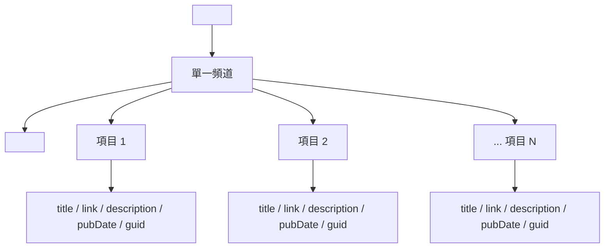
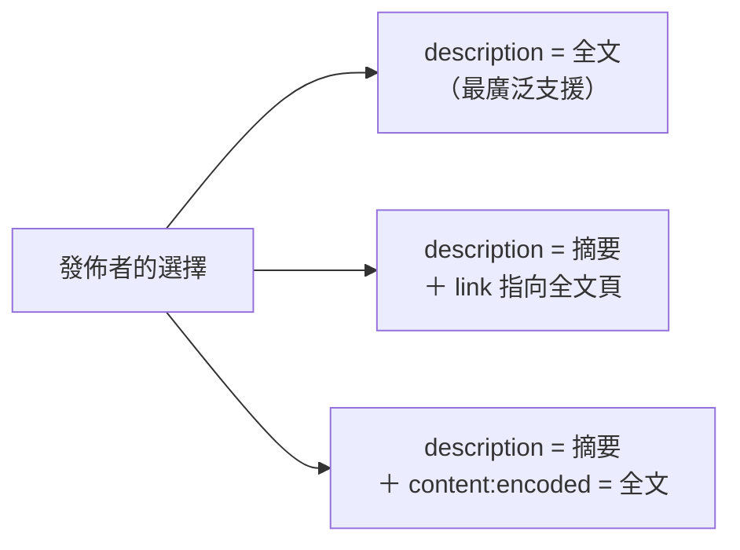

# RSS 飼料會包含「所有」內容嗎？還是只有最新 N 筆與摘要？

## 摘要（TL;DR）

RSS（Really Simple Syndication，簡易資訊聚合）**不是一份全站備份，也不是資料庫傾印**。它本質上是一份「XML 快照」或「內容清單」，通常只描述「最近更新的若干筆項目」，而且在多數實作中帶有明確或慣例性的筆數上限；每一筆項目的內容究竟是全文或摘要，**完全由發佈者自行決定**[^rssprofile-desc][^rfc5005-intro]。

換句話說，問題的答案是「**兩者皆是，但偏向後者**」：

- **筆數**：規格層級在 RSS 0.92 之後已取消上限，但「處理程式可以自訂上限，產生器也可以設定偏好」；RSS 0.90／0.91 則明文規定每條 channel 最多 15 筆[^rss092-limits][^harvard-limits]。實務上，**發佈端的軟體預設值往往就是 10 筆或 15 筆**。
- **內文**：`description` 可以是「完整的內文」也可以是「摘要」，這是「完全由發佈者自行裁量」的選擇[^rssprofile-desc]。

---

## 1. 先釐清名稱：RSS 是什麼？

RSS 是「Web 內容聯合供稿格式」（a Web content syndication format），也是 XML 的一種方言[^rss-spec-what]。這個縮寫在歷史上有多種展開方式[^wiki-rss-lead]：

| 版本 | 時間 | 主要推動者 | 縮寫展開 |
|---|---|---|---|
| RSS 0.90 | 1999-03-15 | Netscape（作者 Ramanathan Guha） | RDF Site Summary[^rssboard-history] |
| RSS 0.91 | 1999-07-10 | Netscape（作者 Dan Libby） | Rich Site Summary[^rssboard-history] |
| RSS 1.0 | 2000-12-06（正式頁面 2000 年） | RSS-DEV Working Group | RDF Site Summary[^rss1-spec] |
| RSS 0.92 | 2000-12-25 | UserLand（Dave Winer） | 沿 0.91 血統[^rssboard-history] |
| RSS 2.0 | 2002-09-18 起、2003-07-15 定稿 | UserLand／哈佛 Berkman Center | Really Simple Syndication[^rss-spec-what][^harvard-history] |
| RSS 2.0.11 | 2009-03-30（現行版） | RSS Advisory Board | Really Simple Syndication[^rssboard-history][^rss-spec-what] |

現行標準的開宗明義就寫著：「RSS is a Web content syndication format. Its name is an acronym for *Really Simple Syndication*.」[^rss-spec-what]

一個 RSS 文件的結構是：最上層是 `<rss>` 元素，底下是**單一** `<channel>` 元素，channel 包含中介資料（metadata）與其內容[^rss-spec-what]。也就是說，**一份 RSS 文件是「一個頻道」的快照，而不是整個網站**。

---

## 2. 筆數：規格怎麼說？

### 2.1 RSS 0.90 與 0.91：明文上限 15 筆

Netscape 的 RSS 0.90 說明文件列出的重點之一是：「You can include up to 15 headlines (items) in your RSS 0.9 file.」（你的 RSS 0.9 檔案中最多可以包含 15 則頭條／項目。）[^rss090-quickstart]

RSS 0.91 的規格則把上限寫在 `<item>` 條目裡：「Also, a maximum of 15 items per channel is enforced at this time.」（目前每條 channel 最多強制 15 筆項目。）[^rss091-netscape-item]

### 2.2 RSS 1.0：不強制，但「建議」最多 15 筆

RSS 1.0 規格在 `<item>` 一節明白寫道：

> 「While RSS 1.0 does not enforce an upper limit, for backward compatibility with RSS 0.9 and 0.91, a maximum of fifteen items is recommended.」
> （RSS 1.0 並不強制上限，但為了與 RSS 0.9 及 0.91 向後相容，建議最多 15 筆。）[^rss1-item]

同一份規格的修訂紀錄也特別澄清了一次用字：「An upper limit of 15 items per RSS document is recommended, not enforced.」（每份 RSS 文件上限 15 筆是「建議」而非「強制」。）[^rss1-version]

### 2.3 RSS 0.92 與 2.0：取消上限，改由「實作」決定

RSS 0.92 的規格有一節標題就叫「All limits are eliminated」（所有上限已移除）：

> 「In RSS 0.91 various elements are restricted to 500 or 100 characters. There can be no more than 15 `<item>`s in a 0.91 `<channel>`. There are no string-length or XML-level limits in RSS 0.92. Processors may impose their own limits, and generators may have preferences that say no more than a certain number of `<item>`s can appear in a channel, or that strings are limited in length.」
> （RSS 0.91 中若干元素被限制在 500 或 100 字元，且 0.91 的 channel 最多只能有 15 筆 item。RSS 0.92 沒有任何字串長度或 XML 層級的限制。**處理程式可以自行施加限制，而產生器也可能有偏好，規定一條 channel 中不得出現超過一定數量的 item**，或字串長度受限。）[^rss092-limits]

現行的 RSS 2.0.11 規格沿用同樣的說法，並指出「A channel may contain any number of `<item>`s.」（一條 channel 可以包含任意數量的 item。）[^rss-spec-items][^rss-spec-limits]

**這正是問題的核心**：規格把「一則飼料該放幾筆」留給發佈者與軟體決定。因此飼料在實務上並不是「全部內容」，而是**發佈者選擇的一個窗口（window）**。

### 2.4 業界慣例：RSS Best Practices Profile 的相關限制

RSS Advisory Board 的《RSS Best Practices Profile》（1.0 版，2007-10-15）在字元資料一節指出「There's no limit on the length of character data that can be contained in an RSS element.」（RSS 元素所容納的字元資料長度沒有限制。）[^rssprofile-chardata]。同份文件也提到 `atom:link rel="self"` 可讓飼料自我識別 URL，使其「更有可攜性、更自足、更容易快取」[^rssprofile-atomlink]，但**並未**規定飼料必須包含全部歷史項目。

### 2.5 最完整的規範化答案：RFC 5005《Feed Paging and Archiving》

如果要用一份標準回答「飼料會不會包含所有內容」，最貼切的其實是 IETF 的 **RFC 5005**（2007 年 9 月，Standards Track）。它明確把飼料分成三類，並解釋為何飼料常被拆成多份文件：

> 「Syndicated Web feeds (using formats such as Atom) are often split into multiple documents to save bandwidth, allow "sliding window" access, or for other purposes.」
> （聯合供稿的 Web 飼料（例如使用 Atom 格式者）**經常被拆成多份文件**，以節省頻寬、允許「滑動視窗」式存取，或基於其他目的。）[^rfc5005-intro]

三種類型的定義如下[^rfc5005-intro][^rfc5005-complete][^rfc5005-paged][^rfc5005-archived]：

| 類型 | 定義 | 是否等於「全部內容」 | 適用情境 |
|---|---|---|---|
| **Complete feed**（完整飼料） | 單一文件即代表邏輯飼料的**全部**項目；「any entry not actually in the feed document SHOULD NOT be considered part of that feed」 | ✅ 是（唯一情況） | 不想「記住」曾看過哪些項目時，例如排行榜、熱門清單 |
| **Paged feed**（分頁飼料） | 多份**暫時性**文件分載項目，**沒有**內容穩定性保證，且「Paged feeds are lossy」（本質上會遺失） | ❌ 否 | 項目數量極大、無限或無法確定時 |
| **Archived feed**（封存飼料） | 一份訂閱文件（放最新項目）＋多份**永久且穩定**的封存文件，可完整重建 | ⚠️ 可重建，但需用戶端主動抓取整條封存鏈 | 項目長壽且用戶端必須一筆不漏 |

RFC 5005 也定義了「logical feed」（邏輯飼料）一詞——指與某飼料相關的**全部**項目集合，並特別與「feed document」（可能只含子集）對比[^rfc5005-terms]。這段術語學本身就承認了：**一份飼料文件不等於飼料的全部**。

### 2.6 Atom 的對應說法

Atom 是 RSS 的替代格式，2003 年 6 月起發展，並成為 IETF Proposed Standard **RFC 4287**（2005 年 12 月）[^wiki-rss-history][^rfc4287]。RFC 4287 對飼料文件的定義是：

> 「An Atom Feed Document is a representation of an Atom feed, including metadata about the feed, and **some or all** of the entries associated with it.」
> （一份 Atom 飼料文件是某個 Atom 飼料的表示，包含該飼料的中介資料，以及**部分或全部**與其相關的項目。）[^rfc4287-feeddoc]

「some or all（部分或全部）」這個措辭，等同於在標準層面承認飼料可以只含一部分項目。RFC 4287 另指出 Atom 處理程式「MAY keep state sourced from Atom Feed Documents and combine them with other Atom Feed Documents」（可保留狀態並結合多份飼料文件），以重建連續視圖[^rfc4287-feeddoc]。

---

## 3. 摘要還是全文？由發佈者決定

RSS 2.0 規格對 `<description>` 的說明是：

> 「An item may represent a "story"... if so its description is a synopsis of the story, and the link points to the full story. An item may also be complete in itself, if so, the description contains the text...」
> （一筆 item 可以代表一則「報導」，此時其 description 是該報導的**摘要／梗概**，而 link 指向全文。一筆 item 也可以**本身就完整**，此時 description 就含有該文本。）[^rss-spec-items]

《RSS Best Practices Profile》把這件事講得更直白。它對 item 的 `description` 定義是：

> 「An item's description element holds character data that contains the item's **full content or a summary of its contents, a decision entirely at the discretion of the publisher**.」
> （item 的 description 元素所容納的字元資料，可以是該項目的**完整內容，或該內容的摘要——這完全由發佈者自行裁量**。）[^rssprofile-desc]

同一份 profile 也提供了「摘要 vs 全文」的標準做法[^rssprofile-contentencoded]：

- 不想用摘要的發佈者：**直接**把全文放進 `description`。
- 想同時提供摘要與全文的發佈者：把**摘要**放 `description`、**全文**放 Content 命名空間的 `content:encoded`，並讓 `description` 排在 item 內較前的位置。
- 只有 `content:encoded`、沒有摘要的項目：全文仍應放在 `description`。

### 3.1 真實軟體的預設值：以 WordPress 為例

WordPress 是地球上最普遍的 CMS 之一，它的飼料行為正好示範了「最新 N 筆 ＋ 可選摘要／全文」這套模式。

- **筆數預設值是 10**：WordPress 安裝時寫入的預設選項 `posts_per_rss` 為 `10`（`wp-admin/includes/schema.php`）[^wp-schema]。
- **後台欄位名稱本身就是答案**：閱讀設定頁的欄位標籤是「Number of recent items shown in syndication feeds」（在聯合供稿飼料中顯示的**最近**項目數量），對應的輸入框是 `posts_per_rss`[^wp-options-reading]。
- **飼料查詢會強制套用此上限**：`WP_Query` 在處理飼料時會覆寫分頁設定——「This overrides 'posts_per_page'」——將 `posts_per_page` 設為 `posts_per_rss`，或退而使用 `get_option( 'posts_per_rss' )`[^wp-wpquery]。留言飼料亦以同一選項作為 `LIMIT`[^wp-wpquery-comments]。
- **摘要或全文是另一個開關**：同一頁有「For each post in a feed, include」（飼料中每篇文章要包含）選項，提供「Full text」（全文，`rss_use_excerpt = 0`）與「Excerpt」（摘要，`rss_use_excerpt = 1`）兩個單選鈕[^wp-options-reading]。安裝預設值為 `0`，即**全文**[^wp-schema]。
- **飼料有多種格式**：WordPress 提供 `rss`、`rss2`、`atom`、`rdf` 等飼料類型，對應的 MIME 類型為 `application/rss+xml`、`application/atom+xml`、`application/rdf+xml`[^wp-feed-php]。

也就是說，一個**全新安裝、未改任何設定**的 WordPress 網站，其 `/feed/` 預設就是「最近 10 篇文章的全文」——既不是全站，也不是摘要。

### 3.2 其他來源對「飼料是最近更新」的明確定位

Google Search Central 在 2014-10-16 的官方文章中，直接把兩種機制的差異講明：

> 「XML sitemaps are usually large; **RSS/Atom feeds are small, containing only the most recent updates to your site.**」
> （XML sitemap 通常很大；**RSS/Atom 飼料則很小，只包含你網站最近的更新。**）[^google-practices]

對於「飼料該放多少」，該文並沒有給出數字，而是給出功能性要求：

> 「In order for Google to not miss updates, the RSS/Atom feed should have all updates in it since at least the last time Google downloaded it.」
> （為了讓 Google 不漏掉更新，RSS/Atom 飼料至少應該包含自上次 Google 下載以來**所有**的更新。）[^google-practices]

伺服器端則有硬性體積上限。FeedBurner 的官方說明頁指出：

> 「**Yes.** FeedBurner will not accept feeds that are larger than **one megabyte**. It's rare for a feed to be larger than 1 MB, but some publishing tools generate their original source feeds with no limit to how far back in time they will reach to include items. Such feeds are vulnerable to steady size increases.」
> （是的。FeedBurner **不接受大於 1 MB 的飼料**。飼料很少超過 1 MB，但有些發佈工具在產生原始飼料時，對於往回追溯多久以納入項目**完全沒有限制**，這類飼料容易持續膨脹。）[^feedburner-limit]

這段說明本身就印證了：**「往回追溯多久」是發佈工具的一個設定**，而常見的服務甚至會用體積上限來強迫飼料維持在「最近的一部分」[^feedburner-limit]。此外，RSS 2.0 的 `<ttl>` 元素提供快取時間提示：「ttl stands for time to live. It's a number of minutes that indicates how long a channel can be cached before refreshing from the source.」（ttl 是 time to live 的縮寫，代表一個頻道在被重新抓取前可以快取幾分鐘。）[^rss-spec-ttl]

---

## 4. 訂閱端（閱讀器）如何處理與保存

飼料本身既然是「最新 N 筆」的窗口，**閱讀器就必須靠規律輪詢才不會漏內容**——一旦某筆項目掉出飼料，除非閱讀器先前已抓過，否則事後無法再取得[^rfc5005-paged]。

《RSS Best Practices Profile》在 `<ttl>` 一節記錄了業界慣例：「By convention, most aggregators check an RSS feed for updates once an hour.」（依照慣例，多數聚合器每小時檢查一次 RSS 飼料是否有更新。）[^rssprofile-ttl] 該 profile 也提到，實測發現絕大多數聚合器把 TTL 當成「最大檢查頻率」或「建議檢查頻率」，而沒有實作規格原意的「最小頻率」[^rssprofile-ttl]。

因此，閱讀器端的「保留策略」成為使用者體驗的關鍵差異：不同服務對已抓取文章保留多久、每個飼料保留幾筆，作法各不相同，且**與飼料格式本身無關**——這是閱讀器自己的資料庫政策。

---

## 5. 為什麼實務上不會是「所有內容」？

把上面幾條線索合起來，可以歸納出四個結構性原因：

1. **頻寬與效率**：RFC 5005 明白指出飼料常被拆成多份文件以「節省頻寬」、允許「滑動視窗」存取[^rfc5005-intro]。FeedBurner 更直接以 1 MB 體積上限擋掉過大的飼料[^feedburner-limit]。
2. **「新內容通知」才是本業**：RSS 的用途是讓使用者與程式「access updates to websites」（取得網站的更新），並由新聞聚合器持續監看新內容[^wiki-rss-lead]。Google 也明白區分「sitemap 大、飼料小，飼料只含最近更新」[^google-practices]。它的設計目的**不是**保存歷史。
3. **規格刻意留白**：RSS 0.92 之後把上限問題交給處理程式與產生器；Atom 也只說「部分或全部」[^rss092-limits][^rfc4287-feeddoc]。
4. **用戶端本來就要自己去重**：`guid`（globally unique identifier）讓聚合器判斷項目是否為新的、避免重複呈現[^rssprofile-guid]；`pubDate` 讓聚合器可選擇不顯示未來日期的項目[^rssprofile-pubdate]。這些機制的存在，本身就預設了飼料是「滾動的」。

---

## 6. 結論

| 問題 | 答案 |
|---|---|
| RSS 飼料會包含**所有**內容嗎？ | **通常不會。** 只有在發佈者刻意採用 RFC 5005 定義的「complete feed」（完整飼料），或把整條封存鏈串起來時，才可能涵蓋全部[^rfc5005-complete][^rfc5005-archived]。 |
| 是最新的 N 筆嗎？ | **通常是。** 規格允許任意數量，但實作與慣例普遍設上限；RSS 0.90／0.91 強制 15 筆，RSS 1.0 建議 15 筆，RSS 0.92 之後交由實作決定[^rss090-quickstart][^rss091-netscape-item][^rss1-item][^rss092-limits]。軟體預設值如 WordPress 是 10 筆[^wp-schema]；Google 也明說飼料「只含最近更新」[^google-practices]；FeedBurner 則以 1 MB 體積上限擋掉過大飼料[^feedburner-limit]。 |
| 是摘要還是全文？ | **由發佈者決定。** `description` 可以放全文或摘要；要同時提供兩者可用 `content:encoded` 放全文、`description` 放摘要[^rssprofile-desc][^rssprofile-contentencoded]。 |

因此，若需要「完整」的內容存檔，正確做法是**主動抓取每一個 `link` 指向的頁面**（或使用 `guid` 去重後自行累積），而不是期待單一飼料 URL 會給出全部歷史[^rssprofile-guid][^rfc5005-paged]。反之，若只是要知道「有新東西」，訂閱飼料正是它的設計用途[^wiki-rss-lead][^google-practices]。

---

## 參考文獻（References）

[^rss-spec-what]: RSS Advisory Board. (2009, March 30). *RSS 2.0 specification* [What is RSS?]. Retrieved 2026-11-14, from https://www.rssboard.org/rss-specification
[^rss-spec-items]: RSS Advisory Board. (2009, March 30). *RSS 2.0 specification* [Elements of <item>]. Retrieved 2026-11-14, from https://www.rssboard.org/rss-specification
[^rss-spec-limits]: RSS Advisory Board. (2009, March 30). *RSS 2.0 specification* [Comments]. Retrieved 2026-11-14, from https://www.rssboard.org/rss-specification
[^rss-spec-ttl]: RSS Advisory Board. (2009, March 30). *RSS 2.0 specification* [<ttl> sub-element of <channel>]. Retrieved 2026-11-14, from https://www.rssboard.org/rss-specification
[^google-practices]: Google Search Central. (2014, October 16). *Best practices for XML sitemaps and RSS/Atom feeds*. Retrieved 2026-11-14, from https://developers.google.com/search/blog/2014/10/best-practices-for-xml-sitemaps-rssatom
[^feedburner-limit]: Google. (n.d.). *Is there a feed file size limit?* FeedBurner Help. Retrieved 2026-11-14, from https://support.google.com/feedburner/answer/79009
[^rssprofile-ttl]: RSS Advisory Board. (2007, October 15). *RSS best practices profile* [4.1.1.18 ttl]. Retrieved 2026-11-14, from https://www.rssboard.org/rss-profile
[^rssboard-history]: RSS Advisory Board. (n.d.). *RSS history*. Retrieved 2026-11-14, from https://www.rssboard.org/rss-history
[^harvard-history]: Winer, D. (2004, April 6). *RSS history*. RSS 2.0 at Harvard Law, Berkman Center for Internet & Society. Retrieved 2026-11-14, from https://cyber.harvard.edu/rss/rssVersionHistory.html
[^harvard-limits]: Winer, D. (2003, July 15). *RSS 2.0 specification* [Comments]. RSS 2.0 at Harvard Law, Berkman Center for Internet & Society. Retrieved 2026-11-14, from https://cyber.harvard.edu/rss/rss.html
[^rss090-quickstart]: Netscape Communications. (1999, March 15). *RSS 0.90 specification* [Step 1: Design and create your RDF Site Summary file]. Archived by the RSS Advisory Board. Retrieved 2026-11-14, from https://www.rssboard.org/rss-0-9-0
[^rss091-netscape-item]: Libby, D. (1999, July 10). *RSS 0.91 specification (Netscape)* [<item>]. Archived by the RSS Advisory Board. Retrieved 2026-11-14, from https://www.rssboard.org/rss-0-9-1-netscape
[^rss092-limits]: UserLand Software. (2000, December 25). *RSS 0.92 specification* [All limits are eliminated]. Archived by the RSS Advisory Board. Retrieved 2026-11-14, from https://www.rssboard.org/rss-0-9-2
[^rss1-spec]: RSS-DEV Working Group. (2001, May 30). *RDF Site Summary (RSS) 1.0* [Version]. Retrieved 2026-11-14, from http://web.resource.org/rss/1.0/spec
[^rss1-item]: RSS-DEV Working Group. (2001, May 30). *RDF Site Summary (RSS) 1.0* [5.5 <item>]. Retrieved 2026-11-14, from http://web.resource.org/rss/1.0/spec
[^rss1-version]: RSS-DEV Working Group. (2001, May 30). *RDF Site Summary (RSS) 1.0* [1.3.1 revision note]. Retrieved 2026-11-14, from http://web.resource.org/rss/1.0/spec
[^rssprofile-desc]: RSS Advisory Board. (2007, October 15). *RSS best practices profile* [4.1.1.20.4 description]. Retrieved 2026-11-14, from https://www.rssboard.org/rss-profile
[^rssprofile-contentencoded]: RSS Advisory Board. (2007, October 15). *RSS best practices profile* [5.2.1 content:encoded]. Retrieved 2026-11-14, from https://www.rssboard.org/rss-profile
[^rssprofile-chardata]: RSS Advisory Board. (2007, October 15). *RSS best practices profile* [3.1 Character data]. Retrieved 2026-11-14, from https://www.rssboard.org/rss-profile
[^rssprofile-guid]: RSS Advisory Board. (2007, October 15). *RSS best practices profile* [4.1.1.20.6 guid]. Retrieved 2026-11-14, from https://www.rssboard.org/rss-profile
[^rssprofile-pubdate]: RSS Advisory Board. (2007, October 15). *RSS best practices profile* [4.1.1.20.8 pubDate]. Retrieved 2026-11-14, from https://www.rssboard.org/rss-profile
[^rssprofile-atomlink]: RSS Advisory Board. (2007, October 15). *RSS best practices profile* [5.1.1 atom:link]. Retrieved 2026-11-14, from https://www.rssboard.org/rss-profile
[^rfc5005-intro]: Nottingham, M. (2007, September). *Feed paging and archiving* (RFC 5005, Section 1). IETF. Retrieved 2026-11-14, from https://www.rfc-editor.org/rfc/rfc5005.html
[^rfc5005-terms]: Nottingham, M. (2007, September). *Feed paging and archiving* (RFC 5005, Section 1.2). IETF. Retrieved 2026-11-14, from https://www.rfc-editor.org/rfc/rfc5005.html
[^rfc5005-complete]: Nottingham, M. (2007, September). *Feed paging and archiving* (RFC 5005, Section 2). IETF. Retrieved 2026-11-14, from https://www.rfc-editor.org/rfc/rfc5005.html
[^rfc5005-paged]: Nottingham, M. (2007, September). *Feed paging and archiving* (RFC 5005, Section 3). IETF. Retrieved 2026-11-14, from https://www.rfc-editor.org/rfc/rfc5005.html
[^rfc5005-archived]: Nottingham, M. (2007, September). *Feed paging and archiving* (RFC 5005, Section 4). IETF. Retrieved 2026-11-14, from https://www.rfc-editor.org/rfc/rfc5005.html
[^rfc4287]: Nottingham, M., & Sayre, R. (Eds.). (2005, December). *The Atom syndication format* (RFC 4287). IETF. Retrieved 2026-11-14, from https://www.rfc-editor.org/rfc/rfc4287.html
[^rfc4287-feeddoc]: Nottingham, M., & Sayre, R. (Eds.). (2005, December). *The Atom syndication format* (RFC 4287, Section 2). IETF. Retrieved 2026-11-14, from https://www.rfc-editor.org/rfc/rfc4287.html
[^wiki-rss-lead]: Wikipedia contributors. (n.d.). RSS. In *Wikipedia*. Retrieved 2026-11-14, from https://en.wikipedia.org/wiki/RSS
[^wiki-rss-history]: Wikipedia contributors. (n.d.). RSS [History]. In *Wikipedia*. Retrieved 2026-11-14, from https://en.wikipedia.org/wiki/RSS
[^wp-schema]: WordPress contributors. (n.d.). *schema.php* [Default options, `posts_per_rss` = 10 and `rss_use_excerpt` = 0]. WordPress core source, `wp-admin/includes/schema.php`. Retrieved 2026-11-14, from https://github.com/WordPress/WordPress/blob/master/wp-admin/includes/schema.php
[^wp-options-reading]: WordPress contributors. (n.d.). *options-reading.php* [Number of recent items shown in syndication feeds; For each post in a feed, include]. WordPress core source, `wp-admin/options-reading.php`. Retrieved 2026-11-14, from https://github.com/WordPress/WordPress/blob/master/wp-admin/options-reading.php
[^wp-wpquery]: WordPress contributors. (n.d.). *class-wp-query.php* [`is_feed` overrides `posts_per_page` with `posts_per_rss`]. WordPress core source, `wp-includes/class-wp-query.php`. Retrieved 2026-11-14, from https://github.com/WordPress/WordPress/blob/master/wp-includes/class-wp-query.php
[^wp-wpquery-comments]: WordPress contributors. (n.d.). *class-wp-query.php* [`comment_feed_limits` uses `get_option( 'posts_per_rss' )`]. WordPress core source, `wp-includes/class-wp-query.php`. Retrieved 2026-11-14, from https://github.com/WordPress/WordPress/blob/master/wp-includes/class-wp-query.php
[^wp-feed-php]: WordPress contributors. (n.d.). *feed.php* [`feed_content_type()` for `rss`, `rss2`, `atom`, `rdf`]. WordPress core source, `wp-includes/feed.php`. Retrieved 2026-11-14, from https://github.com/WordPress/WordPress/blob/master/wp-includes/feed.php
