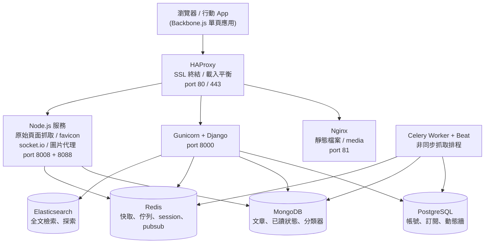
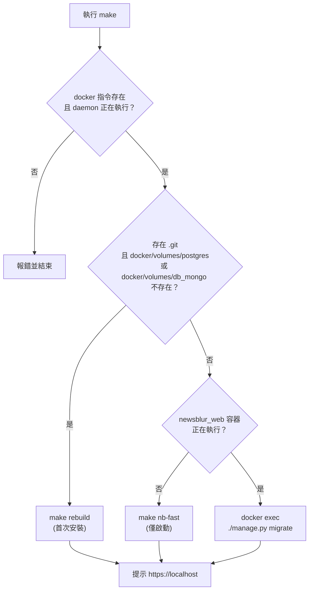
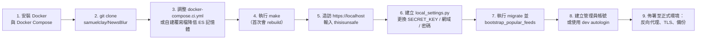

# 用 Docker Compose 自架 NewsBlur 的完整設定指南

## 摘要

NewsBlur 是一套開源的個人新聞閱讀器（RSS 閱讀器），同時具備社交新聞網路與「智慧訓練」（intelligence training）功能，能夠依使用者喜好自動標記或隱藏文章[^nb-readme]。專案以 Django 作為後端、Backbone.js 作為前端，資料層則橫跨 PostgreSQL、MongoDB、Redis 與 Elasticsearch 四種儲存系統[^nb-arch][^nb-readme]。

本報告說明如何以專案內建的 `docker-compose.yml` 在本機或單一伺服器上完成自架部署，涵蓋：硬體與軟體前提、服務拓樸、一鍵啟動流程、個別設定調整、常見錯誤與維護指令。

> 本報告僅涵蓋自架（self-hosted）情境。NewsBlur 官方主要營運的是代管服務 [newsblur.com](https://www.newsblur.com)，自架屬於「完全掌控自己資料」的進階用法[^nb-readme]。

---

## 1. 專案背景與可信度評估

NewsBlur 由 Samuel Clay 於 2009 年建立，儲存庫位於 GitHub 的 `samuelclay/NewsBlur`[^nb-api]。截至 2026-11-14 的公開指標如下：

| 指標 | 數值 |
|---|---|
| 星星數 | 7,691 |
| 分支（fork）數 | 1,048 |
| 授權 | MIT License |
| 主要語言 | HTML（含 Python、JavaScript） |
| 主題標籤 | `rss`, `rss-reader`, `feed-reader`, `elasticsearch`, `mongodb`, `postgresql`, `redis`, `python` |
| 建立日期 | 2009-01-05 |
| 最近推送 | 2026-11-14 |

[^nb-api]

**來源評估**：本專案星數接近 7,700，屬於活躍維護的高知名度開源專案，儲存庫在查詢當日（2026-11-14）仍有推送紀錄[^nb-api]。這代表文件與程式碼的「新鮮度」差異會是主要風險來源——本報告因此以儲存庫中**實際存在的檔案內容**（`docker-compose.yml`、`Makefile` 等）為第一手依據，而非以說明文件為準。

**須留意的一點**：儲存庫內的 `docker/README.md` 內容明顯過時且殘缺，其中提到 `docker-compose run newsblur`、`newsblur_postgres_1` 等已不存在的服務名稱，並帶有未完成的待辦備註[^docker-readme]。該檔案不可作為操作依據。

---

## 2. 系統架構

NewsBlur 的請求路徑與資料層關係如下圖所示（架構圖以儲存庫 `ARCHITECTURE.md` 的說明重繪[^nb-arch]）：



各資料層的職責分工為[^nb-arch]：

- **PostgreSQL**：需要 ACID 保證與複雜關聯查詢的資料，例如使用者帳號、來源（Feed）中介資料、訂閱關係、推薦來源、OAuth 權杖與付款紀錄。
- **MongoDB**：高流量的文件式儲存，例如文章本體（以 zlib 壓縮）、星號收藏、每位使用者的已讀狀態、分類器（classifier）與 AI 回應快取。
- **Redis**：記憶體快取、Celery 訊息中介、session 儲存與 pub/sub。正式環境會拆成四個獨立實例，但 Docker 開發環境共用一個實例並以編號資料庫區隔（DB 0 為使用者快取、DB 4 為 Celery broker、DB 5 為 session、DB 6 為 Django 快取等）[^nb-arch]。
- **Elasticsearch**：全文檢索與向量式探索；在技術說明中被列為 optional[^nb-readme]。

---

## 3. 前提條件

官方說明文件列出的前提條件僅有兩項：**Docker** 與 **Docker Compose**[^nb-readme]。

不過從實際的 compose 檔案與 Dockerfile 可推得以下隱含需求：

| 項目 | 來源依據 |
|---|---|
| 需要 `openssl`（產生自簽憑證） | `Makefile` 的 `keys` 目標[^nb-makefile] |
| 需要足夠記憶體供 Elasticsearch（compose 內限制 2 GB） | `docker-compose.yml` 的 `mem_limit: 2g`[^nb-compose] |
| MongoDB 使用 4.0 映像檔，於 Apple Silicon 可能需修復 | `mongo-repair` 目標註解「fixes boot loop on Apple Silicon」[^nb-makefile] |
| 需要 Linux / macOS 支援；root 目錄需可寫入 | `docker/volumes/*` 為掛載目錄[^nb-compose] |
| imageproxy 若要支援 arm64 需換用替代映像檔 | compose 內註解說明[^nb-compose] |

### 3.1 資源估算

儲存庫中並未提供正式的硬體需求表，但可從設定檔推估：

- **Elasticsearch**：容器層級限制為 `mem_limit: 2g`、`mem_reservation: 512m`，JVM 堆疊設為 `-Xms1g -Xmx1g`[^nb-compose]。CI 用的覆寫檔則把堆疊降到 `384m`[^nb-ci]，說明 Elasticsearch 是記憶體需求的主要來源，且確實可在低記憶體環境下調降。
- **Gunicorn 工作程序數**：`config/gunicorn_conf.py` 以「每 GB 記憶體 1.5 個 worker」計算，上限 16 個；當偵測到 `DOCKERBUILD` 環境變數時固定為 **2 個 worker 並開啟自動重載**[^nb-gunicorn]。該檔並記錄了一項實測教訓：worker 的 RSS 平均約 400 MB，壽命內會成長至約 600 MB，因此曾出現「15 個 worker × 約 500 MB 於 7.7 GB 主機、無 swap」而被核心 OOM killer 中途殺死的情況[^nb-gunicorn]。
- **記憶體預算公式**：`max_worker_memory_bytes` 以「（總記憶體 − 1 GB 保留給 OS／Docker） ÷ worker 數 ÷ 1.15」計算，保留 1 GB 給系統與 Docker[^nb-gunicorn]。

**實務結論**：8 GB 記憶體以上的機器較為穩妥；若僅供個人使用，可參考 CI 覆寫檔將 Elasticsearch 壓到 384 MB，並可使用 `docker-compose.ci.yml` 作為覆寫的起點[^nb-ci]。

---

## 4. Docker Compose 服務拓樸

`docker-compose.yml` 定義了下列服務[^nb-compose]：

| 服務名稱 | 容器名稱 | 映像檔 | 對外埠 | 說明 |
|---|---|---|---|---|
| `newsblur_web` | `newsblur_web` | `newsblur/newsblur_python3`（本地建置） | 8000 | Django + Gunicorn |
| `newsblur_node` | `newsblur_node` | `newsblur/newsblur_node` | 8008 | Node.js 服務 |
| `imageproxy` | `newsblur_imageproxy` | `yusukeito/imageproxy:v0.11.2` | 8088 | 圖片代理（arm64 相容版） |
| `nginx` | `newsblur_nginx` | `nginx:1.19.6` | 81 | 靜態檔案與 media |
| `newsblur_db_postgres` | `newsblur_db_postgres` | `postgres:13.1` | 5434→5432 | 關聯式資料 |
| `newsblur_db_redis` | `newsblur_db_redis` | `redis:latest` | 6579 | 快取／佇列／session |
| `newsblur_db_elasticsearch` | `newsblur_db_elasticsearch` | `elasticsearch:8.17.0` | 9200, 9300 | 搜尋（可選） |
| `dejavu` | `newsblur_dejavu` | `appbaseio/dejavu:3.6.0` | 1358 | Elasticsearch 的 Web UI |
| `newsblur_db_mongo` | `newsblur_db_mongo` | `mongo:4.0` | 29019 | 文件式儲存 |
| `task_celery` | `newsblur_celery` | `newsblur/newsblur_python3` | — | Celery worker + Beat |
| `newsblur_mcp` | `newsblur_mcp` | 本地建置（`./newsblur_mcp`） | 8099 | MCP 伺服器（AI 代理整合） |
| `haproxy` | `newsblur_haproxy` | `haproxy:latest` | 80, 443, 1936 | 對外入口與 SSL |

[^nb-compose]

值得注意的實作細節：

1. **`newsblur_web` 使用本地建置**，Dockerfile 為 `docker/newsblur_base_image.Dockerfile`，基於 `python:3.9-slim`，並安裝 gfortran、BLAS／LAPACK、libjpeg、Rust（供 tiktoken 使用）與 `uv` 套件管理器[^nb-compose][^nb-dockerfile]。
2. **`task_celery` 使用預建映像檔 `newsblur/newsblur_python3`（未指定 tag，等同 `latest`）**，而非本地建置——這與 `newsblur_web` 不同，可能造成版本不一致[^nb-compose]。
3. **`newsblur_web` 掛載 `${PWD}:/srv/newsblur`**，也就是把整份原始碼目錄掛進容器，因此程式碼變更會即時反映，且 `gunicorn_conf.py` 在 `DOCKERBUILD` 下會開啟 `reload = True`[^nb-compose][^nb-gunicorn]。
4. **HAProxy 的設定檔**含 `resolvers docker`（指向 `127.0.0.11:53`）與 `init-addr last,libc,none`，用意是讓後端容器即使暫時下線，HAProxy 仍能啟動[^nb-haproxy]。
5. **`imageproxy` 掛載 `/tmp:/tmp/imageproxy`**，這代表快取目錄位於主機的 `/tmp`[^nb-compose]。
6. **`newsblur_mcp` 依賴 `newsblur_web`**，並設定 `MCP_REDIS_URL=redis://newsblur_db_redis:6579/5`[^nb-compose]。此服務需要用 `docker compose up newsblur_mcp` 單獨啟動[^nb-readme]。

---

## 5. 一鍵啟動流程

官方文件給出的標準流程極簡[^nb-readme]：

```bash
git clone https://github.com/samuelclay/NewsBlur.git
cd NewsBlur
make
```

完成後造訪 `https://localhost`，並在瀏覽器憑證警告頁輸入 `thisisunsafe` 以略過自簽憑證警告[^nb-readme]。

### 5.1 `make` 究竟做了什麼

`Makefile` 的預設目標（`.DEFAULT_GOAL := default`）是一段有分支判斷的 shell 邏輯[^nb-makefile]：



[^nb-makefile]

其中兩個關鍵目標的展開如下[^nb-makefile]：

- `rebuild` = `pull` → `bounce` → `migrate` → `bootstrap` → `collectstatic`
- `bounce` = `docker compose down` → `keys`（產生 SSL 憑證）→ `docker compose up -d --build --remove-orphans`

`bootstrap` 目標會執行 `docker exec newsblur_web ./manage.py loaddata config/fixtures/bootstrap.json`，載入 `sites.site` 與一筆示範 Feed 資料[^nb-makefile][^nb-bootstrap-fixture]。另有 `docker/data.json` 提供另一組 `sites.site` 資料（網域為 `docker.newsblur.com`）[^nb-datajson]。

### 5.2 SSL 憑證的產生

`make keys` 會以 `openssl` 產生一組自簽憑證，寫入 `config/certificates/`（該目錄被 `.gitignore` 排除）[^nb-makefile][^nb-gitignore]：

- 先產生 `dhparam-2048.pem`
- 建立 Root CA（`RootCA.key` / `RootCA.pem` / `RootCA.crt`）
- 建立 `localhost.key` / `localhost.csr` / `localhost.crt`
- 合併為 `haproxy` 使用的 `localhost.pem`

在 Linux 上腳本會嘗試 `sudo cp` 到 `/usr/local/share/ca-certificates/` 並執行 `sudo update-ca-certificates`；若失敗則提示需手動信任憑證[^nb-makefile]。

---

## 6. 設定調整

### 6.1 覆寫設定的正確位置

官方建議建立 `newsblur_web/local_settings.py` 來覆寫 `docker_local_settings.py` 內的設定[^nb-readme]。`.gitignore` 已排除 `local_settings.py`，因此不會被提交[^nb-gitignore]。

### 6.2 自架常用設定項

以下為 `docker_local_settings.py` 與 README 中與自架最相關的設定[^nb-readme][^nb-local-settings]：

| 設定項 | 預設值 | 用途 |
|---|---|---|
| `NEWSBLUR_URL` | `os.getenv("NEWSBLUR_URL", "https://localhost")` | 你的網域，也用於 Archive 瀏覽器擴充功能的 OAuth |
| `SESSION_COOKIE_DOMAIN` | `localhost`（當 URL 為 `https://localhost` 時） | 驗證用的 cookie 網域 |
| `AUTO_PREMIUM` | `True` | 讓新使用者直接取得 premium 功能 |
| `AUTO_ENABLE_NEW_USERS` | `True` | 自動啟用新帳號（略過驗證信流程） |
| `ENFORCE_SIGNUP_CAPTCHA` | `False` | 註冊時是否強制 captcha |
| `OPENAI_API_KEY` | 佔位字串 | AI 功能與「Discover」相關文章 |
| `DAYS_OF_UNREAD` | `30` | premium 使用者的文章保留天數 |
| `DAYS_OF_UNREAD_FREE` | `14` | 免費使用者的文章保留天數 |
| `HOMEPAGE_USERNAME` | `"popular"` | 未登入者首頁顯示的使用者名稱 |
| `DEBUG` | `True`（開發者預設） | 除錯模式；`True` 時開發自動登入才可用 |
| `SECRET_KEY` | `"YOUR SECRET KEY"` | Django 密鑰，**上線前必須更換** |

其餘資料庫連線設定亦在此檔中，全部指向 compose 網路內的服務名稱[^nb-local-settings]：

```python
DATABASES = {"default": {... "HOST": "newsblur_db_postgres", "PORT": 5432}}
MONGO_DB = {"name": "newsblur", "host": "newsblur_db_mongo:29019"}
BROKER_URL = "redis://newsblur_db_redis:6579/0"
REDIS_STORY = {"host": "newsblur_db_redis", "port": 6579}
ELASTICSEARCH_FEED_HOSTS = ["newsblur_db_elasticsearch:9200"]
```

### 6.3 自行更換網域

儲存庫提供了一支**由使用者貢獻、官方標明不再維護**的腳本 `utils/custom_domain.sh`[^nb-customdomain]：

```bash
./utils/custom_domain.sh yournewsblur.example.com
```

它會以 `sed` 修改兩處：

1. `newsblur_web/docker_local_settings.py` 中的 `NEWSBLUR_URL` 與 `SESSION_COOKIE_DOMAIN`，把 `localhost` 換成新網域
2. `config/fixtures/bootstrap.json` 中的 `domain`

腳本開頭即註明「written by a NewsBlur user, lineuctterx, and is unmaintained. Use at your own risk.」[^nb-customdomain]。**使用前建議先備份，或直接手動編輯上述兩個檔案。**

### 6.4 調整 Elasticsearch 記憶體

若要降低資源佔用，可新增一個覆寫檔（類似 CI 做法）[^nb-ci]：

```yaml
# docker-compose.ci.yml（官方 CI 用覆寫檔的內容）
services:
  newsblur_db_elasticsearch:
    environment:
      - discovery.type=single-node
      - "ES_JAVA_OPTS=-Xms384m -Xmx384m"
      - "CLI_JAVA_OPTS="
      - cluster.routing.allocation.disk.threshold_enabled=false
      - xpack.security.enabled=false
      - bootstrap.memory_lock=false
      - indices.breaker.total.use_real_memory=false
```

啟動時以 `docker compose -f docker-compose.yml -f your-override.yml up -d` 套用。Elasticsearch 的完整本機設定位於 `config/elasticsearch/elasticsearch.yml`，其中已停用 xpack 安全性並關閉磁碟水位限制[^nb-es-config]。

### 6.5 監控堆疊（選用）

`docker-compose.metrics.yml` 提供 Prometheus、Grafana、node-exporter，以及針對 Mongo、Redis、HAProxy、Elasticsearch、PostgreSQL 的 exporter[^nb-metrics]。以 `make metrics` 啟動，等同於[^nb-makefile]：

```bash
docker compose -f docker-compose.yml -f docker-compose.metrics.yml up -d
```

Grafana 預設帳密為 `admin` / `pass`[^nb-metrics]。注意 `make down` 也會一併帶上 metrics 檔案[^nb-makefile]。

---

## 7. 首次資料初始化

### 7.1 資料庫遷移

`make` 會自動處理；若需手動執行[^nb-makefile]：

```bash
make migrate
# 等同於：
docker exec -t newsblur_web ./manage.py migrate
```

### 7.2 建立管理員與使用者

儲存庫中未提供專門的「建立第一位使用者」文件。可用的管道包括：

- Django 內建指令：`docker exec -t newsblur_web ./manage.py createsuperuser`
- 開發自動登入（**僅在 `DEBUG=True` 時有效**）：`https://localhost/reader/dev/autologin/`，可用於指定使用者 `https://localhost/reader/dev/autologin/<username>/`；在 `DEBUG=False` 下會回傳 403[^nb-agents][^nb-local-settings]
- 預設開發自動登入使用者名稱由 `DEV_AUTOLOGIN_USERNAME` 指定，預設為 `samuel`[^nb-local-settings]

### 7.3 熱門來源的 bootstrap

官方 README 提供了不需實際抓取的來源清單建立指令[^nb-readme]：

```bash
docker exec -t newsblur_web python manage.py bootstrap_popular_feeds --skip-fetch
```

可依類型過濾：`--type youtube`、`--type reddit`、`--type podcast`、`--type newsletter` 或 `--type rss`[^nb-readme]。

### 7.4 Elasticsearch 索引

`Maintenance.md` 提到，當 Elasticsearch 就緒後應先建立索引[^nb-maintenance]：

```bash
./manage.py index_feeds     # 索引來源
./manage.py index_stories -R
```

對應的 Makefile 目標為 `make index_feeds` 與 `make index_stories`[^nb-makefile]。文章之後會自動被索引[^nb-maintenance]。

---

## 8. 常用維運指令

以下整理自 README 與 Makefile[^nb-readme][^nb-makefile]：

| 指令 | 作用 |
|---|---|
| `make` | 啟動／更新並套用遷移（`git pull` 後執行） |
| `make log` / `make logall` | 檢視 web 與 node 記錄／全部容器記錄 |
| `make shell` | 容器內 Django shell（已自動匯入 models） |
| `make bash` | 容器內 bash |
| `make test` | 執行測試 |
| `make lint` | isort、black、flake8 格式化 |
| `make down` | 停止容器（含 metrics） |
| `make mongo` / `make redis` / `make postgres` | 各資料庫的互動式命令列 |
| `make migrate` | 套用資料庫遷移 |
| `make nbfast`（別名 `nb`、`nb-fast`） | 不重建的快速啟動 |
| `make rebuild` | 完整重建（Docker 設定變更後使用） |
| `make mongo-repair` | 修復 MongoDB（Apple Silicon 開機迴圈問題） |
| `make collectstatic` | 收集靜態檔案（需先執行，若關閉 `DEBUG_ASSETS`） |
| `make keys` | 產生／檢查自簽 SSL 憑證 |

`buy`／`collectstatic` 的細節：`collectstatic` 會先 `rm -fr static`，再以 `newsblur/newsblur_deploy` 映像檔重新產生靜態檔案[^nb-makefile]。`docker_local_settings.py` 對於 `DEBUG_ASSETS` 有明確說明：關閉它之前必須先執行過 `./manage.py collectstatic`[^nb-local-settings]。

---

## 9. 多工作區開發（Git Worktree）

儲存庫支援以 Git worktree 同時開發多個功能，每個 worktree 依目錄名稱雜湊取得一組獨立埠號[^nb-readme][^nb-agents]：

```bash
git worktree add .worktree/feature-name
cd .worktree/feature-name
make worktree        # 產生 .worktree/docker-compose.<name>.yml 並啟動
make worktree-log    # 追蹤該 worktree 的記錄
make worktree-close  # 停止並移除（若無未提交變更）
```

所有 worktree **共用同一組資料庫服務**（PostgreSQL、MongoDB、Redis、Elasticsearch），因此可平行測試而不需複製資料[^nb-readme]。主儲存庫的容器名稱是 `newsblur_web`、`newsblur_celery` 等，worktree 則加上尾綴如 `newsblur_web_<worktree-name>`[^nb-agents]。

生成的 worktree compose 檔（由 `docker/compose/worktree.yml.j2` 模板產生）會把 web、node、nginx、haproxy、celery、MCP 容器都掛上獨立容器名稱與埠號，並加入外部網路 `newsblur_default`[^nb-worktree-template]。埠號計算方式為：以目錄名稱的 md5 前 4 個字元取模 900 再加 100，HTTPS 埠為 `8443 + offset`[^nb-makefile]。

---

## 10. MCP 伺服器（AI 代理整合）

NewsBlur 內建一個 MCP（Model Context Protocol）伺服器，讓 AI 代理能讀取來源、文章與分類器[^nb-readme]。自架時它以獨立容器運行於埠 8099[^nb-readme][^nb-compose]：

```bash
docker compose up newsblur_mcp
```

客戶端指向 `https://your-newsblur-domain/mcp/`[^nb-readme]。compose 中的相關環境變數包括 `NEWSBLUR_BASE_URL=http://newsblur_web:8000`、`MCP_PORT=8099`、`MCP_OAUTH_CLIENT_ID=newsblur-mcp-server` 與 `MCP_OAUTH_CLIENT_SECRET=newsblur-mcp-dev-secret`[^nb-compose]——後者顯然是開發用預設值，對外暴露前應更換。HAProxy 設定中有一條對應的路由規則把 `/mcp` 導向 `newsblur_mcp:8099`[^nb-haproxy]。

MCP 伺服器映像檔本身基於 `python:3.12-slim`，以 `uv sync --frozen` 安裝依賴[^nb-mcp-dockerfile]。

---

## 11. 常見問題與注意事項

### 11.1 文件與程式碼不一致

`docker/README.md` 早於目前的 compose 架構，其中的 `docker-compose run newsblur` 指令、`newsblur_postgres_1` 主機名稱與 `docker/postgres/init.sql.gz` 流程都已不適用[^docker-readme]。**請以 `Makefile` 與 `docker-compose.yml` 為準。**

### 11.2 映像檔標籤不一致

`task_celery` 使用 `newsblur/newsblur_python3`（無 tag），而 `newsblur_web` 使用 `newsblur/newsblur_${NEWSBLUR_BASE:-python3}:latest` 並在本地建置[^nb-compose]。若自行修改了 web 的原始碼或依賴，Celery 容器可能仍跑舊版本——這也是專案文件提醒「修改任何在 Celery 任務中執行的程式碼後必須手動重啟 worker」的原因[^nb-agents]。

### 11.3 MongoDB 在 Apple Silicon 上開機迴圈

`Makefile` 提供了 `mongo-repair` 目標，註解明言此問題與 Apple Silicon 有關[^nb-makefile]。它會停止容器、清除 journal 與 lock 檔、以 `mongod --repair` 修復後重啟。

### 11.4 imageproxy 與 arm64

compose 中預設使用 `yusukeito/imageproxy:v0.11.2`，並以註解說明「若不需要 arm64 且想要原始版本，可改用 `ghcr.io/willnorris/imageproxy:latest`」[^nb-compose]。在 Apple Silicon 或 arm64 伺服器上請保留前者。

### 11.5 SSL 憑證信任

`make keys` 在 Linux 上的 `sudo update-ca-certificates` 步驟被標記為「attempted」，失敗不會中止流程[^nb-makefile]。若瀏覽器仍不接受憑證，需手動信任 `./config/certificates/RootCA.crt`[^nb-makefile]。

### 11.6 對外暴露的預設密碼與密鑰

下列值都是「開箱可用但不安全」的預設值，對外服務前應全部更換：

| 項目 | 預設值 | 來源 |
|---|---|---|
| PostgreSQL 帳密 | `newsblur` / `newsblur` | `docker-compose.yml`[^nb-compose] |
| Django `SECRET_KEY` | `"YOUR SECRET KEY"` | `docker_local_settings.py`[^nb-local-settings] |
| Redis | 未設密碼，`protected-mode no`、`bind 0.0.0.0` | `docker/redis/redis.conf`[^nb-redis-conf] |
| Elasticsearch | `xpack.security.enabled=false` | compose 與 es 設定[^nb-compose][^nb-es-config] |
| HAProxy stats | 基本驗證 `gimmiestats:StatsGiver`（埠 1936） | `haproxy.docker-compose.cfg`[^nb-haproxy] |
| MCP OAuth secret | `newsblur-mcp-dev-secret` | `docker-compose.yml`[^nb-compose] |

Redis 的 `protected-mode no` 搭配 `bind 0.0.0.0`[^nb-redis-conf] 在 compose 內部網路上尚可接受，但**切勿**把 6579 埠直接對外開放。

### 11.7 資料持久化

所有持久化資料都位於 `docker/volumes/` 下的綁定掛載目錄（postgres、redis、db_mongo、elasticsearch），而 `.gitignore` 排除了 `/docker/volumes/*`[^nb-compose][^nb-gitignore]。備份時應直接備份這個目錄。Makefile 亦提供 `mongodump`、`pgrestore`、`redisrestore` 等目標[^nb-makefile]。

### 11.8 缺少正式的上線部署指南

儲存庫中大量的 Ansible、Terraform 與 `utils/ssh_hz.sh` 內容都是為 newsblur.com 自身的正式環境而寫（包括 Hetzner 伺服器命名、S3 備份機與 DigitalOcean 憑證）[^nb-agents][^nb-maintenance]。**這些不適用於自架**。自架者應把 `docker-compose.yml` 視為「開發環境設定」，並自行補上反向代理、TLS、備份與監控。

---

## 12. 建議的自架流程摘要



---

## 13. 結論

NewsBlur 的 Docker Compose 自架流程在「啟動」這一層做得相當便利：`git clone` 加一個 `make` 就能跑起來，憑證產生、映像檔建置、資料庫遷移與初始資料載入都已自動化[^nb-readme][^nb-makefile]。但在「正式營運」這一層，儲存庫幾乎沒有著墨——文件明顯偏向開發用途，且 `docker/README.md` 已經過時[^docker-readme]。

因此實務上的建議是：

1. **以 `Makefile` 與 `docker-compose.yml` 為唯一依據**，忽略過時文件。
2. **首次啟動後立刻更換所有預設密碼與密鑰**（見 11.6 節）。
3. **視資源情況調降 Elasticsearch 記憶體**，並確認機器至少有 8 GB 記憶體較為穩妥[^nb-gunicorn][^nb-ci]。
4. **注意 `task_celery` 使用未標記的預建映像檔**，自行修改程式碼後需手動重啟（`docker restart newsblur_celery`）[^nb-agents][^nb-compose]。
5. **備份 `docker/volumes/` 整個目錄**[^nb-compose][^nb-gitignore]。

---

## 參考文獻

[^nb-readme]: Samuel Clay. (n.d.). *NewsBlur* [README]. Retrieved 2026-11-14, from https://github.com/samuelclay/NewsBlur/blob/main/README.md

[^nb-compose]: Samuel Clay. (n.d.). *docker-compose.yml* [Source code]. Retrieved 2026-11-14, from https://github.com/samuelclay/NewsBlur/blob/main/docker-compose.yml

[^nb-makefile]: Samuel Clay. (n.d.). *Makefile* [Source code]. Retrieved 2026-11-14, from https://github.com/samuelclay/NewsBlur/blob/main/Makefile

[^nb-arch]: Samuel Clay. (n.d.). *NewsBlur Architecture* [ARCHITECTURE.md]. Retrieved 2026-11-14, from https://github.com/samuelclay/NewsBlur/blob/main/ARCHITECTURE.md

[^nb-agents]: Samuel Clay. (n.d.). *NewsBlur Development Guidelines* [AGENTS.md]. Retrieved 2026-11-14, from https://github.com/samuelclay/NewsBlur/blob/main/AGENTS.md

[^nb-local-settings]: Samuel Clay. (n.d.). *docker_local_settings.py* [Source code]. Retrieved 2026-11-14, from https://github.com/samuelclay/NewsBlur/blob/main/newsblur_web/docker_local_settings.py

[^nb-dockerfile]: Samuel Clay. (n.d.). *newsblur_base_image.Dockerfile* [Source code]. Retrieved 2026-11-14, from https://github.com/samuelclay/NewsBlur/blob/main/docker/newsblur_base_image.Dockerfile

[^nb-gunicorn]: Samuel Clay. (n.d.). *gunicorn_conf.py* [Source code]. Retrieved 2026-11-14, from https://github.com/samuelclay/NewsBlur/blob/main/config/gunicorn_conf.py

[^nb-haproxy]: Samuel Clay. (n.d.). *haproxy.docker-compose.cfg* [Configuration file]. Retrieved 2026-11-14, from https://github.com/samuelclay/NewsBlur/blob/main/docker/haproxy/haproxy.docker-compose.cfg

[^nb-es-config]: Samuel Clay. (n.d.). *elasticsearch.yml* [Configuration file]. Retrieved 2026-11-14, from https://github.com/samuelclay/NewsBlur/blob/main/config/elasticsearch/elasticsearch.yml

[^nb-redis-conf]: Samuel Clay. (n.d.). *redis.conf* [Configuration file]. Retrieved 2026-11-14, from https://github.com/samuelclay/NewsBlur/blob/main/docker/redis/redis.conf

[^nb-ci]: Samuel Clay. (n.d.). *docker-compose.ci.yml* [Source code]. Retrieved 2026-11-14, from https://github.com/samuelclay/NewsBlur/blob/main/docker-compose.ci.yml

[^nb-metrics]: Samuel Clay. (n.d.). *docker-compose.metrics.yml* [Source code]. Retrieved 2026-11-14, from https://github.com/samuelclay/NewsBlur/blob/main/docker-compose.metrics.yml

[^nb-customdomain]: Samuel Clay. (n.d.). *custom_domain.sh* [Shell script; contributed by GitHub user lineuctterx]. Retrieved 2026-11-14, from https://github.com/samuelclay/NewsBlur/blob/main/utils/custom_domain.sh

[^nb-worktree-template]: Samuel Clay. (n.d.). *worktree.yml.j2* [Source code]. Retrieved 2026-11-14, from https://github.com/samuelclay/NewsBlur/blob/main/docker/compose/worktree.yml.j2

[^nb-mcp-dockerfile]: Samuel Clay. (n.d.). *Dockerfile* [Source code]. Retrieved 2026-11-14, from https://github.com/samuelclay/NewsBlur/blob/main/newsblur_mcp/Dockerfile

[^nb-maintenance]: Samuel Clay. (n.d.). *Maintenance* [Maintenance.md]. Retrieved 2026-11-14, from https://github.com/samuelclay/NewsBlur/blob/main/Maintenance.md

[^nb-gitignore]: Samuel Clay. (n.d.). *.gitignore* [Configuration file]. Retrieved 2026-11-14, from https://github.com/samuelclay/NewsBlur/blob/main/.gitignore

[^nb-datajson]: Samuel Clay. (n.d.). *data.json* [Fixture data]. Retrieved 2026-11-14, from https://github.com/samuelclay/NewsBlur/blob/main/docker/data.json

[^nb-bootstrap-fixture]: Samuel Clay. (n.d.). *bootstrap.json* [Fixture data]. Retrieved 2026-11-14, from https://github.com/samuelclay/NewsBlur/blob/main/config/fixtures/bootstrap.json

[^docker-readme]: Samuel Clay. (n.d.). *Docker related informations* [docker/README.md]. Retrieved 2026-11-14, from https://github.com/samuelclay/NewsBlur/blob/main/docker/README.md

[^nb-api]: GitHub. (n.d.). *samuelclay/NewsBlur* [Repository metadata API]. Retrieved 2026-11-14, from https://api.github.com/repos/samuelclay/NewsBlur
