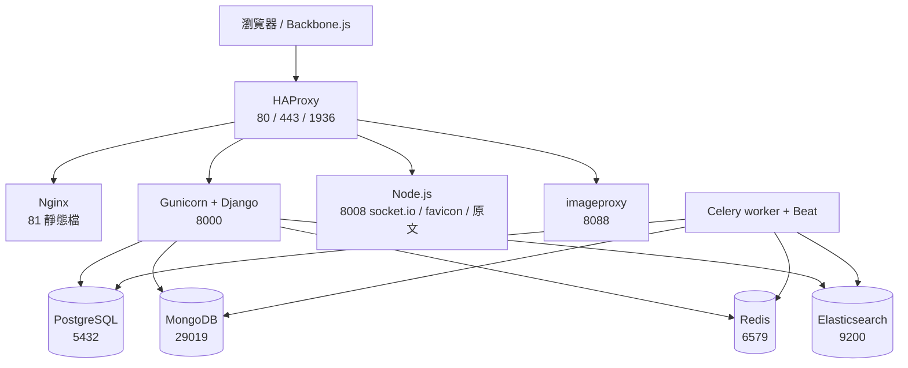
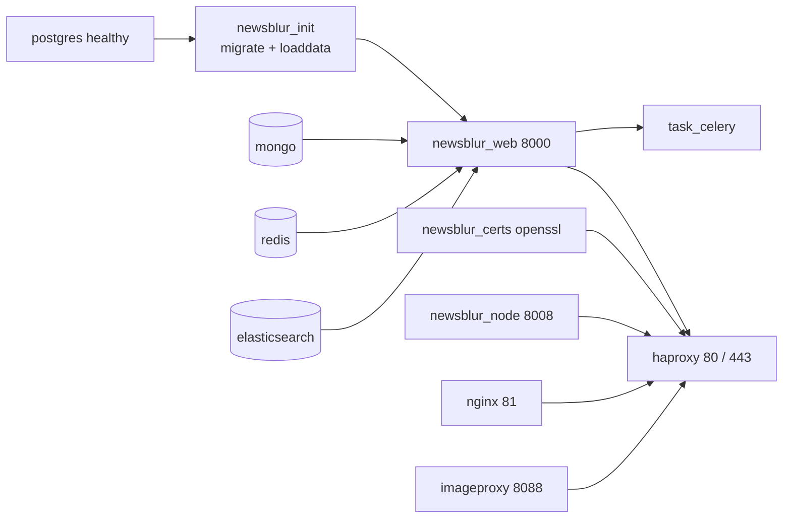

# 只用 docker-compose.yaml 最小化自架 NewsBlur

## 摘要

NewsBlur 是一套開源的個人 RSS 閱讀器，官方自架教學只有三行[^readme]：

```bash
git clone https://github.com/samuelclay/NewsBlur.git
cd NewsBlur
make
```

`make` 背後其實呼叫了一長串 shell 與 `openssl`，並且建立在 Makefile 這個檔案上。對「不信任 bash、只相信 docker-compose.yaml」的維運情境而言，問題不是 `make` 好不好用，而是**部署狀態沒有被完整描述在一個宣告式檔案裡**。

本報告的結論是：**可以只用單一 `docker-compose.yaml` 完成自架**。做法是把 `make` 的每一個副作用都翻譯成 compose 物件：

1. `make keys`（產生自簽憑證）→ 一個 `alpine` + `openssl` 的一次性容器，輸出到 named volume；
2. `make migrate` → 一次性容器執行 `manage.py migrate`；
3. `make bootstrap`（載入 fixtures）→ 同一個一次性容器執行 `loaddata`；
4. `make collectstatic` → 開發模式下**可以省略**，因為容器內設定 `DEBUG=True` 與 `DEBUG_ASSETS=True`，Django 會自己服務靜態檔[^dockerlocal]；
5. `make pull` / `docker compose up -d --build` → 改由 `image:` 與 `depends_on` 表述。

需要注意的誠實前提：`command:` 裡的內容仍然是 shell 字串，容器內仍會執行 `/bin/sh`。能做到的是**把編排與初始化流程完全宣告於 compose 檔案中**，主機端不需要 repo 附帶的腳本、不需要 Make，也不需要在 CI 之外執行任何未受審的 shell；而不是「整個系統沒有 shell」。[^compose-command]

---

## 1. 背景

| 項目 | 內容 |
| --- | --- |
| 專案 | NewsBlur（個人新聞閱讀器 / RSS 閱讀器，含 intelligence 訓練、社交、AI 功能） |
| 來源 | `samuelclay/NewsBlur`[^repo] |
| 授權 | MIT[^repo] |
| 星數 | 7,691 stars、1,048 forks（2026-11-14 查詢）[^repo] |
| 語言 | 主體為 Python（Django）+ Backbone.js 前端，官方標示主要語言為 HTML[^repo] |
| 預設分支 | `main`，最後推送時間 2026-11-14T02:46:55Z[^repo] |

NewsBlur 的技術堆疊包含四個資料存放區與多個輔助服務，官方架構文件有完整說明[^arch]：



官方 `docker-compose.yml` 共定義 12 個 service：7 個應用與周邊服務（`newsblur_web`、`newsblur_node`、`imageproxy`、`nginx`、`haproxy`、`task_celery`、`newsblur_mcp`）、4 個資料庫（`newsblur_db_postgres`、`newsblur_db_redis`、`newsblur_db_mongo`、`newsblur_db_elasticsearch`），以及 Elasticsearch 的視覺化工具 `dejavu`。[^compose]

---

## 2. `make` 到底做了什麼

官方 README 只寫 `make`，但 Makefile 的預設目標是「智慧判斷」：若偵測不到 `docker/volumes/postgres` 或 `docker/volumes/db_mongo` 就執行 `rebuild`，否則若容器沒跑就執行 `nb-fast`，否則只補跑 migration[^makefile]。

| Makefile 目標 | 實際動作 | 只靠 compose 能否達成 |
| --- | --- | --- |
| `rebuild` | `pull bounce migrate bootstrap collectstatic` 串起來[^makefile] | 可以，改寫成多個一次性容器 + `depends_on` |
| `keys` | `openssl dhparam`、自簽 RootCA、`localhost.crt/key`，最後 `cat` 成 `localhost.pem`；macOS/Linux 還會嘗試 `sudo` 把 RootCA 加入系統信任[^makefile] | 可以（憑證產生）；**系統信任那一步不可能**由容器完成，只能手動或改用 `thisisunsafe` 略過 |
| `bounce` | `docker compose down` 後 `up -d --build --remove-orphans`[^makefile] | 可以（`docker compose up -d`） |
| `migrate` | `docker exec -t newsblur_web ./manage.py migrate`[^makefile] | 可以（一次性容器） |
| `bootstrap` | `docker exec newsblur_web ./manage.py loaddata config/fixtures/bootstrap.json`[^makefile] | 可以（一次性容器） |
| `collectstatic` | 先 `rm -fr static`，再用 `newsblur/newsblur_deploy` 映像跑壓縮與校驗[^makefile] | 開發模式可省略；生產模式需保留 |
| `pull` | 拉 `newsblur_python3`、`newsblur_node`、`newsblur_monitor`、`newsblur_mcp` 四個映像[^makefile] | 可以（`docker compose pull`） |

換句話說，**`make` 沒有任何「compose 無法表達」的必要步驟**，唯一真正超出 compose 能力的是把自簽 CA 安裝進宿主機信任庫（因為它需要 `sudo`）。其餘全部可以宣告化。

補充一點：`newsblur_web` 的環境變數 `RUNWITHMAKEBUILD=${RUNWITHMAKEBUILD:-True}`[^compose] 在 2026-11-14 的程式碼搜尋中只出現在 compose 檔案內，應用程式碼並未引用[^search-runwith]。因此移除 Make 流程不會破壞任何行為。

---

## 3. 官方 compose 檔在 Linux 上的四個已知痛點

以下都是官方 compose 檔在「非 Docker Desktop」環境（原生 Linux）上會遇到的問題，而且**上游 CI 已經間接承認**：

### 3.1 bind mount 的目錄擁有權

官方 compose 把四個資料庫的資料目錄綁到 `./docker/volumes/*` 這些**宿主機路徑**[^compose]。這些路徑在 `.gitignore` 內被忽略[^gitignore]，也就是 clone 之後不存在，會由 Docker 以 root 身分自動建立。

這四個 service 對「root 擁有的資料目錄」反應並不一致，這是本節最重要的細節：

| 資料庫 | 容器執行身分 | 是否自行修正目錄擁有權 | bind mount 結果 |
| --- | --- | --- | --- |
| PostgreSQL 13 | 以 root 啟動，entrypoint 內 `exec gosu postgres` 降權[^pg-entrypoint] | 是。`docker_create_db_directories()` 內有 `find "$PGDATA" \! -user postgres -exec chown postgres '{}' +`，且註解說明「若以 root 執行則確保擁有權屬於 postgres 使用者」[^pg-entrypoint] | 可運作 |
| MongoDB 4.0 | 以 root 啟動後 `exec gosu mongodb` 降權[^mongo-entrypoint] | 是。`if [ "$originalArgOne" = 'mongod' ]; then find -L /data/configdb /data/db \! -user mongodb -exec chown mongodb '{}' +`[^mongo-entrypoint] | 可運作 |
| Redis | 以 root 啟動後 `exec gosu redis` 降權[^redis-entrypoint] | 是。`find . \! -user redis -exec chown redis '{}' +`，而工作目錄正是 `/data`（Dockerfile 內 `WORKDIR /data`）[^redis-entrypoint][^redis-dockerfile] | 可運作 |
| Elasticsearch 8.17 | **永遠以 uid:gid `1000:0` 執行**，不會降到較低權限 | **否**，entrypoint 內完全沒有 `chown`[^es-entrypoint] | **失敗** |

Elasticsearch 是最關鍵的一個。其 Dockerfile 最後設定 `USER 1000:0`，且以 `COPY --chown=0:0` 複製發行檔後才 `chown elasticsearch bin config data logs plugins`[^es-dockerfile]；官方文件也說明「容器的執行身分是 uid:gid `1000:0`」，並且「若 bind mount 本機目錄或檔案，它必須能被 elasticsearch 使用者讀取」[^es-docker]。root 擁有、模式 `0755`（Docker 自動建立的預設值）的目錄對 uid 1000 是不可寫的，Elasticsearch 會在啟動時因無法寫入 `/usr/share/elasticsearch/data` 而退出，而且它的 entrypoint 不會代為修正[^es-entrypoint]。

上游 GitHub Actions 工作流程的做法是直接放寬權限[^testsyml]：

```bash
mkdir -p docker/volumes/db_mongo docker/volumes/db_postgres ...
chmod -R 777 docker/volumes
```

CI 需要在啟動前做這一步，正是這個問題的實證。若四個資料庫都會自我修正擁有權，這行 `chmod` 就沒有存在必要。

**compose-only 解法**：四個資料庫統一改用 **named volume** 取代宿主機 bind mount。Docker 首次建立 named volume 時會沿用映像檔內該目錄的擁有權，因此 Elasticsearch 的 data volume 會直接是 `1000:0`（因為映像內該目錄已 `chown elasticsearch`）[^es-dockerfile]，不需要任何 `chmod`，也不需要在主機上跑任何指令。

### 3.2 ARM 專用 JVM 參數會在 x86_64 崩潰

官方 compose 的 Elasticsearch 帶了 `-XX:UseSVE=0`[^compose]，`UseSVE` 是 ARM 的 SVE 指令集開關。上游 CI 因此必須額外掛一個 override 檔把這些參數移除，工作流程註解寫得很直白：「remove ARM-specific JVM flags (UseSVE) that crash on x86_64」[^testsyml]，override 內容同時把 heap 從 1g 降到 384m[^ciyml]。

**compose-only 解法**：在 x86_64 主機上不要抄 `UseSVE` 參數。若要在單檔中同時支援兩種架構，只能用兩個 compose 檔案覆寫（這仍屬 compose 範圍，不是腳本）。

### 3.3 `vm.max_map_count`

Elasticsearch 官方文件要求宿主機核心參數 `vm.max_map_count` 必須為 `1048576`，需以 `sysctl -w` 設定[^es-docker]。這是**宿主機層級的設定，compose 無法代勞**，屬於真正的外部前置條件。

### 3.4 MongoDB 4.0 與 ARM

官方 compose 使用 `mongo:4.0`[^compose]，Makefile 甚至內建 `make mongo-repair` 來修復 Apple Silicon 上的開機迴圈，做法是刪除 journal 與 lock 檔後跑 `mongod --repair`[^makefile]。若主機是 ARM，需要預期這個風險。

另外，haproxy 的設定檔指定 `crt /srv/newsblur/config/certificates/localhost.pem`，backend 用 `server app_django nb.com:8000`，因此 **`newsblur_web` 的 `hostname: nb.com` 不能拿掉**[^haproxy][^compose]。同一份設定還會讀取 `/srv/newsblur/templates/502.http` 作為錯誤頁[^haproxy]，所以 haproxy 容器也必須掛載整個 repo。

---

## 4. 最小化策略：三層

| 層級 | 包含的 service | 能得到什麼 | 失去什麼 |
| --- | --- | --- | --- |
| A：能開起來 | postgres、mongo、redis、web | 網頁介面可開、可註冊、可登入 | 沒有搜尋、沒有抓取新文章、沒有 favicon、原文連結不工作 |
| B：實用最小（本報告建議） | A + elasticsearch + task_celery + node + nginx + haproxy + 兩個一次性容器 | 與官方 `make` 幾乎等價的完整功能 | 沒有 MCP server、沒有 metrics 堆疊 |
| C：完整 | B + newsblur_mcp + docker-compose.metrics.yml[^metrics] | 全部功能 | 資源需求更高 |

層級 A 是**推論而非實測**。可以確定的是 Elasticsearch 的客戶端是延遲建立（`SearchStory.ES()` 是 classmethod，第一次呼叫才 `elasticsearch.Elasticsearch(...)`）[^searchmodels]，而且官方 CI 在跑測試前一定先把四個資料庫全部等起來[^testsyml]，所以上游從未驗證過「沒有 Elasticsearch 也能跑」。此外，沒有 Celery worker 就沒有人執行每分鐘排程的 `TaskFeeds`，也就不會有新文章[^arch]。若只是想確認映像檔與資料庫能組起來，A 可當成煙霧測試；但它是否真的能開起來，本報告不背書。

本報告提供的是**層級 B**。

---

## 5. 完整的單一 docker-compose.yaml

放在 clone 下來的 `NewsBlur/` 目錄根部（因為要相對掛載 repo 內的 `docker/nginx/nginx.local.conf`、`docker/haproxy/haproxy.docker-compose.cfg`、`docker/redis/*.conf`、`config/elasticsearch/elasticsearch.yml`）[^nginxconf][^haproxy][^compose]。其中 `config/elasticsearch/elasticsearch.yml` 與 `docker/redis/*.conf` 都已提交在 repo 內，不需要事先生成[^esconf][^compose]。

```yaml
name: newsblur

x-nb-env: &nb-env
  DOCKERBUILD: "True"

services:
  # ============================================================
  # 一次性初始化容器（對應 make keys / migrate / bootstrap）
  # ============================================================
  newsblur_certs:
    image: alpine:3.20
    container_name: newsblur_certs
    restart: "no"
    entrypoint: ["/bin/sh", "-c"]
    command:
      - |
        set -e
        apk add --no-cache openssl >/dev/null
        cd /certs
        if [ -f localhost.pem ]; then
          echo "certificates already present, skipping"
          exit 0
        fi
        openssl dhparam -out dhparam-2048.pem 2048
        openssl req -x509 -nodes -new -sha256 -days 1024 -newkey rsa:2048 \
          -keyout RootCA.key -out RootCA.pem -subj "/C=US/CN=Example-Root-CA"
        openssl x509 -outform pem -in RootCA.pem -out RootCA.crt
        openssl req -new -nodes -newkey rsa:2048 -keyout localhost.key \
          -out localhost.csr \
          -subj "/C=US/ST=State/L=City/O=Example-Certificates/CN=localhost"
        openssl x509 -req -sha256 -days 1024 -in localhost.csr \
          -CA RootCA.pem -CAkey RootCA.key -CAcreateserial -out localhost.crt
        cat localhost.crt localhost.key > localhost.pem
    volumes:
      - newsblur_certs:/certs

  newsblur_init:
    image: newsblur/newsblur_python3:latest
    container_name: newsblur_init
    restart: "no"
    environment: *nb-env
    working_dir: /srv/newsblur
    entrypoint: ["/bin/sh", "-c"]
    command:
      - |
        set -e
        python3 manage.py migrate --noinput
        python3 manage.py loaddata config/fixtures/bootstrap.json
    volumes:
      - .:/srv/newsblur
    depends_on:
      newsblur_db_postgres:
        condition: service_healthy

  # ============================================================
  # 應用層
  # ============================================================
  newsblur_web:
    image: newsblur/newsblur_python3:latest
    container_name: newsblur_web
    hostname: nb.com
    entrypoint: /bin/sh -c newsblur_web/entrypoint.sh
    environment: *nb-env
    stdin_open: true
    tty: true
    restart: unless-stopped
    ulimits:
      nproc: 10000
      nofile:
        soft: 10000
        hard: 10000
    ports:
      - "8000:8000"
    volumes:
      - .:/srv/newsblur
    depends_on:
      newsblur_init:
        condition: service_completed_successfully
      newsblur_db_postgres:
        condition: service_healthy
      newsblur_db_mongo:
        condition: service_healthy
      newsblur_db_redis:
        condition: service_healthy
      newsblur_db_elasticsearch:
        condition: service_healthy

  task_celery:
    image: newsblur/newsblur_python3:latest
    container_name: newsblur_celery
    user: "1000:1000"
    command: "celery worker -A newsblur_web -B --loglevel=INFO"
    restart: unless-stopped
    environment: *nb-env
    volumes:
      - .:/srv/newsblur
    depends_on:
      newsblur_init:
        condition: service_completed_successfully
      newsblur_web:
        condition: service_started
      newsblur_db_postgres:
        condition: service_healthy
      newsblur_db_mongo:
        condition: service_healthy
      newsblur_db_redis:
        condition: service_healthy
      newsblur_db_elasticsearch:
        condition: service_healthy

  newsblur_node:
    image: newsblur/newsblur_node:latest
    container_name: newsblur_node
    user: "1000:1000"
    environment:
      NODE_ENV: docker
      MONGODB_PORT: "29019"
    command: node newsblur.js
    restart: unless-stopped
    stop_signal: HUP
    ports:
      - "8008:8008"
    volumes:
      - ./node:/srv
      - newsblur_node_originals:/srv/originals
    depends_on:
      newsblur_db_mongo:
        condition: service_healthy
      newsblur_db_redis:
        condition: service_healthy

  imageproxy:
    image: yusukeito/imageproxy:v0.11.2
    container_name: newsblur_imageproxy
    user: "1000:1000"
    entrypoint: /app/imageproxy -addr 0.0.0.0:8088 -cache /tmp/imageproxy -verbose
    restart: unless-stopped
    volumes:
      - /tmp:/tmp/imageproxy

  nginx:
    image: nginx:1.19.6
    container_name: newsblur_nginx
    restart: unless-stopped
    volumes:
      - ./docker/nginx/nginx.local.conf:/etc/nginx/conf.d/nginx.conf:ro
      - .:/srv/newsblur
    depends_on:
      newsblur_web:
        condition: service_started
      newsblur_node:
        condition: service_started

  haproxy:
    image: haproxy:latest
    container_name: newsblur_haproxy
    restart: unless-stopped
    ports:
      - "80:80"
      - "443:443"
      - "1936:1936"
    volumes:
      - ./docker/haproxy/haproxy.docker-compose.cfg:/usr/local/etc/haproxy/haproxy.cfg:ro
      - .:/srv/newsblur
      - newsblur_certs:/srv/newsblur/config/certificates
    depends_on:
      newsblur_certs:
        condition: service_completed_successfully
      newsblur_init:
        condition: service_completed_successfully
      newsblur_web:
        condition: service_started
      newsblur_node:
        condition: service_started
      nginx:
        condition: service_started
      imageproxy:
        condition: service_started

  # ============================================================
  # 資料層
  # ============================================================
  newsblur_db_postgres:
    image: postgres:13.1
    container_name: newsblur_db_postgres
    restart: unless-stopped
    environment:
      POSTGRES_USER: newsblur
      POSTGRES_PASSWORD: newsblur
    volumes:
      - newsblur_pg:/var/lib/postgresql/data
    healthcheck:
      test: ["CMD-SHELL", "pg_isready -U newsblur"]
      interval: 10s
      timeout: 5s
      retries: 10
      start_period: 20s

  newsblur_db_mongo:
    image: mongo:4.0
    container_name: newsblur_db_mongo
    restart: unless-stopped
    command: mongod --port 29019 --wiredTigerEngineConfigString="checkpoint=(wait=60),file_manager=(close_idle_time=0)"
    volumes:
      - newsblur_mongo:/data/db
    healthcheck:
      test: ["CMD-SHELL", "mongo --port 29019 --quiet --eval 'db.adminCommand({ping:1})'"]
      interval: 10s
      timeout: 5s
      retries: 10
      start_period: 20s

  newsblur_db_redis:
    image: redis:latest
    container_name: newsblur_db_redis
    restart: unless-stopped
    command: redis-server /etc/redis/redis.conf --port 6579
    volumes:
      - ./docker/redis/redis.conf:/etc/redis/redis.conf:ro
      - ./docker/redis/redis_server.conf:/usr/local/etc/redis/redis_replica.conf:ro
      - newsblur_redis:/data
    healthcheck:
      test: ["CMD-SHELL", "redis-cli -p 6579 ping"]
      interval: 10s
      timeout: 5s
      retries: 10

  newsblur_db_elasticsearch:
    image: docker.elastic.co/elasticsearch/elasticsearch:8.17.0
    container_name: newsblur_db_elasticsearch
    restart: unless-stopped
    mem_limit: 2g
    mem_reservation: 512m
    environment:
      discovery.type: single-node
      ES_JAVA_OPTS: "-Xms1g -Xmx1g"
      cluster.routing.allocation.disk.threshold_enabled: "false"
      xpack.security.enabled: "false"
      bootstrap.memory_lock: "false"
      indices.breaker.total.use_real_memory: "false"
    volumes:
      - newsblur_es:/usr/share/elasticsearch/data
      - ./config/elasticsearch/elasticsearch.yml:/usr/share/elasticsearch/config/elasticsearch.yml:ro
    ulimits:
      nofile:
        soft: 65536
        hard: 65536
    ports:
      - "9200:9200"
    healthcheck:
      test: ["CMD-SHELL", "curl -fsS 'http://localhost:9200/_cluster/health?wait_for_status=yellow&timeout=5s'"]
      interval: 15s
      timeout: 10s
      retries: 40
      start_period: 60s

volumes:
  newsblur_certs:
  newsblur_pg:
  newsblur_mongo:
  newsblur_redis:
  newsblur_es:
  newsblur_node_originals:
```

### 與官方檔案的差異處與理由

| 差異 | 理由 |
| --- | --- |
| 四個資料庫目錄改用 named volume | 避開 Linux 上 root 擁有 bind mount 目錄、Elasticsearch uid 1000 無法寫入的問題[^es-docker][^testsyml] |
| 移除 `-XX:UseSVE=0` | 該參數為 ARM SVE 專用，在 x86_64 會崩潰[^testsyml][^ciyml] |
| 移除 `memlock` ulimit | 官方 compose 未設，且 `bootstrap.memory_lock` 為 `false`，不需要鎖定記憶體[^compose] |
| 以 `.:` 取代 `${PWD}:` | `./` 相對 compose 檔所在目錄解析，避免相依於執行時的 shell 變數[^compose-services] |
| 加上 healthcheck 與 `depends_on` 條件 | compose 內建，取代上游被註解掉的 postgres healthcheck[^compose] |
| `newsblur_certs` 與 `newsblur_init` 一次性容器 | 取代 `make keys`、`make migrate`、`make bootstrap`[^makefile] |
| 憑證放 named volume，不寫回 repo | repo 的 `.gitignore` 已忽略 `config/certificates`[^gitignore]，改放 volume 可保持工作區乾淨 |
| 移除 `build:` 區塊 | 直接使用 Docker Hub 上的官方映像（`latest` 同時提供 amd64 與 arm64）[^hub-python] |
| 移除 `dejavu`、`newsblur_mcp` | Elasticsearch 視覺化工具與 MCP server 不屬於最小集合[^compose] |
| `newsblur_web` 不掛 `8000` 以外的埠 | 入口統一走 haproxy 的 80/443；保留 8000 便於除錯 |
| 保留 `hostname: nb.com` | haproxy 的 backend 寫死 `server app_django nb.com:8000`[^haproxy] |

---

## 6. 啟動順序

`docker compose up -d` 之後的實際流程如下。`depends_on` 的長格式有三種 condition：`service_started`（等同短格式，不等待健康檢查）、`service_healthy`（等待 healthcheck 通過）、`service_completed_successfully`（等待容器成功結束）[^compose-depends]：



容器啟動時 `newsblur_web` 的 entrypoint 會先執行 `python3 manage.py check_db`，這個指令會輪詢 PostgreSQL 直到連線成功（每次間隔 5 秒）才啟動 gunicorn[^entrypoint][^checkdb]，所以即使 compose 的 healthcheck 條件不夠精確，web 容器也會自己等待資料庫。

Compose 也提供更新的 `pre_start` 生命週期鉤子（先跑一個臨時容器，成功才啟動主容器），可以把 `newsblur_init` 折進 `newsblur_web` 內[^compose-services]；本報告選擇獨立 init service 是因為 `pre_start` 較新、且獨立 service 的執行紀錄比較容易在 `docker compose logs` 中追蹤。

---

## 7. 啟動與驗證

```bash
# 前置（Linux 宿主機）：Elasticsearch 需要
sudo sysctl -w vm.max_map_count=1048576

# 首次啟動
docker compose up -d

# 看初始化結果
docker compose logs newsblur_init
docker compose logs newsblur_certs

# 驗證
curl -s http://localhost:8000/health-check          # 期望：OK
curl -s http://localhost:8000/_dbcheck/postgres     # 期望：某個 feed pk
curl -s http://localhost:8000/_dbcheck/mongo        # 期望：故事數
curl -s http://localhost:8000/_dbcheck/redis?pool=main
curl -s http://localhost:8000/_dbcheck/elasticsearch
```

上述五個端點都在 `newsblur_web/urls.py` 內註冊，實作位於 `apps/static/views.py`[^urls][^staticviews]。

瀏覽器開啟 `http://localhost` 或 `https://localhost`，遇到自簽憑證警告時輸入 `thisisunsafe` 略過（官方 README 也是這樣指示）[^readme]。haproxy 統計頁在 `https://localhost:1936`，帳密為 `gimmiestats` / `StatsGiver`[^haproxy]。

之後若要拉新程式碼：`docker compose pull && docker compose up -d`，`newsblur_init` 會再跑一次 migration。

---

## 8. 陷阱與限制

1. **自簽憑證的系統信任無法自動化**。官方 `make keys` 會在 macOS 用 `security add-trusted-cert`、在 Linux 用 `sudo cp` + `update-ca-certificates` 把 RootCA 裝進系統信任庫[^makefile]。容器做不到這件事（需要宿主機 `sudo`），所以只能接受瀏覽器警告，或由維運人員手動執行一次。憑證檔在 `newsblur_certs` volume 內，可用 `docker compose cp newsblur_haproxy:/srv/newsblur/config/certificates/RootCA.crt .` 取出。
2. **`command:` 仍然是 shell**。本方案把 shell 收斂進 compose 檔案內可見、可 `docker compose config` 稽核的欄位[^compose-command]，但「容器內不執行 shell」是不可能的，這點必須對維運方誠實說明。
3. **imageproxy 使用第三方映像**。官方 compose 提供兩個選項：`ghcr.io/willnorris/imageproxy` 是上游，`yusukeito/imageproxy:v0.11.2` 是社群為 arm64 重新打包的版本[^compose]。選用後者等於引入非原作者維護的映像，供應鏈風險需自行評估。
4. **`task_celery` 的 `user: 1000:1000`**。官方 compose 用 `${CURRENT_UID:-1000}:${CURRENT_GID:-1000}`[^compose]，若宿主機使用者 uid 不是 1000，掛載的 repo 目錄會有寫入權限問題；本檔以固定值簡化，必要時改成 `${UID}`。
5. **`newsblur_certs` 需要在執行期安裝 `openssl`**。`alpine` 基礎映像不含 `openssl` 命令列工具，因此 `command` 內有 `apk add --no-cache openssl`，這代表該容器首次執行需要網路。若目標環境完全離線，應改用 `openssl` 已內建的映像（例如 `alpine/openssl`）。
6. **`newsblur_init` 以 root 身分寫入 bind mount**。`newsblur_python3` 映像的 Dockerfile 沒有宣告 `USER`，因此容器預設以 root 執行[^basedf]，init 容器會以 root 身分把 `logs/` 下的排程檔寫進宿主機目錄，造成這些檔案變成 root 擁有。若在意，可加上 `user: "${UID}:${GID}"`，但這與官方 `make` 用 root 跑 migration 的預設行為不同。
7. **`newsblur_init` 每次 `up` 都會重跑 migration**。官方 `make` 也是如此（README 說 `git pull` 之後要再跑 `make`）[^readme]，屬預期行為。
8. **`mem_limit` 與 `mem_reservation` 是 v2 語法**。在較新的 Compose 中仍相容，但若改用 `deploy.resources.limits` 需注意 `docker compose` 與 Swarm 的差異。
9. **Elasticsearch heap 需與記憶體上限一致**。官方 compose 給 1g heap 配 2g 容器上限[^compose]，CI 則縮到 384m[^ciyml]。主機記憶體小於約 4GB 時應同步調降，否則就是官方註解中提到的那種「worker 被 OOM killer 殺掉」的情境[^gunicorn]。

---

## 9. 批判性反思

- **來源權威性**：本報告的一手依據幾乎全是 `samuelclay/NewsBlur` repo 內的檔案（compose 檔、Makefile、Dockerfile、entrypoint、settings），由專案作者維護，對「官方怎麼設計」這個問題是最高權威；但對「這樣組合在實際主機上是否可行」則是設計意圖而非實測證據。只有 Elasticsearch 的 uid `1000:0` 與 bind mount 權限要求，以及 `vm.max_map_count` 需求，來自 Elastic 官方文件[^es-docker]，屬第三方可交叉驗證的來源。
- **CI 檔案的證據力**：把 `.github/workflows/tests.yml` 當成「上游自己也知道 Linux 權限是問題」的證據是間接推論，但 `chmod -R 777 docker/volumes` 與「UseSVE 會讓 x86_64 崩潰」這兩段是明確的、由專案作者寫下的操作指令與註解[^testsyml]，說服力高於一般推測。
- **未實測**：本報告**沒有**在任何機器上實際執行過這份 compose 檔。所有結論都是靜態閱讀 upstream 檔案推導出來的。第 4 節的「層級 A 可以只靠四個 service 開起來」是推論，風險最高；層級 B 的組態逐項對應官方 compose 與 Makefile，風險相對低，但 `depends_on` 條件、healthcheck 指令與 named volume 的替換仍需實機驗證一次。
- **時效性**：所有引用皆為 2026-11-14 讀取的 `main` 分支內容。NewsBlur 的 compose 檔在 2026 年內有明顯演進（例如新增 `newsblur_mcp`、`deploy` 映像改用 uv 安裝依賴[^deploydf]），未來改動可能使本報告部分段落過期。
- **映像檔新鮮度**：Docker Hub 上 `newsblur/newsblur_python3:latest` 最後推送時間為 2026-09-28、`newsblur_node:latest` 為 2026-03-15、`newsblur_deploy:latest` 為 2026-04-16[^hub-python][^hub-node][^hub-deploy]。映像檔比 repo 的 `main` 分支舊，代表直接用預建映像可能拿到較舊的程式碼；要跟上 `main` 就必須改回 `build:` 區塊自行建置。
- **未討論的範圍**：生產環境部署（TLS 由 Let's Encrypt 簽發、多機 HAProxy、Consul 服務發現、Ansible 部署 playbook、metrics 堆疊）全部不在本報告範圍內；這些在 repo 內都有對應的 `ansible/` 與 `docker-compose.metrics.yml`[^metrics]，但已超出「單檔最小 compose」的命題。

---

## 參考文獻

[^readme]: Samuel Clay. (2026). *NewsBlur README.md* [Source code]. Retrieved 2026-11-14, from https://github.com/samuelclay/NewsBlur/blob/main/README.md

[^repo]: GitHub. (2026). *samuelclay/NewsBlur* [Repository metadata via GitHub REST API]. Retrieved 2026-11-14, from https://api.github.com/repos/samuelclay/NewsBlur

[^compose]: Samuel Clay. (2026). *docker-compose.yml* [Source code]. Retrieved 2026-11-14, from https://github.com/samuelclay/NewsBlur/blob/main/docker-compose.yml

[^makefile]: Samuel Clay. (2026). *Makefile* [Source code]. Retrieved 2026-11-14, from https://github.com/samuelclay/NewsBlur/blob/main/Makefile

[^arch]: Samuel Clay. (2026). *ARCHITECTURE.md* [Source code]. Retrieved 2026-11-14, from https://github.com/samuelclay/NewsBlur/blob/main/ARCHITECTURE.md

[^gitignore]: Samuel Clay. (2026). *.gitignore* [Source code]. Retrieved 2026-11-14, from https://github.com/samuelclay/NewsBlur/blob/main/.gitignore

[^entrypoint]: Samuel Clay. (2026). *newsblur_web/entrypoint.sh* [Source code]. Retrieved 2026-11-14, from https://github.com/samuelclay/NewsBlur/blob/main/newsblur_web/entrypoint.sh

[^checkdb]: Samuel Clay. (2026). *apps/profile/management/commands/check_db.py* [Source code]. Retrieved 2026-11-14, from https://github.com/samuelclay/NewsBlur/blob/main/apps/profile/management/commands/check_db.py

[^dockerlocal]: Samuel Clay. (2026). *newsblur_web/docker_local_settings.py* [Source code]. Retrieved 2026-11-14, from https://github.com/samuelclay/NewsBlur/blob/main/newsblur_web/docker_local_settings.py

[^haproxy]: Samuel Clay. (2026). *docker/haproxy/haproxy.docker-compose.cfg* [Source code]. Retrieved 2026-11-14, from https://github.com/samuelclay/NewsBlur/blob/main/docker/haproxy/haproxy.docker-compose.cfg

[^nginxconf]: Samuel Clay. (2026). *docker/nginx/nginx.local.conf* [Source code]. Retrieved 2026-11-14, from https://github.com/samuelclay/NewsBlur/blob/main/docker/nginx/nginx.local.conf

[^esconf]: Samuel Clay. (2026). *config/elasticsearch/elasticsearch.yml* [Source code]. Retrieved 2026-11-14, from https://github.com/samuelclay/NewsBlur/blob/main/config/elasticsearch/elasticsearch.yml

[^urls]: Samuel Clay. (2026). *newsblur_web/urls.py* [Source code]. Retrieved 2026-11-14, from https://github.com/samuelclay/NewsBlur/blob/main/newsblur_web/urls.py

[^staticviews]: Samuel Clay. (2026). *apps/static/views.py* [Source code]. Retrieved 2026-11-14, from https://github.com/samuelclay/NewsBlur/blob/main/apps/static/views.py

[^testsyml]: Samuel Clay. (2026). *.github/workflows/tests.yml* [Source code]. Retrieved 2026-11-14, from https://github.com/samuelclay/NewsBlur/blob/main/.github/workflows/tests.yml

[^ciyml]: Samuel Clay. (2026). *docker-compose.ci.yml* [Source code]. Retrieved 2026-11-14, from https://github.com/samuelclay/NewsBlur/blob/main/docker-compose.ci.yml

[^metrics]: Samuel Clay. (2026). *docker-compose.metrics.yml* [Source code]. Retrieved 2026-11-14, from https://github.com/samuelclay/NewsBlur/blob/main/docker-compose.metrics.yml

[^deploydf]: Samuel Clay. (2026). *docker/newsblur_deploy.Dockerfile* [Source code]. Retrieved 2026-11-14, from https://github.com/samuelclay/NewsBlur/blob/main/docker/newsblur_deploy.Dockerfile

[^basedf]: Samuel Clay. (2026). *docker/newsblur_base_image.Dockerfile* [Source code]. Retrieved 2026-11-14, from https://github.com/samuelclay/NewsBlur/blob/main/docker/newsblur_base_image.Dockerfile

[^gunicorn]: Samuel Clay. (2026). *config/gunicorn_conf.py* [Source code]. Retrieved 2026-11-14, from https://github.com/samuelclay/NewsBlur/blob/main/config/gunicorn_conf.py

[^hub-python]: Docker Hub. (2026). *newsblur/newsblur_python3 tags* [Container registry metadata]. Retrieved 2026-11-14, from https://hub.docker.com/v2/repositories/newsblur/newsblur_python3/tags

[^hub-node]: Docker Hub. (2026). *newsblur/newsblur_node tags* [Container registry metadata]. Retrieved 2026-11-14, from https://hub.docker.com/v2/repositories/newsblur/newsblur_node/tags

[^hub-deploy]: Docker Hub. (2026). *newsblur/newsblur_deploy tags* [Container registry metadata]. Retrieved 2026-11-14, from https://hub.docker.com/v2/repositories/newsblur/newsblur_deploy/tags

[^es-docker]: Elastic. (2026). Install Elasticsearch with Docker. In *Elasticsearch Guide [8.17]*. Retrieved 2026-11-14, from https://www.elastic.co/guide/en/elasticsearch/reference/8.17/docker.html

[^es-dockerfile]: Elastic. (2026). *distribution/src/docker/Dockerfile* [Source code, branch 8.17]. Retrieved 2026-11-14, from https://github.com/elastic/elasticsearch/blob/8.17/distribution/src/docker/Dockerfile

[^es-entrypoint]: Elastic. (2026). *distribution/docker/src/docker/bin/docker-entrypoint.sh* [Source code, branch 8.17]. Retrieved 2026-11-14, from https://github.com/elastic/elasticsearch/blob/8.17/distribution/docker/src/docker/bin/docker-entrypoint.sh

[^pg-entrypoint]: Docker Library Project. (2026). *docker-entrypoint.sh* [Source code, postgres]. Retrieved 2026-11-14, from https://github.com/docker-library/postgres/blob/master/docker-entrypoint.sh

[^mongo-entrypoint]: Docker Library Project. (2026). *docker-entrypoint.sh* [Source code, mongo]. Retrieved 2026-11-14, from https://github.com/docker-library/mongo/blob/master/docker-entrypoint.sh

[^redis-entrypoint]: Docker Library Project. (2026). *docker-entrypoint.sh* [Source code, redis, maintained by Redis Inc.]. Retrieved 2026-11-14, from https://github.com/redis/docker-library-redis/blob/master/docker-entrypoint.sh

[^redis-dockerfile]: Redis Inc. (2026). *7.4/debian/Dockerfile* [Source code]. Retrieved 2026-11-14, from https://github.com/redis/docker-library-redis/blob/master/7.4/debian/Dockerfile

[^searchmodels]: Samuel Clay. (2026). *apps/search/models.py* [Source code]. Retrieved 2026-11-14, from https://github.com/samuelclay/NewsBlur/blob/main/apps/search/models.py

[^compose-command]: Docker Inc. (n.d.). Services top-level element: command. In *Compose file reference*. Retrieved 2026-11-14, from https://docs.docker.com/reference/compose-file/services/

[^compose-depends]: Docker Inc. (n.d.). Services top-level element: depends_on. In *Compose file reference*. Retrieved 2026-11-14, from https://docs.docker.com/reference/compose-file/services/#depends_on

[^compose-services]: Docker Inc. (n.d.). Define services in Docker Compose. In *Compose file reference*. Retrieved 2026-11-14, from https://docs.docker.com/reference/compose-file/services/

[^search-runwith]: Sourcegraph. (2026). Code search for `RUNWITHMAKEBUILD` in `github.com/samuelclay/NewsBlur`. Retrieved 2026-11-14, from https://sourcegraph.com/search?q=repo%3A%5Egithub%5C.com%2Fsamuelclay%2FNewsBlur%24+RUNWITHMAKEBUILD
