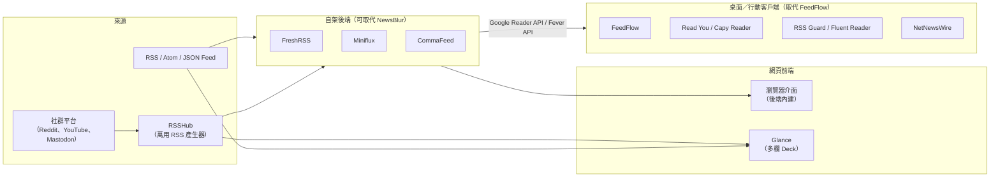
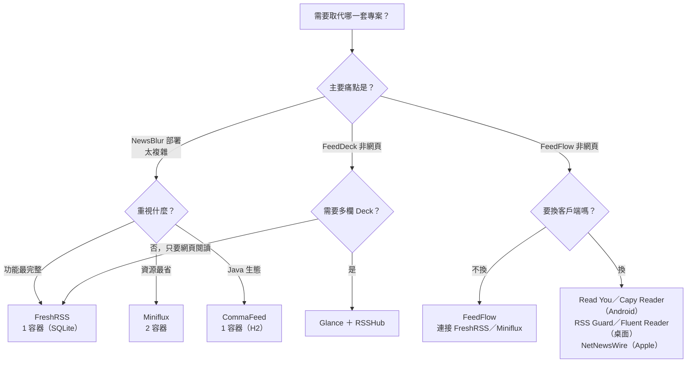

# 三套 RSS 閱讀器專案的 FOSS 替代方案調查

本報告針對三個既有的自由開源軟體（FOSS）RSS 閱讀器專案，尋找可替代的方案，並特別考量兩項限制條件：其一，部分專案並非以網頁為基礎（non-web based）；其二，其中一套專案的 Docker 部署過於複雜。

---

## 摘要

RSS 閱讀器生態可分為三層：**後端聚合服務**（負責抓取與儲存訂閱內容）、**網頁前端**（瀏覽器介面）、以及**桌面／行動客戶端**（原生或跨平台應用）。三套被調查的專案分別落在不同層：

- **FeedDeck** 是一套多欄（TweetDeck 風格）的跨平台前端，同時具備網頁版本。
- **NewsBlur** 是一套完整的自架後端＋網頁前端，並附有原生行動應用。
- **FeedFlow** 是一套純客戶端應用，本身不含伺服器，但可連接多種自架後端。

因此「替代方案」的答案並非單一專案，而是一組**後端 ＋ 客戶端的組合**。

**核心建議：**

| 需求情境 | 建議組合 | 理由 |
|---|---|---|
| 取代 NewsBlur（完整功能、部署簡單） | **FreshRSS** | 單容器（SQLite）即可啟動，多使用者、全文檢索、擴充套件生態最完整 |
| 取代 NewsBlur（極簡、資源佔用最低） | **Miniflux** | 2 容器（本體＋PostgreSQL），Go 單一執行檔，自動遷移資料庫 |
| 取代 FeedDeck（多欄 Deck 介面） | **Glance** ＋ **RSSHub** | Glance 原生支援多欄儀表板佈局；RSSHub 補足社群媒體來源 |
| 取代 FeedFlow（跨平台純客戶端） | **FeedFlow 本身**＋自架後端 | FeedFlow 仍活躍維護，可直接連 FreshRSS／Miniflux，無須更換 |

---

## 1. 背景：三套被調查的專案

### 1.1 FeedDeck

FeedDeck 是一套開源的 RSS 與社群媒體閱讀器，設計靈感來自 TweetDeck，採用多欄（deck）式版面，可同時追蹤 RSS、社群平台、播客、YouTube 與 GitHub 動態[^feeddeck-repo]。它以 Flutter 撰寫，後端使用 Supabase 與 Deno，官方宣稱在行動、桌面與網頁之間有接近 100% 的程式碼共用[^feeddeck-repo]。採 MIT 授權，GitHub 星數約 318[^feeddeck-repo]。最新版本為 v1.4.1，發佈於 2024-08-07[^feeddeck-releases]。

**限制**：此專案並非以網頁為基礎（其架構為 Flutter 跨平台前端搭配 Supabase 後端）。

### 1.2 NewsBlur

NewsBlur 是一套個人新聞閱讀器，具備社群功能與「智慧篩選」（可訓練系統依作者、標籤、標題、來源自動標亮或隱藏文章）[^newsblur-repo]。採 MIT 授權，GitHub 星數約 7,700[^newsblur-repo]。後端為 Django（Python）搭配 Backbone.js 前端，並有原生 iOS、macOS、Android 應用[^newsblur-repo]。

**限制**：Docker 部署過於複雜。其 `docker-compose.yml` 需要 **11 個以上容器**，包含 4 種資料儲存（PostgreSQL、MongoDB、Redis、Elasticsearch）以及 Celery 背景工作者、Node.js 服務、影像代理、HAProxy 與 Nginx[^newsblur-compose][^newsblur-selfhost]。自架者普遍反映安裝困難、網域設定繁瑣、登入 Cookie 網域不一致、說明文件不足等問題[^newsblur-issue946][^newsblur-forum7140][^newsblur-blog]。

### 1.3 FeedFlow

FeedFlow 是一套極簡的開源 RSS 閱讀器，特色是依發佈時間排序、無帳號、無演算法[^feedflow-repo]。採 Apache 2.0 授權，GitHub 星數約 1,300[^feedflow-repo]。支援 Android、iOS、macOS、Windows、Linux，但**沒有網頁版**（官方說明是因為瀏覽器需要伺服器代理抓取來源）[^feedflow-repo]。最新版本 v1.21.0，發佈於 2026-11-10[^feedflow-repo]。

**限制**：非網頁為基礎。但值得注意的是，FeedFlow 本身即為「純客戶端」，可連接本地儲存、雲端硬碟（iCloud／Dropbox／Google Drive），或自架的 FreshRSS、Miniflux 等服務[^feedflow-repo]。

---

## 2. 架構觀點：替代方案的組合關係

RSS 自架生態的典型組合關係如下圖。後端負責抓取與儲存，網頁前端提供瀏覽器介面，桌面與行動客戶端則透過 Google Reader API 或 Fever API 連接後端。

---

## 3. 後端聚合服務（NewsBlur 的替代方案）

以下各專案皆為網頁為基礎、可自架、並提供行動客戶端可用的 API。

### 3.1 對照總表

| 專案 | 授權 | 星數 | 最新版本（日期） | 語言／技術 | 最小容器數 |
|---|---|---|---|---|---|
| **FreshRSS** | AGPL-3.0 | 16.6k | v1.30.4（2026-10-21） | PHP 8.2+ | **1**（SQLite） |
| **Miniflux** | Apache-2.0 | 9.9k | v2.3.5（2026-11-01） | Go 單一執行檔 | **2**（＋PostgreSQL） |
| **CommaFeed** | Apache-2.0 | 3.6k | v7.4.1（2026-10-22） | Java／Quarkus | **1**（H2 內嵌） |
| **Tiny Tiny RSS** | GPL-3.0 | 884（社群分支） | 滾動發佈（無正式版號） | PHP | **4** |
| **yarr** | MIT | 4.1k | v2.9（2026-09-07） | Go 單一執行檔 | 無官方映像 |
| **Fusion** | MIT | 2.4k | v1.3.0（2026-10-07） | Go ＋ React | **1**（SQLite） |
| **Sismics Reader** | GPL-2.0 | 409 | v1.5（2026-03-20） | Java／Jetty | **2** |
| **RSSMonster** | MIT | 579 | v2.3.0（2026-09-09） | Node.js／Vue | **1**（SQLite 模式） |
| **Feeds Fun** | BSD-3-Clause | 399 | v1.29.4（2026-10-22） | Python／FastAPI ＋ Vue | **4** |
| **selfoss** | GPL-3.0 | 2.5k | 2.19（2026-10-12） | PHP | 無官方映像 |

### 3.2 FreshRSS

FreshRSS 是一套可自架、輕量、可自訂、多使用者的 RSS 聚合器，支援 20 種以上語言[^freshrss-repo]。採 AGPL-3.0 授權，星數約 16,600，最新版本 v1.30.4（2026-10-21）[^freshrss-repo]。

**部署**：預設 `docker-compose.yml` 僅定義 **1 個服務**，內建 SQLite，無需外部資料庫；若要使用 PostgreSQL／MySQL／MariaDB，則需第 2 個容器[^freshrss-docker]。支援 `linux/amd64`、`linux/arm64`、`linux/arm/v7`[^freshrss-docker]。

**功能**：多使用者與匿名閱讀、標籤、WebSub 即時推送、以 XPath 抓取無 RSS 的網站、全文檢索（支援正規表達式）、擴充套件系統、CLI 自動化、OPML 匯入匯出[^freshrss-repo]。

**API 與客戶端**：提供 **Google Reader API**（功能完整）與 **Fever API**（功能較有限）；官方列出的相容客戶端涵蓋 Android（Capy Reader、Readrops、FeedMe、Read You、FeedFlow 等）、iOS／macOS（NetNewsWire、Vienna RSS、Readkit、Unread、Fiery Feeds 等）與桌面（Fluent Reader、RSS Guard、NewsFlash）[^freshrss-repo]。

### 3.3 Miniflux

Miniflux 2 自稱「極簡且具主見的訂閱閱讀器」，以 Go 撰寫、編譯為單一靜態執行檔[^miniflux-repo]。採 Apache-2.0 授權，星數約 9,900，最新版本 v2.3.5（2026-11-01）[^miniflux-repo][^miniflux-releases]。

**部署**：官方基本 `docker-compose` 僅需 **2 個服務**（`miniflux/miniflux` 本體與 `postgres:18`）[^miniflux-compose]。啟動時可透過 `RUN_MIGRATIONS=1` 自動遷移資料庫、`CREATE_ADMIN=1` 自動建立管理員[^miniflux-compose]。預設輪詢間隔 1 小時，尊重 `Last-Modified`、`ETag` 等標頭[^miniflux-repo]。

**功能**：PostgreSQL 全文檢索、OPML 匯入匯出、Readability 內容擷取、以 CSS 選擇器自訂抓取規則、正規表達式過濾、移除追蹤像素與 `utm_*` 參數、媒體代理、封鎖外部 JavaScript 等隱私保護[^miniflux-repo]。

**API 與客戶端**：提供 REST API（`/v1/`）、Fever API 與 Google Reader API 三種機制[^miniflux-repo]。值得注意的是 **Miniflux 僅支援 PostgreSQL**，不支援 SQLite[^miniflux-repo]。

### 3.4 CommaFeed

CommaFeed 是一套受 Google Reader 啟發的自架個人 RSS 閱讀器，以 Quarkus（Java）撰寫並可編譯為原生執行檔，前端為 React ＋ TypeScript[^commafeed-repo]。採 Apache-2.0 授權，星數約 3,600，最新版本 v7.4.1（2026-10-22）[^commafeed-repo]。

**部署**：預設內嵌 H2 資料庫，**1 個容器**即可運行；亦可改用 PostgreSQL、MySQL、MariaDB[^commafeed-repo]。提供 Linux／Windows 的預編譯原生執行檔[^commafeed-repo]。

**功能**：4 種版面、淺色／深色主題、鍵盤快捷鍵、RTL 支援、自訂 CSS／JS、以視覺化查詢建構器設定自動標記已讀規則、ntfy／Gotify／Pushover 推播通知、搜尋（含已加星文章）[^commafeed-repo]。

**API 與客戶端**：支援 REST API、Fever API，以及自 v7.3.0（2026-08）起新增的 Google Reader API[^commafeed-repo]。

### 3.5 Tiny Tiny RSS（社群分支）

Tiny Tiny RSS 是歷史悠久的網頁 RSS 閱讀器，採 GPL-3.0 授權[^ttrss-repo]。須注意**原始專案已於 2025-11-01 退休**，目前由社群分支（`tt-rss/tt-rss`）接手維護，星數約 884[^ttrss-repo]。

**部署**：`docker-compose.yml` 需要 **4 個服務**（PostgreSQL、PHP 應用、背景 updater、Nginx），且該檔明確標示為簡化的本地開發配置，不具資料持久化[^ttrss-compose]。**在部署複雜度上並非 NewsBlur 的良好替代方案。**

**功能**：多使用者、巢狀分類、標籤、內容過濾與評分、外掛系統、TOTP 兩階段驗證、產生的 Feed、每日／每週摘要郵件[^ttrss-repo]。提供 JSON API 與多個第三方客戶端[^ttrss-repo]。

### 3.6 其他值得注意的後端

- **Fusion（2.4k 星，MIT，v1.3.0／2026-10-07）**：Go ＋ React 的輕量閱讀器，單一執行檔或 1 個 Docker 容器（SQLite），支援 Fever API 與 OIDC，明確「設計上不含 AI 功能」[^fusion]。但**不支援多欄 Deck 佈局與社群來源**[^fusion]。
- **yarr（4.1k 星，MIT，v2.9／2026-09-07）**：Go 單一執行檔，可作為桌面應用或自架伺服器，SQLite／PostgreSQL、全文檢索、Fever API、可安裝為 PWA[^yarr]。但**無官方 Docker 映像，且僅支援單一使用者**，不適合作為多使用者的 NewsBlur 替代[^yarr]。
- **Feeds Fun（399 星，BSD-3-Clause，1.29.4／2026-10-22）**：以 LLM 自動指派標籤並依標籤評分排序的閱讀器，可整合 OpenAI／Gemini 或相容 API[^feedsfun]。部署需 PostgreSQL、後端 API、workers、前端等 **4 個以上服務**，多使用者情境還需 OIDC IdP，複雜度不低[^feedsfun]。
- **Sismics Reader（409 星，GPL-2.0，v1.5／2026-03-20）**：Java／Jetty，REST API、Lucene 全文檢索、多使用者、原生 Android 應用；Docker 部署為 2 個容器（web ＋ HSQLDB）[^sismics]。
- **RSSMonster（579 星，MIT，v2.3.0／2026-09-09）**：Node.js ＋ Vue，可用 SQLite 模式單容器運行，支援 Fever API 與 Google Reader API[^rssmonster]。
- **selfoss（2.5k 星，GPL-3.0，2.19／2026-10-12）**：經典 PHP 閱讀器，支援 SQLite／MySQL／PostgreSQL，具 Twitter、Reddit、YouTube 等 Spout 系統；但**無官方 Docker 映像**，需自行準備 PHP 環境[^selfoss]。
- **不建議使用**：Winds 已於 2021-10-12 封存（archived）[^winds]；Moonmoon、Kriss Feed 皆已幾近停止維護[^moonmoon][^kriss]。

---

## 4. 多欄／Deck 佈局（FeedDeck 的替代方案）

FeedDeck 的核心價值在於「多欄儀表板」與「RSS ＋ 社群來源混合」。完整重現此體驗需要兩個元件：一個多欄佈局前端，以及一個將社群平台轉為 RSS 的橋接服務。

### 4.1 Glance

Glance 是一套自架儀表板，將各種來源彙整於單一可自訂介面[^glance]。採 AGPL-3.0 授權，星數約 38,200，最新版本 v0.8.8（2026-11-07）[^glance]。以 Go 撰寫，可編譯為單一執行檔或使用 Docker 映像，相依極少[^glance]。

**關鍵優勢**：設定檔採用 **columns 為基礎的佈局**，每個頁面可有多個欄位，欄位尺寸可設為 `small` 或 `full`[^glance]。內建多種與 Feed 相關的 widget，包含 `rss`、`reddit`、`hacker-news`、`lobsters`、`videos`（YouTube）、`twitch-channels`、`releases`（GitHub）等[^glance]。這是最接近 FeedDeck 多欄體驗的自架方案。

**限制**：Glance 是資訊儀表板而非完整的閱讀器，文章以 widget 摘要呈現，閱讀狀態管理與訂閱管理能力不若 FreshRSS／Miniflux。

### 4.2 RSSHub（社群來源橋接）

RSSHub 自稱「全球最大的 RSS 網路」，可為本身不提供 RSS 的網站與平台產生 RSS，涵蓋 Twitter／X、YouTube、Reddit、Telegram、Mastodon、Instagram、TikTok 等[^rsshub]。採 AGPL-3.0 授權，星數約 47,000，版本採日期標記（如 `v2026.11.14`）[^rsshub]。

**部署**：單一容器即可啟動（`docker run -d -p 1200:1200 diygod/rsshub`）；官方推薦的 `docker-compose` 則額外包含 Redis 與 Browserless（Chromium）[^rsshub]。實際做法是產生對應路由網址（例如 `/youtube/user/:username`、`/reddit/:subreddit`），再將該網址加入任何 RSS 閱讀器或 Glance[^rsshub]。

### 4.3 Folo（參考：非自架）

Folo（前稱 Follow）是一套 AI RSS 閱讀器，同時整合 RSS 與社群來源（X／Twitter、Bluesky、Threads、YouTube 等），星數約 39,300，採 AGPL-3.0，桌面版 v1.17.0 發佈於 2026-11-02[^folo]。與 RSSHub 同屬 RSSNext 組織並深度整合[^folo]。

**限制**：Folo 的小說法為**單欄時間軸**，並非多欄 Deck 佈局；且目前**沒有文件化的自架支援**，後端由官方代管，星數雖高但不符「FOSS 自架」的需求[^folo]。

---

## 5. 桌面／行動客戶端（FeedFlow 的替代方案）

### 5.1 首先：FeedFlow 本身不需更換

FeedFlow 仍活躍維護（v1.21.0／2026-11-10），支援本地儲存、雲端硬碟（iCloud／Dropbox／Google Drive）與自架後端（FreshRSS、Miniflux）三種同步模式[^feedflow-repo]。若限制是「非網頁」，則搭配一個自架後端即可在不更換客戶端的前提下取得網頁存取能力。

### 5.2 可連接自架後端的客戶端對照

| 客戶端 | 授權 | 星數 | 平台 | 最新版本（日期） | 支援後端 |
|---|---|---|---|---|---|
| **NetNewsWire** | MIT | 10.5k | macOS、iOS | 2026-11-12 | FreshRSS、Miniflux、TT-RSS、Feedbin、NewsBlur 等 |
| **Fluent Reader** | BSD-3-Clause | 9.8k | Windows、macOS、Linux | v1.3.2（2026-10-29） | FreshRSS、Miniflux、Fever、Google Reader API 等 |
| **Read You** | GPL-3.0 | 7.7k | Android | v0.16.2（2026-06-03） | FreshRSS、Miniflux、TT-RSS、Fever、Google Reader API 等 |
| **RSS Guard** | GPL-3.0 | 2.8k | Windows、Linux、BSD、macOS | v5.3.0（2026-11-12） | FreshRSS、Miniflux、Nextcloud News、TT-RSS 等 |
| **Vienna RSS** | Apache-2.0 | 2.0k | macOS | 3.10.8（2026-07-19） | FreshRSS、BazQux、Inoreader、The Old Reader |
| **NewsFlash** | GPL-3.0 | 約 1.8k | Linux（GNOME） | v5.2.5（2026-08-01） | FreshRSS、Miniflux、Fever、Feedbin |
| **Capy Reader** | GPL-3.0 | 1.5k | Android | 2026.11.1217（2026-11-10） | Feedbin、FreshRSS、Miniflux、Google Reader API |

以上星數與版本資訊來源分別為各專案的 GitHub 頁面與發佈頁[^nnw][^fluent][^readyou][^rssguard][^vienna][^newsflash][^capy]。

**注意**：經常被列為 macOS／iOS 選項的 **Reeder** 與 **lire** 皆為**專有軟體**，並非 FOSS，因此不符本調查的替代條件[^amy-note]。

---

## 6. 決策指引

### 6.1 若目標是取代 NewsBlur

**首選 FreshRSS**：它是功能面最接近 NewsBlur 的自架方案，同時擁有相對簡單的部署。官方 Docker Compose 在 SQLite 模式下**只需 1 個容器**，無需外部資料庫[^freshrss-docker]；具備多使用者、全文檢索、擴充套件與 20 個以上相容客戶端[^freshrss-repo]。相較 NewsBlur 的 11 個以上容器與 4 種資料儲存[^newsblur-compose]，複雜度大幅降低。

**次選 Miniflux**：若優先考量資源佔用與維運簡潔，Miniflux 的 2 容器配置與 Go 單一執行檔是最輕量的選擇[^miniflux-compose]；代價是僅支援 PostgreSQL、無擴充套件系統[^miniflux-repo]。

**注意 Tiny Tiny RSS**：它需要 4 個容器，且原始專案已於 2025-11-01 退休[^ttrss-repo][^ttrss-compose]，就「取代複雜部署」這個目標而言並不理想。

### 6.2 若目標是取代 FeedDeck

FeedDeck 的兩個特性（多欄 Deck 佈局、RSS 混社群來源）需分別處理：

- **多欄佈局**：Glance 的 columns 設定與多種 feed widget 最接近[^glance]。
- **社群來源**：以 RSSHub 產生對應 RSS 後餵入 Glance 或任何後端[^rsshub]。

若可接受單欄時間軸，Folo 整合了 RSS 與社群來源[^folo]，但目前無自架方案，故不符 FOSS 自架條件。

### 6.3 若目標是取代 FeedFlow

FeedFlow 本身仍活躍且已支援自架後端，通常**無須更換**[^feedflow-repo]。若需要替代品，Android 可選 Read You 或 Capy Reader，桌面可選 RSS Guard 或 Fluent Reader，Apple 生態則以 NetNewsWire 為標準[^nnw][^fluent][^readyou][^capy]。

---

## 7. 來源品質與限制說明

- **時效性**：本報告所有數據擷取於 2026-11-14。星數與版本號變動頻繁，尤其 RSSHub 採每日建置、Capy Reader 採每週多次發佈，讀者應以官方頁面為準。
- **星數的解讀**：星數僅反映社群關注度，不等同於品質或維護活躍度。例如 yarr 有 4.1k 星但不支援多使用者與官方 Docker[^yarr]；Tiny Tiny RSS 星數偏低是因為原專案已退休、社群分支接手較晚[^ttrss-repo]。
- **維護狀態的判斷依據**：本報告以「最新版本發佈日期」與「專案是否封存」作為主要判準。Winds 已明確封存[^winds]，Moonmoon 與 Kriss Feed 缺乏近期活動[^moonmoon][^kriss]，已排除於推薦之外。
- **未實地驗證**：本報告未實際部署任何一套專案；容器數量係依據各地專案官方 `docker-compose.yml` 的服務定義統計，實際生產環境可能還需加上反向代理（如 Caddy、Traefik）與憑證管理。
- **無法確認的項目**：Tiny Tiny RSS 社群分支與 yarr 皆採滾動發佈、無正式版本號[^ttrss-repo][^yarr]；NewsFlash 位於 GitLab，星數無法以相同方式精確取得[^newsflash]。

---

## 參考文獻

[^feeddeck-repo]: FeedDeck. (n.d.). *FeedDeck: Open source RSS & social media feed reader*. GitHub. Retrieved 2026-11-14, from https://github.com/feeddeck/feeddeck

[^feeddeck-releases]: FeedDeck. (2024, August 7). *FeedDeck v1.4.1*. GitHub Releases. Retrieved 2026-11-14, from https://github.com/feeddeck/feeddeck/releases

[^newsblur-repo]: Clay, S. (n.d.). *NewsBlur: A personal news reader*. GitHub. Retrieved 2026-11-14, from https://github.com/samuelclay/NewsBlur

[^newsblur-compose]: Clay, S. (n.d.). *docker-compose.yml*. NewsBlur. GitHub. Retrieved 2026-11-14, from https://github.com/samuelclay/NewsBlur/blob/master/docker-compose.yml

[^newsblur-selfhost]: Macklin. (n.d.). *My experience with self-hosting NewsBlur*. Retrieved 2026-11-14, from https://www.macklin.co/my-experience-with-self-hosting-newsblur/

[^newsblur-issue946]: NewsBlur community. (n.d.). *Issue #946: Installing NewsBlur locally*. GitHub Issues. Retrieved 2026-11-14, from https://github.com/samuelclay/NewsBlur/issues/946

[^newsblur-forum7140]: NewsBlur Forum. (2024). *Self-hosting documentation*. Retrieved 2026-11-14, from https://forum.newsblur.com/t/self-hosting-documentation/7140

[^newsblur-blog]: Straw Dog. (n.d.). *NewsBlur 101248 guide*. Retrieved 2026-11-14, from https://www.straw-dog.com/en/articles/newsblur-101248-guide

[^feedflow-repo]: prof18. (n.d.). *FeedFlow: Minimalistic RSS Reader*. GitHub. Retrieved 2026-11-14, from https://github.com/prof18/feed-flow

[^freshrss-repo]: FreshRSS. (n.d.). *FreshRSS: A free, self-hostable feed aggregator*. GitHub. Retrieved 2026-11-14, from https://github.com/FreshRSS/FreshRSS

[^freshrss-docker]: FreshRSS. (n.d.). *Docker README*. FreshRSS. GitHub. Retrieved 2026-11-14, from https://github.com/FreshRSS/FreshRSS/blob/edge/Docker/README.md

[^miniflux-repo]: Guillot, F. (n.d.). *Miniflux 2: Minimalist and opinionated feed reader*. GitHub. Retrieved 2026-11-14, from https://github.com/miniflux/v2

[^miniflux-releases]: Guillot, F. (2026, November 1). *Miniflux releases*. Retrieved 2026-11-14, from https://miniflux.app/releases.html

[^miniflux-compose]: Guillot, F. (n.d.). *contrib/docker-compose/basic.yml*. Miniflux v2. GitHub. Retrieved 2026-11-14, from https://github.com/miniflux/v2/blob/main/contrib/docker-compose/basic.yml

[^commafeed-repo]: Athou. (n.d.). *CommaFeed: Google Reader inspired self-hosted RSS reader*. GitHub. Retrieved 2026-11-14, from https://github.com/Athou/commafeed

[^ttrss-repo]: tt-rss community. (n.d.). *Tiny Tiny RSS*. GitHub. Retrieved 2026-11-14, from https://github.com/tt-rss/tt-rss

[^ttrss-compose]: tt-rss community. (n.d.). *docker-compose.yml*. Tiny Tiny RSS. GitHub. Retrieved 2026-11-14, from https://github.com/tt-rss/tt-rss/blob/main/docker-compose.yml

[^fusion]: 0x2E. (n.d.). *Fusion: A lightweight RSS reader*. GitHub. Retrieved 2026-11-14, from https://github.com/0x2E/fusion

[^yarr]: Kanaev, N. (n.d.). *yarr: yet another rss reader*. GitHub. Retrieved 2026-11-14, from https://github.com/nkanaev/yarr

[^feedsfun]: Yaletski, A. (n.d.). *Feeds Fun: Self-hosted news reader with LLM-powered tagging*. GitHub. Retrieved 2026-11-14, from https://github.com/Tiendil/feeds.fun

[^sismics]: Sismics. (n.d.). *Sismics Reader: Free and open source RSS reader*. GitHub. Retrieved 2026-11-14, from https://github.com/sismics/reader

[^rssmonster]: Strengholt, P. (n.d.). *RSSMonster*. GitHub. Retrieved 2026-11-14, from https://github.com/pietheinstrengholt/rssmonster

[^selfoss]: fossar. (n.d.). *selfoss: The web based news reader*. GitHub. Retrieved 2026-11-14, from https://github.com/fossar/selfoss

[^winds]: GetStream. (2021, October 12). *Winds* [Archived repository]. GitHub. Retrieved 2026-11-14, from https://github.com/GetStream/Winds

[^moonmoon]: Moonmoon. (n.d.). *Moonmoon: A simple feed aggregator*. GitHub. Retrieved 2026-11-14, from https://github.com/moonmoon/moonmoon

[^kriss]: tontof. (n.d.). *Kriss Feed: A simple and smart feed reader*. GitHub. Retrieved 2026-11-14, from https://github.com/tontof/kriss_feed

[^glance]: Glance. (n.d.). *Glance: A self-hosted dashboard that puts all your feeds in one place*. GitHub. Retrieved 2026-11-14, from https://github.com/glanceapp/glance

[^rsshub]: DIYgod. (n.d.). *RSSHub: Everything is RSSible*. GitHub. Retrieved 2026-11-14, from https://github.com/DIYgod/RSSHub

[^folo]: RSSNext. (n.d.). *Folo: An open-source AI RSS reader*. GitHub. Retrieved 2026-11-14, from https://github.com/RSSNext/Folo

[^nnw]: Ranchero Software. (n.d.). *NetNewsWire*. GitHub. Retrieved 2026-11-14, from https://github.com/Ranchero-Software/NetNewsWire

[^fluent]: yang991178. (n.d.). *Fluent Reader: A modern desktop RSS reader*. GitHub. Retrieved 2026-11-14, from https://github.com/yang991178/fluent-reader

[^readyou]: ReadYouApp. (n.d.). *Read You: An Android RSS reader*. GitHub. Retrieved 2026-11-14, from https://github.com/ReadYouApp/ReadYou

[^rssguard]: rotter, M. (n.d.). *RSS Guard*. GitHub. Retrieved 2026-11-14, from https://github.com/martinrotter/rssguard

[^vienna]: ViennaRSS. (n.d.). *Vienna RSS*. GitHub. Retrieved 2026-11-14, from https://github.com/ViennaRSS/vienna-rss

[^newsflash]: NewsFlash. (n.d.). *NewsFlash: A feed reader for GNOME*. GitLab. Retrieved 2026-11-14, from https://gitlab.com/news-flash/news_flash_gtk

[^capy]: Meyers, J. (n.d.). *Capy Reader: A small Android RSS reader*. GitHub. Retrieved 2026-11-14, from https://github.com/jocmp/capyreader

[^amy-note]: Reeder 與 lire 為專有商業軟體，無公開原始碼儲存庫，故不列為 FOSS 替代方案。
